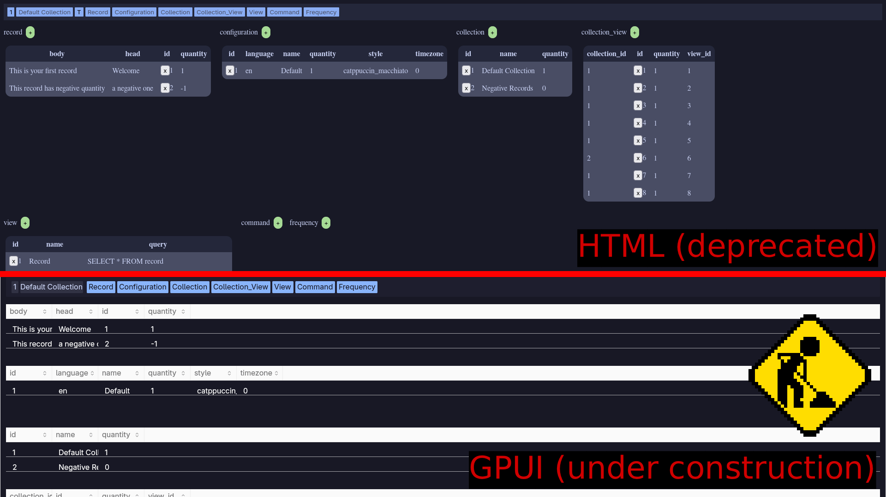

<p align=center>


</p>



# Lince

Tool for registry, interconnection and automation of Needs and Contributions with open scope.

The documentation for the Lince tool is inside the app.

# Usage

> Hic sunt dracones.

You can download the latest release binary from the builds, or if you want to compile yourself:

```bash
cargo run
```

Native plugins are developed in the [Lince plugins repository](https://github.com/lince-social/plugins).
To build and install them from source, clone it as `../plugins` alongside this checkout and follow its setup instructions.

# Disclaimer

Lince is a non-profit project and crowdfunding is the source of development compensation: [Patreon](https://www.patreon.com/lince_social).

Lince tries to facilitate and automate the connection between people and resources, by transforming needs and contributions into data.
The gains and losses related to the interaction, such as transportation, production and services themselves, remain the responsibility
and risk of the parties involved.

Lince embeds required licenses of dependencies, check in the Interface on the License tab in edit mode.

# License

[MIT](LICENSE)
