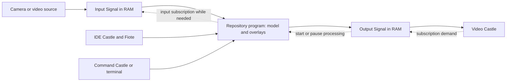

# Remaining work: computer vision through existing development tools

Task 1 is implemented. Its runtime and wire contract are documented in [Live-signals.md](Live-signals.md). This plan retains Task 2 and the deferred extensions; it does not declare the model workflow implemented.

The completed foundation passed cargo checks for the engine, Facade, and native Sandbox, including test code. Targeted acceptance passed five engine streaming tests, two Facade integration tests, five native Video Castle tests, and seven migration-guard tests. The native tests use isolated Bevy fixtures; a real camera and a rendered production session were not exercised.

## Task 2: Computer vision through existing development tools

The lab is a workflow composed from the IDE Castle, Command Castle/terminal, Fiote, and Video Castle. The model backend is an ordinary program in a repository. It reads input frames, applies a model, draws boxes or other results, and publishes output frames to another memory-only Signal.

Lince supplies the generic stream contract and viewers. The repository supplies model loading, inference, overlay rendering, model dependencies, and any training logic. There is no requirement for a dedicated Computer Vision Lab Castle.

### Demand must flow through processing

The program registers as the output Signal's producer and waits for output demand. A visible Video Castle creates that demand. The program then subscribes to the input Signal, which starts its source. When output demand ends, the program stops processing and releases the input subscription. This stops unused camera streams even if the model program remains running in the terminal.

Several output viewers share the same worker output. A directly viewed raw input keeps the camera active independently. If the worker crashes, its input lease expires and the output reports unavailable. A lost demand subscription must pause the worker rather than leave it consuming forever. Bound in-flight inference and drop obsolete input frames; a model that cannot cancel an inference can finish it and discard the obsolete result.

For the initial example, use one input and one output and prevent self-subscription. More complex derived-stream graphs would need cycle detection and explicit demand ownership; they are unnecessary for this demonstration.

### What to build

Provide a documented protocol and a small runnable reference producer/consumer in repository-supported tooling. Start with a deterministic overlay, then use an actual chosen model to prove that inference output reaches Video Castle. The example should demonstrate credentials, waiting for demand, frame validation, timestamp propagation, output publication, pause/resume, and graceful shutdown. Run it through cargo xtask or the project's Nix environment; do not require Node.js.

Carry input epoch and sequence through each output frame so the viewer can identify latency and avoid mixing results from different frames. The first version can bake boxes and labels into the output image. Sending detections separately for editable native overlays is optional later work, not necessary to see a model working.

Use the existing IDE to edit the repository, existing terminal to run its command, and Fiote to help change code through its existing authorized tools. Check that these tools can complete the example and fix concrete gaps if encountered. Avoid inventing a new model process manager when launching a program in the existing terminal is sufficient.

### What this does not require

| Feature | Scope decision |
| --- | --- |
| Dedicated computer vision lab Castle | Unnecessary; compose existing Castles |
| Training engine, model registry, GPU scheduler | Owned by the chosen program or future requirements |
| A built-in detector or support for every model | Choose one demonstration model; keep the transport model-agnostic |
| Native bounding-box editor | Optional; annotated frames already show inference |
| Continuous inference while no consumer exists | Off by default; an explicit future headless consumer can request demand |
| Video recording and persistent inference history | Separate explicit features |
| Gaussian reconstruction, low polygon conversion, scene reconciliation | Deferred separate tasks; they may later consume the same streams |
| Automatic Record location changes or moving Areas | Deferred; viewing inference does not authorize these effects |
| Flying from a camera pose through a reconstructed building | Deferred spatial feature |
| Camera discovery and every camera/network protocol | Start with the supported WebSocket producer/source contract; add specific adapters when requested |

### Sequential implementation and acceptance

1. Use the implemented volatile streaming and Video Castle contracts; add the optional input provenance fields needed to correlate results with source frames.
2. Publish the small protocol reference/example and verify a deterministic annotated stream end to end.
3. Run one actual model from a repository using IDE, terminal, and Fiote; display both input and processed output with Video Castles.
4. Close the output viewer and verify processing stops and its input subscription is released. Reopen it and verify fresh input/output epochs, bounded memory, and visible model errors. Verify source timestamps correlate outputs and slow inference never creates an unbounded backlog.

The decisive acceptance scenario is editing a detector, running it from Command Castle, opening its output Signal in Video Castle, seeing live boxes, closing the Castle to stop consumption, and reopening it to resume. No 3D reconstruction is needed to pass it.

## Deferred extensions

Task 1 supports live canonical decimal and JPEG values, a raw WebSocket upstream source, and GIF file playback. These extensions remain outside the completed scope:

- MP4, audio tracks, inter-frame video codecs, and additional file containers. The repository had no general file video decoder to reuse; the initial native file path uses the existing image library's GIF decoder.
- Additional frame/data types, a native editable detection overlay, and typed input provenance for processed frames. The current envelope carries the publishing stream's epoch, sequence, capture time, and content type. Task 2 should add optional input Signal/epoch/sequence fields when demonstrating correlated model output.
- Authenticated upstream source headers, camera discovery, RTSP/other camera adapters, and private-network/VPS routing. Producer publication already uses scoped Signal endpoint credentials; program consumers use an authorized Facade login.
- Explicit recording/export, durable inference history, and stricter host-level storage guarantees. Live values themselves have no intentional application persistence.
- Reconstruction, low polygon conversion, Gaussian surface representations, object identity across scenes, Record/Area reconciliation, and navigation from a physical camera pose through a reconstructed building.

The next implementation should provide a runnable repository program, begin with a deterministic overlay to prove demand propagation, and then use one chosen model. Use the existing Castles and the implemented Signal protocol rather than creating a dedicated lab or a second stream runtime.
