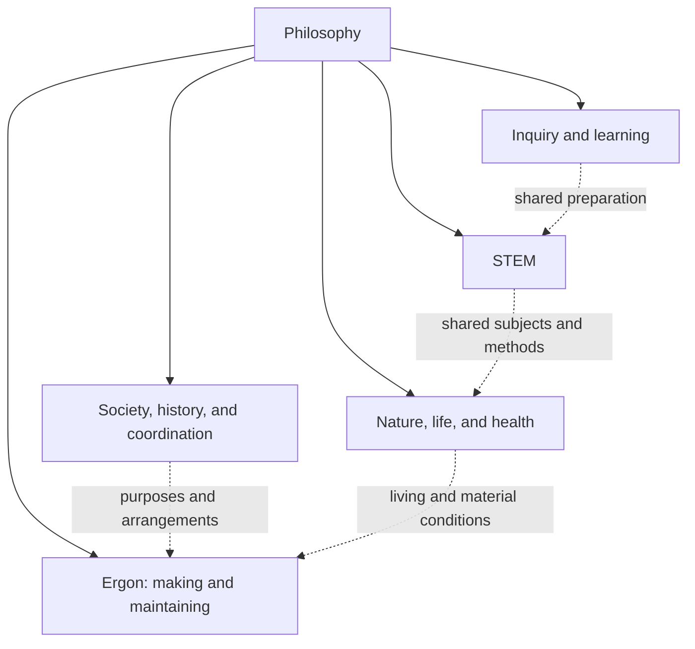

# Ergon — Connected knowledge and Trails

Blueprint for refinement, 2026-10-25. Re-architected around Philosophy, overlapping navigation maps, shared preparation, and coherent routes chosen for particular purposes. Selected books and articles provide much of the substance, joined by concise original explanations. Some material is published through the Institute and some remains at other sources. The creation register and subject placements below are a concrete source-authoring plan for refinement. Relationships are text, links, and references; imports serve discovery/composition for reading. The current delivery excludes extra features and creation of Symbiote/Cell data. Editing this blueprint does not create its source Records, publish content, or complete a delivery stage.

## 1. The outcome

Join knowledge across STEM and the global infrastructure that sustains it into one navigable body for many purposes: understanding, proving, investigating, making, operating, repairing, and improving. Include the work that reproduces knowledge itself: teaching, observation, experimentation, instrument making, calibration, publication, preservation, and training the next practitioners.

Books, articles, manuals, specifications, datasets, and existing Trails can supply the substantive material. Author concise introductions, prerequisite explanations, cross-references, comparisons, and missing connections to make that material usable together. Original lessons or research can fill particular gaps; writing an original replacement for the STEM literature is not a prerequisite.

The Institute owns and maintains its connecting Records, source selections, and Trails, and may publish or retain source works where appropriate. Other works remain accessible from their own sources or a user's local files. The goal is a coherent experience across those origins, with the source and actual availability still visible. Prefer open material and material we can preserve, while allowing useful references to other works.

Ergon includes recurring labour. A description of a factory is incomplete without its maintenance, consumables, training, quality control, utilities, waste treatment, transport, and coordination with other producers. A science curriculum is incomplete without how its claims were established, how to question them, and how another person could investigate them.

The useful question for each part of this work is: **What would a person or group need to understand and sustain this capability, here, at this scale, over this period?** A capability might be proving a theorem, identifying a mineral, maintaining a weather station, reproducing an experiment, running a workshop, or operating a semiconductor process.

STEM is the main coverage programme, connected to Philosophy and to Nature, Society, history, economics, and geography. Those connections support independent questions as well as the work of sustaining technical society. Ergon is a view of that joined body, not a rule that every subject must end in industrial production.

The ambition is comprehensive coverage over time, across fields, levels of depth, and purposes. For a particular learning or practical route, describe the coverage and limits of that route. Keep unavailable or unexplained knowledge visible as gaps. The broad map and curated reading routes can grow before the corpus supports every practical capability.

## 2. What this inherits from Lince

The Trail Record in [Lince.lingua](Lince.lingua) describes the broader use of exported and imported Lince data, including explanations, evidence, recurrent work, Transfers, and collective improvement. This delivery takes a narrower slice of that intention: author and connect knowledge that people can discover and read through ordinary source documents. The broader data workflows remain available in Lince without becoming work required by this plan.

The current [Trail.md](Trail.md) describes ordinary linked documents, composition imports, URI references, and read-only source browsing separated from Add to Cell. Follow that distinction. Philosophy is our chosen entrance into this authored body, not a mandatory application root or a new global catalogue service.

| Material inspected | Consequence for this delivery |
| --- | --- |
| [Philosophy.lingua](../trails/philosophy/Philosophy.lingua) and [its introduction](../trails/philosophy/What-is-Philosophy.lingua) | Reuse the existing identities and navigation. Keep their existing reading schemes local; the new branches are links, not additional scored requirements. |
| [Ergon.lingua](../trails/ergon/Ergon.lingua) | Retain its discovery links and author guidance while planning the larger connected body. |
| [Basic Eletronics.lingua](../trails/ergon/computer-science/Basic%20Eletronics.lingua) | Reuse its authored explanations and sequence by reference when constructing a suitable route. |
| [Farming.lingua](../trails/health/Farming.lingua) | Reuse its descriptions of biology, locality, recurring work, and source references. |
| [Shared examples](../trails/shared/) and [Supply](../trails/habits/simple/Supply.lingua) | Link existing examples where useful to understanding. Reading them does not require creating a personal instance, activating rules, or reproducing their data workflows. |
| [Source commands](../../crates/engine/src/sources.rs) and [publication loading](../../crates/resources/src/publication/load.rs) | Opening a source and resolving explicit composition imports are separate from accepting definitions into a Cell. |
| [Resource model](../../crates/resources/src/lib.rs) and [Trail Castle](../../crates/interface/src/native/trail_castle.rs) | Use existing source, document, media, reference, and retention facilities as available. Content authoring does not add new screens or subsystems. |

These are observations from document and code inspection. No compilation or runtime verification was performed for this scope review. Preserve the actual outstanding checks in Trail.md; this document neither closes them nor extends their work into new features.

### 2.1 Current delivery contract: linked content

**Build the body as authored pages, explanations, links, and references. Relationships between Trails are navigational or explanatory content. The only import work in scope is source discovery and composition for reading; creating or instantiating Symbiote/Cell data from a Trail is outside this delivery.**

Here, “create a Trail” means write its source documents and connections. It does not mean Add to Cell, create a learner's data, instantiate a production system, or define a new runtime object.

| Intended use | Existing mechanism to use | Content to author |
| --- | --- | --- |
| Organise Philosophy, views, branches, and routes | Ordinary document and Record links; existing URI references where useful | Descriptions, selected child links, return links, and explained cross-links |
| Respect a learning ladder | Text and links at the relevant step | Named assumed abilities, why they matter, preparation, alternatives, and optional depth |
| Reuse knowledge across fields | References to the same source or explanation | A short bridge explaining common meaning and changed assumptions |
| Join Institute, external, and local sources | Direct file/URL references and supported document or media locations | Selected works, editions, attribution, access, and useful passages |
| Resolve a declaration needed while browsing | Existing explicit composition/discovery imports | Only the declarations and locations necessary for that reading context |
| Read, study, and investigate | Existing source, document, and media views | Lessons, examples, questions, exercises, methods, and evidence |
| Describe production and upkeep | Prose, diagrams, tables, and references | Inputs, work, cooperation, measurements, maintenance, and unresolved dependencies |
| Keep a selected copy | Existing file, download, retention, and portable-content workflows | A stated selection and a clear account of what is included or external |

The maps do not require a relationship engine, prerequisite scheduler, inherited completion model, new Vocabulary, automatic inverse links, new schema, or new UI. A label such as “read first”, “uses”, “upstream”, “source”, or “further study” is explanatory text accompanying a reference. It does not acquire executable semantics.

Personal instances, automated progression, Karma authoring or activation, generated Needs and Contributions, production-state creation, and Transfer instantiation are deferred from this delivery. Existing examples can be linked and studied; this work does not extend or remove their behaviour.

If a reading route exposes a limitation, record the concrete issue. Additional application features need their own scope decision. This plan does not authorise an expanding implementation programme under the label of making the content seamless.

### 2.2 Imports for discovery are separate from data import

Keep the two meanings explicit throughout delivery:

| Mechanism | Purpose here | Boundary |
| --- | --- | --- |
| Ordinary hyperlink, qualified Record reference, or existing URI assertion | Navigate to a source, branch, related route, or passage | Displaying a link does not retrieve its destination or create placeholder data; follow the link when the reader chooses it |
| Source-level `Import` | Resolve or compose declarations explicitly needed for the source being read, including locating a known Record's defining document | May retrieve declared source documents into the reading context; does not accept them into the learner's Symbiote/Cell or execute their rules |
| Add to Cell / accepted data import | Create or update database definitions and any deliberately selected personal data | A separate existing workflow; not part of this content-creation or relationship plan |
| Resource cache or selected retained files | Read or keep source bytes through ordinary facilities | File caching or retention is distinct from instantiating a Trail's records, operations, or progress in a Symbiote |

Prefer a qualified source reference for a navigational relationship. Add an import only when that document's declarations are actually needed for discovery or composition. Do not import every parent, sibling, prerequisite course, or bibliography entry to make a link visible. Provide a location for a Record identity that cannot otherwise be resolved; an opaque UID is not a universal discovery service.

Source composition can retrieve its explicit imports; ordinary related links remain links. There is no crawler, recursive bibliography ingestion, or automatic whole-body import in this plan. All five organising views and their return paths must remain usable as linked content.

Code inspection found this separation in the current implementation: source Open loads and projects readable documents, whereas the distinct Import command calls the data-import path. The existing [linked-source browsing test](../../crates/engine/tests/trail_sources.rs) contains a check that opening a child source leaves the Cell's Record count unchanged. The [composition-reference tests](../../crates/resources/tests/references.rs) cover explicit imports and unloaded navigation targets. These tests were inspected, not rerun for this Markdown-only revision.

## 3. A library, an atlas, and usable Trails

Develop three connected kinds of content, each publishable in small increments through the same ordinary features.

| Part | What it holds | What a person can do with it |
| --- | --- | --- |
| Source body and connecting text | Books, articles, manuals, existing Trails, data, designs, and other useful material, together with concise original explanations of their connections | Read the substance and understand how the selected sources fit together |
| Dependency atlas | Descriptions and references connecting concepts, claims, materials, processes, equipment, facilities, services, skills, organisations, and unresolved needs | Discover the work and infrastructure behind an outcome |
| Trails | Selected reading and learning routes, with explained prerequisites, exercises, methods, recurring-work descriptions, and cooperation examples | Learn or organise a particular capability |

Use the same concepts, source references, and connecting material in multiple routes. A passage about uncertainty can support field ecology, machining, astronomy, and electronics. A maintenance procedure can support a workshop Trail and a technician's ongoing work. Preserve a book or article as its own work and refer to useful parts without rewriting or splitting the whole work into new Records. An original Institute book is possible where useful, but is not a required output.

Keep a broad atlas and deepen selected capabilities. A map-only entry should say what remains missing. It must never look like an executable procedure simply because it has many relationships.

For each connection, explain what the reader needs from a source, which prerequisites matter, how terminology or assumptions differ between sources, and where the reader can go next. Write enough to bridge a gap. Established explanations can remain in the selected works; derivations, new lessons, or original research are added where the available material does not meet the need.

## 4. Scope across STEM and connected fields

Use this coverage grid to prevent electronics and computing from silently defining the whole project. The connected architecture in sections 4.2–4.5 supplies overlapping entrances, beginning at Philosophy. Familiar field names remain useful views, rather than an exclusive partition or an application-enforced ontology.

The [creation register in section 17](#17-connected-maps-and-trail-creation-register) proposes branch Records, route families, shared preparation, and a first creation batch. The [subject register in section 18](#18-subject-coverage-register-under-the-connected-architecture) reallocates all 200 existing scope proposals under that architecture. Their count describes the inherited inventory; it does not prescribe how many Trails to create. Future additions, divisions, combinations, and connections follow the policy below.

| Area | Knowledge and practices to cover | Infrastructure and recurring work to expose |
| --- | --- | --- |
| Mathematics | Arithmetic, algebra, geometry, analysis, discrete mathematics, logic, proof, probability, statistics, numerical methods, and later specialist branches | Education, notation, checking proofs, reference preservation, calculation tools, and computing where relevant |
| Scientific method and measurement | Observation, models, inference, experimental design, uncertainty, units, calibration, sampling, and reproducibility | Instruments, reference materials, records, laboratories, trained operators, and intercomparison |
| Physical sciences | Mechanics, heat, fluids, electromagnetism, optics, acoustics, quantum and nuclear science | Apparatus, machining, controlled environments, energy, detectors, and instrument upkeep |
| Chemistry and materials | Composition, reactions, thermodynamics, analysis, metallurgy, ceramics, polymers, glass, and material properties | Feedstocks, purification, process control, containment, analytical services, waste handling, and quality assurance |
| Life and agricultural sciences | Cell biology, genetics, evolution, ecology, physiology, microbiology, agronomy, and food systems | Field sites, collections, cultures where applicable, instruments, water, environmental control, care, and observation over time |
| Earth, environmental, and space sciences | Geology, soils, hydrology, oceans, atmosphere, climate, astronomy, and planetary science | Surveys, observatories, sampling networks, maps, sensors, reference records, and long-term monitoring |
| Engineering | Civil, mechanical, electrical, chemical, industrial, environmental, biomedical, and other engineering branches | Design, tolerances, construction, production, inspection, operation, repair, retirement, and supply networks |
| Computing and communication | Logic, algorithms, software, data, control, networks, and digital hardware | Power, equipment, component manufacture, communications links, software maintenance, storage, and recovery |
| Health and biomedical science | Anatomy, physiology, epidemiology, biomedical research, devices, and the production of medical knowledge and supplies | Laboratories, manufacturing, measurement, logistics, quality systems, and trained personnel |
| Shared material and social support | Energy, water, extraction, transport, buildings, education, food, procurement, coordination, and preservation | The people, facilities, supplies, and agreements that keep every other area functioning |

Separate logical dependence from practical support. A mathematical theorem depends logically on definitions, assumptions, and a valid proof. The people establishing and teaching it depend materially on time, education, communication, and other resources. These relationships answer different questions and should have different meanings.

Scientific research, professional practice, and introductory learning also need different routes. A reader can study the principles of an advanced process while the practical route names the facility, supervision, and other conditions required to carry it out.

### 4.1 Proposed policy for grouping knowledge, prerequisites, and exploration

This policy is a draft for refinement. The numerical ceiling is retired; the current catalogue remains available for review against the policy. Its governing proposal is: **organise Trails around useful purposes, reuse knowledge across boundaries, and require the specific foundations a selected path actually uses.**

#### 4.1.1 Boundaries are working choices

A field name is a useful way to organise attention, explanations, practices, and sources. It does not make the knowledge within that field independent of everything else. Preserve familiar names as entry points and descriptions of traditions without requiring every learner or source to belong to a single exclusive category.

Treat a grouping as a revisable claim about what is useful to learn together. Record its purpose, what it clarifies, what it leaves outside, and the connections that cross its boundary. When a new purpose, contradiction, or practical example reveals a poor boundary, revise the grouping while preserving the knowledge and distinctions it helped describe. Related subjects can still need different assumptions, methods, evidence, or depth; connectedness does not make those differences disappear.

This is an editorial policy for the Institute's connected body, not a restriction on what other people or Organs may publish as a Trail.

#### 4.1.2 Shared material, coherent routes, and broad maps

Maintain reusable explanations, source references, exercises, methods, and evidence as ordinary Records and resources. Group them where a group makes sense to read, investigate, or practise together. Do not require an independently catalogued Trail for every concept, technique, chapter, or new paper.

A Trail gives a person a coherent route for a stated purpose, with an intended audience, assumed abilities, scope, and useful result. Its content can cross several fields and reuse material from other routes. Its breadth can range from a focused practical capability to an extensive programme of study; resemblance to a degree is not a condition of being useful.

A field map or broad bundle provides orientation and recommended routes. It can include branches that a learner does not need to complete for their chosen purpose. Completing one branch does not imply completing the others, and the union of every branch's prerequisites must not become the entrance requirement for the whole bundle.

These are roles for ordinary Lince data, not additional mandatory object types. Reuse the same concept when its meaning and scope match. Preserve distinct definitions, assumptions, and perspectives when they differ, adding a bridge instead of forcing a misleading single meaning.

#### 4.1.3 General foundations with multiple entry points

Offer a general STEM orientation introducing quantities, models, evidence, uncertainty, systems, data, and the relationships between fields and productive infrastructure. It can help people choose goals and recognise what they do not yet understand. It is a suggested entry point, not a compulsory course covering everything before specialisation.

A broad education is itself a valid purpose. Someone choosing a substantial general STEM education can follow a connected curriculum across fields at an agreed depth; curiosity, theoretical understanding, and historical or philosophical inquiry can also justify routes. That breadth belongs to the chosen goal and does not become an entrance requirement for every focused route. Make connections and further exploration easy to discover without turning every possible connection into compulsory preparation.

Maintain shared foundation material that routes can draw from: arithmetic, units, ratios, tables, algebra, proof, measurement, probability, computation, and other abilities as needed. A local common foundation is justified when several intended paths actually use it. A broad engineering bundle can therefore recommend a common beginning and offer branches without making every engineering topic a prerequisite of each branch.

Choose a route from its goal and identify the abilities needed along that route. A learner can begin from relevant prior knowledge, use a short self-check if helpful, and follow the missing foundation links. Prior learning can come from another Trail, education, work, or independent practice. Attendance in one particular course is not the only way to know something.

Foundation material should explain reasons, relationships, assumptions, and limits, with practice that uses the idea in more than one suitable situation. A short route should still build meaningful understanding rather than teach only a sequence of actions that works in one example.

#### 4.1.4 Explicit and proportionate prerequisites

Describe an assumed ability at the depth needed and identify where it is used. Prefer “rearrange a linear equation and interpret its units” to “complete mathematics”, or “understand the stock balance” to “finish engineering”. Inspect the assumptions inside a referenced passage as well as its title; a source's hidden expectations need a bridge or a clearer entry condition.

| Relationship | Editorial rule |
| --- | --- |
| Needed before a step | Name the ability, required depth, and step that depends on it; link a route for learning or checking it |
| Learned alongside | Include an introduction or supporting route before the ability is used in an unexplained way |
| Recommended background | Explain how it helps without presenting it as necessary |
| Further depth | Offer a derivation, specialisation, historical connection, or upstream explanation beyond the selected outcome |
| Alternative preparation | Name the alternatives and the outcome each supports; do not imply different depths are equivalent |
| Practical conditions | Keep tools, facilities, resources, supervision, and operating conditions distinct from prerequisites for reading and understanding |

For every required prerequisite, ask what the learner could not understand or do at that point without it. If the author cannot give a concrete answer, treat it as recommended background or reconsider the requirement. The same topic may be required for one route and optional for another.

Learning relationships must not be inferred from production relationships. Understanding inventory for microchips does not require mastering their fabrication, and reading about fabrication does not require owning a fabrication facility. Link the deeper chain for investigation without silently making it a learning gate.

#### 4.1.5 Readiness, depth, and transfer

Browsing and exploration remain available. Prerequisites describe the assumptions supporting a step or accomplishment. Explain them through text and references to preparation; a self-check can be an ordinary question or exercise. This delivery does not implement locks, automatic progression, or a new evidence-state workflow.

Recognition of prior knowledge can be self-declared or supported by suitable answers, work, or other evidence under the chosen route's meaning. Explain the limits of that evidence. Understanding a balance in one context can help elsewhere, but the new context may change the quantities, assumptions, or interpretation; provide a comparison or exercise that makes that transfer explicit.

Progress belongs to a defined capability and depth, not a universal rank in a field. A learner may be advanced in one branch and need introductory material in another. Local sequences can deepen gradually: an introductory model supports an application, which motivates revisiting that model more rigorously. Replace circular demands to fully master two subjects before either can be started with explicit introductory and advanced steps or a sequence that teaches them together.

Learning research informs this proposal without prescribing one universal curriculum: the [National Research Council's account of learning and transfer](https://www.nationalacademies.org/read/9853/chapter/6) discusses initial learning, abstraction, and the active application of knowledge to new contexts. [Carnegie Mellon's learning principles](https://www.cmu.edu/teaching/principles/learning.html) emphasise prior knowledge, organisation, component skills, integration, and appropriate application. The grouping and prerequisite rules here are our proposed editorial choices.

#### 4.1.6 When to add, divide, combine, or connect

| Decision | Justification |
| --- | --- |
| Add a Trail | A useful purpose or audience needs a coherent route that existing routes do not adequately serve, including a previously neglected area |
| Divide a Trail | It contains independently useful goals with substantially different preparation, depth, practice, or next steps, and its present organisation obscures those choices |
| Combine Trails | They serve essentially the same purpose and audience with overlapping preparation and substance, and their differences work better as internal paths or alternatives |
| Connect and reuse | Different purposes benefit from shared knowledge, sources, or methods while their routes remain meaningfully distinct |
| Keep a smaller unit | The material is useful but does not yet justify an independently named route; make it discoverable within the shared body |

Shared prerequisites alone do not justify combining Trails. Different traditional department names alone do not justify separating them. Differences in preferred notation, source, or presentation can often be bridged without copying the entire body into another route. A materially different purpose or perspective can still justify an alternative Trail.

Keep excluded, deferred, or unresolved material visible as knowledge, references, or gaps. Combining entries must not delete their substance, and the absence of an independently named Trail must not make a subject disappear. Coverage matters even when the material lacks a maintainer or a complete teaching route; record that state rather than pretending it is complete or omitting it.

There is no target number, maximum number, fixed minimum size, or automatic overlap percentage. Judge each editorial decision by learner usefulness, coherent preparation and progression, meaningful coverage, reuse, and the work of keeping the route understandable. Naming a new niche is not by itself a reason to publish another Trail.

#### 4.1.7 Worked policy example: stock and logistics

A general STEM or engineering bundle can introduce the wider landscape while allowing a person to select stock management as their current goal. The relevant beginning is quantitative and practical: quantities, units, ratios, tables, incoming and outgoing items, and the distinction between plans and observations.

| Selected step or branch | Preparation relevant to that purpose |
| --- | --- |
| Keep a reliable stock record | Arithmetic, consistent units, a balance of receipts, issues, losses, and adjustments, and recorded observations |
| Follow a simple replenishment rule | The stock balance, a target quantity, and the meaning of lead time; refer to Supply as a worked example |
| Model uncertain demand | Probability, relevant statistics, observations over time, and the assumptions of the selected inventory model |
| Plan movements through a supply network | Rates, capacities, lead times, and the network or optimisation ideas actually used by the chosen method |
| Investigate warehouse layout | Dimensions, space, flows, and relevant geometric reasoning; CAD can be an optional tool or a separate design goal |
| Design the stored product or its machinery | Follow a different branch introducing the geometry, CAD, mechanics, materials, or other abilities that design actually requires |

The inventory route therefore exposes its real foundations and possible continuations without imposing CAD or a complete engineering programme. Its balances can connect later to material accounting, chemistry, ecology, or economics. Each connection should explain the common structure and the differences in what is being counted or conserved.

#### 4.1.8 Ongoing refinement through actual routes

The architecture and initial placements in sections 4.2–4.5 and 17–18 apply this policy to the current proposals. Test and refine the actual route groupings through the contrasting first batch in section 17.4. For each, record the intended outcome and depth, assumed abilities, where those abilities are used, shared material, source locations, missing bridges, optional continuations, and the reason for the proposed grouping.

Walk those routes from different starting backgrounds. Look for hidden assumptions, unnecessary detours, unjustified gates, missing depth, duplicate explanations, and branches that would be clearer separately. Keep broad views for orientation while improving the connections and local sequences that people actually follow. Review the policy when these examples reveal a better rule.

This remains source authoring and curation using descriptions, links, existing reference forms, selected source works, and the explicit discovery/composition imports needed to read them. Relationships and preparation are explanatory content. No additional feature, learning Vocabulary, automatic curriculum planner, prerequisite enforcement, personal-state template, or Symbiote data-creation workflow is part of the delivery.

### 4.2 The connected architecture: Philosophy, maps, and routes

The proposed navigation begins at the existing [Philosophy Trail](../trails/philosophy/Philosophy.lingua). Philosophy supplies a place to investigate our distinctions, explanations, evidence, purposes, and responsibilities. It is also a field with its own questions and reading routes. Connecting other knowledge here does not claim that it is all deduced from philosophy, that there is one accepted philosophical position, or that everyone must study philosophy before starting elsewhere.

An organising Record here is an ordinary authored source page with references to other pages. Authoring it on disk does not add or instantiate it in a learner's Symbiote. The view and route relationships are links and explanations under section 2.1.

Use five organising Records immediately below Philosophy. They are overlapping views of one body, not mutually exclusive classes. A sixth organising Record is justified when a useful perspective cannot be expressed clearly through these views; five is the starting design, not a permanent limit.

Arrows in this diagram describe navigation and useful connections. They do not prescribe prerequisites, an order of study, or mandatory imports.

| Organising Record | First branches | Reason for this view |
| --- | --- | --- |
| Inquiry and learning — proposed @inquiry-map | Quantitative and computational practice; reasoning and communication; measurement and research; learning and teaching; knowledge stewardship | Find shared abilities and ways of questioning, checking, communicating, and continuing knowledge |
| STEM — proposed @stem-map | Mathematics; physics; chemistry; engineering; computing | Find formal, scientific, and technical explanations and routes, including connections into the other views |
| Nature, life, and health — proposed @nature-map | Earth and environment; life and evolution; food, land, and animals; health and care; universe and space | Follow living and natural systems across scales, together with agriculture, medicine, and care |
| Society, history, and coordination — proposed @society-map | History of knowledge and work; ethics and responsibility; economics and institutions; geography and communities | Investigate how people form, interpret, organise, and change the arrangements in which knowledge and production happen |
| Ergon — reuse @ergon | Resources and materials; energy and utilities; production and quality; logistics and exchange; facilities and maintenance; connected system journeys | Follow the work, inputs, cooperation, and recurrent care that sustain capabilities |

STEM should explicitly point into Nature for life, Earth, health, and agricultural sciences, and Nature should point back to the relevant STEM explanations. This keeps the familiar meaning of STEM broad while giving Nature a useful entrance of its own. Geography connects natural processes and human arrangements. Computing connects mathematical meaning, physical devices, communication, and organisation. A shared subject keeps the same identity across these views.

Ergon remains a lens on making and maintaining. Mathematics, philosophy, history, basic science, and the study of life remain worthwhile as chosen ends. They do not have to justify themselves through an immediate manufactured output. Conversely, operating a stock system does not require following every upstream scientific account of its contents.

The branch register in section 17 gives each of the existing 200 proposals an initial editorial placement. Section 18 preserves their subject scope under that structure. A placement tells us where to maintain and first present an entry; it does not assign exclusive ownership of the knowledge or fix the number of eventual Trails.

### 4.3 Branch locally, connect deliberately

A normal route has a visible path such as **Philosophy → Ergon → Logistics and exchange → Keep a reliable stock**, or **Philosophy → Nature, life, and health → Food, land, and animals → Grow and observe a food crop**. The same route may be offered from another relevant branch, using its existing identity.

Keep the Philosophy entry focused on its own introduction and these organising views. Organisers introduce their branches. Branches introduce coherent route families, useful subjects, and the next relevant choices. Divide a crowded branch when the reader needs a more useful choice of purposes, not whenever a new concept is added. There is no fixed maximum number of children, mandatory depth, or requirement to put every Record into a balanced tree.

Every published route must be reachable from at least one branch and have an explicit return link to that branch. Each branch returns to its organiser, and each organiser returns to Philosophy. Provide those links explicitly in the source text or existing URI reference forms; do not presume automatic breadcrumbs or inverse navigation. Direct entry, search, and sharing a route remain valid ways to start.

Use a primary placement for upkeep and a few explained cross-links for other uses. A branch can expose shared subjects without importing every route that uses them. A route can link to an adjacent route without copying its chapters. Keep a focused navigation view readable even when the wider knowledge and production graphs contain many connections and cycles.

| Connection | Meaning in this body | What it does not imply |
| --- | --- | --- |
| Navigation placement | This view helps a person find this branch, subject, or route | A universal classification, completion requirement, or exclusive parent |
| Shared knowledge or source | Routes refer to the same meaning or selected work | That all of their purposes, notation, or completion criteria are identical |
| Learning preparation | This named ability, at this depth, supports this particular step | Completion of the containing map, field, or every sibling route |
| Justification or criticism | This reasoning, evidence, or objection bears on this claim | That a neighbouring subject is required before reading it |
| Production or support dependence | This operation needs the named input, service, facility, or expertise under its stated boundary | That a person must learn to produce the input before learning to use it |
| Source composition | The reader needs a particular declaration document to resolve or compose the selected source | That navigation parents, citations, or the whole connected graph must be imported, or any data added to a Symbiote |

Use the existing contains/part-of URI-reference pattern where useful, or ordinary body links. Explain other meanings with a short label or connecting sentence. This plan requires no new predicates, relationship types, Vocabulary, or query behaviour.

A navigation link back to Philosophy remains a reference; it does not import Philosophy and every branch. Use qualified links for parents, related routes, preparation, and source works. Add a source import only when a declaration is needed for discovery/composition in the selected reading context. Check source opening and retained or exported selections for unintended loading; Add to Cell is outside this delivery.

### 4.4 Make the philosophical connection substantive

A path to Philosophy is useful when the material also gives the learner something to question. In each route's connecting text, identify the distinctions and assumptions relevant to its purpose: what counts as an object, quantity, explanation, good result, convincing argument, or justified intervention? Explain why those choices help, where they break down, and whose purposes they serve.

This can be a short passage, an exercise, a comparison of accounts, or a link through a local subject Record to a shared discussion. It need not become an extra philosophy course appended to every Trail. Do not add a decorative philosopher quotation or an unexplained “related to philosophy” link in place of that connection.

| Route context | Example of a connection to investigate |
| --- | --- |
| Mathematics | Which definitions and assumptions are in use? What does the proof establish, and how does that differ from many successful examples? |
| Physics and chemistry | What is measured and what is inferred? Which idealisations make the model useful at this scale? |
| Biology and agriculture | What does the chosen unit—gene, organism, population, species, field—reveal or hide? How do function, history, locality, and interaction affect the account? |
| Medicine and public health | How are health, harm, benefit, uncertainty, and relevant evidence being defined for the question? |
| Engineering and computing | What need is being met, for whom, under which constraints? How do abstraction, failure, and responsibility shape the design? |
| Stock, logistics, and economics | What is counted, valued, owned, expected, or actually observed? How do objectives and institutional arrangements change a good decision? |
| History and geography | Which sources, categories, period, place, and scale support this account? Whose work or perspective is missing? |

Disagreements and contradictions can motivate a better distinction, model, investigation, or arrangement. Preserve competing interpretations where they matter, with their evidence and assumptions. Diminishing borders does not require pretending that different methods or incompatible claims are interchangeable.

The Philosophy Trail's existing reading schemes remain local authored schemes. Adding navigation branches must not make their descendants compulsory philosophy readings, assign progress automatically, or reinterpret a local philosophy level as a rank across all knowledge.

### 4.5 Describe each route before publishing it

For each candidate route, prepare a brief with: a useful question or outcome; audience and intended depth; first entry point; abilities assumed at each step; where to learn or check missing preparation; material taught alongside; selected sources and edition-specific locations; connecting explanations; a relevant philosophical question; optional continuations; evidence appropriate to its claims; practical conditions if any; availability; and an upkeep owner.

Use the brief to decide whether the candidate is a route, part of another route, a shared unit, or merely a useful map entry so far. Do not automatically promote each field, source chapter, branch Record, or coverage entry into an independently named Trail. Section 17 applies this architecture to the creation sequence; exact scope continues to improve as routes are authored and used.

## 5. Model capabilities and their dependencies

### 5.1 A capability has an explicit boundary

For a practical route's selected outcome, record its intended use, location or conditions, scale, period, quality criteria, and starting resources. List what is supplied from outside the boundary. Explain which parts have actually been demonstrated. A reading route or subject map can be useful without first documenting an operation or conducting a physical demonstration.

Useful distinctions include assembling an instrument from bought parts, fabricating some of its parts in a workshop, and producing its constituent materials. Each is a valid achievement with a different boundary. Do not call the first one reproduction of the entire industrial chain.

For every important input, ask where it comes from; what produces and checks it; which tools and skills that work requires; what those tools consume; and how that capacity is maintained. Stop a particular investigation at a declared boundary, preserving its unresolved upstream links for later work.

Capability descriptions should include quantities with units, relevant material grades and tolerances, time, throughput, yield assumptions, energy and water, labour, equipment access, transport, maintenance, expected losses, and waste or recovery streams where applicable. A quantity without a required quality can describe an unusable substitute.

Do not reduce all of this to one readiness score. A capability can have excellent teaching material, incomplete fabrication knowledge, available equipment, and no trained operator at the same time.

### 5.2 Describe relationships with text and references

For the current body, describe what a connection means in the page and point to the relevant source. Useful labels include “needed for this step”, “explains”, “supports this claim”, “criticism”, “uses”, “produces”, “equipment”, “maintained by”, “measured by”, “supplied by”, “alternative”, and “unexplained gap”. These are writing conventions, not new predicates to implement or a required learning Vocabulary.

A prerequisite explanation identifies the ability, depth, and particular step using it, then links to preparation. An upstream production connection explains the input or support service and links to its account. A source reference identifies the work and passage. Keep these meanings clear in prose even when their links share the same ordinary mechanism.

Existing contains/part-of URI references can remain useful navigation metadata. They do not require a new relationship type, inference rule, inverse-link generator, or query layer. A small authored glossary can explain recurring words if needed; it is ordinary content.

Describe a reusable method separately from any reported run, observations, or learner's work. A Trail can discuss what an operation would consume and produce without instantiating that operation as Symbiote data.

Supply networks contain cycles: instruments help manufacture instruments; tools help build tools; education trains teachers. Describe the initial equipment, standards, skills, and outside services needed to start. Learning routes can offer an ordered sequence through links without pretending industrial production is one acyclic ladder.

### 5.3 Example: reveal the infrastructure behind a sensor

Start with a capability such as keeping useful environmental measurements for a growing bed over a declared season. The first practical boundary might use purchased components, an existing meter, and an existing computer. The exact measurement targets and duration must be chosen during authoring.

The dependency investigation would then follow several branches:

| Branch | Questions the atlas should make visible |
| --- | --- |
| Mathematics and evidence | Which physical quantity is measured? What model turns a signal into an estimate? What uncertainty, sampling interval, and comparison justify its use? |
| Biology and locality | How does the measurement relate to the organism or soil, and which local conditions change the interpretation? |
| Device | Which sensor, circuit, firmware, enclosure, power source, communications method, and storage are required? How are faults detected and repaired? |
| Manufactured parts | How are the board, conductors, connectors, passive components, package, and enclosure made and checked? |
| Semiconductor materials and fabrication | What connects feedstocks, purification, crystal growth, wafers, device processing, packaging, and test? Which methods and performance claims are actually documented? |
| Enabling facilities | Which clean environments, process gases, chemicals, water, vacuum equipment, optics, utilities, design tools, reference materials, and maintenance services are needed? |
| Wider production | Which extraction, refining, machine tools, buildings, transport, workforce training, spare parts, and waste treatment sustain those facilities? |

This is an illustrative map to investigate, not a claim that Lince already contains those methods. NIST's semiconductor metrology programme identifies materials purity, packaging, modelling, manufacturing, and standardisation as distinct areas of work. That is a useful check against reducing chip production to a device schematic. [NIST Metrology Program](https://www.nist.gov/chips/research-development-programs/metrology-program).

Record alternatives at each useful boundary: repair an existing device, simplify the measurement, use a different sensing principle, produce a component locally, or rely on an identified external supplier. Advanced capability can involve dependable cooperation between specialised groups. Local self-sufficiency is a separate goal that a route may choose explicitly.

### 5.4 Discover dependencies systematically

Use a repeatable investigation for each selected capability. This is how the atlas can reveal unfamiliar infrastructure without importing an external encyclopaedia.

1. Identify a concrete outcome, the evidence that would establish it, and its declared boundary. In mathematics this can be a result and its proof; in science a reproducible observation; in production an output with a quality requirement.
2. Trace backward from that outcome through its methods, inputs, apparatus, assumptions, and required expertise. Give an upstream capability its own investigation when its absence would prevent the outcome.
3. Trace support services sideways: utilities, buildings, environmental conditions, calibration, software, consumables, repair, storage, transport, and waste. Ask what stops working when each service disappears.
4. Trace the making and maintenance of the tools themselves, including their reference standards and initial equipment. Mark cycles and starting resources explicitly.
5. Trace the people and knowledge: who teaches the method, who can check it, how an expert's judgment is recorded, and how another person takes over. For research, include sample and data provenance, analysis, criticism, and preservation.
6. Compare the account with an actual run, a teardown where appropriate, a repair record, a procurement list, and a practitioner's account. Investigate disagreements and omissions instead of assuming the first explanation is exhaustive.
7. Stop at named, visible frontiers: a known external service, a documented material grade with no production account yet, an unverified method, or an unanswered question. Give consequential gaps an owner and a proposed next investigation.

For each field, inspect a small coverage grid: explanation, justification, application where relevant, enabling infrastructure, maintenance, teaching, and preservation. Mark whether material is absent, mapped, authored, checked, or demonstrated under stated conditions. These are editorial descriptions, not built-in progress states.

A breadth review should ask which areas have only introductions, which capabilities hide behind an unexplained service, and which maintenance tasks have no trained successor. Expand from those omissions as well as from the interests of current authors. Mapping one complete supply route does not establish that every alternative or every relevant region has been covered.

## 6. What a linked knowledge unit contains

Keep connecting Records small enough to check and reuse. A Record can introduce a subject, identify a source, point to a passage, explain a connection, or describe a practical method. Give it the information appropriate to its purpose. An existing work retains its authorship and substance; the author of the connecting Record is responsible for the selection and explanation added by that Record.

| Aspect | Information to preserve |
| --- | --- |
| Identity | Stable identity, title, source edition or Record revision, authorship of the referenced work and of the connecting text, language, and intended audience |
| Purpose | The question answered or capability supported, intended audience and depth, specific assumed abilities, scope, and limits |
| Substance | A useful source or passage reference, concise connecting text, and original explanations, diagrams, derivations, or methods where needed |
| Basis | Precise supporting sources and locations; assumptions; distinction between the source's claim, the curator's explanation, a prediction, and an observation |
| Verification | Check the selected edition, passage, interpretation, and prerequisites; preserve worked checks, proof reviews, or practical evidence when a route supplies or claims them |
| Application | Conditions, inputs, quantities, tools, skills, quality criteria, expected outputs, and alternatives, as appropriate |
| Continuity | Failure modes, maintenance, preservation, revision history, responsible maintainers, and the next review trigger |
| Reuse | Rights and attribution for each included artifact, source access, dependencies, retained media, and editable originals for material we author |

Write the relevant information in authored source descriptions, references, and suitable attachments. These are content prompts, not required database fields or new relationship machinery. Reading the resulting material does not require accepting definitions into a Symbiote. Record any discovery limitation separately rather than extending this content plan into feature implementation.

Keep several axes separate: completeness of the explanation, strength and scope of evidence, availability of practical resources, permission to redistribute artifacts, and freshness of the revision. An openly licensed lesson can be wrong; a convincing result can be difficult to reproduce; a reproducible method can depend on unavailable equipment.

For measurements, preserve instrument identity, method, conditions, calibration or comparison basis, raw readings, transformations, and uncertainty. A file hash identifies bytes and does not establish measurement validity. NIST's traceability guidance connects measurement results with documented calibration chains and uncertainty; it supports making this evidence visible rather than treating an instrument's name as sufficient. [NIST metrological traceability](https://www.nist.gov/metrology/metrological-traceability).

For mathematics, preserve definitions, assumptions, intermediate reasoning, and the proof's scope. Numerical examples support understanding and can find mistakes, but successful examples do not prove a universal statement. Executable or formal checks can be attached when useful, with their assumptions and tool dependencies recorded.

## 7. Build and maintain the joined body continuously

The main flow is **Need or subject → source selection → precise references → connecting explanations → Trail use → corrections and expansion**. The programme owns its structure and the connections it authors while drawing substantial content from selected works. Write the backlog, source descriptions, and connections as ordinary authoring content. Choosing references does not import providers' collections, create learner or production data, or enable behaviour in a Symbiote.

### 7.1 Select work from capabilities and gaps

Maintain a backlog of fields and infrastructure to map, useful works to register, missing prerequisites and cross-references, unanswered questions, untested procedures, and corrections. Each item should identify what it adds to the joined body and how to check that addition.

Prioritise shared prerequisites, consequential gaps, works that cover several useful subjects, contributors' expertise, opportunities to observe or test, and the effort required to maintain the result. A short explanation that connects two good sources can unlock several Trails without requiring another introductory book.

Use a breadth review to find neglected fields and hidden services. Ask practitioners which work is omitted from textbooks, what frequently fails, what they check before trusting a result, and what a new practitioner repeatedly misunderstands. Invite contributions with permission to publish; preserve context when converting interviews or demonstrations into lessons.

### 7.2 Register sources, connect them, and fill gaps

An author selects books, articles, specifications, datasets, existing Trails, or practitioner material that address the subject. Record the identity, edition, attribution, access, and useful locations of each source. Reuse a shared reference when several routes use the same work instead of creating independent copies of its identity.

Write concise explanations of why a source is useful, what the reader should understand before opening it, which part to read, and how it connects to the next subject or purpose. Explain differences in notation, assumptions, scale, or terminology when they would otherwise interrupt the route. The amount of connecting text follows the actual gap between sources.

When a good explanation or method is missing, author that missing piece with its basis and limits. Recalculate original worked examples and retain editable illustrations and solutions where applicable. Do not make writing replacement chapters a condition of registering and using a good existing source.

Capture practice while it happens: setup, decisions, instrument settings, observations, failed attempts, rework, troubleshooting, and maintenance. A successful demonstration video alone often omits the details a second person needs. Have another person attempt the method and report where the explanation was insufficient.

Tools that help draft, translate, search local material, or calculate can assist. Generated text begins as a candidate. It does not supply experimental evidence, establish a secret recipe, or certify its own accuracy. Record the actual human checks and actual observations.

Use existing authoring checks where helpful: broken references, missing declared files, affected routes, and portable selections. Drafting, recalculation, or translation can be assisted, with uncertain claims and changed meanings left for review. This does not add an automated ingestion, publication, or Symbiote-workflow project.

### 7.3 Check claims and practical usefulness

Check that the selected passage supports the connection being made, the edition and locator match, the proposed prerequisite is useful, and the explanation does not misrepresent its source. For original claims or demonstrated practical routes, add domain-appropriate checks: proof checking, dimensional and numerical checks, reproduction attempts, and documented operating experience as appropriate. Referencing an established work does not require independently repeating every result it contains.

Use another reader or practitioner when an important connection or practical claim needs checking. Keep the review and unresolved work in ordinary authoring notes with references to the affected material. This delivery does not create review-state Records or introduce a reviewer workflow or certification service.

Keep unresolved disagreements and negative results accessible. Link a criticism to the claim and revision it addresses. A consensus count or a quantity of learning points cannot substitute for the evidence supporting a claim.

### 7.4 Release and learn from use

Publish a coherent selection of source pages, connecting text, references, attribution, and known gaps. Some referenced artifacts can remain external; an offline edition must identify the subset whose bytes it includes. When a page reports evidence or a production run, cite the exact method revision so the account remains interpretable. Publishing the selection does not instantiate that run or a learner's state.

New measurements, corrections, changed components, failed reproduction, and newly available methods create update candidates. Identify the claims and routes affected. Distinguish an editorial correction from a changed prerequisite, changed operating limit, or invalidated result.

Correct source text and references through ordinary editorial revisions. Preserve the history of reported observations and describe consequential changes. Updates to the reading body do not import personal-state changes, rewrite a learner's notes, or grant completion.

### 7.5 Give upkeep real owners and resources

The joined body itself has an Ergon problem. Assign responsibility for source selection, connecting text, link and edition upkeep, corrections, preservation, and replacement of absent maintainers. Original teaching material, experiments, and operating methods also need maintainers when they are part of a route. List the necessary work, resources, and responsible people in ordinary authoring notes.

Begin with a weekly local triage of incoming issues, a monthly review of blocked reproductions and shared gaps, and a periodic offline restoration exercise. These are proposed cadences to tune to actual contributors. Domain-specific events matter more than mechanically rewriting every lesson on the same schedule.

Maintain this cadence through the contributors' chosen existing practices. Automated Karma review work is deferred with the other Symbiote workflows. Voluntary submissions and author-selected investigations can bring new material into the editorial backlog without an external ingestion service.

## 8. Openness and unavailable knowledge

Prefer material that Lince can preserve, adapt, translate, and redistribute. Open licensing and public-domain status are different ways material can be reusable; being outside the public domain does not by itself make a work unusable. UNESCO's open-science recommendation includes openly licensed publications, data, educational resources, software, and hardware among the resources supporting scientific practice. [UNESCO Recommendation on Open Science](https://www.unesco.org/en/legal-affairs/recommendation-open-science).

Choose explicit terms for the connecting text and other original material before publication. Treat prose, third-party illustrations, raw datasets, software, and hardware designs as artifacts whose terms must be recorded individually. Do not infer their terms from the application's code licence. A choice of licence is a refinement decision, not something this blueprint applies to existing work.

The joined body can contain Institute-hosted material, externally hosted files, a user's local copies, and precise links to works at their original sources. These all participate through the same subjects and routes. A publication of connecting Records need not contain every referenced work. An explicitly self-contained offline edition must include the material needed for its stated purpose; other selections should show what remains online, separately acquired, or unavailable.

Use several different gap descriptions: not yet researched by us; explanation missing; publicly described but not reproduced; practical parameters unavailable; contributor has not authorised publication; equipment inaccessible; or an open alternative still needs development. Do not label every missing detail a trade secret without evidence.

For unavailable industrial knowledge, publish the principles and interfaces we can substantiate, investigate independently developed alternatives, invite authorised contributions, and retain an explicit research question for what is missing. Do not invent the absent parameters or present an original paraphrase as permission to publish someone else's confidential material. WIPO distinguishes independent development from unauthorised acquisition or disclosure; circumstances and applicable obligations still matter. This proposal therefore records permission and provenance instead of treating a general rule as clearance for a particular contribution. [WIPO trade-secrets overview](https://www.wipo.int/en/web/trade-secrets).

For hardware, editable design files and the information needed to modify and make the design matter in addition to explanatory prose. OSHWA's definition provides a useful authoring reference for that distinction. An open design's upstream component and facility dependencies still need to be mapped separately. [OSHWA Open Source Hardware Definition](https://oshwa.org/resources/open-source-hardware-definition/).

Tacit knowledge needs a practical capture route: demonstrations, annotated runs, troubleshooting conversations, supervised practice, and attempts by another practitioner. If a technique cannot yet be taught reliably from the release, preserve that gap rather than declaring it solved by a recording.

## 9. Learning, building, and maintenance; data workflows deferred

A Trail can explain, compare, ask questions, present exercises, describe methods, and link evidence using ordinary content. Reading an explanation, solving a new problem, proving a claim, making an object, measuring it, maintaining it, and teaching it remain distinct accomplishments. State what a route helps someone understand or do, and the evidence that would support that claim.

For now, readiness and progression are explained through text, examples, and references. A learner can recognise prior knowledge, attempt a question, and follow missing preparation without a new personal-state template, automatic assessment, enforced gate, level, or completion workflow. The learning ladder remains intellectually explicit while the reader chooses how to follow it.

Existing Philosophy development, checklist, and assessment schemes remain available as their own authored examples. Adding branches does not extend their scope, populate their states, or assign their points to other Trails. Reading a score definition does not instantiate that score.

Future work may separately author personal progress, Karma, maintenance reminders, replenishment Needs, production-state patterns, or other uses of ordinary Lince data. That is a later scope decision. This delivery contains no tasks to create or activate those workflows. Preserve the useful conceptual accounts and references so a future practical workflow can build on a sound body of knowledge.

## 10. Explain cooperation, exchange, and handover

A practical subject should explain the cooperation needed to sustain it: materials, equipment access, fabrication, inspection, transport, teaching, repair, and handover to the next person. Use described cases, diagrams, tables, and references to existing examples.

For an exchange example, identify the parties, promised material or service, quantity and required quality, relevant method or specification, place and time, dependencies, and evidence of fulfilment. Explain the distinction between a proposal, an agreement, and an actual delivery. A proposed shipment is not observed stock; payment does not by itself establish that an experiment succeeded.

These are knowledge and worked examples in the current Trails. They do not create Transfer records, assign participants, make commitments, or execute purchases. Reusable operational templates and their instantiation remain outside this delivery and can be scoped separately when requested.

## 11. Starting pathways

Use the connected architecture to support different reasons for entering the same body.

| Starting purpose | Useful first route | Relationship to the wider body |
| --- | --- | --- |
| Find a question or explore | Optional orientation through Philosophy and the organising maps | Discover different views and entry points without an obligation to finish the orientation |
| Seek broad STEM foundations | A deliberately broad route through selected quantitative, reasoning, natural-science, and technical examples | Breadth is this learner's chosen goal; its full preparation and completion requirements do not become everyone else's entrance |
| Meet a bounded need | A focused route such as stock, a mathematical argument, an observation, or an instrument | Follow the local preparation and useful continuations, using the shared material at the depth required |
| Understand a field deeply | A sequence of introductory, rigorous, and specialist routes in a chosen branch | Keep real prerequisites, allow relevant prior learning, and provide crossings to other methods and fields |
| Investigate a whole production or knowledge system | A connected system journey at a declared boundary | See the stages and support services together, with optional depth rather than every contributing field as a gate |

Begin the delivery with a modest map across all branches, then author the orientation and contrasting routes in section 17.4. These test practical accounting, proof, observation, technical construction, historical interpretation, and health-evidence interpretation. They should reveal different uses of shared foundations and different standards of justification. This is a representative first batch, not a requirement that every contributor finish those routes before another field can grow.

Use substantive passages from selected books, articles, manuals, and existing Trails, joined by concise explanations. Reuse sources, concepts, and preparation with matching meanings. Include Institute and external material in the first published selection so returning to the route, source identity, actual availability, and selected retention are exercised across origins.

An instrument and a growing environment can reuse existing Electronics and Farming material. Stock can reuse Supply. Proof and history make clear that useful knowledge need not terminate in making an object. The health-evidence route tests a different relation between observations, interpretation, context, and responsible claims. Deeper material and the whole-system journeys remain visible while the first useful routes are authored.

## 12. Storage and publication

Keep the application source separate from the size of the library. Keep small editable connecting Records, source references, and route definitions in the content tree; the directory chosen for a Record is its maintenance location, not an exclusive classification. Reuse existing material by reference. A source can participate through selected locators without copying its full contents into the database or application repository.

The following is a proposed file arrangement for the navigation skeleton. These paths describe future delivery work; this blueprint does not create or edit those Records.

| Entry | Proposed maintenance location and treatment |
| --- | --- |
| Philosophy | Reuse `institute/trails/philosophy/Philosophy.lingua`, UID `r_00000000000000000000001001`; retain its existing introduction links and local schemes, and propose the five organising links for owner review |
| Inquiry and learning | New `institute/trails/inquiry/Inquiry.lingua`; branch descriptions and routes can live beneath `institute/trails/inquiry/` |
| STEM | New `institute/trails/stem/STEM.lingua`; mathematical, physical, chemical, engineering, and computing maps can live beneath `institute/trails/stem/` |
| Nature, life, and health | New `institute/trails/nature/Nature.lingua`; its branch maps can live beneath `institute/trails/nature/` |
| Society, history, and coordination | New `institute/trails/society/Society.lingua`; its branch maps can live beneath `institute/trails/society/` |
| Ergon | Reuse `institute/trails/ergon/Ergon.lingua`, UID `r_00000000000000000000002001`; its branch maps can live beneath the existing Ergon tree |
| Reused subject material | Keep Basic Eletronics under `ergon/computer-science/` and Farming and nutrition under `health/`; link them from relevant maps without requiring a folder migration |
| Shared preparation and source references | Reuse existing identities and select small shared files beneath `institute/trails/shared/` where helpful; file boundaries follow coherent editing and publication needs |

Name the exact branch files and authorised edits in the delivery brief. Use stable Record references with source locations where available and ordinary links with meaningful descriptions. Keep navigation as references. Explicit imports serve only declarations needed for source discovery/composition; the return path does not require the whole body and delivery does not include Add to Cell or personal-instance templates.

Store Institute-published large books, recordings, datasets, CAD archives, and other substantial media through an appropriate publication store. External files can retain their direct source addresses; readers can use existing file and retention facilities for selected copies. The resource model already carries content hashes, attribution, licences, representations, and locators. Keep runtime publications outside the executable and compiled Instinct assets.

A release should identify its source pages, explicit discovery/composition imports, referenced works and editions, included media, attribution, and availability. State which resources remain external. For a fixed offline edition, retain the selected bytes and their hashes. The current dependency declaration names URIs and does not itself pin an expected hash for every dependency; exact offline editions must therefore be checked through the existing export and retention workflows rather than inferred from mutable addresses.

Preserve the Institute's connecting body and the source material it can retain through controlled storage and independently restorable copies. Keep external references and their availability distinguishable from the material retained by the Institute or a particular user. The ambition to connect a work does not imply the Institute hosts it or guarantees its continued availability.

Choose a separate content repository when its size or contributor workflow warrants it. This changes publication management and source addresses rather than requiring the application binary to contain the corpus. Selected external works can be essential reading for a route without becoming automatically traversed publication-definition dependencies.

Use authored navigation pages, ordinary links, and any existing source-search facilities to find subjects, connecting text, source descriptions, and routes without first importing them as Symbiote data. Do not assume registering a book indexes every page of its full text. Searching inside all retained works would be an additional general library capability to consider only if requested or demonstrated necessary. The joined body must remain legible and usable without a model.

## 13. Presentation through existing reading features

Use the current source and Record views, ordinary links, document and media viewers, and Trail Castle for discovering and reading the body. Organising pages are authored content displayed through those views. The architecture does not require a new dashboard, navigator, learning screen, or specialised STEM interface.

| Existing interaction | Content it should expose |
| --- | --- |
| Browse and choose | Philosophy, organising views, branches, questions, routes, preparation, depth, and return links |
| Read and inspect | Connecting explanations, sources, precise passages, related concepts, and the meaning of their connections |
| Study and practise | Worked examples, questions, exercises, methods, comparisons, and the evidence expected for the declared outcome |
| Understand an operation | Descriptions of inputs, equipment, skills, cooperation, quality, upkeep, and unresolved dependencies |
| Keep selected content | Existing download or retention choices, with included and external material clearly distinguished |

Explain what the reader needs to know and where to go next. Keep storage details and proposed source slugs in authoring material rather than turning them into steps in a learner's course.

Practising a method may involve a person's own tools, notebook, or chosen existing Lince features. Following the Trail does not instantiate those resources or require a new personal Record. Any demonstrated source-discovery or import-resolution problem belongs in the general Trail work; other feature ideas remain outside this delivery.

## 14. Sequential delivery stages

Follow these stages in order for the first content delivery, after refinement. All stages obey section 2.1: author source documents and their links; use imports only for necessary discovery/composition; keep Symbiote data creation outside this delivery. General source-discovery implementation and its outstanding checks remain in [Trail.md](Trail.md). Editing this blueprint has not completed a delivery stage.

### Stage 0 — Settle the linked-content delivery brief

- [ ] Review the five views, branch placements, grouping policy, and first creation batch in sections 4 and 17–18.
- [ ] Agree audience, entry backgrounds, depth, questions, selected outcomes, and known gaps for the first routes.
- [ ] Choose source storage, terms for original connecting text, and responsible maintainers.
- [ ] Name the exact source files to create and exact edits to existing owner-authored files. Prepare reviewable text and apply only the authorised Record edits.
- [ ] State that the deliverable is readable linked content. Keep personal-state templates, new Vocabulary, Karma, production instances, and Transfer creation out of its task list.

Exit: a concrete source-authoring brief with agreed scope, exact proposed edits, and no additional feature programme.

### Stage 1 — Check the existing reading and discovery baseline

- [ ] Check the current Trail.md account of source browsing, references, composition imports, document access, and retention.
- [ ] Identify how a reader opens an entry, follows a link, resolves a required declaration, and returns without Add to Cell.
- [ ] Inspect a small example for concrete source-discovery or import-resolution limitations. Record other feature ideas separately.
- [ ] Keep mapping, source selection, and connecting-text authoring able to proceed independently of unfinished general runtime checks.

Exit: the content has a clear path through existing reading features, with actual discovery limitations recorded accurately.

### Stage 2 — Author the navigation pages and coverage ledger

- [ ] Reuse Philosophy and Ergon identities and existing content. Keep their local reading-scheme meanings.
- [ ] Draft the Inquiry, STEM, Nature, and Society organising pages. Link all five views from Philosophy, with explicit return references.
- [ ] Draft branch pages from section 17.1 with descriptions, useful questions, next choices, and ordinary parent and cross-links.
- [ ] Place the 200 existing subject scopes under section 18's initial homes. Reuse existing material and keep missing teaching content visible.
- [ ] Add the selected overlaps between STEM, Nature, Society, shared inquiry, and Ergon by linking their relevant pages and explaining the connection.
- [ ] Write relationship labels and their meanings in prose. Reuse existing contains/part-of URI references where helpful; do not introduce new predicates or a prerequisite engine.
- [ ] Use qualified references for navigation. Add a composition import only for a declaration actually needed in that reading context.

Exit: each existing subject has a maintenance placement and a readable route through the navigation pages to Philosophy, without creating a Symbiote instance or importing the whole body.

### Stage 3 — Select sources and shared preparation

- [ ] Choose substantive books, articles, manuals, datasets, and existing Trails for the first batch's specific questions.
- [ ] Write source identity, edition, attribution, access, and precise useful locations into the authored material.
- [ ] Link Basic Eletronics, Farming, Supply, and shared examples only where their actual content supports the selected purpose.
- [ ] Identify the shared explanations and passages from section 17.2 that these routes use. Link the same material instead of copying it.
- [ ] Describe Institute-hosted, external, locally held, and optionally retained material accurately.

Exit: the selected routes have substantial source material and relevant preparation links, without a bulk collection import or data-instantiation workflow.

### Stage 4 — Write the bridges and local learning sequences

- [ ] Prepare each route brief from section 4.5.
- [ ] Inspect passages for hidden assumptions. Name the ability, depth, and step using it, and link preparation or an explanatory self-check.
- [ ] Distinguish required background, material learned alongside, recommendations, alternatives, and deeper study in text.
- [ ] Explain changes of notation, scale, assumptions, context, and evidence between sources and fields.
- [ ] Include the route's substantive philosophical question and relevant links through its branch.
- [ ] Fill consequential gaps with checked explanations or examples, distinguishing the curator's additions from the selected source.
- [ ] Add clear next, return, and optional-continuation references.

Exit: the reader can follow the selected material and its intellectual ladder without an automatic gate or prerequisite workflow.

### Stage 5 — Compose the first linked routes

- [ ] Author the optional orientation and contrasting first routes from section 17.4 in their agreed sequence.
- [ ] Link each route from its principal branch and useful secondary entrances, retaining one source identity.
- [ ] Present alternate entry points, questions, worked examples, exercises, and optional depth as content.
- [ ] Explain stock, upkeep, production, and cooperation through tables, diagrams, examples, and source references where relevant.
- [ ] Keep existing operational examples as linked references; do not instantiate personal Records, Needs, Contributions, Transfers, or Karma.
- [ ] Check that any explicit import has a concrete discovery/composition purpose and that parent or sibling navigation needs only references.

Exit: the first routes are usable authored documents connected to the wider body, without an executable relationship model or Symbiote data-creation step.

### Stage 6 — Audit links, discovery, and learning paths

- [ ] Follow each route from Philosophy through its organiser and branch and return. Also enter a child directly and find its context.
- [ ] Open Institute and external source references, precise passages, shared explanations, and optional continuations through existing views.
- [ ] Check required discovery/composition imports separately from ordinary navigation links. Look for unwanted parent/sibling loading, circular composition, missing locations, and accidentally included whole collections.
- [ ] Confirm that reading and source composition do not invoke Add to Cell, create learner or production state, or activate rules.
- [ ] Walk the selected routes from newcomer, practical-experience, and adjacent-field backgrounds. Check hidden assumptions, relevant preparation, useful entry alternatives, and remaining gaps.
- [ ] Verify the stock path explains its necessary quantities and balances without inheriting CAD or semiconductor fabrication.
- [ ] Preserve distinct standards for proof, observation, historical interpretation, technical performance, and health-evidence interpretation.
- [ ] Confirm that navigation links do not extend Philosophy's existing local assessment schemes.

Exit: links and discovery behave as intended, the selected learning paths make sense at their stated depth, and remaining limitations are visible.

### Stage 7 — Publish the linked selection

- [ ] Publish the accepted navigation pages, route documents, source references, connecting explanations, and selected Institute artifacts.
- [ ] Describe audience, purpose, depth, source editions, gaps, and actual included or external material.
- [ ] Keep incomplete branches visibly incomplete; a linked title is not delivered teaching coverage.
- [ ] If a retained or portable subset is offered through existing workflows, relocate it and check its declared files and links.
- [ ] Assign editorial upkeep and succession; publish source material without personal or operational data instances.

Exit: another person can discover and read the selection, follow its references, and use its declared retained subset without importing it as Symbiote data.

### Stage 8 — Expand, deepen, and rebalance the content

- [ ] Repeat section 17.5's creation rounds, improving neglected entrances and selected specialist depth.
- [ ] Update the authored coverage ledger with new questions, material, missing sources or bridges, infrastructure gaps, and maintainers.
- [ ] Add, divide, combine, or connect routes under section 4.1 without fixing their count or losing useful substance.
- [ ] Develop the whole-system journeys as linked explanations at declared boundaries, with optional depth into their constituent fields.
- [ ] Maintain links, editions, explanations, evidence, preservation, and contributor handover as editorial work.
- [ ] Reconsider distinctions and groupings when use, criticism, or new knowledge exposes their limits.
- [ ] Scope any later personal-state or operational automation separately; it is not a requirement for expanding this body.

Exit: a repeatable cycle of mapping, source selection, explanation, reading, correction, and preservation grows the body without expanding its feature scope.

## 15. Validation and progress measures

Verify the content and its references: file and URL targets, Record identities where supplied, useful passage locations, source editions, explanations, route sequence, declared assumptions, and known gaps. The ordinary runtime's unfinished checks remain in Trail.md. Adding a subject does not require a new runtime test suite.

Verify that required preparation is justified by a particular step, relevant prior knowledge has a useful entrance, branches do not inherit unrelated requirements, and cross-field explanations preserve changed assumptions. Check that combinations preserve knowledge and divisions create independently useful paths.

Audit navigation between Philosophy, organisers, branches, and routes, including reverse context links for direct entry to a child. Verify maintenance placement for every current scope and shared references for useful overlaps. The original 200 descriptions are a preservation check for this reorganisation, not a future count restriction.

Audit imports separately: each explicit source import must have a discovery/composition reason. A parent, sibling, prerequisite explanation, citation, or optional continuation ordinarily needs a link. Check that these references do not silently load the whole graph and that reading never depends on Add to Cell, personal bindings, new workflow records, or rule activation.

The scope review inspected the current source Open and data Import paths and the existing tests referenced in section 2.2. It did not run them. During delivery, reuse the general discovery and link checks appropriate to changed references; record concrete source-resolution defects in the ordinary Trail work. Any separately authorised code change follows repository rules, including cargo check and warnings as errors.

When original worked examples or demonstrated methods are included, check their calculations, units, assumptions, evidence, and limits. A proposed procedure is not a recorded successful run. For a declared offline subset, verify that the necessary bytes and references actually accompany it.

Measure useful subject coverage, source quality, explanatory connections, followable routes, missing preparation, unavailable references, neglected areas, corrections, and maintainability. Page counts, file sizes, title counts, and imported bytes do not establish understanding or a sustained productive capability.

## 16. Decisions for the next refinement

The architecture is a body of authored linked content. Maps organise entry points, Trails organise a useful learning purpose, shared explanations and sources support several routes, and ordinary references express the relationships. Imports serve explicit source discovery and composition only. No additional feature or Symbiote data-creation workflow belongs to the current delivery.

The next refinement should make the first source-authoring brief reviewable:

- Settle the five organising descriptions, branch pages, useful overlaps, and explicit return links through Philosophy.
- Select exact source editions and passages for the orientation and first contrasting routes.
- Describe entry backgrounds, step-specific preparation, shared material, source bridges, and philosophical questions.
- State the depth each route supports, its known gaps, and optional continuations.
- Choose the publication and retention arrangement, terms for original material, and maintainers.
- Name exact new source files and edits to existing owner-authored files before delivering them under the Record-authoring rules.

Review those drafts before content delivery. Keep the subject register open to additions and revised groupings; maps, source works, shared units, and learning routes need not have matching counts. Personal-state models, automation, operational templates, and other feature work remain a separate future decision.

## 17. Connected maps and Trail creation register

This is the proposed replacement for a catalogue that treats each field name as one future Trail. It separates organising maps, shared material, and routes selected for a purpose. Section 18 retains the 200 existing subject proposals as a coverage register. Their identifiers remain editorial references; they are not Record UIDs, publication boundaries, learning levels, a target, or a ceiling.

The architecture makes a concrete initial placement for every existing entry and proposes source documents and routes to author from them. All relationships use the links-and-references contract in section 2.1; source imports are limited to discovery/composition, and this register does not schedule Symbiote data creation. It does not claim that these routes, maps, sources, or explanations have already been authored. A branch may eventually offer several routes, one route with internal alternatives, shared units, or a mixture, according to section 4.1.

### 17.1 Branch maps and first route families

The proposed branch slugs below identify Records to create during delivery. Reuse the existing Philosophy and Ergon identities. Give new Records their durable identities through the normal authoring workflow; do not turn an ERG number or a proposed slug into an invented UID.

Each row lists candidate first purposes and the relevant preparation boundary. It is a creation brief, not a complete prerequisite specification for every advanced topic. Author the actual step-level requirements and passage references before presenting a route as ready to follow.

#### Inquiry and learning — @inquiry-map

| Branch Record | Existing scope to reuse | Candidate routes and preparation boundary |
| --- | --- | --- |
| [Quantitative and computational practice](#quantitative-and-computational-practice) — @quantitative-practice-map | ERG-001, ERG-008 | Interpret quantities, tables, and graphs; keep a balance; reproduce a small calculation. Start from the required arithmetic and introduce units, notation, or code when used; operating a table does not require completing programming. |
| [Reasoning and communication](#reasoning-and-communication) — @reasoning-communication-map | ERG-002, ERG-007 | Reconstruct and question an argument; compare explanation with evidence; read and explain a technical passage. Introduce terminology and argument structure within the route; specialist notation gets its own linked preparation. |
| [Measurement and research](#measurement-and-research) — @measurement-research-map | ERG-003, ERG-005 | Make and report a bounded measurement; design an informative comparison; follow an investigation from question to conclusion. Begin with quantities and observations; introduce uncertainty, sampling, and later statistical methods where the selected question needs them. |
| [Learning and teaching](#learning-and-teaching) — @learning-teaching-map | ERG-009 | Organise one's learning; teach a selected idea; hand over a practical method. The required subject knowledge depends on what is being taught; general pedagogy does not require completing a STEM degree. |
| [Knowledge stewardship](#knowledge-stewardship) — @knowledge-stewardship-map | ERG-010 | Connect a small reading collection; describe an edition and useful passage; preserve and restore a declared selection. Start with ordinary reading and file use; introduce bibliography, provenance, publication terms, and retention as the work requires. |

#### STEM — @stem-map

| Branch Record | Existing scope to reuse | Candidate routes and preparation boundary |
| --- | --- | --- |
| [Mathematics](#mathematics) — @mathematics-map | ERG-012–ERG-031 | Construct a mathematical argument; use equations and functions; understand linear transformations; later pursue the chosen structures, spaces, analysis, or uncertain systems. Select the relevant arithmetic, notation, and reasoning rather than placing all foundational mathematics before every application. |
| [Physics](#physics) — @physics-map | ERG-032–ERG-054 | Explain and measure motion, energy, a circuit, or a wave; develop more rigorous accounts of a chosen system. Offer qualitative and quantitative entrances; add algebra, calculus, linear algebra, or statistical methods at the steps that actually use them. |
| [Chemistry](#chemistry) — @chemistry-map | ERG-055–ERG-072 | Explain composition and reaction; follow a material's transformation; investigate structure, analysis, or synthesis. Introduce chemical entities, amount, and balance before relying on them; deeper physical chemistry or computation is a continuation with explicit preparation. |
| [Engineering](#engineering) — @engineering-map | ERG-115–ERG-147 | Compare designs against a need; understand a load-bearing part; diagnose a mechanism; investigate a selected process. Separate understanding, designing, making, inspecting, and maintaining routes. Geometry, CAD, mechanics, chemistry, electronics, and control belong where the chosen task uses them. |
| [Computing](#computing) — @computing-map | ERG-148–ERG-169 | Automate a small calculation; understand a program; investigate how a computer or network works; develop a maintained application. Programming, theoretical computation, digital hardware, data analysis, and operations have connected but different entry paths. |

These five branches can add intermediate maps when their useful choices become crowded. For example, engineering can expose structures and ground; machines and manufacture; energy and processes; circuits and communication; and biological or environmental applications. Mathematics can expose reasoning and structure; space; change; discrete relationships; and uncertainty and decisions. These are navigation proposals, not five compulsory subcourses. Keep specialist material from section 18 discoverable while the routes deepen.

#### Nature, life, and health — @nature-map

| Branch Record | Existing scope to reuse | Candidate routes and preparation boundary |
| --- | --- | --- |
| [Earth and environment](#earth-and-environment) — @earth-environment-map | ERG-073–ERG-083, ERG-085–ERG-086, ERG-092 | Observe a landscape, water system, soil, or weather record; connect local observations to larger processes. Begin with the chosen observations, quantities, and map use; add the relevant chemistry, mechanics, statistics, or modelling with the selected investigation. |
| [Life and evolution](#life-and-evolution) — @life-evolution-map | ERG-093–ERG-104, ERG-113–ERG-114 | Understand an organism and its interactions; investigate cells, heredity, development, or evolution. There are observational, historical, molecular, and quantitative entrances. A first ecology route need not wait for complete molecular biology or computational biology. |
| [Food, land, and animals](#food-land-and-animals) — @food-land-animals-map | ERG-105–ERG-109; reuse the existing Farming and nutrition material | Grow and observe a food crop; follow nutrients through a food system; investigate animal, forest, or aquatic care. Introduce the organism, locality, quantities, and recurring work relevant to the selected goal; machinery design and laboratory specialisation remain distinct continuations. |
| [Health and care](#health-and-care) — @health-care-map | ERG-110–ERG-112; share ERG-103–ERG-104 and other biology as needed | Interpret a bounded health claim; understand a bodily process; investigate the organisation of care. Reading and evidence interpretation have their own entries; clinical practice has additional training, evidence, facilities, and professional conditions. Do not treat every reader as an aspiring clinician. |
| [Universe and space](#universe-and-space) — @universe-space-map | ERG-087–ERG-091 | Understand an astronomical observation; connect light and motion to a celestial explanation; study the history or environment of a chosen world. Basic sky observation, instrument operation, and mathematical astrophysics have different preparation and resource needs. |

#### Society, history, and coordination — @society-map

| Branch Record | Existing scope to reuse | Candidate routes and preparation boundary |
| --- | --- | --- |
| [History of knowledge and work](#history-of-knowledge-and-work) — @history-knowledge-work-map | ERG-011, plus new historical-method and wider-history material where needed | Trace how an object, explanation, institution, or practice changed; compare historical accounts and their sources. Teach source criticism, chronology, and context alongside the investigation. Knowing all of the object's physics is not an entrance condition. |
| [Ethics and responsibility](#ethics-and-responsibility) — @ethics-responsibility-map | ERG-006, connected to Philosophy and domain-specific cases | Examine a decision, affected parties, competing values, and responsibilities. Begin with the case and the arguments; introduce the relevant technical knowledge without making an entire profession's curriculum a prerequisite. |
| [Economics and institutions](#economics-and-institutions) — @economics-institutions-map | ERG-190, plus wider economic and institutional material | Understand resources, work, exchange, costs, allocation, and collective arrangements; compare ways of sustaining a service. Introduce quantities, accounts, and assumptions as needed. Production economics does not stand in for the whole of economics, political economy, or institutional study. |
| [Geography and communities](#geography-and-communities) — @geography-communities-map | ERG-084, plus human-geography and community material | Explain how location, movement, settlement, and scale shape a question; read and critique a map of people and infrastructure. Introduce coordinates and spatial data when used, and connect to Earth systems without requiring geodesy or GIS programming before every geographical question. |

These branches extend beyond the original STEM inventory where that is needed for a coherent body. Historical method, wider history, economics, institutions, and human geography are explicit creation needs, not claims of coverage already supplied by a single ERG entry. They also support independent questions beyond their usefulness to Ergon.

#### Ergon — existing @ergon

| Branch Record | Existing scope to reuse | Candidate routes and preparation boundary |
| --- | --- | --- |
| [Resources and materials](#resources-and-materials) — @resources-materials-map | ERG-170–ERG-175, ERG-184–ERG-185 | Follow one material from source through processing, specification, use, and recovery. Enter through the object or feedstock; link the particular geology, chemistry, properties, machines, and quantities needed at each depth. |
| [Energy and utilities](#energy-and-utilities) — @energy-utilities-map | ERG-176–ERG-179 | Account for a service's energy or water; follow a supply from source to use; investigate reliability and upkeep. Begin with relevant quantities and balances; operating, designing, and manufacturing utility equipment remain separate goals. |
| [Production and quality](#production-and-quality) — @production-quality-map | ERG-004, ERG-181, ERG-183, ERG-188 | Explain whether an output meets a specification; understand repeatability, contamination, loss, and lifecycle boundaries. Introduce the process's measurements and materials as used; advanced statistics and specialised clean production are later paths. |
| [Logistics and exchange](#logistics-and-exchange) — @logistics-exchange-map | ERG-182; share ERG-017, ERG-027, ERG-145, ERG-190, and Supply when useful | Keep reliable stock; follow replenishment; plan movement and capacity; coordinate an exchange. Begin with arithmetic, units, balances, and lead time. Uncertain demand adds probability; optimisation adds its own methods; CAD is needed only if the selected design work actually uses it. |
| [Facilities and maintenance](#facilities-and-maintenance) — @facilities-maintenance-map | ERG-180, ERG-186–ERG-187, ERG-189; share ERG-123 and ERG-146 | Maintain a selected tool, room, facility, or digital service; document a fault and hand over upkeep. Start with the specific equipment and observations; add its relevant mechanics, electricity, materials, computing, or inspection methods rather than all engineering. |
| [Connected system journeys](#connected-system-journeys) — @connected-systems-map | ERG-191–ERG-200 | Follow a declared chain such as minerals to microchips, or sources to a continuing library. Offer an orientation through its stages with optional depth into each branch; do not concatenate every participating field into one compulsory curriculum. |

#### Placement of existing Trails and reusable examples

Connect the existing body as well as future routes. These are proposed navigation links; keep current file locations, identities, internal sequences, resource references, and workflow meanings. A secondary entrance references the same Trail.

| Existing material | Initial navigation placement | Additional useful entrance |
| --- | --- | --- |
| Philosophy introduction, philosophers, and dialogues | Remain within Philosophy's own reading branches | Reasoning and communication; History of knowledge and work |
| Ergon | Philosophy → Ergon | The STEM, Nature, and Society views connect to the relevant branches |
| Basic Eletronics | STEM → Engineering | Computing; Measurement and research; Facilities and maintenance |
| Farming, its foundations, compost, crops, orchards, livestock, and aquatic-food Trails | Nature → Food, land, and animals → Farming's existing internal branches | Life and evolution; Earth and environment |
| Farming production templates | Keep their existing relationship to Farming | Ergon → Production and quality |
| Nutrition needs, Nutrients, and Meal preparation | Nature → Food, land, and animals | Health and care; Logistics and exchange for acquisition and stock |
| Supply and Grocery Shopping | Ergon → Logistics and exchange | Food, land, and animals where the selected contents are food |
| Ride Sharing | Ergon → Logistics and exchange | Geography and communities |
| Reservations and Tickets | Society → Economics and institutions | Logistics and exchange |
| Circular Tool Sharing | Ergon → Facilities and maintenance | Economics and institutions; Logistics and exchange |
| Brasil and its income-tax Trail | Society → Economics and institutions, through a jurisdiction-specific local branch where helpful | Geography and communities |
| Instinct and its handbook | Inquiry → Learning and teaching, as the route for learning Lince | Computing where its explanations support the selected question |
| Shared development, checklist, and assessment examples | Keep their explicit relationship to Philosophy's reading schemes | Learning and teaching as examples of authored assessment; no inheritance of their scores by the new maps |
| Lingua examples and other reusable authoring or maintenance material | Computing or Knowledge stewardship according to purpose | Facilities and maintenance when they concern continued operation |

A map can link an existing source entry directly, without a new predicate, parent assertion, or data import. Add its return reference as an exact owner-reviewed source edit where needed. Check navigation and any necessary discovery imports; this table is the source-authoring blueprint, not a set of instantiated Symbiote relationships.

### 17.2 Shared preparation bank

Author these as reusable explanations, examples, passage references, and exercises. Initially they can be portions of ordinary Records. Create a separate Trail only when a unit forms a useful route under section 4.1. Reuse the material at the depth needed, and allow prior knowledge to replace repetition.

| Shared material | First useful understanding | Deeper continuations selected by purpose |
| --- | --- | --- |
| Quantities, units, ratios, and estimates | Compare amounts, convert compatible units, interpret a proportion, and check an order of magnitude | Dimensional reasoning, scaling, uncertainty, and richer quantity models |
| Tables, balances, and observations | Separate starting amount, incoming and outgoing changes, losses, plans, and observed amount | Material and energy balances, inventories, accounts, populations, and their different assumptions |
| Arguments, definitions, and evidence | Identify a claim, reasons, assumptions, counterexample, and what a source actually supports | Mathematical proof, scientific explanation, historical interpretation, ethics, and criticism |
| Equations and functions | Read a relation, rearrange the forms used, and interpret variables and graphs | Linear algebra, nonlinear models, algebraic structures, and computational representation |
| Shape, position, and scale | Interpret dimensions, distances, orientation, and a simple drawing or map | Surveying, geometry, spatial analysis, CAD, imaging, and topology |
| Measurement and comparison | State the quantity, method, conditions, observations, and limits of a comparison | Calibration, error models, experimental design, reference systems, and instrumentation |
| Rates, change, and accumulation | Relate amount, time, and rate; distinguish a rate from its accumulated effect | Calculus, differential equations, transport, growth, and dynamical models |
| Variability, probability, and data | Interpret variation, a proportion, a distribution, and the population being described | Statistical inference, causal reasoning, stochastic models, and decisions under uncertainty |
| Computation and reproducibility | Follow or repeat the chosen calculation while retaining inputs, method, outputs, and checks | Programming, algorithms, numerical analysis, datasets, software maintenance, and larger computational systems |

The optional general orientation introduces why these abilities matter and where to find them. A selected broad STEM foundations Trail may intentionally teach several together. Neither the orientation nor the entire bank becomes a required first year for every other route.

Use locally ordered steps rather than a single ladder across the body. For example, reliable stock can precede a replenishment rule, followed by optional uncertain-demand modelling; mathematical argument can precede a chosen branch of number theory; observations of an organism can lead toward ecology or toward cells. A deeper step can name more preparation than its introductory predecessor without making that depth a retroactive entrance condition.

### 17.3 Planned crossings between branches

These connections are part of the connecting work to author, not an obligation to publish an extra Trail for each row.

| Shared question | Routes that can meet here | Bridge that must be explained |
| --- | --- | --- |
| What is entering, leaving, changing, or remaining? | Stock, reaction accounting, water systems, energy, ecology, and economic accounts | The chosen boundary, quantity, unit, sources and sinks, and whether any conservation claim actually holds |
| What changes with time? | Logistics, mechanics, hydrology, growth, maintenance, and computing performance | Rates, delay, accumulation, sampling, and the limits of transferring the same equation between contexts |
| Where are things and how can they fit or move? | Maps, warehouse layout, structures, machine parts, imaging, and transport | Coordinates, geometry, scale, capacity, physical constraints, and whether a design tool is useful |
| What warrants a conclusion from limited observations? | Metrology, field science, quality control, public health, history, and model evaluation | The kind of evidence, comparison, uncertainty, provenance, and domain-specific grounds for inference |
| What does a network represent? | Shipments, communication, circuits, ecological relations, and production chains | What nodes and links mean, direction, capacity, dynamics, and what is omitted by the abstraction |
| How is a useful condition maintained? | Instruments, feedback control, organisms, facilities, and social services | The goal or observed regularity, relevant mechanism, disturbances, resources, and important differences between these systems |
| How does knowledge survive translation or handover? | Teaching, technical communication, datasets, software, archives, and historical records | Stable meaning, changed notation or interpretation, source history, retained material, and evidence of successful use |
| Why choose this model, boundary, or goal? | Every branch, through its local questions and Philosophy | The usefulness and limits of the distinction, competing explanations or values, and how criticism could change it |

Share definitions where their meanings match. When a term such as energy, information, value, function, or proof is being used differently, make the difference explicit rather than merging meanings because the word is the same.

### 17.4 First creation batch: orientation and contrasting routes

This batch tests the architecture on genuinely different aims. It is a starting sequence for delivery, not a permanent list of preferred fields. Prepare the optional orientation, identify the shared units used by these examples, and then author the routes in the order below. Other branches remain visible in the map and can deepen as contributors and sources allow.

#### Optional orientation — Find a question and question the map

Introduce the five views and show the same ordinary object or question through more than one of them. Explain the distinction between a map, a source, a shared unit, a route, an assumed ability, and a practical resource. Let the reader choose a question, recognise existing preparation, and find the first relevant step without completing the orientation.

Its philosophical thread is making and revising distinctions: what does a chosen boundary make easier to understand, and what does it hide? Completion is optional. A useful check is that a reader can find stock, biology, mathematical proof, and the work behind a device without interpreting the map as a compulsory sequence.

#### Route — Keep reliable stock and follow replenishment

Place this route under Logistics and exchange, with a secondary entrance from Quantitative and computational practice. Its first outcome is a worked stock balance for one item and an explained replenishment calculation. Start with counting or measured amounts, arithmetic, consistent units, and a table; teach missing notation alongside. Link the existing Supply Trail as an example and explain its calculation and assumptions. Use worked tables in this delivery; do not create live stock, a replenishment Need, or Karma.

Use worked receipts, issues, losses, adjustments, a target, and lead time. Separate planned orders, confirmed arrivals, and actual observations. Probability is preparation for a later uncertain-demand branch; graphs and optimisation are preparation for particular network or scheduling methods. Warehouse design can add geometry and CAD separately. The philosophical thread is what counts as stock, a need, ownership, loss, or evidence that an item has arrived. Check the route with a newcomer and an experienced stock keeper; neither should inherit a product-design curriculum.

#### Route — Construct and explain a mathematical proof

Place this route under Mathematics and link it from Reasoning and communication. Choose a small result with a self-contained argument, such as the sum of the first n odd positive integers. State or introduce the counting, notation, and definitions actually used; distinguish examples, a diagram, an argument for all cases, and the assumptions supporting that argument. This is a route into mathematical understanding, not a requirement to complete all logic before any calculation.

Use a selected explanation, a concise bridge between representations, and an unfamiliar exercise that requires the learner to explain the reasoning. Offer separate continuations into algebra, numbers, geometry, or formal foundations. The philosophical thread is what warrants a universal mathematical claim and what the representation contributes. Evidence is the argument and its review, rather than a reading tick or success on a list of examples.

#### Route — Observe and explain a local living environment

Place this route under Earth and environment and offer it from Life and evolution and Food, land, and animals. Choose a bounded observation involving a growing bed, soil, water, temperature, or organisms. Reuse the relevant Farming material. Begin with describing the site, organism or system, quantities, observation method, and records; introduce the relevant biology, chemistry, and data ideas before relying on them.

A reading version can compare documented observations; a practical version needs the named site, tools, repeated observations, and conditions. Statistical inference, mechanistic chemistry, and instrument design are optional deeper branches until a selected step uses them. The philosophical thread is the choice of system boundary, unit of observation, timescale, and explanation. Check whether the reader can distinguish a reported observation, an interpretation, a proposed cause, and an unresolved question.

#### Route — Understand, build, and maintain a low-voltage instrument

Place this route under Engineering, linking to Computing, Measurement and research, and Facilities and maintenance as useful. Review the existing Basic Eletronics Trail and preserve its authored sequence and limits unless a specific revision is agreed. Offer a reading and calculation boundary first, and an explicit practical boundary for a device built from purchased components. Introduce arithmetic, units, equations, and circuit ideas before their use rather than requiring the whole of mathematics or physics at entry.

Selected passages and short bridges should distinguish a model's prediction, a component specification, a measured result, and a fault. Later continuations can follow signals, control, software, device physics, manufacture, or upstream materials. None becomes a requirement for first using a purchased component. The philosophical thread is model versus object and what justifies a claim about performance. A practical accomplishment requires the stated build and measurement evidence; a reading accomplishment does not acquire that meaning automatically.

#### Route — Investigate the history of an object or technical practice

Place this route under History of knowledge and work, with connections to the object's STEM, Nature, Society, and Ergon branches. Select a bounded question about an everyday instrument, material, crop, or practice. Introduce chronology, source identity, context, and comparison of accounts within the route; explain technical ideas as the historical question needs them.

Join selected historical sources and scholarship through a small amount of original narrative and source criticism. Keep uncertainty about dates, attribution, causal explanations, and omitted labour visible. The philosophical thread is how an account is supported and how categories, scale, and perspective shape it. The outcome is an evidenced account and its limits, not a fictional reconstruction or a requirement to master all of the object's science.

#### Route — Interpret a population-health comparison

Place this route under Health and care and link it to Measurement and research, Ethics and responsibility, and the relevant biology. Select a published question and an identifiable study or educational treatment. Start with the compared populations, outcome, timeframe, quantities, and source; introduce percentages, denominators, and background biology before they are used. More advanced inference has its own stated statistical preparation.

Keep the outcome to interpreting what the selected evidence supports, its uncertainty, and its limits. Connect to experimental design, causality, environment, care systems, and values where useful. The philosophical thread is how health, benefit, harm, and acceptable evidence are defined for the question. Check that the reader can explain a comparison and its limitations; this route's evidence of understanding does not stand in for clinical training or an authority to practise.

For every route in the batch, record specific source editions and passages, missing bridges, any necessary shared definitions, a relevant question linking back through the maps to Philosophy, entry alternatives, known gaps, and the declared reading or practical outcome. A route is ready only at the depth its material actually supports. The plan has not yet selected those source editions or claimed these outcomes.

### 17.5 Expand breadth and depth without reinstating a ceiling

After the first batch has exercised reading, references, and discovery, use the following repeatable content-creation rounds within stage 8. They guide work allocation, not a prerequisite ladder for learners and not a rule that all fields must reach the same depth at once.

| Creation round | Work to deliver | Condition for describing it accurately |
| --- | --- | --- |
| Open the landscape | Make the organising maps, branch briefs, all existing coverage entries, cross-links, and additional gaps discoverable | A map states where teaching routes or sources are missing; navigation alone is not subject coverage |
| Make a useful entrance in neglected branches | Choose a coherent question or introductory route, substantial sources, required preparation, and connecting text for branches that still lack an entrance | The route has usable passages and explanations at a stated depth, rather than a title and general bibliography |
| Deepen selected paths | Add rigorous theory, methods, practice, alternative perspectives, and specialist routes where goals and preparation justify them | Distinguish map, reference, explanation, checked understanding, demonstrated practice, and continuing operation |
| Join complete declared systems | Develop the connected system journeys using existing subjects and useful new investigations; document external services and missing links | A journey has a declared boundary and optional levels of depth, rather than claiming every industry has been reproduced |
| Maintain and rebalance | Review use, missing preparation, unnecessary detours, changing knowledge, splits, combinations, and neglected perspectives | Preserve substance and useful entry paths, update the register, and explain consequential changes |

A deep route can grow while another branch is still being mapped. Reserve some editorial attention for neglected areas so convenient projects do not silently become the whole body. Pure study, explanation, practical work, and historical or philosophical inquiry are all legitimate purposes for that growth.

Use a coverage ledger alongside route briefs: subject or question, existing material, role in routes, evidence and depth, missing source or bridge, initial placement, additional useful views, maintainer, and next investigation. New entries can have descriptive editorial references until a stable Record is authored. There is no need to renumber all existing entries or to make the ledger's size equal the number of Trails.

## 18. Subject coverage register under the connected architecture

The 200 descriptions below preserve the substance and editorial identifiers of the earlier catalogue. They now describe subject scope to allocate across maps, shared material, and routes. They are not 200 commitments to publish one Trail per field. Some are already whole-system route proposals; others may support many routes or remain reference material until a useful route is authored.

Each entry has one initial maintenance placement below. Its branch belongs to the organiser named at the start of that group, and every organiser connects to Philosophy as specified in section 4.2. Those are the proposed Record links to create; the Markdown hierarchy is the blueprint, not evidence that the Records already exist. Add secondary placements and local bridges from section 17 where useful, retaining the same underlying identity.

Coverage must grow beyond these entries whenever useful knowledge is missing. Wider history, economics, institutions, and human geography are explicit examples. Familiar discipline names remain useful subject descriptions within this register; they no longer prescribe the architecture of the learning routes.

Reference points for later coverage audits include the [Mathematics Subject Classification](https://mathscinet.ams.org/mathscinet/msc/msc2020.html), [APS physics subject index](https://journals.aps.org/prresearch/subjects), and [IUPAC chemical terminology by division](https://goldbook.iupac.org/terms/bydivision). These are orientation links, not collections Lince needs to ingest.

### Quantitative and computational practice

Proposed branch Record: @quantitative-practice-map. Organising Record: @inquiry-map. See the [branch creation brief](#171-branch-maps-and-first-route-families) for first routes, preparation boundaries, and useful connections.

#### ERG-001 — Quantitative and technical literacy

Quantitative literacy is the ability to understand numbers, units, proportions, graphs, spatial relationships, and equations in practical contexts. This material builds the language needed to read STEM material, estimate plausible results, follow technical drawings, and recognise incorrect quantities or comparisons.

#### ERG-008 — Reproducible computational work

Reproducible computation preserves the relationship between questions, data, software, calculations, and conclusions. This material introduces practical programming, scripts, versioning, computational environments, numerical checks, provenance, and repeatable execution as shared research skills across STEM.

### Reasoning and communication

Proposed branch Record: @reasoning-communication-map. Organising Record: @inquiry-map. See the [branch creation brief](#171-branch-maps-and-first-route-families) for first routes, preparation boundaries, and useful connections.

#### ERG-002 — Scientific reasoning and method

Scientific reasoning connects questions, observations, models, predictions, and evidence. The material examines how explanations are proposed, tested, criticised, and revised, including causality, uncertainty, competing hypotheses, and the difference between a useful model and the world it describes.

#### ERG-007 — Technical reading, writing, and visual communication

Technical communication explains complex ideas and procedures while preserving their assumptions and limits. The material covers scientific papers, mathematical exposition, specifications, drawings, diagrams, reports, and communication across disciplines, including the connecting explanations that make a joined library useful.

### Measurement and research

Proposed branch Record: @measurement-research-map. Organising Record: @inquiry-map. See the [branch creation brief](#171-branch-maps-and-first-route-families) for first routes, preparation boundaries, and useful connections.

#### ERG-003 — Measurement and metrology

Metrology studies how measurements acquire meaning, comparability, and defensible uncertainty. This material covers units, calibration, reference materials, traceability, instrument response, and reporting, connecting everyday measurement to the laboratories, standards, skilled people, and maintenance supporting reliable science and manufacturing.

#### ERG-005 — Research design and experimentation

Research design turns a question into a study capable of providing useful evidence. The material joins experimental controls, sampling, field observation, laboratory methods, simulation studies, and analysis planning, including reproducibility and the organisation of research with limited resources.

### Learning and teaching

Proposed branch Record: @learning-teaching-map. Organising Record: @inquiry-map. See the [branch creation brief](#171-branch-maps-and-first-route-families) for first routes, preparation boundaries, and useful connections.

#### ERG-009 — Teaching, apprenticeship, and assessment

Teaching reproduces a society's ability to understand and perform skilled work. This material covers prerequisites, explanations, practice, feedback, demonstrations, supervised experience, and assessment, including transferring tacit expertise and training the next teachers, researchers, technicians, and operators.

### Knowledge stewardship

Proposed branch Record: @knowledge-stewardship-map. Organising Record: @inquiry-map. See the [branch creation brief](#171-branch-maps-and-first-route-families) for first routes, preparation boundaries, and useful connections.

#### ERG-010 — Knowledge stewardship and open publication

Knowledge stewardship keeps sources, explanations, data, software, and records discoverable and usable over time. The material joins classification, bibliography, provenance, attribution, publication terms, translation, revision, digital preservation, and offline libraries, supporting continuity between contributors and generations.

### Mathematics

Proposed branch Record: @mathematics-map. Organising Record: @stem-map. See the [branch creation brief](#171-branch-maps-and-first-route-families) for first routes, preparation boundaries, and useful connections.

#### ERG-012 — Mathematical foundations, logic, and proof

Foundations asks what mathematical statements mean and what justifies accepting them. This material covers logic, sets, axioms, proof, infinity, computability, and foundational approaches such as type and category theory, connecting informal reasoning with formal systems and their limits.

#### ERG-013 — Algebra

Algebra studies operations, equations, and the structures that organise them. The material progresses from symbolic manipulation to groups, rings, fields, modules, symmetry, and representation, connecting arithmetic and computation with the common structures appearing throughout mathematics and physics.

#### ERG-014 — Linear and multilinear algebra

Linear algebra studies vector spaces and transformations; multilinear algebra extends that language to interacting quantities and tensors. This material covers matrices, linear systems, eigenvalues, decompositions, inner products, and tensor representations, connecting geometry, mechanics, computation, and data analysis.

#### ERG-015 — Number theory

Number theory studies integers, primes, divisibility, arithmetic patterns, and solutions to equations. This material connects elementary arithmetic with algebraic and analytic methods, finite fields, Diophantine problems, arithmetic geometry, and computational investigations, including connections to coding and cryptography.

#### ERG-016 — Discrete mathematics and combinatorics

Discrete mathematics studies objects that can be counted, arranged, and related by finite rules. This material covers counting, recurrences, generating functions, extremal arguments, discrete structures, and combinatorial designs, connecting proof to questions about arrangements, allocations, algorithms, and finite possibilities.

#### ERG-017 — Graphs, networks, and discrete relationships

Graph theory represents objects and their relationships through vertices, edges, and more general network structures. The material studies connectivity, paths, flows, matching, colouring, and graph algorithms, connecting transportation, circuits, ecosystems, communication, and production dependencies through shared mathematical models.

#### ERG-018 — Geometry

Geometry studies shape, position, size, curvature, and the structure of spaces. This material connects Euclidean, analytic, projective, differential, algebraic, convex, and computational viewpoints, showing how geometric reasoning supports surveying, physical theories, imaging, design, and the manufacture of objects.

#### ERG-019 — Topology

Topology studies continuity and properties that survive continuous deformation. The material introduces spaces, compactness, connectedness, manifolds, and algebraic ways to distinguish shapes, connecting surfaces, knots, global geometry, physical systems, and data within one broad area of study.

#### ERG-020 — Calculus and vector analysis

Calculus studies change, local behaviour, and accumulation. This material covers derivatives, integrals, series, multivariable calculus, gradients, fluxes, and integral theorems, relating their assumptions to motion, fields, growth, conservation, and the balances used throughout science and engineering.

#### ERG-021 — Real and complex analysis

Analysis establishes rigorous accounts of limits, continuity, convergence, differentiation, and integration. This material develops real-variable and complex-variable methods, measure theory, analytic functions, and asymptotic reasoning, explaining why familiar calculations work and how analysis extends beyond elementary calculus.

#### ERG-022 — Functional and harmonic analysis

Functional analysis studies spaces of functions and their operators; harmonic analysis studies frequency decompositions and related structures. The material connects norms, spectra, Fourier methods, distributions, and weak formulations with differential equations, signals, quantum theory, approximation, and inverse problems.

#### ERG-023 — Differential equations and dynamical systems

Differential equations describe rates and relationships; dynamical systems study evolution and qualitative behaviour. This material joins ordinary and partial equations, boundary conditions, stability, bifurcations, chaos, and multiscale models, connecting mathematical methods with physical, biological, and engineered processes.

#### ERG-024 — Probability and stochastic processes

Probability provides a language for uncertain events, random quantities, and dependence. This material develops distributions, conditional reasoning, limit theorems, and stochastic processes, connecting mathematical foundations with random walks, queues, diffusion, reliability, populations, and other systems where variability matters.

#### ERG-025 — Statistics and inference

Statistics studies how limited observations support estimates, comparisons, predictions, and decisions. The material includes sampling, Bayesian and frequentist reasoning, regression, experimental statistics, causal inference, and model checking, emphasising the assumptions and uncertainty accompanying conclusions drawn from data.

#### ERG-026 — Numerical analysis

Numerical analysis studies approximate mathematical answers computed with finite resources. This material covers arithmetic, conditioning, stability, linear solvers, interpolation, integration, differential-equation methods, and convergence, connecting numerical results with error estimates and checks on their reliability.

#### ERG-027 — Optimisation and operations research

Optimisation studies the best feasible choices under stated objectives and constraints. The material joins linear, nonlinear, integer, stochastic, and robust methods with scheduling, queues, inventory, allocation, and optimal control, connecting mathematics to production, transport, facilities, and resource use.

#### ERG-028 — Applied mathematics and mathematical modelling

Applied mathematics builds and investigates models of systems outside mathematics itself. This material connects balances, scaling, approximation, inverse problems, sensitivity, and uncertainty with physics, biology, engineering, and social coordination, focusing on useful representations and the assumptions behind their conclusions.

#### ERG-029 — Information and coding theory

Information theory studies uncertainty, communication, compression, and the limits of representing information. This material connects entropy, channels, source coding, error correction, and transmission limits with mathematical constructions, providing foundations for communication, storage, inference, and dependable scientific data exchange.

#### ERG-030 — Mathematical cryptography

Mathematical cryptography studies constructions that protect information or establish properties such as authenticity under explicit assumptions. The material connects algebra, number theory, probability, complexity, and proof with cryptographic primitives and protocols, explaining the scope of their mathematical guarantees.

#### ERG-031 — Game theory and decision theory

Decision theory studies choices under preferences and uncertainty; game theory studies interacting decision-makers. This material covers utility, strategy, equilibria, cooperation, incentives, and mechanism design, connecting mathematical models to shared resources, institutions, and coordination while examining their behavioural assumptions.

### Physics

Proposed branch Record: @physics-map. Organising Record: @stem-map. See the [branch creation brief](#171-branch-maps-and-first-route-families) for first routes, preparation boundaries, and useful connections.

#### ERG-032 — Classical mechanics

Classical mechanics studies motion, forces, energy, momentum, and mechanical constraints. This material connects Newtonian, Lagrangian, and Hamiltonian descriptions with rotation, oscillations, collisions, and orbital motion, providing models used to understand and design moving systems across many scales.

#### ERG-033 — Continuum and solid mechanics

Continuum mechanics describes materials through fields such as displacement, stress, and strain. The material covers elasticity, plasticity, viscoelasticity, fracture, and fatigue, connecting ideal models with observed deformation and failure in structures, machine parts, geological materials, and living tissues.

#### ERG-034 — Fluid dynamics

Fluid dynamics studies the movement of liquids and gases and their interaction with boundaries. This material spans viscosity, compressibility, turbulence, multiphase flow, and transport, connecting physical principles with experiments, numerical models, natural circulation, and engineered fluid systems.

#### ERG-035 — Thermodynamics and heat transfer

Thermodynamics studies energy, entropy, equilibrium, and the limits of physical processes. The material connects those foundations with conduction, convection, radiation, phase changes, engines, and refrigeration, explaining how heat moves and how thermal conditions constrain scientific and industrial systems.

#### ERG-036 — Statistical and nonequilibrium physics

Statistical physics connects microscopic states and interactions to macroscopic behaviour. This material covers ensembles, kinetic theory, phase transitions, fluctuations, transport, and driven systems, showing how collective properties emerge and how irreversible processes can be described beyond equilibrium.

#### ERG-037 — Electromagnetism

Electromagnetism studies electric and magnetic fields, charges, currents, and their interactions with matter. The material joins electrostatics, magnetism, induction, Maxwell's equations, waves, radiation, and material response, connecting field theory with circuits, machines, communications, and physical measurement.

#### ERG-038 — Waves and acoustics

Wave physics studies disturbances that propagate and interact through superposition, interference, diffraction, and resonance. This material develops sound, vibration, structural acoustics, ultrasonics, and acoustic perception, connecting mathematical descriptions with instruments, materials testing, environments, and control of sound.

#### ERG-039 — Optics, photonics, and laser science

Optics and photonics study light, its interaction with matter, and its generation, guidance, manipulation, and detection. This material connects rays, imaging, diffraction, polarisation, coherence, spectroscopy, lasers, nonlinear and ultrafast optics, fibres, integrated optics, and optoelectronic devices with precision measurement, communication, fabrication, and the physical limits of optical instruments.

#### ERG-040 — Quantum mechanics

Quantum mechanics describes states, observables, probabilities, and dynamics at scales where classical models are insufficient. This material covers wave mechanics, spin, angular momentum, approximation, scattering, identical particles, and measurement, connecting mathematical structure with experiments and the interpretation of quantum predictions.

#### ERG-041 — Atomic and molecular physics

Atomic and molecular physics studies the structure, spectra, motion, and interactions of atoms and molecules. The material connects electronic states, rotation, vibration, collisions, light–matter interactions, trapping, and precision spectroscopy with the experimental tools used to investigate matter.

#### ERG-042 — Condensed matter physics

Condensed matter physics studies the collective properties of solids and liquids. This material includes crystal structure, electronic bands, magnetism, transport, superconductivity, superfluidity, and correlated or topological phases, connecting microscopic explanations with measurable properties and technological materials.

#### ERG-043 — Soft matter and complex materials

Soft matter concerns materials whose structure and response depend strongly on deformation, thermal motion, and organisation. The material joins polymers, colloids, gels, liquid crystals, granular matter, and rheology, connecting collective physics with biological materials and manufactured products.

#### ERG-044 — Nuclear physics

Nuclear physics studies atomic nuclei, their structure, stability, decay, and reactions. This material connects nuclear models, binding energy, radioactivity, fission, fusion, and radiation interactions with the experiments and instruments supporting energy research, isotope production, astrophysics, and material investigation.

#### ERG-045 — Particle physics and quantum fields

Particle physics investigates elementary constituents and fundamental interactions. The material introduces quantum fields, symmetries, the Standard Model, accelerators, detectors, and the interpretation of collision and particle measurements, connecting established evidence with questions that remain unresolved at the field's frontiers.

#### ERG-046 — Relativity and gravitation

Relativity studies spacetime, motion, causality, and gravitation beyond Newtonian descriptions. This material connects special and general relativity, curved geometry, gravitational waves, compact objects, and strong-field tests, explaining the observational and mathematical foundations and identifying unresolved questions about gravity.

#### ERG-047 — Plasma physics

Plasma physics studies collective behaviour in matter containing mobile charged particles. The material covers particle motion, electromagnetic coupling, waves, instabilities, transport, confinement, and high-energy-density conditions, connecting laboratory plasmas, fusion research, industrial processing, and naturally occurring space plasmas.

#### ERG-048 — Nonlinear physics and complex systems

Nonlinear physics investigates systems whose interactions produce behaviour beyond simple proportional responses. This material covers chaos, pattern formation, synchronisation, networks, self-organisation, and emergent behaviour, connecting shared methods across physical, biological, and technological systems while examining limits of prediction.

#### ERG-049 — Biological physics

Biological physics applies physical reasoning to living structures and processes. The material joins mechanics, diffusion, thermodynamics, molecular interactions, collective behaviour, and physical constraints in cells and organisms, connecting experiments and models to the operation of life across scales.

#### ERG-050 — Computational physics

Computational physics uses algorithms and numerical models to investigate physical systems. The material includes particle and continuum simulation, statistical sampling, field calculations, uncertainty, convergence, and comparison with experiment, treating computation as a method whose assumptions and errors must remain inspectable.

#### ERG-051 — Experimental physics and instrumentation

Experimental physics designs observations that test physical explanations and reveal unknown behaviour. This material connects apparatus, detectors, vacuum, cryogenics, electronics, timing, data acquisition, and analysis with calibration and systematic-error studies, exposing the infrastructure needed to make convincing physical measurements.

#### ERG-052 — Radiation and medical physics

Radiation physics studies how particles and electromagnetic radiation interact with matter; medical physics applies physical methods to health-related investigation and technology. This material covers imaging, detection, dosimetry, radiation effects, and equipment characterisation, connecting physical evidence with the professional contexts governing their use.

#### ERG-053 — Quantum information science

Quantum information science studies information encoded in quantum systems and the operations performed on it. This material connects entanglement, communication, computation, sensing, error correction, and physical implementations, explaining theoretical capabilities alongside noise, control, and practical resource requirements.

#### ERG-054 — Nanophysics and surface science

Nanophysics investigates matter where confinement, surfaces, and small dimensions strongly affect behaviour. The material covers nanoscale structures, interfaces, mesoscopic transport, scanning probes, and surface interactions, connecting physical principles with characterisation, fabrication, and the limits of manipulating very small systems.

### Chemistry

Proposed branch Record: @chemistry-map. Organising Record: @stem-map. See the [branch creation brief](#171-branch-maps-and-first-route-families) for first routes, preparation boundaries, and useful connections.

#### ERG-055 — General chemistry

General chemistry provides the language of atoms, molecules, bonding, reactions, composition, and chemical change. This material connects stoichiometry, periodicity, solutions, equilibrium, energy, and laboratory observation, forming a shared foundation for the chemical sciences and their many practical applications.

#### ERG-056 — Physical chemistry and chemical physics

Physical chemistry and chemical physics explain chemical structure, behaviour, and transformation through physical theories and measurements. The material joins thermodynamics, kinetics, equilibrium, quantum states, spectroscopy, statistical mechanics, molecular dynamics, and energy transfer, connecting molecular interactions to experiments and models of reaction conditions, rates, material response, and the limits of chemical change.

#### ERG-057 — Organic chemistry

Organic chemistry studies carbon-based molecules, their structures, properties, and transformations. This material connects functional groups, stereochemistry, reaction mechanisms, synthesis, and molecular characterisation with biological molecules, medicines, fuels, polymers, and the feedstocks and methods behind their production.

#### ERG-058 — Inorganic chemistry

Inorganic chemistry investigates elements and compounds across the periodic table, including metals, minerals, coordination compounds, and extended solids. The material connects bonding, structure, reactivity, spectroscopy, and synthesis with catalysts, electronic materials, ceramics, biological metal centres, and industrial chemistry.

#### ERG-059 — Analytical chemistry and chemical quality

Analytical chemistry determines what substances are present, how much is present, and how confidently that can be established. This material connects sampling, separations, spectroscopy, electroanalysis, mass spectrometry, and method selection with purity, impurities, stability, reference materials, method validation, and measurement uncertainty, following chemical questions into dependable supplies and clearly defined acceptance criteria.

#### ERG-060 — Biochemistry

Biochemistry studies the molecules and chemical processes of living systems. The material connects proteins, nucleic acids, carbohydrates, lipids, enzymes, metabolism, and molecular regulation with methods of investigation, explaining how chemical interactions produce organised biological activity.

#### ERG-061 — Polymer chemistry

Polymer chemistry studies large molecules, how they are made, and how their structure affects their properties. This material connects polymerisation, molecular architecture, processing, degradation, and characterisation with plastics, rubbers, fibres, coatings, adhesives, and biological macromolecules.

#### ERG-062 — Materials chemistry

Materials chemistry designs and investigates substances whose composition and structure produce useful properties. The material connects synthesis, phase behaviour, defects, interfaces, and characterisation across metals, ceramics, glasses, composites, electronic materials, and functional substances used in technological systems.

#### ERG-063 — Electrochemistry

Electrochemistry studies relationships between chemical change and electrical charge transfer. This material covers electrodes, interfaces, potentials, reaction rates, ionic transport, and corrosion, connecting fundamental principles with batteries, fuel cells, electrolysis, sensors, surface treatment, and chemical production.

#### ERG-064 — Surface, colloid, and interface chemistry

This field studies chemical behaviour at boundaries and in dispersed systems. The material connects adsorption, wetting, surface energy, emulsions, suspensions, membranes, and interfacial reactions with catalysis, formulations, separations, materials processing, and the behaviour of natural and biological mixtures.

#### ERG-065 — Theoretical and computational chemistry

Theoretical chemistry builds models of molecular structure and behaviour; computational chemistry makes those models calculable. This material connects quantum-chemical methods, molecular simulation, reaction modelling, and data-driven approaches with validation, uncertainty, and the experimental evidence needed to judge predictions.

#### ERG-066 — Chemical synthesis

Chemical synthesis constructs substances through planned sequences of transformations. The material covers route design, selectivity, reaction conditions, separation, purification, characterisation, and reproducibility across chemical families, connecting a desired molecule or material to the resources and decisions needed to obtain it.

#### ERG-067 — Catalysis and reaction science

Catalysis studies how reaction pathways and rates can be altered by suitable chemical environments or catalysts. The material joins homogeneous, heterogeneous, and biological catalysis with mechanisms, kinetics, selectivity, deactivation, and characterisation, connecting molecular explanations to practical chemical transformations.

#### ERG-068 — Industrial chemistry

Industrial chemistry studies the chemical transformations supplying society with bulk and specialised substances. This material connects raw materials, reaction families, intermediates, product specifications, purification, and waste streams, showing how laboratory chemistry relates to continuous production and interconnected chemical industries.

#### ERG-069 — Environmental chemistry

Environmental chemistry investigates how substances move, react, accumulate, and change in natural and human-altered environments. The material connects chemical cycles, contaminants, sampling, speciation, transformation, and remediation with water, air, soils, ecosystems, and the industrial activities influencing them.

#### ERG-070 — Food and nutritional chemistry

Food chemistry investigates the composition and transformations of foods and their constituent molecules. The material connects nutrients, flavour, structure, processing, preservation, spoilage, and analytical methods with the chemical basis of nutrition and the maintenance of dependable food systems.

#### ERG-071 — Agricultural chemistry

Agricultural chemistry studies the substances and transformations affecting soils, crops, animals, and agricultural production. This material connects nutrients, fertilisers, soil reactions, crop-protection compounds, residues, and analytical methods with biological effects, environmental movement, and the conditions of practical farming.

#### ERG-072 — Medicinal and pharmaceutical chemistry

Medicinal chemistry studies molecules intended to influence biological processes and the relationships between structure and activity. The material connects discovery, synthesis, characterisation, metabolism, formulation, and manufacturing chemistry with the evidence and specialised practices needed to develop pharmaceutical substances.

### Engineering

Proposed branch Record: @engineering-map. Organising Record: @stem-map. See the [branch creation brief](#171-branch-maps-and-first-route-families) for first routes, preparation boundaries, and useful connections.

#### ERG-115 — Engineering design and systems engineering

Engineering design translates needs into systems that can be built, operated, and maintained. This material connects requirements, alternatives, interfaces, modelling, trade-offs, verification, validation, and lifecycle planning, explaining how specialised contributions become a coherent system with explicit performance and resource boundaries.

#### ERG-116 — Civil and structural engineering

Civil engineering creates and maintains built infrastructure; structural engineering investigates how structures carry loads and remain serviceable. The material connects mechanics, materials, structural systems, analysis, construction, inspection, and renewal with the facilities and public works supporting everyday life and technical production.

#### ERG-117 — Geotechnical engineering

Geotechnical engineering studies how soil, rock, and groundwater interact with constructed systems. This material connects site investigation, material behaviour, foundations, slopes, retaining structures, tunnels, and ground improvement, showing how subsurface uncertainty affects construction, mines, transport, and infrastructure maintenance.

#### ERG-118 — Construction and building services engineering

This material studies how buildings and facilities are assembled and made usable. It connects construction methods, project coordination, envelopes, heating, cooling, ventilation, lighting, fire protection, and service distribution with commissioning and upkeep, exposing the systems behind productive indoor environments.

#### ERG-119 — Water and environmental engineering

Water and environmental engineering design systems that manage water, wastes, pollutants, and environmental conditions. The material connects treatment, conveyance, drainage, sanitation, monitoring, and resource recovery with process design, infrastructure operation, and the scientific evidence supporting their intended performance.

#### ERG-120 — Mechanical engineering and machine design

Mechanical engineering applies mechanics, materials, energy, and design to physical machines. The material connects mechanisms, loads, bearings, gears, transmissions, tolerances, lubrication, thermal behaviour, and manufacturability, following designs into assembly, inspection, operation, repair, and the replacement of worn components.

#### ERG-121 — Manufacturing engineering

Manufacturing engineering designs the processes and systems that turn designs into repeatable physical outputs. The material connects forming, machining, joining, additive methods, tooling, automation, metrology, process capability, and production flow, relating individual operations to throughput, yield, quality, and maintainable facilities.

#### ERG-122 — Materials engineering

Materials engineering selects, processes, and improves materials for intended performance. This material connects composition, microstructure, manufacturing history, properties, degradation, testing, and failure across metals, ceramics, polymers, and composites, showing why material specifications and processing conditions are part of every engineered design.

#### ERG-123 — Corrosion, degradation, and material protection

Material durability concerns how useful properties change or are lost under operating and environmental conditions. This material connects corrosion, oxidation, chemical attack, ageing, wear, and interacting degradation mechanisms with coatings, protective treatments, material selection, inspection, and lifetime assessment, following the science of damage into the preservation of equipment and infrastructure.

#### ERG-124 — Chemical and process engineering

Process engineering turns transformations and separations into functioning production systems. The material connects balances, transport, thermodynamics, reaction engineering, unit operations, plant design, control, and process integration, following materials and energy through facilities whose operation depends on coordinated equipment and utilities.

#### ERG-125 — Thermal and energy engineering

Thermal engineering designs systems that transfer heat, convert energy, or control temperature. This material connects engines, turbines, heat exchangers, boilers, refrigeration, heat pumps, and thermal storage with efficiency, materials, fluids, controls, and the maintenance required for dependable service.

#### ERG-126 — Refrigeration, cryogenics, and cold chains

Refrigeration and cryogenics create and maintain low-temperature conditions; cold chains preserve those conditions across production, storage, transport, and use. This material connects cycles, refrigerants, compressors, heat exchangers, insulation, cryogenic fluids, monitoring, energy, and maintenance with the requirements of food, biological materials, laboratories, industrial gases, and scientific instruments.

#### ERG-127 — Electrical power engineering

Power engineering designs and operates systems for generating, converting, transmitting, distributing, and using electricity. The material connects generators, transformers, machines, power electronics, protection, networks, stability, and storage with measurements, control, infrastructure planning, and the recurring work sustaining electrical service.

#### ERG-128 — Batteries and electrochemical energy systems

Electrochemical energy systems convert and store energy through coupled chemical and electrical processes. This material follows active materials, electrolytes, cells, manufacturing, characterisation, and qualification into packs, management electronics, power integration, thermal behaviour, ageing, maintenance, and recovery, connecting electrochemical principles with the material supply chains and operating requirements of practical energy storage.

#### ERG-129 — Control and automation engineering

Control engineering shapes system behaviour through measurement, models, decisions, and actuation. This material connects feedback, stability, estimation, optimisation, industrial control, and automation architecture, explaining how physical processes and digital systems interact under uncertainty, delay, faults, and changing operating conditions.

#### ERG-130 — Mechatronics and robotics

Mechatronics combines mechanisms, electronics, sensing, and computation; robotics uses that integration to perform tasks through embodied systems. The material covers actuators, kinematics, dynamics, perception, motion planning, control, and integration, including practical requirements for calibration, power, maintenance, and interaction.

#### ERG-131 — Electronic engineering

Electronic engineering designs circuits and systems that control energy and process analogue, digital, mixed-signal, and radio-frequency information. The material connects devices, amplification, filtering, oscillation, conversion, feedback, noise, power supplies, printed circuit boards, signal integrity, and high-frequency behaviour with component choice, layout, measurement, testing, and integration into manufactured, serviceable equipment.

#### ERG-132 — Telecommunications and radio engineering

Telecommunications engineering designs systems for exchanging information across distance. The material connects modulation, coding, radio-frequency circuits, antennas, propagation, optical links, networks, synchronisation, and link assessment with the equipment, sites, standards, and maintenance supporting dependable communication services.

#### ERG-133 — Optical and photonic engineering

Optical engineering turns properties of light into useful instruments and systems. The material connects optical design, sources, detectors, coatings, fibres, imaging, lasers, alignment, and testing with fabrication and environmental constraints, showing how physical principles become dependable optical products.

#### ERG-134 — Computer engineering and architecture

Computer engineering and architecture organise digital hardware and software into useful computing systems. This material connects Boolean logic, state machines, instruction sets, processors, memory hierarchies, interconnects, parallelism, embedded platforms, and operating environments with verification, performance, power, thermal limits, manufacture, and testing, explaining how computation becomes physically realised and deployable equipment.

#### ERG-135 — Acoustical and vibration engineering

This field designs systems whose sound or mechanical vibration must be controlled or deliberately produced. The material connects sources, structures, rooms, isolation, damping, transducers, measurement, and signal processing with applications in buildings, machinery, transport, instruments, and industrial condition monitoring.

#### ERG-136 — Aerospace engineering

Aerospace engineering designs systems that operate in the atmosphere or space. The material connects aerodynamics, structures, propulsion, flight dynamics, guidance, thermal systems, communication, and vehicle integration with the manufacturing, testing, ground facilities, and sustained operations that make flight possible.

#### ERG-137 — Marine and naval engineering

Marine engineering studies vessels, offshore systems, and the machinery and structures needed to work on water. The material connects buoyancy, stability, hydrodynamics, propulsion, power, materials, corrosion, navigation, and construction with shipyards, ports, inspection, and long-term maintenance.

#### ERG-138 — Transportation and railway engineering

Transportation engineering designs movement systems, their infrastructure, and their operation. This material connects roads, railways, traffic, track, signalling, terminals, capacity, scheduling, and infrastructure renewal, showing how vehicles and networks become dependable services for people, materials, and production.

#### ERG-139 — Automotive and vehicle engineering

Vehicle engineering integrates propulsion, structures, suspension, steering, braking, electronics, control, and human interaction into mobile machines. The material connects design and testing with manufacturing, energy supply, serviceability, component replacement, and the operating conditions that determine actual vehicle performance.

#### ERG-140 — Biomedical engineering

Biomedical engineering applies engineering methods to biological investigation and health-related technologies. The material connects biomechanics, biomaterials, instrumentation, imaging, physiological signals, devices, and rehabilitation with design verification, biological evidence, production quality, maintenance, and the professional contexts of their use.

#### ERG-141 — Agricultural engineering

Agricultural engineering designs machinery, structures, energy, water, and process systems for biological production. The material connects irrigation, mechanisation, controlled environments, harvesting, handling, storage, and automation with crops, soils, animals, local conditions, and the maintenance capacity of farms.

#### ERG-142 — Mining and mineral engineering

Mining engineering designs the extraction and initial processing of mineral resources. The material connects geology, mine planning, excavation, ventilation, ground behaviour, mineral separation, water, waste, and closure with the machines, utilities, logistics, and skilled teams sustaining extraction systems.

#### ERG-143 — Petroleum and subsurface engineering

Subsurface engineering develops and manages systems interacting with underground formations and fluids. This material connects reservoirs, wells, drilling, production, geomechanics, flow, monitoring, and closure with energy resources, geothermal systems, storage, environmental conditions, and specialised surface infrastructure.

#### ERG-144 — Nuclear engineering

Nuclear engineering applies nuclear processes and radiation to energy, research, and other technologies. The material connects reactor physics, heat removal, materials, shielding, instrumentation, fuel cycles, and facility systems with testing, inspection, operation, waste management, and the institutions sustaining nuclear work.

#### ERG-145 — Industrial engineering and production systems

Industrial engineering organises people, equipment, information, and materials into productive systems. The material connects operations research, facility layout, production planning, ergonomics, quality, inventory, scheduling, and improvement, showing how individual technical processes become coordinated work at meaningful scale.

#### ERG-146 — Reliability, maintenance, and repair systems

Reliability, maintenance, and repair preserve or restore the useful performance of systems over time. The material connects failure modes, degradation, diagnostics, inspection, availability, and repair planning with technical documentation, skilled trades, workshops, spare-parts inventories, compatible replacements, fabrication, and logistics, showing how sustained capability depends on maintenance networks and feedback into design.

#### ERG-147 — Human factors and safety engineering

This field studies interactions among people, tasks, equipment, organisations, and operating conditions. The material connects ergonomics, interface design, workload, error, hazards, system analysis, and learning from incidents, treating dependable operation as a property of the whole working arrangement.

### Computing

Proposed branch Record: @computing-map. Organising Record: @stem-map. See the [branch creation brief](#171-branch-maps-and-first-route-families) for first routes, preparation boundaries, and useful connections.

#### ERG-148 — Foundations of computer science

Computer science studies computation, representation, algorithms, and the limits of effective procedures. This material connects formal languages, automata, computability, complexity, abstraction, and mathematical reasoning, explaining what computers can do and how computational questions differ from particular implementations.

#### ERG-149 — Algorithms and data structures

Algorithms are procedures for solving problems; data structures organise information for those procedures. The material connects correctness, complexity, searching, sorting, graphs, indexing, parallel methods, and approximation with practical choices about time, memory, scale, and the shape of data.

#### ERG-150 — Programming languages and implementation

Programming languages provide ways to express computation and organise software. This material connects language semantics, types, abstraction, compilers, interpreters, runtime systems, and program analysis, explaining how written programs acquire meaning and become executable behaviour on real machines.

#### ERG-151 — Software engineering, architecture, and lifecycle

Software engineering creates, evaluates, delivers, and maintains organised executable systems. This material connects requirements, decomposition, interfaces, data modelling, state, concurrency, error handling, architecture, and collaboration with testing, formal verification, release processes, observability, incident response, and long-term change, relating local code decisions to the dependable behaviour and continued usefulness of complete applications.

#### ERG-152 — Operating systems and systems programming

Operating systems manage computation, memory, devices, storage, and isolation on shared hardware. This material connects processes, scheduling, virtual memory, filesystems, drivers, concurrency, and resource management with low-level programming, performance, fault handling, and the foundations supporting higher-level software.

#### ERG-153 — Distributed systems and cloud computing

Distributed systems coordinate computation and state across independently failing machines and communication links. The material covers replication, consistency, consensus, scheduling, distributed storage, services, and deployment, connecting system design to networks, physical facilities, operational work, and resource constraints.

#### ERG-154 — Databases and data engineering

Database systems organise persistent information and support dependable queries and updates. The material connects data models, transactions, indexing, query execution, storage, replication, pipelines, and data quality, following information from collection through maintained datasets and useful applications.

#### ERG-155 — Computer networks and Internet systems

Computer networking connects devices and services through layered communication systems. This material covers links, addressing, routing, transport, naming, application protocols, network management, and measurement, connecting software abstractions to cables, radios, exchange points, facilities, and the institutions operating them.

#### ERG-156 — Cybersecurity and privacy engineering

Security engineering investigates how systems preserve intended properties despite faults, misuse, and adversarial behaviour. The material connects threat modelling, authentication, access control, cryptography, isolation, secure development, monitoring, and recovery with privacy requirements and the practical management of digital infrastructure.

#### ERG-157 — Artificial intelligence

Artificial intelligence studies computational approaches to reasoning, search, planning, perception, learning, and action. The material connects symbolic and statistical methods, knowledge representation, agents, evaluation, and decision-making, examining how capabilities depend on data, objectives, environments, computation, and human interpretation.

#### ERG-158 — Machine learning and predictive modelling

Machine learning develops models whose behaviour is fitted from data or experience. This material connects supervised, unsupervised, and reinforcement methods with representation, optimisation, generalisation, uncertainty, and evaluation, following models into deployment, monitoring, and the evidence needed to assess their usefulness.

#### ERG-159 — Language and speech technology

This field studies computational systems that process, generate, recognise, or translate language and speech. The material connects linguistics, representations, acoustic modelling, statistical and neural methods, datasets, evaluation, and accessibility with applications in communication, information access, and technical translation.

#### ERG-160 — Computer vision and image analysis

Computer vision extracts information about scenes and objects from images and related measurements. This material connects image formation, geometry, recognition, reconstruction, tracking, learning, and evaluation with cameras, illumination, datasets, and applications in research, manufacturing, medicine, and robotics.

#### ERG-161 — Computer graphics and interactive simulation

Computer graphics represents and renders geometric and visual worlds; interactive simulation lets people investigate and manipulate modelled environments. The material connects geometry, animation, rendering, physical simulation, visualisation, and interaction with tools for design, scientific explanation, training, and exploratory work.

#### ERG-162 — Human–computer interaction and accessibility

Human–computer interaction studies how people understand and use digital systems. This material connects perception, interaction design, usability, accessibility, assistive technologies, user research, and evaluation, helping scientific and technical tools accommodate diverse bodies, abilities, practices, and contexts of work.

#### ERG-163 — Scientific computing and high-performance computing

Scientific computing applies numerical and data methods to research problems, while high-performance computing organises large computational resources. The material connects simulation, parallelism, accelerators, workflows, verification, and performance with the hardware, networks, storage, cooling, and expertise sustaining computational science.

#### ERG-164 — Embedded and real-time systems

Embedded systems place computation inside equipment whose physical task and timing matter. This material connects microcontrollers, firmware, sensors, actuators, scheduling, communication, power, and real-time constraints with testing, fault handling, interfaces, and the maintenance of installed devices.

#### ERG-165 — Semiconductor devices and fabrication

Semiconductor technology turns material properties and controlled processing into electronic and optoelectronic devices. This material connects junctions, transistors, device structures, wafers, patterning, deposition, etching, doping, packaging, and testing with process control and the specialised infrastructure behind chip manufacture.

#### ERG-166 — Integrated-circuit design and microelectronics

Microelectronics designs interconnected devices into compact functional circuits. The material connects analogue and digital design, hardware description, verification, physical layout, design tools, process constraints, power, timing, and test, following a circuit concept into designs that a fabrication process can realise.

#### ERG-167 — Signals, sensing, and instrumentation technology

Instrumentation converts physical phenomena into usable observations. The material connects sensing principles, transducers, conditioning, sampling, digital signal processing, estimation, calibration, and data acquisition, showing how complete measurement systems relate their outputs to the quantities being investigated.

#### ERG-168 — Data storage and archival technology

Storage technology preserves information across media, devices, filesystems, and managed collections. This material connects magnetic, optical, and solid-state media with controllers, error correction, redundancy, migration, retrieval, and preservation, exposing the materials and recurring operational work behind durable digital knowledge.

#### ERG-169 — Quantum and emerging computing technologies

This material examines computing approaches that depart from conventional digital architectures, including quantum, photonic, neuromorphic, analogue, and reversible systems. It connects physical principles, computational models, devices, fabrication, control, and evaluation, distinguishing research possibilities from demonstrated practical capabilities.

### Earth and environment

Proposed branch Record: @earth-environment-map. Organising Record: @nature-map. See the [branch creation brief](#171-branch-maps-and-first-route-families) for first routes, preparation boundaries, and useful connections.

#### ERG-073 — Geology

Geology studies Earth's materials, structures, processes, and history. The material connects rocks, tectonics, deformation, sedimentation, volcanism, and field interpretation, explaining how landscapes and deposits form and how geological understanding supports infrastructure, resource use, and investigation of natural change.

#### ERG-074 — Geophysics

Geophysics investigates Earth through physical measurements and models. This material covers seismic, gravitational, magnetic, electrical, and thermal methods, connecting instruments, signals, inverse problems, and field surveys with knowledge of the subsurface, planetary structure, natural processes, and resource-bearing formations.

#### ERG-075 — Mineralogy and petrology

Mineralogy studies minerals and their properties; petrology studies rocks and the processes that produce them. The material joins crystallography, identification, composition, textures, and phase relationships, connecting natural materials with geological history, industrial feedstocks, and methods of characterisation.

#### ERG-076 — Geochemistry

Geochemistry explains geological and planetary systems through elemental composition, chemical reactions, and isotopic evidence. The material covers weathering, fractionation, mineral and fluid equilibria, dating, and elemental cycles through rocks, waters, and sediments, connecting laboratory analysis with field samples and questions about resources, environments, and planetary history.

#### ERG-077 — Paleontology and Earth history

Paleontology studies past life through fossils and their geological context. This material connects fossil identification, stratigraphy, dating, evolution, ancient environments, and the preservation of evidence, showing how observations reconstruct histories far beyond the timescale of direct human records.

#### ERG-078 — Meteorology and atmospheric science

Atmospheric science studies the structure, motion, composition, and physical and chemical behaviour of the atmosphere. This material connects weather, clouds, aerosols, radiation, circulation, atmospheric reactions, transport, observation networks, and forecasting models, explaining how measurements and models investigate changing conditions and exchanges with land, water, and living systems.

#### ERG-079 — Climate science

Climate science investigates the statistics, mechanisms, variability, and long-term evolution of Earth's coupled environment. The material connects atmosphere, ocean, land, ice, biogeochemical cycles, observations, paleoclimate evidence, and models, emphasising how different sources constrain explanations and projections.

#### ERG-080 — Ocean and cryosphere sciences

This material studies oceans, sea ice, glaciers, and other frozen-water systems as physical, chemical, and biological environments. It connects circulation, heat, salinity, ice dynamics, marine processes, and observation methods with climate, ecosystems, navigation, and global material cycles.

#### ERG-081 — Hydrology and water science

Hydrology studies water moving and being stored across land, subsurface, rivers, lakes, and the atmosphere. The material connects precipitation, infiltration, runoff, groundwater, catchments, and water quality with measurements and models supporting ecosystems, settlements, agriculture, and water infrastructure.

#### ERG-082 — Soil science

Soil science investigates soils as evolving mineral, organic, physical, chemical, and biological systems. This material covers formation, structure, nutrients, water, organisms, classification, and degradation, connecting field and laboratory observations to agriculture, construction, ecosystems, and long-term land stewardship.

#### ERG-083 — Environmental systems science

Environmental systems science studies interactions between physical environments, living systems, and human activity. This material connects material cycles, ecosystem processes, pollution, resource use, environmental monitoring, and system assessment, helping readers follow effects across boundaries that individual disciplines often separate.

#### ERG-085 — Geodesy and surveying

Geodesy studies Earth's shape, orientation, gravity, and reference systems, while surveying establishes positions and dimensions for practical work. The material connects coordinates, instruments, satellite positioning, uncertainty, and field methods with mapping, construction, navigation, and monitoring of deformation.

#### ERG-086 — Remote sensing and Earth observation

Remote sensing infers properties of distant objects and environments from measured signals. This material connects imaging, spectra, radar, lidar, satellites, airborne instruments, calibration, and interpretation, explaining how observation systems produce evidence about land, water, atmosphere, vegetation, and infrastructure.

#### ERG-092 — Natural hazards and disaster science

Disaster science investigates hazardous processes, exposure, vulnerability, and the conditions producing severe consequences. The material connects earthquakes, floods, storms, landslides, fires, monitoring, modelling, and preparedness with infrastructure and community systems, treating risk as more than a physical event alone.

### Life and evolution

Proposed branch Record: @life-evolution-map. Organising Record: @nature-map. See the [branch creation brief](#171-branch-maps-and-first-route-families) for first routes, preparation boundaries, and useful connections.

#### ERG-093 — General biology

Biology studies living systems, their organisation, functions, diversity, and interactions. This material introduces cells, heredity, evolution, organisms, ecosystems, and biological investigation, providing a common framework for connecting molecular explanations with life at larger scales and longer times.

#### ERG-094 — Cell and molecular biology

Cell and molecular biology study how cells organise and sustain life through interacting structures and molecules. This material connects membranes, organelles, molecular machinery, signalling, gene regulation, metabolism, and cell division with microscopy and experimental methods, linking molecular interactions to cellular function and the foundations of larger biological systems.

#### ERG-095 — Developmental and regenerative biology

Developmental biology studies how organisms acquire organised form and function; regenerative biology investigates how living systems replace or restore structures. The material connects cell fate, signalling, gene regulation, embryogenesis, growth, morphogenesis, tissue organisation, stem cells, and regeneration across organisms, relating molecular mechanisms and experimental evidence to development, reproduction, and repair.

#### ERG-096 — Genetics and genomics

Genetics studies heredity and variation; genomics studies genomes and their organisation and function. The material connects inheritance, mutation, gene expression, population variation, sequencing, and analysis with experimental evidence, breeding, evolution, biotechnology, and the interpretation of genetic information.

#### ERG-097 — Microbiology and virology

Microbiology studies microscopic organisms, while virology investigates viruses and their interactions with hosts. This material connects microbial diversity, physiology, growth, ecology, infection, and experimental methods with food, soil, industrial processes, health, and the maintenance of biological research materials.

#### ERG-098 — Immunology and host–pathogen interactions

Immunology studies biological recognition, defence, and regulation, including interactions between hosts, microbes, and their environments. This material connects innate and adaptive immunity, inflammation, immune memory, host–pathogen relationships, vaccines, and experimental methods with infection biology and the evidence used to investigate protective responses, immune dysfunction, and biological interventions.

#### ERG-099 — Evolution, biodiversity, and systematics

This material studies how life changes, diversifies, and is classified. It connects natural selection, drift, speciation, ancestry, population processes, taxonomy, and phylogenetic inference, explaining how fossils, organisms, molecular evidence, and collections contribute to accounts of biological relationships.

#### ERG-100 — Ecology and conservation biology

Ecology studies relationships between organisms and their environments; conservation biology investigates persistence and loss of biological diversity. The material connects populations, communities, ecosystems, disturbance, field methods, and ecological models with the evidence needed to understand and maintain living systems.

#### ERG-101 — Botany and plant science

Plant science studies plant structure, function, development, diversity, and environmental interactions. This material connects anatomy, photosynthesis, nutrition, reproduction, growth, and stress responses with field and laboratory observations, supporting agriculture, forestry, ecosystem science, and investigation of plant-based materials.

#### ERG-102 — Zoology and animal physiology

Zoology studies animal diversity and biology, including how animal bodies function and behave. The material connects anatomy, development, physiology, behaviour, reproduction, and adaptation with comparative methods, explaining relationships between organisms, environments, and the demands of maintaining animal life.

#### ERG-103 — Human anatomy and physiology

Anatomy studies bodily structure; physiology explains how bodily systems function and interact. This material connects tissues, organs, circulation, respiration, digestion, movement, regulation, and reproduction with biological evidence, providing foundations for health sciences, ergonomics, and biomedical technology.

#### ERG-104 — Neuroscience and cognitive science

Neuroscience investigates nervous systems; cognitive science studies processes such as perception, learning, memory, language, and reasoning. The material connects neural biology, behaviour, psychology, computation, and experimental methods, exploring how different explanatory levels contribute to understanding cognition.

#### ERG-113 — Biotechnology and bioprocess science

Biotechnology uses biological systems and their components to produce useful functions or materials. This material connects molecular methods, cell culture, fermentation, synthetic biology, downstream processing, and characterisation with the supplies, facilities, quality systems, and skills needed for dependable biological production.

#### ERG-114 — Bioinformatics and computational biology

Computational biology investigates biological questions through data, algorithms, and models. The material connects sequence analysis, structures, networks, evolution, imaging, and systems biology with statistics, computation, and experimental validation, showing how digital methods depend on biological provenance and meaningful measurements.

### Food, land, and animals

Proposed branch Record: @food-land-animals-map. Organising Record: @nature-map. See the [branch creation brief](#171-branch-maps-and-first-route-families) for first routes, preparation boundaries, and useful connections.

#### ERG-105 — Agriculture and agronomy

Agronomy studies crops and the systems that sustain their production. The material connects soil, water, climate, plant development, breeding, pests, management, field experimentation, and harvesting, showing how scientific understanding and recurring work become dependable food, fibre, and other agricultural outputs.

#### ERG-106 — Animal science and veterinary science

This material studies the health, nutrition, reproduction, welfare, and management of animals in human care. It connects biology, husbandry, disease investigation, veterinary knowledge, and production systems with the people, facilities, records, and resources required for responsible ongoing care.

#### ERG-107 — Forestry and land stewardship

Forestry studies trees, forests, and their management across long biological and economic timescales. The material connects forest ecology, regeneration, soils, water, disturbance, inventory, harvesting, and restoration, relating the production of timber and other services to continuing ecosystem function.

#### ERG-108 — Fisheries, aquaculture, and aquatic biology

This material investigates aquatic organisms and systems used to obtain or cultivate them. It connects ecology, reproduction, nutrition, water conditions, population assessment, production methods, and monitoring with food systems, resource stewardship, and the recurring work of aquatic facilities.

#### ERG-109 — Food science and human nutrition

Food science investigates food properties and processing; nutrition studies how food relates to biological needs and function. This material connects composition, digestion, dietary evidence, preservation, microbiology, sensory properties, and food systems, linking agricultural production with the conditions of useful nourishment.

### Health and care

Proposed branch Record: @health-care-map. Organising Record: @nature-map. See the [branch creation brief](#171-branch-maps-and-first-route-families) for first routes, preparation boundaries, and useful connections.

#### ERG-110 — Medical and clinical sciences

Medical science investigates disease, injury, prevention, diagnosis, and treatment through biological and clinical evidence. The material connects pathology, immunology, infection, clinical investigation, and the organisation of care, explaining how research and professional practice depend on laboratories, equipment, supplies, and trained teams.

#### ERG-111 — Public health and epidemiology

Public health studies and supports health at population scale, while epidemiology investigates the distribution and causes of health-related outcomes. This material connects surveillance, study design, prevention, environmental conditions, interventions, and health systems with the interpretation of population evidence.

#### ERG-112 — Pharmacology and toxicology

Pharmacology studies how substances affect living systems; toxicology investigates harmful effects and their conditions. The material connects mechanisms, exposure, dose–response relationships, metabolism, experimental methods, and evidence evaluation with the development and assessment of substances encountered in medicine, industry, food, and environments.

### Universe and space

Proposed branch Record: @universe-space-map. Organising Record: @nature-map. See the [branch creation brief](#171-branch-maps-and-first-route-families) for first routes, preparation boundaries, and useful connections.

#### ERG-087 — Observational astronomy

Observational astronomy acquires and interprets evidence about celestial objects through light and other messengers. The material connects telescopes, detectors, spectroscopy, timing, surveys, calibration, and data analysis with observatory operations and the limits imposed by instruments and observing conditions.

#### ERG-088 — Astrophysics

Astrophysics explains celestial systems through physical laws and observations. The material covers stars, stellar evolution, galaxies, compact objects, interstellar matter, and high-energy phenomena, connecting nuclear, gravitational, electromagnetic, and statistical physics with astronomical measurements and computational models.

#### ERG-089 — Cosmology

Cosmology studies the large-scale structure, history, and evolution of the universe. This material connects gravitation, expansion, early-universe processes, background radiation, structure formation, and observational inference, distinguishing established evidence from unresolved questions about the universe's contents and fundamental description.

#### ERG-090 — Planetary science

Planetary science studies planets, moons, small bodies, and how planetary systems form and evolve. The material connects geology, atmospheres, interiors, orbital environments, remote observations, and spacecraft measurements, using comparisons between worlds to investigate their histories and physical possibilities.

#### ERG-091 — Solar and space-environment science

This material studies the Sun and the charged-particle and electromagnetic environments surrounding planets and spacecraft. It connects solar activity, space plasmas, magnetic fields, radiation, observation networks, and space weather with effects on communications, navigation, power infrastructure, and exploration.

### History of knowledge and work

Proposed branch Record: @history-knowledge-work-map. Organising Record: @society-map. See the [branch creation brief](#171-branch-maps-and-first-route-families) for first routes, preparation boundaries, and useful connections.

#### ERG-011 — History and philosophy of science and technology

This material studies how scientific ideas, technical practices, instruments, and institutions developed together. It examines evidence, explanation, technological change, and disagreements about method, using history to reveal the labour, materials, and collective arrangements behind apparently isolated discoveries.

### Ethics and responsibility

Proposed branch Record: @ethics-responsibility-map. Organising Record: @society-map. See the [branch creation brief](#171-branch-maps-and-first-route-families) for first routes, preparation boundaries, and useful connections.

#### ERG-006 — Research ethics and professional practice

Responsible STEM work considers the people, organisms, environments, and communities affected by investigation and application. This material introduces research integrity, consent, welfare, attribution, conflicts of interest, professional responsibility, and institutional review, connecting technical decisions to accountable practice.

### Economics and institutions

Proposed branch Record: @economics-institutions-map. Organising Record: @society-map. See the [branch creation brief](#171-branch-maps-and-first-route-families) for first routes, preparation boundaries, and useful connections.

#### ERG-190 — Economics of production and infrastructure

Production economics investigates how resources, capabilities, costs, and coordination shape what can be produced and sustained. This supporting Ergon area connects capacity, scale, capital equipment, operating and maintenance costs, procurement, workforce, replacement, and long-term resource allocation with the practical feasibility and continuity of scientific facilities, industrial systems, and shared infrastructure.

### Geography and communities

Proposed branch Record: @geography-communities-map. Organising Record: @society-map. See the [branch creation brief](#171-branch-maps-and-first-route-families) for first routes, preparation boundaries, and useful connections.

#### ERG-084 — Geography, cartography, and geographic information

Geography investigates spatial patterns and relationships; cartography and geographic information systems represent and analyse them. This material connects maps, coordinates, spatial data, landscapes, populations, and infrastructure, supporting fieldwork and decisions whose meaning depends on location, scale, and geographic context.

### Resources and materials

Proposed branch Record: @resources-materials-map. Organising Record: @ergon. See the [branch creation brief](#171-branch-maps-and-first-route-families) for first routes, preparation boundaries, and useful connections.

#### ERG-170 — Mineral resources, extraction, and refining systems

This material follows mineral resources from geological evidence to usable feedstocks. It connects exploration, extraction, concentration, refining, resource quality, water, energy, equipment, transport, and waste, revealing the dependencies that lie beneath manufactured objects and specialised scientific materials.

#### ERG-171 — Metals and metallurgical production

Metallurgical production turns ores, recycled materials, and intermediate substances into metals with useful composition and structure. The material follows iron, steel, aluminium, copper, and other metal families through refining, alloying, casting, working, heat treatment, inspection, and the infrastructure needed to sustain production.

#### ERG-172 — Ceramics, glass, cement, and mineral products

This material investigates the production of mineral-based materials used in structures, optics, electronics, and industrial equipment. It connects feedstocks, formulation, furnaces, forming, firing, finishing, and quality with energy, refractories, machinery, and the properties demanded by different applications.

#### ERG-173 — Polymers, rubber, composites, and coatings production

This material follows synthetic and natural materials into plastics, elastomers, composites, coatings, and adhesives. It connects feedstocks, formulation, processing, reinforcement, curing, finishing, testing, and degradation with the machines and utilities required to produce and maintain useful material performance.

#### ERG-174 — Machine tools and precision production infrastructure

Precision production depends on machines capable of creating and checking the components of other machines. This material connects cutting, grinding, forming, toolmaking, bearings, drives, fixtures, metrology, calibration, and repair, exposing the recursive problem of producing and maintaining the means of production.

#### ERG-175 — Industrial chemical feedstocks and supply systems

This material maps the substances that enable other industries, including acids, bases, fertilisers, solvents, petrochemical intermediates, and speciality chemicals. It connects raw resources, processing plants, purity requirements, storage, transport, utilities, and suppliers with the production chains depending on them.

#### ERG-184 — Textiles, clothing, and technical fabrics

Textile production turns fibres into materials serving everyday and specialised needs. The material connects natural and synthetic fibres, spinning, weaving, knitting, finishing, dyeing, garment manufacture, testing, and repair with applications including protective clothing, filters, composites, and industrial products.

#### ERG-185 — Timber, paper, and packaging systems

This material follows forests and other fibre resources into structural wood, paper, and packaging. It connects resource management, harvesting, milling, pulping, forming, finishing, recovery, and transport, showing how material handling and preservation depend on often overlooked biological and industrial systems.

### Energy and utilities

Proposed branch Record: @energy-utilities-map. Organising Record: @ergon. See the [branch creation brief](#171-branch-maps-and-first-route-families) for first routes, preparation boundaries, and useful connections.

#### ERG-176 — Electricity infrastructure and energy storage

Electrical infrastructure connects energy resources to dependable power at the place of use. This material follows generation, renewable systems, transmission, distribution, conversion, storage, control, and repair, including the material supply chains, balancing services, and workforce needed to sustain electrical availability.

#### ERG-177 — Fuels, hydrogen, and thermal energy supply

This material studies systems supplying combustible fuels, hydrogen, and useful heat. It connects extraction or production, refining, biomass conversion, geothermal resources, transport, storage, distribution, and end-use equipment with material requirements, energy balances, maintenance, and dependence on shared infrastructure.

#### ERG-178 — Water, sanitation, and shared industrial utilities

Shared utilities provide the water, drainage, treatment, and services on which settlements and production facilities rely. This material connects sources, pumping, distribution, treatment, wastewater, reuse, monitoring, and asset maintenance, showing how ordinary service work enables advanced industrial and scientific activity.

#### ERG-179 — Industrial gases, vacuum, and high-purity supplies

Many technologies depend on controlled gases, low pressures, and substances whose contamination is tightly limited. This material connects gas production, purification, storage, delivery, vacuum pumps, seals, filtration, analysis, and maintenance with the research and manufacturing processes these supplies enable.

### Production and quality

Proposed branch Record: @production-quality-map. Organising Record: @ergon. See the [branch creation brief](#171-branch-maps-and-first-route-families) for first routes, preparation boundaries, and useful connections.

#### ERG-004 — Standards, interoperability, and quality infrastructure

Quality infrastructure helps independently produced materials, components, measurements, and services work together and meet defined requirements. This material connects standardisation, interfaces, metrology, reference systems, testing, inspection, accreditation, and conformity assessment with the institutions and agreements supporting comparability, interchangeability, and confidence across laboratories, suppliers, industries, and regions.

#### ERG-181 — Clean manufacturing and contamination control

Clean manufacturing controls particles, chemical contamination, biological contamination, and environmental conditions according to process needs. This material connects cleanrooms, airflow, filtration, garments, handling, materials, monitoring, cleaning, and qualification with the facilities and practices supporting microelectronics, precision manufacture, pharmaceuticals, and research.

#### ERG-183 — Food production, preservation, and distribution systems

This material follows food from biological production through handling, processing, storage, and distribution. It connects farms, fisheries, mills, processing facilities, refrigeration, packaging, testing, transport, and waste recovery with the recurring work required to feed people and sustain technical communities.

#### ERG-188 — Industrial ecology and lifecycle assessment

Industrial ecology studies production systems through their exchanges of materials, energy, water, products, and wastes. This material connects material-flow accounting, input–output relationships, lifecycle assessment, industrial symbiosis, and environmental effects with supply-chain evidence, identifying dependencies, displaced impacts, recovery opportunities, and the assumptions behind comparisons between ways of meeting a need.

### Logistics and exchange

Proposed branch Record: @logistics-exchange-map. Organising Record: @ergon. See the [branch creation brief](#171-branch-maps-and-first-route-families) for first routes, preparation boundaries, and useful connections.

#### ERG-182 — Transport, logistics, warehousing, and trade infrastructure

Logistics moves and holds resources so they are available in the required place, condition, and time. This material connects ports, roads, rail, shipping, air transport, warehouses, packaging, tracking, inventory, and coordination, revealing how physical exchange sustains geographically specialised production.

### Facilities and maintenance

Proposed branch Record: @facilities-maintenance-map. Organising Record: @ergon. See the [branch creation brief](#171-branch-maps-and-first-route-families) for first routes, preparation boundaries, and useful connections.

#### ERG-180 — Laboratory facilities and scientific equipment

Laboratories are maintained systems of instruments, workspaces, utilities, supplies, methods, and skilled people. This material connects facility planning, apparatus, calibration, shared services, sample handling, equipment procurement, repair, and records, explaining what is required to keep scientific investigation possible over time.

#### ERG-186 — Construction, housing, and production facilities

This material follows the creation and upkeep of places where people live, learn, and produce. It connects land, design, materials, labour, equipment, construction, utilities, commissioning, inspection, and renewal, tracing the physical and organisational prerequisites of functioning settlements and industrial facilities.

#### ERG-187 — Recycling, remanufacturing, and material recovery

Material recovery investigates how used products and waste streams can return to useful service or production. This material connects collection, sorting, characterisation, disassembly, separation, reprocessing, remanufacture, and quality, including the limits created by contamination, degradation, mixed materials, and energy requirements.

#### ERG-189 — Digital infrastructure manufacture and operation

Digital infrastructure combines manufactured computing equipment with networks, facilities, power, cooling, storage, software, and ongoing operational work. This material follows those dependencies through deployment, monitoring, upgrades, incident response, replacement, and preservation, showing the material systems behind apparently intangible digital services.

### Connected system journeys

Proposed branch Record: @connected-systems-map. Organising Record: @ergon. See the [branch creation brief](#171-branch-maps-and-first-route-families) for first routes, preparation boundaries, and useful connections.

#### ERG-191 — From mineral resources to precision machinery

This route follows the dependencies connecting geological resources to machines capable of accurate manufacturing. It joins extraction, metallurgy, energy, machine tools, bearings, controls, metrology, skilled trades, and repair, identifying the initial equipment and external contributions needed to bootstrap a productive workshop.

#### ERG-192 — From minerals to microchips

This route follows semiconductor production from feedstocks and purified materials to designed, fabricated, packaged, and tested chips. It connects chemistry, crystals, devices, lithography, optics, vacuum, gases, water, design software, equipment suppliers, facilities, and specialist labour, keeping unavailable methods and external dependencies visible.

#### ERG-193 — From energy supply to connected computation

This route explains what is required to keep useful computing and communications available. It joins energy resources, generation, grids, storage, components, computers, networks, facilities, software, and maintenance, following dependencies from physical supply to the digital tools that support other STEM work.

#### ERG-194 — From water sources to a healthy community

This route connects water, sanitation, environmental conditions, food, health evidence, and the institutions supporting a settlement. It joins natural systems with engineering, laboratories, maintenance, logistics, and professional knowledge, showing how several disciplines cooperate to sustain essential services over time.

#### ERG-195 — From soil to food and nutrient cycles

This route follows the relationships between land, soil, water, organisms, agricultural work, processing, consumption, and returned nutrients. It connects chemistry, ecology, farming, machinery, energy, logistics, nutrition, and material recovery, including the measurements and recurring tasks that preserve productive capacity.

#### ERG-196 — From basic materials to buildings and transport

This route follows the production systems behind usable places and connections between them. It joins minerals, metals, cement, glass, polymers, timber, construction equipment, vehicles, roads, railways, ports, utilities, inspection, and renewal, making the infrastructure of collective technical work visible.

#### ERG-197 — From scientific discovery to manufactured application

This route follows an idea through evidence, reproduction, design, scale-up, qualification, and production. It connects research methods, instruments, materials, engineering, pilot facilities, supply chains, testing, documentation, and feedback, explaining why a demonstrated phenomenon and a maintained useful product require different bodies of work.

#### ERG-198 — From learner to a continuing skilled workforce

This route investigates how a community reproduces its capacity to investigate, build, operate, and maintain complex systems. It connects foundational education, specialised study, apprenticeship, practice, assessment, teaching, technical documentation, and succession, linking individual understanding to the continued availability of skilled work.

#### ERG-199 — From scattered sources to a joined STEM library

This route organises the work of connecting existing knowledge into a usable whole. It joins subject mapping, source selection, passage references, concise explanations, translation, authored learning routes, updates, and preservation, using ordinary Lince features to connect Institute, external, and personally retained material.

#### ERG-200 — Sustaining a regional STEM ecosystem

This route brings together the people, knowledge, facilities, resources, services, and agreements needed to sustain advanced technical activity in a region. It connects education, research, production, utilities, logistics, maintenance, governance, and Transfers, treating outside dependencies and cooperation between specialised communities as explicit parts of the system.
