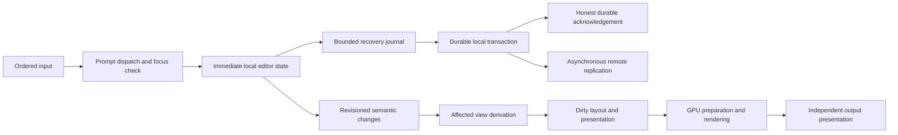

# 10. Architecture for a responsive interface

[Organization](Park.md), [source evidence](00-evidence-and-research.md), [targets](08-benchmarks.md). This is the direction to test through the atomic stage tasks, not an already implemented replacement renderer. Source locations are entry points; follow their current callers before editing.

## Shared families and responsibility boundaries

| Existing family and members | Responsibility to retain | Refactor direction and proving tasks |
| --- | --- | --- |
| Park dispatch, native_input, runtime/input_queue, CanvasWorker, host input, Bevy editable text | Ordered device input, current focus/target, gestures, native/client routing | Prompt admission and editor feedback, bounded indivisible work, fair control service, stale-frame cancellation: P43/P105–P108. |
| RecordEditor, TextBinding, protein_area rows/property controls, description, Cell bridge, transport Session, engine/store | One actual Record identity across views, correct local/remote state, collaboration and access | Explicit edit phases, incremental recovery and canonical writes, bounded publication/fanout: P102/P114–P121/P137–P139. |
| ThemeSettings, TokenOverrides, authored token uses, relation Colors, token_style resolver/presentation, token_metrics | Inheritance, dynamic rules, overrides/reset, authored zero and explicit colors | Compile source styles on change, compact resolved reads, affected-consumer application, coherent theme revisions: P109/P78/P110–P113 and P89 if duplication is proven. |
| LayoutBox, layout engine/solver, Bevy UI/text, scroll_sand, canvas/output projections | Fit/Fill/intrinsic sizing, clipping, stable text/editor state and correct hit mapping | Dirty roots and separated layout/paint/input changes, retained pan/drag/scroll: P113/P122/P123/P74–P76. |
| NativePlan, topology presentation/surface_render, Bevy extraction/render, graphics imports/exports | Deterministic shared budget, native/device affinity, complete pixels and safe lifetimes | Immutable derivation, narrow application, measured batching/parallelism and coherent frame epochs: P60/P61/P62/P67/P68. |
| Output/session/composition, client callbacks, DRM presentation and retained native surfaces | Per-output clocks, damage, buffer ownership, lock/capture privacy | Independent output dirty/queued/wait states and safe minimal submissions: P52/P53/P54/P55/P58/P72. |
| Native feature plugins, notifications, timers, query views, media/file/AI workers | Background semantics continue even with no visible view | Consumer demand for presentation, producer readiness/deadlines, shared bounded workers: P47/P63/P77/P92/P124–P133. |
| Laboratory catalogue/driver, xtask Park validation, host performance and latency reporting | Isolated temporary data, cancellation, exact nonzero selectors, bounded evidence | One fixture manifest and runner, causal event flows, reusable workflow/performance cases: P93/P101–P104/P134. |

Reuse these families. Avoid a new scheduler, cache, worker and serialized state copy for each feature. A new abstraction is justified when it removes competing responsibilities and has concrete callers, a clear invalidation/lifetime contract and measured total cost. Family-specific changes still use the repository's componentree workflow when implementation requires a new grouping; this document does not replace that approval step or an approval already given for the same grouping.

## Intended flow and ownership

The graph separates responsibilities; it does not grant permission to bypass the current draft-before-send guarantee. A recovery/canonical-write redesign must demonstrate recoverability at every crash boundary before changing that ordering. For a local source the durable journal and canonical transaction may be able to share work; for a remote source, recoverable local pending intent and origin acknowledgement remain distinct. Preserve operation IDs, ordering, conflict resolution and authorization on both paths.

The external Wayland-client path already handles much input in Park and receives application buffers independently. Keep that path separate from native semantic updates. Where it still waits for native work, establish the actual dependency before coupling or decoupling it. A client buffer commit after a key is not proof of that key's visible response.

## Explicit revisions, not universal full updates

Changes should name the domain they invalidate: content, authored style, resolved style, intrinsic text/size, layout constraints, placement/transform, clip, input/focus/actions, media pixels, capture/privacy, and output configuration. These are proposed responsibilities, not a demand for ten new components on every entity. Reuse existing epochs/components where they already express the dependency correctly.

A completed presentation references the semantic/style/layout/input/output generations it actually used. Work may reuse unchanged domains, but cannot publish incompatible geometry and input maps, old capture permissions, or half of a new theme. Entity/Record/source replacement and output retirement invalidate old results. Consumers must not wait on a global “everything fresh” gate when their own inputs are ready.

One local text edit should affect its editor, dependent intrinsic sizing, the relevant Record/query views and demanded pixels. It should not clear unrelated style caches, regenerate all descriptions or repaint the other monitor. Color-only edits should not reflow text. Moving an unchanged item should update transforms and hit mapping without reshaping its content unless a dependency such as Area inheritance or wrapping really changed.

Producer-maintained dirty sets or revision journals can make work proportional to actual changes. Bevy Changed queries are useful correctness tools but still inspect matching entities; replacing one full traversal with another change-filtered full traversal is not automatically an optimization. Include dirty-index maintenance, component additions/removals, newly opened consumers and memory in the comparison.

## Read-heavy style data

Keep persisted authored tokens as the source of truth for editing/import/export. Test a separate compact runtime representation containing the already-resolved values the consumers actually need. Candidate implementations include an indexed array for a small fixed token domain, shared immutable resolved style sets with per-entity bindings, or a few typed hot components. Compare them; a full per-entity token array may waste more memory than it saves CPU.

Inheritance/rule evaluation belongs on a real source change. Resolve only required properties, intern identical style sets where reuse pays, keep source/origin descriptions on the inspection path, and apply to only affected consumers. Cache memory must retire with its owners. Keep dynamic contexts and explicit icon colors correct. Do not create a global mutable resolver lock that serializes the newly independent systems.

First-open initialization and rare edits may cost more than a cached read. They still need bounded completion and a coherent publication. Theme sliders and animations are write-heavy controls and remain separate test cases. Whether P91's extra scheduling CPU is worthwhile for the common steady case must be judged with measured style-change frequency; faster rare writes alone are not proof of a daily-use win.

## Scheduling and processor use

Keep short CPU work for semantics, queue admission, dependency decisions and command submission close to its owner. Use the GPU for drawing/filtering/composition and suitable large data-parallel image operations when transfer and synchronization costs justify it. Do not move branch-heavy editor or permission state onto a GPU. Conversely, do not retain expensive per-pixel CPU work just because it is easy to call from ECS.

Break a long system at a meaningful boundary: collect immutable inputs, derive independent results, perform one deterministic shared budget decision where required, and narrowly apply current results. Reuse existing workers and a serial path for cheap batches. Run-queue delay, locks, copying and thermal cost count. Worker thread affinity, NonSend resources and GPU ownership are real constraints, not traits to paper over.

Main/render overlap needs an owned coherent snapshot because NativeCanvas consumes geometry/input/images immediately after app.update. A shallow bounded pipeline can improve throughput while making inputs older; choose from measured input-visible latency and per-output presentation. Never add a frame of buffering to every stage independently. Service cancellations, releases, focus/lock changes and pending persistence even while bulk work is busy.

## Refactor as vertical slices

Each slice must carry an actual workflow through input, state, presentation and persistence when relevant. Delete its superseded adapter/storage path once the replacement is checked. Do not keep compatibility for unused older versions. A large internal transformation is appropriate if the critical path supports it; a large simultaneous unmeasured rewrite makes it harder to identify which change helped or broke a workflow.

Vertical slices are code/ownership boundaries, not one-release-per-slice requirements. Follow [12](12-measurement-and-delivery.md): measure first, implement all ready independent measured slices in a broad batch, run useful local checks in Niri and push. Measure the installed candidate in Park, update the evidence/plan and stop for the return to Niri. Keep one coherent mechanism per measured owner in that cycle and name coupled changes honestly. Do not retain old/new algorithm switches or duplicate production paths for comparative testing; real capability fallbacks and serial handling of cheap work remain product decisions.

Evaluate the combined candidate with fixed workloads and the per-phase report in subject 11. If a combination regresses, use its causal trace to repair the affected boundary, or retain the honest tradeoff for the user. Shared resource effects may still require a focused follow-up candidate; do not claim timing alone proves independent contributions. Do not restart a cycle of unrelated microbenchmarks while a known dominant blocker remains.
