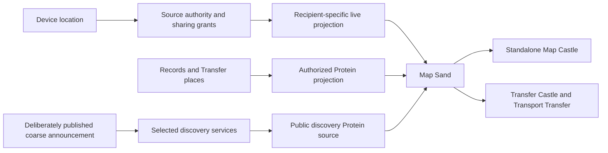

# Maps, location sharing, and Transport Transfer

Research begun 7 October 2026; location implementation and delivery priorities updated 8 October 2026; map data, native renderer, and customization research expanded 10 October 2026. The accepted location scope and implementation status are described first. The next sequence is generic location and desktop workflows, desktop maps, then mobile completion. Map implementation has not started. External links support the research. Renderer selection, integration approaches, and new map tokens below are recommendations to validate, not implemented capabilities. Performance figures remain acceptance targets, not measured results.

## Accepted location decisions and current scope

The initial location increment is implemented. Finish its generic reliability and desktop workflow gaps first, deliver the desktop map and its Transfer integration next, and complete mobile last. Mobile toolchain setup, target validation, acquisition lifecycle work, touch presentation, and device measurements must not block the desktop map increment. Preserve the existing mobile implementation while its remaining work waits. Geocoding, routes, and multi-stop journeys remain optional later extensions.

The human selected these decisions:

- Choose a source device for each Record, defaulting to the current device. Another device in the Organ must approve acquisition locally.
- Attach live location to any selected Record, normally its Need/Contribution. Keep it separate from the Record's saved place and Transfer meeting-point snapshots.
- Before sharing, only the starting Person's authorized sessions may view the live location. Organ membership alone grants no access.
- Maintain one active source per Record. Different people's locations belong to separate Records, which a Transfer can bring together.
- Clear live coordinates when tracking stops or expires. Retain configuration; saving a location as a place is a separate action. Do not retain a journey history.
- Default a session to one hour, editable by its controller. If linked to a Transfer, completion or cancellation also ends the session.

Provide native Record controls for choosing the source, starting/stopping, duration, selected recipients, and viewing the latest coordinates, accuracy, capture age, and source status. Transfer details currently bring together the permitted locations of their linked Records without a map. An outside recipient receives a narrow location view, not access to the Record's other fields or Transfer terms. Exact sharing is explicit; public/coarse discovery remains unimplemented and can be developed as a general discovery capability before its map presentation.

Implementation should reuse device identity, Person authentication, Record authorization, and encrypted peer communication. Keep observations ephemeral and bounded, control messages reliable, and authorization checks ahead of every delivery. Retained configuration must never restart sensor acquisition without source-device confirmation after a restart.

## Accepted visibility and Record capability refinement

The human approved implementation of the generic location and desktop work and requested a reusable **Visibility Castle**. Saved location and live location sharing are two independent capabilities of an ordinary Record. They are available to any Transfer kind without a map, including Ride, Delivery, donation, exchange, lending, visits, and plain agreements. A saved place is retained context; a live observation expires and never silently replaces that place or the agreed Transfer terms.

Visibility policies select the Record and the data being controlled: ordinary Record data, its saved place, or its live location. Compose an allowlist and an excludelist from any number of bounded conditions within implementation limits. Each condition can select specific Organs, a lower/upper proximity bound, or both. Proximity means the owner's existing Organ contact proximity, where lower values are closer; it is not geographic distance. Bounds can be strict or inclusive so “below 3”, “at least 2”, and closed/open ranges are unambiguous.

The human confirmed the composition rules: criteria within one condition combine with AND; include conditions combine with OR; exclude conditions combine with OR; any matching exclusion wins. An empty include list grants no additional Organ access. Named Person grants remain available for live sharing, but an applicable Organ exclusion also prevents those deliveries. The controller retains access to manage and stop their own capability. Missing or unauthenticated Organ identities cannot satisfy proximity rules. Contact proximity is read at delivery time, so changing it changes future access without restarting acquisition.

The Castle previews the effective decision for known Organs and explains the matching conditions. Editing uses revision checks, requires authority over the selected data, and must not expose private policy contents to observers. Changing visibility affects future delivery; previously delivered data cannot be erased from another person's knowledge. Ordinary replication remains bounded by existing grants and sync policy. An explicit Organ policy also authorizes a narrow direct projection of the selected data, without private configuration, unrelated Records, or an unapproved saved place. Withholding a saved place must also prevent it leaking through ordinary Record replication or references; do not redact or rewrite signed history to disguise that leak.

Implement the shared evaluator and backend before the Castle, reuse the same editor from Record location controls, and verify the complete feature in a deterministic topology of three or four Lince instances. Cover both static and live location, included/excluded Organs and overlapping ranges, changed proximity, observer-only views, stop/expiry, replay, Transfer termination, and absent maps. Exercise more than a Ride preset to prove that the capabilities are generic. Map implementation remains the next phase and mobile completion remains last.

## Location implementation

The location increment uses ordinary Records, Persons, Cells, Record permissions, and encrypted Iroh communication. It introduces no ride-specific backend. The shared [location model](../crates/nucleus/src/location.rs), [location engine](../crates/engine/src/location.rs), and [native controls](../crates/interface/src/location.rs) support both device acquisition and a labelled manually reported position.

Record controls choose the controlling Person, one authorized source device, explicit Person recipients, a duration from one minute to one day, and an optional Transfer end condition. The default is this device, no additional recipients, and one hour. Desktop Record cards, Protein rows, and Transfer details open the same controls; Transfer details also expose their linked promise Records. Mobile Record details open the same shared controls. A separately opened observer panel accepts a private location reference with the Record and authority endpoint together. Diagnostic fields remain available. Copying or loading the reference grants no access and does not start acquisition. An Organ allowed by the current live policy can view without creating another Person at the sharing Organ; a named recipient can instead authenticate through the existing encrypted login.

Selecting a remote source creates a pending request there. It cannot start acquisition. The starting Person must authenticate that source device with the sharing Organ and approve locally. The authentication button reuses Lince's existing encrypted live login; it does not put a password in a Record action. For an outside observer, create or use the intended Person identity at the sharing Organ and explicitly select that Person as a recipient. They authenticate through the observer panel. This grants a latest-location view without granting Record access or making them a Transfer party. Arbitrary bearer links and anonymous viewers are not implemented.

Settings are retained in the new append-only `0002_location.sql` migration. Sessions, source approvals, observer identity mappings, and coordinates stay in memory. Restart requires a new start and source approval. Routine location actions skip durable action-intent storage while retaining signed-session checks and replay rejection. Fixes never update the Record place, Transfer terms, ordinary sync, or a durable outbox. **Set saved place** works without starting tracking. **Save current position as Record place** is a separate explicit action using `SetPlace`. Both retain the coordinate under the saved-place policy; the first saved place creates a private policy. Agreed Transfer meeting points continue to use revision-checked Transfer terms.

Each Record has one active source session with a fresh session identity. Incoming fixes must match that source and session, increase the sequence, have valid finite coordinates, and have a recent capture time after approval. Only the latest fix is retained. The view shows reported coordinates, accuracy when supplied, and elapsed capture age; it marks a fix stale after fifteen seconds and removes it after sixty seconds. A missing or denied provider is visible. Neither viewing nor reconnecting resets a fix's age.

The first authority is the Cell with the smallest endpoint identifier among the valid signed Organ roster's write-capable Cells; a standalone device is its own authority. Configuration stays at that authority. There is no automatic failover or replicated location settings yet. The authority must be reachable to start, approve, or view remote sharing. Source leases renew every five seconds and stop authorizing acquisition after thirty seconds without renewal. Stop clears local acquisition immediately even when the authority cannot be reached; an already delivered recipient view can remain visible until its short fix expiry. The controller's standing, Record authority, device admission, roster, and Transfer end condition are rechecked during the session.

The [Linux adapter](../crates/desktop/src/location/portal.rs) uses the XDG Location portal and closes its session when acquisition ends. A supporting portal backend is required. The [Android service](../crates/mobile/android/app/src/main/java/social/lince/mobile/LocationService.java) uses platform LocationManager, respects coarse/fine permission, and runs bounded active sharing with a foreground notification and Stop action. It has no Google Play Services dependency and does not restart automatically. Manual reporting remains available where a native provider is unavailable; Windows and Apple acquisition adapters are deferred.

Location traffic has its own narrow encrypted connection, limited to location requests. Named-recipient delivery checks current Person/device admission and its explicit audience. Organ delivery checks the authenticated Organ, current contact proximity, and composed include/exclude rules. Exclusions override named-recipient grants, with a controller exception. A previously authenticated outside recipient does not need Organ membership or general discovery acceptance. Limits include 32 additional recipients, 64 active source/session entries per runtime, a 16 KiB incoming request, and a maximum one-day session. There is no public or approximate publication in this increment; a grant shares the reported coordinates at the provider's actual accuracy.

Remaining operational limits are platform permission/device testing, battery measurements, and clock skew: source and authority wall clocks must be sufficiently aligned because future timestamps and captures predating approval are rejected. Authority changes intentionally end existing sessions. Previously delivered coordinates cannot be erased from another person's knowledge. Map rendering, geographic search, public announcements, geocoding, routes, and the composed Transport Transfer map are not implemented. Desktop map delivery now precedes the remaining mobile work.

### Visibility implementation refinement

The shared [visibility model](../crates/nucleus/src/visibility.rs) evaluates strict/inclusive proximity ranges and Organ lists with the confirmed composition rules. The [Visibility Castle](../crates/desktop/src/visibility_castle.rs) reuses the [native editor](../crates/interface/src/visibility.rs) for ordinary Record data, saved place, and live location. It includes Record selection, range editing, multiple inclusions/exclusions, and a preview showing matching condition numbers for each known Organ. Saves compare the revision; rejected saves preserve edited rules. Limits are 64 conditions, 64 Organ identities per condition, and 12 KiB serialized policy data.

Append-only migration `0003_data_visibility.sql` stores independent policies and revisions. Policy contents sync only between the owning Organ's authorized Cells. Outside readers receive a narrow permitted projection. Live policy edits from another authorized Cell are sent to the designated sharing authority before success is reported. Editing requires Record read/update and permission-assignment authority; when acting as a Person, live policy management also requires the location controller.

For saved places, private means no additional outside-Organ disclosure; local Record permissions still govern readers and the owning Organ's authorized Cells retain their normal replication authority. Live coordinates have the narrower starting-Person default. Choosing an Organ for live sharing authorizes that Organ's authenticated endpoint; it is an intentional broader audience than a named Person. Policies and the Castle's selected Record/scope persist, while unsaved rules, live observations, and acquisition consent do not become workspace state. The Castle includes the embedded accessibility dependency's license and credits.

A withheld saved place conservatively withholds ordinary replication of the Record and its signed history, because history may contain exact coordinates. Allowing that replication can disclose earlier saved places in retained history; the Castle explains this. Narrow direct projections return current permitted data, and the Record-data projection can return text without its saved place. This does not recall data already delivered. Transfer delivery projections, queued envelope preparation, and hosted pulls also check current Organ visibility before sending. Transfer meeting-point disclosure remains a separate agreed-terms capability; live sharing never rewrites it.

The four-Cell simulation adapts the existing sale fixture into a single-promise bike handoff through agreement, occurrence activation, confirmations, settlement, delivery, and restart. It adds independent subject and passenger Need location sources, a family observer, and an excluded Organ. Assertions cover static/live separation, ranges and explicit Organs, changed proximity, blocked contacts, stale saves, 500 latest-only fixes without new facts, queued Transfer delivery after visibility changes, automatic Transfer-bound stopping, and restart without reacquiring the passenger source. Focused engine and native editor tests cover excluded named recipients, source-side policy routing, private configuration sync, permission checks, preview, and explicit saved-place actions. Saved-place controls remain available while the sharing authority is unreachable.

### Visibility refinement verification on 8 October 2026

- `cargo test -p lince-simulation --test location_visibility` passed the complete four-Cell handoff scenario described above. This uses isolated Cells and real Transfer actions with an authenticated simulated location network; the separate Cell test exercises actual encrypted loopback connections.
- The combined `location::tests` run passed thirteen engine tests, one Cell encrypted-loopback test, and eight shared native UI tests. This adds source-side visibility routing, excluded named recipients, current Organ proximity, separate saved-place controls available before authority loading, and private reference loading without acquisition to the initial coverage below.
- The visibility test harnesses compiled by that run were executed in the interface Nix shell: two policy tests, one editor preview/revision test, and four desktop tests passed, including restoration of the Visibility Castle's Record/scope without policy contents or coordinates.
- `cargo test -p engine --lib visibility::tests` passed the private-sync test with its Cell signing key initialized. It checks saved-place default denial, own-Organ policy replication, explicitly allowed place replication, withheld policy contents, and rejection of foreign policy injection. Together with the topology and focused runs above, 31 tests passed for this refinement.
- `cargo check -p lince-desktop -p lince-mobile` passed for the native Linux hosts during this refinement. The latest shared controls and desktop changes also compiled in the focused test run. Rust warnings are denied; this does not establish Android target or device support.
- `cargo check -p store` and all seven `migration_guard` tests passed immediately after appending `0003_data_visibility.sql` and its exact SHA-384 entry. No earlier migration or checksum was changed.

Map rendering, native permission prompts, portal lifecycle, battery use, and sustained-device performance remain unmeasured here. The generic visibility/Record-capability increment is implemented; clock-skew handling, explicit authority handoff, coarse discovery, and the broader guided Transport Transfer flow remain open in the ordered desktop plan below. Desktop maps follow that work, and mobile completion remains last.

### Initial location verification on 8 October 2026

- Twelve engine location tests passed. They cover private defaults, explicit recipients, signed identity, selected-device approval, source/session replay, invalid native fixes, concurrent starts, permission loss, Transfer termination, expiry/restart, and offline source stopping. A 2,000-update test retains one latest observation without adding Record facts or a saved place. Signed manual updates also leave no durable action-intent payload.
- The Cell test uses real encrypted loopback connections and the existing live password/session handshake. An outside recipient with no contact relationship or Record read permission can view the granted location. An incorrect password fails, and revoking its Person/device admission blocks further views.
- Six shared native UI tests passed: expired coordinates disappear, stopping ignores earlier replies, saving requires a fresh fix and explicit request, observer authentication preserves identity, successful polls wait before polling again, and recipient controls cannot display an uncommitted change during a live session.
- `cargo check -p lince-interface -p lince-desktop -p lince-mobile` passed in the interface Nix shell, with Rust warnings denied by the workspace. This checks the native Linux desktop and mobile host; it does not substitute for the Android target check below.
- `cargo check -p store` and all seven `migration_guard` tests passed after appending the new migration and SHA-384 entry. The existing migration and checksum were left unchanged.
- All Android Java host classes passed `javac -Xlint:all -Werror` against the official Android 35 platform. A full Android Rust cross-check could not complete because the local SDK/NDK toolchain is absent; its native dependency compilation attempts to use the host C compiler. APK installation, device permission prompts, portal behavior, and battery use have not been validated here.

## What we want

Give the default Transfer Castle a map and the ability to share the current location of a person or another Record. Make the same map available as a standalone Castle, with its source and filters configured through Protein. Build **Transport Transfer** as a workflow that combines these general capabilities with ordinary Needs, Contributions, parties, promises, reservations, time windows, and confirmations.

A driver can share their location with selected passengers. A passenger can share theirs with the driver, selected other passengers, or a family member outside the Transfer. Each person decides independently. A public transport announcement can appear on a discovery map while its author's profile, exact pickup, exact destination, and live movement remain private.

The intended result is useful beyond ride sharing: deliveries, visits, lending equipment, moving goods, meeting someone, and coordinating field work can use the same pieces. The transport-specific layer should mostly supply names, defaults, filters, and a convenient screen.

## What Lince already has

Before this location increment, the repository provided these foundations. The implementation above adds live location; the map remains deferred.

| Existing foundation | What it gives us | What still needs work |
| --- | --- | --- |
| [Place and geographic helpers](../crates/nucleus/src/place.rs), [Place storage](../crates/store/src/places.rs) | Coordinates, Record place references, distance and proximity calculations | Validated geographic attachments with audience rules, accuracy, and multiple purposes; a device source and map |
| [Transfer snapshots](../crates/nucleus/src/transfer.rs) | A default place, promise and occurrence locations, time windows, parties, dependencies, and child Transfers | Distinguish agreed places from changing observations; ordered stops and their workflow presentation |
| [Transfer field disclosure](../crates/nucleus/src/transfer/disclosure.rs) | Audiences for location, parties, quantities, text, and source Records; recipient projections | Exact location needs a private default, precision choices, expiring grants, and independently authorized live streams |
| [Transfer Castle](../crates/desktop/src/transfer_castle.rs), [existing presets](../crates/desktop/src/transfer_castle/model.rs) | Native Bevy Transfer UI, including Ride and Delivery presets | Map composition and a guided Transport Transfer flow; existing presets do not establish a full transport implementation |
| [Protein](../crates/protein/src/lib.rs), [shared query editor model](../crates/interface/src/queries.rs) | Record and Transfer queries, proximity to a Record, classification, and time filters | Viewport queries, geographic output, and a source for authorized discovery announcements |
| [Public social protocol](../crates/nucleus/src/social.rs), [discovery search](../crates/store/src/social.rs) | Anonymous or identified Need/Contribution announcements, signatures, expiry, server selection, and private reply routes | Structured coarse geography and machine-readable availability; current `area` and `availability` are text |
| [Discovery service](../crates/engine/src/social/service.rs), [private reply sessions](../crates/engine/src/social/session.rs) | Directory infrastructure and encrypted private conversations | Geographic indexing and a narrow handoff from discovery to a Transfer |
| [Wire](../crates/engine/src/wire.rs), [editor presence](../crates/engine/src/presence.rs) | Iroh connectivity and an example of bounded, expiring, in-memory updates | Geographic updates with their own consent and recipient rules; editor presence is not location authorization |
| [Shared interface](../crates/interface/Cargo.toml), [mobile host](../crates/mobile/Cargo.toml) | Shared Rust UI infrastructure and native Bevy desktop/mobile hosts | Shared map and permission models with desktop and mobile presentation |

Two details affect the design. `ItemDisclosure::default()` gives ordinary Transfer location and parties the default `Everyone` audience. `ItemAccess` also has an owner/privileged path. Neither authorizes a person's live position: this increment enforces an independent private audience. The [Android manifest](../crates/mobile/android/app/src/main/AndroidManifest.xml) now declares location permissions and a non-exported location foreground service.

## Shared feature families

These are the proposed families to review before implementation. Introduce concrete location and map capabilities first; avoid a general telemetry framework until another actual use requires it.

| Family | Members | Shared responsibility |
| --- | --- | --- |
| Geographic attachments | Record place, agreed meeting point, service area, ordered stop, planned route | Valid geographic data, purpose, precision, and disclosure |
| Live location | My device, another authorized device representing an asset, a selected remote person's shared position | Source authority, current observation, expiry, audience, and transport |
| Map | Standalone Map Castle, Transfer map, discovery map, family viewer | One Map Sand, camera, layers, picking, clustering, attribution, and source configuration |
| Transfer coordination | Ride, delivery, visit, equipment handoff, group trip | Time windows, resource capacity, stops, progress, confirmation, cancellation, and ordinary Transfer accounting |
| Discovery | All public Need/Contribution announcements, including transport | Signed public projection, geographic/time search, private replies, expiry, and selectable services |

Keep **Transport Transfer** distinct from the repository's `crates/transport`, which handles application communication. A ride should not require a second agreement engine, a separate passenger identity system, or ride-only location permissions.

## Location and visibility

### Four independent decisions

The UI and backend must distinguish:

1. **Acquire:** may this Lince device ask the operating system for location?
2. **Represent:** whose location does this source represent: me, a vehicle, a parcel, or another Record I may operate?
3. **Disclose:** who may receive it, at what precision, for how long?
4. **Publish:** which deliberately selected details may enter public discovery?

Operating system permission answers only the first question. Transfer membership, a public Record, a contact relationship, and permission to edit a Transfer do not answer the others. An asset operator must have explicit authority to attach its source; selecting another person never grants authority to track them. One participant cannot turn on another participant's device source.

### Defaults and controls

Saved exact coordinates start withheld from outside Organs, subject to existing local Record permissions. Live position starts private to its controlling Person. Transport publication starts anonymous and coarse. Named recipients and explicit Organ policies are independent sharing controls; a shortcut such as “selected Transfer participants” resolves to a reviewed recipient list. Adding a passenger later does not silently add them to an existing grant.

Each sharing card states the subject, source device, recipients, precision, and end condition. Offer “Share once,” “Share during this Transfer,” and “Share for a duration.” The selected default is one hour, editable, with completion/cancellation additionally ending a Transfer-linked session. A separately chosen personal grant can continue for a bounded duration after a ride, for example to let family see the walk home.

Opening a map or activating a Transfer does not start sharing. The user may approve a preset's suggested recipients in the same flow used to start sharing. Exactness and the recipient list stay visible, with a global **Stop all location sharing** action. Changing or restarting the source device requires a fresh binding and local confirmation.

| Detail | Public discovery | Driver | Another passenger | Family observer |
| --- | --- | --- | --- | --- |
| Passenger's profile | Hidden by default | Separately disclosed | Separately disclosed | Existing contact information only |
| Passenger's pickup/destination | Coarse area only | Exact if explicitly granted | Hidden unless selected | Hidden unless selected |
| Passenger's live location | Never through the default discovery projection | Only if selected | Only if selected | Only if selected |
| Driver's live location | Never through the default discovery projection | Own location | Only passengers the driver selects | Only with the driver's grant |
| Private Transfer terms and accounting | Hidden | Existing Transfer permissions | Existing Transfer permissions | Hidden |

An outside observer receives permission to view a location stream and any explicitly included context. They do not become a Transfer party, gain settlement powers, receive the passenger list, or inherit access to messages and private Records. A family member's grant to see the passenger does not grant access to the driver's source, even when the passenger is travelling in that vehicle.

Reuse existing audience concepts, but enforce geographic grants separately where necessary. Check access before serialization, delivery, subscription updates, and rendering. Protein is a query tool; selecting a broader filter cannot enlarge permission. Hiding a marker after sending its exact coordinates is insufficient.

### Precision and honest privacy

Support hidden, area, and exact disclosure. Area disclosure returns an area geometry or cell and its size, rather than an exact point with a vague visual circle. Do not include a hidden address, geocoder result, source Record UID, precise time, route, heading, speed, or accuracy metadata that would reconstruct the protected position.

Use a consistent coarse representation for an announcement's lifetime. Refreshing random offsets or publishing increasingly precise areas can expose the original location through repeated observations. Precision must also cover destination, route, time, identity, and free text. Warn during publication if the user has written an address into text that will be public.

Describe this as **anonymous publication with approximate geography**, not guaranteed anonymity. Mobility research demonstrates that sparse time/place observations can identify people in a particular dataset. A coarse cell or an omitted name alone does not solve that problem. [Research: Unique in the Crowd](https://www.nature.com/articles/srep01376).

## The location model

Separate stable geographic information from short-lived observations.

**Geographic attachment:** a Record or Transfer term referring to a point, area, route, or ordered stop, with a purpose such as meeting point or destination. Agreed pickup and delivery places belong in versioned Transfer terms. Live movement must not rewrite an agreement or generate a revision for every fix.

**Location source:** an authorized binding from a subject to a publishing device or manual source. Store its controller, device authority, status, and source kind. A desktop may display a phone's permitted stream, but must label it as the phone's source. A manually placed point is a declared position, not a GPS observation.

**Location observation:** source/session identifier, increasing sequence, coordinates or authorized area, capture time, reception age, horizontal accuracy when available, and a short validity period. Include heading and speed only where the workflow needs them and the recipient is allowed to receive them. Validate finite coordinates, geographic ranges, time bounds, source authority, and packet size.

A valid signature identifies the authorized publisher; it does not prove physical presence or make GPS immune to spoofing. Treat observations as reported location with visible source and uncertainty. They must not independently trigger settlement, identity verification, or proof of delivery.

**Location grant:** subject, issuer, source, recipient identities/device bindings, precision, optional Transfer context, start/end conditions, expiry, and authorization generation. Reuse Lince's established authority and identity machinery. A device endpoint key must be bound to the person or private conversation receiving the grant; possession of an Iroh endpoint alone does not establish that authority.

**Current-location projection:** a bounded latest observation per source and permitted viewer, normally in memory. Persist grants and their changes where necessary for restart/revocation, but do not put routine positions in Record history, Transfer evidence, ordinary sync, an outbox, logs, analytics, or crash reports. Explicitly saving a place or a journey is a separate action with a retention policy. Storing such data does not make it public.

Proposed initial timing: publish about every three seconds while moving and every fifteen seconds while stationary; mark moving observations stale after fifteen seconds and stationary observations after forty-five seconds, and remove positions after sixty seconds without a fresh fix. These are tuning starting points. A heartbeat reports source availability without resetting the observation's capture age. Carry capture age across reconnections, reject replayed/out-of-order samples, and cap the accepted age using local elapsed time. Receiving a cached observation must not make it fresh again. A paused or offline source visibly reports its state; interpolation must not invent continued movement.

Use one selected publishing device per source session. A handoff creates a new authorized session; observations from the old device cannot race the new one. Stop acquisition when no approved local use or sharing session needs it. A map viewer subscribes to remote data without starting its own sensor.

### Network and revocation

Reuse Iroh for authenticated direct connections and relay fallback. Lince pins Iroh 1.2.0, whose API supports reliable streams and datagrams. Use reliable control messages for grants, stop, and revocation; begin with bounded, coalesced latest-position delivery, then consider datagrams if measurements justify them. Do not queue a ride's positions for later bulk delivery. [Iroh architecture](https://docs.iroh.computer/), [pinned connection API](https://docs.rs/iroh/1.2.0/iroh/endpoint/struct.Connection.html).

Authorize and generate a precision-limited payload independently for each recipient. Different audiences must not share an exact-coordinate group key. For direct endpoint-to-endpoint delivery, Iroh protects the connection; a relay still observes connection metadata. If an application mailbox or other intermediary forwards payloads, use application end-to-end encryption through the established private-session implementation. The ordinary social mailbox's durable history and retention should not become the default carrier for frequent location samples.

Revocation stops future publication to the removed recipient, invalidates the grant generation, terminates affected subscriptions, and clears local viewer caches. Reconnection rechecks current authorization. Use bounded authorization leases and sample expiry so disconnected clients cannot retain an indefinitely active view. Persist the necessary revocation state before acknowledging a stop, and fail closed when current authority cannot be established.

An already authorized recipient can keep screenshots or previously received coordinates. Lince can stop future disclosure and delete its own caches; it cannot remotely erase another person's knowledge. This limit should appear in the sharing explanation.

## Device support

Expose a small shared provider interface: capability/status, request permission, begin updates with an accuracy/rate policy, and stop. Keep platform acquisition in the platform host and policy in the engine. Permission denial, approximate access, no sensor, an old fix, and suspension are normal visible states.

| Platform | Proposed acquisition | Constraints |
| --- | --- | --- |
| Android | Start with platform `LocationManager` through the existing native bridge; leave a fused provider optional | Respect approximate permission. Active sharing started by a visible user action can use a correctly declared location foreground service with a persistent notification and Stop action. Do not depend on Google Play Services being installed. [LocationManager](https://developer.android.com/reference/android/location/LocationManager), [runtime permissions](https://developer.android.com/develop/sensors-and-location/location/permissions/runtime), [foreground service rules](https://developer.android.com/develop/background-work/services/fgs/service-types) |
| Linux desktop | XDG Location portal where an available backend supports it; manual position and explicitly connected external source otherwise | Portal availability and accuracy vary. The portal exposes sessions, accuracy requests, and update thresholds. Do not silently infer position through an IP lookup. [XDG Location API](https://flatpak.github.io/xdg-desktop-portal/docs/doc-org.freedesktop.portal.Location.html) |
| Apple platforms | Core Location in the relevant host when that platform is implemented | Handle authorization, reduced accuracy, and background lifecycle explicitly. Permission and background support do not guarantee uninterrupted sampling. [Authorization](https://developer.apple.com/documentation/corelocation/requesting-authorization-to-use-location-services), [background updates](https://developer.apple.com/documentation/corelocation/handling-location-updates-in-the-background) |
| Windows desktop | Windows geolocation provider, with manual/external-source alternatives | Request access and handle disabled or unavailable location. [Windows location API](https://learn.microsoft.com/en-us/windows/apps/develop/maps-and-location/get-location) |

Finish Linux acquisition and manual-source validation first. Complete the existing Android host after desktop maps and workflows work. Do not present a future Apple or Windows adapter as already available. A desktop with no reliable location can still use maps, select an area manually, and view permitted remote locations.

Foreground services, background permission, and background network execution are distinct. On Android, start an active location service from the permitted visible state; requesting background location merely because the user locks the screen is not the default design. Any later need to start/restart tracking while already in the background requires a separate platform-policy review and clear user intent. Test locked-screen operation, service termination, permission changes, network changes, and battery restrictions on actual devices.

## Map rendering without a JavaScript frontend

The map backend has several parts: geographic datasets, tile generation and distribution, cartographic rendering, address search, and road routing. Reuse existing projects for these. Lince should own the Bevy controls, permission-aware overlays, and workflow composition. A library that downloads tiles is not necessarily a vector renderer; a geographic file reader is not a cartographic engine; a basemap is not a routing graph.

The preferred direction is **OSM-derived vector tiles, an existing Rust renderer, and a Bevy Map Sand**. Vector data makes independent customization of roads, water, buildings, and text possible. The recommended first experiment is Galileo with a regional Protomaps archive. Keep MapLibre Native as the established cartography alternative and compatible Bevy raster rendering as the bounded fallback. Do not commit to implementing missing cartography in Lince merely to keep a particular dependency.

Keep the following choices independent so a provider change does not rewrite Transfer or location behavior:

| Part | What it decides | Initial recommendation |
| --- | --- | --- |
| Geographic dataset | Which roads, buildings, water, names, and other features exist | Existing OSM-derived basemap; Natural Earth for the bundled overview |
| Tile schema | Layer names, attributes, feature classes, and zoom-dependent content | One pinned Protomaps schema first; an adapter for another schema only when needed |
| Container and transport | How already-generated tiles are stored and fetched | Regional PMTiles locally or through HTTP Range; ordinary tile URLs where useful |
| Cartographic engine | Projection, vector decoding, label placement, style evaluation, and GPU rendering | Galileo experiment, then MapLibre Native if necessary |
| Lince presentation | Castle layout, filters, controls, Record selection, and authorized overlays | Shared Bevy Map Sand with the existing customization system |

These are narrow map boundaries, not a new general plugin or telemetry framework. Saved places, live location, visibility, Protein results, and Transfers keep their existing independent capabilities.

### Renderer research and recommendation

The current desktop pins Bevy 0.19.1 and its lockfile resolves wgpu 29.0.4. These versions determine immediate plugin compatibility. Verify dependency alignment against a pinned renderer revision before attempting shared GPU resources; matching a major version alone does not prove that device features, render-target formats, scheduling, or APIs fit.

The latest preference is a Rust renderer shipped with Lince, a Bevy interface with full theme-token control, and no mandatory runtime installation. Renderer code and required small assets belong in the release; geographic datasets have a separate size and update policy. Neither a Rust crate nor Bevy includes a detailed map of the world by itself. Upstream versions below were checked during the 10 October research and must be pinned when the experiment begins.

| Option | Evidence | Assessment for Lince |
| --- | --- | --- |
| **Galileo** | Rust GIS engine with raster/vector/feature layers; renderer APIs accept a supplied wgpu device/queue and a destination texture view. Current main uses wgpu 29. The project is work in progress and complete MapLibre expression support remains open. [Project](https://github.com/galileo-map/galileo), [manifest](https://github.com/galileo-map/galileo/blob/main/Cargo.toml), [rendering API](https://docs.rs/galileo/latest/galileo/render/struct.WgpuRenderer.html), [expression coverage](https://github.com/galileo-map/galileo/issues/322) | First Rust vector experiment. Build a Bevy adapter around its rendering engine, without adopting its example GUI. Require real street labels, matching styles, changed colors, bounded allocations, and correct texture lifecycle. Do not assume the published crate and main have identical dependencies or features. |
| **MapLibre Native through its Rust FFI** | Native vector/raster rendering from style documents, Rust bindings, and host-controlled texture targets. The C ABI is pre-1.0 and unstable. [Native engine](https://github.com/maplibre/maplibre-native), [FFI status](https://maplibre.org/maplibre-native-ffi/), [texture integration](https://maplibre.org/maplibre-native-ffi/guides/attach-a-render-target/) | Established cartography alternative if Galileo fails the labelled-map gate. The engine is C++, called through Rust. Pin/package its native artifact and prove graphics synchronization. A documented borrowed texture is not proof that a Bevy wgpu texture can be imported directly across every backend. |
| **bevy_slippy_tiles 0.12.0** | Published compatibility table now includes Bevy 0.19. Supports raster tile download/display, caching, reference coordinates, concurrency/retry/rate controls, and disabling automatic rendering. [API and compatibility](https://docs.rs/bevy_slippy_tiles/latest/bevy_slippy_tiles/) | Most immediately compatible raster option. This corrects the earlier 0.11/Bevy 0.18 finding. Use its loading capabilities with Castle-owned presentation where necessary. Basemap colors and labels are already pixels; overlays and surrounding controls remain fully themed. |
| **bevy_geo_tiles 0.2.1** | Raster map plugin with WGS84/Web Mercator conversion, local origin, pan/zoom, markers, optional polylines/polygons, and asynchronous tile loading. Supports Bevy 0.18 and 256-pixel raster tiles. [API and compatibility](https://docs.rs/bevy_geo_tiles/latest/bevy_geo_tiles/) | Useful existing geographic ergonomics, but requires a Bevy 0.19 adaptation. Built-in global camera/origin state needs per-Castle integration. It does not solve vector basemap styling. |
| **Rustial / rustial-renderer-bevy 0.0.1** | Rust map engine with a Bevy renderer bridge targeting Bevy 0.18.1. The published renderer documentation build failed; its metadata and description are available. [Renderer crate](https://docs.rs/crate/rustial-renderer-bevy/latest), [engine API](https://docs.rs/rustial-engine/latest/rustial_engine/) | Experimental native Bevy vector candidate. Verify actual label/style behavior and the porting burden before adopting it. Early version numbering or a documentation failure alone does not establish a runtime defect, but neither supplies evidence of the cartography Lince needs. |
| **MapLibre Rust** | Rust/WebGPU renderer whose project describes a proof of concept. It is a separate engine rather than a ready Bevy Map Castle plugin. [Project status](https://github.com/maplibre/maplibre-rs) | Watch as a research alternative. Evaluate one revision and a real scene rather than treating the name or a platform list as production readiness. |
| **Rust geographic data helpers plus Bevy** | `geo` supplies geographic types/algorithms, `geozero` reads common geographic formats, and `pmtiles-rs` reads existing tile archives. [geo](https://github.com/georust/geo), [geozero](https://github.com/georust/geozero), [PMTiles reader](https://github.com/stadiamaps/pmtiles-rs) | Good for Record geometry, projection boundaries, simple bundled polygons, and overlays. These are not street-map renderers. Do not expand their use into implementing road-label placement, vector styles, or a replacement cartographic engine. |

**Recommended decision:** test Galileo first in a bounded desktop experiment, then MapLibre Native FFI if it cannot provide the needed cartography. Bevy owns Lince's controls, markers, and cards in either case. If the raster fallback is selected, explicitly record that independently themed basemap features are deferred; tinting a whole tile is not equivalent to recoloring water, roads, and labels.

MapLibre's Rust binding is currently snapshot-only; its default build script downloads a native artifact. Pin both binding revision and native library, and use `MAPLIBRE_NATIVE_C_INSTALL_DIR` with an explicit reproducible install prefix if selected. A build-time downloaded dependency is different from a runtime download, but a floating snapshot still makes the release difficult to reproduce. Package through Nix/xtask and verify whether the supported target permits the required single-binary delivery or needs an explicitly approved plugin. [Rust installation](https://maplibre.org/maplibre-native-ffi/install/#rust).

Select the renderer after it draws a real labelled map inside the existing Linux Bevy host with measured interaction and bounded resources. Review eventual Android backend/packaging feasibility now; leave Android integration, touch, pause/resume, and device acceptance to the final mobile phase. A desktop selection does not establish mobile support. If neither vector candidate passes without a substantial fork or new cartographic engine, use the raster fallback and retain the same source, camera, authorization, and overlay boundaries.

### Bevy integration and geographic coordinates

Galileo exposes `new_with_device_and_texture` and `render_to_texture_view`. The intended adapter would use Bevy's GPU device/queue and a Castle-sized render target, then composite that target within the native Sand. Verify submission order, thread requirements, texture format/usage, alpha, and ownership against the chosen revision. Do not create a second window or require Galileo's egui/winit presentation. Do not implement interactive rendering by reading every frame back to CPU memory and uploading it again. [Renderer API](https://docs.rs/galileo/latest/galileo/render/struct.WgpuRenderer.html)

Each Castle needs its own camera, viewport, geographic origin, selection, interaction state, and resolved map style. Share bounded public tile bytes between Castles where their source/version matches; private overlays remain scoped to the authorized viewer. The same Map Sand must embed in the default Transfer Castle and open independently. A renderer that works with one fullscreen map still needs this integration.

The slippy plugin's documented settings contain one reference position and transform offset; `bevy_geo_tiles` exposes a global `LocalOrigin` and main camera. Therefore neither documented default establishes multiple independent workspace maps. For raster rendering, disable automatic presentation where useful and create Castle-owned tile entities, clipping, and camera state. Prefer a narrow integration to a large plugin fork. [Slippy configuration](https://docs.rs/bevy_slippy_tiles/latest/bevy_slippy_tiles/), [geographic plugin state](https://docs.rs/bevy_geo_tiles/latest/bevy_geo_tiles/)

Keep the saved/live model in validated latitude/longitude coordinates. Let the map engine perform the selected projection, normally Web Mercator for these tile sources. Use double precision for geographic/projected positions and camera-relative coordinates at the GPU boundary to avoid world-scale floating-point jitter. Handle latitude limits and antimeridian wrapping explicitly. Reuse the engine's conversion for markers, picking, and place selection instead of maintaining a second approximate transform.

Distinguish measurements in meters from UI dimensions in pixels. Marker icons should remain readable through zoom changes; a reported accuracy radius should follow geographic scale and latitude, rather than appearing as a fixed-size circle. Recenter the camera origin without moving the reported place. Organ contact proximity in the Visibility Castle continues to mean social/contact proximity, independent of map distance.

Pointer input inside a map must coexist with moving/resizing the Castle and with its overlay controls. Capture pan/zoom only for the relevant viewport and release capture when interaction ends. Verify two maps at different locations, their keyboard focus, clipping under other Sands, scale-factor changes, and teardown. A hidden or settled map should stop rendering until camera, tiles, style, or overlays change. Sensor acquisition remains a separate explicit capability.

### Native UI, themes, and a complete binary

Bevy supplies cameras, textures, meshes, pointer events, UI layout, and render-to-texture composition; the existing Lince Castle framework supplies placement and theme tokens. These are enough for custom map controls, Record cards, selection, and overlays. Use the cartographic engine for its difficult map-specific work. Existing Bevy map plugins add geographic conversion and tile/camera behavior, but still need version checks and per-Castle input/clipping. [Bevy texture composition example](https://bevy.org/examples-webgpu/ui-user-interface/render-ui-to-texture/)

Ship the renderer, licenses/credits, default style, required fonts/glyphs/sprites, and a small useful overview with the Lince release. First launch must not download an SDK, JavaScript frontend, native library, or mandatory style asset pack. Optional fetching of detailed map data is a separate network choice. Measure the complete artifact with map support enabled and disabled. If renderer size or native linkage prevents the requested distribution, document the measured reason before selecting an explicitly installed plugin; ordinary Records and Transfers never depend on it.

A regional basemap archive is data and can be imported as an ordinary package; it does not inherently require executable plugin machinery. Separate this from choosing to package a large renderer as a plugin. A configured online source may fetch visible tiles without installing software, but the UI must distinguish online coverage, installed regions, and the bundled overview.

A practical offline baseline is low-resolution Natural Earth land/country data plus permitted Record markers. Its data is public domain. The published 1:110m land archive is about 68 KB compressed; this covers one coarse layer, not the complete baseline, labels, fonts, or roads. Pin and measure all selected assets and preprocessing output. Use existing geometry readers/tessellation for this simple overview. [Terms](https://www.naturalearthdata.com/about/terms-of-use/), [land dataset](https://www.naturalearthdata.com/downloads/110m-physical-vectors/110m-land/)

Street coverage requires an allowed online provider or an offline regional archive with matching resources. Choose a named sample, record its bounds and maximum zoom, and measure archive size, installed size, startup, and cache growth. A world overview works without any later download but must describe its limited detail. Route computation and address search remain separate optional provider capabilities.

### Connecting map styling to existing customization tokens

The [shared token definitions](../crates/interface/src/tokens.rs) already include `Surface`, `Ink`, `Accent`, `Warning`, `Error`, `SandBackground`, `SandBorder`, `SandInk`, `FontSize`, and `IconSize`. `SandStyleKind` has a `TimeCastle` precedent for feature-specific customization, but no map kind or map tokens yet. The [desktop customization scopes](../crates/desktop/src/customization.rs) include all Sands, a Sand kind, an individual Sand, and workspace contexts.

The [desktop resolver](../crates/desktop/src/token_style.rs) checks Relation color rules first, then this Sand and its parents, preview sources, and `ThemeSettings`. The shared settings resolve kind overrides, global overrides, and the selected theme/default. Use that resolver for map controls and Record overlays; do not duplicate a palette that ignores local or parent customization. A Record marker may use its Record/Relation styling, while map land and roads use the Map Castle's own style scope. Define the overlay's style source explicitly so embedding a map in Transfer does not unintentionally recolor every Record identically.

Add a proposed `MapCastle` style kind and a resolved map palette with semantic overrides. Begin with the following relationships; exact colors and numeric ranges need real scene validation:

| Map role | Fallback from resolved existing tokens | Proposed specific override |
| --- | --- | --- |
| Land/background | `SandBackground`, using `Surface` where an opaque basemap is needed | `MapLand` |
| Water | Subdued `Accent` mixed with the land color | `MapWater` |
| Parks/vegetation | A restrained distinct shade with contrast against land | `MapVegetation`, if the selected style needs it |
| Buildings | A nearby land/ink mixture, subordinate to roads and markers | `MapBuilding` |
| Minor and major roads | Separate contrast levels derived from `SandInk` and land | `MapRoad`, `MapRoadMajor` |
| Basemap labels and halos | `SandInk` and an opaque contrasting land/surface halo | `MapLabel`, `MapLabelHalo` |
| Selected Record and displayed path | `Accent` | Separate `MapSelected` / `MapRoute` only when independent customization is useful |
| Measurement accuracy area | The relevant marker color with bounded translucent fill | `MapAccuracy`, if needed |
| Stale/uncertain location status | `Warning`, together with text or a distinct symbol | Reuse the status token |
| Controls, cards, markers, and text scale | Existing spacing, padding, font, and icon tokens | Map-specific bounded numeric tokens only for real cartographic controls |

The names above are proposals, not existing tokens. Today's defaults are literal values. Adding `MapWater` with another hardcoded default would not make changing `Accent` update the water. Implement a deliberate fallback mechanism: resolve explicit map overrides through the same scope order, otherwise derive the role from already-resolved general tokens. Resolve derived roles in a fixed, acyclic order. Resetting a semantic override should restore that relationship. Define whether a preset supplies an explicit map role or inherits the generic theme.

The [theme document implementation](../crates/interface/src/tokens/document.rs) currently exports effective literal values and requires every token on import. Therefore a derived-default feature must define whether export freezes the current palette or preserves fallback relationships, and how importing a theme affects them. Extend bundled presets and the export/import model together with any new tokens. Record this behavior and verify round trips; do not create a second map-only theme file or treat old-format compatibility as a product requirement.

Resolve the palette before passing it to the renderer. Keep a version of that resolved style for each Castle; compare values and update only affected paint/material properties when possible. A color change should not re-fetch unchanged vector tiles, clear authorized Record state, or restart a source device. If a renderer requires replacing its style, measure the cost and preserve valid raw tile data. Raster tiles can switch between provider-supplied whole styles but cannot offer arbitrary semantic recoloring of their baked pixels.

Preserve the current color contract: token byte colors become Bevy `Color::srgba_u8`. Convert correctly when another renderer or GPU uniform expects linear colors, and handle premultiplied alpha consistently. Otherwise the map can visibly disagree with a Sand using the same token. Keep label halos/backgrounds readable, and use shapes/text as well as colors to distinguish Need, Contribution, saved places, live sources, and stale data.

Retain the existing cartographic style's zoom-dependent widths, feature priority, and label placement. Lince tokens provide colors and bounded scale controls; they should not make all roads one UI border width or all labels one size at every zoom. Arbitrary dark/light/custom themes need contrast checks against roads, water, buildings, and permitted overlays. Reusing the UI's fonts in map labels depends on the renderer's text/glyph interface; a Bevy text asset alone does not prove integration.

Protomaps offers a flavor model containing colors, fonts, landcover shades, and POI properties, which is a useful reference for this adapter. Its documented customization interface is TypeScript, and its default sprites have pre-rendered flavor colors. Adopt the existing style/resources and map their roles in Rust without requiring a JS frontend or Node-based customization path. Preserve their licenses. [Flavor and sprite documentation](https://docs.protomaps.com/basemaps/flavors)

Vector geometry does not imply every map asset can be recolored. Prefer renderer-supported tintable/SDF symbols or a bundled neutral icon set where practical, otherwise document which provider sprites remain fixed or select complete light/dark sprite variants. Verify shields, POIs, and city symbols under custom themes. Building a replacement glyph or road-label engine is outside Lince's scope.

### Map data and hosting

Use existing generated geographic products rather than loading the raw OSM planet database into every Lince. The useful alternatives are:

| Data/product | Strengths | Challenges and recommendation |
| --- | --- | --- |
| **Protomaps regional vector basemap** | Existing OSM/Natural Earth context map, documented layer schema, downloadable regional extracts, and PMTiles distribution | Preferred first offline/self-hosted dataset. Pair the pinned schema version with matching styles/resources; check the detail required at meeting-point zoom. [Downloads](https://docs.protomaps.com/basemaps/downloads), [layer schema](https://docs.protomaps.com/basemaps/layers) |
| **OpenFreeMap with OpenMapTiles schema** | Public online instance without API keys, self-hosting option, styles, and weekly planet downloads | Easiest online alternative. Uses unmodified OpenMapTiles schema; public service has no SLA. Downloads are MBTiles/Btrfs, not a promised ready PMTiles regional package. Import/conversion and matching styles need their own path. [Project and service](https://openfreemap.org/) |
| **Shortbread vector tiles** | Lean general-purpose OSM schema, existing generators, styles, and regional downloads | Evaluate if a simpler feature set improves the chosen scene/package. Do not assume it is always smaller: compare the same region, zoom, and resources. It needs a Shortbread style adapter. [Schema and downloads](https://shortbread-tiles.org/) |
| **Natural Earth overview** | Public-domain, low-detail world geometry suitable for bundling | Recommended offline baseline. Useful geographic context without claiming street coverage or transport directions. [Data terms](https://www.naturalearthdata.com/about/terms-of-use/) |
| **Allowed raster provider or raster archive** | Finished labels/symbols delivered as images; works with the compatible Bevy raster plugin | Fastest fallback. Verify distribution/offline permission and packaged resources. Independent road/water/text colors require upstream styles or a vector renderer. |

**Preferred deployment:** regional Protomaps PMTiles, read locally or hosted by a selectable provider/Institute, plus matching styles, sprites, glyphs, and attribution. The published planet archive is roughly 120 GB for zooms 0–15; use regional extraction and a deliberate maximum zoom. Copy immutable versions to the selected host rather than hotlinking Protomaps build downloads. Package measurements must identify the region and detail instead of promising a universal download size. [Basemap download and extraction guidance](https://docs.protomaps.com/basemaps/downloads)

PMTiles is a tile container, not a dataset, schema, renderer, or routing graph. It can contain raster or vector tiles. MBTiles is another archive choice, with its own reader/storage integration. Protomaps, OpenMapTiles, and Shortbread use different layer/attribute conventions even when all supply MVT vector tiles. A source configuration needs the declared schema/version, format, zoom range, bounds, resources, and attribution, not just a URL. Validate compatibility before displaying a source; do not render a blank map and imply there are no Records.

PMTiles remote access uses HTTP Range requests. Reuse an existing Rust reader and supply tile bytes to the selected engine, rather than assuming native support for `pmtiles://`. The Rust reader supports local and remote backends; its documented simple directory cache has no eviction, so Lince needs a bounded implementation. Account for cancellation, stale replies, archive directory entries, decompression, and per-source limits. [PMTiles concepts](https://docs.protomaps.com/pmtiles/), [Rust reader and cache notes](https://github.com/stadiamaps/pmtiles-rs), [MapLibre resource interception](https://maplibre.org/maplibre-native-ffi/guides/intercept-network-requests/)

Institute hosting has two reasonable forms. Static PMTiles archives need an HTTP server with correct Range behavior. Ordinary tile endpoints can use Martin, an existing Rust server supporting PMTiles/MBTiles and related resources. Martin belongs on the optional server; a desktop reading its local pack should not have to install/run a server process. Keep map hosting separate from general Need/Contribution discovery even when both run on one host. [PMTiles hosting](https://docs.protomaps.com/pmtiles/cloud-storage), [Martin](https://maplibre.org/martin/)

A raster fallback needs real PNG/JPEG/WebP tiles or a raster archive. A vector Protomaps tile is not an image. Use an allowed provider or an existing server renderer if raster output is required; do not write that backend in Lince. The slippy plugin's default OSM endpoint does not establish permission for Lince's offline/prefetch features.

### Offline package contents, updates, and provider privacy

An offline package should declare its dataset/schema/version, geographic bounds, zoom coverage, creation/source date, tile archive, compatible style, glyph/font and sprite resources, byte sizes, hashes, and licenses/attribution. Include language coverage and fallback behavior when a name's glyphs are absent. Package source data separately from the user's map palette so a theme change does not require another geographic download.

Install/update packs atomically after verifying complete content; keep a working version until replacement succeeds. Interrupted downloads, insufficient disk space, renamed/moved local files, unavailable glyphs, and missing high-zoom coverage should leave a usable overview/list. A source hash establishes integrity only relative to trusted metadata; it does not prove that an arbitrary provider's geographic claims are true. Dates describe available data, without implying live road/traffic knowledge.

Fonts can be a substantial part of worldwide language coverage. Select a useful bundled set and a clear regional/language resource policy rather than promising all scripts within a tiny binary. Verify diacritics, long names, collisions, curved street labels, and supported bidirectional text using the chosen engine. Offline means required styles, sprites, and labels remain available with all network access disabled. [MapLibre offline resource model](https://maplibre.org/maplibre-native-ffi/guides/work-offline/)

Raw public tile bytes may share a bounded cache across maps using the same source/version. Rendered tiles, prepared symbols, and glyph atlases can depend on style, font, zoom, scale factor, and backend. Theme changes should invalidate affected rendered state, not unchanged geographic bytes. Keep authorized Record geometry, live positions, picking targets, and private annotation textures out of durable/shared basemap caches. Revocation must remove those overlays and redraw any retained surface that still displays them.

The basemap provider receives tile/resource requests, without needing Record identifiers, Transfer terms, profiles, or live marker payloads. Tile coordinates still reveal the viewed region, and requests for glyphs/styles can disclose language or style choices. Offline packs avoid those viewer requests. Choosing an Institute map host is a trust/deployment choice, not a reason to relax visibility rules. Map access must never start location acquisition or transmit private overlays to a hosted style service. [Map hosting privacy](https://docs.protomaps.com/guide/security-privacy)

Display visible OpenStreetMap attribution and include embedded dependency licenses/credits in the Sand. Verify data, schema, styles, fonts, and icons independently; Natural Earth's public-domain data and a schema's permissive license do not replace OSM data attribution. Do not build offline packs from OSM Foundation's public raster/vector tile endpoints: bulk/offline use is prohibited under their service policies. Use permitted downloadable datasets, self-hosted tiles, or a provider explicitly allowing the required use. [OSM attribution](https://www.openstreetmap.org/copyright), [raster service policy](https://operations.osmfoundation.org/policies/tiles/), [vector service policy](https://operations.osmfoundation.org/policies/vector/)

### Main challenges and how to resolve them

| Challenge | Why it matters | Recommended resolution |
| --- | --- | --- |
| Complete street cartography | Colored polygons alone do not provide readable streets, symbols, or collision-managed labels | Reuse one existing schema/style and test a real labelled scene; change renderer rather than build missing cartography |
| GPU composition | Separate contexts, queue ordering, texture formats, or CPU readback can dominate interaction cost | Prove direct GPU composition, ownership, resize, and teardown inside the existing Bevy host before adoption |
| Independent Castles | Global camera/origin/plugin state can make two maps interfere | Give each Sand its own map view/input/style state; share only suitable bounded public caches |
| Coordinate precision | Large projected positions and projection boundaries can misalign markers and picking | Double precision outside the GPU, camera-relative rendering, and one consistent projection/conversion path |
| Actual theme inheritance | Hardcoded map defaults would ignore changes to generic theme tokens | Add explicit semantic override/fallback behavior through existing scopes and define export/import semantics |
| Colored sprites and fonts | Vector maps can still contain fixed-color icons and external glyph resources | Choose supported tintable/neutral symbols or documented variants; package required resources and verify custom themes |
| Package and binary size | Detailed global geography and language assets are too large to assume bundled | Ship a measured overview and core assets, measure a named regional pack, and reserve executable plugins for a demonstrated packaging need |
| Provider/schema differences | The same tile format can expose different layers and attributes | Declare schema/version and use a matching style adapter; begin with one dataset |
| Cache growth and obsolete work | Multiple maps, zooming, and repeated themes can accumulate requests and GPU allocations | Bound raw/decoded/rendered caches separately, coalesce work, cancel or discard stale requests, and reclaim closed views |
| Malformed or surprising resources | Tiles, compressed archives, and style URLs are external input | Bound reads/decompression/geometry, validate resource origins and paths, and contain failures without blocking the UI |
| Private output surviving revocation | A map texture, hit target, cluster, or export can retain a location after its grant changes | Authorize before projection; invalidate viewer overlays, derived results, picking, and displayed surfaces on revocation/expiry |
| Online dependence | A tile server or directory failure otherwise makes workflows appear empty or unusable | Preserve authorized lists, overview, local packs, cached permitted data, and explicit source status |
| Upstream maintenance | WIP renderers and snapshot FFIs can change APIs or miss needed behavior | Pin exact revisions/artifacts, record unsupported features, and keep the adapter small enough to replace |
| Mobile lifecycle | Touch, surface loss, locked screen, memory, and battery are separate platform work | Review feasibility now; implement and measure after desktop maps and workflows are complete |

### Approved map delivery and Record capability

The owner approved implementing maps after the location foundation and before mobile. Buildings are unnecessary and are excluded from Lince's map rendering and downloaded tile cache. A globe is optional: implement a flat Web Mercator map first, because it meets the requested interactions and fits the existing native Bevy host.

The selected stack is Galileo's Rust renderer, pinned to revision `42550766d38faca071805f57e7317c5addf1efc3`, with the same wgpu 29 generation as Bevy 0.19. Bevy owns the Castle controls, input, Record markers, visibility, and theme inheritance. Galileo renders the public basemap into the host's GPU texture; no JavaScript frontend, extra window, local HTTP server, or repeated GPU-to-CPU readback is required. The earlier Protomaps-first recommendation remains comparison material; the implementation begins with the leaner Shortbread schema.

Bundle Natural Earth's 1:110m land geometry as the offline world overview. The checked-in GeoJSON is approximately 138 KB before packaging. This is deliberately overview geography, not an accurate street-level coastline. Water is the background, and downloaded Shortbread water, land-cover and road layers supply additional detail. Detailed vector tiles start when the renderer selects data zoom 3; fractional display zoom can select the next detail level. Stored detail ends at zoom 14; display zoom can continue to 20 by overzooming, without promising new geographic information at each displayed level.

Use the public VersaTiles OSM + land-cover endpoint as an editable default supporting server, with OpenStreetMap and ESA WorldCover attribution. Its public service has no uptime guarantee; an Institute can host the same schema through an existing tile server. Lince Settings expose a primary local `z/x/y.pbf` directory, local Shortbread PMTiles archives, the supporting HTTPS `{z}/{x}/{y}` URL, online/offline choice, maximum data detail, and storage budget. Supporting servers must permit the intended caching and area downloads. Do not point offline download controls at OSM Foundation's restricted public tile services.

Local source files and persisted downloaded tiles are read before requesting the supporting server. Multiple maps share one source store and coalesce simultaneous requests for the same tile. Downloads are streamed and show completed tiles and received bytes; a byte total is shown when the server supplies one. A high-zoom viewport requests its own visible tile set, not the entire planet at that level. Interrupted, unavailable, malformed, oversized, and over-budget detail keeps the world overview and displays a source status.

The default source still sends buildings inside its original vector tiles. Lince removes the `buildings` layer before writing its compressed cache and does not draw it. Reducing network transfer as well requires hosting a prefiltered Shortbread dataset. This distinction matters when measuring download size. User-provided archives remain unchanged on disk, while building geometry is excluded from rendering.

The user can draw a rectangle at any current zoom, select a target data detail, and download that area through the chosen level. Include intermediate detail so zooming back out works offline; the bundled overview already covers the lowest levels. Bound tile enumeration before allocating or downloading. Very large areas at street detail must ask for a smaller area or less detail rather than quietly starting an enormous download. Handle selections crossing the antimeridian separately from selections covering most of the flat world.

Maps are a reusable Record presentation capability. Opening a normal Record or a Transfer offers the same Map controls. Clicking a map can set the existing saved-place capability of a Record through its normal authorized action. It does not start live tracking. Saved and live markers are obtained through the existing backend location/Record permission checks and stay outside shared public tile files. Expired, denied or unavailable live positions must disappear; a saved location is a separate marker. Transfers remain usable without opening a map.

Map colors derive from resolved Surface, Ink and Accent tokens through the existing theme, parent and Sand overrides. Changing these tokens regenerates the affected rendering style, not geographic downloads. The Castle includes source attribution and dependency/data licenses. Unbound map cameras and workspace placement can be saved. A Record/Protein-bound map saves its source and restores from an overview until authorized positions arrive; its camera center is omitted so centering on a private marker cannot put that coordinate in workspace history. Marker coordinates and live traces are never included in map snapshots.

The initial cartography supports land/water fills, roads, boundaries and point labels with locally bundled Lato/DejaVu fonts. The default label layer is `place_labels`, keeping neighborhood and settlement names while avoiding dense POI clutter. Galileo's current basic vector processor does not render curved street labels from line geometry. That limitation must be made explicit rather than describing this as full MapLibre cartography. Routing, traffic, address search over the basemap, elevation, satellite imagery, arbitrary schemas, globe rendering and mobile integration remain separate work. They are not prerequisites for placing a coordinate or visualizing authorized Record locations. [Galileo source](https://github.com/galileo-map/galileo), [Shortbread layers](https://shortbread-tiles.org/schema/1.1/), [VersaTiles datasets](https://docs.versatiles.org/basics/tilesets.html), [Natural Earth public-domain terms](https://www.naturalearthdata.com/about/terms-of-use/).

The current implementation accepts one schema through two delivery formats: a Shortbread tile directory or a Shortbread PMTiles v3 archive. PMTiles is a container, not a substitute for a matching layer schema. Raster, MBTiles, arbitrary OSM PBF, GeoTIFF and unrelated vector schemas do not become supported merely by selecting a file. They need separate adapters and validation. Archives use plain or gzip internal sections and tiles; the reader bounds file ranges, directory entries, expanded sections and tile payloads. Raw downloaded tiles have an 8 MiB limit and expanded tiles a 16 MiB limit. Local files are never rewritten. The public download cache is compressed, source-specific and limited to 1 GiB by default; reaching that limit stops an area job with a visible error.

To distribute extra offline detail, put optional `maps/*.pmtiles` files or `maps/tiles/{z}/{x}/{y}.pbf` beside the executable in the release ZIP. On first start Lince detects those sources, and Map Settings can replace them. The overview itself is embedded with the application, so an ordinary binary still opens a world map without installing another resource. A regional pack must contain the intermediate zoom levels that users will view, schema/version information and the applicable OpenStreetMap/ESA credits. Ship a versioned, prefiltered pack to avoid buildings occupying its archive; filtering during display cannot shrink an existing archive. Use the upstream VersaTiles converter and vector-layer filter for pack preparation rather than inventing an OSM importer. [VersaTiles conversion](https://docs.versatiles.org/guides/converter.html), [layer filtering](https://github.com/versatiles-org/versatiles-rs/tree/main/versatiles_pipeline#vector_filter_layers).

The first Record overlays are bounded to 32 source Records per map. Standalone maps can bind to a Protein area in the same workspace; inline Transfer maps gather the Transfer, its promises and parties. Markers link back to the ordinary Record presentation. The same saved-location inspection resolves permitted named address Records, while live observation uses the existing source authority and visibility checks. Hidden maps stop their polling and GPU composition; an explicitly started area download can continue in the background. This increment does not implement geographic clustering, unbounded discovery or a spatial index.

Validation must exercise coordinate/pointer agreement at street detail, anchored zoom, world and antimeridian selection, rejection of excessive area requests, local-first operation, request coalescing, offline reopen, streamed progress, cancellation, compressed-tile limits, removal of buildings, theme changes, independent map views, and removal of unauthorized or expired Record overlays. Use a real GPU capture of the bundled overview and a small allowed detailed fixture before claiming the native composition works. Existing location/topology simulations continue to establish sharing permissions; map tests must also establish that denied locations never reach an overlay.

Validation completed for this increment:

| Check | Result |
| --- | --- |
| `cargo check -p lince-desktop --lib --tests --example map_castle_visual` | Passed with workspace warnings denied |
| `cargo test -p lince-map --test offline_map` | 10 passed: coordinates, anchored zoom, polar projection, area bounds, local-first reads, coalescing, offline cache, cancellation, PMTiles validation, malformed/compressed tiles and building removal |
| `cargo test -p lince-desktop --lib map_castle::` | 6 passed: independent camera/theme state, privacy-safe workspace snapshots, Record controls, denied/revoked/expired overlays, area-job cancellation and source settings persistence |
| Native Bevy GPU capture | Verified the bundled world overview and a São Paulo road view at display zoom 14, with all 15 visible tiles available locally after downloading; land/water, street geometry and neighborhood labels render without buildings |

The native permission test uses three independent viewer maps, including a denied viewer and a revoked viewer. It exercises the map's handling of authorized backend replies; it does not replace the separate three/four-Lince transfer and wire simulations. No release binary-size, dense-map frame-time, long-duration memory, battery or mobile measurements are claimed by these checks.

Run the checks through `nix develop .#interface --command` in the repository. The reproducible visual example is `cargo run -p lince-desktop --example map_castle_visual -- target/map-visual-verification --detail`; omit `--detail` to capture only the offline overview. It writes `flat-world.png` and, when detail is enabled, `flat-roads.png`. Detail capture contacts the configured default public map service and uses a temporary cache. These captures establish native GPU composition and basic cartography, while the broader renderer gates below remain open.

### First desktop experiment and renderer decision gate

Use a named regional fixture with water, several road classes, labelled intersections, and non-ASCII names. Buildings are excluded under the later owner decision. Pin the archive/schema/style/resources and record hashes and size. Include a small permitted Record fixture with saved places, coarse public areas, and independently authorized live markers; keep actual sensor acquisition outside the rendering comparison.

1. Render this fixture with Galileo in a Castle-sized Bevy texture using the host device/queue where supported. Establish a dependency revision that works with Lince's pinned stack.
2. Verify label placement, road joins/order, symbols, glyph availability, map-to-screen/picking agreement, and useful detail at both overview and meeting-point zoom. Record unsupported style expressions rather than silently dropping them.
3. Change the existing global theme, a proposed Map Castle kind override, and one Castle override. Verify land/water/roads/labels and Lince overlays update appropriately, with no new sensor request or unchanged-tile fetch. Check fixed-color sprite limitations separately.
4. Open two Castles at different regions/styles, pan/zoom independently, resize, change scale factor, hide/show, and close/reopen. Check clipping, focus, idle redraw, cancellation, resource reclamation, and no recurring CPU frame readback.
5. Disable the network with a complete regional pack installed. Verify labels, sprites, overview fallback outside coverage, visible attribution, and continued Record/Transfer list use.
6. Apply the existing proposed desktop frame-time/memory gates on recorded reference hardware. Measure initial loading, rapid pan/zoom, warm-cache revisits, repeated themes, and multiple-Castle overhead separately. Resource limits apply to the combined map workload, not an unlimited budget for each Castle.
7. Record the tested revision, backend, available cartographic features, artifact/resource sizes, performance measurements, and integration changes. If Galileo needs a substantial cartography fork, evaluate MapLibre Native using the same fixture and gates. If neither vector option fits, select the compatible raster fallback with its theme limits documented.

Galileo now has a pinned, reproducible native integration, verified world/road captures, and automated map correctness and permission coverage. The full gate is still open: reference hardware, dense scenes, scale-factor changes, language coverage, sustained resource use and release artifact size need measurements. Keep the existing adapter small enough to replace if those measurements expose a substantial cartography or performance gap.

### Address search and routing

Define replaceable geocoding and routing providers. Start with manual map placement and saved places. Add a self-hosted or explicitly contracted geocoder for address search; do not make public Nominatim an implicit dependency. Its public service has an application-wide maximum of one request per second, forbids client autocomplete, and asks users not to submit personal/confidential input. [Public Nominatim policy](https://operations.osmfoundation.org/policies/nominatim/).

For road routes and travel-time estimates, evaluate **Valhalla** first because its existing APIs cover routes, matrices, and multiple travel modes; **OSRM** is an alternative for a narrower road-routing deployment. Keep this work independent of drawing the map. Lince's small `MapGraph` helper is not a production street database. [Valhalla API](https://valhalla.github.io/valhalla/api/), [OSRM API](https://project-osrm.org/docs/v5.24.0/api/).

Route results are proposals/estimates, not proof that a ride occurred. Show provider, mode, estimate age, and uncertainty; do not imply live traffic without a source. A straight line is a geographic connection, not a navigable route. Exact endpoints sent to a remote router/geocoder are disclosures to that service, even if the final map hides them. Prefer local or selected trusted services and explain that disclosure before the request.

## Map Castle and Protein

Opening the standalone Map Castle shows permitted geographic attachments from its selected Protein, with an editable source, layer choices, search, and a list alongside the map. Records without a location remain visible in the list. Clicking a marker opens its Record or Transfer; choosing a place can fill an ordinary authorized geographic field.

Separate three layer types: stable Record/Transfer places, public discovery areas, and live streams granted to the viewer. Public areas appear as areas, exact observations as points with measurement accuracy where allowed, and stale observations with their age. Distinguish Need and Contribution by shape or labels as well as color.

Add bounded geographic output and viewport filtering to Protein where its sources support them. Existing `Near { of, meters }` is a useful foundation, but it does not provide a viewport query or remote-directory access. Reuse the existing discovery service client, and expose its validated announcement projection as a Protein source. Do not execute arbitrary local Protein expressions at a directory server; translate only supported public filters and apply remaining filters locally.

Queries must evaluate what the viewer may see. A distance predicate, ordering, cluster count, bounding box, route, or filter result must not reveal an exact location the viewer cannot otherwise read. Never build public clusters or heatmaps from hidden exact coordinates. Deduplicate discovery results before clustering, and label aggregates as counts of visible announcements rather than counts of people.

Use a spatial index for stable geographic projections where benchmarks justify it. SQLite R*Tree provides bounding-box candidate lookup, after which authorized geometry/distance checks still apply. Confirm the packaged SQLite has the required module. H3 is an alternative for public coarse cells and regional queries; it is an index, not an anonymity guarantee. [SQLite R*Tree](https://sqlite.org/rtree.html), [H3 indexing](https://h3geo.org/docs/highlights/indexing/).



## Transport Transfer ergonomics

### Opening the workflow

“Transport Transfer” opens the shared map with a saved Protein selecting transport-related Needs and Contributions. Show public announcements in the chosen area/time window, the user's own relevant Records, and active Transfers in separately labelled layers. Let the user change area manually without granting device location. Avoid publishing continuous driver availability as a trail of precise moving pins.

Offer **Need transport** and **Offer transport**. A short composer asks for origin area, destination area, departure/arrival window, amount of capacity, and optional conditions. Exact meeting points stay private until deliberately shared. A signed announcement contains only its reviewed public projection.

Use concepts/assertions for transport classification and units for capacity; do not encode the workflow as a separate database kind. Local Need quantities retain Lince's existing sign convention. Public announcement quantities use the existing positive amount plus separate Need/Contribution direction. Labels such as driver and passenger describe the selected workflow roles; they are not hardcoded meanings of party A or B.

### From discovery to completion

1. **Discover:** see approximate origin/destination areas, availability, declared capacity, and an anonymous alias. A map/list switch and filters remain available.
2. **Request:** open the established private reply flow. Each side controls any identity reveal and exact-place disclosure. A contact relationship is not a prerequisite for sending an allowed introduction.
3. **Agree:** create or select an ordinary Transfer, bind the private conversation to the correct counterpart, reserve capacity, agree on stops and time windows, and review who sees which details.
4. **Approach:** offer the driver a reviewed “Share with these passengers” action. Offer each passenger independent choices for the driver and outside observers. Display fresh positions, the meeting point, and an estimated arrival if a route provider is available.
5. **Meet and travel:** provide explicit actions for arrived, met/boarded, departed, and reached a stop. Treat these as reusable checkpoint/progress observations. Location can suggest an action but cannot automatically confirm boarding, receipt, or fulfillment.
6. **Complete:** use ordinary fulfillment, receipt, settlement, and dispute behavior. Stop Transfer-bound sharing, retain only approved durable evidence, and withdraw/adjust discovery availability. Personal grants follow their separately selected end condition.

Use a map with a small action card showing the next useful step. Keep the relevant location-sharing summary accessible throughout the ride. Driver presentation should minimize necessary interaction. Mobile can use a map and bottom sheet; desktop can use a map beside the Transfer detail. Both use shared models and the same Map Sand.

The visible progression “Finding → Agreed → Approaching → Travelling → Completed” is a workflow presentation over Transfer state and checkpoint observations. It must not become another settlement state machine. Cancelling, losing connectivity, or declining location sharing remains supported; agreed work can be confirmed manually.

### Capacity, stops, and multiple passengers

A generic itinerary is an ordered collection of stops with purpose, permitted place, time window, linked obligation, and optional confirmation requirement. A checkpoint observation refers to that agreed itinerary/version. It should not silently change Transfer terms or create another accounting effect for the same work.

Model occupied capacity using existing exact quantities and reservations. For a direct trip, reserving one seat uses one unit of the shared resource. If a journey later supports passengers boarding/alighting at different stops, capacity must be checked on every overlapping segment; summing passengers for the entire journey either overbooks it or rejects valid reuse. Keep that extension generic for seats, parcel volume, weight, equipment, or other limited resources.

For multiple passengers, choose between individual linked child Transfers and a group Transfer according to the existing disclosure model. Default to independently private passenger obligations where needed. Sharing a vehicle does not imply sharing passenger identities, home addresses, destinations, or messages. Admission must reserve capacity atomically on the authoritative resource; a directory's availability is only an advertisement and cannot enforce reservations.

The initial complete workflow can support one origin, one destination, and directly reserved capacity. Additional stops and segment-aware reuse are a later complete increment, with explicit limits in the UI until implemented. Payment or reciprocity, when selected, remains an ordinary linked Transfer obligation.

## Discovery and an institute node

Extend Lince's existing general Need/Contribution discovery. The Lince institute can operate one directory and optional connectivity services while users can choose other operators, query multiple sources, or work directly with peers. Discovery services locate announcements; peers retain authority over agreements and grants.

Add a bounded signed geographic/time projection to announcements: classification, direction, coarse origin/service area, optional coarse destination/corridor, structured availability window, declared capacity, revision, expiry, and private reply route. Do not export raw Records, profile links in anonymous mode, exact source/subject/device identifiers, or location streams. Give transport availability a shorter explicit expiry where appropriate; current publication lifetime is expressed in days and needs a general extension for time-sensitive work.

Search by chosen area, direction, concepts, units, and time overlap. Validate geometry sizes and supported filters; bound result counts and query work. H3 cells or another documented coarse-area representation can support neighbor queries without sending the user's exact fix. Broad area/time queries still reveal interests to the server, so offer manual area selection and avoid high-frequency polling tied to motion.

Keep results signed and deduplicate by announcement identity/revision. Validate author authority, expiry, withdrawal, and declared redistribution permissions. Short leases, refresh rules, and local cache expiry matter even if a server omits a withdrawal. A stale advertisement must never be treated as proof that a person is currently available or has spare capacity.

Anonymous signing keys, reply routes, revisions, text, and origin/destination combinations can still link activity. Review key/route reuse across announcements before promising unlinkability. The operator also sees request timing and network metadata. Use Lince's existing publication, private conversation, block, report, moderation, budget, and retention mechanisms rather than making transport-specific copies.

Keep the institute's roles independently configurable:

| Service | May receive | Authority |
| --- | --- | --- |
| Need/Contribution directory | Reviewed public announcements and public search areas | Index and moderate its own service |
| Iroh relay | Encrypted connection traffic and routing metadata | Forward traffic |
| Private introduction/mailbox service | Narrow encrypted envelopes and delivery metadata | Relay permitted introductions/control |
| Basemap tile hosting | Basemap requests or downloaded regional packages | Serve public map data |
| Optional geocoding/routing | The input deliberately sent to that provider | Return place/route estimates |

Running these services on one institute host does not merge their permissions. It must not receive live location plaintext simply because it performs discovery. A basemap service also does not need Lince profile identifiers or private markers. Prefer offline maps where privacy matters; remote tile/resource requests reveal viewed areas to that provider. [Map hosting privacy considerations](https://docs.protomaps.com/guide/security-privacy).

The institute is replaceable infrastructure, but a configured single directory is still a discovery dependency. Show source reachability and incomplete results honestly. Directly connected active Transfers and cached/offline maps should continue when the directory fails. Peer-to-peer location still requires a usable direct path or relay; offline maps do not provide offline remote tracking.

## Performance and correctness gates

Fetch only visible tiles and a bounded adjacent margin permitted by the provider. Key raw geographic bytes by provider, immutable source version, and tile coordinates; key prepared/rendered state additionally by style, fonts, and relevant render settings. Cancel obsolete requests or discard their results if the selected engine cannot cancel, and cap decoding, decompression, CPU work, and GPU allocations. Validate archive ranges and resource URLs. Keep private overlays out of shared basemap caches and off remote map servers. Theme changes retain unchanged geographic bytes; revocation/expiry invalidate private overlays and their picking/derived results immediately.

Process geographic queries and tile decoding outside the UI update path. Use camera-relative rendering coordinates to avoid precision loss from world-scale floats. Handle the antimeridian, projection limits, zoom extremes, and low accuracy explicitly. Update only changed markers; cluster authorized visible data and preserve stable picking targets. Coalesce frequent location samples while letting revocation bypass sample backlog.

| Proposed initial gate | Target to validate |
| --- | --- |
| Interactive rendering | p95 frame time within 16.7 ms on the reference desktop and 33.3 ms on the reference Android device during pan/zoom |
| Dense geographic results | Fixture with 10,000 located Records and 50 live sources; bounded viewport results/clustering; no full-store scan for every sample |
| Incremental map memory | Initial budget of 256 MiB desktop and 100 MiB Android above the host baseline; bounded independently of trip duration |
| Delivery under a controlled connected network | p95 capture-to-display under five seconds with a three-second moving publication interval; separately measure direct and relay paths |
| Settled/hidden maps | No continuous map rendering, polling, or sensor activation caused only by an inactive Castle |
| Sustained mobile sharing | Thirty-minute device test with battery, thermal, bandwidth, memory, and screen-lock measurements |

Choose and record reference hardware before enforcing these targets. A target is not a promise across every device/network. Benchmark rendering, geographic queries, sensor acquisition, and live delivery separately so improvements address the actual bottleneck.

Required correctness/security scenarios include recipient-by-recipient denial, changed membership, outside observers, coarse payloads with no exact data, denied/approximate permission, replay/out-of-order samples, source handoff, restart, expired/revoked grants, clock skew, locked screen, network loss, malformed geometry/tile data, and no coordinates in routine logs/history. Test queries, sort order, counts, previews, exports, and nested Transfer history for geographic disclosure.

Transport checks include concurrent reservations, cancellation releasing capacity, independent passenger privacy, confirmation without location, and exactly one accounting result for a fulfilled obligation. Later segment capacity tests must cover overlapping and disjoint journeys. Native visual checks must cover map picking, touch gestures, resize, accuracy areas, stale markers, stop controls, and the family viewer's restricted context.

## Sequential implementation plan

The initial location model, ephemeral sessions, private peer delivery, source approval, native controls, Linux provider, and Android service are implemented. Verification above records their actual coverage. The remaining work proceeds sequentially: shared/backend and desktop work first, desktop maps second, mobile completion last. Each feature increment includes its backend, native presentation, and meaningful verification.

### First: generic location and desktop workflows

Current progress: step 1 is implemented. Step 4 has selection controls and private references; step 5 has reusable map-free Record/Transfer controls; step 7 has automated topology, wire, engine, and native UI coverage. Their broader workflow/device gates remain open. Steps 2, 3, and 6 still require implementation; begin with clock handling before expanding the workflow.

1. **Shared visibility and Record capabilities — implemented.** The bounded include/exclude evaluator, explicit Organ and strict/inclusive proximity ranges, private defaults, condition preview, and revision-safe policy storage are shared capabilities. The Visibility Castle opens from saved-place and live-location Record controls. Policies apply before delivery and replication, with exclusions winning over named recipient grants. Transfers remain independent of maps.
2. **Handle clock differences safely.** Replace reliance on closely aligned device wall clocks with a bounded observation-age protocol and local elapsed-time accounting. Preserve source approval, session identity, increasing sequence, replay rejection, and maximum freshness. Test clock changes, delayed packets, reconnects, and samples captured before approval.
3. **Make authority availability usable.** Show the designated sharing authority and its reachability. Define an explicit authorized handoff of private configuration if another Cell must take over; changing authority ends the old session and requires fresh local source approval. Keep observations and acquisition consent ephemeral. Automatic failover is a separate decision, not a prerequisite for making this limitation visible.
4. **Finish desktop sharing ergonomics.** Replace manual Record/endpoint entry in the normal workflow with Record, Person, and device selection plus a private invitation. An invitation identifies the intended view; it never grants access by possession alone. Reuse authenticated named recipients, show the effective audience/source/end condition, and retain a diagnostic manual entry path if useful.
5. **Compose a desktop Transport Transfer without a map.** Reuse Needs, Contributions, requests, agreement/reservation, parties, time windows, confirmations, and cancellation. Bring the participants' separate location Records together in a list with independent driver, passenger, and outside-observer consent. Add generic Transfer capabilities only where the workflow exposes a real gap, and check reuse in Delivery.
6. **Prepare general discovery without rendering.** Review static exact-coordinate disclosure paths, then add explicit coarse publication, time/availability filters, signed expiring announcements, private replies, and Protein list results. An institute directory is one selectable discovery source; maps later consume the same permitted results. Identity/profile disclosure and coordinate precision need separate controls.
7. **Validate the desktop flow.** Exercise Linux portal/manual sources and a driver/passenger/family-observer scenario across three or four Lince instances. Cover composed visibility ranges, excluded named recipients, changed proximity, static/live separation, offline stop, expiry, revocation, changed device admission, source handoff, restart, and Transfer termination. Measure bounded update traffic and memory without writing journey history. Reuse the simulation's isolated Cells and actual Transfer actions.

### Second: desktop maps and their workflow integration

1. **Pin the initial map data and representative scene — implemented foundation.** Bundle the 138 KB Natural Earth land overview and use Shortbread for detail. Pin Galileo and the matching schema; include data and dependency licenses. The approved stack above supersedes the earlier Protomaps extract recommendation. Measure and version optional regional release packs separately.
2. **Validate the native integration — basic composition verified.** Direct host-GPU texture composition has real world/road captures; tests cover independent camera/theme state and offline sources. Finish scale-factor, idle/resource and bounded-performance measurements. Keep MapLibre Native and the Bevy raster fallback as alternatives if the integration fails its remaining gates. Record measured release size and unsupported features; review mobile feasibility without implementing mobile.
3. **Map customization and shared presentation state — implemented foundation.** Resolve the existing Surface, Ink and Accent tokens, including parent and per-Sand overrides. Reuse the existing Square style family and theme serialization. Each map has its own camera and input state; the source/cache is shared. Separate semantic map tokens remain a later option if users need more independent control.
4. **Static maps and standalone Map Castle — implemented foundation.** Reuse authorized Record locations, source selection/status, viewport tile selection, marker navigation, manual place selection, attribution/credits and overview fallback. The same Map Sand opens inside Records and Transfers. No sensor approval or live sharing is needed to view a saved place. Dense Record discovery and clustering remain follow-up work.
5. **Integrate permitted live positions — exact and approximate markers verified.** Maps reuse the existing recipient view and source authority, show user-configured areas, remove denied/expired observations, and keep marker coordinates out of public tile files and workspace snapshots. The four-Lince transport case checks address permissions, actual permitted replies, circle geometry, independent saved/live revocation and stale authority replies. Device accuracy presentation and an explicitly requested local “locate me” control remain separate follow-up work.
6. **Complete the desktop Transport Transfer map.** Present the existing Protein discovery results and Transfer workflow on the shared map. Keep public coarse announcements, private exact meeting places, and each participant's live grants separate. Preserve the list workflow when the basemap or directory is unavailable; map viewing never grants visibility or starts sharing.
7. **Finish desktop offline and performance coverage.** Deliver regional data import/update with complete resources, source versions, and credits. Test interrupted installs, network/resource failure, stale data, malformed tiles, different coverage, repeated themes, multiple Castles, and bounded caches. Run the defined dense-map desktop benchmarks and verify keyboard interaction/accessibility. Validate overlay visibility in the existing three/four-Lince topology. No mobile validation is required to complete this desktop increment.

### Last: mobile completion

1. **Complete the Android toolchain and target check.** Install the missing SDK/NDK components and run `cargo check` for the actual Android target through the supported Nix/xtask workflow. Validate the application through that workflow on a real device.
2. **Integrate the completed shared map and workflow.** Adapt the desktop-tested Map Sand, filters, cards, private invitations, and consent controls to the mobile host. Verify touch/pinch, density, accessibility, surface recreation, pause/resume, and texture teardown.
3. **Validate acquisition and sharing on devices.** Test approximate/denied/revoked permissions, screen locking, foreground notification Stop, process termination, network changes, source approvals, observer access, and Transfer end conditions. Retained configuration never restarts acquisition automatically.
4. **Measure sustained mobile behavior.** Run the defined battery, thermal, bandwidth, memory, map-interaction, and offline-package tests. Tune sampling and redraw policies from measurements, and report any device coverage that remains unavailable.

Ordered multi-stop journeys, segment capacity, linked Transfers, routing, and geocoding remain later extensions outside this first complete workflow. They should extend generic itinerary/reservation capabilities and use existing providers, with explicit disclosure of any private places sent to a service.

Any schema work uses a new migration numbered above every existing migration. Append its exact SHA-384 entry without changing any existing migration or checksum, then run `cargo check -p store` and migration_guard tests before continuing. Use `cargo check` with warnings treated as errors; run applications through the repository's xtask or Nix workflow. Put shared UI work in `crates/interface` and the native hosts; the unplugged web crate is only a reference.

## Configurable geographic areas and linked addresses

The owner clarified that a “general range” is an approximate geographic area, independent of the Organ proximity that selects the audience. Each include condition for Saved place or Live location now has an optional area radius in metres. An empty radius grants an exact point. A whole number from 100 to 100000 grants an approximate area. Organ identities and proximity bounds still combine with AND within a condition; inclusions combine with OR; exclusions always win. Record-data rules and exclusions do not accept an area radius.

Where several inclusions match the same viewer, the most precise permitted result applies: exact wins over an area, and a smaller area wins over a larger one. This lets an owner allow an exact pickup point to a passenger while showing a larger area to family or other trusted Organs. The native Visibility Castle edits and previews these rules. Saved-place and live-location policies stay independent, and the controller retains the exact local source.

The authority computes a stable generalized centre before sending a permitted area. It snaps coordinates to the centre of a geographic grid cell sized from the selected radius. The delivered circle covers the source point, including at the dateline and poles. Small movement inside the same cell preserves the centre; this avoids averaging fresh random offsets to recover a stationary exact point. Area replies omit address text, street-record labels, source address slugs, and device accuracy. The radius is uncertainty/disclosure size, distinct from a GPS accuracy estimate.

A named place is an ordinary Record with coordinates, such as Street4. A Need, Contribution or Party links it with `#address`; the existing saved-location selection handles multiple candidates and a Record's own coordinates. An address used as pickup context stays on the ordinary Record participating in the Transfer. It does not copy precise coordinates into immutable Transfer terms or make map viewing necessary for agreement, occurrence, receipt or settlement.

The linked place requires its own Record and Saved-place permissions. For an approximate viewer, the coarser of the requesting Record's selected radius and the linked place's radius applies. Hiding either required source removes the linked result. A source change or a radius edit is resolved on the next read rather than copying a stale coordinate onto the referring Record.

Ordinary replication cannot safely deliver an approximate Record by simply covering its point on screen: saved coordinates can appear in place rows, assertions and retained facts. Approximate Saved-place access therefore withholds that Record from ordinary replication and uses a narrowly permitted location projection. The shared location reference identifies the owning node and Record; it is not a bearer grant. The observer still authenticates as a Lince Organ and must match current permissions. The Map Castle's Shared location control uses this reference to request saved and live projections even when an approximate viewer has no replicated Record.

Maps draw approximate areas as translucent circles with the inherited Ink token for saved places and Accent for live locations. Exact viewers retain point markers. Area labels report the radius, and live-location text avoids presenting a generalized centre as an exact address. Bound-map workspace snapshots retain the shared reference but omit marker coordinates and the automatically centred camera. Denial, stale fixes, expiry, source changes and closed maps clear the corresponding overlays.

These controls reduce geographic detail; they do not promise anonymity. Time, repeated movement between cells, public text, a rare route or a known street can still identify a person or place. Previously delivered exact data cannot be recalled from another device. Choose an area before granting access, avoid exact address text in public Record content, and keep publication/discovery projections separately reviewed. Approximate Saved-place access deliberately does not create a complete ordinary Record replica.

## Laboratory and four-Lince validation

The repeatable topology has four isolated Lince stores: the transfer source/driver, passenger, outside family observer and excluded outsider. It uses the ordinary Transfer lifecycle and authenticated location request routing. The transport variant supplies one seat as a Contribution, gives the passenger an independent journey Need, links Street4 as pickup context through the canonical address concept, and exercises saved and live sharing separately.

The scenario checks private defaults, exact passenger access, a family area changing from 1000 to 3000 metres, a linked-source policy forcing a coarser 10000-metre result, outsider denial, proximity and trust revocation, stale policy edits, independent passenger consent, 500 fixes without adding retained facts, filtered replication/history, transfer delivery without coordinates, transfer completion stopping its bound live source, and restart without automatic acquisition. The Map Laboratory case consumes replies from this actual topology and checks permitted exact points, area circles, no outsider markers, cleared overlays and private workspace snapshots.

The six original native map cases, the topology case and a stale-authority-reply case are registered in the existing Laboratory catalog. `map_laboratory` runs the full catalog and bounded CPU stress workloads, then writes a JSON report. It exercises the same Laboratory runner available in Lince. A headless CPU report is not a GPU, mobile, sensor, real-network or dense-map benchmark. Those remain separate validation gates. Location requests in the topology use an in-process network that routes the caller's Organ and node identity into the actual Engines; Transfer delivery uses the simulation's existing signed-message machinery.

The initial full Laboratory run recorded 357 passes and nine failures caused by mounting map previews without an image asset resource. Map mounting now initializes that resource when needed. This also fixes ordinary inline-map creation in a minimal Castle scene. The new topology test initially lacked its own headless map resources; its fixture now supplies those. Map points and areas preserve their geographic circle shape through the ordinary button styling systems while retaining theme colours, focus and actions. The subsequent full run exposed a stale workspace test: current removal keeps Sands in Trash instead of moving them to another workspace. The test now checks that behavior and restoration.

| Check after the fixes | Result |
| --- | --- |
| `cargo check -p lince-desktop --lib --tests --example map_laboratory` | Passed with warnings denied |
| `cargo test -p nucleus --test location_areas` | 2 passed; global coverage, stable centres, invalid geometry/radii and policy precedence |
| `cargo test -p lince-simulation --test location_visibility` | 2 passed; map-free transfer and transport/address/area scenarios, including fact-chain and settlement checks |
| Native `map_castle::` tests | 8 passed; topology overlays, circular geometry, private snapshots, stale authority replies, independent maps, denial/expiry, cancellation and settings |
| Shared `location::tests` | 10 passed; address controls, saved/live separation, area copy, acquisition consent and expiry |
| Shared `visibility::tests` | 2 passed; composed rules, revision-safe commands, editable area size and invalid-size rejection |
| `cargo test -p engine --test vocabulary_location` | 10 passed; address semantics, source selection, permissions, replication and nearby queries |
| `cargo test -p lince-map --test offline_map` | 10 passed; local/cache/server ordering, offline archives, cancellation, limits, malformed data and building removal |
| Full headless Laboratory after corrections | 368 passed, 0 failed; all 8 map cases included; 66 CPU stress measurements completed |

The final report is [map-laboratory-verified.json](../target/map-laboratory-verified.json). The stress configuration uses at most 32 Sands, batches of 16, five warm-up frames, ten measured frames and a 20 ms budget. Of 66 CPU measurements, 23 exceeded that budget and the runner stopped the affected workloads as designed. Visibility, Sync, Configuration and Organ Castles are among those requiring performance follow-up. The slowest observed p95 was about 1642 ms for 16 Organ Sands with physics enabled. These are CPU stress observations across the existing Sand catalog; the report has no graphics device and does not measure the Map Castle's GPU rendering or dense map capacity.

To repeat the Laboratory from the workspace, create `target/map-tmp` and choose a new output filename; the example preserves an existing report:

```sh
nix develop .#interface --command env TMPDIR="$PWD/target/map-tmp" RUST_MIN_STACK=33554432 CARGO_BUILD_JOBS=3 cargo run -p lince-desktop --example map_laboratory -- target/map-laboratory-new-run.json
```

To try the controls, give Street4 its coordinates, link it through `#address` from the participating ordinary Record, and select that saved-location source. Configure the referring Record and Street4's saved-place permissions: exact for the passenger, a radius for family, and any required exclusions. Configure live sharing separately, with its selected device, controller, duration and optional Transfer binding. The observer can paste the shared location reference into Map → Shared location. Matching current permissions determines whether it draws a point, an area or no marker; the reference itself does not grant access.

## Decisions remaining after research

The recommended defaults are private exact location, anonymous coarse publication, explicit named recipients, bounded sharing, shared Bevy presentation, an existing cartographic engine, and selectable general discovery services. The owner selected Galileo, a bundled Natural Earth overview, Shortbread vector detail, configurable local/server delivery and existing token inheritance for this desktop increment. MapLibre Native remains the cartographic alternative; compatible Bevy raster tiles remain a fallback with reduced basemap styling. Implementation and validation are recorded above; the broader performance/mobile gates are independent.

The chosen data limit is zoom 14 with display overzoom to 20, and the editable default server is VersaTiles. Remaining packaging choices include which regional extracts to ship, regional/language resources, package refresh cadence and the artifact size threshold for a renderer plugin. Theme exports retain the underlying Surface/Ink/Accent choices; map roles are derived when rendered. Complete the ordered desktop validation before starting mobile work or adding more provider/schema adapters. Any future raster fallback must state its styling limitation.

The initial public geographic area size and timing defaults need usability/privacy tests, especially in sparse areas. Outside observers should use authenticated Lince identities or the established private conversation identities in the first release; a web viewer or bearer link would be a separate product with its own access/expiry design. Institute hosting region, resource budget, and routing/geocoding operation need deployment decisions after those capabilities are concrete. Hosting basemap tiles, public announcements, and private live location remains separate in authority and disclosure.

No new ride-specific backend is needed for the first workflow. New backend work belongs to geographic attachments, selective live location, generic coordination where gaps exist, and general discovery. Transport Transfer supplies the ergonomics that bring them together.
