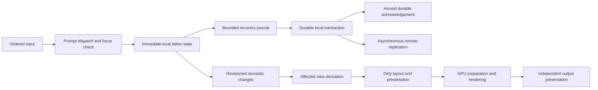

# Park interface overhaul — change report

This is the single active report for the owner-requested responsiveness overhaul of 2026-11-11. It supersedes the execution order and automation instructions archived below. The original Records remain preserved until the owner chooses to remove their native identities; they are historical source material, not a second active queue. This report must be updated in place. Do not start another performance plan or silently mark old acceptance work complete.

Current measured state, 2026-11-14: the latest matched optimized `2d8e7ada` → `044d44a6` comparison verifies 10.5% less typing CPU in surface fingerprinting, but does not establish a whole-frame gain. Mean native update rises from 23.326 to 23.631 ms and typing p95 from 38.551 to 40.991 ms in this pair. Both pass all 90 native checks, 960 checked input samples and pixel/output checks with loss-free coverage, but fail mixed interaction and 60 Hz acceptance: every sampled pan frame exceeds 16.667 ms. The earlier matched password-mask comparison retains its separate 87.3% layout CPU and 6.0% native-update reductions; do not add percentages across these different owners and recordings. The owner’s live report remains “better, still janky, less than 1s” on the earlier `f3459bfb`; full daily desktop acceptance is open.

Evidence availability, 2026-11-14 13:02 UTC: a filesystem recheck found both repository `target/` and the previous private evidence directory `/home/user/.local/state/lince/park-overhaul-20261111/` absent. The cause is unknown. Source, this report and its lossless archive remain intact. Historical results and hashes below record observations made before that loss; statements that old private receipts are retained describe their earlier state, not current availability. Those raw captures, frozen controls and helpers cannot presently be reopened or rehashed. The final retained-source verification was interrupted without an accessible result and is not counted as passed. Fresh verification is recorded separately below in a new directory; it does not restore the old raw captures.

## Incident and what the evidence says

The owner reports approximately one minute between opening a Ghostty tab or entering Edit and a visible response, including an almost empty active workspace. This is a failed product, regardless of isolated benchmark passes. The installed and running boot binary was `baf7fadc54212d857392e1df7969b4c3f7f77814`, an optimized release, not a debug build. No causal percentage of the minute-long delay has yet been established.

The boot's 30-second capture-off recording measured 28.36 seconds of CPU in `park-canvas` (94.53% of one core), about 24.34 seconds across four SQLite workers, and effectively no CPU in the physics worker. Process CPU was 228.87% of one core. Aggregate machine CPU hides this saturation. The record does not establish a controlled quiet interval, but it rules out assuming the canvas thread was mostly asleep during that recording. GPU utilization is not evidence that CPU work should simply be moved to the GPU.

Private nested controls using the installed optimized binary, networking disabled, no credentials, and separate empty databases distinguish an empty layout from the saved layout without its live Records. Neither reproduced a minute-long frame. They expose cold shader/pipeline stalls, but do not reproduce the populated live-data path. This is a scope distinction, not an excuse to dismiss the owner's report. Exact timings and the subsequent representative reproduction belong in the results section below.

Why earlier rounds did not establish success: the previous ledger explicitly leaves populated daily interaction, physical presentation, and end-to-end input acceptance open. Many measurements concern small, private, unoptimized, or otherwise restricted fixtures. Improvements to those owners were shipped while the product's primary failure remained unproven. Later deliveries also addressed startup, credentials, and compaction; they are not demonstrated performance improvements. We cannot claim every binary was slower without matched recordings, but the current owner's experience is an unequivocal acceptance failure.

## Objective and boundaries

Make the central path from input to visible feedback short, bounded, and independent of unrelated data and background work. Unchanged content must cost close to nothing. An empty visible workspace must remain responsive when other workspaces contain substantial data. A normal scene of 20–30 varied native items plus Firefox and Ghostty on both monitors must approach the actual refresh rate without recurring stalls.

Keep data, save guarantees, ordering, focus, IME, clipboard, capture privacy, lock safety, accessibility, output geometry, physics semantics and supported rendering intact. Do not achieve a result by deleting the user's workspace, disabling features globally, weakening permissions, throwing away tool/action results, dropping key transitions, or permanently reducing visual quality. Reuse existing mechanisms when they express the right ownership. Delete competing work and redundant state; do not add a separate scheduler/cache to every feature.

Work in Niri. Private headless/native GPU and bounded nested fixtures are allowed. Do not replace the user's compositor, restart Park, start the personal startup agent, or reboot during this run. Do not run another Engine against the live database. Private SQLite backups may be inspected with a manually constructed Cell runtime that has no Fiote, wire, effect worker, background supervisor or credential access. No compiler runs during a measured interval.

## Central ownership audit

1. Backend-to-interface delivery: immutable shared messages, routing before copying, bounded admission, and no multiplicative copying into unrelated consumers. Snapshot state is different from ordered mutation acknowledgements and text/terminal streams; preserve those distinctions.
2. Work admission: input transitions must not wait behind unbounded background drains or a complete rebuild of every result tree. Bound work at resumable boundaries, retain unfinished work explicitly, and wake only when work is ready.
3. Retention: only changed content requires derivation. Avoid serializing, cloning, validating and indexing the entire canvas during routine frames. Keep exact invalidation at actual inspection, mutation, restore and persistence boundaries.
4. Presentation demand: visible outputs, active editors, capture and portals define demand. Inactive presentation should sleep while necessary data/automation semantics continue. A per-frame scan labelled “cached” is still work and must be charged.
5. Layout and text: avoid dirtying stable nodes; separate intrinsic-size changes from paint and transforms. A growing transcript or result collection must not rebuild all prior text each update.
6. GPU and output handoff: do not synchronously wait for shader compilation or unrelated native updates when a valid frame can remain displayed. Keep geometry, privacy and input mapping coherent with the image actually presented. Respect buffer lifetimes and per-output pacing.
7. Storage and queries: identify repeat reads, query feedback and access-gate waits. Only changed results should invalidate views. Preserve durable-save acknowledgement and authorization. Measure the whole fanout, not just the write transaction.

These are audit areas, not seven claimed fixes. A change is retained only with source review and evidence for its actual boundary. The implementation/results section must distinguish coded, locally verified, rejected and still unverified work. This is one broad coding batch; do not ship production experiment switches or request a fresh session per idea.

## One strict suite

The suite must fail on missing phases, missing input responses, timeouts, unsupported required hardware, empty selectors, mismatched source identity and dropped required measurements. No averages-only pass and no automatically relaxed budgets. Correct output and final state are required alongside timings. A private-frame publication is not physical input-to-screen latency.

| Workload | Required coverage | Gate |
| --- | --- | --- |
| Empty interface, cold then warm | Startup, open/close Edit, external-window geometry, two outputs | Warm command-to-completed-correct-frame p95 <= 33.4 ms, p99 <= 50 ms, worst <= 100 ms; cold readiness recorded separately |
| Empty active workspace with populated inactive workspaces | Hundreds of retained rows and rich text, retained canvas receipts, no view demanded | Same response gate; no recurring full rebuild; genuinely idle CPU <= 2% of one core after settling |
| Daily mixed scene | 20–30 varied items, native text/controls, ordinary windows, both outputs | p95 input feedback <= two refresh periods; p99 <= three; worst <= 100 ms |
| Backend pressure | Large snapshots, irrelevant messages, bursts, saves and terminal/agent output during input | Every ordered transition and receipt preserved; bounded retained backlog; no input starvation; unchanged messages produce no rebuild |
| Continuous activity | Typing, scrolling, dragging, pan/zoom and native animation | >= 97% of actual output refresh during continuous change; avoidable missed deadlines <= 1%; no pause > 100 ms |
| Local edits | Unicode/IME, title/body, multiple views, persistence and reopen | Immediate local echo; durable acknowledgement measured independently; no lost or duplicate edits |
| Lifecycle | Open/close, workspace switch, deletion, output resize, visibility, capture demand | No stale pixels, hit mapping, privileges, subscriptions or retained memory growth |
| Correctness floor | Protein filter glyphs and selection, edit-panel bounds, old input/lock/privacy invariants | Mandatory, exact nonzero cases; a timing win cannot hide a failed functional oracle |

These are strict acceptance targets, not current measurements. Hardware completion, native publication, actual DRM presentation and visible pixels must be labelled separately. The one suite/report must retain cold startup, warmed operation, quiet resource use, long-tail latency, queue age, database work, named systems and GPU work. Wall/CPU/GPU intervals overlap: do not sum nested spans as independent costs. Report before/after against the same fixture and environment. Overall product acceptance remains failed until the actual installed daily workflow passes.

## Implementation and measured results

### What this batch changes

The relevant problem is work amplification on the serial native owner. A visually empty workspace did not imply an empty native workload: retained areas on other workspaces could materialize entire Record trees, incoming messages were copied into many consumers, and small style changes discarded derived state for unrelated trees. Repeated whole-canvas capture added work even when nobody was asking for a canvas snapshot. These are shared interface mechanisms, not Firefox-specific optimizations. The saved-workspace reproduction below demonstrates multi-second stalls before this batch. It does not establish that every second of the reported minute came from these mechanisms.

| Shared boundary | Previous behavior | Retained implementation | Verification and limits |
| --- | --- | --- | --- |
| Cell to native interface | Independent readers cloned owned `ServerMessage` payloads, including large snapshots, before deciding whether they needed them. | `CellMessage` carries an immutable `Arc<ServerMessage>`. Consumers share the message, inspect routing/variant first, and copy only the data they need to retain. Ordinary message cursors and ordering remain unchanged. | Regression checks independent readers, pointer identity, real mutation acknowledgement ordering, and payload lifetime after message expiration. This does not introduce lossy coalescing or discard text/terminal/action results. |
| Protein query projection | A successful reply could dirty an unchanged area; inactive workspaces built row UI even without presentation demand. | Identical ready replies retain existing projection state. Undemanded areas retain logical results but defer new native row construction. Removed/revoked rows are still removed while hidden. Demand includes physical outputs, overview, portals and the active workspace. | Hidden-result readiness and zero materialized rows are asserted in the stress fixture. Functional cases check reveal, unchanged snapshots, another output, portal demand and revocation. Already-materialized hidden rows are retained; this is not full row virtualization. |
| Shared token derivation | A change in one tree invalidated cached style values across unrelated trees. | Invalidate changed nodes, their descendants and dependent previews. Only a theme change or initial setup invalidates everything. Preserve cached values across ordinary frames. | Exact resolver equivalence, reparenting, component removals, preview dependencies and unrelated-tree retention. Invalidation still scans retained cache entries; it is not a claim of zero bookkeeping. |
| Style and metric application | Stable nodes repeatedly prepared/resolved metrics and applied presentation values. | Apply only invalidated or actually changed bindings/nodes. Preserve authored numeric bases, including zero ratios and late fields. Process sufficiently large affected sets in parallel using the existing Bevy scheduler. Button roundness uses the shared cached resolver. | Spacing, padding, typography, icons, reparenting, late additions, zero values and both button kinds pass exact-value checks. No separate cache or scheduling framework was added per feature. |
| Canvas API and persistence | A 200 ms refresh repeatedly captured, cloned, indexed and validated the canvas. Up to eight API operations could run in one update. | Register the host cheaply; capture at an actual API request or persistence boundary. Admit one API operation per native update and wake again while work remains. Keep receipts, undo, schema refresh and recovery state. Move serialized-document validation to the existing storage worker before writing. | Invalid documents leave the last durable snapshot intact; quit still waits for flush. A single large API request or save capture can still occupy the owner: this change bounds admission, not the cost of an individual operation. |
| Surface reuse fingerprint | All glyph/geometry/image inputs were fed through the standard SipHash implementation. | Use Bevy's existing fast hasher for this non-cryptographic render fingerprint; keep every original input and the separate privacy/geometry fences. | Sensitivity regression checks camera, glyphs, clipping and changed images. No new dependency, reduced visual quality or omitted dirty field. |
| Castle readiness | Every glyph repeated a hash lookup for its atlas image, including consecutive glyphs on the same page. | Check a consecutive atlas page once while still visiting all glyphs and validating every page transition. No persistent readiness cache or weakened presentation gate. | Regression removes each page in a multi-page, repeating layout and requires readiness to fail until that page returns. Existing replacement-content stability remains mandatory. Measured mean owner CPU falls from 55.068 to 14.771 ms/call in the follow-up recordings. |
| Retained status/history panels | Sync overview changes destroyed and reconstructed the whole panel, including unchanged long subject labels and controls. Render also cloned the overview before discovering there was nothing to update. | One shared keyed-child reconciler preserves entities, unchanged text, control focus, order and independent child ownership. Sync describes rows only for dirty, presented panels, then changes only different values. | The regression holds 160 long history entries, reorders/removes rows, changes a button caption, preserves focus and unchanged text change-ticks, and checks hidden/reveal behavior. This is not a claim that every feature now uses keyed reconciliation. |
| Panel and inspection demand | Hidden Sync panels continued requesting overviews and rebuilding text. Information panels also rebuilt while hidden. Opening Edit walked the hierarchy for inspection even with every inspection overlay off. | Shared ancestor/workspace demand includes every physical output, overview and portal, without depending on stale layout readiness. Defer hidden presentation, stop hidden Sync inspection requests, refresh on reveal, and skip inspection traversal when it has no output to draw. | Existing logical synchronization and in-flight results continue. Tests cover inactive/secondary-output/preview/portal demand, disabled or display-none parents, reveal before layout, and inspection disable/cleanup. |
| Measurement delivery | Concurrent producers could lose a span or input sample merely because another thread held the recorder mutex, even far below its capacity. | Use Crossbeam's bounded concurrent queue for these two streams, preserving the existing capacity and explicit overflow counters. Text-invalidations get opt-in cause/byte counters. | Eight concurrent producers retain every one of 1,024 unique samples; deliberate overflow is counted exactly. Final representative capture has no lost reports, systems, spans or input traces and includes its final drain. Capture-off does not install the text diagnostic system. |
| Worker failure | A native thread panic could leave a fixture waiting without an immediately visible error. | Recognize an already-finished native worker before shutdown even if its error channel is empty. | The private fixture initially exposed this during a Bevy query conflict. This is failure reporting, not a claimed cause of the original CPU incident. |

Most changed files are consumers of the one shared-message representation. They are not separate feature rewrites. No optimization switches, alternative production renderer, private per-feature scheduler, compositor hot-restart mechanism or credential changes are introduced.

### Matched saved-workspace reproduction

The reference is one private read-only SQLite backup and the exact saved workspace document, copied freshly for each run. The fixture has five workspaces, ten Protein areas on inactive workspaces, 305 Records, and 754 saved placements including nested/generated content. **754 is not a claim of 754 top-level items on screen.** The manual Cell has no personal Fiote, wire or background service startup, and the process has no network namespace access. The live database is never opened by another Engine.

- Database SHA-256: `fc388506a42ae6207aeaab704cdeafa749c8bf2040eeed2939b3b03879929408`.
- Saved document SHA-256: `90c3c6ae6cf3acfd5baf707647b76251be0c6127c3be001afe5141438a55225e`.
- Before source: `baf7fadc54212d857392e1df7969b4c3f7f77814`; the old executable is preserved separately.
- Both comparison executables use the same local **debug** profile/features/linker/CPU environment. No compiler runs during either measurement. These are source comparisons, not predictions of optimized physical desktop latency.
- The common cohort is twelve Edit commands, each followed through the worker's input serial to completed GPU-frame publication. Twelve samples do not establish a reliable p99. Startup is reported separately. The candidate additionally runs thirty seconds of repeated actions to expose delayed background work.

| Common twelve-command cohort | Before | Candidate before the final readiness change | Interpretation |
| --- | --- | --- | --- |
| Profiling off: mean | 3,139.567 ms | 586.611 ms | 81.3% lower mean latency in this fixture |
| Profiling off: median | 597.670 ms | 400.094 ms | 33.1% lower; the mean alone overstates the typical-action gain |
| Profiling off: worst | 15,778.096 ms | 2,661.131 ms | Large old stalls reduced; remaining tail still unacceptable |
| Profiling on: mean | 3,278.017 ms | 731.061 ms | Same direction with named-stage observation enabled |
| Profiling on: median | 1,850.203 ms | 459.211 ms | Timing of late work changes the small cohort; do not generalize this percentage |
| Profiling on: worst | 11,974.720 ms | 2,820.230 ms | No assertion that all stalls disappeared |

Capture-off cold readiness was 3,985.094 ms before and 3,766.695 ms after. The candidate's capture-off soak completed 45 further actions: median 315.339 ms, p95 1,164.471 ms, worst 1,437.133 ms. Capture-on soak completed 47: median 314.468 ms, p95 581.669 ms, worst 1,319.026 ms. Different soak counts and asynchronous background timing prevent treating those two percentile sets as a precise instrumentation-overhead estimate. Both reveal recurring long-tail work. **This batch has not met the responsiveness target.**

Named exclusive owner-CPU observations explain the remaining work more usefully than machine-wide utilization. The old recording has thirty native updates; the candidate recording includes the additional soak and has 130. These are per-call means over different-duration recordings, not independent causal percentages for each source change:

| Native owner | Old mean CPU/call | Candidate mean CPU/call |
| --- | --- | --- |
| Shared style application | 176.627 ms | 3.561 ms |
| Token layout metrics | 77.668 ms | 2.327 ms |
| Protein update | 142.515 ms | 3.202 ms |
| Button roundness | 64.372 ms | 0.820 ms |
| UI text measurement | 223.311 ms | 23.186 ms; individual call still reaches 671.976 ms |
| UI layout | 122.059 ms | 23.673 ms |
| Surface fingerprinting | 64.275 ms | 24.760 ms |
| Castle readiness | 57.093 ms | 55.068 ms before the final atlas-check reduction |

Old style derivation counted 617,587 values in thirty updates; the candidate counted 12,393 in 130. Metric consumers needing resolved values fell from 293,125 to 5,315 across those respective recordings. Canvas captures were thirty / 665.989 ms total before and three / 28.840 ms total after. None of these totals should be added to overlapping wall, GPU or async wait spans. The older observer dropped 1,228 other system samples; the specific owners above each have the full thirty calls, but the complete old system inventory is not a complete CPU accounting. The candidate recording has zero lost reports, system samples, spans or input traces.

Final-source follow-up (`owner-after-atlas` and `owner-after-atlas-off`), after removing repeated adjacent atlas lookups:

| Profiling-off common cohort | Original source | Final source |
| --- | --- | --- |
| Mean, twelve Edit commands | 3,139.567 ms | 495.720 ms |
| Median | 597.670 ms | 306.513 ms |
| Worst | 15,778.096 ms | 2,602.246 ms |
| Cold readiness, separately | 3,985.094 ms | 3,600.885 ms |

This is an 84.2% mean and 48.7% median reduction for the common twelve-command debug cohort. It is **not** an 84.2% claim for Park as a whole. The final capture-off soak has 44 further actions: mean 438.179 ms, median 377.752 ms, p95 1,108.481 ms and worst 1,130.932 ms. Its mean and median are worse than the preceding candidate soak, while its tail improves. The capture-on soak is also worse than that preceding candidate: 42 actions, mean 471.562 ms, median 450.668 ms, p95 1,206.962 ms and worst 1,485.652 ms. Keep those contrary observations; do not select only the favorable common cohort.

The final capture-on common cohort has mean 559.382 ms, median 370.845 ms and worst 2,627.638 ms. Its complete recording has 144 native updates and zero lost reports/system samples/spans/input traces. Readiness CPU is 14.771 ms/call, versus 55.068 before the final change; text measurement remains 21.446 ms/call with a 695.423 ms outlier, UI layout 23.753 ms/call, and surface fingerprinting 26.668 ms/call. The narrower atlas change is retained for its measured CPU reduction and unchanged readiness semantics. It does not establish a uniform action-latency gain: background timing and different update counts remain coupled. Input waiting behind ongoing work and text/layout tails still need optimized attribution.

### Recurring text stalls attributed and removed from the representative replay

The follow-up begins at `4f2f9dea`. Its owner traces expose approximately 670–700 ms text-measurement calls recurring about eight seconds apart while other calls take only a few milliseconds. Opt-in invalidation counters and temporary component-owner attribution identify 160 Sync history subject labels carrying approximately 115,830 bytes, rebuilt together with hundreds of other panel nodes. The activity panel was on an inactive workspace. Source inspection confirms a full child-tree replacement on each changed overview, plus an unnecessary overview clone on ordinary render calls. This is a concrete trigger for repeated text/layout work in a visually empty workspace, not evidence that all of the reported minute-long delay has one cause. Temporary owner logging was removed; no Record contents were printed.

The retained-panel implementation follows an established rendering principle: keep stable display objects and invalidate changed content instead of reconstructing unchanged trees. Chromium's current paint documentation describes retained display items and invalidation at affected objects/subtrees; that is the relevant precedent, rather than replacing Bevy with another toolkit. Bevy already retains its ECS/text state; our panel builder was throwing that state away. [Chromium paint architecture](https://chromium.googlesource.com/chromium/src/+/refs/heads/main/third_party/blink/renderer/core/paint/README.md).

The same immutable saved-workspace fixture, graphics environment, debug profile and twelve-command protocol were used again. Each run gets a fresh copy, no services or credentials, no network access, and no competing compiler. A preserved `4f2f9dea` executable was repeated after the first candidate run. The final candidate was then measured with capture both on and off. These are matched private source comparisons, not optimized physical desktop measurements.

| Capture-off observation | Repeated `4f2f9dea` | Retained-panel final source |
| --- | --- | --- |
| Twelve Edit commands: mean | 497.106 ms | 341.986 ms |
| Twelve Edit commands: median | 308.333 ms | 213.760 ms |
| Twelve Edit commands: worst | 2,597.513 ms | 1,731.808 ms |
| Subsequent 30-second soak: samples | 45 | 63 |
| Soak mean | 419.329 ms | 231.519 ms |
| Soak median | 370.388 ms | 222.444 ms |
| Soak p95 | 1,030.429 ms | 283.334 ms |
| Soak worst | 1,141.146 ms | 373.418 ms |
| Cold initial readiness, separately | 3,901.031 ms | 3,692.870 ms |

The common twelve-command mean is 31.2% lower. Soak median is 39.9% lower and p95 72.5% lower. Soak sample counts differ because the duration is fixed; do not add these percentages to earlier changes or call them an overall Park speedup. The first retained-panel candidate independently measured a 223.346 ms soak median and 298.489 ms p95. The final repeat supports the same direction, but all of these latencies remain unacceptable.

The final capture-on run has 192 native updates, 40 reports, zero lost reports/system samples/spans/inputs and a final report. Its twelve-command mean/median/worst are 394.870/268.053/1,813.678 ms. Its 55-action soak has mean 302.099 ms, median 300.398 ms, p95 350.737 ms and worst 375.610 ms. Capture overhead remains material; performance claims above therefore use capture-off timings.

| Attributed native owner | Earlier `4f2f9dea` mean CPU/call | Retained-panel final mean CPU/call | Final maximum |
| --- | --- | --- | --- |
| Text measurement | 21.446 ms | 2.448 ms | 103.866 ms |
| UI layout | 23.753 ms | 20.659 ms | 39.618 ms |
| Surface fingerprinting | 26.668 ms | 4.108 ms | 8.060 ms |
| Castle readiness | 14.771 ms | 9.887 ms | 16.767 ms |
| Sync panel render | — | 0.085 ms | 0.213 ms |
| Inspection draw | — | 0.077 ms | 0.231 ms |

These are exclusive owner-CPU observations from different-duration runs, not isolated causal percentages. No fingerprint algorithm changed in this follow-up: fewer hidden history glyphs also reduce downstream fingerprint and readiness work. The final text diagnostics observe 1,815 invalidation candidates, 29,963 source bytes and 1,168 new blocks across the complete recording. They distinguish observed text/style/scale/unit/addition changes; Bevy's private missing-font retry flag is not exposed, so the counters must not be advertised as complete accounting of every possible text-measurement cause. A zero-size or inherited-invisible node before layout is not, by itself, proof of absent presentation demand.

The largest remaining recorded first-use stalls include synchronous pipeline processing at 1,224.574 ms owner CPU and initial upscaling pipeline preparation at 712.018 ms. Park explicitly enables synchronous pipeline compilation. Bevy 0.19.1 supports asynchronous preparation, but simply turning it on would allow missing pipelines to produce incomplete frames. Keep this as a separate cold-path obligation: readiness, completion-driven wakeup, shader errors, correct pixels and policy-valid prior-frame retention must be implemented together. It does not explain the sustained warm latency. Whole-scene layout, readiness, remaining per-frame system scans and input waiting behind that work remain candidates for further reduction.

### Strict suite and retained failures

The optimized application exposes `lince --park-performance-check`. It builds private fixture data, runs mandatory Protein/interface correctness first, and measures empty, populated-inactive and thirty-item/two-output scenes. Input uses the actual pointer/keyboard/manipulation path and requires exact characters, changed scroll offsets, visible drag positions and the final committed position. It includes worker idle CPU, input-serial publication, real GPU completion and pixel/output-mapping checks. `lince-park` also has a private `responsiveness` example for matched saved-state replays; it refuses directories without the explicit private-fixture marker.

Each timed interaction cohort has 120 samples. A single >100 ms sample fails its response gate. Missing phases, unnamed/missing system observations, dropped reports/spans, missing hardware GPU execution, an unfinished report, unknown source identity, a debug executable or the five-minute hard timeout prevent an overall pass. There are no automatically relaxed limits. Detailed capture is enabled only for the explicitly requested check. The existing bounded system-observation capacity was raised to cover this application's approximately 1,650 distinct observed systems without losing samples; capture-off does not pay that collection cost.

The first complete interaction run (`strict-final`, before the final atlas-check reduction) passes all 41 mandatory functional cases and all exact outcomes for 120 Edit commands in each scene, 120 Unicode inputs, 120 scrolls, 120 drag movements plus committed position, and 120 pan frames. It fails the debug latency gates and then exits 124 at the five-minute deadline before completing worker/pixel/final-report checks. That result is retained as **failed and incomplete**, not converted into a pass because the executable is unoptimized.

| Strict debug cohort, 120 samples each | p50 | p95 | Worst |
| --- | --- | --- | --- |
| Empty, Edit response | 88.112 ms | 100.104 ms | 106.063 ms |
| Empty active workspace, eight populated inactive areas | 103.252 ms | 125.025 ms | 140.222 ms |
| Thirty native items, Edit response | 330.148 ms | 452.718 ms | 465.745 ms |
| Mixed scene, exact Unicode input under query pressure | 382.917 ms | 557.158 ms | 628.780 ms |
| Mixed scene, directed scrolling | 291.808 ms | 370.292 ms | 509.265 ms |
| Mixed scene, dragging | 340.139 ms | 359.263 ms | 370.857 ms |
| Mixed scene, pan to completed GPU frame | 288.435 ms | 330.442 ms | 363.208 ms |

An earlier candidate run measured 0.097% of one core during the private worker's five-second quiet interval; it is an empty private worker observation, not the populated optimized desktop. It did not pass that run's response gate. A private suite pass, if obtained, must remain distinct from actual Firefox/Ghostty/20–30-item operation on both physical outputs.

Final source verification:

- The complete `lince` application passes locked/offline `cargo check` with both `instinct` and `park` enabled.
- Native interface and Park library test executables compile with `native-presentation`, `session` and `server-tests`. This compiles the full test code; it is not a claim that every test was executed.
- All 25 `native::canvas_host::tests` pass, including ordinary action dispatch, invalid-state rejection, unsaved draft preservation, bounded canvas contracts, guarded undo, restart identity and saved receipts.
- Both `responsiveness::tests` pass: missing/lost observation coverage, insufficient samples, nonfinite values and a single over-budget freeze cannot pass acceptance.
- The `fast_interface_rules` wrapper passes after running all 42 required functional cases and checking their exact, unique registration in Laboratory. Protein Add filter runs first. The new multi-atlas readiness/removal case passes together with replacement-content stability, token invalidation, late/zero metrics, renderer sensitivity and durable/private storage checks.
- Test execution above uses isolated temporary data and no credentials/network access. No release application is compiled locally.

The final-source strict run (`strict-final-source`) repeats all 42 functional cases successfully, completes all three scene cohorts and all 120-input typing/scroll/drag/pan cohorts with correct state, and completes the worker publication cohort. It again exits 124 at five minutes while entering the final graphics proof. Its response gates fail; the deadline is not increased to obtain a pass.

| Final-source strict debug cohort | p50 | p95 | Worst |
| --- | --- | --- | --- |
| Empty, Edit response | 90.080 ms | 97.590 ms | 104.503 ms |
| Empty active workspace, populated inactive areas | 102.445 ms | 112.952 ms | 124.464 ms |
| Thirty native items, Edit response | 310.078 ms | 434.983 ms | 447.289 ms |
| Mixed scene, Unicode input under query pressure | 372.140 ms | 538.207 ms | 581.072 ms |
| Mixed scene, scrolling | 281.334 ms | 351.744 ms | 518.459 ms |
| Mixed scene, dragging | 332.669 ms | 347.446 ms | 366.865 ms |
| Mixed scene, pan | 280.116 ms | 328.071 ms | 365.204 ms |
| Empty worker, queued input to GPU-completed publication | 146.651 ms | 170.932 ms | 179.571 ms |

The final empty worker's five-second quiet interval consumes **0.110% of one CPU core**. The interrupted trace contains 295 valid reports, all seven required phases, named bodies for each interactive phase, 1,150 native-main/post-update-CPU/GPU-completion observations and 1,002 query-execution observations. Hardware GPU intervals are present. Emitted reports record zero dropped reports, systems, spans or inputs, but the watchdog prevents the final drain/report, so this is explicitly **incomplete coverage**, not a successful coverage gate.

The final native graphics proof is then executed separately with a compatible EGL driver and **passes**: exact rendering checks, independent output views, shared captures, reconnects and GPU export. The Vulkan path rejects CPU adapters and the EGL proof selects a non-software device. This closes that focused correctness check; it does not turn the timed-out suite into a pass or establish physical desktop frame pacing.

### Corrections made while validating this batch

These failures are retained so they cannot become fabricated performance evidence:

- The first shared-style candidate exposed Bevy's conflicting-query check. The changed-node query and mutable presentation query now use a `ParamSet`; the corrected native application and interface cases run successfully.
- The initial synthetic inactive fixture requested the default 100-row page while asserting 300 rows, then a subsequent fixture implicitly assigned its populated workspace to a physical output. Both runs were stopped and rejected. The final fixture explicitly requests 300 rows, assigns workspaces to both outputs, asserts the published assignments, waits for all eight full result sets and requires zero inactive row trees.
- The mixed-input fixture used global projected coordinates with `Presentation::pointer`, which expects coordinates local to the focused output. The helper now focuses the actual output, verifies a visible hit target, and converts coordinates using published viewport/frame origins. It does not assign keyboard focus directly. All 120 exact Unicode checks then pass; the ordinary pointer implementation was not weakened to accommodate a test.
- The private launcher's environment whitelist initially omitted EGL/GBM settings. Preserving those names alone was insufficient: `devShells.default` does not supply an EGL vendor, and this debug executable's glibc 2.42 cannot load the host Mesa 26.2.6 build requiring glibc 2.43. The failed default and host-driver attempts are retained. The successful private proof uses the Mesa 26.1.2 EGL vendor/GBM directories from the existing Nix development dependency closure, matching the debug executable. `devShells.interface` and the installed wrapper already define matching runtime defaults; no production graphics-loader change or software fallback is used. The saved-workspace timing comparisons use the same development environment before and after and do not execute this separate EGL pixel-import proof.
- The old system-observation bound loses samples in this application's larger inventory. The bound was increased and loss remains a hard acceptance failure. The complete representative candidate recording has zero reported loss; the deadline-terminated strict run still lacks its final report and remains incomplete.
- The broader test build caught a malformed expression inside a new `serde_json::json!` test fixture. It was corrected before shipping; a normal application check alone would not have checked that `cfg(test)` code.
- The first final `fast_interface_rules` wrapper run passes all 42 bodies but fails catalogue membership: the renderer-fingerprint case had been added to the fast list without registering it in the full Laboratory catalogue. Registration was fixed, the assertion now names any missing/duplicate cases, and the entire wrapper rerun passes.

### Retained-panel verification and recorder correction

The final native executable passes all 48 fast functional cases, including the mandatory Protein dropdown first, readable glyphs, Edit bounds, retained Sync controls/focus, keyed child ownership, output demand, inspection cleanup and concurrent trace retention. The separate hardware graphics proof passes exact rendering, independent output views, shared captures, reconnects and GPU export with the compatible existing Mesa development driver. The five pure performance-recorder tests pass, including bounded overflow, concurrent distributions and report backpressure. The preceding 47-case native test wrapper also verifies exact Laboratory registration; the added recorder wrapper is registered through the same local case macro used by both lists. Both Main scheduling tests pass with the preserved startup/deferred/custom-order behavior.

The first retained-panel capture lost one span despite a maximum of only 171 spans in a report and a 2,048-span bound. The old producer used `try_lock`, so mutex contention could discard a sample without a full queue. That capture remains incomplete evidence. The final bounded-queue implementation retains all samples in both its concurrent regression and the representative replay, without relaxing any acceptance limit. The queue crate was already in `Cargo.lock`; only the direct interface dependency edge was added. No package version was upgraded.

The final application passes locked/offline `cargo check -p lince --features instinct,park`. No local release build is part of this validation.

The final strict run, `retained-final-strict`, again passes all 48 functional cases and every exact interaction outcome in the completed cohorts. It fails the response gates and exits 124 at the unchanged five-minute deadline during the final graphics proof. The separately completed graphics proof above passes; the combined suite remains **failed and incomplete**.

| Retained-panel final strict debug cohort, 120 samples each | p50 | p95 | Worst |
| --- | --- | --- | --- |
| Empty, Edit | 89.232 ms | 100.209 ms | 107.448 ms |
| Empty active workspace, populated inactive areas | 101.847 ms | 111.898 ms | 119.662 ms |
| Thirty native items, Edit | 297.698 ms | 312.152 ms | 346.770 ms |
| Mixed scene, Unicode input under query pressure | 360.810 ms | 522.440 ms | 540.523 ms |
| Mixed scene, scrolling | 288.650 ms | 364.793 ms | 539.814 ms |
| Mixed scene, dragging | 335.369 ms | 354.514 ms | 358.146 ms |
| Mixed scene, pan | 284.537 ms | 331.918 ms | 361.190 ms |
| Empty worker, input to completed publication | 144.853 ms | 167.912 ms | 173.855 ms |

Do not generalize the saved-history replay improvement to this entire synthetic scene. Mixed Edit tails improve, but several other timings are similar or worse than the preceding strict run. Scrolling p95, for example, is 364.793 ms versus 351.744 ms. The synthetic Sync panel does not contain the saved fixture's long history; this follow-up has not solved the broad mixed-workload cost. The private empty worker's quiet CPU is 0.099% of one core, not a populated-desktop idle result.

The interrupted trace has 294 reports, all seven required phases, hardware GPU intervals, 1,193 native-main/post-update-CPU/GPU-completion observations and 1,055 query-execution observations. Emitted reports lose zero systems, spans, inputs or reports, but there is no final drain because of the deadline. That is incomplete coverage, irrespective of the passing complete representative capture. `retained-final-validation.json` in the private evidence directory records source hashes and check results. All 16 archived source hashes remain exact. Delivery uses a source push for CI; no Actions wait, binary installation or session change is part of this batch.

### Optimized private acceptance on `4f2f9dea`

The first broad overhaul's completed CI artifact was tested privately in Niri. Its archive checksum, embedded full revision, target and optimized flag were verified; a private copy uses the installed Nix runtime's loader and library paths. No installed binary, user session or personal database was changed. This revision precedes the retained Sync-history fix at `8dde455c` and the readiness changes below. These results are neither a before/after shipping comparison nor measurements of the current source.

The complete strict run finishes within its five-minute deadline. All 42 functional cases in that revision pass, as do the exact typing/scroll/drag outcomes, worker publication, and GPU pixel/resize/output-mapping checks. The **overall result is failed**: the mixed scene misses its latency and motion budgets, and the old recorder loses 24 span observations. There are 68 reports, a final drain, all required phases and system bodies, hardware GPU observations, and no lost reports, system samples or input traces. The previously implemented bounded span queue addresses the old contention-loss path, but does not retrospectively make this recording complete.

| Optimized private cohort, 120 samples each | p50 | p95 | Worst |
| --- | --- | --- | --- |
| Empty, Edit response | 16.418 ms | 19.500 ms | 21.439 ms |
| Empty active workspace, eight populated inactive areas | 18.013 ms | 24.356 ms | 31.194 ms |
| Thirty native items, Edit response | 38.471 ms | 49.914 ms | 82.799 ms |
| Mixed scene, Unicode input under query pressure | 42.697 ms | 52.587 ms | 95.085 ms |
| Mixed scene, scrolling | 34.895 ms | 47.066 ms | 84.731 ms |
| Mixed scene, dragging | 37.787 ms | 44.727 ms | 50.423 ms |
| Mixed scene, pan to GPU completion | 33.882 ms | 40.821 ms | 45.197 ms |
| Empty worker, input to completed publication | 26.989 ms | 32.363 ms | 37.153 ms |

Cold readiness is 2,050.797 ms for the empty scene, 1,101.584 ms for populated inactive workspaces and 1,997.701 ms for the mixed scene. Quiet empty-worker CPU is 0.0257% of one core. The latency table measures private native publication/GPU completion, not physical input-to-screen latency or Firefox performance. In particular, the 33.882 ms pan median does not establish actual display FPS.

The optimized typing phase attributes 4.456 ms of exclusive CPU per native update to Bevy UI layout, 1.885 ms to Protein update, 1.133 ms to Castle readiness, 1.097 ms to UI border extraction and 0.954 ms to text extraction. The named native-update interval averages 33.372 ms; its main schedule averages 21.109 ms and render update 7.442 ms. GPU submission-to-observed-completion averages 7.247 ms and includes queue/wait time. These intervals overlap and must not be added as independent CPU costs. The recorded GPU diagnostic paths are much shorter than that completion interval, but do not establish a complete, additive GPU budget. Main-thread work, repeated scene processing and serialized handoff remain stronger candidates than an unsupported blanket CPU-to-GPU migration.

A measurement-boundary flaw was also found: construction of the next worker inherited the previous pan phase, and the final graphics proof inherited the worker's input phase. The suite now marks both preparation boundaries as warmup. The old pan phase's 124 updates therefore include transition work; its aggregate cannot be described as 120 purely warmed pan updates. Its explicit 120-sample interaction timings above remain intact. Evidence: `ci-4f2/receipt.json`, `ci-4f2-strict.log`, `ci-4f2-strict.jsonl` and `ci-4f2-strict-summary.json` in the private evidence directory.

### Readiness bookkeeping and Record-copy removal after `8dde455c`

The retained implementation updates the existing layout-stamp map only for changed components, removals and disable/re-enable transitions. It no longer allocates and rebuilds the complete map on every update. Bevy's periodic `CheckChangeTicks` event clears these retained raw counters; the next post-layout snapshot rebuilds the complete map once. Without that reset, a long-running process could compare rebased component ticks with old cached values and hold readiness indefinitely. This issue was found in final review before shipping; the regression checks reset with only part of the tree otherwise changed. Castle traversal uses cached typed ECS queries instead of repeatedly resolving individual components through `World`; it still checks the entire relevant subtree, current text layout, every required image page and layout readiness. Capture-ready and presented markers are written only when their values change. These are query and bookkeeping changes, not a cache that declares old content ready.

Kanban now borrows source rows, retains only UID/quantity data needed across mutation, and builds one UID-to-first-position map per column. It avoids copying complete Record JSON and repeated linear position searches while preserving duplicate-row counts and first-duplicate ordering. Spatial influence similarly borrows Record properties during its read-only calculation. Hidden logical effects, ordinary Record changes and room/column behavior remain enabled.

A more elaborate ready-root cache was implemented, tested and removed. Maintaining its invalidation dependencies cost more than the traversal it replaced: readiness plus its change observer averaged 10.020 ms of exclusive CPU per update, against 7.333 ms with the simpler typed traversal. Its captured soak median was 305.544 ms versus 290.999 ms. Passing functional checks did not justify retaining that extra state. The reparenting, visibility and late-layout regressions written during the experiment remain useful and are kept; no alternate runtime path remains.

The final representative capture (`readiness-reset-on`) has 207 native updates, 39 reports, a final drain and zero lost reports/system samples/spans/inputs. Against the earlier `8dde455c` captured replay, Castle readiness averages 6.363 rather than 9.887 ms of exclusive CPU per call, layout-stamp bookkeeping 0.669 rather than 1.165 ms, and Kanban update 4.235 rather than 4.963 ms. These are observations from separate private debug recordings, not isolated shipping speedup percentages. UI layout remains 18.312 ms per call, area-force preparation 5.696 ms and physics preparation/simulation 6.492 ms in this fixture. Unchanged owners also run faster in this later recording; do not attribute all of the difference to these edits or to the counter-reset safeguard.

The preserved `8dde455c` executable was repeated with capture off against a fresh copy of the same fixture. The final candidate was then measured with capture off; no compiler or other test ran during either measurement.

| Capture-off matched debug replay | Repeated `8dde455c` | Final candidate |
| --- | --- | --- |
| Twelve Edit commands: mean | 321.815 ms | 313.263 ms |
| Twelve Edit commands: median | 204.256 ms | 189.929 ms |
| Twelve Edit commands: worst | 1,636.997 ms | 1,677.974 ms |
| Subsequent 30-second soak: samples | 67 | 67 |
| Soak mean | 201.936 ms | 200.323 ms |
| Soak median | 190.882 ms | 192.407 ms |
| Soak p95 | 258.029 ms | 266.016 ms |
| Soak worst | 360.819 ms | 296.890 ms |
| Cold readiness, separately | 3,919.043 ms | 3,560.365 ms |

The common twelve-command median is 7.0% lower, but its worst sample is worse. Soak mean falls only 0.8%; median and p95 are slightly worse, while the worst sample improves. The earlier matched pair measured a 221.694 → 212.040 ms soak median with p95 273.641 → 279.854 ms. Thus a steady-state latency improvement is not consistently demonstrated. Retain the straightforward CPU/copy reductions, but do not describe these results as a broad responsiveness fix or hide the contrary tails. Before the counter-reset safeguard, the captured soak measured 291.982/413.080/514.415 ms median/p95/worst; the final capture measures 255.851/344.738/356.669 ms. The final baseline is also faster than its earlier repeat, so this cross-run difference is not a measured benefit of the safeguard. Capture overhead and asynchronous work remain material. Acceptance is still failed.

An initial follow-up capture lost one system observation. The system aggregator still used `try_lock` and could discard an otherwise valid sample during a reporter swap or shard collision. Its existing small critical section now takes the mutex; the reporter only swaps the map while holding it and serializes outside the lock. Name/capacity bounds and explicit loss accounting remain. This opt-in observer change is not a production speedup. The regression records 16,000 observations across 32 producers while snapshots drain concurrently and verifies exact counts and exclusive CPU totals. The final captured replay loses no observations.

Verification: all 51 mandatory fast interface cases pass with Protein Add filter first, including the final cache-reset regression; all six Castle cases, fourteen Kanban cases and six spatial-influence cases pass. The six focused performance-recorder checks pass. GPU rendering, independent outputs, shared captures, reconnects and export checks pass. The full application passes locked/offline checking with `instinct` and `park`. The strict-suite warmup-marker edits are compiled; rerunning the optimized suite remains required. The final private replay and graphics checks exercise the edited runtime paths. Final evidence is in `readiness-reset-{on,off,control}/`, `readiness-reset-interface.log`, `readiness-reset-pixels.log` and `readiness-final-validation.json`. No local release build, personal-data Engine, live Park session, installation or reboot was performed.

### Affected UI roots: retained layout, clipping and stacking work

The optimized mixed typing recording places UI layout at 4.456 ms of exclusive CPU per update, clipping at 0.708 ms and stacking at 0.754 ms. The representative debug replay places layout at 18.312 ms. Source inspection identifies work beyond numerical solving: the existing driver walks every tree to synchronize hierarchy and then walks every tree again to refresh geometry, even when Taffy reuses its numerical result. Clipping and stacking also traverse unchanged trees. These observations justify changing this shared boundary; skipped-work counts alone will not establish a full-frame gain.

The candidate patches the pinned Bevy UI driver. It still uses the same Taffy solver, layout rules, rounding, geometry calculation, clipping and stable sibling ordering. Component changes and removals identify affected roots; hierarchy synchronization visits changed parents, and geometry/clipping traverse affected roots. Structural disable/re-enable transitions conservatively refresh layout. Stacking is retained until hierarchy, ordering, membership or an externally changed computed index requires rebuilding. There is no alternative runtime mode, replacement renderer or feature-specific cache. The two root sets are reusable scratch storage, not a persistent tree of copied layout inputs. A rare root carrying both Node and GhostNode retains conservative hierarchy synchronization because the two root roles share Taffy children.

`crates/vendor/bevy-ui` preserves the published 0.19.1 source and its MIT/Apache licenses. The cached registry archive SHA-256 is `8a2f97c39dadfef97dbe295fc1ce212825bb9fda2becc8f558d1d7e7d7dbbedf`; all thirty copied upstream files were compared against that archive before editing. The package is a workspace member so its engine regressions can run directly. The original layout, clipping and stack entry points remain only as test oracles, excluded from production builds. The numerical layout and recursive geometry/clipping calculations remain unchanged. The patch must earn the maintenance cost of a pinned engine override.

All 68 engine unit checks currently pass. The added differential case compares geometry, transforms, clips and stack order over 320 transitions and their subsequent stable updates, including nested sizing, scale, scroll, reparenting, component removal/re-addition, z-order, overrides and external computed-value changes. The original reference is forced to fully synchronize Node/Children inputs: its own stale parent-layout result after Node removal must not become the acceptance oracle. Separate cases cover disable/re-enable, replaced layout storage and eleven ghost-hierarchy transitions. A static 2,080-node scene performs zero additional geometry visits over twenty updates; changing one of its thirty-two roots visits its own sixty-five nodes. Those are correctness/work-elimination checks, not latency measurements.

The normal native interface suite gains a scroll/reparent/clip/input-order/disable-re-enable check while keeping Protein Add filter first. All 52 fast interface cases pass on the final executable. The full application passes locked/offline checking with `instinct` and `park`. The final hardware-GPU probe passes rendering, independent output views, shared captures, reconnects and export. The declared Protein glyph/selection and Laboratory-first requirements and Edit-panel geometry requirement remain covered by mandatory cases. No hardware or day-to-day requirement is inferred from those focused checks.

The preserved `a3e3ca59` executable and the candidate use the same debug profile, graphics environment and verified saved-state reference described above. Each replay receives a fresh private copy, with no services, credentials, networking or live database access. No compiler or other test runs during a measurement. The final paired capture-off replay, after all source and packaging cleanup, gives:

| Final capture-off saved-state replay | Repeated `a3e3ca59` | Final candidate |
| --- | --- | --- |
| Twelve Edit commands: mean | 327.089 ms | 305.370 ms |
| Twelve Edit commands: median | 196.846 ms | 178.756 ms |
| Twelve Edit commands: worst | 1,672.832 ms | 1,677.072 ms |
| Subsequent 30-second soak: samples | 66 | 71 |
| Soak mean | 208.566 ms | 178.902 ms |
| Soak median | 201.680 ms | 167.264 ms |
| Soak p95 | 289.874 ms | 269.978 ms |
| Soak worst | 313.299 ms | 274.121 ms |
| Cold initial readiness, separately | 3,885.973 ms | 3,638.275 ms |

The final soak mean is 14.2% lower, median 17.1% lower and p95 6.9% lower. Its worst sample improves, while the twelve-command worst is slightly worse. An earlier capture-off candidate has a 164.933 ms soak median and 228.662 ms p95, compared with 192.343/266.657 ms before and 187.126/258.866 ms in a repeated baseline control. Its worst sample was 342.174 ms against about 321.5 ms in both controls, approximately 6.4% worse. Both matched comparisons support lower typical steady processing time, but neither proves every tail improves. Earlier baseline cold readiness also beat the candidate, so a reliable cold-start improvement is not established. The earlier measurements remain in the evidence; they are not replaced by the more favorable final tail. These are private debug source comparisons, not release latency or physical FPS claims.

A separate paired capture-on run attributes the changed boundary directly. Both recordings include a final drain and lose no reports, systems, spans or inputs. Per-call exclusive owner CPU is:

| Shared owner | `a3e3ca59`, 171 calls | Candidate, 173 calls |
| --- | --- | --- |
| UI layout | 23.059 ms | 17.924 ms |
| UI stacking | 4.074 ms | 2.200 ms |
| UI clipping | 4.145 ms | 2.269 ms |
| Combined exclusive CPU of these three systems | 31.279 ms | 22.393 ms |

The three systems together use 28.4% less mean exclusive CPU in this recording. This sum is restricted to distinct exclusive system CPU observations; it is not a sum of nested wall/GPU spans. The captured whole-run soak does **not** improve: mean 378.960 → 380.839 ms, median 364.206 → 377.813 ms and p95 472.912 → 479.998 ms, with worst 655.917 → 589.635 ms. Other preparation owners remain substantial and some get slower in the recording: physics 8.397 → 8.871 ms, Castle readiness 7.874 → 7.958 ms, area forces 7.453 → 7.450 ms and Kanban 5.373 → 5.617 ms per call. The opt-in phase observer itself costs about 12 ms per update. Capture changes the workload and the captured and uncaptured pairs were taken at different times; do not derive a precise observation-overhead percentage from them. Retain the simpler traversal reduction because the functional checks and repeated capture-off comparisons support it, not because lower owner CPU guarantees better end-to-end latency.

The broad strict debug run is still **failed and incomplete**. All 52 mandatory correctness cases and the exact interaction outcomes completed through the mixed scene. Each cohort below has 120 responses:

| Strict debug cohort | p50 | p95 | p99 | Worst |
| --- | --- | --- | --- | --- |
| Empty: Edit | 95.143 ms | 103.442 ms | 112.966 ms | 114.266 ms |
| Empty with eight inactive areas: Edit | 106.538 ms | 117.639 ms | 123.622 ms | 126.478 ms |
| Thirty mixed items under query pressure: Edit | 282.820 ms | 303.058 ms | 321.715 ms | 323.626 ms |
| Mixed: typing | 359.749 ms | 545.667 ms | 559.411 ms | 560.601 ms |
| Mixed: scrolling | 265.272 ms | 328.211 ms | 431.026 ms | 514.750 ms |
| Mixed: dragging | 316.257 ms | 348.821 ms | 364.998 ms | 375.590 ms |
| Mixed: pan | 263.190 ms | 315.684 ms | 351.386 ms | 352.741 ms |
| Worker input to completed publication | 152.241 ms | 175.243 ms | 181.039 ms | 183.108 ms |

Cold readiness is 5,300.111/5,353.625/14,368.444 ms for the empty/inactive/mixed fixtures, respectively. Quiet worker CPU is 0.102% of one core. The final pixel case rejects the local EGL environment for missing `EGL_EXT_device_base`: this invocation omitted the matching Nix Mesa paths, mixing the debug build's Mesa 26.1/glibc 2.42 environment with the host Mesa 26.2/glibc 2.43. The standalone final GPU probe uses the matching paths and passes; that does not convert the strict run into a pass. The process hits its unchanged five-minute deadline and exits 124 without the final suite coverage/result object. The performance stream does finish its own final drain with zero lost observations. A final performance report and a completed, passing test-suite report are distinct. The suite also rejects debug executables for acceptance; neither debug timings nor a graphics-environment failure justify weakening its limits.

Final packaging preserves and installs both Bevy UI licenses in UI packages. The vendored code replaces the legacy `core::f32` import with primitive constants, and six existing test literals get explicit `f32` types, so the newly local dependency does not introduce fatal warnings under the application's warnings-as-errors build. These edits do not change runtime layout calculations. All 68 engine unit tests pass after those warning fixes; Nix syntax validation and the final full application check pass. The final native and GPU checks and capture-off pair use executables rebuilt after the complete cleanup. The pinned engine override is a maintenance obligation when updating Bevy, not an invitation to fork unrelated toolkit behavior.

Private evidence: `layout-upstream.json`, `layout-baseline-source.json`, `layout-candidate-source.json`, `layout-final-source.json`; `layout-{before,after,control}-off/`, `layout-{before,after}-on/`, `layout-final-{control-off,off}/`; `layout-strict-debug.{log,jsonl}`, `layout-strict-debug-summary.json`, `layout-final-interface.log`, `layout-final-pixels.log`, and `layout-final-validation.json`. Source/executable hashes distinguish the measured versions. Acceptance remains failed until the optimized saved-workspace and physical daily workload meet the existing targets.

### Optimized Park visit — `f3459bfb`, 2026-11-14 UTC

The owner entered Park and requested measurements before returning to Niri. The running process is the installed optimized `f3459bfbcd52deb8bf511ce01b72b6d60d462ed0`, verified through its actual executable, installed build metadata and SHA-256 `cadda5c7728eec9dfcece0dc208c7621c2c7d2d5db1994fe62cbc3263641773c`. The machine reports an i7-1165G7, eight logical CPUs, about 15.4 GiB RAM and Intel i915 graphics. Read-only Wayland output discovery confirms eDP-1 at 1366×768, 60.059 Hz, and HDMI-A-1 at 1920×1080, 60 Hz, both scale 1. No application build, installation, compositor restart or personal-data Engine was started for this visit.

The owner completed the requested Edit open/close, chat typing and available canvas-drag interactions and reported: “better than before, still a little janky, less than 1s overall, but needs improvement.” This is qualitative human evidence, not a stopwatch measurement or a pass against the millisecond targets. Individual human action timestamps are unavailable. The three live recordings are separate from the isolated suite, with no compiler or test workload running alongside them:

| Live process observation | Requested quiet baseline, 30 s | Requested interaction period, 45 s | Follow-up, 20 s |
| --- | --- | --- | --- |
| Total CPU, percent of one core | 211.90% | 204.44% | 203.85% |
| Native canvas thread | 71.00% | 70.91% | 70.60% |
| Four SQLite workers combined | 53.87% | 51.71% | 51.45% |
| Compute pool threads combined | 37.17% | 37.36% | 37.60% |
| Process read-returned bytes (`rchar`) | 2,234,438,319 | 2,738,100,474 | 814,342,621 |
| Actual storage-read bytes | 0 | 61,440 | 32,768 |
| Native canvas runnable-queue wait | 69.10 ms | 91.59 ms | 30.18 ms |

The follow-up also records per-thread I/O: SQLite workers account for 773,279,744 of 814,342,621 read-returned bytes, approximately 95%, through 188,789 reads in twenty seconds, with zero storage-read bytes on those threads. This is substantial repeated database/cache work; it is not 773 MB of disk traffic. The sample does not identify the SQL statements or prove which view/service requests them. Read contents were not inspected. The live canvas thread spends very little of each interval waiting runnable for a CPU, so lack of available CPU time alone does not explain the delay. Compute workers are already active; the evidence does not justify treating absent parallelism as the sole cause.

GPU fdinfo is deduplicated by DRM client ID. The two active render clients account individually for approximately 16.0%/18.3% in the baseline, 11.6%/19.8% during requested interaction, and 11.5%/20.0% in the follow-up. These are per-client engine counters, not physical FPS or an additive GPU utilization guarantee. The process initially has no swap; its later observations reach about 239 MiB swapped. System I/O pressure is also elevated, while memory-pressure stalls and major-fault counts are small in these intervals. Both facts remain in the raw resource recordings; neither is sufficient to assign the jank to swapping or storage. The sampler itself uses roughly 1.3–1.6% of one core.

Twenty read-only `wl_display.sync` requests measure compositor dispatch round trips at median 0.208 ms, p95 1.785 ms and maximum 4.490 ms. This small cohort shows that the Wayland dispatch path can answer promptly while the desktop feels janky. It does not measure input processing, native updates, client drawing or physical scanout. Detailed in-process tracing was disabled when this live session started and cannot be switched on through the existing recorder; no debugger injection or security-setting changes were attempted. Consequently these live samples cannot provide per-system attribution for the personal canvas.

The same installed executable then runs `--park-performance-check` in a private HOME/config/data/runtime directory and network namespace, with the installed graphics metadata rather than the local debug environment. It uses synthetic data and manual fixture Cells without personal Fiote or wire startup. The real Park session remains running throughout, and its resource counters are saved alongside the suite. This makes the run a valid functional/acceptance observation under concurrent desktop load, **not** a controlled before/after comparison with earlier suites taken in Niri. It completes in 71.05 seconds, exits 1 because timing gates fail, and identifies itself as optimized at the exact running revision.

| Optimized strict cohort, 120 samples each | p50 | p95 | p99 | Worst |
| --- | --- | --- | --- | --- |
| Empty: Edit | 22.405 ms | 30.614 ms | 33.148 ms | 33.759 ms |
| Empty with eight inactive areas: Edit | 24.736 ms | 32.119 ms | 34.011 ms | 36.334 ms |
| Thirty mixed items under query pressure: Edit | 49.043 ms | 59.855 ms | 92.180 ms | 99.954 ms |
| Mixed: typing | 54.628 ms | 65.219 ms | 115.028 ms | 127.225 ms |
| Mixed: scrolling | 46.312 ms | 55.921 ms | 61.407 ms | 102.425 ms |
| Mixed: dragging | 49.267 ms | 56.489 ms | 60.260 ms | 60.555 ms |
| Mixed: pan | 46.415 ms | 52.884 ms | 54.304 ms | 58.545 ms |
| Worker input to completed publication | 35.693 ms | 46.811 ms | 48.899 ms | 49.102 ms |

Empty and populated-inactive Edit cases pass their existing gates. The mixed scene and worker input case fail. All 52 mandatory interface cases pass, Protein Add filter first, including readable choices/selection and Edit-panel geometry. Exact interaction outcomes and final pixels/output-mapping checks pass. The timing stream has 81 reports, its final drain, all required phases/systems/stages, hardware GPU execution, and zero lost reports, systems, spans or inputs. The final suite coverage/result object is present; this is a **complete measured failure**, unlike the earlier debug timeout. Cold readiness is 2,390.044/1,708.160/2,510.957 ms for empty/inactive/mixed scenes. Private empty-worker quiet CPU is 0.0198% of one core; that must not be substituted for the live application's roughly two-core workload.

For the 120-update mixed typing phase, mean native-update wall time is 45.142 ms, main-schedule wall time 28.771 ms and extraction wall time 4.086 ms. Submission-to-observed-GPU-completion is 5.187 ms and includes queue/wait time. These intervals overlap and cannot be added as independent costs. The largest ordinary exclusive CPU owners include UI layout 4.306 ms, Protein update 2.637 ms, camera driver 1.987 ms, text extraction 1.311 ms, border extraction 1.257 ms, native physics preparation 1.249 ms, Castle readiness 1.164 ms, capture fingerprinting 1.021 ms and UI stacking 0.960 ms per update. The opt-in phase observer itself takes 2.406 ms. Clipping is 0.683 ms. Recorded GPU pass intervals are much shorter than the whole update, but do not constitute an additive accounting of all GPU work. Warmup still includes individual upscaling-pipeline and pipeline-queue calls reaching 676.956 and 610.003 ms of exclusive owner CPU, respectively.

A second substantial signal is asynchronous Record access contention inside the synthetic workload: during typing, 42 write-access waits average 771.059 ms and reach 1,376.497 ms, while the associated write-held intervals average 0.439 ms. Six read-held intervals average 914.272 ms and reach 1,412.680 ms. These are elapsed asynchronous spans, not CPU usage or added input latency, and the small read cohort does not establish a reliable percentile. They strengthen the need to inspect gate lifetime and query/refresh fanout alongside rendering. They do not prove those exact waits occur on the personal data path. Coordinate any changes there with ongoing sync/history/DB-lock work instead of duplicating it.

Evidence is retained privately under `/home/user/.local/state/lince/park-overhaul-20261111/visit-f3459bfb-20261114T0005Z/`: executable/host identity, actual outputs and dispatch samples, the three raw live resource recordings and summaries, the human observation, the complete optimized suite log/trace/receipt, per-phase CPU/wall/GPU/counter summary and concurrent live-process resource observations. The directory also keeps the small capture/analysis scripts so the method is reproducible. No raw personal Record contents or screen images were collected. All measurements are finished; the next coding round belongs in Niri.

### Query amplification investigation in Niri — unchanged `f3459bfb`

After the owner returns to Niri and Park has stopped, the same installed optimized executable runs the private strict suite again, with its own installed graphics metadata and no compiler running. It finishes in 55.03 seconds. Empty Edit p95 is 22.015 ms, populated-inactive Edit 23.712 ms, mixed Edit 41.982 ms, typing 53.461 ms, scrolling 42.251 ms, dragging 42.255 ms, pan 39.349 ms and worker publication 32.280 ms. All 52 interface correctness checks and final pixels/output mapping pass. Mixed interaction still fails. This is an environment control, not a source-code improvement or a matched measurement of compositor overhead.

The 69 trace reports include the final drain, every required phase/system/stage and hardware GPU work. However, 52 span samples overflow the bounded recorder, so coverage correctly fails. Exact interaction cohorts are complete, but this recording must not be described as complete per-stage accounting. Recorded typing-phase write-access waits still average 676.468 ms across 39 calls while write-held intervals average 0.339 ms; seven read-held intervals average 631.734 ms. Query execution records 261 elapsed samples averaging 19.488 ms. Removing concurrent Park therefore does not remove the long guarded refreshes. These remain asynchronous elapsed measurements, not CPU totals or physical input latency.

The source reruns every subscribed Protein serially for each refresh, including identical definitions, inside the existing read-access scope. A structural inspection of the frozen workspace snapshot finds 19 serialized query definitions, 12 distinct, with one definition repeated eight times. Those are saved definitions, not a count of current live subscriptions. The first experiment shares successful identical results inside one event only, preserves each alias and its Sync activity, and leaves the authorization boundary in place. Distinct queries, intervening edits, unsubscribe/replacement, failed queries and permission changes require correctness checks. Repeated trigger attribution remains separate work; this experiment does not establish the cause of all live SQLite activity.

Private control evidence and the ensuing query experiment belong in `/home/user/.local/state/lince/park-overhaul-20261111/round-query-20261114/`. The prior debug replay executable is frozen there with SHA-256 `9181a2aa1bfe1d66437ff89b83fde0ff6da796d4f61c39ab4a125022475f1f00` for comparisons after rebuilding. No personal workspace is modified by these fixtures.

### One result per identical query in each event — local query checks

`Session` now evaluates equal subscribed Proteins once within a refresh or Fact event and fans the successful rows out to their original subscription IDs. Structural equality includes source, predicates, fields, includes, aggregation, order and limit; it does not serialize a query in the hot path. It uses the response already being constructed, not a persistent result cache. The next event executes a fresh query. Failed queries still report their own errors, subscriptions keep separate Sync activities/history, Nearby refreshes update their existing last-value state, and the existing login, visibility, access guard and selective Fact invalidation remain in place. Refresh no longer clones and reinserts the unchanged subscription map. Initial Subscribe messages and the independent ephemeral tick retain their existing behavior.

The file-backed synthetic query benchmark has 300 Records with 4 KiB descriptions. Each condition performs twelve warmed refreshes. Two runs of the frozen old test executable and two of the candidate are interleaved, without compilation during measurement. They are debug builds; these timings are not shipping latency or an estimate of the entire desktop's improvement.

| Subscription condition | Old median per run | Candidate median per run | Actual query executions over 12 refreshes | Cached bytes read over 12 refreshes |
| --- | --- | --- | --- | --- |
| Eight identical queries | 64.592 / 62.949 ms | 11.179 / 10.597 ms | 96 → 12 | About 109.23 → 13.65 MB |
| Thirty-two identical queries | 257.912 / 269.860 ms | 25.252 / 21.250 ms | 384 → 12 | About 436.91 → 13.65 MB |
| Thirty-two distinct queries | 253.285 / 265.672 ms | 264.283 / 265.374 ms | 384 → 384 | About 436.91 MB in both |

For the eight-alias condition, average read-guard hold falls from 64.330–64.998 ms to 10.533–10.880 ms, and measured process CPU over twelve refreshes falls from 0.94–0.96 s to 0.16 s. With 32 aliases, holds fall from 256.043–269.770 ms to 21.694–23.069 ms and CPU from 3.77–3.99 s to 0.36–0.40 s. The read reduction is 87.5%/96.875%; `rchar` is cached file-read volume, not physical storage traffic. Distinct-query work is unchanged, with CPU 3.76/3.94 s before and 3.90/3.91 s after. Its timing ranges overlap and one pair is slower; no distinct-query speedup is claimed. These short runs do not establish a fine-grained overhead bound.

Twenty-six transport checks pass: three new batch regressions, fifteen existing session tests, four login tests and four Sync-service tests. The new cases compare rows against independent query execution, retain per-alias history, change data between events, replace/unsubscribe aliases, exercise failed reads without stale results, separate local/remote visibility and revoke a grant, and preserve quiet ephemeral ticks after refresh. The manual benchmark is deliberately ignored in ordinary concurrent test runs and was executed separately. Saved-canvas response timing and the native interface gates are checked separately below; neither the large query reduction nor these backend checks constitute daily-use acceptance.

### Saved-workspace countercheck and graph amplification

The identical-query optimization does **not** establish better saved-workspace responsiveness. Two capture-off replays of the old debug executable have steady medians of 207.238/210.319 ms; two batching-only replays have 211.216/206.701 ms. The respective p95 values are 291.623/252.242 ms and 263.591/294.190 ms, with 65 steady responses in every run. Typical response is essentially unchanged. The twelve initial Edit commands also retain a roughly 1.7–1.8 second worst response. These matched negative results are kept alongside the synthetic query win.

A complete captured pair reduces executed queries from 109 to 96, but total read-guard occupancy is nearly identical at 37.527/37.449 seconds. A single query still takes approximately nine seconds, and a guarded refresh reaches approximately 9.6 seconds. The recordings each contain 38 reports, their final drain, and zero lost observations. Async query, refresh and guard intervals overlap; their totals must not be added or labelled CPU time. The first batch's new span/counter names were not yet in the interface recorder's allowlist, so these two traces do not contain the new batch metrics. The bridge now admits fixed numeric batch, source-specific query, Record selection/materialization and graph measurements; arbitrary names and private contents remain rejected.

Isolation on the same frozen database distinguishes query selection from enrichment. The twelve distinct saved query definitions complete individually in at most 139.843 ms cold and 79.923 ms warm. Adding generic built-in source probes still exposes no nine-second query. In contrast, requesting relation links for 248 Records takes **16,758.668/16,743.635 ms** in two successive debug samples. Threads for the same number of Records take 501.569/423.308 ms. The link implementation reloads the complete selected relationship graph once per returned Record, then scans it again for each traversal hop. Serialized templates explain why the simple saved query alone did not reproduce that work: enrichment is added by the interface.

The replacement loads the same authorized query's graph once and indexes incident edges. Per-Record traversal visits incident candidates, preserves original global edge order at every hop and retains direction, depth, cycle, duplicate-link, quantity and name-resolution behavior. The graph belongs to one query only; subsequent queries observe fresh data, with no persistent cache or access-boundary change. Empty results and aggregation avoid graph loading. The existing selector and all non-link includes retain their behavior.

The independent old full-scan oracle matches the indexed traversal in 4,992 graph/direction/depth/root combinations. A database integration check verifies one load for twelve returned Records, zero unnecessary description decoding, exact filtered links, fractional quantities, subsequent retractions and empty selection. All 27 Protein unit/query/relation checks and all 26 transport/session/login/Sync checks pass with the graph change.

On the same frozen-data link workload, the replacement takes **127.399/87.858 ms**, compared with 16,758.668/16,743.635 ms: 99.24%/99.48% less elapsed query time in these two debug samples. All forty before/after query-shape hashes, row counts and result/error classifications agree. The independent graph oracle supplies the exact output checks; the private profiler deliberately does not export Record payloads. The unchanged thread include remains 506.102/449.818 ms, so no thread-query improvement is claimed. Receipts preserve the source and executable identities, fixed fixture and raw timings. Native interface response and resource use are separate measurements below; this query percentage is not a whole-desktop improvement claim.

### Saved-workspace result after sharing and indexing the graph

The final native examples use the same debug profile and `session` features as the preserved `f3459bfb` baseline, with matching Nix Mesa paths. Each replay receives a fresh copy of the exact frozen database and document. The first capture-off pair runs baseline then candidate; the second reverses that order. No compiler or other test runs during either pair. The workload is twelve Edit transitions followed by thirty seconds of repeated transitions, spaced 250 ms after each response; faster replies therefore produce more completed soak actions.

| Capture-off observation | Baseline, first / second run | Candidate, first / second run |
| --- | --- | --- |
| Whole-process CPU time, including startup | 88.312 / 88.186 s | 56.612 / 57.149 s |
| Wall duration | 40.706 / 40.152 s | 40.007 / 40.061 s |
| Soak completed actions | 73 / 73 | 75 / 76 |
| Soak median response | 159.202 / 157.036 ms | 143.763 / 142.377 ms |
| Soak p95 response | 230.507 / 231.978 ms | 219.911 / 215.165 ms |
| Soak worst response | 268.337 / 357.995 ms | 262.230 / 252.964 ms |
| Twelve initial actions: median | 174.391 / 172.669 ms | 154.611 / 154.052 ms |
| Twelve initial actions: worst | 1,661.280 / 1,658.249 ms | 1,769.065 / 1,721.940 ms |
| Cold readiness, separately | 3,800.073 / 3,560.933 ms | 3,605.500 / 3,425.544 ms |

Whole-process CPU falls 35.9%/35.2% while completing slightly more actions in similar wall time. Steady medians improve 9.7%/9.3%, and steady p95 improves 4.6%/7.2%. **The initial worst response regresses about 6.5%/3.8% and remains unacceptable.** Cold preparation has not been fixed. These are repeated local debug comparisons; they establish less work and a modest steady response improvement in this fixture, not an optimized desktop FPS or idle-CPU result. The graph fix earns its place by eliminating the measured read amplification, preserving output and reducing actual fixture CPU; the negative cold tail stays recorded.

A final captured replay has 38 contiguous reports, its final drain, and zero lost reports, systems, spans or inputs. Compared with the preceding complete batching-only trace, the remaining Record-access and query spans are:

| Inclusive asynchronous observation | Batching only | Final graph candidate |
| --- | --- | --- |
| Read-held calls / total / maximum | 36 / 37.449 s / 9,601.060 ms | 41 / 7.640 s / 821.215 ms |
| Query calls / total / maximum | 96 / 37.440 s / 9,046.070 ms | 211 / 7.625 s / 422.689 ms |
| Refresh calls / total / maximum | 4 / 27.870 s / 9,601.043 ms | 9 / 6.586 s / 821.197 ms |
| Write-access waits: calls / mean / maximum | 28 / 2,308.385 ms / 9,517.000 ms | 46 / 95.125 ms / 821.140 ms |

The faster query path completes more queued refreshes, so the work counts are deliberately shown. These overlapping elapsed spans cannot be summed as CPU or direct input delay. The new graph counters show nine graph loads for 972 per-Record projections, instead of a load for every projection; mean graph load is 70.327 ms and mean incident-edge projection 0.185 ms. The event batch reuses 75 successful query results. Source-specific spans now identify the remaining long query as Record work: maximum selection is 70.198 ms, materialization 408.683 ms. The separately measured thread enrichment remains a candidate within that materialization; this trace does not identify each include's share. Refresh and write waits below one second are much better than nine seconds but still exceed the responsiveness target.

All 52 fast native interface checks pass on the final executable, with readable/selectable Protein filters first, Edit-panel bounds and the numeric-only performance bridge exercised. The separate hardware-GPU probe verifies rendering, independent output views, shared captures, reconnects and export. The final locked/offline application check passes with `instinct,park`. The strict optimized suite from the Park visit remains the current product acceptance failure; no local release build or new installed-session claim is substituted for it.

Private receipts in `round-query-20261114/` include `graph-query-comparison.json`, `graph-native-source.json`, `graph-*-checks.log`, `graph-native-{fast,gpu}.log`, `graph-{control,candidate}-off*/`, `graph-candidate-on/`, build logs and the replay/summarization helpers. Exact executable and source hashes distinguish these from the preceding batching-only measurements. The single report retains both successful work elimination and unsuccessful or regressed end-to-end results.

### Thread selection and retained exclusive queries — follow-up to `bd519b79`

The remaining thread enrichment repeats four vocabulary-binding reads and a relation query for every returned Record. The frozen database has twelve active thread relations attached to eight Records, while the enrichment probe returns 248 Records. The new query-scoped selection resolves those bindings once and reads related subjects in one SQL statement, using the same `json_each` pattern already used by `records::get_many`. It groups by the actual resolved relation target and keeps the old predicate-family, retraction, deletion, deduplication and ordering behavior. Message projection, pagination, creator/social metadata and call summaries retain their implementation in a dedicated thread module; the transfer view uses that same implementation. No cross-query cache, additional permissions or new service is introduced.

The grouped-store regression compares every returned Record field and order with the original individual lookup, including feature aliases, duplicate roots/edges, more than 1,100 requested identities, missing/quoted identities, retractions, deletion and changed feature bindings. The Protein check uses 64 roots, separate thread limits/cursors and later deletion; it requires one selection and one relation batch and preserves empty roots. Those two checks pass, as do twenty existing Record-query and three relation-context tests.

The broader Protein `features` suite reports **24 passed and five failed**. A separately built unchanged `bd519b79` control reproduces exactly the same five failures: `availability_reflects_active_outgoing_promises` expects the absent `planned` field; `nested_record_filters_cover_text_dates_relations_and_assignee` creates an ambiguous `part-of` meaning; `threads_include_keeps_an_empty_thread_without_a_message_predicate` fails its vocabulary precondition; `threads_include_resolves_sender_name_from_the_actor` has setup rejected by the bounded mutation policy; and `visibility_gate_is_the_one_read_boundary` expects one visible result and receives two. These are recorded failures, not newly passing checks or a claimed full feature-suite pass. This performance batch does not rewrite those expectations or change access policy. Baseline and candidate sources/executables, logs and restoration receipts are private in `round-thread-20261114/`.

The native trace also charges roughly 3.7 ms of exclusive CPU per call to Kanban update in the saved-workspace replay, which contains a Kanban. Its routine queries reconstruct Bevy query state every frame. The retained change uses Bevy's built-in exclusive `QueryState` parameters for the same three queries, leaving the update body, ordering and output intact. The new native case checks late archetypes, board disable/re-enable/removal, stale parts and released-card membership. The new control/candidate captures measure 3.822/3.501 ms of exclusive CPU per call across 225/231 updates. That modest difference does not establish a major cause or justify a broad rewrite of every exclusive system; other owners also vary between recordings. Keep the simpler framework-owned query lifetime and its correctness check without claiming an isolated percentage of whole-interface improvement.

The same 248-Record thread probe runs in baseline/candidate/candidate/baseline order with compilation stopped. The two baseline runs take 475.750/451.563 ms and 481.375/421.920 ms for cold/warm samples; the candidates take 55.196/40.578 ms and 53.538/43.858 ms. That is approximately 88–91% less elapsed thread-query time. All forty query hashes, row counts and error classifications agree across all four runs, including the unchanged link/numeric/shader and built-in-source controls. Three existing subscription-batch regressions also pass. These are local debug query results, not physical input or whole-desktop improvements.

The final native suite passes all **53 cases**, with Protein Add filter first and the existing readable-text and Edit-panel geometry checks intact. The GPU probe passes native rendering, independent output views, shared captures, reconnects and export. The exact final native source/executable hashes are verified against `native-source.json`.

Four saved-workspace runs use fresh copies of the same database/document, tracing disabled, matching debug profile/features, and no concurrent compiler. The order is control/candidate/candidate/control. These repeat the existing twelve-command cold cohort and thirty-second Edit soak; they are not physical desktop latency measurements.

| Capture-off observation | Control A | Candidate A | Control B | Candidate B |
| --- | --- | --- | --- | --- |
| Startup | 3,891.724 ms | 3,680.894 ms | 3,749.782 ms | 3,476.300 ms |
| First twelve actions: median | 152.313 ms | 150.038 ms | 199.687 ms | 155.736 ms |
| First twelve actions: worst | 1,821.201 ms | 1,818.090 ms | 1,890.343 ms | 1,759.376 ms |
| Soak action count | 76 | 76 | 72 | 75 |
| Soak median | 143.580 ms | 141.862 ms | 153.721 ms | 148.400 ms |
| Soak p95 | 214.300 ms | 246.466 ms | 231.987 ms | 226.394 ms |
| Soak worst | 273.089 ms | 284.177 ms | 284.406 ms | 285.865 ms |
| Whole process CPU | 57.272 s | 55.024 s | 60.352 s | 55.438 s |
| Whole run wall time | 40.861 s | 40.162 s | 40.906 s | 40.010 s |

The candidate uses 3.9%/8.1% less total CPU in these bounded replays. Typical warmed latency improves only 1.2%/3.5%; p95 worsens 15.0% in A and improves 2.4% in B, while worst latency worsens in both. The small repeated cohorts and asynchronous background timing do not establish a stable tail improvement or its cause. Retain the demonstrated query-work reduction, but do not describe this as smoother whole-interface behavior or acceptance. Peak resident memory is about 10–15 MiB higher in the candidate runs; this observation is not a leak diagnosis.

The captured control/candidate have 38/40 contiguous reports, final drains and zero report/system/span/input loss. Both contain 41 read-held intervals, 48 write waits and nine refreshes. Read-held elapsed totals fall from 7.853 to 5.484 s, with maxima 887.985/615.006 ms; refresh totals fall from 6.810 to 4.668 s. Record materialization maxima fall from 414.098 to 194.487 ms across 183/180 materializations. Write-wait means remain 93.559/91.000 ms, with maxima 889.981/639.898 ms. Query counts differ, 208/204, and elapsed asynchronous spans overlap: these are not additive CPU savings or measured input-to-screen delay. The candidate's 27 thread selections take 64.965 ms total, including 27 batched relation lookups; 36 nonempty thread projections take 153.136 ms total. Repeated refresh work and broad read-access lifetime still deserve attention, while authorization, revocation and durable acknowledgements must remain correct.

Native work still dominates much of the action path: the candidate's UI layout averages 12.595 ms of exclusive CPU, physics preparation 5.975 ms and Area forces 4.942 ms per update in this debug capture. Cold pipeline queue processing has a 1,256.365 ms individual call. These are specific remaining owners, not proof that the physics worker is busy or that low GPU utilization is a GPU-placement fault. The next batch should address unchanged native preparation and refresh fanout rather than keep treating enrichment speed as the product outcome.

Private evidence, including both source generations, test failures, query comparisons and all six new native recordings, is in `round-thread-20261114/` under the retained evidence directory. The full application check with `instinct,park` passes. Final validation preserves the source/executable identities and all sixteen archived Record bodies exactly. The existing optimized product acceptance failure remains authoritative; this source has not been installed or tested in a new physical Park session.

### Native Area preparation ownership — follow-up to `32449dc2`

The next capture separates work previously grouped under physics preparation. In the same private saved-workspace debug replay, 219 native updates perform 438 Area-effect updates and 439 field preparations. Field preparation averages 3.665 ms per call and the following spatial-force calculation 1.650 ms. Physics-body synchronization averages only 0.511 ms, terrain preparation 0.111 ms and Protein motion preparation 0.257 ms. This does not support blaming a busy physics solver: repeated source preparation is the larger measured cost. The capture has 38 contiguous reports, its final drain and zero recorded loss.

The first candidate retains the routine ECS queries through Bevy's existing exclusive system parameters and cached-system mechanism. It also borrows the Protein configuration when reading ordering rather than cloning the whole configuration. Field preparation falls to 2.360 ms per call across 445 calls, with spatial forces at 1.332 ms across 444 calls. A second candidate retains immutable Area definitions in the existing prepared field collection and avoids invalidating force derivations for an equal filter update. Field preparation falls to 1.651 ms per call; its counters record 4,884 definition reuses and eleven rebuilds. All 69 native cases pass at that intermediate source. These exploratory captures do not establish a whole-interface CPU reduction: process CPU remains about 61–62 seconds in each roughly 42-second captured run.

Source inspection finds another repeated operation in this same owner: `InfluenceArea::validate` validates stored Protein queries through JSON serialization, and the spatial-force consumer separately validates and clones the same Area configuration. The retained implementation shares the prepared, validated definitions with that consumer. Its index belongs to the existing field collection; it replaces the temporary lookup previously reconstructed during every refresh. An unchanged ordinary definition keeps its validation result through Bevy change tracking. Changed, newly seen and invalid definitions still take the canonical validator; removing a generated-group exception requires validation again. Spatial forces retain their prior query iteration order, current placement, membership and physics update points. No simulation step, wake, filter, scope or permission is removed.

The final source passes all **76 native cases**, Protein Add filter first, and the GPU rendering/output/capture/reconnect/export probe. The expanded common suite includes the existing force, immunity, scaling, live ordering and spatial geometry cases. New checks cover late archetypes, pinning, disabled/re-enabled Areas, workspace/reparenting changes, filter removal, equal filter updates, changed definitions, invalid-to-valid recovery, generated-group removal and cleanup. The shared application check with `instinct,park` also passes. The three relevant declared interface rules remain mapped to passing cases. Backend code is unchanged in this batch; the five pre-existing Protein feature-suite failures recorded above remain unresolved.

The final capture has 228 native updates, 457 field preparations and 456 spatial-force updates. Field preparation averages **0.721 ms**, about 80% below the instrumented control's 3.665 ms. The complete Area-effect stage averages **0.910 ms**, about 83% below 5.326 ms; spatial-force calculation averages **0.183 ms**, about 89% below 1.650 ms. These are overlapping stage observations, not additive savings. Definitions are reused 5,016 times and rebuilt eleven times. Across the application, 131 canonical Area validations total 13.782 ms. All 38 reports are contiguous, include the final drain and record zero loss. Full scans, sorting membership and other per-pass work remain; this is not a claim of fully demand-driven simulation.

Four fresh saved-workspace runs compare the final source with unchanged `32449dc2`, tracing disabled and compilation stopped, in control/candidate/candidate/control order. Both binaries use the same debug profile/features. Each run has twelve initial Edit actions followed by the same thirty-second soak; differing completed action counts remain visible.

| Capture-off observation | Control A | Candidate A | Control B | Candidate B |
| --- | --- | --- | --- | --- |
| Startup | 3,970.621 ms | 3,813.453 ms | 3,666.045 ms | 3,715.782 ms |
| First twelve actions: median | 166.594 ms | 152.058 ms | 166.528 ms | 161.593 ms |
| First twelve actions: worst | 1,985.915 ms | 1,958.159 ms | 1,821.638 ms | 1,854.803 ms |
| Soak action count | 74 | 76 | 74 | 75 |
| Soak median | 146.105 ms | 141.876 ms | 146.580 ms | 143.681 ms |
| Soak p95 | 227.868 ms | 203.231 ms | 215.919 ms | 246.410 ms |
| Soak worst | 302.738 ms | 289.354 ms | 268.814 ms | 310.493 ms |
| Whole process CPU | 57.663 s | 56.343 s | 56.218 s | 56.459 s |
| Whole run wall time | 41.210 s | 40.507 s | 40.209 s | 40.307 s |

Typical warmed latency improves 2.9%/2.0%, but p95 improves 10.8% in A and worsens 14.1% in B; worst latency improves 4.4% in A and worsens 15.5% in B. Total CPU falls 2.3% in A and rises 0.4% in B, with slightly more completed candidate actions. There is no demonstrated stable whole-process CPU or tail-latency win. Retain the large, functionally verified removal of repeated Area work and the modest median improvement, without presenting this as resolution of the product failure or assigning the mixed tails to a proved cause.

The larger remaining native owners are UI layout at 13.332 ms, Castle readiness at 6.320 ms, Kanban update at 3.649 ms and capture fingerprinting at 3.383 ms of exclusive CPU per update in this final debug capture. Cold pipeline processing still has a 1,205.769 ms individual call. The unchanged backend has read-held intervals up to 625.112 ms and Record materialization up to 188.130 ms. These values direct the next work toward native layout/scene preparation and refresh ownership rather than further small tuning of Area definitions.

The new measurement stages and definition reuse counters are opt-in and contain only numeric values. Private source/executable identities, frozen intermediate executables, complete native checks and four captured/four capture-off recordings are in `round-native-20261114/`. All sixteen archived Record bodies are preserved. No optimized release build, binary installation, compositor restart or physical Park acceptance run occurred. The existing optimized acceptance failure remains open.

### Intrinsic layout inputs — follow-up to `a3b1052f`

UI layout was still the largest recurring named native owner. The first candidate separated geometry-only changes from Taffy computation and visited only affected branches when numerical inputs were unchanged. It passed all 69 engine tests and the 76-case native/GPU checks. In a 265-node deterministic scene, a leaf outline change needed three geometry visits instead of 265. The representative saved workspace did not benefit: traced UI layout was 13.491 ms in the control and 13.503 ms in the candidate. With tracing disabled, warmed medians were 142.052 → 140.824 ms and 142.728 → 143.339 ms; p95 was worse in both pairs, 192.878 → 206.716 ms and 188.021 → 243.372 ms. The runtime shortcut and its hierarchy bookkeeping were removed. Its expanded nested/ghost geometry transitions remain as correctness coverage. This is a rejected experiment, not a pending implementation task.

The new opt-in layout observer measures input synchronization, Taffy computation and geometry application separately, along with numeric counts of changed inputs and visited nodes. It does not collect text, Record identifiers or user content. The unmodified-behavior instrumented capture averages 2.167 ms of synchronization, 5.991 ms of computation and 4.899 ms of geometry application per update. Its 231 updates scan 379,024 nodes, observe 30,522 changed content measures and perform 362,416 geometry visits. The existing plain-text observer sees only 2,124 measurement candidates: it does not cover the editable-text sizing producer. Treating those candidates as all text measurement would misidentify the owner.

An initial shared-input candidate makes equal converted styles, equal fixed/image measurements and already-empty measure removal idempotent in the existing Taffy store. It passes the engine/native/GPU checks but alone only reduces traced layout from 13.267 to 12.932 ms per update. Just 41 content-only updates are eliminated. Typed counters rule out images as the dominant cause. This motivates fixing the editable-input representation rather than adding another image-specific shortcut.

The retained implementation gives the existing editable-text width/height descriptor a concrete `NodeMeasure::TextInput` variant. Its sizing formula is unchanged. The producer no longer heap-allocates an opaque custom measure for every update, and the shared layout owner can compare that descriptor with the one already stored in Taffy. Equal measurements retain the numerical result; actual width/height, style, scale, hierarchy and removal changes still invalidate it. Arbitrary custom measures and shaped text measures remain conservatively fresh. Node changes still refresh geometry, including border radii that are not numerical layout inputs. There is no separate editor cache, no blanket layout run condition, and no alternate optimization mode. This differs from the rejected P60 cache/gate experiments preserved in the archive.

The final typed capture observes 27,012 editable-input measures and eliminates 26,898 content-only invalidations. UI layout falls from **13.267 to 9.239 ms of exclusive owner CPU per update**, about 30%. The child wall-time stages fall from 2.167/5.991/4.899 ms to **1.984/3.679/3.382 ms** for synchronization/computation/geometry. These child intervals and the parent CPU interval have different clock scopes; they are not independent additive savings. Geometry visits fall from 362,416 across 231 updates to 238,344 across 237 updates, about 36% fewer per update. The capture has 38 contiguous reports, a final drain and zero recorded loss. Input producers still run and may mark components changed: the existing 64-editor idle regression still observes 1,536 EditableText, ContentSize and TextLayoutInfo tick changes over 24 updates. The improvement is retained layout work, not a claim that all upstream editor churn has stopped.

The final source is compared with unchanged `a3b1052f` using fresh copies of the same verified private database/snapshot, identical debug profile/features, no concurrent compilation and no performance tracing. The order is control A, candidate A, candidate B, control B; each has twelve initial Edit actions followed by a thirty-second soak.

| Capture-off observation | Control A | Candidate A | Control B | Candidate B |
| --- | ---: | ---: | ---: | ---: |
| Startup | 3,884.137 ms | 3,677.800 ms | 3,642.988 ms | 3,670.790 ms |
| First twelve actions: median | 152.762 ms | 139.290 ms | 148.936 ms | 138.167 ms |
| First twelve actions: worst | 1,882.149 ms | 1,811.129 ms | 1,788.044 ms | 1,873.273 ms |
| Soak action count | 77 | 77 | 76 | 77 |
| Soak median | 141.582 ms | 139.325 ms | 142.595 ms | 141.832 ms |
| Soak p95 | 191.429 ms | 215.418 ms | 240.554 ms | 179.775 ms |
| Soak worst | 299.400 ms | 284.430 ms | 310.841 ms | 290.165 ms |
| Whole process CPU | 56.620 s | 55.221 s | 55.905 s | 55.012 s |
| Whole run wall time | 41.008 s | 40.007 s | 40.258 s | 39.955 s |

The first twelve action medians improve 8.8%/7.2%; warmed soak medians improve only 1.6%/0.5%. Whole process CPU falls 2.5%/1.6%, with one extra completed action in candidate B. Warm p95 worsens 12.5% in A and improves 25.3% in B; worst warm latency improves 5.0%/6.7%. This supports retaining reduced layout work and modest CPU/typical-latency gains. It does not establish a stable p95 improvement or a shipping desktop speedup. The traced whole-process CPU remains approximately 61.5 seconds in a 41-second run despite the cheaper layout stage.

Final validation passes **71 Bevy UI engine cases with ghost nodes, 65 without, all 76 mandatory native cases, the GPU rendering/output/capture/reconnect/export probe, and the full application check with `instinct,park`**. The full-traversal oracle explicitly retains unconditional style/context replacement, so it does not share the candidate's invalidation shortcut. New differential checks cover equal/changed fixed, image and editable-input measures, arbitrary custom measures, clears, scale, visual bounds and border radii; existing 320-transition layout/hierarchy coverage remains. The existing hardware idle-editor/pixel/transition regression and real-keyboard glyph/save/fresh-reopen regression both pass. Protein Add filter stays first; readable selectable Protein choices and Edit-panel usable geometry remain covered by their mandatory cases. This is not universal visual certification. The five pre-existing backend Protein feature failures remain unchanged and were not rerun in this batch.

The remaining costs are still substantial in this debug recording: native update averages 150.956 ms wall time, main schedules 94.285 ms, extraction 10.648 ms, pointer capture 4.710 ms and input-control collection 2.118 ms. These nested intervals must not be added. Castle readiness averages 6.370 ms of exclusive CPU; capture fingerprinting 3.425 ms. Cold pipeline processing still reaches 1,260.764 ms in one call. Read-held backend intervals reach 611.723 ms and write waits 660.080 ms. The capture-only phase observer also consumes time; its cost cannot be presented as a demonstrated normal-runtime bottleneck. The next work must continue eliminating unnecessary scene/input preparation and refresh work, with explicit attribution of these larger delays, rather than continuing to tune the now-retained editable measure.

Private source/executable identities, rejected and intermediate executable snapshots, all seventeen recordings and final check receipts are in `round-layout-20261114/`. All sixteen archived Record bodies remain unchanged. No local optimized release build, binary installation, personal-service activation, session restart or reboot was performed. Optimized physical Park and daily-workflow acceptance remain failed/unverified; these debug results do not close them.

### Status reads and subscription refreshes — follow-up to `f5af6594`

The next recording separates Record materialization into schema fields, display names, work metadata and other includes. Across the same private saved-workspace replay, materialization consumes 2,693.991 ms of accumulated await time, schema fields 741.590 ms, work-log identity lookups 125.402 ms and display-name preparation 94.229 ms. These are nested scopes, not additive CPU savings. Nine subscription refreshes consume 4,953.163 ms and the longest read-held interval reaches 639.830 ms. Optimizing the small work-log lookup would leave most of that repeated refresh work intact, so no work-log batching or terminology cache was implemented.

Source inspection identifies a direct cause of unnecessary refreshes. Karma requests `RosterStatus` every five seconds. The generic Action dispatcher interprets a successful result with no Facts as a reason to invalidate subscriptions unless the Action is in its preview exceptions. Status and history reads were missing from those exceptions. A status poll therefore asks every affected connection to repeat its queries and deliver their results. The transport and Engine also both acquire exclusive access for these reads. Two new regressions reproduce the problem on the previous behavior: a status read invalidates subscriptions, and it cannot complete while an independent read scope is held.

The shared Action classification now identifies nine inspected operations as reads: roster status, saved-mail status, outgoing-mail inspection, file-sync status, connected-canvas inspection, Fiote activation history, Karma rule history, saved-command inspection and Record-authority inspection. Both transport and Engine use that classification for access ownership, and the dispatcher excludes them from mutation-driven query invalidation. They still execute their current permission and visibility checks and return fresh data. Authenticated signed requests retain their outer exclusive scope for intent bookkeeping. Existing preview exceptions remain intact. Unreviewed Actions retain conservative write handling; `MailboxStatus` in particular remains a mutation because it sweeps expired bundles.

All **26 focused backend cases pass**: four new inspection regressions, fifteen existing session cases, three subscription-batch cases and four login/revocation cases. The new coverage checks all nine responses, no spurious notification or sync-op write, status freshness after a real configuration change, notification for an actual mutation without Facts, concurrent read access, exclusion of a writer until readers finish, and denied/failed reads. A mailbox fixture proves that the similarly named mutating status operation still refuses a read scope, performs expiration and publishes a change notification. Its initial missing-registration fixture error was corrected; the final case passes against the real foreign-key constraints. No authorization rule or mutation acknowledgement was weakened.

The final traced replay retains eight status inspections but reduces subscription refreshes from **nine to one**. The remaining refresh completes in the report ending 6.123 seconds into the run; the subsequent recurring refreshes disappear. Its trigger is not identified by this capture. Both traced runs finish with 38 contiguous reports, a final drain and zero lost reports, systems, spans or inputs. The materialization observers added before the behavior change are present in both versions.

| Traced saved-workspace observation | Previous behavior | Final candidate |
| --- | ---: | ---: |
| Executed queries | 205 | 53 |
| Query rows | 6,726 | 1,506 |
| Messages drained by the interface | 288 | 72 |
| Subscription refresh await, accumulated | 4,953.163 ms | 597.586 ms |
| Read-access held, accumulated | 5,837.100 ms | 1,605.826 ms |
| Record materialization await, accumulated | 2,693.991 ms | 586.152 ms |
| Write-access wait, accumulated | 3,673.497 ms | 894.330 ms |
| Longest read-access hold | 639.830 ms | 597.604 ms |
| Longest write-access wait | 608.038 ms | 654.290 ms |

These asynchronous intervals overlap and must not be added or described as CPU savings. There are about 74% fewer executed queries, with 72% less accumulated read-held time and 76% less accumulated write-wait time. The maximum write wait is worse, despite the lower total; the change eliminates repeated invalidation, not the cost of a necessary full refresh. Native update still averages 146.591 ms in the debug capture. Neither this result nor the owner's improved-but-janky live feedback closes the responsiveness targets.

The final runtime is also compared with the unchanged `f5af6594` executable with tracing disabled. Each receives a fresh verified copy of the same private database/snapshot, the same debug profile/features and graphics environment, and no concurrent compiler or other test. Run order is control A, candidate A, candidate B, control B. Each run contains twelve initial Edit actions and a thirty-second warmed soak, with a 250 ms pause after each completed soak action.

| Capture-off observation | Control A | Candidate A | Control B | Candidate B |
| --- | ---: | ---: | ---: | ---: |
| Startup | 3,865.224 ms | 3,723.339 ms | 3,650.003 ms | 3,732.429 ms |
| First twelve actions: median | 139.844 ms | 138.651 ms | 139.091 ms | 138.406 ms |
| First twelve actions: worst | 1,794.375 ms | 1,874.180 ms | 1,954.064 ms | 1,862.082 ms |
| Soak action count | 77 | 78 | 77 | 78 |
| Soak median | 140.797 ms | 136.333 ms | 140.864 ms | 132.245 ms |
| Soak p95 | 178.596 ms | 157.167 ms | 180.478 ms | 164.736 ms |
| Soak worst | 295.149 ms | 232.541 ms | 286.990 ms | 224.112 ms |
| Whole process CPU | 54.964 s | 49.532 s | 55.783 s | 49.339 s |
| Whole run wall time | 40.457 s | 39.858 s | 40.009 s | 39.859 s |

Whole-process CPU falls **9.9% and 11.6%**, while each candidate completes one more soak action. Warmed medians improve **3.2% and 6.1%**, p95 **12.0% and 8.7%**, and worst warm response **21.2% and 21.9%**. Initial-action medians improve less than 1%; first-use worst latency and startup remain mixed. Retain the shared read classification and its lower query/CPU work. These are two matched private debug comparisons, not an optimized desktop speedup claim. They do not measure physical input-to-screen latency or prove that all live SQLite churn has stopped.

All **76 mandatory native cases**, the GPU rendering/output/capture/reconnect/export probe, and the full application check with `instinct,park` pass on the final source. Protein Add filter remains the first native case; readable selectable Protein choices and usable Edit-panel geometry are covered. The two manual subscription benchmarks remain explicitly ignored, not counted as passing. The five pre-existing Protein feature failures remain outside this batch and were not rerun. No additional hard rule specific to inspection scheduling was found in the declared Records.

Source and executable identities, the two traced recordings, four capture-off recordings, comparisons, negative baseline regressions and final validation receipts are saved privately in `round-schema-20261114/`. All sixteen archived Record bodies remain exact. No local optimized build, installation, personal-service activation, session restart or reboot was performed. This batch ends with a source push; it does not watch Actions or claim optimized physical acceptance.

### Idle editable text — follow-up to `02c72cc9`

The next source audit follows the remaining change propagation in the native frame. The earlier 64-editor hardware fixture observed 1,536 changes each to `EditableText`, `ContentSize` and `TextLayoutInfo` during 24 untouched updates. The current Bevy UI producer constructs a mutable editor driver every frame, even when the editor's own retained layout is valid, and unconditionally assigns the same cursor geometry. Those writes mark the components changed and cause later size, scrolling, binding and readiness consumers to revisit unchanged fields. The direct editable-layout system is only 0.665 ms per update in the latest debug capture; the experiment must measure its downstream work rather than claim that this one owner explains all lag.

The retained change consults the existing editor layout-validity API before refreshing, reads valid layouts immutably, and assigns cursor geometry only when its value changes. It adds no second layout cache, change detector or execution mode. Actual width/style/text changes still use the existing layout and generation path. A new mandatory native case exercises idle change ticks, selection, Unicode insertion, width/font reflow, IME preedit/commit, cursor blinking, focus loss and isolation between editors. The hardware idle/pixel regression now rejects false idle invalidations. All three component-change counts are **zero across 64 editors and 24 untouched updates**, while the exact rendered reference and subsequent editing transitions still pass. The older 1,536-count recording establishes the false invalidation, not a matched hardware timing comparison.

The saved-workspace comparison uses the unchanged `02c72cc9` executable and the final candidate, the same debug profile/features and graphics environment, fresh verified fixture copies and no concurrent compiler or other test. Both traced runs contain 243 native updates, 71 warmed soak actions, 38 contiguous reports, a final drain and zero lost reports, systems, spans or inputs.

| Traced saved-workspace observation | Previous behavior | Final candidate |
| --- | ---: | ---: |
| Editable-input measure updates | 27,696 | 839 |
| All changed measure inputs | 31,840 | 4,984 |
| Equivalent-measure no-ops | 27,581 | 724 |
| UI roots computed | 3,650 | 3,650 |
| UI geometry nodes visited | 243,846 | 243,846 |
| UI layout: mean exclusive CPU/update | 8.917 ms | 8.514 ms |
| Castle layout bookkeeping: mean exclusive CPU/update | 0.683 ms | 0.410 ms |
| Editable layout producer: mean exclusive CPU/update | 0.660 ms | 0.678 ms |
| Native update: mean wall time | 147.606 ms | 146.969 ms |
| Whole process CPU | 56.483 s | 56.213 s |

Editable measure updates fall **97.0%** and layout bookkeeping does less work, but real root computation and geometry visitation counts do not change. The editable-layout producer itself is slightly slower. The roughly 0.4% native-update reduction is small, not evidence of a desktop latency fix. Exclusive CPU observations and nested wall spans use different clocks and must not be added together.

With tracing disabled, the run order is control A, candidate A, candidate B, control B. Every run completes twelve initial Edit actions and 78 warmed actions during a thirty-second soak, with a 250 ms pause after each completed soak action.

| Capture-off observation | Control A | Candidate A | Control B | Candidate B |
| --- | ---: | ---: | ---: | ---: |
| Startup | 3,783.952 ms | 3,614.895 ms | 3,699.144 ms | 3,703.244 ms |
| First twelve actions: median | 140.691 ms | 138.751 ms | 141.780 ms | 124.175 ms |
| First twelve actions: worst | 1,822.310 ms | 1,798.001 ms | 1,859.101 ms | 1,830.171 ms |
| Soak median | 135.441 ms | 137.489 ms | 134.378 ms | 134.574 ms |
| Soak p95 | 220.629 ms | 154.999 ms | 159.710 ms | 204.317 ms |
| Soak worst | 250.020 ms | 230.731 ms | 233.923 ms | 252.941 ms |
| Whole process CPU | 49.212 s | 49.242 s | 49.336 s | 48.334 s |
| Whole run wall time | 40.104 s | 39.811 s | 39.808 s | 39.815 s |

There is **no consistent end-to-end latency gain**. Whole CPU is essentially unchanged in pair A (+0.06%) and 2.03% lower in pair B. Warmed medians are 1.51% and 0.15% worse; p95 improves 29.75% in A but worsens 27.93% in B. Retain the simpler, accurate change handling and the eliminated invalidations, not a claim that this resolves the main slowdown. The evidence argues against another round of speculative editor caching: larger frame and first-use costs remain the priority.

All **77 mandatory native cases**, **71 Bevy UI unit cases with ghost nodes**, both exact hardware regressions for idle editors and real keyboard typing, the GPU rendering/output/capture/reconnect/export probe and the full application check with `instinct,park` pass. The typing regression verifies rendered glyphs, local autosave and a fresh reopen. Protein Add filter remains first; readable selectable Protein choices and usable Edit-panel geometry remain covered. The first build rejected the new unregistered native case under denied warnings; registering it in the mandatory suite corrected that failure before all final checks and measurements. No additional hard rule specific to editor scheduling was found in the declared Records. Backend and unrelated feature suites were not rerun for this change.

Source/executable identities, all six recordings, comparisons and validation receipts are saved privately in `round-editor-20261114/`. The sixteen archived Record bodies remain exact. This is private unoptimized evidence; optimized physical latency and daily-use acceptance remain open. No local optimized build, installation, personal-service activation, session restart or reboot was performed. This batch ends with a source push without watching Actions.

### Area hover invalidation — follow-up to `bc1edfe6`

The next audit follows recurring native layout work. A temporary source-location diagnostic, built with Bevy's `track_location` feature, attributes 9,560 Node writes to Area behavior hover handling. During its 212 warm updates, that producer writes forty unchanged delete-button layouts per update: 8,480 writes, **76.8% of the diagnostic's warm style writes**. It also reinserts unchanged row clickability. These writes occur even without a hovered row. The saved fixture's retained Areas therefore keep dirtying their UI roots during unrelated interaction. The diagnostic prints only source locations/counts, uses the private copied workspace and was removed before ordinary-build performance comparisons. Its timings are not a control/candidate comparison.

The retained change updates visibility and clickability only when their existing values differ. It adds no stored hover cache or alternate execution path. The new mandatory native regression checks unchanged ticks with hover absent/present, both pointer routes, nested button hits, edit-mode transitions and recreation of a removed preview. Its first fixture incorrectly assumed that the preview resource already existed before the first hover; that assumption was corrected. The corrected case fails on the old implementation because a stable hover advances both component timestamps, then passes with the fix. All other 77 mandatory native cases pass in both runs.

Both ordinary debug executables use the same features, graphics environment and verified private database/snapshot, with no concurrent compiler or test. The traced control processes 243 updates and 71 soak actions; the candidate processes 246 updates and 72 soak actions. Both recordings have 38 contiguous reports, a final drain and zero lost reports, systems, spans or inputs.

| Traced saved-workspace observation | Previous behavior | Final candidate |
| --- | ---: | ---: |
| Changed Node styles, total | 14,259 | 4,627 |
| UI roots computed, total | 3,650 | 1,958 |
| UI geometry nodes visited, total | 243,803 | 217,640 |
| UI roots computed per update | 15.021 | 7.959 |
| UI layout: mean exclusive CPU/update | 8.497 ms | 8.019 ms |
| Clipping: mean exclusive CPU/update | 1.654 ms | 1.356 ms |
| Token style application: mean exclusive CPU/update | 2.024 ms | 1.849 ms |
| Token metric application: mean exclusive CPU/update | 1.332 ms | 1.208 ms |
| Castle readiness: mean exclusive CPU/update | 6.082 ms | 6.062 ms |
| Native update: mean wall time | 146.963 ms | 145.381 ms |

After accounting for the update count, there are **68% fewer style notifications and 47.0% fewer root computations**. Layout CPU falls 5.6%, but the layout-computation span itself is essentially unchanged (3.528 → 3.511 ms/update); much of the eliminated work belongs to smaller roots. Readiness still traverses the relevant trees, and the whole update improves only about 1.1%. These observations do not establish a shipping latency gain. CPU and nested wall intervals must not be added as independent savings.

The capture-off order is control A, candidate A, candidate B, control B. Every run receives twelve initial Edit actions followed by a thirty-second soak with 250 ms pauses after completed actions.

| Capture-off observation | Control A | Candidate A | Control B | Candidate B |
| --- | ---: | ---: | ---: | ---: |
| Startup | 3,894.801 ms | 3,654.199 ms | 3,634.382 ms | 3,625.152 ms |
| First twelve actions: median | 137.585 ms | 136.455 ms | 140.448 ms | 136.443 ms |
| First twelve actions: worst | 1,737.124 ms | 1,806.476 ms | 1,826.900 ms | 1,754.112 ms |
| Soak action count | 78 | 78 | 79 | 78 |
| Soak median | 138.032 ms | 138.684 ms | 136.975 ms | 136.481 ms |
| Soak mean | 136.356 ms | 137.073 ms | 135.460 ms | 136.396 ms |
| Soak p95 | 219.252 ms | 216.593 ms | 222.970 ms | 215.268 ms |
| Soak worst | 244.601 ms | 258.875 ms | 229.561 ms | 228.424 ms |
| Whole process CPU | 49.025 s | 49.010 s | 49.750 s | 48.929 s |
| Whole run wall time | 40.361 s | 39.859 s | 40.158 s | 39.759 s |

Warm p95 improves **1.2% and 3.5%**, but medians are effectively unchanged (+0.47% and −0.36%), and mean response is slightly worse in both pairs. Whole CPU is unchanged in A (−0.03%) and 1.65% lower in B, where the candidate completes one fewer action. The worst warm response is 5.84% worse in A and 0.50% better in B. Retain the simple elimination of false writes and its measured reduction in layout work; do not describe the result as a meaningful overall responsiveness fix. These results lower the priority of further unmeasured setter sweeps and reinforce the need to attribute the larger complete-frame costs and input waiting.

All **78 mandatory native cases**, the GPU rendering/output/capture/reconnect/export probe and the full application check with `instinct,park` pass on the final source. Protein Add filter still runs first; readable selectable choices and usable Edit-panel geometry remain covered. No additional hard requirement specific to hover invalidation was found in the declared Records. The source-location probe and `track_location` build feature are absent from the delivered implementation. Existing shader, input, readiness, permission and durable-edit behavior was not replaced by this change; focused verification does not re-certify every archived hardware workflow.

Source identities, the negative regression, the diagnostic recording, six matched ordinary-build recordings and final receipts are private in `round-node-writes-20261114/`. All sixteen archived Record bodies remain exact. No optimized local build, binary installation, session restart or personal-service activation was performed. The batch ends with a source push without watching Actions. Optimized physical and daily-use acceptance remain open.

The cold-path source audit also confirms that Bevy's upscaling preparation explicitly blocks for its first pipeline, separately from Park's synchronous compilation setting. A flag change alone would leave that wait. Asynchronous compilation remains a separate obligation requiring completed-frame publication, wakeup and shader-error handling together.

### Complete native/export/GLES input replay — follow-up to `32d4a156`

The next experiment extends the existing offered-input prototype through an actual hardware GLES consumer. The earlier test stopped at ready publication and deferred all reading until the trials ended. The new consumer owns its EGL context on one thread, reuses exactly two output targets, imports and draws every published native image, and records completion of both output fences. Its publication channel has capacity one. Context initialization, shader warmup and final pixel readback are outside timing. No production render scheduling, input path, pool size or graphics setting changes.

The fixture retains the existing two 640×480 outputs, sixteen visible native trees with text and child nodes, one editable input and an input-driven visual marker. Each variant receives the same offered schedule: eight sparse keys 240 ms apart or twenty-four sustained keys 40 ms apart. Forward and reverse process orders compare ordinary serial rendering with the existing worker-owned export overlap. These are current-source **debug** experiments; they do not predict the optimized populated desktop or physical presentation.

| Input to both GLES fences completed | Serial, forward / reverse | Overlap, forward / reverse |
| --- | ---: | ---: |
| Sparse median | 112.151 / 114.388 ms | 115.035 / 117.847 ms |
| Sparse p95 | 127.132 / 122.098 ms | 123.678 / 129.525 ms |
| Sustained median | 149.701 / 148.932 ms | 142.584 / 145.760 ms |
| Sustained p95 | 193.732 / 194.762 ms | 178.139 / 182.425 ms |
| Sustained process CPU | 1,278.760 / 1,264.244 ms | 1,836.579 / 1,852.150 ms |
| Sustained completed frames | 10 / 10 | 14 / 14 |

Overlap lowers sustained median delay **4.75% / 2.13%** and p95 **8.05% / 6.33%**, but uses **43.62% / 46.50% more CPU** and finishes the stream **4.30% / 5.78% later**. Much of that CPU increase comes from producing forty percent more frames for the same twenty-four keys; CPU per frame also rises 2.59% / 4.64%. Sparse median delay worsens 2.57% / 3.02%, with about 1.9% more CPU and mixed tail results. This is a measured resource/latency tradeoff, not a blanket prohibition on parallelism or small gains. Keep the prototype and stronger diagnostic; these results do not justify enabling it in production before optimized benefit and ownership requirements are established.

The consumer itself averages **0.762–1.005 ms** across the eight cohorts, with a maximum of 2.143 ms. Sustained native Main averages 44.869–46.990 ms and Render update 24.136–26.252 ms in this debug fixture. GLES overlaps later Main work, but **never overlaps a later Render CPU interval in these runs**. Therefore this experiment measures the immediate full consumer path; it does not close the separate contention question of GLES consumption while newer Vulkan work is active. Do not turn the absence of that contention here into a general GPU synchronization claim. These observations continue to prioritize expensive native preparation and rendering over the immediate GLES consumer.

Both process orders pass all **78 mandatory native cases**, with Protein Add filter first. All 128 offered keys retain their order and exact editor state. All 80 retained native frames pass the existing input-prefix, independent geometry, current-marker and quiet-output glyph/hash checks after timing; the final GLES result of each cohort agrees with that same oracle. Warming also compares both complete GLES outputs against their native source pixels. Intermediate GLES images are consumed and fenced, but only the final one is read back per cohort. The response marker is not proof of first entered-glyph paint. Producer jitter stays below 0.224 ms. External clients, Records/persistence, capture-policy changes, lock/output transitions, physical presentation and long-term production resource ownership remain outside this fixture.

The focused test build succeeds without compiler diagnostics, and both complete runs exit successfully in about 46 seconds. No compiler or other test runs during either measurement. The first private summarizer incorrectly treated the test harness's inline first `PASS` as a missing case; parsing the actual prefixed line confirms all seventy-eight cases without changing the tests or their results. Source hashes, the compiled executable identity, raw per-input/frame/consumer intervals, pixel receipts and `summary-v1.json` are retained privately in `round-consumer-20261114/`. The test has no production experiment switches; no optimized application was built or installed locally and no session/service was started or restarted.

Release delivery also needs to stop outrunning its own build. A single read of recent main runs found six canceled intermediate runs after the last successful `f3459bfb` build. The workflow uses `cancel-in-progress: true` for the main branch. At the start of this follow-up, run **43567505304** was building `32d4a156c5a9f2f38b5f88ecc22004d6b465be80`; another immediate push would cancel it again. Preserve this build while local investigation continues. Do not repeat those canceled revisions as if they supplied optimized verification, install an unverified binary, or busy-poll Actions. Local diagnostic work can be committed without triggering another main build.

### External pointer motion no longer demands a full native update — follow-up to `ebc1e0d4`

The next shared-path audit finds that every pointer movement publishes a native pointer sample and wakes the entire native canvas, even when the actual recipient is an external Wayland client. Merely removing the wake is insufficient: the worker also consumes pending motion during client-pixel updates and treats that motion as a reason to run Main again. This can defeat the existing client-pixel path during ordinary browser or terminal interaction. It is a concrete source of unnecessary work, not an established explanation for all minute-long delays.

The retained change keeps coordinates and their epochs in the existing capacity-one pointer slot. External-only motion delivers to the client immediately without demanding native work. The worker consumes the latest position before actual native work or queued actions, while pixel-only client updates leave it pending. Prefetching the first queued action keeps pointer application before action handling; button/keyboard barriers and ordered queue delivery remain. Passive coordinates do not start a native visual-latency sample that could become arbitrarily old before the next action.

Entering native content, leaving it, native grabs/manipulation, file drag, modal/overview/shortcut-capture interaction and display magnification retain native updates. A cached Bevy query also preserves updates for relative-cursor consumers and cursor-bound terrain, including conservative cases where their visibility has not been narrowed. This does not introduce a user setting, benchmark switch, alternate renderer, new queue or per-feature scheduler. Required native updates still have their existing substantial cost.

The negative regression uses a real private Wayland client, Vulkan native frames and GLES output composition at 1000×720. It disables fixture physics equally for the control and candidate, settles first, then offers 120 changed positions at scheduled eight-millisecond intervals. It counts actual native Update executions and client-delivered positions. Both versions use the same debug profile and no concurrent compilation or other test. The previous input implementation fails the zero-unnecessary-updates assertion:

| External motion stream | Previous input path | Candidate |
| --- | ---: | ---: |
| Offered changed positions | 120 | 120 |
| Positions received by the client | 120 | 120 |
| Native updates, including settling afterward | 18 | 0 |
| Process CPU during the offered stream | 1,554.157 ms | 398.574 ms |

The observed process-CPU reduction is approximately **74.4% in this fixture**. That number includes the test dispatcher and GLES composition and is not an optimized desktop, FPS or input-to-screen result. Earlier candidate executions also have zero native updates and measure 378–388 ms process CPU; they are development checks, not an independent balanced statistical cohort. The completed regression additionally verifies nine subsequent client-color commits against current GPU pixels without native updates, current coordinates at the next queued action, correct click recipients, native entry/exit wakeup, continued coordinate delivery to a registered native motion observer, and restored sleep after that observer is removed.

All **78 mandatory native cases** pass with Protein Add filter first, preserving readable/selectable glyphs and the Edit geometry checks. The actual queue-full native scroll regression and the two-output focus regression pass; the latter covers click delivery, pointer-following under queue pressure, popups, IME and lock ownership. A real file drag crosses outputs without stale hover or source movement. The 16-Sand native settling regression also passes: each of six native pointer inputs produces exactly one completed publication before sleeping. Together with the new motion case, these are five passing hardware regressions around the changed boundary, not a pass for every historical input test.

Two existing test setup assumptions needed correction to reach their assertions: focus settings now require the Park Customization link and its Focus accordion, and explicitly arranged magnification test windows must be placed relative to the current camera center. No production settings layout, shortcut, camera behavior or assertion was changed. After these corrections, the larger magnification/constraints test exposes a lost pointer lock after changing the factor from 2× to 2.25×. Restoring exactly the three previous input-admission files and recompiling the same corrected test reproduces the same assertion failure. The candidate is restored afterward. The failed zoom/lock check remains **unresolved**, and its later confinement/destruction cases were not reached; it is not counted as a passing magnification suite or attributed to this optimization.

The final session/server-test build and the normal session build check both succeed without compiler warnings or errors. Source snapshots, all attempted build/test receipts, the negative control, motion counts, CPU observations and the matched zoom/lock failure are retained privately in `round-motion-20261114/`. All sixteen archived Record bodies remain unchanged.

Release run **43567505304** has now completed successfully at `32d4a156c5a9f2f38b5f88ecc22004d6b465be80`. Its immutable Linux artifact is **14105086811**. A private download under `release-32d4a156-20261114/` writes `download-receipt.json` when finished; verify its exit status, archive checksum and packaged build identity before using it. Acquisition is not installation or acceptance. This follow-up can now be pushed without cancelling that completed build. The next measurement should use that optimized artifact for the preceding accumulated changes; the external-motion fix belongs to the subsequent build. No live Park session, personal data/service, binary installation or compositor restart is part of these checks.

### Optimized comparison exposes query-to-interface amplification — follow-up to `47cd5bcf`

Run **43567505304**, artifact **14105086811**, was downloaded successfully. The archive checksum, target, packaged revision and the private executable's actual `--build-info` agree on optimized `32d4a156c5a9f2f38b5f88ecc22004d6b465be80`. The original ELF is preserved; only a private copy has its interpreter and runtime-library paths adapted to the same installed Nix dependencies used by optimized `f3459bfbcd52deb8bf511ce01b72b6d60d462ed0`. Neither binary was installed or launched as the desktop. The external-pointer fix in `47cd5bcf` is not part of this release comparison.

An initial repeat terminated with SIGBUS on a SQLite worker while the filesystem had approximately 40 MB free. This is an incomplete run, not a performance result or a proven explanation of the earlier desktop incident. The preceding pair is excluded too. Superseded private compiled executables were removed with a path/hash receipt; all source, raw measurements, fixtures and personal data were preserved. The fresh runner checks available space before starting and samples it during execution. Its four measured runs had no concurrent compiler or live Park session.

The fresh order is old C, new C, new D, old D. Each process uses a new private HOME/database/cache and disabled networking under Niri. The core workload, Cargo dependency lock and build settings are unchanged between these revisions: thirty items drawn from thirteen native kinds, two virtual output sizes, eight inactive Areas and 300 synthetic Records. The native functional suite grows from 52 to 78 cases, so total process CPU and total suite duration are not identical-workload comparisons. This is a synthetic native-owner-to-completed-GPU measurement with tracing enabled, not the saved personal workspace, external application latency or physical scanout.

| Cohort, 120 exact responses per run | Old p95, C / D | New p95, C / D | Change in mean of the two p95 values |
| --- | ---: | ---: | ---: |
| Empty, Edit | 19.084 / 20.094 ms | 20.835 / 20.635 ms | +5.9% |
| Empty with populated inactive Areas, Edit | 22.956 / 21.340 ms | 21.858 / 22.011 ms | −1.0% |
| Mixed scene, Edit | 47.197 / 41.575 ms | 36.548 / 36.476 ms | −17.7% |
| Mixed scene, typing under query pressure | 53.446 / 49.211 ms | 87.613 / 87.525 ms | **+70.6%** |
| Mixed scene, scrolling | 40.667 / 39.847 ms | 37.477 / 37.831 ms | −6.5% |
| Mixed scene, dragging | 40.275 / 40.800 ms | 36.352 / 36.614 ms | −10.0% |
| Mixed scene, pan | 39.080 / 39.954 ms | 37.141 / 36.524 ms | −6.8% |
| Worker input to completed publication | 33.694 / 33.309 ms | 32.829 / 33.227 ms | −1.4% |

All four runs complete their functional cases, exact interaction outcomes and pixel/output checks, but **none passes overall performance acceptance**. The typing regression is repeatable: its new median is approximately 81 ms, compared with 37–41 ms in the controls. Several better cohorts do not establish a net desktop improvement. The earlier first pair's apparently faster typing, obtained before storage exhaustion was discovered, must not replace these fresh repeated results.

The diagnostic distinction is important: individual query execution becomes faster, but much more resulting work reaches the serial native owner. During typing, the controls drain 231–232 Cell messages; the candidates drain 4,879–5,293. Protein receives 40 row replies in each control and 848–920 in the candidates. Mean query-execution await falls from approximately 18–20 ms to 4.5–4.7 ms, while the input loop explicitly requests query invalidation after every character. Faster completion can therefore deliver many more refresh batches during the same fixed number of input actions. These are measured counts, not a claim that every query or message is unnecessary.

For C's typing phase, exclusive CPU per native update changes from 1.850 to 14.636 ms in Protein update, 0.519 to 9.216 ms in Record extensions, and 0.244 to 4.518 ms in Ontology. Native Main averages 54.373 ms and the full native update 66.611 ms in the candidate; GPU submission-to-completion averages 6.134 ms. This points to message processing and repeated data work ahead of additional layout micro-optimizations or unmeasured CPU/GPU repartitioning. Source inspection finds `record_extensions::receive` constructing `json!(rows)` before checking whether the request ID and source belong to it, Ontology cloning matching results and dirtying its view unconditionally, and every refresh returning complete subscription snapshots even when content is unchanged. Protein already checks equal rows before rebuilding, but still receives and compares those large payloads. These are next-fix candidates, not changes claimed implemented here.

The complete timeline also reveals a measurement defect. The span ring admits only 2,048 entries per reporting window, while some observed windows require more than 3,000. New C/D lose 6,400/6,552 raw span events; old D loses 80 and old C loses none. Sequence continuity, final reports, all aggregate system samples and input samples survive. The reported response arrays remain complete, but missing raw spans prevent a complete timeline/coverage pass. No gate is weakened. The bounded capture-only span ring is increased to 16,384 entries; capture-off behavior is unchanged. Both focused debug builds succeed. All 78 mandatory native cases pass, including concurrent trace producers and overflow accounting, with Protein Add filter first and the glyph/selection/Edit-geometry checks intact. No additional declared rule specific to trace capacity was found. Loss-free optimized verification still requires the subsequent binary.

Evidence, exact identities, resource samples, all attempted receipts, raw reports and the compact comparison are under `release-32d4a156-20261114/`. The four fresh recordings are `comparison/{old-c,new-c,new-d,old-d}`. The original human interaction recording and the report of “better, still janky, less than one second” remain preserved under `visit-f3459bfb-20261114T0005Z/`; they are not new observations of `32d4a156`. At this checkpoint CI run **43573416021** was still building `47cd5bcf`, so the correction was committed locally as `1f8f758f` without cancelling it. That run completed successfully before the following delivery fix. No local optimized build, installation or session restart was performed.

### Suppress unchanged query delivery before the native owner — follow-up to `1f8f758f`

The retained production change addresses the amplification identified above. Each subscription retains its last exact result. Identical query aliases share immutable rows within the session, including across unchanged refreshes, instead of retaining a separate large copy per alias. Each automatic refresh still executes the fresh, authorized query for every distinct query definition. Only a changed result is delivered. Initial subscriptions and explicit reloads still return complete snapshots. Query errors and session/access failures clear the retained result so recovery delivers it again, even if its content matches the pre-error state. Permission revocation must publish the new empty result. Unsubscription releases ownership. Mutation acknowledgements, query history and collaboration streams remain intact.

The native Record extensions receiver now checks request ID and source before constructing JSON or copying a reply payload. This removes unrelated work even when real changed results must be delivered. There is no new delay, debounce, experimental production branch, per-feature scheduler or permission cache. Changed results still use complete snapshots and still incur copies at delivery boundaries; this is not a complete delta or shared-row transport implementation. Retention is bounded by the existing subscription count, not by a new byte budget.

The new automatic-delivery regression fails against the previous production implementation, then passes with the fix. Forty-one transport checks pass, covering equivalent and distinct queries, initial/explicit snapshots, actual changed rows, action acknowledgements, current visibility and permission revocation, query/session failures and recovery, sync history, ephemeral data and shared-row lifetime. Five native Record extension checks pass, including unrelated large replies, matching IDs from the wrong source, correct replies and source-specific connection invalidation. Fourteen real native Cell bridge checks pass, including live Fact/non-Fact updates, write acknowledgements, independent consumers and message order, wakeups, unsubscription, bounded queues and disconnect ownership.

The first complete candidate recording exposes one obsolete expectation in the common suite: a delegated query expects a repeat result after a different Record changes. Its assertion is corrected to require no redundant reply while separately proving that the query activity still executes. Revoking permission must still emit an empty update. With that test-only correction, all **78 mandatory native cases pass**, with Protein Add filter first, readable/selectable glyphs and Edit bounds preserved. The measured production source is unchanged. The original failed common-suite result remains in the recording; it is not relabelled as a pass.

The comparison uses the same debug profile, synthetic data, tracing, installed Mesa dependencies and eight 120-response cohorts as the frozen `1f8f758f` control. No compiler or other test runs during either recording. It is a native input-to-completed-GPU comparison under Niri, not optimized desktop or physical input-to-screen acceptance.

| Cohort | Previous p95 | Candidate p95 | Change |
| --- | ---: | ---: | ---: |
| Empty, Edit | 102.153 ms | 100.234 ms | −1.9% |
| Empty with inactive content, Edit | 108.318 ms | 106.649 ms | −1.5% |
| Mixed scene, Edit | 274.068 ms | 271.148 ms | −1.1% |
| Mixed scene, typing under query pressure | 472.635 ms | 348.385 ms | **−26.3%** |
| Mixed scene, scrolling | 259.862 ms | 256.845 ms | −1.2% |
| Mixed scene, dragging | 311.423 ms | 313.131 ms | +0.5% |
| Mixed scene, pan | 281.997 ms | 281.019 ms | −0.3% |
| Worker input to completed publication | 167.368 ms | 166.600 ms | −0.5% |

Typing median falls from **446.304 to 304.307 ms**, and worst observed delay from 503.230 to 361.298 ms. The other cohorts show little change; this pair does not establish a broad interaction speedup. All 960 timed input outcomes and the pixel/output checks complete. Both debug traces have contiguous reports, finalization and zero lost reports, system samples, raw spans or input samples. The control exceeds the internal 300-second deadline after producing every workload result and its final trace, before producing the overall verdict. The candidate completes in about 292 seconds and reports failure. **Neither passes the strict performance gate.** These observations do not replace optimized verification of the earlier typing regression.

The named costs explain the useful part of the result:

| Typing-phase observation | Previous | Candidate |
| --- | ---: | ---: |
| Cell messages drained | 5,445 | 13 |
| Cell message wake requests | 5,491 | 12 |
| Protein row replies received | 944 | 0 |
| Unchanged results suppressed | 0 | 5,474 |
| Fresh query rows materialized | 110,789 | 110,789 |
| Protein update, exclusive CPU/call | 48.856 ms | 4.115 ms |
| Record extensions update, exclusive CPU/call | 34.562 ms | 0.165 ms |
| Ontology update, exclusive CPU/call | 26.476 ms | 0.154 ms |
| Native Main, elapsed/update | 320.544 ms | 178.286 ms |
| Complete native update, elapsed/update | 410.691 ms | 271.762 ms |
| Render update, elapsed/update | 57.321 ms | 56.263 ms |
| GPU submission-to-completion, queue elapsed | 1.882 ms | 1.975 ms |

Each named consumer has 120 calls. CPU and elapsed measurements are different quantities; overlapping stages must not be added as exclusive shares. The same **1,320,900,000 Record body bytes** are still read in this phase. Query results are freshly computed; the reduction comes from preventing unchanged data from reaching the native owner. UI layout remains about 23 ms exclusive CPU/update, and Render update remains about 56 ms elapsed in this debug scene. Work elimination at delivery is useful but does not solve those whole-frame costs.

A separate file-backed benchmark uses 300 synthetic Records with 4 KiB bodies, twelve refreshes per cohort, and fresh private processes in old/new/new/old order. Eight identical subscriptions reduce mean process CPU across the two runs from 140 to 115 ms per twelve refreshes; thirty-two identical subscriptions reduce it from 345 to 100 ms. Query and within-batch reuse counts remain equal. However, **thirty-two distinct queries regress**: mean process CPU rises from 3,280 to 3,695 ms, approximately **12.7%**, and mean median refresh latency rises from 220.330 to 255.043 ms, approximately 15.8%. The exact comparison/retention work has a real backend cost, even while suppressing all 384 repeated output messages. CPU is sampled in ten-millisecond process ticks; the timing excludes result consumption while CPU includes the fixture's result validation/destruction. The old fixture verifies complete deliveries and the candidate verifies any delivered rows.

Peak RSS across the entire benchmark is 128.4–128.7 MiB in the controls and 128.9–140.5 MiB in the candidates. This includes initialization, all three cohorts and allocator retention; it is not a steady-state memory or leak measurement. Keep these costs visible in the optimized comparison. Retain the shared delivery fix for its measured end-to-end typing and owner-CPU reduction, without claiming that every backend workload improves or that the optimized regression is closed.

All evidence is private under `round-fanout-20261114/`: the negative control, frozen control identities, exact measured source diff, build/check receipts, full raw traces, `comparison.json`, and `query-resources-{results,summary}.json`. The final rebuild changes only the common test expectation after the measured production candidate. No local optimized application, live Park session, personal service, installation or restart was part of this work.

### Remove per-Record work-log ID reads — follow-up to `98bcb189`

The next trace points to another concrete amplification: the typing phase performs **36,057 work-log identifier reads**, although the synthetic Records have no work logs. `record_schema::attach` executes one SQL request per selected Record whenever `work_logs` is requested, including default full projections. It also returns each property's serialized value even though only its identifier is used. This occurs inside the shared query read scope and can delay writes as well as consume CPU.

The retained change selects only Records whose loaded work metadata contains logs, then reads identifiers in batches of at most 512 selected Records. Empty or unrequested log projections issue no identifier query. The SQL preserves the old object-value filter and per-Record ordering by start value and property, including null starts and ties. Existing positional fallback IDs remain unchanged. It selects identifiers without returning unused property values and moves each identifier into its result. There is no persistent cache, new database schema, production switch or change to log totals/running-time calculation. Authorization still selects the permitted Records before enrichment.

The negative regression observes twelve unnecessary reads for twelve empty Records on the previous implementation. The candidate passes nine focused checks across work-log projection, existing Record schemas and body projection. They cover absent/empty metadata, 513 populated Records across the batch boundary, Unicode content, null/tied starts, scalar properties, fallback IDs, identifier edits, pagination, unrequested fields, exact quantities, current visibility and permission revocation. One initial permission fixture created public Records and therefore did not exercise its intended restriction; adding explicit owner-only visibility rules fixes the setup without weakening the one-visible-Record assertion. The benchmark's first build also needed its temporary-directory setup corrected to use the existing private artifact directory; no dependency was added.

The repeated file-backed query comparison uses 300 synthetic Records with 4 KiB bodies, full default projection, twelve measured queries after warming, private HOME/database/network namespaces and no concurrent compiler or other test. Populated Records contain five log values, including null/tied starts and one fallback ID. Process order is old A, new A, new B, old B; exact output checks run in every cohort.

| Complete query observation | Previous A / B | Candidate A / B | Change in paired mean |
| --- | ---: | ---: | ---: |
| Empty logs, median wall time | 33.758 / 31.961 ms | 13.939 / 12.451 ms | **−59.8%** |
| Empty logs, mean process CPU/query | 44.001 / 41.377 ms | 20.903 / 14.924 ms | **−58.0%** |
| Populated logs, median wall time | 51.684 / 50.306 ms | 26.318 / 27.230 ms | **−47.5%** |
| Populated logs, mean process CPU/query | 65.234 / 62.960 ms | 33.597 / 36.542 ms | **−45.3%** |

Identifier queries per twelve refreshes fall from **3,600 to zero** for empty logs and from **3,600 to twelve** for populated logs. Peak RSS across both cohorts in each process is 77.1/78.1 MiB for the controls and 80.8/66.7 MiB for the candidates; this mixed initialization-inclusive observation is not a steady-state memory result. These are debug query measurements, not whole-interface percentages. The preceding thirty-two-distinct-query retention regression uses a narrower projection without work logs and remains a separate unresolved cost.

A fresh full native pair uses the verified previous `98bcb189` executable and the candidate, identical debug features/graphics dependencies, thirty mixed native items, eight inactive Areas, 300 synthetic Records and both output sizes. No compiler, query benchmark or other test overlaps either recording. All **78 mandatory native cases**, all 960 exact timed input outcomes, and the pixel/output checks pass in each run. Protein Add filter remains first; the readable/selectable glyph and Edit-bound requirements remain covered. Both traces have contiguous reports, final drains and zero losses in all four channels. Both complete with an explicit failed performance verdict; neither is a timeout or a passing desktop result.

Typing p95 changes from **348.771 to 319.159 ms (−8.5%)**, median from 307.301 to 299.914 ms (−2.4%), and worst observed delay from **371.307 to 394.202 ms (+6.2%)**. The pan p95 also rises 2.9%; other cohort p95 changes lie between −1.1% and +0.9%. These are one native pair with 120 samples per interaction, not a statistically established tail improvement. The direct query work reduction is much larger than its observed effect on input latency.

| Native typing phase | Previous | Candidate |
| --- | ---: | ---: |
| Work-log ID lookups | 36,057 | 0 |
| Record schema enrichment, mean elapsed/call | 3.151 ms | 0.491 ms |
| Record materialization, mean elapsed/call | 8.510 ms | 5.954 ms |
| Full query batch, mean elapsed | 204.812 ms | 171.838 ms |
| Read-access hold, mean elapsed | 170.576 ms | 144.146 ms |
| Write-access wait, mean elapsed | 67.760 ms | 53.104 ms |
| Native Main, mean elapsed/update | 181.179 ms | 177.675 ms |
| Complete native update, mean elapsed/update | 274.656 ms | 267.190 ms |
| Render update, mean elapsed/update | 56.374 ms | 55.979 ms |

Both typing phases have 119 query batches and 762 write-wait observations. Boundary timing gives 143/142 read-held intervals and 1,429/1,428 materializations. These overlapping elapsed spans are not additive CPU shares or direct durable-edit latency. Both still read **1,320,900,000 Record body bytes**. Required row projection, repeated selection and the much larger native Main/render costs remain; this change does not implement general SQL predicate/limit pushdown or solve the remaining input tails. Retain the lower query work and waits, then prioritize the shared frame path over further work-log refinements.

Evidence is private in `round-work-log-20261114/`: exact frozen control identities/source, attempted and final build/check receipts, the expected negative failure, four query benchmark runs, `comparison.json`, both native raw traces and `native-comparison.json`. The first native runner attempt stopped before launch because the control copy was not finished; after its handle completed and its hash was verified, the actual control ran once. Before building, the repository's existing locked cleanup implementation removed 68 superseded incremental snapshots, approximately 13 GiB of logical cache data. Source, final compiled variants, measurements and private fixtures were preserved. The original cleanup helper's module-path build error and corrected implementation hashes are recorded too. No local optimized application, installation, personal-service activation, live Park session or restart was part of this work.

### Optimized delivery verification — `98bcb189`

CI run **43581017919**, artifact **14110471910**, completed successfully. Archive checksums, packaged metadata and the private executable’s actual build information agree on optimized `98bcb189460b268002f1e125ea5155dcac2ba6c6`. The original ELF is preserved; a private runtime copy uses the same installed Nix dependencies as the `f3459bfb` control. This release includes the unchanged-query delivery fix and enlarged trace ring. It precedes work-log batching at `dbf5dc8a` and the Sync change below. No binary was installed or launched as the desktop.

Four fresh processes run in old A, new A, new B, old B order under Niri, with private HOME/database/cache, disabled networking and no compiler or other test running concurrently. The core workload, dependency lock and build settings are unchanged: thirty varied native items, two output sizes, eight inactive Areas, 300 synthetic Records and 120 exact responses per cohort. The mandatory functional suite has 52 cases in the control and 78 in the candidate, so total suite CPU and duration are not identical-workload comparisons.

| Optimized cohort | Old p95, A / B | New p95, A / B | Change in mean p95 |
| --- | ---: | ---: | ---: |
| Empty, Edit | 20.083 / 20.988 ms | 20.169 / 20.213 ms | −1.7% |
| Empty with inactive content, Edit | 22.373 / 22.832 ms | 22.255 / 23.428 ms | +1.1% |
| Mixed scene, Edit | 42.681 / 44.753 ms | 36.676 / 37.321 ms | −15.4% |
| Mixed scene, typing under query pressure | 49.835 / 54.897 ms | 47.354 / 47.107 ms | **−9.8%** |
| Mixed scene, scrolling | 43.553 / 43.584 ms | 37.638 / 36.200 ms | −15.3% |
| Mixed scene, dragging | 40.659 / 39.504 ms | 37.556 / 37.114 ms | −6.9% |
| Mixed scene, pan | 37.337 / 38.663 ms | 38.625 / 36.677 ms | −0.9% |
| Worker input to completed publication | 33.877 / 32.735 ms | 33.509 / 33.565 ms | +0.7% |

The preceding large optimized typing regression is no longer reproduced. Candidate typing medians are 39.008/38.482 ms against 41.851/42.131 ms in the controls; worst observed typing responses are 50.363/52.385 ms against 86.923/85.628 ms. These short repeated cohorts do not establish rare-tail or daily-desktop guarantees. **All four runs still fail overall performance acceptance.**

During typing the controls drain 232 Cell messages each; both candidates drain two, with no Protein row replies. The candidates suppress 2,876/2,903 unchanged results while still freshly materializing 58,630/58,975 query rows. Main averages 17.129/17.152 ms against 20.176/20.480 ms; the full native update averages 28.997/29.083 ms against 32.027/32.337 ms. Render update remains approximately 7.4–7.5 ms in both versions. These overlapping elapsed stages are not additive CPU shares. The fix removes repeated delivery work but leaves substantial query and complete-frame cost.

Every mandatory functional case, all 960 exact timed input outcomes and the pixel/output checks pass in all four runs. Protein Add filter is first, with readable/selectable glyphs and Edit bounds covered. Both candidate traces have complete phase/system/stage coverage, hardware GPU execution, finalization and **zero losses in all four channels**. Old A is also loss-free. Old B loses 91 raw span events with its original small ring; its complete response arrays survive, but its timeline coverage correctly fails. That failed control trace is preserved. The larger ring’s optimized verification is complete for this workload; the older lossy recordings are not relabelled.

Evidence is private under `release-98bcb189-20261114/`: verified download/runtime identities, all four traces and resource recordings, receipts, summaries and `comparison-summary.json`. This is native-owner-to-completed-GPU evidence under Niri. Physical presentation, live application input, durable title/body edits, populated idle resource use and the distinct-query comparison/retention cost remain separate obligations.

### Unchanged Sync snapshots no longer rebuild controls — follow-up to `dbf5dc8a`

Fixed numeric attribution, enabled only with performance tracing, assigns newly created text blocks to their nearest native item kind. In the unchanged control’s 120-frame typing phase, **2,600 text blocks are created**: 876 under Sync, 860 under Configuration, 858 under Organ and six under Work Timer. Configuration embeds Sync, and Organ embeds those configuration controls. The shared panels therefore account for 2,594 new blocks while an unrelated editor is being typed into. Every new block is accounted for; no Record text or private identifiers are recorded.

The plugin-catalog and Record-offer watchers reread current state after global query changes or their five-second timer, then publish identical snapshots. Their native receivers clone those results and rebuild controls. This path is independent of the Cell subscription delivery fix. Blob Sync already compares retained values on the native owner but still receives duplicate publications and wakeups.

One shared publication helper now compares each fresh typed result with the existing watch-channel value before publication. Identical results retain that value without notifying or waking the native owner. Actual changes, first results, errors and recovery still publish; action replies are unchanged. Backend reads and current permission checks still execute. The plugin catalog gains typed equality; there is no additional retained cache, schema change, background service, experimental production switch or delayed acknowledgement.

All **13 focused Sync tests pass**, including the two new snapshot tests, existing plugin/offer/blob controls, saved settings, typing preservation and directory save/restart behavior. The new tests cover repeated identical snapshots, changed and empty results, errors/recovery, slow readers, wake counts and receiver closure. Both full native replays pass all **78 mandatory cases**, 960 exact timed input outcomes and pixel/output checks. Protein/glyph/Edit requirements remain covered. Both traces finalize with contiguous reports and zero lost reports, system samples, raw spans or input samples. Both complete with a failed performance verdict, rather than a timeout.

The matched comparison uses the frozen attribution-only control and candidate, identical debug features, graphics dependencies and workload. The candidate publishes no new Sync snapshots during typing and retains **1,507 unchanged snapshots**. Text creation falls from **2,600 to six**, all six belonging to Work Timer. Scroll and pan create no new text blocks; required Edit controls still build normally.

| Typing-phase work or cost | Control | Candidate |
| --- | ---: | ---: |
| New text blocks | 2,600 | 6 |
| Text-measure source bytes | 164,542 | 4,382 |
| Hierarchy updates | 5,206 | 18 |
| Changed geometry inputs | 5,208 | 20 |
| UI stack, exclusive CPU/update | 11.695 ms | 1.491 ms |
| Text measurement, exclusive CPU/update | 11.369 ms | 2.615 ms |
| Clipping, exclusive CPU/update | 8.082 ms | 1.317 ms |
| Native Main, mean elapsed/update | 172.937 ms | 138.220 ms |
| Complete native update, mean elapsed/update | 260.194 ms | 233.623 ms |
| Render update, mean elapsed/update | 54.752 ms | 57.773 ms |

Main time falls **20.1%**, while complete native update time falls 10.2%. Typing median changes from 293.276 to 266.173 ms, p95 from **316.694 to 304.541 ms (−3.8%)**, and worst observed response from 352.027 to 324.818 ms. Other cohort p95 changes range from −5.6% to +0.8%; pan is the small regression. Worker worst response also rises from 177.133 to 181.925 ms. This is one debug pair, not an optimized or physical desktop improvement claim.

Residual work is substantial. Layout still scans **669,480 nodes** over the typing phase, computes 786 roots against 790 before, and consumes 21.362 ms exclusive CPU/update against 21.729 ms. Castle readiness rises from 10.564 to 12.113 ms, capture-origin extraction from 6.025 to 7.277 ms, and Render update rises 5.5%. The capture-only phase observer costs 10.692 ms and is not ordinary production work. Query-batch await rises from 167.390 to 174.688 ms; mean write-access wait rises from 51.373 to 64.399 ms, with 758/752 observations. These overlapping async intervals are not CPU shares or direct save latency, and one pair does not establish the cause of every rise. Keep the shared work elimination for its measured Main/input benefit; do not claim that all affected owners improve.

The next investigation should explain why stable scene nodes still require this layout/readiness/extraction work, then reduce it at the correct invalidation and resource-lifetime boundaries. The large drop in false geometry changes with nearly unchanged scanning gives a stronger target than further refinements to the removed Sync publication loop. Fresh backend queries still run; that remaining cost must not disappear from the ledger.

Evidence is private under `round-scene-churn-20261114/`: frozen executable identities, measured source patches, owner-balanced traces, focused-test/build receipts, `native-comparison.json` and the final validation manifest. The candidate trace has 262 complete reports; its control has 270. A local debug build was deliberately interrupted before exhausting disk space, then resumed successfully after removing superseded compiler cache and completed test executables. All source, raw evidence, fixtures and frozen controls were preserved. Final formatting changes only pre-existing wrapping/optional trailing commas in two touched files; their bytes are verified against rustfmt output from the exact measured source. No local optimized application, installation, personal-data Engine, Park session or restart was part of this work.

### Unchanged password masks no longer invalidate whole panels — follow-up to `43bfcbd7`

The retained Sync snapshots remove control creation but leave a separate invalidation source. Numeric trace attribution now covers every text-measure candidate, not only newly created blocks. It remains opt-in and records item kinds and counts, never text or private identifiers. In the unchanged control's 120-frame typing phase, 786 text measurements contain 240 each from Sync, Configuration and Organ, plus 66 from Work Timer. The fixture has two of each of those three kinds. All six embed the same Workspace Sync password field, whose empty mask is assigned again every update. Both password-protection passes also mutate the pending-edit vector when there is nothing to remove. The expensive consequence is renewed text measurement and layout, not the few bytes of mask text.

Workspace Sync now uses the existing shared value-preserving text setter for its mask. It reads at most 32 Unicode scalar values and selects a slice of a fixed mask rather than allocating an unchanged string. Each protection pass inspects pending edits before mutating them. Real password changes still update the mask; equal-length replacements and additions beyond the existing 32-bullet limit preserve its layout. Copy and cut remain suppressed, ordinary edits and paste requests retain their order, and synchronization, timers, hidden-field treatment and password accessibility semantics are unchanged. No new runtime cache, feature switch or scheduler is introduced.

The new mandatory native case fails on the unfixed code while all other 78 cases pass. With the fix, all **79 cases pass** in both the focused interface run and the strict suite. The regression runs the real native text/layout systems and Workspace Sync maintenance: empty and populated idle ticks stay stable, Unicode insertion and composition work, masks have glyphs, same-length/capped edits retain mask layout, clearing removes glyphs, and both protection passes remove only copy/cut while preserving normal input and paste requests. Protein Add filter remains first; its readable choices/selection and Edit-panel geometry pass.

The matched native replay uses the frozen attribution-only control and candidate, identical debug profile/features, synthetic 30-item workload, private HOME/network namespace and matching graphics environment. No compiler or heavy analysis runs during either timed interval. Each replay verifies 960 exact input outcomes and final pixels/output mapping. The control has 263 reports and the candidate 254; both finalize, cover all required phases/systems/stages including hardware GPU work, and lose zero reports, system samples, raw spans or input samples. The candidate completes in 273.717 seconds, exiting with a performance failure rather than a timeout.

| Typing-phase work or cost | Control | Candidate |
| --- | ---: | ---: |
| Sync/Configuration/Organ text measurements | 720 | 0 |
| All text measurements / computed UI roots | 786 | 60 |
| Geometry nodes visited | 397,074 | 5,340 |
| UI nodes scanned | 669,480 | 669,480 |
| UI layout, exclusive CPU/update | 21.068 ms | 3.956 ms |
| Native Main, mean elapsed/update | 139.927 ms | 119.652 ms |
| Complete native update, mean elapsed/update | 236.003 ms | 217.819 ms |
| Render update, mean elapsed/update | 58.102 ms | 59.741 ms |
| Typing p95 | 307.489 ms | 284.104 ms |

Layout CPU falls **81.2%**, Main time **14.5%**, complete native-update time **7.7%**, and typing p95 **7.6%**. The remaining 60 text measurements belong to Work Timer; its legitimate time updates continue. Required Edit controls still build, and Configuration still changes during pan. Other populated-cohort p95 improvements are Edit 7.3%, scroll 5.1%, drag 6.3% and pan 6.1%. Empty/inactive Edit p95 rises 1.6%/1.4%; worker worst response rises from 172.784 to 178.841 ms. This is one debug pair, not a demonstrated optimized or physical-desktop gain.

The remaining large owners shift away from layout. Capture fingerprinting is 12.225 ms exclusive CPU/update against 10.455 ms, Castle readiness 12.036 ms against 12.058 ms, and capture-origin extraction 7.456 ms against 7.318 ms. Render update rises 2.8%. The capture-only phase observer costs 10.777 ms and must not be attributed to ordinary production use. Mean write-access wait is 66.073 ms against 61.659 ms across 752 observations each; these are overlapping async elapsed intervals, not CPU shares or direct save latency. Keep the verified work elimination and its net input benefit, record these rises, and investigate the remaining whole-scene preparation/extraction/render costs instead of repeatedly optimizing the now-small mask writer.

Evidence is private under `round-text-invalidation-20261114/`: source hashes/patches, negative and positive interface runs, full control/candidate traces and summaries, owner-balanced attribution, `native-comparison.json` and `validation.json`. The frozen candidate executable SHA-256 is `a45a48bf00a74b1d2da791c0c522be2a8ad8ccbd30624f9026a0f6e4af2d9b78`. The already-finished live Park capture and the owner's qualitative response remain preserved in `visit-f3459bfb-20261114T0005Z/`; their hashes were rechecked. The session is Niri. No Park restart, installation, personal-data Engine or reboot was part of this follow-up. **Strict performance acceptance remains failed.**

### Rejected: sharing ownership-component reads within one pointer snapshot

The wider frame accounting identifies pointer-snapshot capture as a larger elapsed interval than the individual readiness or render-fingerprint systems: **21.055 ms/update during typing**, inside a 28.181 ms frame-input interval in the latest debug control. These are elapsed spans; they do not yet separate owner CPU, blocking or scheduling. They are also outside the named Bevy system list, so ranking only that list misses this input cost.

The experiment reused immutable ancestor-component reads within one snapshot, through one bounded ownership reader shared by the pointer candidates. It preserved the ordinary ownership calculation and read live input-activity state on every request. A full table fell back to direct reads. The focused regression covered repeated shared ancestors, zero/small/full table bounds, interactive versus descriptive access, activity loss and return while the same reader remained alive, hiding, reparenting, canvas replacement, lock and despawn. It passed, together with the existing accessibility action and text checks.

The full candidate passed 91 mandatory native cases, all 960 exact input outcomes, final pixels and output mapping. Its 255-report trace finalized with all required phases/systems/stages and zero lost reports, system samples, spans or inputs. It completed in 273.357 seconds with the strict performance verdict still failed. The matched control is the frozen password-mask candidate, with the same debug profile, synthetic workload and private Niri environment; neither timed interval had concurrent compilation or heavy analysis.

| Typing-phase interval | Control | Experiment |
| --- | ---: | ---: |
| Pointer snapshot, mean elapsed/update | 21.055 ms | 21.044 ms |
| Complete frame-input preparation | 28.181 ms | 28.185 ms |
| Complete native update | 217.819 ms | 216.671 ms |
| Typing p95 | 284.104 ms | 276.883 ms |

Other pointer-capture phases improve by roughly 0.9–3.3%, but the targeted typing interval and full frame-input interval are effectively unchanged. Mixed Edit p95 rises 1.6%; dragging's worst sample rises from 283.241 to 302.073 ms. Lower typing/scrolling p95 and lower backend waits in this one pair do not establish a benefit from the ownership reader. **Remove the runtime experiment:** there is insufficient demonstrated benefit for the added table, API and ownership-path refactor. No alternate implementation remains. This does not prove pointer preparation is irreducible; it says ancestor metadata reuse alone did not explain the dominant interval. Split filtering, camera/projection work, ownership, lineage construction and copying, and distinguish CPU from waits before choosing the next refactor.

The locked Bevy dependency, version 0.19.1, provides a concrete reference in `bevy_ui/src/picking_backend.rs`: `NodeQuery` groups node-component reads, and `UiStack.partition` lets its picking backend resolve a camera once per ordered slice. Park currently resolves camera/surface/projection state per candidate while scanning every stack node for each output. Compare these boundaries after attribution; preserve original stacking, clipping, displayed-surface provenance and fresh action ownership. This is an untested simplification candidate, not evidence of a gain or permission to reuse stale authorization.

Keep the eleven existing accessibility regressions in the common fast native suite, making them mandatory for subsequent input/presentation changes. They cover Unicode limits, keyboard ownership, stale actions after activity/canvas/modal/mapping changes, disabled controls, secret-text export, selection validity, output ownership, reveal intents and current-versus-presented text. Protein Add filter remains first. The cache-specific test is removed with its implementation. The final retained source therefore contains 90 mandatory native cases and the previously verified password-mask optimization, not this ownership experiment.

Before the evidence-directory loss, `round-surface-preparation-20261114/` held the frozen experimental executable/source patch, complete trace and `native-comparison.json`. The experimental executable hash observed then was `1e236115c9ddc39f500800d783ecca12caf42f4cc1425e66f220aeb6e00b2372`; its results must not be presented as measurements of the final retained source. Final retained-source checks were not verified before that loss; the fresh 90-case verification below replaces that pending check without reconstructing the missing receipts. The previous optimized release for `43bfcbd7` completed successfully as Actions run `43590726013`, so publishing the retained source no longer cancels that verification artifact. No installation, Park session, personal-data Engine or reboot is part of this round.

### Fresh verification after the evidence-directory loss

A clean focused **debug** build of the retained source at `5792f0f2` plus the eleven accessibility registrations completed with unchanged Rust/build-input hashes. Its private `--interface` run passes **all 90 mandatory cases** in 13.050 seconds, with Protein Add filter first. The rejected ownership-reader runtime is absent: pointer code matches the committed implementation exactly, and ownership code differs only in test-module registration. These are new checks, not a claim that the interrupted earlier build succeeded. The frozen debug executable SHA-256 is `81a007a0cd0e2679cb92f948f4cdb6510f659c8af03f0b3ecc6f2fe82ed71dae`.

Actions run `43590726013` supplied optimized release `43bfcbd7b50ce2e245b63be284ebcf924ec7ba56`. Its packaged and executed build identities agree; the archive checksum matches. The executable SHA-256 is `64050c38341f0fcbd08657abf1209a8d77203b1b7c479129108f6f512a1d6ef6`. It was **not installed**. The separate private run uses Niri, fresh HOME/XDG directories, disabled networking and synthetic data, with no compiler or heavy analysis during measurement. It includes work-log batching and Sync retention, but predates password-mask retention and the eleven added mandatory checks.

The optimized suite completes in 51.645 seconds. All **78 native checks in that artifact**, **960 checked input samples**, and pixel/resize/output-mapping checks pass. All required phases, named system bodies, stages and hardware GPU diagnostics are present in 62 finalized reports, with zero lost reports, system samples, spans or inputs. The strict performance verdict is still **failed**:

| Fresh optimized workload | p95 feedback | Worst feedback |
| --- | ---: | ---: |
| Empty workspace, Edit | 19.628 ms | 25.374 ms |
| Empty workspace with inactive content, Edit | 21.588 ms | 27.921 ms |
| Thirty mixed items under query pressure, Edit | 37.614 ms | 43.379 ms |
| Mixed typing | 42.232 ms | 48.478 ms |
| Mixed scrolling | 33.936 ms | 39.794 ms |
| Mixed dragging | 37.788 ms | 42.930 ms |
| Mixed pan | 38.530 ms | 41.304 ms |
| Private worker input to completed publication | 33.403 ms | 34.313 ms |

All 120 pan samples exceed the 16.667 ms native rendering budget. The worker's p95 narrowly exceeds 33.4 ms; retain the exact verdict rather than rounding it into a pass. Its isolated idle CPU is 0.028% of one core, which does **not** certify the populated live desktop's idle state. Cold readiness is 2.028 seconds for the empty fixture, 0.928 seconds with inactive content, and 1.716 seconds for mixed content. None of these intervals measures physical input-to-screen presentation.

During typing, the complete native update averages **25.197 ms elapsed**: Main is 13.734 ms, extraction 2.910 ms, and Render update 7.116 ms. Frame-input preparation is 1.785 ms, including **1.112 ms pointer capture**. Image export is 3.378 ms, including 3.107 ms in export submission; GPU submission-to-completion is 4.293 ms. These are nested/overlapping intervals, not additive independent costs. Submission-to-completion includes waiting and is not GPU execution time. The old 21.055 ms pointer result was a debug measurement on a different source state; the difference is **not** a demonstrated pointer optimization.

Largest named typing CPU owners include UI layout at 1.779 ms/update, camera rendering at 1.427 ms, Record projection at 1.049 ms, border extraction at 1.041 ms, text extraction at 0.868 ms, Castle readiness at 0.853 ms, capture fingerprinting at 0.754 ms and provenance extraction at 0.627 ms. The phase observer itself costs 1.701 ms of exclusive CPU/update during capture; do not attribute that to normal capture-off use. Rank the next work using this optimized whole-frame accounting, including rendering and export, instead of promoting a debug hotspot solely because its absolute number is larger. The already-coded mask fix still needs optimized measurement before further layout changes are justified.

The typing trace records 2,824 suppressed unchanged query results and 1,104 suppressed unchanged Sync publications, while 728 text-measure candidates and 391,912 geometry visits remain in this pre-mask release. Read-access hold averages 61.944 ms over 64 observations and write-access wait averages 63.198 ms over 384; these are overlapping asynchronous elapsed intervals, not CPU shares or direct durable-save latency. Focused real-edit fanout, distinct-query costs and populated daily idle work remain open. No causal percentage for work-log batching or Sync retention is claimed from this single new run without its old controls.

Fresh private evidence is in `/home/user/.local/state/lince/park-overhaul-20261114T130626Z/`: build/source receipts, exact rollback verification, frozen executables, the 90-case log, optimized run/trace, phase attribution and `validation.json`. The trace SHA-256 is `c3b6a47b0d55c516305c949dda7833654e1f83fe914512e17e38a42b31ded0cb`. The optimized CLI emits native checks as structured results rather than `PASS` lines: its initial wrapper receipt's zero line count is not coverage; `validation.json` derives the correct 78 cases from the final suite verdict. The user’s feedback and older aggregate observations remain in this report, but their missing raw captures have not been recreated. No Park session, personal-data Engine, installation, startup-agent activation or reboot was performed.

### Export CPU attribution — 2026-11-14

The fresh optimized baseline leaves approximately 3.1 ms inside export submission without identifying whether it is CPU execution or waiting. The retained change reuses the existing opt-in thread CPU observer around complete export, `wgpu::Queue::submit`, and actual completion-worker polling. It adds no alternate renderer, queue, timer framework or rendering policy. The strict suite now fails when any of these three owner measurements is absent. Native-system coverage is checked independently: export spans alone cannot satisfy it. The final six focused tests pass after that guard is tightened, and an independent inspection of the saved 246-report trace confirms that it meets both sets of coverage requirements. GPU commands, synchronization, completion limits, deadlines and output ownership are unchanged.

The debug control and instrumented candidate are frozen separately, with exact source receipts and no compiler during either timed interval. The candidate completes all 90 native cases, 960 checked input samples and the pixel/resize/output-mapping case. Its 246 reports include every required phase and owner, hardware GPU observations, a final drain and zero losses in all four measurement categories. The strict performance result remains **failed**, and debug timings are not release acceptance. Three CPU-observer tests, two strict-suite coverage tests and the completion-state test pass. The initial `session`-only test-library build hits pre-existing feature-gated dead-code errors; the repository's `session,server-tests` configuration builds and runs all six focused cases successfully without suppressing warnings.

For the candidate's 120 mixed typing updates:

| Owner | Calls | Elapsed ms per native update | Owner CPU ms per native update | Exclusive owner CPU ms per native update |
| --- | ---: | ---: | ---: | ---: |
| Complete export | 120 | 3.971 | 3.937 | 0.813 |
| Export queue submission, nested inside export | 120 | 3.156 | 3.124 | 3.124 |
| Completion polling, separate thread | 272 | 0.224 | 0.216 | 0.216 |

Submission therefore spends about 99% of its measured interval executing on its CPU thread in this debug workload. It is not a 3 ms measurement of GPU execution or a predominantly sleeping wait. The separate submission-to-observed-completion stage averages 1.729 ms; it includes asynchronous scheduling and waiting. Do not add the parent export, its nested submission, and the asynchronous completion interval as independent wall costs. Scroll and drag submission show the same pattern, about 3.1 ms CPU per native update. Optimized owner CPU still needs measurement; the similar optimized submission wall time alone does not establish that its entire breakdown is identical.

The candidate's typing p95 is 281.727 ms versus the fresh debug control's 267.888 ms; complete native update averages 204.672 versus 204.122 ms. This observational change is not a performance optimization, and one sequential pair does not establish a causal latency effect. The capture is used for ownership attribution, not as a claim of faster daily use. Tracing remains opt-in; capture-off overhead has not been independently quantified.

Pinned `wgpu` source shows resource tracking, driver submission, retirement and callbacks within submission. Its [Queue callback contract](https://docs.rs/wgpu/29.0.4/wgpu/struct.Queue.html#method.on_submitted_work_done) also places callback execution on the submitting/polling caller. The current two outputs already share one export submission. Adding another batching layer would not remove a duplicate per-output submit. The remaining investigation must distinguish core bookkeeping, driver work and retirement before promoting a handoff or buffer-lifetime change. Main/update and render costs from the optimized baseline remain larger priorities than this debug subinterval.

External stack sampling was attempted only on private child processes. Both hardware-cycle and software CPU-time recording were denied; a separate software-counter check succeeds, which is not permission to assume sampling works. No sampled profile was obtained. No security settings, capabilities or session state were changed. The internal CPU trace above is complete and does not depend on those failed profiler attempts.

Fresh private evidence is under `/home/user/.local/state/lince/park-overhaul-20261114T130626Z/render-export-135124Z/`: frozen executables, source/build/test receipts, `control-analysis.json`, `attribution-analysis.json`, coverage output, and profiler failure logs. Candidate executable SHA-256 is `b90dbbfd3aed1be6fa334f6b12bdfe7848abe2942c7180c091bdf8ed0d5420c1`; trace SHA-256 is `17c216af62219735e218b51516ab597c1f57842c993d5d32a099c002f70582e8`. The preceding optimized `2d8e7ada` Actions run `43601613105` was still building at the last check; no newer optimized result or installation is claimed.

### Surface fingerprint lookups — retained simplification and rejected hashing rewrite, 2026-11-14

`fingerprint_captures` looked up each included capture twice and its image up to three times while inspecting one immutable extracted frame. The retained version resolves the capture once and the image once, then uses the same references for availability, dynamic-image dirtiness and texture identity. Every original hash operation and input remains intact. There is no extra retained cache, dependency/invalidation scheme, allocation, renderer branch or production experiment switch. The existing mandatory fingerprint regression now also checks glyph color/position changes, stable independent captures, restoration to the original fingerprint and removal of both capture owners. It remains registered in the 90-case common suite.

The frozen control is built from `90a26e83`; the retained candidate differs in exactly one Rust/build input, `crates/interface/src/native/topology/surface_render.rs`. Both full private debug suites complete all 90 native cases, 960 checked input samples and the native pixel/resize/output-mapping case. Both have every required measurement owner/phase, hardware GPU observations, a final drain and zero losses. The control has 243 reports and the retained candidate 242. Protein Add filter remains the first case. **Both strict performance verdicts are still failed.**

| Workload | Control fingerprint exclusive CPU ms/update | Retained lookup-only CPU ms/update | Change |
| --- | ---: | ---: | ---: |
| Typing | 11.332 | 10.358 | −8.6% |
| Scroll | 9.516 | 8.519 | −10.5% |
| Drag | 9.289 | 8.581 | −7.6% |
| Pan | 9.214 | 8.440 | −8.4% |

During typing, render update averages 55.563 → 55.017 ms (−1.0%) and complete native update 202.194 → 201.747 ms (−0.2%). Main is 111.018 → 111.641 ms (+0.6%). Typing p95 is 262.013 → 264.839 ms (+1.1%); scrolling p95 is +2.1%, mixed Edit −0.9%, dragging +0.7% and pan −0.4%. These small mixed response changes are not a demonstrated whole-desktop latency gain. Retain the simpler code for consistent reduction of the measured owner and objectively removed lookups; verify optimized behavior before claiming a release percentage. The source-image workload counters match: 4,560 considered/reused targets and 1,080 visible requests during typing. These counters describe target reuse, not a claim that all raster passes were skipped. No compiler ran during any timed capture. A low-CPU artifact download was concurrent with the final lookup-only run; its scope is recorded instead of claiming a completely quiescent host.

Rejected experiment: replacing per-float writes with array hashing, including a grouped glyph array, passes correctness but increases fingerprint CPU from 11.332 to 11.998 ms (+5.9%) in the full debug pair. Typing p95 rises 19.0%, but unchanged Main/extraction/input stages also rise; that entire slowdown cannot be causally assigned to the hash operation. A separate within-process ABBA test isolates the operation using the same pinned Bevy hasher. Across sixteen interleaved trials, the debug kernel increases CPU per glyph from 128.339 to 141.276 ns (+10.1%); the standalone kernel compiled at optimization level 3 increases 6.517 to 11.219 ns (+72.1%). This is a tiny hashing program linked to the existing dependency artifacts, not a locally built optimized application or a release desktop benchmark. The source audit confirms that FoldHasher already packs small numeric writes. The array rewrite is removed completely; do not reintroduce it on the assumption that another batching layer must be faster. The enhanced behavior regression is retained.

Private receipts, source hashes, all three frozen application fixtures, complete traces, `comparison.json`, `comparison-lookup.json`, rejected patch and standalone-kernel source/results are in `/home/user/.local/state/lince/park-overhaul-20261114T130626Z/fingerprint-1428/`. Control trace SHA-256: `a7c066279ebed27730f07efbe36d4333ce265ffe45ca418f1ae01da54ea7b9ef`. Retained candidate executable SHA-256: `9112956f0248907d533ec07d6e1525e1b58326ca1745a5f079187b73d2bc7e80`; trace SHA-256: `3714a21b4e1ffc82adb0d9c506ca2aed43191487f5217fb853a98cb649ec3f5e`. Optimized Actions run `43601613105` for `2d8e7ada` has now succeeded; its artifact download is still in progress at this checkpoint. No installation, session startup or reboot occurred.

### Matched optimized password-mask verification — 2026-11-14 15:05 UTC

Both private release executables identify themselves as optimized, with packaged metadata matching their actual `--build-info`: control `43bfcbd7b50ce2e245b63be284ebcf924ec7ba56` and candidate `2d8e7ada6332c5a179a3814fb623aafb60d63ce5`. The candidate includes unchanged mask retention, its diagnostics and registration of the existing accessibility checks; it precedes `90a26e83` export CPU attribution and `044d44a6` lookup removal. Those later changes are not measured by this pair. The same isolated synthetic two-output workload ran candidate then control, with no compiler, source changes, personal database, service startup or desktop installation. This is one matched pair, not repeated trials or physical presentation.

All 78 control and 90 candidate native checks pass, with Protein Add filter first. Both complete the same 960 checked input samples and native pixel/resize/output-mapping checks. There are 63 control and 62 candidate reports, every required phase and owner for those revisions, hardware GPU observations, a final drain and zero dropped reports/system samples/spans/input traces. Both strict performance verdicts remain failed.

| Private input to completed frame, p95 ms | Control | Candidate |
| --- | ---: | ---: |
| Empty Edit | 19.520 | 19.647 |
| Edit with populated inactive workspace | 21.607 | 21.540 |
| Mixed Edit | 35.723 | 34.260 |
| Typing | 40.411 | 37.143 |
| Scrolling | 34.257 | 32.060 |
| Dragging | 35.985 | 35.717 |
| Pan | 35.653 | 33.365 |
| Empty worker input | 32.648 | 31.470 |

Across 120 typing updates, named layout exclusive CPU falls 1.846 → 0.235 ms/update (−87.3%), Main wall time 13.667 → 12.078 ms (−11.6%) and complete native update 25.056 → 23.553 ms (−6.0%). Native UI computation falls 0.997 → 0.001 ms/update and geometry propagation 0.603 → 0.001 ms/update. UI roots computed fall 728 → 8, text-measure candidates 734 → 8 and geometry-node visits 391,912 → 712. The 720 recurring empty-mask invalidations are gone; the remaining small differences include timer/startup-boundary work. Both runs still scan 669,480 UI nodes and make 212,000+ cached style reads during typing: stable derivation does not yet mean zero traversal work.

Extraction is 2.894 → 2.944 ms (+1.7%), Render 7.099 → 7.095 ms (−0.1%), input preparation 1.727 → 1.888 ms (+9.3%) and image export 2.688 → 2.723 ms (+1.3%). These unaffected or worsened costs are retained in the evidence; one ordered pair cannot establish why each changed. Export submission is 2.431 → 2.458 ms and observed asynchronous completion 4.939 → 4.583 ms; neither is a hardware GPU execution interval and they must not be added to nested CPU costs. Both phases have 4,560 surface targets considered/reused and 1,080 visible requests. Target reuse is not a claim that extraction or all drawing was skipped.

Typing p99 improves 43.928 → 39.184 ms and worst 49.272 → 41.067 ms, but every one of the 120 pan samples still exceeds the 16.667 ms refresh period. Cold readiness is 1.777 → 1.764 seconds for the empty fixture and 1.724 → 1.733 seconds for mixed content. The empty worker's settled idle CPU is 0.026% → 0.029% of one core; this does not measure the populated live desktop. The remaining sustained and cold costs require further work.

Private identities, raw traces, source receipts and `comparison.json` are saved in `/home/user/.local/state/lince/park-overhaul-20261114T130626Z/optimized-mask-1502/`. Control executable SHA-256: `64050c38341f0fcbd08657abf1209a8d77203b1b7c479129108f6f512a1d6ef6`; candidate: `d111bace06d3c2f386bc0978ec3271e2caf03fcae53eb4390451b40294a6e8d6`. Control trace SHA-256: `d9f4627fa96d129b528f7fef255b2dd0202300a192f9d746d129b336e9a3e42f`; candidate: `055a419f7c9cbbeceafcdcc443b1a8c914970cc90f61ea354dd09afa91b6f3a0`. Candidate Actions run `43601613105` and artifact `14118107581` completed; archive checksum and extraction are verified. The subsequent owned commits `90a26e83` and `044d44a6` have been pushed without installing or restarting anything.

### Hidden Record views consume changed data once — 2026-11-14

The row reconciler left an invisible view permanently dirty until it could draw. Each later native update rebuilt a hash set of every result ID to check removal, even when that view had no materialized rows. This made the cost of using one workspace depend on the result counts of other, unchanged workspaces. A dirty date-ordered view could also repeat sorting while waiting for presentation.

The retained implementation distinguishes changed logical data from deferred row presentation with one boolean in the existing Area state. A hidden view processes removal/revocation when data changes, consumes that dirty work, and retains the obligation to materialize its latest state on reveal. A view without rows does not build an ID set. Subsequent hidden frames check demand without revisiting every result. Visible reconciliation clears the deferred obligation. Queries, authorization, ordered action acknowledgements, configuration, background behavior, availability/draft handling and the existing physical-output/overview/portal demand rules remain in their existing paths. There is no per-Record cache, new worker or optimization setting.

The existing mandatory hidden-view regression now covers multiple updates while hidden, stable existing rows until reveal, reveal without another reply, portal demand without another reply, removal and connection revocation while presentation is deferred. The candidate passes all 90 native cases, Protein Add filter first. Both matched full private debug runs complete all 960 checked input samples, pixel/resize/output-mapping checks, required phase/native/export owners, hardware GPU observations, final measurement drains and zero report/system/span/input losses. The control has 242 reports and the candidate 240. **Both strict performance verdicts remain failed.** The frozen control is `044d44a6`; exactly three Rust/build inputs change: `protein_area.rs`, `protein_area/rows.rs` and the existing `protein_area/tests.rs`.

| Mixed workload | Control Record projection CPU ms/update | Candidate | Change |
| --- | ---: | ---: | ---: |
| Typing | 3.637 | 0.997 | −72.6% |
| Scroll | 3.112 | 0.793 | −74.5% |
| Drag | 3.069 | 0.801 | −73.9% |
| Pan | 3.087 | 0.800 | −74.1% |

In the typing phase, Main averages 111.653 → 109.475 ms (−2.0%), complete native update 202.213 → 199.407 ms (−1.4%), extraction 19.560 → 19.391 ms, Render 55.319 → 54.496 ms, input preparation 28.560 → 26.720 ms and image export 3.740 → 3.561 ms. Typing p95 falls 271.208 → 262.152 ms (−3.3%), scrolling 217.811 → 210.051 ms (−3.6%), mixed Edit 243.111 → 235.788 ms (−3.0%), dragging 260.217 → 257.317 ms (−1.1%) and pan 245.500 → 244.829 ms (−0.3%). Empty Edit is slightly worse, 93.314 → 93.654 ms (+0.4%). These are one matched debug pair; incidental changes in unrelated owners are not all assigned to this fix. Optimized validation remains pending.

A second pair replays a fresh private read-only SQLite backup and the latest saved workspace snapshot. It contains 305 Records, five workspaces, eleven saved Areas and three saved Sands; those structural counts are not counts of everything on screen. Database SHA-256: `28881afa4b87f76d25074186a4d3f336918e43800b6575ced3a9d34ebd8b3d61`; saved layout: `e8ee8051c244c8674aa29f048f14da7a231659ea1f52a43453faa0585ea536ed`. Each process receives a fresh copy, private HOME/XDG and a network namespace. The existing example constructs a manual Cell with no Fiote, wire, effect worker or personal supervisor startup. An Engine only opens the disposable copy; the live database is opened read-only solely for SQLite's backup API. The source backup and snapshot remain unchanged.

Both saved-state replays finish successfully with the same 184 native updates, 104 published controls per response, twelve initial Edit responses and 76 additional soak responses with consecutive input serials. All reports are retained with a final drain and zero losses. Their twelve-command mean is 290.319 → 287.361 ms and median 158.437 → 154.382 ms; the first-use worst response remains 1,743.569 → 1,744.025 ms. Across the 76 soak responses, mean is 148.731 → 148.343 ms, but median is worse, 149.556 → 153.978 ms. **The saved-workspace response is effectively unchanged in this pair; do not claim a meaningful improvement to the owner's daily workflow.**

The complete reporting windows within the final twelve seconds cover 11.098/11.542 seconds and 56/59 native updates respectively. Normalized Record projection CPU falls 1.836 → 1.656 ms/update (−9.8%); native update averages 121.991 → 120.917 ms. The warmed remaining owners include Castle readiness (5.427 ms CPU/update), Kanban update (3.222), UI layout (3.108), surface fingerprinting (2.796) and source/scene preparation. These are debug observations from this saved-state fixture, not comparable release percentages. Cold pipeline processing still reaches 1,228.171 ms exclusive CPU in one body and upscaling preparation 665.535 ms in another. Keep their separate boundaries; do not add those peaks or use lifetime averages as warmed costs. Inspection of Kanban identifies repeated unfiltered hierarchy walks for its column labels; the follow-up below narrows and measures that traversal. Cold readiness and whole-scene work remain larger unresolved problems.

All fresh raw captures, frozen executables, reference inputs, build/source receipts and reproducible analysis helpers are private under `/home/user/.local/state/lince/park-overhaul-20261114T130626Z/hidden-projection-1517/`. Candidate executable SHA-256: `493fc79d2093a6f26ee2ddb219a043f0d20522d5f9e75ef865fc12999fd15ca4`. Synthetic control trace: `2c1dedf266e979dc9deba2455e1689206baf6dffacb47dd1f1e6cbc120ef834a`; candidate trace: `9cb8ae515977cbbcffcd2ca2c3bc39e8d39441074f17b3a8349bce3f653e9475`. Builds finish before sequential timed captures, and measured sources remain unchanged. No optimized application build, personal startup, installation or session restart occurred. The preceding optimized Actions run `43607758251` for `044d44a6` is still in progress at this checkpoint; hold this follow-up locally rather than cancelling that run with another push.

### Kanban label traversal narrowed and measured, 2026-11-14

The saved-workspace trace identified a repeated hierarchy walk: each of the seven Kanban columns queried every `ChildOf` entity, then rejected everything without a private column-title or status role. The retained change uses one typed, archetype-filtered Bevy query, retained by the existing exclusive update system. It visits only those label roles and keeps the same parent/grandparent ownership rule and status precedence. Query iteration refreshes archetype membership, including headers created during the same update. One-shot store previews construct the same query locally. No additional cache, worker, setting or visibility gate is introduced; column mutations, Record ordering, card movement and persistence remain on their existing paths.

A new mandatory native case checks labels created after the query first runs, a new label archetype, direct and nested labels, two independent boards, unchanged text change-ticks, reparenting, added/removed roles, both roles together, despawn and unrelated/deeper text. It shares the existing Kanban fixture. The native catalogue and fast suite include it exactly once, with Protein Add filter still first. All 91 native checks pass both alone and within the full private GPU suite.

All sixteen Kanban unit cases also pass, including task creation/transfer/exit, room placement and saved-state behavior. The full-catalogue assertion then exposes eighteen existing accessibility, influence and hover cases missing from that catalogue despite running in the fast suite. Three missing registrations repair this; the rebuilt final-source test passes with all 91 fast cases represented exactly once. Timing captures below precede those three registration additions. The Kanban runtime source and timed-fast-suite source remain unchanged; the exact catalogue-only difference is saved privately, and no final-source GPU timing rerun is claimed. The earlier broader Park unit build failed on existing unused test-helper warnings under its selected feature set and is not counted as passed. Successful unit verification uses `cargo test -p lince-interface --features native-presentation --lib` with the recorded focused selectors and private environment.

Two saved-workspace pairs use frozen control `c370c3e0` and the candidate, with the same private backup and saved layout described above. The first control precedes the candidate build; its candidate follows that build. After the full suite, a second pair runs candidate then control without a compiler or heavy analysis between the timed runs. This reverse-order repeat is necessary because the first pair also shows increased costs in unchanged owners. The table uses complete reporting windows within the final twelve seconds, normalized by native updates; each window covers 11.655–11.877 seconds and 59–61 updates.

| Saved-workspace measurement | First control → candidate | Reverse-order pair, control → candidate |
| --- | ---: | ---: |
| Kanban exclusive CPU, ms/update | 3.062 → 1.075 (−64.9%) | 3.233 → 0.988 (−69.5%) |
| Complete native update, ms/update | 121.305 → 131.125 (+8.1%) | 125.402 → 123.550 (−1.5%) |
| Soak response mean, ms | 148.203 → 150.729 (+1.7%) | 152.241 → 149.979 (−1.5%) |
| Soak response worst, ms | 181.403 → 183.164 | 191.189 → 185.401 |

**Retain the reduced label work; do not claim a reliable whole-desktop gain.** The Kanban owner falls in both pairs, while total response is mixed and the reverse pair's roughly two-millisecond frame saving is small. Four runs preserve 104 published controls, all twelve initial Edit responses and every subsequent input serial, with 75–76 soak responses each. They finish with 183/182/181/182 native updates and 37/37/36/39 reports in execution order, final drains and zero report/system/span/input losses. Cold startup varies from 3.490 to 5.467 seconds; those cold figures are not assigned to this label change. First-use Edit still reaches 1.733–1.854 seconds. The representative workload remains far too slow.

The candidate's full private debug suite completes all 960 checked inputs, pixel/resize/output-mapping checks, required phase/native/export CPU owners and hardware GPU observations. All 261 reports survive with a final drain and zero losses. **Strict timing acceptance fails.** Typing p95 is 286.968 ms, dragging 310.276 ms and pan 404.354 ms, with a 787.424 ms worst pan sample. This run is slower than the previous debug checkpoint and is not a matched synthetic before/after claim. The synthetic scene has no Kanban board; its Kanban update consumes only 0.036 ms CPU per typing update. Keep the bad whole-frame results visible and investigate larger shared costs rather than interpreting a lower label cost as success. Optimized verification of this change remains pending.

The slow pan phase also records a 708.119 ms native-update maximum, a physics-system maximum of 163.758 ms wall / 93.198 ms exclusive CPU, and text-measurement maxima of 51.848 / 51.631 ms. These are per-scope maxima that may occur in different updates; they must not be added or assigned to the single worst input without alignment. Physics already has a bounded catch-up loop of at most eight fixed steps. Inspect why that work remains active during pan and separate preparation, fixed steps and scheduling before changing time semantics or adding parallelism. Cooling and the bound are present; neither proves that the active frame cost is small. Verify these leads on the optimized workload before ranking debug peaks as release costs.

Receipts, immutable reference inputs, frozen executables, raw captures and analysis helpers are private under `/home/user/.local/state/lince/park-overhaul-20261114T130626Z/kanban-labels-1541/`. Candidate executable SHA-256: `e076b970b793d5ca41d5f8889a22024bf89736fc57514a81a3a327818ee150eb`; control: `493fc79d2093a6f26ee2ddb219a043f0d20522d5f9e75ef865fc12999fd15ca4`. Final unit executable: `032ff0fe502bde99059d79f9f4f49dc3243dac11b3c53c28b4b640cdb9be1dee`. Full-suite trace: `2df404e1d4a4b1f41df4cf6beea68f928c0d8788c4b3f6298631575e894c8ad5`. Saved traces in execution order: `f33281488c0114013236f84ea6060d0b780d0623e025fb08d76ba28ce009d983`, `cab5f6da42ffba528b2627d9140f7caf7b91ac6cdceb3d0e790b63d6268d68dd`, `20037e6d62ee2757341da9bc1c6dbb3b66033be47cc0659ec045ff16cb58fa34`, `23a4592e47e4702abfea08e576a0c027d3988125bfe617d2826f917f7b504de5`. Every timed command verifies unchanged Rust/build inputs. The preceding optimized Actions run `43607758251` for `044d44a6` succeeded at 15:56 UTC, releasing the hold on shipping these follow-ups. No optimized application build, personal startup, installation or session restart occurred.

### Optimized surface fingerprint and export attribution — 2026-11-14 16:39 UTC

The private control is optimized `2d8e7ada6332c5a179a3814fb623aafb60d63ce5`; the candidate is optimized `044d44a6283f20655e9eb5cd7ef2c31970d77189`, from successful Actions run `43607758251`, artifact `14120737490`. Archive checksums, packaged metadata and each executable's actual `--build-info` agree. The source difference is the retained lookup reduction plus export CPU attribution and its required coverage. It predates the hidden-row and Kanban changes at `c370c3e0`/`9133a961`. Neither executable is installed or used as the desktop; Niri remains the session.

Two preliminary captures detected compiler interference and are excluded from the timing comparison, regardless of their results. An unrelated project's existing watcher was left running. Both replacement captures use the same once-per-second compiler monitor and report no detected compiler activity; sampling cannot exclude a compiler that starts and exits between samples. Monitor wall overhead is 0.457/0.523 seconds across 50/51 checks, with 0.027/0.029 seconds of Python monitor-thread CPU; the latter excludes the `ps` child CPU. The final pair is control then candidate, under the same private HOME/XDG, network isolation and pinned Mesa environment, with unchanged source receipts. It is one pair, not repeated-trial or physical-desktop evidence.

| Measured boundary | Optimized control | Optimized candidate | Interpretation |
| --- | ---: | ---: | --- |
| Typing fingerprint exclusive CPU/update | 0.785 ms | 0.702 ms | 10.5% less CPU in this owner; all fingerprint inputs retained |
| Pan fingerprint exclusive CPU/update | 0.688 ms | 0.652 ms | 5.2% less CPU in this owner |
| Complete native typing update | 23.326 ms | 23.631 ms | 1.3% worse; no whole-update speedup demonstrated |
| Typing Main / Render | 11.878 / 7.117 ms | 12.077 / 7.108 ms | Main grows; Render is approximately unchanged |
| Typing input preparation | 1.745 ms | 1.856 ms | 6.4% worse in this pair |
| Typing input-to-completed-frame p95 | 38.551 ms | 40.991 ms | 6.3% worse; both miss the two-refresh-period target |
| Drag input-to-completed-frame p95 | 36.989 ms | 38.213 ms | 3.3% worse |
| Worker input-to-publication p95 | 34.431 ms | 34.166 ms | 0.8% lower; still fails its strict gate |

Both runs complete 90 native cases with Protein first, all 960 checked input responses, pixels, resizing and current output mapping. Coverage passes with hardware GPU execution, final drains and zero report/system/span/input losses: 61 control reports and 63 candidate reports. The candidate additionally proves nonzero coverage of all three new export CPU owners. Minimum pan response is 24.790/24.060 ms, so neither run has a sampled pan response inside 16.667 ms. **Both overall strict verdicts remain failed.** The new instrumentation and a single shared-machine pair limit causal conclusions about small whole-frame changes; the narrower work reduction is supported by the unchanged fingerprint contract and lower measured owner CPU.

The optimized candidate attributes typing export submission to **1.616 ms exclusive CPU and 1.644 ms wall per update**. Export preparation outside that nested submission costs another 0.266 ms exclusive CPU. Completion polling runs on its separate worker: 631 calls across 120 typing updates, totaling 1.154 ms exclusive CPU and 1.175 ms wall per native update. These are not all serial additions to the native frame. Observed submission-to-completion is 5.732 ms and overlaps other work; it is not measured GPU execution time. The optimized submission CPU is smaller than the earlier debug 3.124 ms, so that debug number must not drive the next priority ranking. Other substantial typing owners include camera rendering (1.431 ms), Protein update (1.112 ms), border extraction (1.059 ms), Castle readiness (0.925 ms) and text extraction (0.874 ms). The opt-in observer itself measures 1.692 ms and is not always-on production work.

Read-only source inspection also rules out two premature changes. Bevy's UI camera mapper already caches the last successful camera; another identical cache would duplicate it. Disabling synchronous pipeline compilation alone does not eliminate first-use blocking: the upscaling preparation explicitly blocks on its blit pipeline. Native surface drawing also skips unavailable pipelines and wakes again. A correct asynchronous change still needs coherent previous-frame retention, completion wakeup and shader-failure handling rather than a lone flag change.

Fresh identities, rejected captures, clean logs/traces, compiler-monitor receipts, per-owner analysis and `comparison.json` are under `/home/user/.local/state/lince/park-overhaul-20261114T130626Z/optimized-export-verify/`. Control executable SHA-256 is `d111bace06d3c2f386bc0978ec3271e2caf03fcae53eb4390451b40294a6e8d6`; candidate is `785dd94a865a917dfefabbbd4bc88f3f640de87a95a1e1d1be97f244c531f332`. Clean trace hashes are `61831d0ab17d3a7be475a66a68e3dbcf9a2f2b7561593949e7603d6056c641bc` and `a057d6e671867fa3e5cbff51b426d6591d91b67871773df1d7a50e1e0ce7705a`. No local release application build, personal-data Engine, installation or session restart was performed.

### Build the saved-workspace probe with application release features — 2026-11-14

The remaining representative-data gap cannot be closed by repeating debug timings or weakening the application's private-suite argument guard. `crates/lince/Cargo.toml` now exposes `park-responsiveness` as an example pointing at the existing `crates/park/examples/responsiveness.rs`. CI builds that same source from package `lince`, with `--release --features instinct,park`, default UI enabled, and the release job's existing target/LTO/compiler environment. There is no duplicate fixture implementation or new production behavior switch.

The probe adds an early `--build-info` branch identifying its package, version, revision, optimization state, architecture and OS. CI requires the current revision, optimized x86-64 Linux output, the application package, and matching application revision/version. It packages the probe, both metadata files and checksums in the separate `park-measurement-artifacts-x86_64-unknown-linux-gnu` artifact. Normal application publication/install patterns select only `lince-binary-artifacts-*`. The existing private marker, manual Cell without Fiote/wire/supervisor, and explicit fixture directory remain unchanged. The application's `--park-performance-check` continues rejecting additional data-directory arguments.

Local verification uses a **debug** probe, not a locally built release application. Its Cargo artifact records exactly `default, instinct, park, ui`; identity is `9133a961-probe-candidate`, with the exact source/build hashes retained. The build completes in 572.418 seconds, with unchanged Rust/build inputs. The early identity branch creates no user-data files; missing arguments, nonexistent directories, absent markers and wrong markers all fail. The invalid-fixture database sentinel remains byte-identical with no additional database files. All **91 native checks pass**, Protein Add filter first.

The same frozen debug probe completes the existing saved-workspace replay with private HOME/XDG and network isolation: twelve initial Edit transitions and 76 soak transitions, all ordered input serials, final measurement drain and zero lost reports/system samples/spans/input traces. The original reference remains unchanged. Forty compiler-monitor samples detect no interference. Warmed soak mean is 145.750 ms and worst is 169.872 ms; this is an unpaired functional replay with a different feature build from the earlier standalone probe, **not a performance gain or optimized acceptance result**. A matching CI artifact is still required to measure this representative workload in release mode.

Workflow YAML, shell syntax, seven metadata acceptance/rejection cases and separation from shipping-artifact download patterns pass. The existing cache-identity checks pass 11 cases; source-timestamp/cache checks pass 12 in the Nix development shell. An initial bare-host timestamp-test invocation could not select a Rust toolchain and is not counted as a code failure or a passed check. Formatting and owned-file whitespace checks pass. No Rust runtime algorithm or user configuration changes in this follow-up.

Private proof is under `/home/user/.local/state/lince/park-overhaul-20261114T130626Z/frame-work-next/`: build/source receipts, frozen probe, identity/directory-guard checks, native results, workflow checks and saved replay. Probe SHA-256 is `690e45898b2152dbd4dcdc2ec6162bbc9f80b2901d245e32d6dca6ec007572d3`; replay trace is `7c738eedb4020619a98dc2bccf864af78d7726237780664dd5e067261a0a003a`. Reference database/document hashes are `28881afa4b87f76d25074186a4d3f336918e43800b6575ced3a9d34ebd8b3d61` / `e8ee8051c244c8674aa29f048f14da7a231659ea1f52a43453faa0585ea536ed`.

At the delivery check around 16:55 UTC, main and remote main still identify `9133a961e936ce91002f54040f15cfb975090e50`, whose Actions run `43614483675` remains in progress. Hold this follow-up locally instead of cancelling that build with another push. The first CI probe archive, its optimized saved-state results and physical desktop acceptance remain pending. No Actions polling loop, installation or session restart is added.

### Remaining acceptance obligations

This report replaces the old execution queues, not their unproved guarantees. The archive remains exact historical evidence. These are unresolved obligations within this same report, not a new round of unrelated feature work:

- Prioritize the latest optimized whole-frame costs: 23.631 ms/native update, including 12.077 ms Main and 7.108 ms Render, followed by input preparation and image export. Attribute CPU, worker execution, scheduling and driver/queue waits separately; image export/submission (1.920/1.651 ms) and submission-to-completion (5.732 ms) are overlapping intervals, not measured GPU execution. Optimized export CPU attribution is now verified: 1.616 ms CPU/update in submission, 0.266 ms in other export preparation and 1.154 ms on the separate completion-poll worker. Measure core/driver/retirement work before changing handoff; do not rank this work using the larger debug submission cost. External stack recording is currently denied; software counter access alone does not provide a sampled profile. The optimized mask comparison removes most layout computation but leaves repeated whole-scene scans: measure Record projection, UI extraction, temporary render entities and mesh allocation, then change the expensive lifetime/derivation boundary with current pixels, hit mapping and complete provenance proved. Pointer capture is 1.160 ms within 1.856 ms of input preparation on the latest optimized artifact; split its filtering, projection, ownership, lineage and copying before another pointer change, but do not rank it above larger optimized costs using the old 21.055 ms debug number. The bounded ancestor-metadata reader was measured and removed; do not reintroduce it unchanged. Surface fingerprinting now performs one capture lookup and one image lookup per included node, reducing that debug CPU owner by 7.6–10.5% and the optimized typing owner by 10.5% in its matched pair; the extra array-hashing layer was measured and removed. These small scoped results do not replace optimized whole-frame or representative saved-workspace attribution. Low GPU utilization alone does not establish where work belongs.
- Unchanged password-mask retention now has matched optimized verification above; do not repeat its implementation or leave release validation pending. Work-log batching and shared Sync publication retention complete the optimized suite with correct input and pixels; unchanged-delivery counters are observed, but their isolated causal performance gains are not established by that unpaired run. Preserve the separately paired optimized verification of unchanged-query delivery at `98bcb189` while validating actual changed title/body edits and durable acknowledgements under pressure. Measure distinct-query comparison/retention CPU, read-scope duration and memory: the separate debug backend benchmark still regresses about 12.7% in CPU with thirty-two distinct queries. Initial/explicit snapshots, current authorization and visibility, errors/recovery, sync history and ordered streams remain required. Changed full snapshots, real-edit fanout and repeated Record-body materialization remain candidates; faster query execution alone is not success.
- Use the fresh saved-workspace reference and matched captures above for continued attribution. The shared probe now has the application-root build target, CI release artifact recipe and local checks described above; do not recreate that tooling. Deliver it after the current main build finishes, verify the optimized archive/identity, and run the same private saved-state workload before ranking the next large preparation/extraction/retention change. The hidden-row dirty/deferred split and filtered Kanban label query are implemented and measured; do not repeat their work. Kanban CPU now measures 0.988–1.075 ms/update instead of 3.062–3.233 in the two debug pairs, but overall saved-workspace response is mixed and still roughly 150 ms during the soak. Castle readiness, whole-scene preparation/extraction, rendering and handoff remain larger priorities. These are debug saved-state workloads and defined tail windows, not optimized desktop results or direct comparisons with older lifetime averages. Removing most false style writes substantially reduces root counts but barely changes overall response; further unmeasured setter sweeps are lower priority. Attribute the larger boundaries on the representative optimized workload, including waits and serial dependencies; retain work only with current pixels, capture privacy and hit mapping proved. The stronger native/export/GLES replay above finds a modest sustained-input benefit at substantially greater CPU cost for the existing parallel prototype; do not repeat that native-only experiment unchanged or enable production overlap on frame count alone. Concurrent later-Vulkan consumption and the archived ownership/privacy/lifecycle prerequisites remain unproved. The geometry-only branch experiment has been tested and removed; do not repeat it, the blanket layout gate or the ready-root cache unchanged. Shared Area preparation, hidden Sync-history rebuilding, equivalent editable-input measurement, false idle-editor invalidation and unconditional Area hover writes are addressed at their measured boundaries. Parallel scheduling should follow work elimination and preserve frame/resource ownership.
- The optimized Park visit exposes persistent live canvas and SQLite work even in the requested quiet interval. Repeated graph reads and per-Record thread-selection reads have been removed in the faithful isolated saved-state reproduction; identical queries share work within an event. Status reads no longer invalidate subscriptions or request exclusive access: the recurring five-second refresh loop is removed in the private replay. Its one remaining early refresh still holds read access for about 0.6 seconds. Attribute that refresh's trigger, the necessary query work and read-scope lifetime before adding more caches or parallelism; preserve authorization and durable acknowledgements. Validate these reductions on an optimized artifact and instrumented daily session before claiming that live quiet-state churn is solved. Do not restart the owner's session unexpectedly.
- Cold text/pipeline preparation still stalls. Implement asynchronous preparation only together with readiness, completion-driven wakeup, shader-failure handling and a policy-valid prior-frame fallback. The optimized release evidence does not justify disabling readiness or pretending submission-to-completion is GPU execution time.
- Building a newly visible large Protein area is still synchronous, and previously built hidden row trees remain allocated. Visible paging/virtualization and bounded construction are not claimed complete.
- The latest measured optimized suite, `044d44a6`, completes all workloads with loss-free traces and correct input/pixels, but still fails mixed interaction/60 Hz acceptance. Its paired owner reduction does not establish a whole-frame gain or replace the earlier separate mask and query-delivery comparisons. The owner’s live interaction report remains improved but janky and is an observation of `f3459bfb`, not these later binaries. The real optimized saved-workspace timing reproduction, Firefox/Ghostty input-to-screen latency, DRM presentation deadlines, twenty–thirty varied items on both physical monitors, and long-running resource stability remain unmeasured. The user must not be told the whole desktop is fixed because a private fixture improves.
- Ordered backend bursts and large individual API requests still need latency attribution under realistic contention. The shared-message change removes redundant payload copies; it does not prove every consumer is bounded.
- Existing privacy, IME, clipboard, output/hotplug, remote authorization, durable local edits and accessibility obligations remain in force. This batch's focused checks do not re-certify every archived hardware or daily-use test.
- The corrected real-client magnification test loses pointer lock after a 2× → 2.25× factor change on both the previous input path and the motion-admission candidate. Keep its assertion and receipts; repair that existing interaction separately rather than treating the failed suite as green or expanding this performance change silently.

The former private evidence directory `/home/user/.local/state/lince/park-overhaul-20261111/` is unavailable as of the dated notice above. Private captures must not be committed. This public report records only structural counts, hashes, source identity and aggregate timings. No new Park session, personal startup agent, reboot or binary installation is part of this batch.

## Original plan and evidence — lossless archive

The following fenced source files preserve every original task, rationale, receipt, research link and stable Record identity as they existed at `baf7fadc`. Their historical workflow instructions are superseded by this report. Pending tasks in the archive are not silently completed; their relevant obligations are covered by the audit and strict acceptance above and must be reconciled in the final results. Hashes are SHA-256 of the original UTF-8 file bytes.

### Archived 00-evidence-and-research.lingua

SHA-256: `ed73d0ee43c6490742a6fde45e03b32d6f8eff6e660e4fbfa58228327f049b38`

<details>
<summary>Original Records and evidence</summary>

````lingua
Park — 0. Evidence, source findings and primary research (
    @park-dev-00-evidence-and-research: 0,
    is #chapter,
    #part-of @park-development: 12,
    #park-workflow @park-development-cycle
) { r_14AZKSVCBTJXY97EXZZ0838FWW
**Current workflow:** [Development cycle](record:r_043BC6V4K9R3X6E9E4TZP3P6J0). **Resume state:** [Current checkpoint](record:r_2KDK4ZZZJNBEK0J23TFNQAZF9Y).

# 0. Evidence, source findings and primary research

**Continue through these Records:**

- [Park — Performance-only Niri candidate after 3fdc9356 — 2026-11-09 UTC](record:r_7M3XNE7QSB3KHW34CSYEGG249Q)
- [Park — A0 Park visit — optimized 3fdc9356, 2026-11-09 UTC](record:r_619SAYW8V26804MDDR9RYB4JMC)
- [Park — P36/P66: optimized grouped export, visibility and persistent native demand on 2026-11-07](record:r_70P90A5S1SY5KHMPQ3TFPPVJCQ)
- [Park — P122: repeated constraint roots measured; numerical-solver retention deprioritized on 2026-11-06](record:r_1D0C4M30Y1AG2VCRQ3W5C6BTVN)
- [Park — P113: content-only text autosave retains style and geometry state on 2026-11-06](record:r_2RGZ2A6RZDGD1DNY4R6KR27WV5)
- [Park — P60: surface planning boundary and skipped empty shader-source scans on 2026-11-06](record:r_7YGE32CXDXCXPBFSE8VJRRHPXY)
- [Park — P70: native pass hardware timing with isolated frame identity on 2026-11-06](record:r_1PACA70S4V2V5TGX5NNP3CKEK3)
- [Park — P70: actual export hardware intervals on 2026-11-06](record:r_1M425JT53V7ZE4RW6AKF0ZPR5D)
- [Park — P67: warmed render work and rejected serial Render scheduler on 2026-11-06](record:r_6D27AQ3MBZPNAFCGCBTHZGZS63)
- [Park — P60: warmed main bodies and desktop query reuse on 2026-11-06](record:r_6MKN53RJ5H8K32YS4XCB8X3WHW)
- [Park — P55: bounded direct-target reuse compared on 2026-11-06](record:r_2F8B4AS14NZPWYGK5N89S94JE0)
- [Park — P55: fresh direct export targets compared on 2026-11-06](record:r_50H554C4DW5T690X1N26RV6EYV)
- [Park — P62: matched offered-input replay on 2026-11-06](record:r_6RPQF3JQ5G62GRBXSHQKG7SQR5)
- [Park — P62: worker export removes the native-owner publication hold on 2026-11-06](record:r_5ZQ3WV3QYNW2R96Q6EMGHRCH6W)
- [Park — P62: coherent overlap boundary selected on 2026-11-06](record:r_3EWT423FEAQKR6BM399DNP240R)
- [Park — P60: native main phases attributed on 2026-11-06](record:r_77BK7J6C7AKSG80N8KR1E00QW9)
- [Park — P56: coherent native output submission kept on 2026-11-06](record:r_367SDDFYTS57JXCQXX89M045R8)
- [Park — Installed optimized frame ownership measured on 2026-11-06](record:r_2J3V23Y87Y7H2FYAWM8GBE45Y0)
- [Park — Exact history JSON-size reuse kept on 2026-11-06](record:r_6JSEAFG9AC78KEV14YP3Q9294W)
- [Park — Canonical preflight Record reuse kept on 2026-11-06](record:r_2K085KENQRAPX3J3ABKJ85DBCC)
- [Park — SQLite allocator-statistics contention removed on 2026-11-06](record:r_3SF32W2B906FQJ2Q3YCZZZ5ANS)
- [Park — Metadata storage reads completed on 2026-11-06](record:r_7D0XVGS9Y0PG286JNPXGBQSGRP)
- [Park — Current optimized session observed on 2026-11-06](record:r_22Q2RQE73HH78Y1YEAKKW7FJJK)
- [Park — Indexed history retention kept on 2026-11-05](record:r_5DNK2VP08SW72C85NHNAXN6RM6)
- [Park — Native refresh remainder attributed on 2026-11-05](record:r_4SSMEX7CHVWT50K1GAV57JYZRN)
- [Park — Demand-aware Record result projection completed on 2026-11-05](record:r_3BWGZ6ATPYAQ112ZE87B5RH2ZJ)
- [Park — Private CPU sampling on 2026-11-05](record:r_5K4MTJCD8N2DR4PQFFXB92K4HD)
- [Park — Dependent subscription refresh completed on 2026-11-05](record:r_1X3XBPNSMGN7X8SS7VYNF65VD6)
- [Park — Populated query/storage attribution on 2026-11-05](record:r_7544RX8XZFRZ1WJ6D6MMEPHKF5)
- [Park — Borrowed native text splicing completed on 2026-11-05](record:r_0P39A5V1PDWWDVB9TE7WYD9GF7)
- [Park — Backend phases and accepted-history work reduction on 2026-11-05](record:r_13Z1C9F265JDKD2YTVTCDK02YP)
- [Park — Incremental recovery completed on 2026-11-05](record:r_5MZZQFDAS3V6ZFKH81MNT1RKDR)
- [Park — Local-edit investigation and kept fixes on 2026-11-05](record:r_0RAAZ3W76ADVE6N82Y9MKP3S8M)
- [Park — Source findings from this planning pass](record:r_0HG3PYDE0G92RMEY574SX5TVZK)
- [Park — Research checked for the new direction](record:r_7QY4ZEFDE2HEQ5S9WN62DWKKJN)
- [Park — Declared behavior checked for this plan](record:r_3GRG80F86Y02416YVCF9W0BWTQ)
- [Park — What remains unknown](record:r_3F1NWVTTGQ8C5RJFWP13HH3Y2R)
- [Park — P101 input correlation completed; implementation kept](record:r_2F1QT5XW8K8GNPQDPXFT5AYCTN)
- [Park — P103 workload/identity baseline completed on 2026-11-05](record:r_5HQCCPDXVAA2G4ADFGV47QD23H)
- [Park — Evidence already available; do not repeat completed mechanisms](record:r_3ESQKET1SPF1FWD712EFC4J6B4)
- [Park — Rejected directions and constraints to retain](record:r_0SN0WCX51KC9RHN4Q5ZGNAKXM1)
- [Park — Primary research and its application](record:r_0VWFWA1Q5EDMK9KVCGK8ZVKA94)
- [Park — P60: idle-editor sizing and unchanged UI layout experiments on 2026-11-07](record:r_4H9Z0F9CBS8JED6DZCD7CA7VZK)
- [Park — P60/P66: normal-build main-phase attribution prepared on 2026-11-07](record:r_1T5N0MHV14AF809BJNM4AWK7XE)
- [Park — P53 prerequisite: stop pixel frames without ready client progress on 2026-11-07](record:r_58TZPPRZFKC0W6Y01BZY0H18Y4)
- [Park — Optimized 8c2348ed: current rendering and I/O findings on 2026-11-07](record:r_5ZJBZP4J0G4H8R9T44BTQQ2MA6)
- [Park — P53/P87: output-submission callbacks and obsolete Started path locally verified on 2026-11-07](record:r_4D5FRN8PZ09WBSXRPH6CD6BNW8)
- [Park — Archived initial native regression implementation from the acceptance plan](record:r_3M0QCK4SZ1828CRJJDHCWFPR3B)
- [Park — A0 measurement foundation prepared for CI, 2026-11-07](record:r_1DQXCZJYA0BGS7MDA9EMBBE90F)
} r_14AZKSVCBTJXY97EXZZ0838FWW

Park — Performance-only Niri candidate after 3fdc9356 — 2026-11-09 UTC (
    @park-dev-4d7a256ad24ef34d4d77: 0,
    is #chapter,
    #part-of @park-dev-00-evidence-and-research: 3,
    #park-workflow @park-development-cycle
) { r_7M3XNE7QSB3KHW34CSYEGG249Q
**Current workflow:** [Development cycle](record:r_043BC6V4K9R3X6E9E4TZP3P6J0). **Resume state:** [Current checkpoint](record:r_2KDK4ZZZJNBEK0J23TFNQAZF9Y).

## Performance-only Niri candidate after 3fdc9356 — 2026-11-09 UTC

The user returned to Niri (PID 27982 verified), requested unattended work and made low resource use, fast interaction and minimal freezes/stutter the sole current scope. Broad Laboratory UI, general regression-platform expansion and delivery/build cleanup are deferred. Two independent runtime mechanisms accompany the minimal observation repairs; no optimization selectors, alternate production implementations, worktree or compositor refresh mechanism are introduced.

- **P53 runtime:** a bounded estimated-refresh queue holds at most one unchanged frame per physical output. Replacements preserve the first deadline, hardware presentation supplies the clock anchor, and actual damaged submission, mode changes, pause and stale power/output/lock ownership retire estimates. Input, semantic dispatch, capture and the other output retain independent service. New deferred/delivered counts show whether this branch is exercised; the current always-new output texture identity may keep it rare. An unexercised branch is not a claimed performance gain. The already-delivered submission callback/Started cleanup is not new work.
- **P131 runtime:** component change state and borrowed `SplitString` equality avoid repeatedly materializing unchanged accessibility values. Unicode, registration, external node replacement and secret masking remain current. This adds no derived-state cache. A focused App regression, body timer and materialized-byte/work counts accompany the change; the broader incremental accessibility tree remains unproven and open.
- **P152 observation:** retain static names through the narrow `bevy_utils/debug` feature rather than the broader Bevy GPU-label debug feature; observe real body and deferred-command spans. An actual App/Commands test catches the previously missed name integration. Bounded producer shards reduce observer contention between workers; snapshots merge histograms into one row per system and retain bounded executing-thread CPU totals. Thread IDs are process-local, not physical cores. Capture-off now avoids the observer itself: previously the private fixtures still paid its clock/span work despite disabling the sink. New overhead controls are required.
- **P151/P155 report:** renderer phase contracts require real system rows; transport, aggregate costs and optional detail loss stay distinct. Individual fixture/selector/environment identities preserve independently unchanged case controls. A changed case stays explicitly incomparable; an old missing cost is never zero. Shared setup changes require a workload version bump.
- **P154 fixture:** replace direct focus mutation with completed real pointer press/release frames before the typing phase. All 24 exact Unicode assertions remain, now with focus/pending/output failure context. This is a candidate readiness repair, not an established cause or a verified closure of the second-key failure. Its full optimized route must run in Park.
- **P156 runtime setup:** derive installed graphics JSON and wrapper defaults from the same Nix values. Prepared tests merge dynamic graphics libraries into the explicit loader path and preserve caller GBM/EGL overrides, including intentional empty values. No manual library paths, extra runtime package, wrapper shell execution or software-rendering substitution is needed on the new package. The actual installed candidate remains the acceptance check.

**Local validation:** 27 Python runner/report checks and three standalone tests compiled from the actual pure pacing module pass. The latest locked/offline native `cargo check --tests` passes for both `lince-interface` and `lince-park` with `lince-interface/native-presentation,lince-park/session,lince-park/server-tests`; native tests are type-checked, not executed here. The source comment guard caught new explanatory comments, which were removed; their reasoning belongs here. CI retains mandatory Protein Add filter first and adds the optimized App observer, accounting, accessibility and pacing checks. No local release application is built, no native/GPU performance run occurs in Niri and Actions is not polled.

The Nix launch contract evaluates but cannot execute locally: an upstream bootstrap source derivation (`cb41cbfe717e4c00d7bb70035cda5ee5f0ff9341.tar.gz`) fails its fixed-output hash. This is an environment/dependency validation limitation, not a passed package check; no unrelated dependency repair is undertaken. A new matching installed Nix package must verify automatic hardware loading.

**Research used:** Niri keeps an existing per-output estimated-vblank timer rather than postponing it on repeated work, and derives presentation estimates from its frame clock. Park applies that demand/ownership principle through its existing calloop deadline dispatch, with its own output/power/privacy guards. Sources checked 2026-11-09: [Niri DRM backend](https://raw.githubusercontent.com/YaLTeR/niri/main/src/backend/tty.rs), [Niri frame clock](https://raw.githubusercontent.com/YaLTeR/niri/main/src/frame_clock.rs). Bevy name retention is verified against the locked `bevy_utils 0.19.1/src/debug_info.rs` and `bevy_ecs` FunctionSystem sources.

**Next Park visit:** verify actual binary revision and installed graphics metadata, run the full matched prepared suite and bounded capture-on/off controls, require named body/deferred/worker observations, and retain any mixed-route failure. Then measure the populated daily scene and real outputs with the existing session trace; rank exclusive CPU, waits, client demand and frame/input tails before the next broad refactor. Do not repeat rejected pointer camera/query/projection-map caches or infer CPU-to-GPU migration from total CPU alone. Speedup percentages and physical acceptance remain unmeasured for this candidate.

**Startup preparation/receipts:** `/home/user/.local/state/lince/park-validation/performance-niri-20261109T023740Z/`. The existing UWSM environment loader has a private self-removing hook for one `lince_park_session` login, setting existing performance capture variables and a fresh private `installed-session.jsonl`. It does not restart or alter the current Niri session. Verify that log and executable before measuring. Preserve the previous immutable 3fdc9356 receipts below; do not replace their observations with newly compiled results.


<a id="a0-3fdc9356-park-visit"></a>
} r_7M3XNE7QSB3KHW34CSYEGG249Q

Park — A0 Park visit — optimized 3fdc9356, 2026-11-09 UTC (
    @park-dev-fcb34fcd187d3af8b701: 0,
    is #chapter,
    #part-of @park-dev-00-evidence-and-research: 27,
    #park-workflow @park-development-cycle
) { r_619SAYW8V26804MDDR9RYB4JMC
**Current workflow:** [Development cycle](record:r_043BC6V4K9R3X6E9E4TZP3P6J0). **Resume state:** [Current checkpoint](record:r_2KDK4ZZZJNBEK0J23TFNQAZF9Y).

## A0 Park visit — optimized 3fdc9356, 2026-11-09 UTC

**Identity and scope:** active Park PID 25223 and the CI validation bundle both identify `3fdc93565941fbf90903773d7e739e77c45fe667`, optimized x86_64 Linux. The manifest's artifact hashes and GitHub archive SHA-256 match. Tests execute prepared binaries; no local compilation, user Record edits, clipboard access, workspace rearrangement or physical monitor/lock/VT actions occur. Other agents' dirty cache-policy files are preserved. The installed process has no `LINCE_TRACE_PERFORMANCE`/`LINCE_PERFORMANCE_LOG` startup setting. These are private fixture measurements, not physical S3 acceptance or a before/after source speedup.

**Delivery:** the 914,534,215-byte archive downloads through bounded parallel byte ranges after a slow single stream, verifies and extracts; its redundant ZIP is removed after verification. The initial unmodified runner passes Protein and all six disk-backed edit cases but cannot load Vulkan for any graphics case. The active Park wrapper's whitelisted graphics environment plus its library directories in the explicit ELF loader path unblock those cases. This is a recorded temporary launcher adapter, not a passed automatic setup contract. P156 owns that repair. The bundle also contains a 954,940,776-byte application ELF unused by every case; P157 records that delivery-only opportunity.

**Outcomes:** the main corrected-environment run passes 11/12 cases: Protein-first interface, hardware GPU, both text/glyph autosave forms and reopen, GLB/WGSL capture/replacement, controlled input/verified pixels and six file-backed title/body cases. The mixed 24-item/two-output route fails at its second Unicode assertion (`é` observed, `éé` expected), identically with capture off. Do not dismiss this as a fixture-only problem or weaken its oracle without identifying target/input/frame ordering. Its later phases are untested. The main run has 31/43 transport-complete observations; one GPU warmup loses a detailed span. A final selected GPU/text repeat passes all checks and all six declared phase windows with no such loss. Actual named Bevy body observations remain absent in every run, explicitly reported unobserved; transport-complete does not mean all required measurements exist.

**P93 completed — runner orchestration and lifecycle:** exact nonzero selectors, mandatory Protein-first ordering, serial execution, per-case isolation, source-stamped artifacts, preserved failures/incomplete reports and no compile fallback work on the installed machine. A deliberate one-second GPU-case timeout records `case-timeout`, fails rather than passing, exits its child with SIGTERM and leaves no matching test process. The unchanged-source typing comparison has 535 rows and zero missing rows. P156's automatic graphics setup and P151/P152/P155's missing coverage/comparison extensions remain separate unfinished work; P93's completed checkbox is removed.

**Continue through these Records:**

- [Park — Timing observations to reuse](record:r_5E2R343MAZ1RW00XJRBXW1308N)
- [Park — Tooling faults and next Niri batch](record:r_1AXKAEEQBAH9C0S57959MQ1QF9)
} r_619SAYW8V26804MDDR9RYB4JMC

Park — Timing observations to reuse (
    @park-dev-5f3a054dccc7093370f7: 0,
    is #chapter,
    #part-of @park-dev-fcb34fcd187d3af8b701: 37,
    #park-workflow @park-development-cycle
) { r_5E2R343MAZ1RW00XJRBXW1308N
**Current workflow:** [Development cycle](record:r_043BC6V4K9R3X6E9E4TZP3P6J0). **Resume state:** [Current checkpoint](record:r_2KDK4ZZZJNBEK0J23TFNQAZF9Y).

### Timing observations to reuse

| Private workload | Mirror/local-binding median | Settled median | Maximum settled | Samples |
| --- | --- | --- | --- | --- |
| Short title, one view | 0.137 ms | 22.761 ms | 30.546 ms | 3 |
| Short title, eight views | 0.133 ms | 29.726 ms | 30.333 ms | 3 |
| 1 KiB body, one view | 0.156 ms | 31.889 ms | 46.761 ms | 3 |
| 64 KiB body, one view | 0.244 ms | 28.409 ms | 29.238 ms | 3 |
| 64 KiB body, eight views | 0.620 ms | 28.230 ms | 44.671 ms | 3 |
| Near-1 MiB body, eight views | 10.262 ms | 84.821 ms | 101.245 ms | 3 |

All use real private SQLite WAL/FULL files on btrfs and exact new-Engine reopen; OS caches are not flushed. Each three-edit cohort publishes three updates to subscribed all-record/edited-record queries and zero updates to six unrelated-record subscriptions where present. Observed checkpoints overlap, include bounded polling and omit GUI paint/normal background contention. Three samples do not establish p95/p99 or close P102/P136. The large eight-view mirror cost is a future scaling target; the small cases do not reproduce the user's whole-desktop freeze.

For eleven unheld synthetic input rounds, median native queue delay is **0.010 ms** (maximum 0.116 ms), delivery-to-prepared **11.530 ms**, prepared-to-GPU-ready **1.531 ms**, and origin-to-published **14.312 ms** (maximum 19.055 ms). Verified pixel readback occurs at **32.071 ms** median / 41.186 ms maximum; the post-GPU-ready observation/readback portion alone has a 20.491 ms median. The deliberately held first round is excluded. The existing `probe_pixels` also creates a fresh EGL display/context/renderer and downloads pixels; its sub-costs are not individually timed here. These same-origin/same-frame intervals show why readback latency must not be called physical input-to-screen latency; medians are not additive. They do not measure OS-device ingress, external-client typing or the populated daily scene.

The hardware case uses Intel Iris Xe TGL GT2 (`0000:00:02.0`), Mesa 26.2.6/Vulkan. Two capture-on controls have full-frame medians **16.360/15.786 ms** and pixel-only medians **10.884/11.147 ms**; the intervening capture-off control gives **16.208/11.374 ms**. The off control retains this case's explicit hardware query/drain behavior. All exact reference pixels match; every one of its 24 pixel-only timed samples executes zero native main updates. The phase envelope contains subsequent verification/finish full updates and is not that pure sample cohort. UI GPU timestamps are about **0.04 ms per pass**, not whole-frame GPU duration. Clustering/mesh/upscale work and occasional preprocessing spikes up to 5.285 ms remain distinct; timings must not be summed across nested passes. This does not establish a bottleneck in the actual Firefox/GLES/DRM consumer.

In the final private full-frame phase, mean native main is **5.026 ms**, render sub-app **5.177 ms**, native pointer capture **0.945 ms**, custom layout solve **0.185 ms**, surface derivation/application **0.263 ms** and style application **0.029 ms**. Native update and GPU completion-age spans include different/nested scopes; these are not additive CPU shares. The observed style cache derives/resolves no new values, and surfaces/layout runtimes remain stable. Pointer capture is a better evidenced small-scene candidate than repeating the completed numerical-solver experiment; actual system bodies and S3 still need measurement before choosing the largest production refactor.
} r_5E2R343MAZ1RW00XJRBXW1308N

Park — Tooling faults and next Niri batch (
    @park-dev-8889e32b3216ce439611: 0,
    is #chapter,
    #part-of @park-dev-fcb34fcd187d3af8b701: 56,
    #park-workflow @park-development-cycle
) { r_1AXKAEEQBAH9C0S57959MQ1QF9
**Current workflow:** [Development cycle](record:r_043BC6V4K9R3X6E9E4TZP3P6J0). **Resume state:** [Current checkpoint](record:r_2KDK4ZZZJNBEK0J23TFNQAZF9Y).

### Tooling faults and next Niri batch

1. **P152:** zero actual system samples. The optimized ELF contains Bevy's disabled-debug-name placeholder; Bevy 0.19.1 source gates `DebugName::type_name` behind debug-name support, while Park enables only trace. The current synthetic-span test misses this integration failure. Preserve actual optimized names, require real App/native-system coverage and remeasure capture cost; do not label the current controls a bound on system-body instrumentation overhead.
2. **P154:** diagnose mixed-scene key/application/completed-frame ordering, repair it and verify all later phases. Preserve the strict correctness oracle and realistic workload.
3. **P156:** remove the need for the temporary installed-graphics adapter. Before the next session, prepare the existing startup-capture environment so live S3 does not remain untraced again.
4. **P151/P155/P153:** enforce required coverage, keep valid same-case comparisons when another fixture changes, and separate GPU query consumption/epilogue scopes. Do not treat missing owners as zero or an aggregate pass as whole-desktop acceptance.

**Receipts:** `/home/user/.local/state/lince/park-validation/a0-3fdc9356-20261109T012718Z/`. Start with `analysis.json`, `preflight.json`, `archive-integrity.json`, `runtime-launch-adjustment.json`, `cancellation-check.json`, `bevy-name-check.json` and `unchanged-typing-comparison.json`. `capture-on/` is the failed original environment; `capture-on-installed-graphics/` is the full corrected-environment run; `capture-off-control/` and `capture-on-repeat/` are bounded controls. Raw logs, per-phase histograms, GPU frame JSON, synthetic input identities and pixel artifacts remain available. No improvement percentage against the old binary is supported. The Park visit ends after these Markdown updates; return to Niri for the broad coding batch.

[Organization](record:r_0PCR2DTXNGTQGBE6RBWR0ECTXW). Source findings below describe mechanisms, not a measured fraction of the current desktop lag.
} r_1AXKAEEQBAH9C0S57959MQ1QF9

Park — P36/P66: optimized grouped export, visibility and persistent native demand on 2026-11-07 (
    @park-dev-1a1cfbb27dd23efc829e: 0,
    is #chapter,
    #part-of @park-dev-00-evidence-and-research: 67,
    #park-workflow @park-development-cycle
) { r_70P90A5S1SY5KHMPQ3TFPPVJCQ
**Current workflow:** [Development cycle](record:r_043BC6V4K9R3X6E9E4TZP3P6J0). **Resume state:** [Current checkpoint](record:r_2KDK4ZZZJNBEK0J23TFNQAZF9Y).

## P36/P66: optimized grouped export, visibility and persistent native demand on 2026-11-07

The live process remains optimized 204b94b6, with the previously recorded executable hash. A single public release-asset fetch supplies optimized 4e6dca84; Nix wraps its prebuilt archive without compiling the application or changing the live session/personal configuration. The artifact predates fc4fc839's ordinary-build main-phase observer. Every observation uses private data/XDG directories, a common old-version seed, bounded twenty-second nested sessions and separate application/profiler logs. The parent grants two virtual 683×733 outputs at scale 1, confirmed at three points per run. The populated showoff camera is approximately 0.35947 zoom. These are not the physical two-monitor, 100%-zoom or normal daily acceptance workloads.

The old/new/new/old producer sequence has complete parsed reports and no dropped reports. The table uses only complete reporting intervals contained within reporter elapsed 8–18 seconds. Means are nested wall spans, not additive CPU/GPU costs.

| Producer control, mean ms | Old 1 | New 1 | New 2 | Old 2 |
| --- | ---: | ---: | ---: | ---: |
| Native main | 9.898 | 9.800 | 9.471 | 9.748 |
| Complete native update | 17.886 | 17.768 | 17.201 | 17.507 |
| Render update | 6.172 | 6.151 | 5.945 | 5.977 |
| Complete export | 3.755 | 2.846 | 2.546 | 2.765 |
| Lince layout stage | 0.222 | 0.170 | 0.162 | 0.222 |

P56's structural follow-up passes: the new warm cohorts have 368/376 native frames, 736/752 image encodings, 368/376 export submissions and 368/376 completions. The old controls have 360/375 frames and 720/750 completions for the separate-output mechanism. Do not turn these timings into a code-only percentage: the first old export control drifts materially, and actual loaded graphics libraries differ between packages. Both discover the host Vulkan ICD generation, but the old/new EGL Mesa libraries are 26.2.6/26.1.2, with different loader/GBM closures. No software-renderer conclusion follows from the set of discovered driver libraries. Matching library/device and presentation scope remain necessary for a causal shipping comparison.

Every initial native and client run submits the outer nested window only once. Native preparation/publication continues, but the terminal has no pixel-only commits; clean child exit and valid output globals do not make those client runs valid. Exec identity, the portal flag and a private configuration-file adjustment do not establish a rendering fix. The configuration adjustment does allow Ghostty's actual OpenGL renderer and synthetic command to initialize. Preserve the failed runs rather than silently dropping them. After the user agrees to keep the same temporary window visible, the 4e6dca84 follow-up records 967 pixel-only client commits, 1,241 pixel-only native frames, 37 full native updates and 175 outer submissions. The action also resizes the virtual outputs to 480×1017; metadata retains both old preferred and new current modes. This validates the exercised pixel-only route and makes visibility/reconfiguration a material test condition, without isolating their individual effects. It does not establish physical FPS, input latency, a parent-compositor bug or a matched code-only speedup. No clipboard contents, user's Records or real desktop captures are read.

The [Wayland frame-callback contract](https://wayland.freedesktop.org/docs/html/apa.html#protocol-spec-wl_surface-request-frame) permits withholding callbacks for nonvisible surfaces. [Niri's redraw state machine](https://github.com/niri-wm/niri/wiki/Development:-Redraw-Loop) additionally distinguishes idle, queued, real-vblank and estimated-vblank demand so undamaged callback clients cannot drive unrestricted work. These support a visibility-aware test and P53/P107 investigation; they do not prove the cause of an unobserved window's single submission.

Same-binary controls select a more immediate question. Motion/reduced-motion/motion have 346/352/358 full native frames in approximately nine-second warm cohorts, while immediate owner-thread shader wake requests become 346/0/358. Disabling that animation alone does not remove sustained work. A populated reduced-motion clone with attraction disabled still prepares 343 frames and receives 366 interface wake requests; disabling all shaders separately still gives 358 frames and 379 wakes. Those are attribution-only feature settings, verified in the private saved snapshot after each run; disabling supported features is not proposed as an optimization. Caller-only diagnosis in a private debug fixture identifies the WorkTimer's embedded Time Castle requesting hand updates on a sixteen-millisecond timer. Removing only that item from the otherwise static private snapshot leaves four full frames in a complete 4.997-second reporting interval, compared with 358 in the earlier 9.113-second cohort; these are different interval lengths, not an invented 358-to-four equal-window percentage. In independent, nearly equal 9.7-second passive windows, matched canvas/Compute threads fall from 4.98/3.87 to 0.11/0.07 CPU seconds. Removing a feature is attribution, not the retained optimization. The live clock legitimately changes; its unconditional high-frequency request rate is the selected work-reduction opportunity.

The original comparison runner mistakenly samples /proc/TID/stat, which supplies aggregate process CPU even for the nonleader paths on this machine. Those entries are explicitly invalid as per-thread evidence and must never be summed. The leader entry remains a process-CPU observation in its independent process-elapsed window. The two later static controls correct the path to /proc/TID/task/TID/stat. In the first, matched threads record 4.98 CPU seconds named park-canvas and 3.97 named Compute Task Pool, plus 0.37 in the completion worker, during a roughly 9.76-second passive interval. This is useful ownership evidence, not a percentage of the frame spans or all-machine CPU. Different clock origins, thread churn, shared host load and instrumented execution remain explicit. DRM descriptor aliases are deduplicated by device/client ID; per-client engine counters are not summed into invented whole-GPU utilization.

Evidence: /home/user/.local/state/lince/park-validation/performance-20261106/optimized-4e6-comparison/, especially identities.json, analysis.json, receipt-producer.json, complete-motion.json, complete-static.json, complete-disabled.json, terminal-v4-invalid.json and terminal-visible-v5-new/. Source hashes and original stdout/stderr/metadata/passive samples are retained. The release manifest/archive identity is in the adjacent published-release-yjoeypyn/ directory. No Actions query, application release compilation, live restart, owner Record edit, kernel-policy change or attached profiler is performed. P60/P66/P67/P70 and physical/input acceptance remain open; P140/P146's stated coverage gaps and P135's appearance failure are unchanged.

**Continue through these Records:**

- [Park — P47: clock deadlines coalesced and empty-hand demand bounded](record:r_4B6NZ1P1MKH6R8KSDWX4670AMZ)
} r_70P90A5S1SY5KHMPQ3TFPPVJCQ

Park — P47: clock deadlines coalesced and empty-hand demand bounded (
    @park-dev-26d81ff0835b5eb07db1: 0,
    is #chapter,
    #part-of @park-dev-1a1cfbb27dd23efc829e: 93,
    #park-workflow @park-development-cycle
) { r_4B6NZ1P1MKH6R8KSDWX4670AMZ
**Current workflow:** [Development cycle](record:r_043BC6V4K9R3X6E9E4TZP3P6J0). **Resume state:** [Current checkpoint](record:r_2KDK4ZZZJNBEK0J23TFNQAZF9Y).

### P47: clock deadlines coalesced and empty-hand demand bounded

The retained native change reuses WakeDeadline for Time Castle's own requests. Multiple unrelated updates keep the earliest pending deadline, removed views and Laboratory suspension cancel it, and replacing the callback retires the previous target. Other source deadlines remain independent. Empty coiled clocks derive a request interval from aperture and conservative raster extent, limiting the additional angular step to approximately 0.025 raster pixel when above the existing sixteen-millisecond floor, with a one-second maximum. A normal empty hour clock requests roughly ten updates per second instead of sixty; larger/short-period clocks request more often. Populated clocks and active transitions retain the fast path. Actual hand positions still use current wall time, rather than accumulated sampling deltas. Mode changes reset the transition origin so idle time is not mistaken for animation progress. No setting, data migration, clock removal, new worker or default profiler is introduced. This is source-demand reduction, not an animation-only renderer or proof that the desktop now meets its FPS/input targets.

Two new shared Laboratory cases verify geometric displacement using the existing model across multiple apertures, raster extents, timezones and timestamps, and exercise the actual render system through a thirty-two-update burst, independent later deadline, removed view, callback replacement, fast-clock rearming, mode transition and suspension. A burst produces one deadline callback. The fast suite and full catalogue share the same case definitions. Temporary caller instrumentation is absent from final runtime source. The existing timer counters now include this clock family; the old manual spawns were missing from those counts, so old/new scheduled-timer totals are not a complete comparable census.

Final V5 cargo check and test-executable compilation pass with no Rust warnings/errors. Two complete eighteen-case common gates pass, Protein Add filter first each time. The existing idle-editor hardware case preserves actual text/geometry/font/hierarchy transitions and its two reference RGBA hashes exactly match the earlier original-dispatcher fixture. Real keyboard input, GPU glyph changes, sixty-four neighboring layouts, save and fresh reopen pass. The populated showoff's rendering/assets/camera/editing/tiling/persistence case passes, as does actual background Record loading/deletion waking and repainting a quiet worker without test input. These establish the exercised correctness and work bounds, not optimized whole-desktop latency/FPS. P140/P146's full rule/Protein GPU-paint gaps and the independent P135 fractional-scale appearance failure remain open.

The V2 and V4 failed lifecycle-fixture runs remain archived: clock creation and mode UI changes legitimately issue immediate notifications. The final fixture measures late-deadline absence relative to those notifications instead of suppressing them, and uses actual Laboratory suspension rather than the notification-isolation helper. Initial burst, removal, replacement and fast-deadline assertions remain. Runtime V5 is identical to the measured/check-compiled V4 prefix; the last change corrects only that fixture boundary.

Evidence: /home/user/.local/state/lince/park-validation/performance-20261106/wake-callers/, including complete-v5.json, source-v5.json/source-v5-files/, the frozen executable/compiler receipts, separate logs and idle/typing artifacts. receipt.json records the completed gates and equal output hashes. An optimized binary containing this change is required for the combined two-monitor/Firefox/daily acceptance comparison. Held network fetches and work-log mutations are unchanged paths; no claim is made that every Time Castle workflow or the complete rule map was executed.
} r_4B6NZ1P1MKH6R8KSDWX4670AMZ

Park — P122: repeated constraint roots measured; numerical-solver retention deprioritized on 2026-11-06 (
    @park-dev-3d470edf2dbeadebfb56: 0,
    is #chapter,
    #part-of @park-dev-00-evidence-and-research: 105,
    #park-workflow @park-development-cycle
) { r_1D0C4M30Y1AG2VCRQ3W5C6BTVN
**Current workflow:** [Development cycle](record:r_043BC6V4K9R3X6E9E4TZP3P6J0). **Resume state:** [Current checkpoint](record:r_2KDK4ZZZJNBEK0J23TFNQAZF9Y).

## P122: repeated constraint roots measured; numerical-solver retention deprioritized on 2026-11-06

The existing native-layout-solve span includes Record layout restoration, desktop coordination, constraint collection, numerical solving and result application. A new native-layout-constraints child span excludes restoration/desktop coordination; its collection, constraint-solve and application children split the remaining work. Two numeric counters report roots and items actually processed. All reuse the existing bounded opt-in reporter. No dependency, cache, worker, scheduling change or layout fast path is introduced.

The existing real-keyboard/glyph test can now add up to 256 off-camera fixed Square layouts through a test-only environment setting. This observation uses 64 neighbors plus the selected text Sand. Their LayoutRuntime values and change ticks remain exactly stable across four typed characters, yet every update processes 65 roots and 66 constraint items. Both plain and editable text cases preserve actual glyph pixels, exact old/new restoration and saved-workspace reopen. Images with 64 neighbors compare byte-for-byte with the zero-neighbor control. This proves repeated work on unchanged roots in that caller; it does not prove which collection/application inputs can safely be retained.

| Final private debug cohort | Updates | Entire layout stage | Constraint collection | Numerical solve | Application | Whole constraint portion |
| --- | ---: | ---: | ---: | ---: | ---: | ---: |
| Warm two-output static scene, 16 roots/16 items | 24 | 3.682 ms | 0.932 ms | 0.024 ms | 1.417 ms | 2.388 ms |
| Plain-text keyboard edits, 65 roots/66 items | 4 | 5.062 ms | 0.752 ms | 0.063 ms | 0.678 ms | 1.516 ms |
| Editable-text keyboard edits, 65 roots/66 items | 4 | 4.853 ms | 0.752 ms | 0.048 ms | 0.530 ms | 1.345 ms |

These are nested mean wall intervals in a private unoptimized hardware fixture. Collection/application include necessary World reads, geometry and scroll propagation; their entire cost cannot be declared unnecessary. The pre-constraint remainder includes both restoration and desktop coordination. Child counts match parent counts, their nonoverlapping totals fit inside the parent and no reports are dropped. The pixel-only cohort does not execute these main phases. Numerical solving is small even here; retaining only solver results or parallelizing that arithmetic would miss most measured work. A future root-retention experiment must justify collection/application tracking, actual changed inputs, intrinsic/Fit/Fill, placement/scroll/hierarchy dependencies and retirement cost.

The earlier optimized installed-binary receipts were re-read rather than treating debug timing as shipping priority. Across the four 204b94b6 conditions, the entire native-layout-solve stage averages 0.179–0.255 ms. The populated warm condition has 0.255 ms layout versus 9.087 ms native main across 496 updates. Those are different source/profile/workloads and are not current-candidate timings or an additive CPU breakdown. They nevertheless make the larger unattributed optimized main remainder the better next target. P122 was promoted too early from debug evidence. P60 returns ahead of it; a broad dirty-root cache is deferred until a representative optimized workload justifies its bookkeeping. P122 remains pending, not completed or rejected through an untried implementation.

Both source generations pass normal interface/Park checks and test compilation with zero compiler warnings/errors. Five final process runs execute 80 common cases, Protein Add filter first each time. The final phased source has two runs/32 common cases. Generic two-output full/pixel/resumed pixels retain SHA-256 d56c9b1763de9db69627a1d6f75bcaa2b7e29646f3edaea3a56fd9c726459909. Actual Protein GPU glyph coverage and wider rule mapping remain P146/P140. This round adds useful attribution and a scaling/correctness probe; it claims no latency/FPS improvement, no current physical acceptance and no performance optimization shipped from the pending retention task.

Evidence: `/home/user/.local/state/lince/park-validation/performance-20261106/layout-domains/`, including `source-v1.json`, `source-v2.json`, their frozen changed files, compiler/executable receipts, `complete-v1.json`, `complete-v2.json`, `phase-summary-v2.json`, raw reports/logs, `reused-optimized-layout.json` and `receipt.json`. The reused optimized source receipts are identified and hashed there. Sources/executables are frozen and compilation does not overlap GPU observations. No application release build, Actions query, attached sampling, live profile/session/clipboard change or owner Record edit occurred.
} r_1D0C4M30Y1AG2VCRQ3W5C6BTVN

Park — P113: content-only text autosave retains style and geometry state on 2026-11-06 (
    @park-dev-b9ce25f472e338c17682: 0,
    is #chapter,
    #part-of @park-dev-00-evidence-and-research: 125,
    #park-workflow @park-development-cycle
) { r_2RGZ2A6RZDGD1DNY4R6KR27WV5
**Current workflow:** [Development cycle](record:r_043BC6V4K9R3X6E9E4TZP3P6J0). **Resume state:** [Current checkpoint](record:r_2KDK4ZZZJNBEK0J23TFNQAZF9Y).

## P113: content-only text autosave retains style and geometry state on 2026-11-06

The actual Edit panel autosave caller updated the selected text and then reinserted an unchanged SandText component. Tokens treats Changed<SandText> as a reason to clear each consumer's entire prepared style cache. For unmanaged text it also rewrote unchanged Node geometry, and every successful save rewrote the blank status Text. Ordinary direct in-canvas Record typing does not mutate SandText; this finding applies to the Edit panel's text-properties path and does not explain all reported typing, client or dragging lag.

Content-only autosave now changes the actual EditableText/Text content while preserving unchanged SandText metadata, Node geometry and status Text. Static Text is also assigned only when its value changes. Real geometry/overflow/style changes retain the existing validation and update path; no cache, revision type, worker, queue or scheduling change was added. The unmanaged fit_sand calculation now folds borrowed offsets/sizes instead of building a persistence snapshot that clones every owned text and metadata value. Layout-managed Sands retain their existing early return. Workspace persistence reads current text in its normal snapshot and does not require the redundant metadata tick.

A new Laboratory case is reused by the common fast suite. The source baseline at 929ecd73 fails on the unnecessary SandText tick after a content-only save, with all fifteen earlier common cases passing first. The final sixteen-case suite checks plain/editable text, exact Unicode save snapshots, unchanged metadata/Node/CanvasItem/status ticks and retained unrelated prepared style values. Mixed content/position/width edits still update geometry and enclosing size; a later font-size override invalidates and resolves to its new value. Protein Area Add filter remains first. The routine suite's existing catalogue/order checks now identify required cases independently of a growing suffix, while retaining the exact expected full order.

The private hardware case uses real keyboard messages through the normal frame/autosave systems at 1000×720 for plain and editable text. Four typed characters change 863/904 actual glyph pixels while SandText geometry stays unchanged. Independently restoring the old and new content reproduces each complete image exactly, attributing the difference to the text. Closing and dropping each Presentation, then opening a fresh one from its saved workspace file, preserves the edited text. This is file-backed application-instance reopen, not a separate OS-process crash/recovery test. The existing two-output full/pixel/resumed reference also remains byte-exact with its earlier baseline: SHA-256 d56c9b1763de9db69627a1d6f75bcaa2b7e29646f3edaea3a56fd9c726459909.

That hardware fixture exposed an existing accessibility defect: text-properties fields attempted to set a label on an AccessibilityNode they had never inserted. Their labels could not be selected by the native driver. They now reuse accessibility::input for the five fields, including multiline semantics for content. The shared regression checks all five labels. The earlier fixture generations failed before typing/glyph verification and remain recorded as failed setup checks, not passes. Final normal interface/Park checks and test compilation pass with zero compiler warnings/errors. Three selected Park tests pass, including the shared style catalogue; both final common runs execute all sixteen cases, for 32 final common executions.

Keep the deterministic work elimination and the repaired field semantics. No elapsed/CPU/FPS improvement is claimed: this round establishes fewer unnecessary writes, cache clears and unmanaged bounds clones, with correctness pixels/input/persistence. The current installed session still identifies as optimized 204b94b6f310 with startup tracing unset; it is not this candidate. P66, P60, P122, broad style/layout scoping and optimized physical acceptance remain open. This initially promoted P122; the later P122 measurements above supersede that ranking and return priority to the larger optimized native-main remainder. Existing accessibility input synchronization also clones values during full updates; P131 records this nearby producer to inspect without assuming it dominates.

The final source manifest hashes 3,120 inputs and the test executable is frozen and checked. Compilation and GPU checks do not overlap. Edit panel usable bounds and the mandatory Protein CPU glyph/dropdown cases pass; complete rule mapping and actual Protein GPU glyph acceptance remain P140/P146. No owner Record, live profile, clipboard or session state was changed; no application release build, Actions query or live restart occurred.

Evidence: `/home/user/.local/state/lince/park-validation/performance-20261106/text-autosave/`, especially `red-result.json`, `red.log`, `source-red.json`, `source-green-v4.json`, `source-green-v4-files/`, the three `*-green-v4-result.json` compiler receipts, `green-v4-result.json`, `green-v4-pixels/`, `running-session.json` and `receipt.json`. Earlier source/compile/setup results retain their own identities. Full desktop latency and both physical outputs still require the appropriate installed optimized candidate and coordinated acceptance.
} r_2RGZ2A6RZDGD1DNY4R6KR27WV5

Park — P60: surface planning boundary and skipped empty shader-source scans on 2026-11-06 (
    @park-dev-a072da2b01efa791a867: 0,
    is #chapter,
    #part-of @park-dev-00-evidence-and-research: 143,
    #park-workflow @park-development-cycle
) { r_7YGE32CXDXCXPBFSE8VJRRHPXY
**Current workflow:** [Development cycle](record:r_043BC6V4K9R3X6E9E4TZP3P6J0). **Resume state:** [Current checkpoint](record:r_2KDK4ZZZJNBEK0J23TFNQAZF9Y).

## P60: surface planning boundary and skipped empty shader-source scans on 2026-11-06

The surface callback now explicitly derives a private SurfacePlan and immediately applies it in the same exclusive call. The plan owns the existing native requests, effect requests, shared grants and diagnostics; it adds no heap container, worker, queued handoff or interleaved world update. Native and effect targets retain one deterministic shared byte/priority budget. Existing vectors/maps used only to calculate that budget can finish their lifetime before application. Two opt-in stages reuse the existing bounded reporter: native-surface-derivation and native-surface-application. Their counts must match the parent native-surfaces count, and their disjoint totals must fit inside its wall total.

The planning boundary is not pure: it includes hole-context refresh and effect-consumer registration, epoch advancement and pruning. Those semantic updates cannot be skipped or moved to a worker just because pixels remain stable. This finding constrains P60's larger proposed split. Keep the normal callback exclusive until a measured independent calculation, immutable source boundary and total snapshot/validation cost justify changing it. The current extraction supplies a concrete boundary and attribution, not completed parallelism or an optimized main-thread latency win.

Inspection found two requests that cannot produce results when no shader-effect images are owned. Material admission previously constructed and scanned a SurfaceConsumer query with an empty source-image lookup; every candidate was necessarily discarded. The effect request function also constructed a Window query even when its owner list was empty. It now returns before the first query for an empty lookup and before the second for an empty owner list. Consumer epoch advancement and pruning still happen before the latter return. Active-source admission, scale, priority, resource identity, shared budget and shader execution remain in the existing path. This removes two query constructions/archetype scans on eligible full updates without another cache, setting, allocation or worker. Pixel-only frames already bypass this main phase; variation in their timings is not a benefit of these guards.

The existing stationary-surface and text-density/premultiplied-opacity regressions are now reused in Laboratory and the common fast suite. A new shared shader check covers queued demand while the image-owner map is empty, exact epoch advance/expiry, first material activation after source return, hidden consumers, source absence and later reactivation. Existing shader-unit fixtures reuse that setup rather than maintaining a second copy. The suite grows from twelve to fourteen cases for the boundary baseline, then fifteen with the new lifetime check. Protein Area Add filter stays first in every run. This is resource-state coverage; actual Shader GPU pressure/rendering and physical daily acceptance are not newly established by the headless check.

Both sources use the existing private native fixture: two simulated 640×480 outputs, sixteen text-bearing trees, 24 full and 24 pixel-only observations after warmup. The diagnostic drain's extra PreUpdate remains outside the measured frame, as recorded in P70. Each source runs reporter off/on/off; a focused candidate-then-baseline reporter comparison checks order/drift. The older executable is source-reconstructed against its committed boundary baseline before reuse, rather than relabelled as the current worktree. The new common check adds one independent pre-warmup case to the candidate. These are private unoptimized observations with shared desktop/thermal load, not a clean shipping percentage.

| Profiled process | Native surfaces mean | Planning mean | Application mean | Full / pixel frame wall median |
| --- | ---: | ---: | ---: | ---: |
| Boundary baseline, first order | 4.621 ms | 2.131 ms | 2.475 ms | 128.589 / 42.605 ms |
| Empty-source guards, first order | 4.465 ms | 2.036 ms | 2.416 ms | 140.534 / 39.370 ms |
| Guards, reverse comparison first | 4.475 ms | 2.022 ms | 2.441 ms | 127.243 / 42.719 ms |
| Baseline, reverse comparison last | 4.201 ms | 1.975 ms | 2.214 ms | 130.260 / 42.540 ms |

Each profiled row has exactly 24 warmed executions for all three surface stages, zero dropped reports, a separate startup report and no main-surface executions in the pixel report. The reporter records wall distributions; it does not supply per-phase owner-thread CPU. The earlier near-equal whole-body wall/owner-CPU finding is separate evidence. Whole-frame controls are mixed, including a slower first candidate profile. Reverse order does not confirm the small initial stage-duration drop. Keep the simple deterministic work removal; report elapsed and complete-desktop gains as unresolved. Do not repeat this matrix merely to improve a median or claim that the rest of the lag is solved.

All eight process references match byte for byte across baseline/candidate and reporter controls, retaining SHA-256 d56c9b1763de9db69627a1d6f75bcaa2b7e29646f3edaea3a56fd9c726459909. Full/pixel and resumed frame checks pass. Baseline processes run fourteen common cases each; candidate processes run fifteen: 116 common case executions across the eight processes, all beginning with Protein Add filter. Edit panel geometry and CPU Protein glyph/atlas checks pass; actual Protein GPU text and full rule mapping remain P146/P140. Interface library/test checks, Park library/test checks and frozen test compilation complete with zero warnings/errors for both sources. No release application build, live restart, attached sampling, runtime-profile/clipboard change, Lingua edit or Actions query occurred.

P113 is the next useful prerequisite: trace one real ordinary edit/input trigger through current revisions and separate its necessary semantic upkeep, style/intrinsic/layout, transform/input and pixel/capture consumers. A forced static full-frame benchmark establishes repeated cost, not that production idle demand is wrong or all work may be skipped. Reuse the existing input replay, binding/query and scene revision signals to establish the concrete trigger before adding another cache or event layer. P60 remains open for a justified expensive pure derivation/application change and optimized input/complete-consumer acceptance. Do not force a worker split of this stateful planning phase or retry the completed serial/query-cache experiments unchanged.

Evidence: `/home/user/.local/state/lince/park-validation/performance-20261106/surface-phases/`, especially `source-v1.json`, `source-v2.json`, `source-v1-files/`, `source-v2-files/`, the six compiler result receipts, `surface-phases-complete-v1.json`, `surface-phases-complete-v2.json`, `baseline-stage-reports-v1.json`, `candidate-stage-reports-v2.json`, `baseline-reconstructed-v1.json`, `reversed-profile-complete.json`, `comparison-summary.json`, `method.json` and `receipt.json`. Source and executable hashes are frozen/verified; compilation and GPU timing do not overlap. The two guards and measured boundary remain; larger scheduling/worker claims remain unproved.
} r_7YGE32CXDXCXPBFSE8VJRRHPXY

Park — P70: native pass hardware timing with isolated frame identity on 2026-11-06 (
    @park-dev-7d34b222e6f8aa6877c8: 0,
    is #chapter,
    #part-of @park-dev-00-evidence-and-research: 170,
    #park-workflow @park-development-cycle
) { r_1PACA70S4V2V5TGX5NNP3CKEK3
**Current workflow:** [Development cycle](record:r_043BC6V4K9R3X6E9E4TZP3P6J0). **Resume state:** [Current checkpoint](record:r_2KDK4ZZZJNBEK0J23TFNQAZF9Y).

## P70: native pass hardware timing with isolated frame identity on 2026-11-06

The new ignored native hardware case reuses pinned Bevy 0.19.1's RenderDiagnosticsPlugin and DiagnosticsRecorder, including the existing UI pass spans. Its constructor hook is compiled only for tests. It requires hardware timestamp support inside both encoders and passes; CPU-only diagnostics or missing UI intervals cannot satisfy the case. Every recorded CPU span family must have an available GPU counterpart with the same number of observations. Production plugin selection, schedules and shader behavior remain unchanged.

Asynchronous results are isolated rather than assigned to whichever frame happens to be current. After a bounded queue poll, the public recorder processes mapped callbacks and the existing PreUpdate consumer transfers results to DiagnosticsStore. This diagnostic drain and history clearing happen outside the measured frame in both controls. Exactly one presentation frame is submitted before the next drain; the test checks one Main update for full frames and zero for pixel-only frames. This is an isolated private fixture, not normal throughput or physical input latency. Its extra PreUpdate work makes the observation unsuitable for claiming daily cadence or input/save behavior.

The final case uses two simulated 640×480 outputs and sixteen text-bearing native trees, each with 32 children. Twelve full frames and a reference frame precede the observations. The same frozen executable runs diagnostics off/on/off, each process collecting 24 full and 24 pixel-only frames. The instrumented process records 34 distinct diagnostic paths per mode, eight CPU/GPU pass families and 912 available GPU span observations. Some names aggregate several view invocations; they do not identify a physical output. No recorded CPU family lacks its GPU counterpart. The 256-query recorder budget is not treated as unlimited coverage; the counterpart/count guards check this fixture's recorded families.

| GPU span family | Values per frame | Full-frame median / p95 | Pixel-only median / p95 |
| --- | ---: | ---: | ---: |
| Light clustering | 2 | 0.151 / 0.207 ms | 0.151 / 0.500 ms |
| Transparent 3D pass | 2 | 0.071 / 0.111 ms | 0.072 / 0.106 ms |
| UI | 3 | 0.043 / 0.063 ms | 0.042 / 0.070 ms |
| Upscaling | 4 | 0.055 / 0.090 ms | 0.056 / 0.105 ms |
| Early mesh preprocessing | 2 | 0.014 / 0.035 ms | 0.015 / 1.412 ms |

Bin unpacking, opaque 3D and transparent 2D intervals have medians around 0.001–0.002 ms. Preserve the tails: early mesh preprocessing reaches 4.190/4.284 ms in full/pixel observations, and pixel clustering reaches 3.574 ms. Device intervals include dependencies/contention and are not pure shader busy-time counters. They are neither disjoint additive scopes nor calibrated to the host clock. Existing spans do not cover every resource upload, driver operation, full submission envelope, GLES consumer or scanout.

| Process | Full frame wall / owner CPU | Pixel-only wall / owner CPU |
| --- | ---: | ---: |
| Diagnostics off, first | 132.222 / 90.208 ms | 41.547 / 15.699 ms |
| Diagnostics on | 134.435 / 94.024 ms | 44.942 / 17.988 ms |
| Diagnostics off, last | 136.257 / 95.655 ms | 37.135 / 14.618 ms |

The diagnostic drain adds about 3.365/4.027 ms median outside the instrumented full/pixel frame timers. Collection includes pipeline statistics as well as timestamps. Full-frame direction changes between controls; instrumented pixel frames are slower than both controls and control drift is material. Keep these costs explicit. These debug observations do not give an optimized desktop speedup, a CPU/GPU percentage, or proof that all remaining delay is CPU computation. Together with the measured owner-thread CPU in P60/P67, the small typical draw/compute intervals favor removing the known repeated main/render CPU work before another broad processor migration, serial-render switch or timing framework. P60 is now the next ready task; actual GLES waits and optimized current-path attribution remain P70/P66.

Each process verifies actual reference glyphs, exact full/pixel output bytes and the resumed full frame. The final instrumented and both control processes also save their complete two-output reference bytes, which compare exactly across processes: SHA-256 d56c9b1763de9db69627a1d6f75bcaa2b7e29646f3edaea3a56fd9c726459909. All three first run the twelve-case common suite, Protein Add filter first: 36 final common case executions. Edit panel geometry and CPU Protein glyph/atlas checks pass; actual Protein GPU glyph acceptance and wider rule mapping remain P146/P140. No new input latency or physical FPS acceptance is claimed by this static fixture.

Normal cargo check and test compilation pass without warnings/errors. The first generation's control caught the test invalidating its own retained scene through the public scene-editing accessor; test-only diagnostic access was corrected before the final runs. The second generation supplied exploratory timings but lacked the exact cross-process reference artifact; the third adds that artifact and per-frame CPU/GPU counterpart guards. Keep those distinctions. Source/executable hashes are frozen and checked, and compilation does not overlap GPU measurement. No application release build, live restart, attached sampling, runtime-profile/clipboard change, Lingua edit or Actions query occurred.

Evidence: `/home/user/.local/state/lince/park-validation/performance-20261106/native-pass-gpu/`, especially `source-v3.json`, `source-v3-files/`, `park-check-native-gpu-v3-result.json`, `park-tests-native-gpu-v3-result.json`, `native-gpu-complete-v3.json`, `summary-v3.json`, `native-gpu-enabled-v3/native-pass-hardware.json`, all three `native-pass-reference.rgba` files and `receipt.json`. Earlier source/compile/results and the reconstructed second-generation test source remain labelled separately. The useful probe and shared timing/pixel helpers stay in the codebase; P70 remains open for its unmeasured boundaries.
} r_1PACA70S4V2V5TGX5NNP3CKEK3

Park — P70: actual export hardware intervals on 2026-11-06 (
    @park-dev-7cd2702429a7b49ecc47: 0,
    is #chapter,
    #part-of @park-dev-00-evidence-and-research: 202,
    #park-workflow @park-development-cycle
) { r_1M425JT53V7ZE4RW6AKF0ZPR5D
**Current workflow:** [Development cycle](record:r_043BC6V4K9R3X6E9E4TZP3P6J0). **Resume state:** [Current checkpoint](record:r_2KDK4ZZZJNBEK0J23TFNQAZF9Y).

## P70: actual export hardware intervals on 2026-11-06

A bounded ignored hardware test now brackets the existing raw Vulkan export initialization, image copy and external queue-family release. The hook and query pool exist only in test builds; production commands, source-initialization pass, submission/completion grouping and image ownership are unchanged. The pool has 512 slots, reserves each pair once, resets it on the GPU and is retained with the originating device through the existing submitted-work completion callback. Host results require availability after export completion and use no query WAIT flag. Unsupported queue precision/period or unavailable results fail explicitly. The delta guard covers unused high bits and queue-counter wrap, including 64-bit wrap.

The Intel Iris Xe Vulkan queue reports 36 valid timestamp bits and approximately 52.083 ns per tick. This conversion and the query reset/availability/stage semantics follow the [Khronos query specification](https://docs.vulkan.org/spec/latest/chapters/queries.html). TOP before initialization through BOTTOM after release measures device elapsed time including dependencies/contention, not a pure-copy busy-time counter. Per-output intervals can overlap. CPU/device clocks are not calibrated; host submission, completion age and device intervals have different boundaries and are not an additive utilization decomposition.

The private unoptimized fixture uses flat synthetic RGBA16F source pixels at 1366×768 and, in the two-output case, 1920×1080 as well. Each output count runs off/on/on/off blocks, four excluded warmups then 24 recorded observations per block: 192 warmed samples total, including 96 timed samples and 336 available hardware queries with warmups. This exercises actual production export commands, not native scene rendering, client video, GLES composition or DRM scanout. Compilation and GPU measurement do not overlap.

| Outputs / block | Host export return wall / owner CPU | Host export through observed completion | Hardware export interval median / p95 |
| --- | ---: | ---: | ---: |
| Laptop / first off | 2.505 / 2.493 ms | 4.171 ms | unavailable by design |
| Laptop / first on | 2.783 / 2.763 ms | 5.871 ms | 1.232 / 3.566 ms |
| Laptop / second on | 2.045 / 2.031 ms | 4.635 ms | 0.968 / 3.564 ms |
| Laptop / last off | 2.283 / 2.269 ms | 4.199 ms | unavailable by design |
| Both / first off | 5.805 / 5.734 ms | 9.625 ms | unavailable by design |
| Both / first on | 4.449 / 4.387 ms | 8.173 ms | 1.578 / 8.294 ms |
| Both / second on | 4.354 / 4.233 ms | 8.446 ms | 1.515 / 8.289 ms |
| Both / last off | 5.514 / 5.444 ms | 9.994 ms | unavailable by design |

These are not optimized desktop timings or a new performance win. Timing-on/off direction varies by block and output count; shared desktop contention, allocation history and thermals remain uncontrolled. Completed query reads cost about 49–61 microseconds median outside the reported host completion interval. Keep overhead visible rather than claiming a clean calibrated cost from this run. The device tails matter: about 8.3 ms p95 for both outputs is material even though their median is about 1.5 ms. Neither this tail nor the larger host duration identifies a specific native-render/driver bottleneck.

All eight block-final groups preserve exact exported bytes immediately and after later source mutations/exports; twelve retained images remain independent. The separate existing gate passes BGRA/RGBA/sRGB/HDR/channel order, zero initialization, aliases, rejected formats/usages and retained lifetimes. Both hardware cases first execute all twelve common interface cases, Protein Add filter first: 24 common case executions. Protein CPU glyph/atlas and Edit panel geometry checks pass; actual Protein GPU glyph acceptance and the full rule map remain P146/P140. Normal feature cargo check and test compilation complete with zero compiler warnings/errors. The initial compiler attempt caught a deprecated atomic method; it was replaced with try_update before any measurement. No application release build, live restart, attached sampling, runtime-profile/clipboard change, Lingua edit or Actions query occurred. The running installed process still identifies as 204b94b6f310 and is not relabelled as this source candidate.

Keep the bounded export probe and exact-pixel guard. P70 remains open: the next useful measurement is actual native GPU passes using pinned Bevy 0.19.1's existing RenderDiagnosticsPlugin/DiagnosticsRecorder and its already-instrumented UI pass, with off controls and explicit asynchronous result/frame identity. Avoid another generic timing framework or replaying this completed copy experiment unchanged. The actual GLES consumer and current optimized/physical frame path still need distinct attribution. These data do not overturn the earlier rejected serial Render or mixed direct-target consumer results.

Evidence: `/home/user/.local/state/lince/park-validation/performance-20261106/gpu-timestamps/`, especially `source-v2.json`, `park-check-gpu-v2-result.json`, `park-tests-gpu-v2-result.json`, `timestamps-complete-v2.json`, `timestamp-export-v2/export-hardware-intervals.json`, `summary-v2.json`, `method-v2.json` and `receipt.json`. Source/executable hashes are frozen and checked. The first source generation failed compilation and produced no hardware observation.
} r_1M425JT53V7ZE4RW6AKF0ZPR5D

Park — P67: warmed render work and rejected serial Render scheduler on 2026-11-06 (
    @park-dev-ad8f60fe6a1fe8aead46: 0,
    is #chapter,
    #part-of @park-dev-00-evidence-and-research: 229,
    #park-workflow @park-development-cycle
) { r_6D27AQ3MBZPNAFCGCBTHZGZS63
**Current workflow:** [Development cycle](record:r_043BC6V4K9R3X6E9E4TZP3P6J0). **Resume state:** [Current checkpoint](record:r_2KDK4ZZZJNBEK0J23TFNQAZF9Y).

## P67: warmed render work and rejected serial Render scheduler on 2026-11-06

The existing bounded system-body observer now covers selected render preparation/submission functions as well as main systems. A separately labelled 24-frame pixel-only loop uses the real pixel_frame entry point, waits for export completion and proves that native main/UI layout did not execute. It reads the actual last pixel-only frame before running Main again, then verifies the resumed full frame against the same two-output reference. The original first generation checked only the subsequent full frame; it is retained as exploratory timing evidence, not the final pixel-path visual oracle. The final source is the second generation.

The fixture remains private and unoptimized: sixteen native text-bearing items with 32 children each, two simulated 640×480 outputs, no actual client/Records stream, DRM or physical presentation. Optional Bevy names/tracing is enabled only in the diagnostic process. Every listed body has 24 observations per mode; the observer records 624 full-frame and 384 pixel-frame body executions without dropping samples. Nested parent/child durations and concurrent process CPU cannot be added as disjoint work.

| Selected body | Full update: wall / owner-thread CPU | Pixel-only: wall / owner-thread CPU |
| --- | ---: | ---: |
| Render schedule wrapper | 35.285 / 14.023 ms | 34.490 / 13.940 ms |
| Render system | 12.845 / 7.668 ms | 12.866 / 7.586 ms |
| Camera driver | 10.995 / 6.053 ms | 10.913 / 5.972 ms |
| GPU light-clustering preparation | 4.507 / 4.458 ms | 4.742 / 4.656 ms |
| Pipeline queue processing | 0.024 / 0.021 ms | 0.027 / 0.022 ms |

The render wrapper's process CPU medians are 53.044/51.678 ms. Its owner-thread CPU does not account for all workers or establish GPU execution time. Light-clustering preparation is repeated CPU work, with per-view buffers constructed by the pinned Bevy implementation; it is a candidate for work removal, not proof that its CPU preparation belongs on the GPU. Warm pipeline queue processing is small here, so this does not support treating ordinary sustained lag as pipeline compilation. Cold first-use stalls remain a separate conditional question. The tracing-off pixel-frame median is 36.950 ms versus 45.896 ms with collection: diagnostic overhead/drift is material, and these durations are not an optimized desktop percentage.

The larger worker/process cost justified one controlled experiment: use SingleThreadedExecutor for the Render schedule while preserving its graph and all main/PostUpdate rules. The same frozen executable compares default/serial in two process orders, with actual pixel bytes and input/reference checks. Both main executor controls still run independently within each process.

| Process order | Full update wall / process CPU, default → serial | Pixel-only wall / process CPU, default → serial |
| --- | ---: | ---: |
| Default first | 139.139 / 174.492 → 131.904 / 155.012 ms | 45.252 / 67.035 → 48.102 / 57.437 ms |
| Serial first | 133.935 / 167.874 → 146.174 / 168.995 ms | 44.171 / 65.411 → 47.359 / 55.838 ms |

Reject unconditional serial Render scheduling in this scope. It lowers pixel-frame CPU in both orders but increases pixel-frame elapsed time about 6–7%; full-update results change direction. No net responsiveness improvement is established for the experience being repaired. This is not a new policy against tradeoffs or a conclusion that every parallel render job helps. The candidate-only flag/switch is removed; exact source, patch and executable remain in the receipt. The owner's specifically authorized negative entry is recorded in Build.lingua. The useful observer and direct pixel-frame check remain, with production scheduling unchanged.

Final source bytes match source-v2.json after removing the serial candidate. Named and normal feature checks and test compilation pass without compiler warnings/errors. Six final main/render comparison processes execute all twelve common interface cases, Protein Add filter first: 72 case executions. All retain reference hash 7066745708592007671, actual pixel-only and resumed full-frame reference bytes, ordered ASCII/Unicode editor state and same-frame response markers under both main executor controls. Actual Protein GPU text and full rule mapping remain P146/P140; generic scene glyphs do not close them. No release application build, live restart, runtime-profile or clipboard mutation, attached sampling or Actions query occurred.

P70 is now the next ready prerequisite before a broader render/resource rewrite: collect hardware timestamp intervals at a bounded existing submission/pass boundary, distinguish actual device duration from host queue/driver/worker waits, and report unsupported capabilities. Reuse the measured CPU/ownership map and copy/precision/lifetime gates. Do not add more broad CPU timers, enable a global serial renderer, or interpret the host gaps as GPU execution. Current optimized daily attribution and complete native/GLES/DRM timing remain open.

Evidence: `/home/user/.local/state/lince/park-validation/performance-20261106/render-bodies/`, especially `source-v2.json`, `park-check-render-v2-result.json`, `park-tests-render-v2-result.json`, `render-complete-v2.json`, `body-summary-v2.json`, `park-check-render-normal-v2-result.json`, `source-v3.json`, `render-executor-complete-v3.json`, `render-executor-reversed-complete-v3.json`, `rejected-render-executor-summary-v3.json`, `experimental-v3-source/` and `experimental-v3.patch`. Source/executable hashes are frozen and checked; compilation and GPU observations do not overlap. These remain private debug observations with shared desktop load and uncontrolled thermals.
} r_6D27AQ3MBZPNAFCGCBTHZGZS63

Park — P60: warmed main bodies and desktop query reuse on 2026-11-06 (
    @park-dev-8f9018aa74754e97e577: 0,
    is #chapter,
    #part-of @park-dev-00-evidence-and-research: 260,
    #park-workflow @park-development-cycle
) { r_6MKN53RJ5H8K32YS4XCB8X3WHW
**Current workflow:** [Development cycle](record:r_043BC6V4K9R3X6E9E4TZP3P6J0). **Resume state:** [Current checkpoint](record:r_2KDK4ZZZJNBEK0J23TFNQAZF9Y).

## P60: warmed main bodies and desktop query reuse on 2026-11-06

The existing named-system diagnostic now observes selected execution bodies only during its 24 warmed original-dispatcher frames. It reuses Bevy's system spans and the existing wall/process/owner-thread clocks; collection stops before the phase/executor comparison. Both subscriber layers retain the system-only filter. This excludes startup from the selected-body samples and records wall time separately from executing-thread CPU. It remains a private debug fixture with tracing overhead, desktop contention and uncontrolled thermals, not an optimized daily cost ranking. The initial compiled observer generation was not run; its additional layer needed the same filter before measurements. The corrected generation passes both collection-off/on controls.

The warmed result selects actual CPU work: UI layout, Lince layout resolution and surface synchronization spend almost all of their observed duration on their executing threads. These are appropriate CPU control/layout responsibilities; this observation does not explain every rendering wait or assign a CPU/GPU percentage to the user's lag.

| Selected warmed body | Baseline wall / owner CPU | Query-reuse candidate wall / owner CPU |
| --- | ---: | ---: |
| Bevy UI layout | 4.843 / 4.798 ms | 4.694 / 4.663 ms |
| Lince layout resolver | 4.595 / 4.552 ms | 3.902 / 3.872 ms |
| Native surface synchronization | 4.493 / 4.436 ms | 4.409 / 4.318 ms |

The candidate keeps six standard Bevy QueryState values for desktop roots, managed items, suppressed items, candidate items, workspace members and influence sources. They are initialized once in their owning World and reused across updates/outputs through resource_scope. Only query plans are retained: values, ordering, filters and raw component change ticks are read as before. QueryState refreshes matching archetypes; this adds no application-level result cache, invalidation scheme, worker, delayed application or changed executor. No runtime default-query-filter registration was found in the affected hosts. The influence helper can now borrow World immutably.

Keep this query-construction work reduction, with the roughly 0.68 ms lower selected-body CPU median explicit and whole-frame gain unresolved. The collection-off original-dispatcher medians are 138.468 → 140.019 ms wall and 174.973 → 174.879 ms process CPU. Across the 64 default-executor observations per source, complete-frame wall/process CPU are 137.496/171.433 → 139.943/174.369 ms; the slower candidate control remains visible. The serial controls instead improve 138.331/165.203 → 134.133/163.399 ms. These are sequential process controls with varying background work, not a shipping percentage or permission to add the observed gains together. Do not spend another matrix chasing the small whole-frame difference. Production keeps its default PostUpdate executor and existing main/render handoff.

Both candidate main diagnostics preserve reference hash 7066745708592007671, exact pixels on both outputs at every executor block, ordered ASCII/Unicode input and same-frame response markers, and the reference after deletion/reset. The fast interface suite now includes the existing two-output canonical-root and unrelated-window/fullscreen-restoration Laboratory cases. The first warms the resolver and changes root/item archetypes before output remapping; the second adds a new application after warmup. All twelve cases pass with Protein Add filter first. Production-copy precision/lifetime, filtered private/public capture with one main update, visible/offscreen/inactive-workspace glyph checks and the full camera/dragging/tiling/editing/persistence showoff pass. Named and normal compiler feature graphs have zero warnings/errors, and the frozen test executable compiles cleanly. Actual Protein GPU text and the full rule mapping remain P146/P140, rather than being called covered by generic scene glyphs.

P60 remains open for the expensive derivation/application boundary and optimized critical-path evidence. Reuse the completed warmed attribution and six-query reduction. Surface synchronization and UI layout now exceed the selected resolver body; inspect their actual repeated work before adding more caches or moving a small helper to workers. Missing deferred-command/validation costs remain explicit. The 9–11 ms optimized main baseline is still a different workload/profile.

Evidence: `/home/user/.local/state/lince/park-validation/performance-20261106/warm-main-bodies/`, including `source-v2.json`, the exact archived baseline observer sources, `warm-complete-v2.json`, `warmed-body-summary-v2.json`, `candidate-source-v1.json`, `query-reuse-complete-v1.json`, `query-reuse-summary-v1.json`, `query-safety-complete-v1.json` and final compiler/receipt files. Both source generations have frozen SHA-256-identified executables; source hashes are checked before execution and compilation does not overlap GPU timings. No release application build, live-session restart, user-data/clipboard mutation, attached sampling or Actions query occurred.
} r_6MKN53RJ5H8K32YS4XCB8X3WHW

Park — P55: bounded direct-target reuse compared on 2026-11-06 (
    @park-dev-db38786856ae8fa6f53f: 0,
    is #chapter,
    #part-of @park-dev-00-evidence-and-research: 282,
    #park-workflow @park-development-cycle
) { r_2F8B4AS14NZPWYGK5N89S94JE0
**Current workflow:** [Development cycle](record:r_043BC6V4K9R3X6E9E4TZP3P6J0). **Resume state:** [Current checkpoint](record:r_2KDK4ZZZJNBEK0J23TFNQAZF9Y).

## P55: bounded direct-target reuse compared on 2026-11-06

The test-only direct-target provider now has a bounded pool: six output groups and a 256 MiB retained-allocation admission budget in the native comparison. Each exported image carries its group's explicit lease. Reuse requires no remaining leases and completed Vulkan export work, then reacquires external ownership, clears every channel and restores the layout expected by wgpu. Texture views and Bevy image wrappers are reused with the same DMA-BUF identity. A busy/exhausted pool returns the ordinary copy fallback; the measured candidate verifies actual direct-target identity on all 256 candidate frames. Production still uses batched copies.

This repeats the preceding full/pixel-frame fixture at one/two physical output sizes, including actual compositor canvas import and representative GLES draw/fence. Eight balanced blocks per condition and a second process with reversed order yield 512 measured frames. Unique frame stamps, complete converted scene pixels, actual label ink and retained old-image checks pass: 64 block-end frames plus 256 handoff frames, with newer work still pending at 127 of 128 handoff opportunities. Explicit GLES fences keep these private consumers alive; they do not establish every production retirement contract.

| Condition | Complete frame plus GLES, copy → pooled direct, forward | Reversed order | Process CPU, copy → pooled, forward / reverse |
| --- | ---: | ---: | ---: |
| One output, full native | 114.946 → 109.038 ms | 113.924 → 109.216 ms | 141.728 → 136.132 / 139.696 → 137.686 ms |
| One output, pixel-only | 36.424 → 38.215 ms | 37.407 → 38.937 ms | 52.533 → 50.555 / 55.024 → 53.042 ms |
| Two outputs, full native | 145.025 → 131.747 ms | 147.801 → 136.314 ms | 175.142 → 160.788 / 175.555 → 165.064 ms |
| Two outputs, pixel-only | 55.142 → 55.649 ms | 53.722 → 52.209 ms | 73.037 → 68.712 / 70.106 → 65.338 ms |

Target setup falls to 0.572–0.651 ms at the medians. Full-native complete times improve about 4–9%, with less process CPU in every condition/order. Pixel-only elapsed results remain mixed. More importantly, consuming an older two-output pixel frame while newer work runs takes 9.911/6.922 ms at the pooled medians versus 2.745/2.823 ms for copies. These are host-observed complete GLES handoff durations, not measured GPU pass time or proof of an equivalent production stall. Six retained groups occupy 99,532,800 bytes for one output and 149,889,024 for two; every condition finishes with six allocations, 58 reuses and zero fallbacks. The admission budget covers retained pool allocations, not transient allocation attempts, external image/view holders or total GPU memory.

Separate GPU gates prove exact HDR/packed storage, full zero clearing on repeated reuse, one retained output preventing group reuse, a simulated capture lease preventing reuse, busy-slot fallback, size/format replacement, byte admission and sRGB rejection. A deliberately delayed GPU submission also proves that dropped exported leases cannot recycle unfinished storage. Review found that an abandoned preparation needed its own completion ticket: it now remains counted until its queued work completes, is discarded rather than reacquired, and is tested with the GPU still pending. The exploratory first generation remains archived; the table uses only the corrected second generation.

Consumer source review finds retained Completed frames in desktop pending/current/per-output state, queued DRM frames, retired prepared frames and capture Source/Readback ownership; capture readback retains its source through its fence. This supports an eventual explicit lease boundary, but actual capture isolation, frozen aliases, teardown/error/hotplug paths, supported color formats and real-client reuse are not proved by the simulated lease. Vulkan's [external ownership rules](https://docs.vulkan.org/spec/latest/chapters/synchronization.html) also require checking the device/driver identity assumptions behind EXTERNAL before production reuse. Discarding old contents or adding acquire-unmodified hints is a separate experiment with its own validity conditions; no such hint or ownership shortcut was added.

Keep the prototype as a reproducible candidate and keep the production copy path. The bounded comparison is answered; do not repeat it unchanged. P55 remains open for a specifically justified consumer-wait/production-integration change. Promote P60's substantially larger main-work bodies before spending another round on pool tuning. This accepts small useful gains while accounting for the demonstrated memory, synchronization and integration cost; it is not a minimum-gain policy.

Both compiler feature graphs pass with zero warnings/errors. Six common ten-case interface gates pass with Protein Add filter first, followed by passing production-copy precision/lifetime, private/public one-main-update capture and full showoff guards. The generic GPU labels and CPU Protein checks leave P146's actual Protein GPU-text acceptance and P140's full rule mapping open.

Evidence: `/home/user/.local/state/lince/park-validation/performance-20261106/pooled-targets/`, including `source-v2.json`, `park-check-pooled-v2-result.json`, `park-tests-pooled-v2-result.json`, `pooled-complete-v2.json`, `summary-v2.json`, `park-check-pooled-normal-v2-result.json` and the final safety/receipt files. Source and frozen executable hashes are checked before execution; compilation and timing do not overlap. No release application build, live-session restart, user-data/clipboard mutation, attached sampling or Actions query occurred. These are private test-profile results, with live desktop contention and uncontrolled thermals, not optimized input/FPS acceptance.
} r_2F8B4AS14NZPWYGK5N89S94JE0

Park — P55: fresh direct export targets compared on 2026-11-06 (
    @park-dev-b683bcf9b49d4d6fa74b: 0,
    is #chapter,
    #part-of @park-dev-00-evidence-and-research: 307,
    #park-workflow @park-development-cycle
) { r_50H554C4DW5T690X1N26RV6EYV
**Current workflow:** [Development cycle](record:r_043BC6V4K9R3X6E9E4TZP3P6J0). **Resume state:** [Current checkpoint](record:r_2KDK4ZZZJNBEK0J23TFNQAZF9Y).

## P55: fresh direct export targets compared on 2026-11-06

A test-only target provider replaces the final Bevy output GpuImages before view preparation with fresh exportable RGBA16F allocations on the existing Vulkan device. It batches their required zero initialization, registers the initialized images with wgpu, renders the actual native scene and externally releases those same allocations without the output copy. Every timed direct frame verifies DMA-BUF identity with its prepared target; a copied fallback cannot masquerade as the candidate. The ordinary batched-copy path remains the control and the production default. Raw initialization/release command recording is shared with the existing helpers, with unchanged recording tokens. No new renderer, device, production worker, user setting or enabled fast path is introduced.

The reused fixture contains sixteen native items with text and 32 child nodes each, with real main/render schedules. Conditions are one 1920×1080 output or that output plus 1366×768, full-native versus the actual pixel-only frame function. Assets/pipelines are warm. Eight balanced blocks provide 32 observations per variant/condition; a second process reverses block order. Each observation includes target allocation/initialization/registration/view replacement, frame export/readiness, actual compositor canvas import and a representative GLES draw/fence to an 8-bit renderbuffer. The final dataset has 512 measured frames. Final color management, DRM/presentation, real clients/Records, capture and format/output transitions are excluded; these debug observations are not shipping input/FPS acceptance.

| Condition | Complete frame plus GLES, copy → fresh direct, forward | Reversed block order | Process CPU, copy → direct, forward / reverse |
| --- | ---: | ---: | ---: |
| One output, full native | 111.448 → 111.983 ms | 110.983 → 111.169 ms | 137.597 → 139.204 / 138.333 → 139.162 ms |
| One output, pixel-only | 37.264 → 41.446 ms | 38.438 → 42.661 ms | 54.123 → 54.514 / 55.092 → 56.702 ms |
| Two outputs, full native | 148.402 → 146.026 ms | 143.198 → 140.953 ms | 178.179 → 175.725 / 169.733 → 172.173 ms |
| Two outputs, pixel-only | 51.314 → 60.504 ms | 51.626 → 58.480 ms | 69.747 → 74.770 / 71.616 → 74.046 ms |

Fresh direct target setup medians range from 3.2 to 5.2 ms; the control's steady target lookup is about 0.01 ms. Setup includes a real initialization submission: pinned wgpu 29.0.4's unsafe HAL texture-import contract requires initialized contents. Removing that work without replacing initialization is not a valid optimization. Eliminating the image copy does not eliminate initialization, GPU writes, registration, view/FBO work or synchronization. Two-output full updates show a small elapsed gain with mixed CPU results; one-output full updates are near ties. Pixel-only frames are slower in both process orders, including roughly 13–18% more complete elapsed time for two outputs. Keep the batched-copy default. This is a measured rejection of fresh-per-frame direct targets, not proof that every reuse design is slower.

The correctness oracle changes the final GPU image each frame with unique half-float color stamps in two known native-item regions, then verifies old epochs after later frames. Outside those small, explicitly checked regions, complete GLES-converted scene pixels equal the reference. Each native label region must contain actual dark ink and its green background. Sixty-four retained block-end frames plus 256 concurrent-handoff frames are checked after timing. Of 128 handoff opportunities, 127 observe a newer Vulkan frame still pending when the old ready image is consumed. Pixels remain correct. Two-output pixel-only direct targets have larger host-observed GLES fence waits in these private cases: wait medians are 12.382/10.701 ms versus 1.950/5.183 ms for copy. These include dependency/scheduling/observation cost; they do not identify hardware pass time, implicit-sync causality or an equivalent production stall. Ready-publication timing alone is insufficient for the complete handoff comparison.

Separate GPU gates verify zero initialization, BGRA/RGBA, exact RGBA16F values above SDR white, packed RGB10A2 and retained images after replacement/source drop. The direct prototype explicitly rejects sRGB attachments; supported-format integration remains pending. The initial full-scene attempt fails because the old convenience reader asks GLES to directly read an RGBA16F texture as 8-bit ABGR. The private reader now first draws through GLES to an 8-bit target, then reads that target; native-scene comparisons are explicitly converted visual pixels, while the separate raw GPU tests establish storage precision. The initial static scene oracle and exploratory measurements remain labelled separately; the final unique-stamp oracle prevents identical static pixels from hiding old-target writes.

Both final compiler feature graphs have zero warnings/errors. The five final common-suite gates each pass all ten cases, Protein Add filter first. Existing batched precision/lifetime/privacy checks, private/public capture with exactly one main update and the full rendering/editing/camera/tiling/persistence showoff also pass. Edit-panel geometry is covered by the common case. Generic native GPU text/converted pixels and CPU Protein checks do not close P146's actual Protein GPU-text acceptance or P140's full rule mapping.

This fresh-target stage established the setup cost and consumer-wait questions for the bounded comparison recorded above. Its explicit GLES fence does not prove the production retirement contract. A display allocation cannot be modified by filtered capture or a later frame after export. Do not subtract nested setup timings to predict a shipping gain. Production direct targets remain disabled.

Evidence: `/home/user/.local/state/lince/park-validation/performance-20261106/direct-targets/`, especially `source-v4.json`, `raw-helper-preservation-v1.json`, `park-check-direct-v4-result.json`, `park-tests-direct-v4-result.json`, `direct-complete-v4.json`, `summary-v4.json`, `safety-complete-v4.json`, `park-check-direct-normal-v4-result.json` and `receipt.json`. Per-condition JSONs include balanced blocks, frame epochs and pending-work handoff flags. Frozen executable/source hashes are verified before runs; no compiler is active during measurements. The first macro compile error, original readback failure and narrower static-oracle generation are retained. No release application build, session restart, real-data/clipboard mutation, attached sampling or Actions query occurred.
} r_50H554C4DW5T690X1N26RV6EYV

Park — P62: matched offered-input replay on 2026-11-06 (
    @park-dev-3c2de3187dc34a258d83: 0,
    is #chapter,
    #part-of @park-dev-00-evidence-and-research: 332,
    #park-workflow @park-development-cycle
) { r_6RPQF3JQ5G62GRBXSHQKG7SQR5
**Current workflow:** [Development cycle](record:r_043BC6V4K9R3X6E9E4TZP3P6J0). **Resume state:** [Current checkpoint](record:r_2KDK4ZZZJNBEK0J23TFNQAZF9Y).

## P62: matched offered-input replay on 2026-11-06

The next experiment tests the same planned input stream rather than offering a new key whenever each variant happens to start main. A separate bounded producer offers eight sparse keys 240 ms apart or 24 sustained keys 40 ms apart, starting 20 ms after each trial's origin. Actual producer timestamps and jitter are retained. All four variants use the same native scene/editor/response-marker/geometry oracles, queue every down/up transition in order and apply all currently queued keys together. A bounded event-driven coordinator services both offered keys and render completions; an idle native-export variant does not ignore ready notifications while waiting for another key. At most one main epoch is prepared ahead of the one render job. The common independent consumer records the first ready coherent publication containing each input prefix.

Two process orders complete 256 offered keys and 133 retained two-output frames. No key is lost or duplicated. Every rendered prefix agrees with the editable-text state, independent item position and visible response color; old exported pixels remain immutable and the quiet output keeps the established exact hash and actual glyph pixels. An additional 48 direct-delivery control epochs pass after the fixture/pixel helpers are shared. Each of these three final entry points first passes all ten common native cases with Protein Add filter first. Both normal and named-feature cargo checks and the frozen test compilation have zero compiler warnings/errors. Production source and scheduling do not change in this experiment.

| Design | Sparse median publication age, forward / reverse | Sustained median age, forward / reverse | Sustained p95 age, forward / reverse | Sustained process CPU, forward / reverse | Sustained frames, forward / reverse |
| --- | ---: | ---: | ---: | ---: | ---: |
| Serial | 134.077 / 149.873 ms | 207.832 / 217.689 ms | 275.036 / 280.524 ms | 1387.301 / 1460.337 ms | 8 / 8 |
| Threaded but serial | 148.780 / 153.090 ms | 211.638 / 207.345 ms | 281.547 / 265.884 ms | 1448.649 / 1409.349 ms | 8 / 8 |
| Overlap, native-owner export | 144.922 / 145.517 ms | 269.196 / 297.339 ms | 331.838 / 366.012 ms | 1681.415 / 1722.860 ms | 9 / 9 |
| Overlap, worker-owned export | 146.568 / 140.098 ms | 190.126 / 213.350 ms | 239.790 / 258.098 ms | 1717.997 / 1709.450 ms | 10 / 9 |

These ages run from actual offered input to its first coherent ready publication, corroborated by the input-driven visual marker and geometry. They are not physical presentation or first editable-glyph paint times. Planned deadlines match across every variant; maximum producer jitter is below 1 ms. p95 is nearest rank over only eight or 24 correlated inputs, not a confidence interval or population tail estimate. These debug native-only trials share the active machine, exclude external clients/Records/capture demand and retain all completed images for readback after timing; different frame counts therefore also differ in retained export memory. They do not close optimized daily/physical input or FPS acceptance.

The native-owner overlap design improves fixed-run cadence but makes sustained-input median and p95 worse in both process orders. Keep that shape as a negative diagnostic control. Worker-owned export lowers sustained median by about 8.5%/2.0% and p95 by 12.8%/8.0% relative to serial, using 23.8%/17.1% more CPU for one/two additional frames. Sparse median/CPU results change sign with run order; there is no established ordinary-typing win. This is a useful but costly candidate, not a justification to enable production pipelining immediately. This replay initially promoted P55's output-transfer comparisons; those are now answered above and the queue returns to P60's larger main-work reduction before broader P62 integration. This does not create a minimum-percentage or blanket slowdown policy; it follows the supported benefit, resource cost and ownership effort.

The first sustained attempt catches a fixture occlusion: at key 18, the original three-pixel-per-key motion puts the response marker beneath its neighbor. Editor-prefix and geometry assertions pass before the pixel assertion fails. The replay now uses explicit one-pixel-per-key travel for its 24 keys, while the original direct-delivery control retains three pixels. Independent geometry/pixel assertions stay intact. Completed trials are saved individually before the next starts. The failed source/executable/logs remain separately identified; do not count the partial first replay as acceptance.

Before deeper production overlap, also measure actual GLES consumption while newer Vulkan work is active. The earlier export reader sometimes needed a DMA-BUF acquire wait after its completion gate; that is a measurement gap, not proof of a production stall. This replay's deferred readbacks cannot answer it. Immutable client pixels/imports and upload leases, saved scene/input/window feedback, output/format replacement, filtered capture, lock/privacy invalidation, lifecycle/failure and all resource affinity requirements remain P62 prerequisites. P140's full rule mapping and P146's actual Protein GPU-text acceptance also stay open.

Evidence: `/home/user/.local/state/lince/park-validation/performance-20261106/render-offered/`, especially `source-v2.json`, `park-tests-offered-v2-result.json`, `park-check-offered-v2-result.json`, `park-check-offered-normal-v2-result.json`, `offered-complete-v2.json`, `summary-v2.json` and `receipt.json`. Per-trial JSONs and complete input/epoch/pixel reports are under each final run directory. The first fixture failure is retained in `attempt-v1-failure.json` and its original logs. Source and executable hashes are verified before timing; no compiler runs during measurements. No release application build, session restart, real-data/clipboard mutation, attached profiling or Actions query occurred.
} r_6RPQF3JQ5G62GRBXSHQKG7SQR5

Park — P62: worker export removes the native-owner publication hold on 2026-11-06 (
    @park-dev-97ed3f5805ae9688a1d1: 0,
    is #chapter,
    #part-of @park-dev-00-evidence-and-research: 355,
    #park-workflow @park-development-cycle
) { r_5ZQ3WV3QYNW2R96Q6EMGHRCH6W
**Current workflow:** [Development cycle](record:r_043BC6V4K9R3X6E9E4TZP3P6J0). **Resume state:** [Current checkpoint](record:r_2KDK4ZZZJNBEK0J23TFNQAZF9Y).

## P62: worker export removes the native-owner publication hold on 2026-11-06

The GPU context now owns the existing device, queue, immutable Vulkan handles and completion driver independently of the native renderer. The native Rc owner retains capture accounting, its RefCell import-wait registry and the descriptor reactor. Sharing the GPU context uses its actual Send/Sync types; there is no unsafe Send implementation, second device, extra production worker or enabled production pipeline. The moved allocation, copy, initialization, barrier, retention and completion helper bodies are byte-for-byte unchanged. Existing serial callers use the same helpers through the native renderer.

The native-only prototype adds worker-owned export/readiness and the same capacity-one publication consumer to all four variants. A ready frame can reach that consumer while the native owner is running main n+1. Extraction and main change-tracker clearing still happen on the native owner; the worker owns the Render SubApp and the saved frame epoch. There is one render job and one GPU frame at a time. All 96 epochs across the two four-way runs pass actual input-prefix, independently expected geometry, visible response-marker and retained-image checks on both outputs. The quiet output retains exactly the earlier reference hash, 10161224655539119508. Every comparison begins with all ten common cases, Protein Add filter first. Both serial controls have zero temporal main/render overlap.

| Twelve-frame private debug control | Forward wall / process CPU | Reversed-order wall / process CPU | Median direct key-to-ready, forward / reverse |
| --- | ---: | ---: | ---: |
| Serial | 1660.593 / 2065.818 ms | 1701.505 / 2096.751 ms | 137.120 / 139.272 ms |
| Threaded but serial | 1603.685 / 1977.807 ms | 1738.998 / 2138.247 ms | 133.444 / 144.897 ms |
| Overlap, native-owner export | 1386.523 / 2181.263 ms | 1384.155 / 2164.094 ms | 213.798 / 213.691 ms |
| Overlap, worker-owned export | 1393.900 / 2252.232 ms | 1430.556 / 2246.008 ms | 153.514 / 150.373 ms |

Worker-owned export publishes 11 of 12 frames during the following main update in each run. The measured median interval between render completion and export entry changes from 65.105/62.751 ms to about 0.001 ms. This establishes removal of the native-owner scheduling hold. It does not establish hardware GPU time, displayed frames or matched-load user latency: input is still offered once per main iteration at different real times. Keep the adverse controls explicit: worker-owned export uses about 3–4% more process CPU and has slightly slower complete-run wall time than native-owner overlap here. Both overlap designs improve this fixed-run cadence over serial at more CPU cost; these correlated debug observations on a shared machine are not a shipping percentage.

A separate lifetime regression drops the native renderer before allowing the worker to export two differently sized images. The worker then drops its sources and GPU context before an independent renderer imports the retained exports and checks exact pixels. That case and the existing zero-initialization/precision/alias/source-overwrite/GLES batch gate pass, each after the ten ordered common cases. Both normal and named diagnostic feature checks have zero compiler warnings/errors. Serial integration also passes DMA-BUF empty/partial/full/resized damage, private/public capture with exactly one main update, and the full rendering/editing/camera/tiling/persistence showoff. Generic native glyph pixels and CPU Protein checks do not close P146's actual Protein GPU-text acceptance or P140's full rule mapping.

P62 remains open. The next useful experiment compares fixed offered input origins with bounded event-driven handling of both input and ready frames, including the waiting/queue cost. Do not simulate a responsiveness gain by having only one variant ignore ready notifications during an artificial wait. Before production overlap, preserve immutable client pixels/imports and per-frame upload leases, saved scene/input/painted-window feedback, target/output/format replacement, filtered-capture/main-World coordination, privacy/lock invalidation, first-frame readiness, cancellation/failure and shutdown/resource affinity. The context split makes independent export possible; it does not solve those ownership requirements. Production scheduling remains serial.

Evidence: `/home/user/.local/state/lince/park-validation/performance-20261106/render-export/`, including `source-v1.json`, `gpu-helper-preservation-v1.json`, `park-check-export-v1-result.json`, `park-tests-export-v1-result.json`, `overlap-export-complete-v1.json`, `summary-v1.json`, `safety-complete-v1.json`, `park-check-export-normal-v1-result.json` and `receipt.json`. The test executable is frozen and hashed outside Cargo output; all performance runs verify its source identity and absence of a compiler. No application release build, live-session restart, real-data/clipboard mutation, attached profiling or Actions query occurred.
} r_5ZQ3WV3QYNW2R96Q6EMGHRCH6W

Park — P62: coherent overlap boundary selected on 2026-11-06 (
    @park-dev-d46fa6dcc89e0071fc64: 0,
    is #chapter,
    #part-of @park-dev-00-evidence-and-research: 376,
    #park-workflow @park-development-cycle
) { r_3EWT423FEAQKR6BM399DNP240R
**Current workflow:** [Development cycle](record:r_043BC6V4K9R3X6E9E4TZP3P6J0). **Resume state:** [Current checkpoint](record:r_2KDK4ZZZJNBEK0J23TFNQAZF9Y).

## P62: coherent overlap boundary selected on 2026-11-06

Source inspection confirms that a pipeline flag is insufficient. `Presentation::frame` runs the complete App update, then reads native geometry/input/configurations and the current RenderApp GPU images. `export_frame` reads mutable current output assignments, targets, origins, fullscreen/encoding and capture state. The native worker assigns scene/input serials and painted-window snapshots after that call. Moving rendering to a thread without changing these boundaries can label old pixels with newer input/geometry/outputs or release client uploads belonging to the next frame.

The installed optimized warm control has mean main 9.087 ms, extraction 0.865 ms and render-update 6.968 ms. The three separately measured post-update boundaries total only 0.833 ms: geometry 0.084, input 0.748 and window configurations 0.001 ms. Other post-update capture/policy work is not separately covered by this sum. A same-frame overlap confined to those three boundaries has a small ceiling; the stronger experiment is actual main n+1/render n overlap. These wall spans are not hardware GPU execution and the ideal overlap bound is not a predicted FPS gain.

The pinned Bevy 0.19.1 pipeline moves a Render SubApp through capacity-one channels, performs extraction on the main owner and runs the render schedule on a persistent thread. Park's VulkanRenderer stays in an Rc and owns a RefCell import-wait registry/reactor plus completion/device state; it must not be made superficially Send with an Arc. `SubApp::update` clears its own trackers; the main World trackers must be cleared after extraction, preserving removal/change observation. Existing filtered capture mutates/isolates views and re-extracts the main World; a completed old frame cannot run that operation against an already advanced main World.

The bounded private prototype preserves a serial control and a threaded-but-serial control, then overlaps real native main work with the previous render. It reuses the existing two-output fixture and ten-case common gate, asserts no populated NonSend render resources before moving the SubApp, retains native-thread export/readiness and permits one render job and one GPU frame at a time. A saved epoch holds actual editor input, geometry and output texture handles before advancing main. Real typed input changes an on-screen color marker; simultaneous item movement and retained old-image reads must agree with that epoch. No artificial sleeps, new production switch or application scheduling change is needed for this experiment. Direct per-epoch key delivery differs in timing between variants, so its ready-age observations are diagnostics, not matched offered-load input latency.

Prototype success covers only its explicit native-only workload. Before any production overlap, include clients/imports and immutable pixel epochs, detach uploads per submitted frame, bind native/compositor scene and input serials to that saved frame, preserve target/output replacement and format/geometry, and handle privacy/lock/capture invalidation, cancellation, failure, first-frame readiness and shutdown/resource affinity. Direct GPU writes or reused client textures during an older render can change its pixels; a later-frame global upload drain can release a buffer before its consumer. Filtered capture needs the matching main/render epoch or a correct drain boundary. Keep these requirements in P62; do not close it after the smaller prototype.

The final prototype passes in forward and reversed mode order. Each run begins with all ten common native cases, Protein Add filter first. All 72 produced epochs retain their typed-input prefix, independently expected three-pixel item movement, matching visible color response and old immutable exported pixels. The quiet second output preserves readable glyph pixels and one exact hash (10161224655539119508) across every epoch and mode. Render worlds have no populated NonSend resources in this fixture; no unsafe Send wrapper or production scheduling change is introduced. Actual temporal overlap totals 386.619/398.817 ms; both serial controls have zero overlap. Source, frozen executable and normal/optional-feature checks have zero final compiler warnings/errors.

| Twelve-frame private diagnostic | Forward wall / process CPU | Reverse-order wall / process CPU |
| --- | ---: | ---: |
| Serial | 1622.413 / 1982.097 ms | 1584.998 / 1943.719 ms |
| Threaded but serial | 1651.642 / 2044.734 ms | 1738.845 / 2147.020 ms |
| Main/render overlap, native-owner export | 1376.471 / 2159.613 ms | 1400.977 / 2172.636 ms |

This supports useful overlap in this debug workload with a CPU cost; it is not a measured shipping or physical FPS improvement. Twelve observations per variant and two process orders are limited, correlated evidence on the shared machine. Immutable readback follows timing. The direct-delivery input-to-ready medians also rise: serial 135.940/130.263 ms, threaded serial 137.294/143.251 ms, overlap 212.574/217.513 ms. Those offered-input times differ by construction, so this is not a causal matched-load user-latency comparison. The protocol does expose a real scheduling hazard: an already finished old render cannot begin native-owner export until the next main update finishes. In the overlapping runs, the measured main-end/render-end intervals imply median lower bounds of 34.355/31.991 ms for that hold, before channel/audit/export work. Do not label higher cadence alone as solving responsiveness.

Keep the current production path. The next P62 experiment must prevent a busy next main update from holding completed-frame export/publication, using correct ownership of immutable device/export state and saved frame metadata, or a justified bounded interruption boundary. Compare fixed offered input origins as well as sustained frame work. Respect the existing Rc/RefCell import-wait owner; do not hide it in an Arc. A render/export result must reach the compositor with its own scene/input/output/capture epoch, and each upload lease must survive its actual GPU consumer. The client/import, capture/privacy, feedback and replacement requirements above remain mandatory before shipping. This completed native-only experiment does not close P62.

Evidence: `/home/user/.local/state/lince/park-validation/performance-20261106/render-overlap/`, especially `source-v3.json`, `park-tests-overlap-v3-result.json`, `overlap-complete-v2.json`, `summary-v2.json` and `park-check-overlap-normal-v1-result.json`. The first missing Components iterator compile error and the narrower initial one-output-marker run remain separate. The final source adds independent geometry and actual second-output oracles; the scope still excludes external clients, records, active capture, output replacement and production worker feedback. Full P140 mapping and actual Protein GPU-text acceptance P146 remain open. No release application build, live-session change, data/clipboard access, attached profiling or Actions query occurred.
} r_3EWT423FEAQKR6BM399DNP240R

Park — P60: native main phases attributed on 2026-11-06 (
    @park-dev-2238cf9125182d0116f2: 0,
    is #chapter,
    #part-of @park-dev-00-evidence-and-research: 402,
    #park-workflow @park-development-cycle
) { r_77BK7J6C7AKSG80N8KR1E00QW9
**Current workflow:** [Development cycle](record:r_043BC6V4K9R3X6E9E4TZP3P6J0). **Resume state:** [Current checkpoint](record:r_2KDK4ZZZJNBEK0J23TFNQAZF9Y).

## P60: native main phases attributed on 2026-11-06

A private test reuses the existing offscreen fixture: two 640×480 outputs, sixteen visible native trees with text and 32 small child nodes each, plus one editor. It measures every actual MainScheduleOrder phase with wall, process-CPU and owner-thread-CPU clocks, then compares the largest phase under Bevy's default multithreaded executor and SingleThreadedExecutor. Startup already ran; the diagnostic preserves the original Main schedule and restores it without repeating startup. No pool size, production executor or live session setting changed. These are unoptimized test-profile observations, not the earlier optimized populated scene or physical FPS/input acceptance.

PostUpdate dominates this fixture: its first 24 measured frames have a 37.074 ms median wall span, compared with Update 11.848 ms, PreUpdate 2.840 ms, RunFixedMainLoop 2.292 ms and each other phase below 0.737 ms. PostUpdate contains 341 systems, 153 exclusive/non-Send; Update contains 172 systems, 145 exclusive/non-Send. Broad World access limits implicit concurrency, but these counts do not establish which function is expensive or whether any work belongs on the GPU. System names are unavailable in the ordinary build; the inventory explicitly preserves that limitation.

Eight alternating blocks, eight observations per variant/block, four excluded warmups after each executor change give 64 observations per variant. Readback is outside timing. The same process also measures the original dispatcher and the phase observer: full-frame medians are 127.262 and 128.611 ms respectively. This sequential control includes drift and is not a clean numerical instrumentation-overhead subtraction.

| Boundary and metric | Default PostUpdate executor | Serial PostUpdate executor |
| --- | ---: | ---: |
| PostUpdate median wall / process CPU | 38.802 / 46.571 ms | 36.311 / 38.229 ms |
| PostUpdate median owner-thread CPU | 25.344 ms | 35.947 ms |
| Complete native frame median wall / process CPU | 134.036 / 167.407 ms | 129.138 / 156.430 ms |
| Complete native frame p95 wall | 149.693 ms | 150.789 ms |

The serial control uses less CPU here but has mixed block-level wall results, two slower full-frame blocks out of eight and a slightly slower full-frame p95. Process CPU includes concurrent renderer/driver workers; it is not precise per-system CPU attribution. Repeated frames are correlated and the real desktop shares the machine. The CPU reduction keeps serial execution as a candidate; the small p95 cost is not an automatic rejection under the user's net-gain preference. Its optimized complete-scene tradeoff remains unmeasured. Keep production unchanged while identifying the costly functions within PostUpdate using the pinned Bevy's optional system names/tracing. Do not present this as completing P60's derivation/application split, proving a shipping gain, or evidence that more workers will help.

Both executors preserve exact reference pixels on both outputs after every block, including the existing visible labels. Ordered ASCII/Unicode input changes the editor state and a same-frame GPU marker; deletion restores the reference pixels. The marker is a semantic-response oracle, not an entered-glyph paint oracle. All eight common native cases pass first, including Protein Add filter, and the original three-condition offscreen test passes after fixture extraction. Normal session/server-test check and test compilation pass with zero warnings/errors. The initial compile errors and two diagnostic-only missing-name assertion failures are retained, corrected and excluded from results. P140's full rule mapping and P146's GPU text gate remain open.

The first optional-name build also passes both collection-off and metadata-only collection-on runs: all eight mandatory cases, identical actual reference pixels (combined hash 7066745708592007671, also equal to the ordinary build), input checks and the same phase/system counts. Its formatter's `without_time()` disables busy/idle durations as well as timestamps, so its close events establish names only, not per-function cost. A separately identified follow-up uses `with_timer(())` to keep an empty timestamp formatter while retaining busy/idle measurements. The selected `system` spans cover execution bodies; deferred command application, conditions and executor/validation overhead are not fully mapped by this collector and stay explicit gaps, rather than being assigned to the largest named body. Preserve the unsuccessful attribution attempt instead of treating successful test execution as proof of timing coverage.

The corrected collector passes both feature-matched collection-off/on cases and records 2,448 timed system-span close events. All retain the exact reference hash and the mandatory eight-case order. The PostUpdate inventory has 341 systems and 330 unique printed names; 329 names are captured. The missing name is `bevy_ecs::apply_deferred`, representing twelve barriers; deferred application remains outside the collected bodies. Excluding the diagnostic closure leaves 328 mapped production names, 295 with positive busy duration. The marker and dispatcher closures have the same printed Rust type name, so their combined 17.211 s is explicitly excluded from the production ranking.

The largest aggregate busy-wall totals are Bevy UI layout 1.620 s across two span instances, native surface synchronization 1.540 s, Lince layout resolution 1.370 s, Castle layout snapshots 0.527 s and UI stacking 0.407 s. These cover the entire fixture lifetime, including startup, warmup, both executors and input/reset checks; they are not per-call CPU numbers or exact steady-state optimized costs. Nested work can overlap. The feature-matched collection-off/on original-dispatcher frame medians are 142.780/149.430 ms; their sequential process lifetimes and drift prevent subtracting that difference as precise tracing overhead. Do not infer a desktop percentage. The older optimized 0.36 ms surface control remains a different, valid workload/profile. Reuse this completed attribution instead of rebuilding the naming feature graph or expanding generic timers again.

A concrete readiness-side work reduction follows the trace: `castle::remember_layout` previously rebuilt a World query and fetched an EntityRef plus five component references per UI node. Its replacement uses Bevy's cached typed query and writes only the existing Layouts resource. The same five raw change ticks, absent-component zeros, complete map replacement and schedule boundaries remain; no application-specific cache, worker or delayed publication is introduced. The shared suite is extended to ten cases with command-spawned nodes, all five tracked component changes, archetype/removal/despawn updates and existing presented-Castle replacement readiness. The final ten-case shared gate, GPU export/lifetime entry, exact reference/control and corrected full showoff flow pass. This is kept as a simple lookup/access reduction with whole-frame gain unresolved; it does not finish P60's highest-cost derivation/application split. Its small, direct work elimination is selected before a costly surface-ownership rewrite; the larger surface/layout and optimized critical-path questions stay open.

The snapshot candidate passes all ten shared cases in collection-off/on runs, preserves the exact baseline reference pixels, ordered ASCII/Unicode input and both-output offscreen checks, and passes private/public capture with one main update. Its named snapshot span falls from 527 to 135 ms over the fixture lifetime, and PostUpdate has 152 exclusive systems instead of 153; snapshot reads are now Send and nonexclusive. This is a direct lookup/access reduction, not a desktop or optimized percentage. In the default-executor observations, PostUpdate median wall/process CPU changes from 39.140/47.292 to 38.769/46.403 ms, while full-frame wall/process CPU changes from 136.079/172.263 to 137.395/172.270 ms. That slower full-frame control stays visible; whole-frame gain is unresolved. Do not spend repeated benchmark rounds chasing its small percentage before the larger bodies.

The broader showoff check initially fails at its overview-input assertion in both frozen baseline and candidate. Source confirms the fixture uses Mod+Space while the current default is Mod+Shift+Space. The fixture now includes Shift; production shortcuts and the modal assertion remain unchanged. The corrected shortcut passes; the next fixture obstacle leaves its note covered after prior pan/zoom, confirmed in the captured frame. The fixture now centers its existing camera on that note before the actual pointer drag, without lowering zoom/resolution or removing assertions. The corrected full showoff flow then passes, including overview, real dragging, tiling, spatial rendering and persistence. The final normal session/server-test check and optional-name/trace check/test compilation pass with zero compiler warnings/errors; the normal check is `park-check-readiness-normal-v1-result.json`. No release application binary was built. Baseline/candidate failures, valid narrower checks and raw timing controls remain in the receipt.

Evidence: `/home/user/.local/state/lince/park-validation/performance-20261106/main-schedules/`, especially `candidate-source-v5.json`, `park-tests-v5-result.json`, `main-attribution-v3/native-main-schedules.json`, `summary-v3.json`, `main-attribution-v3-result.json` and `offscreen-fixture-regression-result.json`. Corrected timing evidence is in `named-system-summary-v2.json`; the kept query comparison is in `readiness-system-summary-v1.json`, with candidate source/executables in `candidate-source-readiness-v1.json` and `park-tests-readiness-v1-result.json`. Final fixture/source checks use `candidate-source-readiness-v3.json`, `park-tests-readiness-v3-result.json` and `readiness-final-complete-v3.json`. Feature/collection variants have separate identities and must not be pooled with tracing-off results. No real data, clipboard, session, kernel policy or Actions queries were involved.
} r_77BK7J6C7AKSG80N8KR1E00QW9

Park — P56: coherent native output submission kept on 2026-11-06 (
    @park-dev-31afe02a344d3455ccd6: 0,
    is #chapter,
    #part-of @park-dev-00-evidence-and-research: 435,
    #park-workflow @park-development-cycle
) { r_367SDDFYTS57JXCQXX89M045R8
**Current workflow:** [Development cycle](record:r_043BC6V4K9R3X6E9E4TZP3P6J0). **Resume state:** [Current checkpoint](record:r_2KDK4ZZZJNBEK0J23TFNQAZF9Y).

## P56: coherent native output submission kept on 2026-11-06

Native frames now export their independently owned output images in one GPU submission. Normal wgpu source preparation shares one command encoder; the unchanged raw Vulkan copies and external releases share a separate encoder. Two outputs require two command buffers, one queue submission and one completion job, compared with four buffers, two submissions and two jobs before. Each image keeps its own allocation. Every source/target remains retained through the whole submitted pair, and the same all-output readiness and geometry/input/output mapping rules remain. Single-output exports retain their original two-buffer path. This applies automatically to the shared full-native and pixel-only frame exporter, with no user setting, new worker, cache, dependency or lowered resolution/precision.

The separation between normal wgpu and raw HAL encoding is deliberate: the pinned wgpu-core 29.0.4 explicitly rejects mixing them within one encoder. All original raw Vulkan copy/barrier tokens are preserved. Each source still has its empty load/store pass and COPY_SRC transition; the load is needed for wgpu's submission-time uninitialized-memory protection. Targets still receive full copies and external ownership release. This removes host coordination, not transferred pixels or the required ownership boundary. Copy recording, actual queue submission and whole frame export have distinct timing scopes; the new `dmabuf-export-submit` stage records queue.submit. The copy stage excludes grouped finalization, so use the complete export boundary rather than adding nested spans or comparing its new values with older copy-plus-submit totals.

Checks for the actual session/server-test feature combination pass with zero compiler warnings/errors. The common eight native cases run first in each GPU acceptance/comparison entry, always beginning with Protein Add filter. GPU checks exercise BGRA8, sRGBA8, RGBA16F above SDR white and exact RGB10A2 channels across different sizes, repeated source overwrite/replacement/drop, independent old-frame pixels, aliases of one source, empty/invalid/partially failed groups, zero initialization and cross-API GLES reads. Four existing cases pass for camera target dimensions, bounded metrics/backpressure, reconnect/workspace/window state and private/public capture pixels with exactly one main update. CPU glyph/layout coverage and exact arbitrary-image copying do not close P140's full rule mapping or P146's rendered-text gate.

Two helper-boundary comparisons use one frozen actual-GPU test executable, both algorithms, fixed output sizes 1920×1080 and 1366×768 in RGBA16F, eight balanced blocks with 16 observations each and no concurrent compilation. Each variant/output count has 64 observations; repeats within one process are correlated. Data construction and independent pixel readbacks are outside timing. The complete boundary waits for all completion gates before any DMA-BUF acquire, matching Frame::ready; process CPU uses CLOCK_PROCESS_CPUTIME_ID and includes driver/completion threads. These are debug/test-profile export measurements, not optimized whole-application, input-visible or physical presentation results. The active desktop remains an uncontrolled shared-machine load.

| Tracing-off export observation | One output: separate → shared API | Two outputs: separate → shared pair |
| --- | --- | --- |
| Submit wall median | 3.404 → 3.329 ms | 5.980 → 5.161 ms |
| Submit process CPU median | 3.356 → 3.306 ms | 6.027 → 5.106 ms |
| Ready process CPU median | 3.778 → 3.718 ms | 6.441 → 5.556 ms |
| Ready wall median | 6.575 → 6.928 ms | 9.476 → 9.489 ms |
| Ready wall p95 | 10.950 → 13.394 ms | 16.373 → 13.605 ms |

Keep the adverse control: one-output readiness and its p95 are slower in this sample, despite the unchanged single-output algorithm; do not dismiss the observations or claim a latency gain there. In the traced comparison, two-output submit CPU changes 6.095 → 5.411 ms, ready CPU 6.389 → 5.914 ms and median readiness 9.703 → 9.887 ms. Useful host-work reduction is established; a stable whole-desktop latency or FPS gain is not. A previous four-buffer batch reduced submissions but had slower tracing-off readiness; it was refined to the shared preparation/copy pair rather than shipped as that prototype. Earlier readiness samples that acquired the first image before waiting for all others are explicitly superseded.

The final counter-only replay has a fully parsed, zero-loss report: 396 image encodings, 328 actual export submissions and 328 completion jobs across the mixed separate/shared controls and warmups, exactly matching the recipe. Independent final large-image checks verify pixels after their sources are gone. Earlier reports truncated while their asynchronous logger was still writing at process exit; preserve those raw failures and use the complete final replay for counter claims. P93 now records that lifecycle finding.

The first GPU reader incorrectly assumed a completed historical export implied an immediately readable DMA-BUF while subsequent work was active. Both the shared and separate-export controls required acquire waiting. Only the private reader now performs a bounded two-second acquire wait; the production path gains no blocking wait. All completed pixel/privacy assertions remain exact, and benchmark readiness waits for all completion gates before checking acquires. No user Records, clipboard, session, system sampling permissions, migration, owner Record or package setup is changed.

P56's mechanism/local checks are complete. The next strongest ready task is P60: attribute the 9–11 ms main-schedule remainder rather than splitting the roughly 0.36 ms surface helper. P66/P135 retain verification of the new optimized export path and actual frame/input age; P65/P15/P16 retain daily/physical acceptance. Do not infer a percentage of the desktop improvement from these phase medians.

Receipt and source hashes: /home/user/.local/state/lince/park-validation/performance-20261106/export-batching/receipt.json. The primary frozen artifact is park-tests-v4-lince_park, its identity/checks are in park-tests-v4-result.json and park-check-v5-result.json, raw comparisons are coalesced-comparison-{off,counters}.log/.stderr and coalesced-summary.json. The final source-drop/counter artifact is park-tests-v5-lince_park, with park-check-v6-result.json, coalesced-complete-counters.log/.stderr and complete-counter-proof.json. Earlier controls, first failures and complete command/source manifests remain alongside them. No local optimized application build or Actions polling was performed.
} r_367SDDFYTS57JXCQXX89M045R8

Park — Installed optimized frame ownership measured on 2026-11-06 (
    @park-dev-412e2bddf71153b229e5: 0,
    is #chapter,
    #part-of @park-dev-00-evidence-and-research: 463,
    #park-workflow @park-development-cycle
) { r_2J3V23Y87Y7H2FYAWM8GBE45Y0
**Current workflow:** [Development cycle](record:r_043BC6V4K9R3X6E9E4TZP3P6J0). **Resume state:** [Current checkpoint](record:r_2KDK4ZZZJNBEK0J23TFNQAZF9Y).

## Installed optimized frame ownership measured on 2026-11-06

P66/P67 now have four bounded, successful observations from the actual installed optimized 204b94b6 executable, SHA-256 785992cc56ecac80c056c9a7c702b1ee8075d315efb7de7e24dbdb51e6d38154. Each launches an isolated, Cell-backed nested Park with two simulated outputs, private data/XDG directories and a 20-second lifetime. Conditions are a populated Laboratory showoff, its warm repeat, a private Ghostty emitting changing terminal content, and a private Firefox rendering a changing WebGL canvas. These are installed frame-path diagnostics, not a release save comparison, physical-monitor acceptance or the user's complete daily workspace. The host Park stays active and shares the machine. All children exit successfully; no compiler, real user database/clipboard access, session restart, perf/ptrace capture or Actions query is involved. An initial invalid listen-address setup exits before rendering and is excluded.

The measured rendering sources are unchanged between installed 204b94b6 and e99a8605: the only native-directory difference is an 18-line test addition. This does not mean the installed application includes P149/P150 or the two later canonical-history fixes. Build identity, raw performance reports, private-client logs, half-second passive thread/DRM accounting, exact interval selection and source hashes are retained outside Cargo output. Discard whole reporting intervals beginning before five seconds, or ten seconds for the Firefox startup. Spans started in another reporting interval can finish in these buckets.

| Mean elapsed phase | Populated first | Populated warm | Terminal pixels | Firefox WebGL |
| --- | --- | --- | --- | --- |
| Native main schedule | 11.210 ms / 456 updates | 9.087 ms / 496 | 8.981 ms / 27 | 9.020 ms / 6 |
| Full native update, including main/extraction/render | 20.963 ms | 18.581 ms | 16.917 ms | 15.608 ms |
| Pixel-only native update, including render/export | No client stream | No client stream | 11.782 ms / 738 | 11.527 ms / 547 |
| Render schedule | 7.198 ms | 6.968 ms | 5.141 ms | 5.284 ms |
| Extraction | 0.883 ms | 0.865 ms | 1.033 ms | 1.151 ms |
| Whole frame export, two output images | 4.954 ms | 5.646 ms | 5.565 ms | 4.985 ms |
| Export copy/submit, per image | 2.346 ms | 2.692 ms | 2.663 ms | 2.376 ms |
| Export allocation, per image | 0.086 ms | 0.090 ms | 0.096 ms | 0.094 ms |
| Topology native surface preparation | 0.371 ms | 0.358 ms | 0.274 ms | 0.304 ms |

These are nested wall spans, not additive CPU time or hardware GPU execution. In the populated scene, the full update followed by export already exceeds a 16.67 ms refresh budget. Native main has substantial unattributed work; topology::presentation::synchronize is too small here to remain the leading split candidate on the strength of an older debug ranking. The actual pixel-only path works: terminal/Firefox streams mostly avoid full native main updates. They still pay extraction, render preparation and two output exports. Export allocation is much smaller than copy/submit; allocation pooling alone is not the leading supported remedy. Observed completion age averages about five milliseconds but includes execution, queueing and wake observation.

**Continue through these Records:**

- [Park — CPU/GPU and ownership map](record:r_5GVWHAE5WW00MQD1DJ0J6R4DMT)
} r_2J3V23Y87Y7H2FYAWM8GBE45Y0

Park — CPU/GPU and ownership map (
    @park-dev-f807dd793249a95085c9: 0,
    is #chapter,
    #part-of @park-dev-412e2bddf71153b229e5: 483,
    #park-workflow @park-development-cycle
) { r_5GVWHAE5WW00MQD1DJ0J6R4DMT
**Current workflow:** [Development cycle](record:r_043BC6V4K9R3X6E9E4TZP3P6J0). **Resume state:** [Current checkpoint](record:r_2KDK4ZZZJNBEK0J23TFNQAZF9Y).

### CPU/GPU and ownership map

| Boundary and source | CPU owner and cadence | Device/data/transfer | Status and next question |
| --- | --- | --- | --- |
| session.rs event dispatch; server/input.rs; runtime/input_queue.rs | Seat/event-loop thread admits client input or queues native work; bounded target-aware native input, latest compatible pointer motion. | Small event/state messages; client forwarding does not require a synchronous GPU readback. | CPU control work is required. Queue age and actual input-visible latency remain P43/P65/P66. |
| runtime.rs run; presentation.rs frame | park-canvas coordinates the native World. Bevy can schedule eligible systems on the existing Compute Task Pool. Native dirty/input work runs the main schedule; compatible client pixels use pixel_frame instead. | ECS/native state, current geometry, editor/input maps; main and render execute sequentially with pipelined rendering disabled. | CPU derivation/coordination is required; a 9–11 ms main remainder needs attribution before a P60/P61 split. A busy worker does not prove useful parallelism. |
| graphics.rs VulkanRenderer::new; presentation.rs new_with_cell | park-canvas creates one manual wgpu device/queue and supplies it to Bevy. | Hardware Vulkan required; CPU adapters are rejected. Runtime DRM clients use i915 at PCI 0000:00:02.0. | Hardware rendering is active. No evidence here justifies moving rasterization from CPU to GPU: it already uses the GPU. |
| graphics/buffers.rs import_surface; graphics/import.rs import_dmabuf_regions; presentation/clients/tree.rs | park-canvas checks producer readiness and client layout/content versions. Unready fences use the existing reactor. | DMA-BUF uses GPU image copies, partial damage and immutable prior content; SHM requires checked CPU reads followed by uploads. Compatible client updates retain native geometry. | SHM processing is a legitimate CPU path, not evidence that every client uses software blits. Both actual private streams exercise the DMA-BUF copy/preserve path. Unsupported layouts remain rejected. |
| native/topology/presentation.rs; topology/surface_render.rs | CPU derives surface budgets/layout/fingerprints, extraction and retained capture decisions. | Text/glyph preparation and cached atlas updates occur on CPU; native surface rasterization, effects and 3D composition use Bevy GPU passes. Requests/targets scale with extent, density, format and demand. | Do not move focus/layout/privacy decisions to GPU or gate semantic work solely on visibility. The surface preparation body is about 0.36 ms in the warm populated control. |
| presentation/pixels.rs; presentation.rs frame and export_frame | RenderApp runs on the coordinating native path; eligible render systems use Bevy workers, driver work submits to Vulkan. | Native output textures and cached client images remain GPU resources. The pixel-only path still performs extraction/render preparation. | Render wall cost is about 5–7 ms here, with unknown CPU/driver/GPU-wait shares. P62 needs coherent geometry/input/image epochs, not a pipeline flag. |
| graphics/import.rs export_copy and export_render_target | park-canvas prepares and submits an independent export for each output, every exported native frame. | A new exportable allocation receives a full GPU image copy and external queue-family release. Sources and allocations are retained through submitted work; immutable old frames remain readable. | Two output exports mean two submissions/completions. P56 can compare batching them once per coherent frame without removing copies or lifetimes. P55 can separately compare direct exportable render targets, preserving initialization, precision and ownership. The measured copy span contains API/driver submission time; a batching win is not yet proven. |
| graphics/completion.rs; graphics/wait.rs; runtime.rs awaiting | park-gpu-completion checks pending submissions; park-fence-events services descriptors. The native coordinator parks while its previous frame is unready and publishes only after readiness. | Numeric completion signals; no normal readback of the rendered pixels. Submission-to-completion measures readiness age, not GPU execution time. | Existing asynchronous readiness is present. Probe-only waits/readback must not be mistaken for production pixel transfers. P70 owns missing hardware timing. |
| desktop.rs accept; nested/renderer.rs canvas/render_view/render_scene | Event-loop thread imports ready native DMA-BUFs into GLES, composes layers/cursors/popups and encodes output color. | A second hardware graphics context on the same Intel GPU; no PCI GPU-to-GPU migration is demonstrated. Linear/color targets and final composition remain GPU-backed. | This API boundary and full-output copies are candidates for comparison. Source sharing cannot ignore external ownership, color, lock, capture or buffer retention. |
| session.rs Hardware::render and output_presented | Seat thread handles independent pending output state, submits DRM buffers and consumes vblank feedback. | GLES output texture to DRM planes/swapchain; native images, scanout/capture and fences retain separate consumer lifetimes. | Source ownership is mapped. The nested run does not measure the physical DRM stage; current output damage/pacing, physical FPS and input acceptance remain open. |

Passive DRM accounting deduplicates descriptor aliases by device/client ID. Park, the existing Ghostty and private Firefox GPU clients identify the same Intel i915 PCI device. Private Ghostty logs its actual OpenGL renderer. The Firefox page reports a hardware Intel WebGL renderer at devicePixelRatio=1, and its GPU process has an active i915 DRM context; this is not proof of the entire Firefox WebRender/SWGL compositing configuration. The synthetic page remains visible and emits 807 requestAnimationFrame callbacks in 15.006 seconds, with a 252.34 ms largest callback interval. These callbacks are not displayed frames, video decode/loss results or the P15/P16 workload. Do not substitute them for physical acceptance.

In the first populated run, the native coordinator uses approximately 56% of one CPU and four Compute workers together approximately 48% over the retained passive interval. This confirms that both coordinator and workers run; it does not attribute individual phases or prove that adding workers helps. Per-client DRM engine deltas are retained separately, never summed into a GPU utilization percentage. No hardware timestamp breakdown or current optimized tracing-off overhead calibration is available. Outer-window placement, zoom and occlusion were not independently verified. Nested producer/accepted/observed counts differ substantially, but that is not an exact count of wasted physical frames; P107 must establish that boundary before cancelling work.

Primary guidance remains [Niri's redraw state and undamaged-client callback throttling](https://github.com/niri-wm/niri/wiki/Development:-Redraw-Loop): output demand and semantic wake deadlines are separate. This motivates P53/P107 investigation rather than copying a global fixed timer. That ownership report selected P56's per-output export submission break; its completed local outcome is recorded above. Attribute the main schedule for P60 next and assess P62's coherent overlap. P55's direct exportable target comparison has stronger evidence than speculative processor migration. P66/P67 remain open for their missing current daily/physical signals and exact client ownership; no measured desktop improvement or completed performance fix is claimed from this investigation.

Raw receipts and per-condition summary.json files: /home/user/.local/state/lince/park-validation/performance-20261106/frame-ownership/receipt.json and source.json; trial directories named there retain the complete logs, passive observations, launch scripts and Firefox reports. No source, migration or owner Record changed for this observation.
} r_5GVWHAE5WW00MQD1DJ0J6R4DMT

Park — Exact history JSON-size reuse kept on 2026-11-06 (
    @park-dev-b7dca59e73fb43e72dcc: 0,
    is #chapter,
    #part-of @park-dev-00-evidence-and-research: 506,
    #park-workflow @park-development-cycle
) { r_6JSEAFG9AC78KEV14YP3Q9294W
**Current workflow:** [Development cycle](record:r_043BC6V4K9R3X6E9E4TZP3P6J0). **Resume state:** [Current checkpoint](record:r_2KDK4ZZZJNBEK0J23TFNQAZF9Y).

## Exact history JSON-size reuse kept on 2026-11-06

P137 removes the repeated serialization of all historical text merely to enforce a JSON byte limit. It does not skip candidate history validation. Full roots, schema/operation/dependency/known-ID checks, delete-target checks, grant/property checks, current text limits and actual snapshot limits remain. AcceptedDoc retains eight bytes of exact escaped-text accounting with its existing private validated document/version/limits. Reuse still requires the valid immutable base; changed limits/revisions use fresh validation. No dependency, schema, permission cache, worker, runtime setting or user flow is added.

The exact size identity is `E(H) = M(H) + T(H)`: E is the full JSON encoding length; M serializes the same owned history with each insert's text emptied; T sums each inserted string's escaped JSON content bytes, excluding its two surrounding quotes. The same capped Serde serializer measures M and all fresh text; escaping is not reimplemented or approximated. After existing overlap/known-operation and normalized-delta checks, historical insertion atoms are retained and immutable, so the next T equals the valid base T plus the normalized delta's new T. That new T is the already required normalized wire encoding's length minus its fresh metadata encoding's length. Candidate metadata, including operation splitting/merging, messages, counters, peers and frontiers, is measured afresh. The resulting exact full-history byte count is checked against the unchanged cap. The private candidate constructor is only reached through this guarded preparation path.

Fresh constructors count text and metadata with the existing CappedWriter generalized for Vec/sink outputs. They no longer need a discarded whole-history JSON buffer. Candidate history is still exported as typed data and inspected completely before the owned exported strings are emptied for metadata measurement. Snapshot import/export and full structural/history work remain possible costs. The old history-bytes counter records full text-budget processing; new validated-bytes and reused-text-bytes counters distinguish exact budget coverage from skipped text rescanning. Do not interpret these as bytes written to disk or as permission reuse.

All 49 guard cases pass. Three new independent full-serialization/per-string oracles cover repeated Unicode/control/escaping edits, three peers, concurrent merge/replay and exact below/equal/above byte boundaries. Existing partial-overlap, split Unicode, reverse-delete and timestamp/message tests also check the independent oracle. Existing malformed input, limits, isolation, selected-property, poisoned-candidate and snapshot guards remain. Seventeen Engine integration cases and eight common native cases pass, with Protein Add filter first. All final Engine/native checks and test compilations have zero compiler diagnostics. CPU glyph/layout coverage does not close P140's full mapping or P146's actual GPU paint.

An optimized helper-only comparison copies the old/new size helpers, uses the actual pinned Loro/Serde schema/serializer types, and compiles those helpers with Rust opt-level=3. Data construction/cloning precedes timing; both variants consume their owned exported schema. ABBA order gives six observations per variant/case. Every size equals independent full JSON serialization. This is not a fully optimized Engine/Lince or desktop benchmark: linked SDK dependencies are reused debug artifacts, and the helper harness has a minimal error carrier.

| Size calculation control | Previous median | Retained-text median | Exact JSON size |
| --- | --- | --- | --- |
| Empty history | 0.882 µs | 0.271 µs | 65 bytes |
| 1 KiB text | 1.852 µs | 0.952 µs | 1,249 bytes |
| 1,048,000-byte text | 691.094 µs | 7.136 µs | 1,048,225 bytes |
| Escaped/Unicode text | 1,166.670 µs | 4.006 µs | 852,193 bytes |
| 512 tiny insertions, 32 alternating peers | 574.412 µs | 413.656 µs | 88,989 bytes |

The real debug binding/Cell/file-backed comparison uses frozen 29539860 and the candidate, identical probe source/features and no concurrent compilation. Six tracing-off edits per variant/case plus one three-edit counter run per variant/case give 72 edits and 24 exact durable reopens. One/eight views, zero/eight subscriptions, head/body and 1 KiB/roughly 1 MiB bodies are covered. Three canonical commits, three recovery writes/clears, all six required related-query history entries/updates (or zero without subscriptions) and unrelated-query silence remain exact. The candidate scans no old text for the JSON size budget during measured edits while validating the exact full size; 3,145,725 escaped text bytes are reused across three large edits. Random peer metadata slightly changes total JSON/snapshot lengths between runs; the independent same-document size oracle is the exactness proof.

| Tracing-off settled response | Baseline → candidate median | Process CPU for three edits |
| --- | --- | --- |
| Small title / one view | 38.95 → 34.60 ms | 70 → 55 ms |
| Small body / one view | 93.94 → 36.63 ms | 110 → 75 ms |
| Large title / eight views | 190.03 → 146.30 ms | 730 → 625 ms |
| Large body / eight views | 277.91 → 227.47 ms | 1,320 → 1,175 ms |

Keep sampling limits and unfavorable controls: the small-body baseline includes a 318.659 ms tail, so its full elapsed difference is not attributed to this tiny small-string optimization. Large-body echo rises from 33.54 to 36.60 ms in these six-event samples. No optimized full-save or physical input/FPS acceptance is established. Process CPU is quantized to 10 ms, the adapter is high-entropy rather than complete paragraph S4, and nested stage durations cannot be added as CPU.

In one accounting run per variant, three large-title edits reduce JSON-size encoding from 69.098 to 0.237 ms and full synchronous preparation from 224.563 to 181.399 ms; large-body preparation changes 384.809 → 263.263 ms. These diagnostic stage reductions do not imply equal release/desktop gains. Remaining typed-history export/inspection, snapshot import/export, live echo, full-field projection, large replacement/tail behavior and optimized complete-path tests stay under P137/P102. Return to actual shipping frame/input and CPU/GPU ownership evidence in P66/P67 before more debug save micro-optimization; do not sum successive improvements into a desktop prediction.

Receipt, final source manifest and exact check/test/artifact records: /home/user/.local/state/lince/park-validation/performance-20261106/history-budget/receipt.json and source.json. The helper source/build/results and size-probe-summary.json are alongside them. Native raw controls/counters and summary.json are under comparison-20261106T153916Z/. No local release application build, Actions query, real database/clipboard mutation or session restart occurred. No migration or .lingua changed.
} r_6JSEAFG9AC78KEV14YP3Q9294W

Park — Canonical preflight Record reuse kept on 2026-11-06 (
    @park-dev-5b946d6c0bca95887ffe: 0,
    is #chapter,
    #part-of @park-dev-00-evidence-and-research: 541,
    #park-workflow @park-development-cycle
) { r_2K085KENQRAPX3J3ABKJ85DBCC
**Current workflow:** [Development cycle](record:r_043BC6V4K9R3X6E9E4TZP3P6J0). **Resume state:** [Current checkpoint](record:r_2KDK4ZZZJNBEK0J23TFNQAZF9Y).

## Canonical preflight Record reuse kept on 2026-11-06

Canonical text persistence previously loaded the complete existing Record independently for legacy composition and native canvas validation. Both resolvers are read-only with respect to that Record, and the canonical caller retains its existing import/access serialization. It now shares one fresh, operation-local Record value, retains both validation branches, their order, origin/reference/actor checks and all later transaction guards, and explicitly releases the Record before opening the write transaction. There is no cross-operation data cache, permission cache, schema/API change or new layer. The five per-edit WAL boundaries are unchanged.

Seventeen selected Engine cases pass: both generated-origin formats, hidden references, ordinary/absent-field edits, CRDT storage, deletion, compaction, lost acknowledgements, exact-once replay, large recovery and four unclean crash boundaries. Engine/native checking and test compilation have zero compiler diagnostics. The common native suite passes eight cases with Protein Add filter first; complete rule mapping and actual GPU glyph paint remain P140/P146 work.

The frozen a82b8fcd native executable and the new source-stamped executable run 16 tracing-off controls in ABBA order plus eight counter runs. All 72 edits and 24 exact durable reopens pass. One/eight views, zero/eight subscriptions, title/body mutations and 1 KiB/roughly 1 MiB bodies are covered. Query/history counts and unrelated-query silence remain exact. No compilation runs during measurement; the adapter is unoptimized and is not physical S4/desktop acceptance.

| Three edits / field | Full-body bytes decoded, baseline → candidate | Composition-preflight span total, baseline → candidate |
| --- | --- | --- |
| 1 KiB / title | 18,432 → 15,360 | 1.348 → 1.058 ms |
| 1 KiB / body | 18,450 → 15,375 | 1.328 → 0.839 ms |
| Roughly 1 MiB / title | 18,873,936 → 15,728,280 | 7.592 → 2.819 ms |
| Roughly 1 MiB / body | 18,873,954 → 15,728,295 | 8.425 → 3.824 ms |

This removes exactly one full body decode/read per mutation, about 1 MiB per large edit, and one-sixth of this fixture's measured body decoding. It is not a one-sixth desktop/FPS improvement. There is no minimum elapsed percentage for retaining this simple, definite work reduction under the owner's stated preference. Opaque snapshot byte totals can vary slightly with generated peer identities; exact text/replay and limits, not identical binary sizes, are the semantic oracle.

Retain the unfavorable complete-path controls: tracing-off settled medians are 41.653 → 37.107 ms (small title), 37.980 → 33.096 ms (small body), 177.784 → 409.594 ms (large title) and 239.293 → 293.088 ms (large body). Large-title candidate range reaches 1,359.050 ms. There are only six tracing-off edits per variant/case, and the new tail's cause was not observed. The previous syscall experiment is not proof that these new slow controls are I/O. Do not claim a whole-save, CPU-total, optimized shipping or desktop latency gain. Keep the scoped read reduction and require the current optimized/gated workflow observations for acceptance.

The counter trace makes the next larger CPU candidate concrete: three large-title edits spend 225.80 ms in synchronous canonical preparation, with candidate build 184.38 ms, history validation 109.84 ms (including history encoding 72.91 ms), and snapshot export 48.48 ms. Those spans overlap. P137 is promoted for one validated incremental-candidate experiment while preserving strict limits, immutable base isolation, known-operation checks and transaction authorization. The installed Loro 1.16.0 source documents public fork as O(n), and internal LoroDoc::fork encodes and decodes a whole fast snapshot; replacing cached snapshot import with that call is not an established cheap-fork optimization.

P116's five-write ownership is also clearer: recovery append gates native request dispatch; canonical commit stores an actor-scoped payload-matching receipt; acknowledgement persists changed recovery pending state; two relevant queries each append required history. Dropping/delaying recovery or trusting a receipt ID without actor, payload and journal-generation validation is not an implemented optimization. P116 remains open, with P137's normal compute cost promoted ahead of that more complex recovery redesign. P66/P102 still need current optimized live/causal/physical attribution.

Receipt and source/artifact manifests: /home/user/.local/state/lince/park-validation/performance-20261106/canonical-preflight/receipt.json and source.json. Exact build/selectors and immutable binaries are alongside them. Raw control/counter data and summary.json are under comparison-20261106T144535Z/. No release build, Actions polling, real database changes, clipboard use or session restart occurred.

**Continue through these Records:**

- [Park — Earlier P137 mechanisms moved from its pending task](record:r_05JFRT1EF27KBTMJT02FGGJ8WN)
} r_2K085KENQRAPX3J3ABKJ85DBCC

Park — Earlier P137 mechanisms moved from its pending task (
    @park-dev-c531e4d57ffb495f7fe3: 0,
    is #chapter,
    #part-of @park-dev-5b946d6c0bca95887ffe: 566,
    #park-workflow @park-development-cycle
) { r_05JFRT1EF27KBTMJT02FGGJ8WN
**Current workflow:** [Development cycle](record:r_043BC6V4K9R3X6E9E4TZP3P6J0). **Resume state:** [Current checkpoint](record:r_2KDK4ZZZJNBEK0J23TFNQAZF9Y).

### Earlier P137 mechanisms moved from its pending task

These are historical implementation/validation notes, not newly repeated checks or closure of the remaining optimized/large-replacement requirements. Original target/ receipts may be unavailable as noted elsewhere in this ledger.

**Built and locally checked:** prepare_text reuses its already isolated, locally authored document through the full shared delta admission checks, removing its second snapshot copy and JSON replay. Untrusted JSON and replica imports retain their guarded paths. Forty-two guard checks pass, including candidate/replay equivalence, base immutability and admission/output limits. A separate reopen capture found the first binary import of a large durable delta tail stalling in the same Loro cursor routine. persist_text now checkpoints an individual mutation with at least 65,536 new operation atoms in its existing transaction, retaining the 100-row threshold and all history. Boundary/Unicode and failed-fact rollback/retry checks pass. The eight empty/1 MiB native file-backed cases reopen exactly; the previous setup and reopen stalls each exceeded 180 seconds. Kernel perf sampling was unavailable; debugger captures concerned private children only.

**Broader validation completed:** all nine existing small snapshot/pruning/tombstone/catch-up cases and the separate large remote-import case pass after giving their fixtures explicit incoming-replication grants. The large import completes in 7.3 seconds inside its unchanged 20-second operation limit. The two new threshold/rollback cases and the explicit 99/100/101-row checkpoint regression also pass. Production replication policy and all assertions remain intact; five initial default-deny fixture failures are retained in the evidence.

**Accepted-history work removal implemented and locally checked:** AcceptedDoc retains the exact validated limits and reuses its base validation only with matching limits/revision, committed attached full state and private immutable document ownership. New candidates, deltas and permissions keep their full checks. Four new guard regressions pass, including a shrinking candidate under stricter limits, an invalid candidate under unchanged limits, changed internal revision and fresh/reused equivalence; all 46 guards and 20 native binding cases pass. Twelve size/view/field cases, two matched baselines and eight tracing-off controls reopen exactly. Three edits now validate/encode three complete histories instead of six, about 3.15 MB instead of 6.30 MB at 1 MiB. Receipt: target/park-validation/performance-20261105/accepted-history/receipt.json.

**Needs optimized testing:** repeat matched head/body latency under daily load and investigate the body acknowledgement tail if reproduced. In six tracing-off diagnostic edits per variant, pooled title acknowledgement medians were 255.1 → 139.6 ms and body medians 276.8 → 313.7 ms; individual runs include variable durability/commit waits. Keep the verified work reduction, report the mixed body result, and do not infer shipping responsiveness or attribute all awaited I/O changes to the cache. Snapshot import, fresh-candidate history validation/export, native splicing and the separate large-replacement/tail cases remain.
} r_05JFRT1EF27KBTMJT02FGGJ8WN

Park — SQLite allocator-statistics contention removed on 2026-11-06 (
    @park-dev-5f9365d0ff4063db0359: 0,
    is #chapter,
    #part-of @park-dev-00-evidence-and-research: 578,
    #park-workflow @park-development-cycle
) { r_3SF32W2B906FQJ2Q3YCZZZ5ANS
**Current workflow:** [Development cycle](record:r_043BC6V4K9R3X6E9E4TZP3P6J0). **Resume state:** [Current checkpoint](record:r_2KDK4ZZZJNBEK0J23TFNQAZF9Y).

## SQLite allocator-statistics contention removed on 2026-11-06

P150 disables unused process-global SQLite allocator bookkeeping through the shared Cargo setting `LIBSQLITE3_FLAGS = "SQLITE_DEFAULT_MEMSTATUS=0"`. No runtime reconfiguration, new dependency, thread, cache, pool-size change or schema change is introduced. SQLite remains thread safe, with the ordinary allocator, foreign keys, WAL and FULL durability. The existing initial/replacement-connection regression now verifies the actual compiled option and `THREADSAFE=1`. Lince and its SQLx sources have no consumers of the disabled global statistics or their dependent soft/hard heap-limit APIs. Per-connection statistics and OS accounting remain available. This is a deliberate loss of unused global diagnostics/heap-limit capability, not removal of an existing application memory budget.

[SQLite's allocator documentation](https://www.sqlite.org/malloc.html#memory_status) explains that global memory accounting serializes allocations with a mutex; per-connection statistics do not need that global lock. Its [compile-option guidance](https://www.sqlite.org/compile.html#default_memstatus) supports disabling this accounting. Thread-safety and synchronous-durability options are separate and remain unchanged. Cargo's bundled-library build tracks changes in the flag; Nix source packaging retains `.cargo`, and both Linux/Android cache identities already hash this configuration. Cross-target builds were not executed.

The new P102 private diagnostic found first-refresh queries near 0.5 s with new SQLite workers consuming substantial CPU. Actual running-session sampling and then private-child sampling were denied by OS policy; no permission-equivalent sampling workaround or security-setting change was attempted. An independent child probe instead used the exact bundled SQLite 3.46.0 source and flags, the synthetic Lince schema (342 tables, 1,510 triggers, including 969 generated projection triggers), and an optimized `-O3` build. Only memory accounting changes between samples; thread safety stays enabled. The ABBA controls have ten observations per variant/worker count and no concurrent compilation. These are database-library measurements, not optimized Park or desktop percentages.

| Independent connections | Open/query/close wall / process CPU, accounting on | Accounting off | Query-ready wall, on → off |
| --- | --- | --- | --- |
| 1 | 33.945 / 33.444 ms | 32.542 / 32.318 ms | 28.548 → 25.548 ms |
| 2 | 117.635 / 217.126 ms | 31.902 / 62.318 ms | 93.796 → 25.256 ms |
| 4 | 304.627 / 913.127 ms | 50.664 / 174.310 ms | 252.129 → 41.318 ms |

Warm prepared-query controls exclude schema setup, statement preparation and connection cleanup. Four workers executing 2,000 metadata reads each take 46.180 / 153.556 ms wall/CPU with accounting and 38.322 / 129.777 ms without it; two workers take 22.326 / 41.928 → 17.159 / 32.003 ms. The one-worker control is approximately unchanged. Keep the large proven parallel-allocation saving and smaller warm-query saving without extrapolating their percentages to the desktop.

The preserved P149 native executable and the candidate differ only in this build setting and the added durability-test assertions; production Rust/SQL source is identical. Thirty-two tracing-off, file-backed native binding/Cell runs cover title/body edits at requested body sizes of 1 KiB with one view/no queries, and 1 KiB/64 KiB/1 MiB with eight views/eight subscriptions, in ABBA order. All 96 edits and 32 exact durable reopens pass; both affected queries refresh three times, the six unrelated queries stay quiet, and all six required history rows remain. One-view/no-query runs have zero history rows. This is the deterministic high-entropy adapter, not the complete paragraph S4 workload or physical presentation. Each table cell is a median of two run-level observations; warm values pool four edits. Native builds are unoptimized and process CPU is quantized to 10 ms.

| Eight-view body size / edited field | First settled refresh, baseline → candidate | Subsequent settled refresh, baseline → candidate |
| --- | --- | --- |
| 1 KiB / title | 168.347 → 127.157 ms | 55.127 → 50.425 ms |
| 1 KiB / body | 216.178 → 127.510 ms | 53.769 → 57.784 ms |
| 64 KiB / title | 164.899 → 192.540 ms | 53.569 → 152.360 ms |
| 64 KiB / body | 153.989 → 127.494 ms | 58.679 → 65.816 ms |
| 1 MiB / title | 453.053 → 296.651 ms | 283.695 → 200.720 ms |
| 1 MiB / body | 496.980 → 410.895 ms | 247.568 → 259.792 ms |

The one-view controls are mixed/small: title settled medians 40.356 → 43.624 ms and body 38.822 → 29.743 ms. Keep all controls and the slower 64 KiB/title result; do not claim every save is faster. Immediate title echo remains around 1–2 ms; eight-view 1 MiB body echo remains about 33–34 ms. Canonical acknowledgement, refresh and physical output are separate from echo.

A targeted four-run straced 64 KiB/title follow-up investigates the large tail without replacing the tracing-off observations. One candidate's 17 nonoverlapping sync calls total 609.55 ms, maximum 84.27 ms, compared with 53.06–64.35 ms across 16/17 calls in the other runs. Each run contains exactly 15 WAL sync calls across three edits, with one/two additional negligible directory syncs; classify their draft/canonical/history ownership before treating calls as transaction counts. Its query-execution sum is 118.37 ms; the first baseline is 426.89 ms and the other candidate 110.24 ms. These are nested asynchronous stage sums, not additive CPU or exclusive latency. The follow-up demonstrates material durable-I/O waits; it does not establish why device latency varied or prove all slow controls harmless. P102/P116/P117 retain attribution and safe write-boundary reduction, preserving FULL durability, recovery, permissions and required history/publication. Do not merely debounce ordinary input when only bursts benefit.

Verification: Store check plus Store/Engine/native test compilation and native check have zero compiler warnings/errors; 69 selected Store cases and 54 Engine access/dependency cases pass. Four Store failures exactly match the frozen pre-change names and normalized panic diagnostics; they remain failures. The common native suite passes all eight cases with the Protein Add filter case first. Seven CI cache-identity tests and owned-file formatting/diff checks pass. P140's full rule mapping and P146's actual GPU glyph-paint proof remain open; CPU layout/glyph-atlas checks are not physical text-paint acceptance. No local release build, real database mutation, session restart, Actions query or physical FPS/input acceptance was performed.

Receipt: /home/user/.local/state/lince/park-validation/performance-20261106/edit-attribution/memstatus-receipt.json. Build/source/C-probe hashes and capability audit are in memstatus-provenance.json; immutable candidate and check/test records are under memstatus-validation/. Raw native controls and summaries are under memstatus-comparison-20261106T141444Z/; the completed syscall follow-up is memstatus-followup-20261106T141950Z/. Incomplete wrapper attempts are excluded from result counts. The running 204b94b6 session does not contain P149/P150, so installed optimized impact remains a later gate.
} r_3SF32W2B906FQJ2Q3YCZZZ5ANS

Park — Metadata storage reads completed on 2026-11-06 (
    @park-dev-d06ea5e04a67d6462758: 0,
    is #chapter,
    #part-of @park-dev-00-evidence-and-research: 613,
    #park-workflow @park-development-cycle
) { r_7D0XVGS9Y0PG286JNPXGBQSGRP
**Current workflow:** [Development cycle](record:r_043BC6V4K9R3X6E9E4TZP3P6J0). **Resume state:** [Current checkpoint](record:r_2KDK4ZZZJNBEK0J23TFNQAZF9Y).

## Metadata storage reads completed on 2026-11-06

P149 removes unrequested bodies from Record reads using an explicit unloaded/full representation and dependencies from fields, filters, ordering and includes. Complete public reads still return full bodies; an omitted body cannot become a canonical empty description. Text filters, body/description sorting and unknown dependencies retain full reads. UID-only permission matching uses the same pipeline with fresh visibility and role policies.

Omitting Rust body decoding alone left about 8.6 MB of logical reads and 3 ms for eight large bodies. The body column preceded most metadata, so SQLite still traversed its overflow payload to reach later fields. A private column-order experiment and the linked production query probe confirm this mechanism. [SQLite's file format](https://www.sqlite.org/fileformat.html#representation_of_sql_tables) stores values in schema column order and puts excess payload in linked overflow pages. New append-only migration 0044 moves bodies after metadata without adding a permanent duplicate table, index or cache. It stages existing bodies, changes the layout and restores the body/version/revision behavior within the migration transaction. Existing projection installation restores its generated update trigger. [SQLite ALTER TABLE](https://www.sqlite.org/lang_altertable.html#alter_table_drop_column) documents the rewrite and schema-reference constraints used here.

The final comparison uses isolated baseline 204b94b6 and current-source executables, identical probe code and matching compiler feature/profile graphs after normalizing the worktree path. Compilation finishes before measurement. Each query has two warmups and three samples; tracing-off controls use baseline/candidate/candidate/baseline with separate private databases, six samples per variant/projection. Both use 4096-byte pages, a 2 MB SQLite page cache and WAL/FULL durability. Every case checks full-result projection equivalence and exact description content after cold reopen.

| Metadata workload | Baseline wall / process CPU | Candidate wall / process CPU | Scope |
| --- | --- | --- | --- |
| Eight small bodies | 0.406 / 0.514 ms | 0.325 / 0.414 ms | Tracing off |
| Eight roughly 1 MiB bodies | 31.086 / 31.240 ms | 0.465 / 0.605 ms | Tracing off |
| 64 small bodies, 128 work logs each | 2.168 / 2.712 ms | 2.228 / 2.645 ms | Traced diagnostic; elapsed gain unresolved |

For traced large-body metadata, decoded body bytes fall from 8,388,480 to zero and logical read bytes from 15,729,695 to 126; the latter is the procfs diagnostic's small overhead rather than a physical-disk measure. Logged SQLx invocations remain one. Body/full-read controls are mixed: tracing-off small body/full wall medians are 0.376/3.312 → 0.468/2.960 ms, and large body/full medians are 27.301/27.099 → 25.956/30.421 ms. Keep the definite metadata work removal and large scaling improvement under the user's net-positive preference; do not claim that every query, whole save or shipping desktop becomes faster by this percentage. These are unoptimized local diagnostics.

The corrected reader passes three new regressions plus isolated body-dependency accounting. The final Protein rerun passes 251 cases with 13 explicitly excluded baseline failures; all 13 reproduce with identical normalized panic diagnostics on 204b94b6. Selected storage tests pass 69 cases, including the new migration rollback/preservation test; four other storage failures also reproduce identically on the baseline. The migration checks preserve every table's data, Record row IDs, empty/Unicode/NUL/large and deleted content, history, revisions and authentication state, then check foreign keys, integrity and subsequent authoring. All 43 earlier migrations match their committed checksums, and all seven migration-guard checks pass. Twelve selected engine read/access regressions pass. All eight ordered native interface cases pass, with Protein Area Add filter first. The native library check and test compilation have zero compiler warnings or errors. These checks cover CPU glyph/layout/input behavior. Actual GPU glyph paint and formal rule mapping remain P146/P140.

Evidence, frozen executables, source hashes, compiler graphs, original failures and baseline comparisons: /home/user/.local/state/lince/park-validation/performance-20261106/body-read/. The final performance generation is comparison-20261106T123036Z/reports.json and summary.json; verified-source.json identifies its source. Earlier candidate generations remain separately labelled. The installed 204b94b6 session does not include P149.
} r_7D0XVGS9Y0PG286JNPXGBQSGRP

Park — Current optimized session observed on 2026-11-06 (
    @park-dev-fadcf846c7c1bb78903d: 0,
    is #chapter,
    #part-of @park-dev-00-evidence-and-research: 633,
    #park-workflow @park-development-cycle
) { r_22Q2RQE73HH78Y1YEAKKW7FJJK
**Current workflow:** [Development cycle](record:r_043BC6V4K9R3X6E9E4TZP3P6J0). **Resume state:** [Current checkpoint](record:r_2KDK4ZZZJNBEK0J23TFNQAZF9Y).

## Current optimized session observed on 2026-11-06

The running Park executable is now the Nix package for 204b94b6 (PID 4538), including the previously pushed query/history fixes. P149 is not in that installed binary. Startup performance/input tracing variables are unset. A read-only userspace perf capture was denied by the OS; it produced no CPU samples, and no permissions or kernel settings were changed.

Two passive five-second observations with no compilation running show substantial ongoing work. The first records about 176% aggregate CPU: park-canvas uses 70%, compute workers 36%, Tokio workers 30% and SQLite workers 26% of one CPU. These are thread-family observations with uncontrolled user interaction, not function-level causes or an idle acceptance result. Most read traffic in the second observation belongs to four SQLite workers: roughly 551 MB of logical reads in five seconds, with zero accounted physical read bytes. Cache-served reads still imply query/copy/decoding work; they are not 551 MB of disk reads. This strengthens the case for investigating database/read amplification without assigning all lag to it.

The process exposes i915 DRM client accounting. Multiple descriptors share one client ID and must be counted once. Active engine-time counters exist for two clients, but their producer/pass mapping and CPU submission/presentation timeline are not established. The later identity snapshot was taken while compilation ran, so it is not a quiet GPU benchmark. [Linux DRM accounting documentation](https://docs.kernel.org/gpu/drm-usage-stats.html) defines client identity, engine active time, capacity and counter regression handling; engine active time is not frequency-normalized utilization, and per-client values must not be added into a whole-GPU utilization claim.

Fresh evidence is outside Cargo output: /home/user/.local/state/lince/park-validation/performance-20261106/session-20261106T112409Z/passive-observation.json, thread-io-20261106T112654Z.json, live-profile-20261106T112749Z/receipt.json and drm-identity-20261106T113821Z.json under that same state directory. P66/P67/P70 remain open. The previous target/ tree was removed externally, including its historical raw receipts and frozen executables; committed summaries below are historical observations whose original files are now unavailable. P149 recreated its comparison from an isolated 204b94b6 checkout and kept new source snapshots/results outside target/.
} r_22Q2RQE73HH78Y1YEAKKW7FJJK

Park — Indexed history retention kept on 2026-11-05 (
    @park-dev-3beecdd630c5b1afc2d4: 0,
    is #chapter,
    #part-of @park-dev-00-evidence-and-research: 643,
    #park-workflow @park-development-cycle
) { r_5DNK2VP08SW72C85NHNAXN6RM6
**Current workflow:** [Development cycle](record:r_043BC6V4K9R3X6E9E4TZP3P6J0). **Resume state:** [Current checkpoint](record:r_2KDK4ZZZJNBEK0J23TFNQAZF9Y).

## Indexed history retention kept on 2026-11-05

History pruning now uses the existing age index and a primary-key cutoff instead of materializing all retained IDs and scanning every entry against that list. It preserves age boundaries, newest-sequence retention, sequence gaps, policy limits, activity/summary bytes, ordering and the existing per-query durable history writes. No schema, dependency, setting or history omission was introduced. The production retention test checks 75 configurations against an independent oracle, including empty histories, future timestamps and exact expiry boundaries.

The same file-backed probe compares old and new SQL on linked SQLite 3.46.0, with two warmups per variant and four measured samples each in alternating ABBA blocks. Progress callbacks approximate VM work, not CPU instructions or SQL-statement counts; callback collection is disabled during timing. Results are query-only, excluding setup, savepoint/rollback, commit and fsync:

| Retained limit | Progress callbacks, old → kept | Median query time, old → kept |
| --- | --- | --- |
| 8 | 213 → 91 | 0.084 → 0.119 ms |
| 1,000 (default) | 19,060 → 2,075 | 2.045 → 0.330 ms |
| 10,000 (maximum) | 190,060 → 20,075 | 39.210 → 10.544 ms |

The small control is slower despite less measured VM work; retain it explicitly under the user's net-positive preference. The default/maximum cases remove useful repeated work without a cache or new scheduling mechanism. The private probe verifies all stored bytes after rollback and cold reopen. The earlier system-SQLite 3.53.3 experiment has 128 additional equivalence configurations and is not substituted for the linked-SQLite result. An initial standalone linker invocation omitted the existing SQLx library; that harness failure and corrected inputs are retained.

All 101 regular checks pass, including the common eight-case native suite with Protein Area Add filter first, Store, sync service, bindings, document guards and observer/privacy checks. Four private native edit cases (12 edits) and the three-size SQL probe pass exact reopen. Native cases preserve six query executions/history rows per three edits, quiet unrelated subscriptions and recovery/canonical counters. Check and test compilation have no warnings.

P102 also splits the same SQLx write start into pool acquisition, BEGIN IMMEDIATE and commit-sequence update without changing transaction ownership or semantics. Across each native case's nine Store helper writes, pool acquisition totals 0.69/0.93/1.18/1.02 ms, writer admission 0.95/1.08/29.06/17.94 ms and sequence update 0.74/0.95/1.33/1.06 ms. These are aggregate Store-helper phases, not all reads or direct draft transactions. History commit totals remain variable at 42/392/46/39 ms; neither a stable whole-save speedup nor an fsync-only/CPU attribution is established. Do not drop required durability or completion semantics to remove these waits.

At this stage, P149 was the next local reduction because metadata queries still read full bodies; its completed follow-up is recorded above. This observation used the 9d8c20bc Nix package. P66/P102 still require optimized causal/presentation and CPU/wait/commit evidence. Actual GPU text paint and formal rule mapping remain open (P146/P140).

Receipt, frozen source/executable identities, all controls and native observations: target/park-validation/performance-20261105/history-prune-candidate/receipt.json; preliminary component data and original harness failure: target/park-validation/performance-20261105/history-prune/. No release build, installation, session restart or Actions polling was performed.
} r_5DNK2VP08SW72C85NHNAXN6RM6

Park — Native refresh remainder attributed on 2026-11-05 (
    @park-dev-dea0677a02904ffdbe4d: 0,
    is #chapter,
    #part-of @park-dev-00-evidence-and-research: 665,
    #park-workflow @park-development-cycle
) { r_4SSMEX7CHVWT50K1GAV57JYZRN
**Current workflow:** [Development cycle](record:r_043BC6V4K9R3X6E9E4TZP3P6J0). **Resume state:** [Current checkpoint](record:r_2KDK4ZZZJNBEK0J23TFNQAZF9Y).

## Native refresh remainder attributed on 2026-11-05

The follow-up history-phase capture reuses the same observer, moved unchanged from utils into nucleus so store and engine share it without a new dependency. Four further native cases retain all query/history/canonical/recovery counts and exact reopen; 88 checks pass including the common eight-case suite first and the disabled/unwinding observer check. History prepare/begin/insert/prune/commit totals are 0.37/56.04/0.71/0.88/255.47, 0.37/10.33/0.55/0.77/42.24, 0.37/169.02/0.42/0.69/32.49 and 0.41/10.08/0.51/0.89/60.44 ms per three edits. Begin plus commit account for 96–99% of the history elapsed time; which wait dominates varies. Begin still includes pool acquisition, BEGIN IMMEDIATE and commit-sequence update. These captures do not prove CPU, fsync alone, or a stable latency improvement. Receipt: target/park-validation/performance-20261105/refresh-history-phases/receipt.json.

P102 now separates existing Cell subject validation, collaboration lock/document/export, query work, sync-summary preparation and awaited history append through the same opt-in numeric reporter. Four private native binding/Cell/file-WAL-Full cases retain six relevant queries and six history rows per three edits, quiet unrelated subscriptions and exact cold reopen. Query/refresh/history totals are respectively 168/215/45, 108/296/186, 145/203/57 and 173/227/50 ms for small head/body and large head/body edits. History append accounts for 93–99% of the non-query refresh remainder; collaboration totals 1–3 ms, with negligible measured import-lock waiting. The residual after these serial phases is 0.6–1.1 ms. These are elapsed diagnostic observations, not on-CPU accounting or a baseline/candidate speedup comparison.

Separate strace controls with zero/one/eight subscriptions pass exact reopen and expected query/history/update counts. Their three-edit windows contain 12/16/21 successful fsync calls totaling approximately 50/74/83 ms of syscall duration. These whole-edit totals include recovery and canonical writes as well as history; they do not assign those sync calls to history or isolate SQL/pool/scheduler waiting. A zero-subscription runner initially incorrectly required an absent sync-service phase after its child passed; the optional-zero assertion was corrected, all three controls repeated, and the initial data retained.

Check and test compilation pass without warnings. The common eight-case native suite passes with Protein Area Add filter first; 21 binding, five monitor/privacy, seven sync-service and 46 document-guard checks pass. The later indexed-retention capture above supplies the pool/writer/sequence split; P102 still lacks complete production causal publication and CPU/wait attribution. Required history ordering, errors, cancellation and durability remain intact. Current optimized desktop attribution, actual GPU text paint and formal rule mapping remain unverified.

Receipt, frozen source hashes/patch, executables, raw observations and syscall summaries: target/park-validation/performance-20261105/refresh-attribution/receipt.json. No release build, installation, session restart or Actions polling was performed.
} r_4SSMEX7CHVWT50K1GAV57JYZRN

Park — Demand-aware Record result projection completed on 2026-11-05 (
    @park-dev-a519b34efa98c7bcf3ef: 0,
    is #chapter,
    #part-of @park-dev-00-evidence-and-research: 677,
    #park-workflow @park-development-cycle
) { r_3BWGZ6ATPYAQ112ZE87B5RH2ZJ
**Current workflow:** [Development cycle](record:r_043BC6V4K9R3X6E9E4TZP3P6J0). **Resume state:** [Current checkpoint](record:r_2KDK4ZZZJNBEK0J23TFNQAZF9Y).

## Demand-aware Record result projection completed on 2026-11-05

P126's selected-field projection experiment is complete and kept. Record queries load localized names only for named fields/links/relation context, work metadata only for requested work/date fields, and canonical sorting names only when the sort consumes them. Plain metadata queries skip the derived-schema pass. Base JSON constructs requested fields while retaining uid/kind and the existing property order. Work logs are borrowed for calculation and cloned once when requested for output; elapsed-time calculation runs only when requested. Selection, filtering, source visibility, permission checks, full-record loading and relevant sync history remain in their existing paths. No scheduler, cache, permission shortcut or setting was added.

Check/test compilation passes without warnings. The eight-case common native suite passes with Protein Area Add filter first; the new Laboratory case covers every declared Record field, empty/unknown/duplicate selections, exact large decimal quantities, serialization order and both concept-sort aliases. All 96 selected Protein/backend cases, 21 native binding cases and five additional Area interactions pass. Two old fixtures failed against frozen pre-optimization libraries: one duplicated installed assigned-to, and one counted only four new Concepts despite 21 installed Concepts. They now use the installed assignment identity and relative Concept counts while retaining their privacy/DAG assertions. The private probe initially lacked normal Organ initialization; its corrected fixture includes bootstrap Records and preserves the initial failure.

Metadata and body projections fall from 13 to one SQLx completion per query; full results fall from 25 to 23 in the small cases and 81 to 79 in the dense case. These count logged invocations, not SQLite internal subqueries/triggers/implicit statements. One baseline body sample also opened a pool connection, adding a PRAGMA completion and about 77 ms; it remains in the raw data. All 18 direct-query cases reopen exactly, with 162 measured query samples. The exact probe source and entire resolved compiler-artifact feature/profile multiset match between baseline and candidate; broader native correctness builds have separate feature identities and are not substituted into timing comparisons.

Tracing-off ABBA controls contain six samples per variant/query, after two warmups per query per process. Metadata medians are 2.42 → 0.56 ms for eight small Records, 42.62 → 30.12 ms for eight roughly 1 MiB bodies/128 logs each, and 34.02 → 2.09 ms for 64 small-body/log-heavy Records. Full-result controls are mixed: 3.39 → 4.25 ms and 33.51 → 34.45 ms are slower; the dense full result improves 64.67 → 52.89 ms. Whole-fixture child CPU is lower in the small/dense controls and slightly higher for large bodies; that measure includes initialization, setup, validation, serialization and reopen. Keep the definite work removal and useful metadata gains under the user's net-positive preference. Do not claim every workflow is faster or convert these diagnostic results into a shipping percentage.

Four candidate-only native binding/Cell/WAL-Full cases cover head/body, 1 KiB/1 MiB, eight views/subscriptions and 12 edits, with exact reopen. They retain six relevant queries/history inserts per three edits, quiet unrelated subscriptions and canonical/recovery counters. Their query-execution totals are 5/177/14/97 ms versus refresh totals 436/228/251/157 ms. This supports P102 attribution of work outside the query, including sync-history persistence and scheduling; it does not assign the entire remainder to one cause. Per-query CPU, physical input/presentation, actual GPU glyph paint and formal rule mapping remain open (P102/P66/P146/P140).

Large-body metadata still fetches unrequested full bodies through the one remaining Record read, leaving about 30 ms despite a small response. P149 owns pushing proven field dependencies into the storage read while preserving full-read APIs. P137 also has a source-only pinned-Loro fork lead: its fork uses a structured inner Snapshot, so measuring it against public cached-byte import is necessary before assuming either cheap cloning or redundant serialization. No engine change or fork gain is claimed.

Receipt, frozen executables/sources, feature parity, original failures, all controls and native cases: target/park-validation/performance-20261105/query-projection/receipt.json. No release build, installation, real-session restart, clipboard operation or Actions polling was performed.
} r_3BWGZ6ATPYAQ112ZE87B5RH2ZJ

Park — Private CPU sampling on 2026-11-05 (
    @park-dev-ee6576d0bb4b8df4d5f2: 0,
    is #chapter,
    #part-of @park-dev-00-evidence-and-research: 693,
    #park-workflow @park-development-cycle
) { r_5K4MTJCD8N2DR4PQFFXB92K4HD
**Current workflow:** [Development cycle](record:r_043BC6V4K9R3X6E9E4TZP3P6J0). **Resume state:** [Current checkpoint](record:r_2KDK4ZZZJNBEK0J23TFNQAZF9Y).

## Private CPU sampling on 2026-11-05

The frozen P101 diagnostic executable now has one CPU-counter run and two userspace stack recordings, with performance tracing disabled. All 36 controlled input responses pass their color-pixel oracle. Current seven-case common rules pass first, with Protein Area Add filter first. Full and predeclared five-second-delayed captures contain 773 and 286 samples, with zero reported sample loss. Bevy compute workers account for 47.35%/37.76% of sampled periods and park-canvas for 40.62%/43.36%; the remainder includes IO and the test thread. This proves worker execution, not useful simultaneous core occupancy, a CPU/GPU division error or a percentage of current desktop lag.

These captures do not supply the required optimized daily bottleneck ranking. Startup includes Naga/shader preparation; the delayed capture still includes EGL/Mesa initialization for readback and the test's pixel loop. Five seconds is not a proven steady-state boundary. Native Rust parent call chains are insufficient to attribute a dominant main system, although some C runtime chains resolve. Do not promote a rendering rewrite or optimize the oracle as if it were product work from these samples. The existing observed frame-preparation span remains a hypothesis to narrow, not an assigned CPU/GPU cause. P66 stays open; use [the execution queue](record:r_1FMCTGVHF35B6D0T70JEQAMYDW) for the next locally supported work.

Receipt, raw data, executable/source identities, counter output and analyses: target/park-validation/performance-20261105/frame-cpu/receipt.json. Explicit user-only call chains permit sampling without changing kernel settings. Initial shell/permission/report-option/raw-layout failures and corrections are retained; raw aggregation matches both official sample counts and event-period totals. The executable is the earlier diagnostic fixture, not the current optimized session. CPU geometry/shaping/atlas ink and synthetic color checks do not close actual GPU glyph paint or formal rule mapping (P146/P140). No source optimization was kept from this inconclusive frame attribution, and no real session, clipboard, release build or Actions polling was involved.
} r_5K4MTJCD8N2DR4PQFFXB92K4HD

Park — Dependent subscription refresh completed on 2026-11-05 (
    @park-dev-8bbc071637bc4df0a478: 0,
    is #chapter,
    #part-of @park-dev-00-evidence-and-research: 701,
    #park-workflow @park-development-cycle
) { r_1X3XBPNSMGN7X8SS7VYNF65VD6
**Current workflow:** [Development cycle](record:r_043BC6V4K9R3X6E9E4TZP3P6J0). **Resume state:** [Current checkpoint](record:r_2KDK4ZZZJNBEK0J23TFNQAZF9Y).

## Dependent subscription refresh completed on 2026-11-05

P118 is complete for the measured local-owner text notification family. Known canonical text Facts now skip unrelated sole exact-UID queries selecting only direct Record fields, with no derived/includes/aggregate dependencies. The guard checks the current subject and Fact origin; delegated viewers, unknown changes and complex queries retain full refresh. Its Include match is exhaustive so newly added dependencies require review. No grant cache, worker, setting, sync-history suppression or durability change was introduced.

The new Laboratory/common regression fails before the change with three Updates instead of the required global-plus-target two, then passes after it. It verifies related/global refreshes and history, explicit full refresh, delegated revalidation and revocation. Four predicate guards, five Nearby cases, 21 native binding cases, 46 collaboration guards, all 15 Session cases and six additional native sort/filter/group/delete/source/retained-identity cases pass. Every common run starts with Protein Area Add filter; the common suite now contains seven cases. A preexisting Session visibility fixture failure reproduces with the frozen old executable: its private-labelled Record had no actual visibility restriction. The fixture now declares an owner-only visibility rule, preserving every assertion and production permission behavior. Check/test compilation passes without warnings.

All 16 candidate file-backed cases/48 edits reopen exactly. For three edits with eight subscriptions, query executions and durable sync-history inserts fall from 24 each to six each; result rows fall from 45 to 27. The six unrelated subscriptions receive no Updates. Zero/one-subscription controls remain at zero/three queries and history inserts. Actual sync calls in the captured eight-subscription window fall from 38 to 21; WAL syncs fall from 36 to 18, while directory/database maintenance varies. The zero/one controls remain 12/17 calls. Do not turn traced syscall wall time into hardware or ordinary latency attribution.

The four eight-subscription refresh-scope totals change from 392/411/1332/390 ms to 201/154/255/247 ms across three edits, for 1 KiB head/body and 1 MiB head/body respectively. These unoptimized, traced diagnostic aggregates overlap other awaited scopes and do not establish a shipping percentage, physical latency or FPS. The metadata fixture does not build graphical Protein views; per-edit message bytes and entity churn are unmeasured. Existing graphical regressions verify retained identity separately. P102 retains graphical publication/causal and SQL-statement attribution; P66 retains optimized daily evidence. Actual GPU glyph paint and formal rule mapping remain open under P146/P140.

Receipt, frozen source/executables, expected failing regression, controls and actual sync traces: target/park-validation/performance-20261105/query-invalidation/receipt.json. No release build, installation, real-session restart, clipboard operation or Actions polling was performed.
} r_1X3XBPNSMGN7X8SS7VYNF65VD6

Park — Populated query/storage attribution on 2026-11-05 (
    @park-dev-e44e741cd565dff040e4: 0,
    is #chapter,
    #part-of @park-dev-00-evidence-and-research: 713,
    #park-workflow @park-development-cycle
) { r_7544RX8XZFRZ1WJ6D6MMEPHKF5
**Current workflow:** [Development cycle](record:r_043BC6V4K9R3X6E9E4TZP3P6J0). **Resume state:** [Current checkpoint](record:r_2KDK4ZZZJNBEK0J23TFNQAZF9Y).

## Populated query/storage attribution on 2026-11-05

P102 now observes actual metadata subscriptions in the private native binding/Cell fixture: the ordinary global feed, the edited Record and six unrelated exact-UID Records. Its added updated_at field distinguishes real refreshes after head/body changes; timestamps correlate input, acknowledgement, relevant-query settlement and validated recovery with child-only strace. One narrow readback validation query is added per edit. Relevant refresh completion is not a global idle barrier; the private query messages do not reconstruct the full graphical Protein views.

All 16 file-backed cases/48 edits reopen exactly, covering 1 KiB/1 MiB head/body and zero/one/eight subscriptions, plus syscall captures. Three text edits execute zero queries without subscriptions, three with the global feed and 24 with all eight subscriptions. Every unrelated query sends three Updates, and each query execution inserts one durable sync-history row: 24 history inserts for three edits, including 18 for unaffected Records. The source is explicit: protein::affects ignores the Fact for every non-ephemeral source; Session::execute_sync records each result through SyncService::run and sync_activity::append in its own transaction. P118 is promoted ahead of speculative fixes. Preserve actual relevant query/history semantics; do not simply disable sync history or relax durability.

Actual sync calls inside the private three-edit window are 12 without subscriptions, 17 with one and 38 with eight; these include WAL/database/directory syncs, not just canonical commits. Syscall wall sums are 46.2/69.8/159.4 ms under tracing, with no call crossing the window end. Do not use those traced values as normal latency or disk hardware time. Untraced eight-query refresh spans total about 0.39–1.33 seconds across three edits in these diagnostic samples; canonical work and query read/refresh scopes can overlap. Current evidence supports removing unnecessary work, not a shipping percentage.

Receipt and frozen baseline, common-six-case UI checks, raw reports/syscalls and parser: target/park-validation/performance-20261105/query-fanout/receipt.json. The first static check rejected a deprecated Bevy accessor, which was corrected; final source/test compilation has no warnings. P102 still needs SQL-statement counts, production per-operation causal identity/presentation and current optimized daily evidence. Actual GPU paint/formal rule mapping remain open. No release build, installation, real-session restart, clipboard operation or Actions polling was performed.
} r_7544RX8XZFRZ1WJ6D6MMEPHKF5

Park — Borrowed native text splicing completed on 2026-11-05 (
    @park-dev-1385a03f82fe45598dee: 0,
    is #chapter,
    #part-of @park-dev-00-evidence-and-research: 723,
    #park-workflow @park-development-cycle
) { r_0P39A5V1PDWWDVB9TE7WYD9GF7
**Current workflow:** [Development cycle](record:r_043BC6V4K9R3X6E9E4TZP3P6J0). **Resume state:** [Current checkpoint](record:r_2KDK4ZZZJNBEK0J23TFNQAZF9Y).

## Borrowed native text splicing completed on 2026-11-05

P79 is complete. The shared native binding splice scans Unicode scalars for matching prefixes/suffixes, counts scalar deletion positions, and borrows the inserted UTF-8 slice. It removes both whole-string character vectors and the inserted temporary string while preserving the existing Loro mutation/commit boundaries. The original algorithm is now the regression oracle in Laboratory and the common fast native suite, behind Protein Area Add filter. No new editor, diff engine, cache or setting was added.

The oracle passes 528 cases across both fields, covering shared UTF-8 prefix/suffix bytes, combining text, emoji/ZWJ, RTL, NUL, newlines, empty/no-op, insert/delete/replace, exact exported mutation schemas, cursors, untouched fields and snapshot reopen. Two pending/no-op cases preserve commit behavior. All 21 native binding cases and the expanded six-case common suite pass; native check/test compilation reports zero warnings. Existing undo, collaboration, IME/paste, failures and recovery cases stay green. The isolated oracle also passed before full native compilation finished. Its initial wrong-Serde linkage and an allocator-template import error were corrected in the private harness; raw failure logs remain.

A counting-allocator probe executes exact extracted old/new splice source against a non-allocating Loro call recorder, isolating helper-owned buffers from Loro internals. All 40 cases in both debug and optimized builds allocate zero helper buffers and keep inserted argument pointers inside the original input. A 1 MiB ASCII append previously made seven allocator requests totaling 14,680,156 requested bytes; it now makes none. This is requested allocation volume, not peak resident memory or a claim that the entire native edit allocates nothing.

The native comparison uses the nearest frozen accepted-history executable/source, keeping P114/P123 and canonical validation reuse equal. Twenty-four candidate matrix cases span 1 KiB/64 KiB/1 MiB, head/body, start/end and one/eight views; eight matched traced baselines and eight tracing-off ABBA controls also reopen exactly. Total: 40 cases/120 edits, preserving three canonical commits, three recovery writes/clears and zero full recovery exports per case. In traced 1 MiB/eight-view cases, three splices change 186.7 → 140.1 ms at the start and 143.5 → 83.0 ms at the end. Tracing-off pooled first-update medians across six edits per variant change 67.4 → 53.3 ms and 49.9 → 34.2 ms, respectively. Start controls include a slow baseline run; do not present those values as a shipping percentage.

Save acknowledgements are slower in the pooled controls: 280.0 → 350.3 ms at the start and 261.7 → 310.4 ms at the end, with slow candidate tails and variable durability/commit work. Publication totals vary with callback/polling cadence. Keep the verified resource/foreground-input improvement, preserve these regressions explicitly, and use P102/P137/P117 to attribute the remaining acknowledgement delays before claiming a total-save improvement. No optimized daily, physical presentation, GPU timing or FPS acceptance is established. UI geometry/shaping/atlas-ink checks pass; actual GPU glyph paint and formal rule mapping remain open under P146/P140. Common-span scans, the owned current edit value and Loro/storage/projection work remain.

Receipt, frozen inputs/executables, raw controls and harness sources: target/park-validation/performance-20261105/borrowed-splice/receipt.json. No release build, installation, real-session restart, clipboard operation or Actions polling was performed.
} r_0P39A5V1PDWWDVB9TE7WYD9GF7

Park — Backend phases and accepted-history work reduction on 2026-11-05 (
    @park-dev-09fa1ae4a8410579adcd: 0,
    is #chapter,
    #part-of @park-dev-00-evidence-and-research: 737,
    #park-workflow @park-development-cycle
) { r_13Z1C9F265JDKD2YTVTCDK02YP
**Current workflow:** [Development cycle](record:r_043BC6V4K9R3X6E9E4TZP3P6J0). **Resume state:** [Current checkpoint](record:r_2KDK4ZZZJNBEK0J23TFNQAZF9Y).

## Backend phases and accepted-history work reduction on 2026-11-05

P102 now feeds engine/transport phases into the existing opt-in native reporter through a small static-label/numeric observer. It covers gate waits/holds, admission, candidate preparation/history, snapshot/delta export, canonical begin/body/commit, reactions and query refresh, without a second profiler or content fields. Its baseline exposed full accepted-history validation and encoding repeated before every fresh candidate validation. These aggregates have no per-edit causal identity; awaited phases overlap and do not establish hardware CPU/GPU execution, exact SQL/fsync or presentation. The text fixture does not exercise populated Protein subscriptions. P102 remains open.

The kept P137 change stores the exact validated limits with privately owned immutable AcceptedDoc state. Reuse requires matching limits/revision and committed, attached, full state; fallback and fresh-candidate validation remain intact. Four new regressions cover changed limits before a shrinking candidate, same-limit invalid candidates, changed internal revision and fresh/reused equivalence. Forty-six guards, 20 native binding cases, five reporter checks, one observer check and four transport cases pass. Every common interface suite starts with Protein Area Add filter and passes its five cases. The transport invisible-Record fixture now has explicit owner-only visibility; its denial and local-access assertions remain intact. No production permission policy changed.

Twelve candidate cases span 1 KiB/64 KiB/1 MiB, title/body and one/eight views; two matched traced baselines and eight tracing-off ABBA controls also pass exact cold reopen, totaling 22 cases/66 edits. Three edits perform three full-history validations instead of six. At 1 MiB/eight views, encoded history bytes fall from about 6.30 MB to 3.15 MB. Base-validation elapsed totals fall from 77.7/94.3 ms to 0.12/0.15 ms for title/body; complete preparation totals change 326.4 → 259.5 ms and 468.1 → 420.8 ms. These are overlapping diagnostic wall scopes, not hardware CPU time. Three canonical commits, three recovery writes/clears, zero full recovery exports and exact reconstruction remain.

Tracing-off acknowledgement medians pooled across six edits per variant are 255.1 → 139.6 ms for title and 276.8 → 313.7 ms for body. Per-run body medians are 284.7/262.3 ms before and 354.8/268.6 ms after. Variable durability/commit waits and desktop drift prevent dependable end-to-end attribution; the slower body control is retained explicitly. Keep this bounded work reduction, with optimized daily head/body validation still required by P137/P66. Do not claim a desktop FPS or latency pass. Native UI checks establish CPU geometry/shaping/atlas ink only; actual GPU text paint and formal rule discovery remain unverified under P146/P140.

Sources, executable hashes, raw traces/controls, failures, checks and decision: target/park-validation/performance-20261105/accepted-history/receipt.json and ../backend-phases/. Source checks and test compilation finish without warnings. No release build, installation, real-session restart, clipboard access or Actions polling was performed.
} r_13Z1C9F265JDKD2YTVTCDK02YP

Park — Incremental recovery completed on 2026-11-05 (
    @park-dev-2247f7ec2db6d05f3026: 0,
    is #chapter,
    #part-of @park-dev-00-evidence-and-research: 749,
    #park-workflow @park-development-cycle
) { r_5MZZQFDAS3V6ZFKH81MNT1RKDR
**Current workflow:** [Development cycle](record:r_043BC6V4K9R3X6E9E4TZP3P6J0). **Resume state:** [Current checkpoint](record:r_2KDK4ZZZJNBEK0J23TFNQAZF9Y).

## Incremental recovery completed on 2026-11-05

P114 is complete. Native text bindings reuse the supplied checkpoint, export only binary updates, serialize newly queued immutable requests once, and retain the reusable checkpoint after acknowledgements. Small metadata, request payloads and checkpoints occupy separate rows. A private SQLite probe shows why: a tiny acknowledgement wrote 4,227,152 WAL bytes with a 2 MiB checkpoint in the same row, versus 4,152 bytes when separated. The production-schema page-write regression also passes. Recovery writes leave canonical commit_sequence unchanged. Generation/sequence checks protect writes and cleanup, and an acknowledged durable prefix can progress while newer input is still writing.

P115's conditional extra encoding experiment is unnecessary: periodic reconstruction and snapshot/base64 encoding already run on an owned two-slot worker with a private Loro document; normal text editing exports no full recovery snapshot. Missing causal dependencies remain recoverable and postpone compaction. Initialization is automatic; no setting or manual file is needed. The failed 512-request cap was corrected before acceptance. Both Store and engine tests preserve 1,025 queued Unicode requests through reopening and advance their durable prefix under the 64 MiB budget; metadata counts toward that budget and request membership checks are linear.

Eight Store cases, eight engine recovery cases, 20 native binding cases and the five-case common interface suite pass across their identified source stages. The new engine parent test kills its own private child after append, canonical commit, acknowledgement and compaction, with a live WAL, then checks exact text, intent and idempotent replay after reopening. Its deliberately ignored helper is explicitly invoked four times. Forty-two collaboration guards, 13 snapshots, 10 access-intent cases and four reporter checks also pass on the unchanged canonical/reporting paths. Protein Area Add filter remains first in every common suite run.

The full diagnostic measured 19 file-backed fixtures/57 edits and 16 tracing-off ABBA fixtures/48 edits, with exact cold reopen. The repaired source added four traced confirmation fixtures and eight tracing-off controls. Beside a 1 MiB body with eight views, final pooled first binding-update medians were 92.2 → 1.8 ms for title edits and 157.2 → 56.0 ms for body edits. Recovery-observed medians were 124.3 → 11.0 ms and 180.9 → 75.3 ms; canonical acknowledgement remained about 175 ms and 306 ms, respectively. Normal three-edit fixtures used three updates totaling 254–279 bytes and zero full recovery exports, retaining three writes and three logical acknowledgements. Initial checkpoint storage happens once per binding generation.

These are unoptimized, headless synthetic binding/Cell/engine observations, including polling and ordinary desktop/thermal drift. They are not physical text presentation, optimized daily performance, GPU timing or FPS acceptance. Small-field latency effects remain mixed; do not add percentages from separate experiments. Actual GPU glyph paint and the formal rule manifest remain open. The final source/check identities, earlier failures, matrix, control order, crash test and decision are in target/park-validation/performance-20261105/incremental-recovery/accepted-receipt.json; measured/ freezes the earlier full matrix source/executables, and crash-source.json identifies the later test-only validation extension. No release build, installation, clipboard access or session restart was performed.

The later P79 experiment above removes the whole-buffer splice temporaries; common-span scanning and the remaining projection/feedback work still need optimized attribution. P102 still needs per-edit causal linkage through the backend phases, populated query fanout and presentation; P66 still needs the current optimized daily workspace. A separate whole-text replacement exceeded 180 seconds inside Loro's Myers diff before recovery began; P137 retains that finding and its bounded-diff investigation.
} r_5MZZQFDAS3V6ZFKH81MNT1RKDR

Park — Local-edit investigation and kept fixes on 2026-11-05 (
    @park-dev-41efc9250696f4f70b95: 0,
    is #chapter,
    #part-of @park-dev-00-evidence-and-research: 763,
    #park-workflow @park-development-cycle
) { r_0RAAZ3W76ADVE6N82Y9MKP3S8M
**Current workflow:** [Development cycle](record:r_043BC6V4K9R3X6E9E4TZP3P6J0). **Resume state:** [Current checkpoint](record:r_2KDK4ZZZJNBEK0J23TFNQAZF9Y).

## Local-edit investigation and kept fixes on 2026-11-05

The P102 private fixture now exercises real native bindings and Cell requests against a temporary file-backed SQLite database using WAL and synchronous Full. It separates input splicing, draft encoding, storage queue/write waits, ChangeRecord service and binding publication, and checks exact head/body after reopening a new Engine. It does not observe physical echo, GPU execution, per-statement SQL/fsync or the internal access-gate/transaction/reaction/query breakdown. Its high-entropy body is a size-scaling diagnostic, not the frozen S4 paragraph adapter. Source base is 4dd44f9a2a040011727812a91616c93af4ccfaaf with recorded dirty inputs; the observed running session remains optimized 9d8c20bc and excludes these local changes.

Three mechanisms are kept. Completed-draft cleanup skips the snapshot/base64/JSON it previously discarded: three edits export three recovery snapshots instead of six, retaining all three draft writes and required deletes. Locally authored canonical text preparation reuses its isolated candidate through the full shared admission/validation path, removing a duplicate snapshot copy and JSON replay. A mutation containing at least 65,536 new operation atoms checkpoints in the existing SQL transaction, preserving the 100-row threshold and all history; this avoids the reproduced large-tail cold-reopen stall. The per-mutation threshold does not bound every history made of smaller mutations.

Forty-two guard checks, ten access-intent checks, three new checkpoint threshold/rollback/99–101-row checks, nine existing snapshot/pruning/tombstone/catch-up checks and the large remote-import regression pass across the recorded artifacts. Five initial snapshot tests stopped at default-deny incoming replication; their fixtures now explicitly grant it, with production security policy and assertions preserved. The large remote import completed in 7.3 seconds inside its unchanged 20-second operation bound. Eight empty/1 MiB, head/body, one/eight-view file-backed fixtures reopened exactly. The four 1 MiB fixtures each completed setup, three edits and reopen in 8.2–9.7 seconds; earlier intermediate setup and reopen attempts separately exceeded 180 seconds. These diagnostic observations are not shipping speedup ratios. Receipt: target/park-validation/performance-20261105/local-edits/checkpoint-receipt.json, with source/artifact manifests, raw failures and debugger captures beside it. final-regressions.json includes the explicit 99/100/101-row checkpoint regression.

P123 is complete: the borrowed-editor implementation removes unchanged editor-buffer flattening from input comparison, publication comparison and selection/presence conversion using Parley's existing SplitString. All 19 selected file-backed end/start cases passed, covering empty/1 KiB/64 KiB/1 MiB bodies and one/eight views; their 57 edits saved and reopened exactly. Opt-in bounds show zero input-string copies during unchanged updates and exactly three copies for three real edits, regardless of view count. The common suite passes Protein Area Add filter first, shared caption layout, panel bounds and native editor stability. Fourteen existing binding/selection checks, four reporter checks and the new direct active-IME/pending-paste case pass. That case holds a real Parley composition or a private synthetic paste result while a remote change arrives, then verifies merged Unicode in both views and canonical storage. No system clipboard operation is used. This removes input copies, not all Loro projections, comparisons, diff work or draft snapshots. Final source/test identities and results are in local-edits/final-source.json, boundary-tests-result.json and final-regressions.json; the 19-case copy bounds are in borrowed-copy-bounds.json.

Tracing-off ABBA controls on the same large eight-view diagnostic showed idle-update medians of 11.1–11.3 ms before the borrowed candidate and 6.3–8.0 ms after it. Initial-edit and settled-save timings did not show a consistent comparable gain. Small controls and ordinary desktop drift remain visible in copy-control-runs.json. Earlier native-only snapshot/copy comparisons likewise had noisy and sometimes worse end-to-end readings; keep their narrower work reductions without presenting them as an FPS improvement. Before the incremental recovery completion above, tiny title edits beside the 1 MiB body still spent roughly 80–100 ms encoding recovery snapshots on the foreground path, supporting P114. This does not establish the cause of lag in external terminals, Firefox or canvas dragging.

The current common suite checks CPU layout, pointer interaction, text colors and glyph-atlas ink. P146's actual GPU paint gate, P140's grammar-backed rule manifest, the full S4/mixed-scene adapters, optimized current-workload attribution and physical daily-workspace acceptance remain missing evidence. The applied rules are protein-readable-text, the hidden protein-laboratory header rule and edit-panel-geometry; their broader coverage must not be called green from these narrow checks.
} r_0RAAZ3W76ADVE6N82Y9MKP3S8M

Park — Source findings from this planning pass (
    @park-dev-f2245a1ffa52e770cfe8: 0,
    is #chapter,
    #part-of @park-dev-00-evidence-and-research: 777,
    #park-workflow @park-development-cycle
) { r_0HG3PYDE0G92RMEY574SX5TVZK
**Current workflow:** [Development cycle](record:r_043BC6V4K9R3X6E9E4TZP3P6J0). **Resume state:** [Current checkpoint](record:r_2KDK4ZZZJNBEK0J23TFNQAZF9Y).

## Source findings from this planning pass

Review context: HEAD b4429a44cf3d20ba18b3f90a131339f64ba14201, 2026-11-04, shared dirty worktree. The planning work changed Markdown only. No fresh desktop timing, compilation, benchmark, installation or session restart was performed. These observations establish code paths and potential amplification; they do not establish how much of today's lag comes from each one.

| Observed current mechanism | Source entry point | What to measure/change through the plan |
| --- | --- | --- |
| Each Tokens system parameter owns Local caches keyed by entity/token and kind. refresh clears that system's caches when the theme changes, any matched changed input exists, or tracked components are removed. Inputs include ChildOf, overrides, SandText, authored token uses and relation colors. | crates/interface/src/native/token_style/resolver.rs: Tokens, Cache, refresh, prepare, resolve_direct/base | Cached reads exist, but repeated validation, hash lookup, source/type scans and broad invalidation remain. A non-style SandText change can clear style caches; do not assume every typed character changes SandText without tracing. P109/P78/P110/P111. |
| Color and icon application prepare values by traversing consumers, then traverse again to resolve/apply; token metrics likewise prepare and apply, with existing guards and a parallel threshold. | native/token_style/presentation.rs: apply/icons; native/token_metrics.rs: icons/layout | Setting components only when unequal avoids some writes but not all scans/lookups. Read-heavy data layout and affected-consumer work are distinct experiments. P110/P111; P109 rechecks P91's rare-write versus steady tradeoff. |
| The default RecordEditor autosave sends one changed whole head when no request is pending; confirmed text advances on acknowledgement. TextBinding editors are excluded from that fallback. | native/record_view.rs: save/acknowledge | There are distinct editor paths. Trace the actual title field the user uses rather than applying a fix to an unused fallback. P102/P120/P123. |
| TextBinding update enumerates/sorts views, retains documents and materializes editor/document strings. When revision exceeds saved it exports ExportMode::Snapshot, base64-encodes and JSON-serializes snapshot plus pending requests before spawning the SQL task. Canonical ChangeRecord send requires saved == revision. | native/record_binding.rs: update, Document/Draft; engine/record_change.rs: save_record_edit_draft/clear_record_edit_draft | The asynchronous write does not remove foreground encoding. Recovery-before-send is a guarantee to preserve or correctly replace, not useless work to delete. Repeated full snapshot/queue serialization may amplify edits by document/history size. P102/P114–P117/P123. |
| A focused text binding or pending/joining document schedules a 150 ms wake; storage and Cell readiness also ring wakes. Inflight retries and presence have their own timing. | native/record_binding.rs: update, active/wake_at; native/cell_bridge.rs: delivery | Inventory actual required deadlines and replace redundant heartbeat work with source-driven liveness. Do not remove a heartbeat before retry/presence/queue progress has a signal. P108. |
| Description sync reads editable sources and set removes non-shader child entities, preserving shader previews before markup::render. | native/description.rs: sync_editors, set; description/markup.rs | A body keystroke may pay full parse/tree churn and subsequent style/layout work. Raw/Pretty/Split demand, unchanged blocks and asset lifetimes need separate accounting. P119/P123. |
| The in-process Cell bridge has bounded request/response channels and specialized call/speech/preview tasks, but awaits ordinary session.handle requests in its select arm. Session handles access/session validity around operations. refresh can re-execute registered subscriptions. | native/cell_bridge.rs: connect; crates/transport/src/session.rs: handle/act/refresh/on_sync_event | In-process transport is already local, not proof of network latency. Measure head-of-line delay, access locks, query fanout and ordering before parallelizing requests. P102/P118/P121. |
| Engine access_scope holds a read/exclusive-write RwLock for the entire awaited operation; nested same-engine scopes reuse task-local authority. observe_committed_fact awaits react_to_event after publishing a committed fact. | crates/engine/src/login.rs: access_scope; engine/lib.rs: observe_committed_fact; collab.rs: apply_text_change_as | Access-gate wait, database wait, Cell head-of-line delay and post-commit reaction time are separate possible blockers. Measure each before parallelizing or acknowledging a different semantic boundary. P102/P117/P121/P138/P139. |
| Canonical text mutation prepares an isolated guarded candidate from the retained snapshot, updates head/body projection and logs deltas; SQL snapshot compaction is already conditional at COMPACT_OPS = 100. | engine/collab_guard.rs: AcceptedDoc/prepare_delta; engine/collab.rs: persist_text | Do not confuse existing periodic canonical checkpoints with the frontend's per-revision recovery snapshot. Snapshot preparation/validation and full text projection may still be document-sized. Preserve isolation, permissions, limits and replay semantics when testing an incremental candidate. P137. |
| File-backed store opens WAL with synchronous Full, four pooled connections and ten-second busy_timeout. Memory and inspection opens differ. | crates/store/src/lib.rs: open/open_durable/connect_file | These are different durability/connection contexts. WAL still permits one writer at a time; measure acquire/transaction/commit/checkpoint separately. Do not benchmark memory-only SQL to prove local durability or loosen settings to hide work. P94/P117. |
| NativeCanvas frame performs setup, records.tick, projection/capture preparation, app.update, then consumes updated geometry/input/images. PipelinedRenderingPlugin is disabled and synchronous pipeline compilation enabled. | crates/park/src/presentation.rs: construction and frame; runtime.rs: run | Main/render overlap cannot be enabled safely by flipping one flag. A coherent handoff, live input epochs, resource ownership and actual GPU timing are needed. P60/P62/P67/P70/P73. |
| The worker already distinguishes native/scene/pixel work and sleeps when no work is requested. Client-only pixel reuse and latest-frame publication exist. | crates/park/src/runtime.rs and presentation.rs | Do not build another worker/queue to reimplement those wins. Find residual full updates, superseded preparation and unfair drains. P36/P43/P106/P107. |
| The native app registers many feature plugins and Laboratory already gathers shared cases, including tokens/metrics/records/input. | native/app.rs; native/laboratory/catalogue.rs, driver.rs, headless.rs | Registration alone does not prove idle cost. Inventory actual consumers/semantic activity and reuse the existing isolated runner. P124/P77/P93/P104. |

The existing profiler is enabled with LINCE_TRACE_PERFORMANCE=1/true at process initialization; LINCE_PARK_TRACE_FRAMES enables the separate Park frame trace. Its OnceLock state means setting a shell variable after startup does not enable an already-running compositor. Existing host/performance histograms and runtime/latency correlation are the starting tools. Missing causal edit/save traces are work for P101/P102, not already available results.
} r_0HG3PYDE0G92RMEY574SX5TVZK

Park — Research checked for the new direction (
    @park-dev-133ced04cf81571353e5: 0,
    is #chapter,
    #part-of @park-dev-00-evidence-and-research: 799,
    #park-workflow @park-development-cycle
) { r_7QY4ZEFDE2HEQ5S9WN62DWKKJN
**Current workflow:** [Development cycle](record:r_043BC6V4K9R3X6E9E4TZP3P6J0). **Resume state:** [Current checkpoint](record:r_2KDK4ZZZJNBEK0J23TFNQAZF9Y).

## Research checked for the new direction

These primary sources motivate candidates; their architecture and benchmark results are not evidence that Park already benefits. Check pinned local APIs before implementation.

| Source | Application and limit |
| --- | --- |
| [Bevy 0.19.1 Changed query](https://docs.rs/bevy_ecs/0.19.1/bevy_ecs/query/struct.Changed.html) | Change filters still inspect matching entities, and mutable dereference counts as change. P78/P111/P113 compare genuine sparse invalidation with full change-filtered scans and preserve deferred-command visibility. |
| [Chromium compositor architecture](https://www.chromium.org/developers/design-documents/compositor-thread-architecture/) and [RenderingNG architecture](https://developer.chrome.com/docs/chromium/renderingng-architecture) | Separate input/scroll/composition from long semantic work and retain intermediate artifacts. P43/P62/P74–P76 need Lince-specific coherent state and ownership; no copy of browser DOM/JavaScript machinery. |
| [Chromium scheduling for input responsiveness](https://blog.chromium.org/2015/08/scheduling-timers-to-improve-input.html) | Timer/background tasks can delay input despite available aggregate capacity. P106/P108 use short service boundaries and necessary deadlines, with fairness rather than permanent high-priority spinning. |
| [Qt Quick performance guidance](https://doc.qt.io/qt-6/qtquick-performance.html) | Attribute binding/processing cost, bound blocking work and use asynchronous event-driven preparation where useful. P105/P119/P125/P127 measure whole interactions instead of treating GPU acceleration as a complete responsiveness fix. |
| [Loro persistence](https://www.loro.dev/docs/tutorial/persistence) and [export modes](https://www.loro.dev/docs/tutorial/encoding) | Incremental updates plus periodic snapshots can reduce edit save cost. Recovery must retain pending causal imports and remove old updates only after durable replacement. P114/P115 must validate these semantics against the pinned Rust library and existing Lince mutation/draft contracts. |
| [SQLite WAL](https://www.sqlite.org/wal.html) and [synchronous semantics](https://sqlite.org/pragma.html#pragma_synchronous) | WAL allows reader/writer overlap but only one writer; checkpoints can create long commits. Changing Full to Normal changes power-loss durability. P117 first removes redundant work, shortens lock ownership and measures checkpoint effects without quietly changing saved-data guarantees. |
| [Niri redraw loop](https://github.com/niri-wm/niri/wiki/Development:-Redraw-Loop) | Per-output redraw/wait state and callback service even without damage motivate P52/P53. A UI semantic deadline and a display repaint clock are different signals. |
| [Perfetto event flows](https://perfetto.dev/docs/instrumentation/track-events) | Causal cross-thread flows and bounded correlation can distinguish queue wait from execution. P101/P102 extend existing reporting; importing a new tracing stack is conditional, not a prerequisite if current tools can expose the same links. |
} r_7QY4ZEFDE2HEQ5S9WN62DWKKJN

Park — Declared behavior checked for this plan (
    @park-dev-2fd7933d9527cb24c00a: 0,
    is #chapter,
    #part-of @park-dev-00-evidence-and-research: 814,
    #park-workflow @park-development-cycle
) { r_3GRG80F86Y02416YVCF9W0BWTQ
**Current workflow:** [Development cycle](record:r_043BC6V4K9R3X6E9E4TZP3P6J0). **Resume state:** [Current checkpoint](record:r_2KDK4ZZZJNBEK0J23TFNQAZF9Y).

## Declared behavior checked for this plan

The Lince Record was searched before and after the reorganization for appearance/inheritance, text editing, Records, workspace navigation, composition/Fit/Fill, keyboard/accessibility and Laboratory isolation. Its pipe-prefixed lines contain a quotation and platform-path table; no applicable pipe-prefixed requirement was found for this planning change. Relevant surrounding declared behavior is preserved as workflow oracles: presentation removal does not delete a Record, themes do not export Records, independent input scopes remain valid, and Laboratory uses temporary data with normal workspaces suspended. No owner Record was edited and no runtime behavior was certified by this documentation review.
} r_3GRG80F86Y02416YVCF9W0BWTQ

Park — What remains unknown (
    @park-dev-bef7f8fb8e2b477a5f86: 0,
    is #chapter,
    #part-of @park-dev-00-evidence-and-research: 818,
    #park-workflow @park-development-cycle
) { r_3F1NWVTTGQ8C5RJFWP13HH3Y2R
**Current workflow:** [Development cycle](record:r_043BC6V4K9R3X6E9E4TZP3P6J0). **Resume state:** [Current checkpoint](record:r_2KDK4ZZZJNBEK0J23TFNQAZF9Y).

## What remains unknown

No current daily/physical optimized causal profile assigns a fraction of the reported lag to token lookup, serialization, SQLite, exclusive ECS systems, CPU/GPU placement or missing parallelism. The read-heavy styling hypothesis is well-founded enough to investigate but not a statement that styling dominates. GPU submission/wait is not hardware execution; a busy worker is not proof of enough or too little parallelism. Hidden and inactive content may still require semantic work or demanded capture/overview presentation. The workflow inventory and measured critical path decide which substantial refactor happens first.
} r_3F1NWVTTGQ8C5RJFWP13HH3Y2R

Park — P101 input correlation completed; implementation kept (
    @park-dev-02a9836c01833bbff4e4: 0,
    is #chapter,
    #part-of @park-dev-00-evidence-and-research: 822,
    #park-workflow @park-development-cycle
) { r_2F1QT5XW8K8GNPQDPXFT5AYCTN
**Current workflow:** [Development cycle](record:r_043BC6V4K9R3X6E9E4TZP3P6J0). **Resume state:** [Current checkpoint](record:r_2KDK4ZZZJNBEK0J23TFNQAZF9Y).

## P101 input correlation completed; implementation kept

The existing performance reporter now emits at most 1,024 bounded numeric input records per report, with explicit event/report loss and no key text, clipboard contents, Record titles or surface names. Input origin IDs link dispatch, native enqueue/dequeue/delivery, prepared frame, observed GPU readiness, publication and per-output DRM/observed presentation. Client events retain the oldest unobserved pending origin during a burst instead of replacing it with the latest timestamp; later input starts a fresh receipt after observation.

The full Park cargo check and test compilation passed with zero warnings/errors. Twenty-three selected Rust cases passed. Two traced native runs produced 24 complete controlled typing-to-pixel traces, and two private real Wayland client runs linked key delivery to a verified new-color response. Pixel oracles matched with tracing on/off. The same diagnostic executable ran off/on/on/off: pooled warmed native medians were 122.07 ms off and 132.22 ms on, an observed increase of 10.15 ms (8.3%); the off-to-off process-median drift was 0.20 ms. This compares the whole opt-in tracing facility, not the incremental new records alone. Four process runs under ordinary desktop/thermal load do not establish a stable overhead estimate or a speedup; shipping tracing remains off. The private trace places substantial elapsed time inside frame preparation; CPU/GPU execution and optimized daily attribution remain unobserved.

Receipt: target/park-validation/performance-20261105/input-trace/receipt.json; raw comparison, logs, source/executable identities, clock/loss data and excluded fixture attempts are adjacent. The additional worker-only test check failed on existing feature gates and is now P148; full Park checks passed. No baseline worker-only rebuild was used for that attribution: error sites and missing gate declarations were compared with unchanged HEAD source.

A native record follows the oldest applied batch origin and high serials, not proof that every coalesced event became visible. Client presentation is explicitly a newer-buffer proxy for uncontrolled applications. The controlled fixtures establish their own synthetic pixel causality, not physical scanout. GPU-ready records the observation of a ready fence after preparation, not hardware execution duration; readback costs stay in the private probe. Deferred dispatch can retain the same origin ID across routing scopes. Partial/lost traces must stay labeled incomplete.

The finishing rule audit found the newly declared `protein-laboratory`, `protein-readable-text` and `edit-panel-geometry` requirements, including the Protein header comment. P101 changes reporting and private probes, without changing those product layouts or controls. The required common native suite, mandatory first Protein Area dropdown case and rule-to-case mappings are not implemented: P140–P147 explicitly remain a refinement draft. These checks are unavailable/unmapped, not passed by P101's pixel probes or accessible-name checks. The earlier planning audit above predates these declarations. No owner Record, skill or repository instruction was changed by P101.

The user relogged into optimized 9d8c20bc during this task; that binary does not include these local tracing changes. Live capture with the added records needs a later binary and the existing LINCE_TRACE_PERFORMANCE=1 startup option. No session/configuration change or release build was performed. P65/P66 and final physical acceptance remain open.
} r_2F1QT5XW8K8GNPQDPXFT5AYCTN

Park — P103 workload/identity baseline completed on 2026-11-05 (
    @park-dev-65a4565264a93e4c0181: 0,
    is #chapter,
    #part-of @park-dev-00-evidence-and-research: 836,
    #park-workflow @park-development-cycle
) { r_5HQCCPDXVAA2G4ADFGV47QD23H
**Current workflow:** [Development cycle](record:r_043BC6V4K9R3X6E9E4TZP3P6J0). **Resume state:** [Current checkpoint](record:r_2KDK4ZZZJNBEK0J23TFNQAZF9Y).

## P103 workload/identity baseline completed on 2026-11-05

The reusable [workload recipe](workloads.json) freezes S0/S1/S2/S3/S4, deterministic synthetic identities/content, 64/256-item distributions, visible/off-camera/inactive demand, shared Record views, file-backed edit sizes, controlled activities, 28 workflow IDs, existing family selectors and exact missing adapter coverage. Seven definition/identity checks passed. It is a fixture/input contract, not a claim those mixed scenes already ran.

Current-PID capture found optimized b4429a44cf3d20ba18b3f90a131339f64ba14201 running, while the independent source snapshot is 9d8c20bc44a310552ee083de071aa9bcf55d85b8 (3,802 selected source inputs hashed). Both outputs were logged at their expected geometry: eDP-1 1366×768/60.059 Hz and HDMI-A-1 1920×1080/60 Hz, scale 1. CPU/device/power/governor/thermal metadata and tracing-off status were captured. The completed b442 Linux release job's flags/recipe were checked; no CI watching, compilation, workload launch or session/settings change occurred.

Receipt: target/park-validation/performance-20261105/workload-manifest/receipt.json. It links the frozen run-manifest, per-source hashes, source patch, expanded deterministic fixtures, CI log/excerpt and validation log. Recheck source/executable/output/thermal identity before timing; the observed thermal state was uncontrolled. Actual daily item counts, input-visible causality, complete mixed-scene adapter wiring and new optimized performance remain open under P101/P102/P104/P124/P134 and the acceptance tasks.
} r_5HQCCPDXVAA2G4ADFGV47QD23H

Park — Evidence already available; do not repeat completed mechanisms (
    @park-dev-d10088316a847aa6daad: 0,
    is #chapter,
    #part-of @park-dev-00-evidence-and-research: 844,
    #park-workflow @park-development-cycle
) { r_3ESQKET1SPF1FWD712EFC4J6B4
**Current workflow:** [Development cycle](record:r_043BC6V4K9R3X6E9E4TZP3P6J0). **Resume state:** [Current checkpoint](record:r_2KDK4ZZZJNBEK0J23TFNQAZF9Y).

## Evidence already available; do not repeat completed mechanisms

These are local implementation/regression receipts, not current physical acceptance. Historical target paths may be absent after reinstall; retain source/workload provenance and do not invent a pass when an artifact is missing. Do not add the diagnostic percentages together.

| Implemented family | Local evidence under target/park-validation/performance-20261104/ |
| --- | --- |
| Shipping release-profile audit: running c9f56419, completed CI log, recipe/artifact identity and seven cache checks; no runtime-performance claim | release-profile/receipt.json; rerun with nix shell --offline nixpkgs#jq --command python3 target/park-validation/performance-20261104/release-profile/audit.py |
| Serial-dependency audit: 14 committed source files and pinned Bevy executor checked against 34 saved reporting windows/495 diagnostic main updates. Exclusive World barriers and the sequential main/render boundary are established; surface preparation is the first conditional split. Untimed main-system costs and optimized daily CPU/GPU attribution remain open | serial-chain/receipt.json, report.txt and stage-summary.json; outline-correction.json corrects the original deferred-outline wording; rerun python3 target/park-validation/performance-20261104/serial-chain/audit.py |
| Color/icon styling runs independently after sizing, retaining consumer/deferred-command barriers. Nine diagnostic benchmark runs, 32 state comparisons and 14 native checks passed. Large changing-theme styling updates were about 10% faster at 3–4% more CPU; steady/small gains and physical desktop FPS remain unproven | style-schedule/receipt.json |
| Stage/wake/input-age reporting | profiler-receipt.json, wake-receipt.json, latency-receipt.json |
| Demand-driven native updates and current queued-click guards | settling/receipt.json, persistence/receipt.json |
| Client-only pixel frames reuse native geometry/input state | pixels/; a private 24-buffer stream required zero full native updates instead of 24 |
| Retained style/metric and Record derivations | style-cache-comparison.json, records/comparison.json |
| Bounded background profile saving and explicit capture provenance | persistence/receipt.json |
| Producer-driven Command history/output and source-owned speech/shader deadlines | notifications/receipt.json, wake-cadence/receipt.json |
| Primary-window query plans and shared capture-source extraction | primary-window/, queries/, allocations/ |
| Required-property metric preparation and admission before text walks | offscreen/, admission/; runtime source includes 85b464ef and 74dc80f1 |
| Layout-solver grid scratch allocated only for nonempty grids; 1,280 bit-exact layout comparisons, six full-frame runs and three text/capture checks passed. A 1,024-node Free/Row/Column fixture went from 3,079 allocator requests to 4; physical FPS improvement remains unproven | layout-scratch/receipt.json |
} r_3ESQKET1SPF1FWD712EFC4J6B4

Park — Rejected directions and constraints to retain (
    @park-dev-1461a221a213425b4e2e: 0,
    is #chapter,
    #part-of @park-dev-00-evidence-and-research: 863,
    #park-workflow @park-development-cycle
) { r_0SN0WCX51KC9RHN4Q5ZGNAKXM1
**Current workflow:** [Development cycle](record:r_043BC6V4K9R3X6E9E4TZP3P6J0). **Resume state:** [Current checkpoint](record:r_2KDK4ZZZJNBEK0J23TFNQAZF9Y).

## Rejected directions and constraints to retain

- Camera/ancestor query retention and one-entry camera-fact reuse did not improve pointer/full-frame cost enough to justify their complexity. See pointer/receipt.json. Do not restore them without distinct new evidence.
- Unconditional full projection maps improved dense-tree fixtures by 3.6–8.0% CPU but made small controls 4.5–5.8% worse; no implementation was kept. See pointer-admission/receipt.json.
- Retiring ordinary-child scroll state at zero offset had an unstable large-scene baseline and 3.4–8.5% worse shallow controls. No implementation was kept. See layout-scroll/receipt.json. This does not settle the separate retained scroll-transform hypothesis P76.
- Guarded companion/camera component writes showed roughly 0.6–1.4% changes alongside a 1.3% control shift; the rewrite was discarded. See changes/receipt.json.
- Typed-child filtering had mixed private diagnostic results: visible-only CPU was 2.1% worse, off-screen 3.1% better and inactive-workspace 7.4% better, with equal pixels. No representative overall win justified adoption; the candidate and its experiment-only test were removed. See typed-children/receipt.json and institute/trails/lince/Build.lingua. Revisit only with distinct evidence, not another pass over the same marginal path.
- Existing text shaping already preserves unrelated glyph/layout storage through targeted edits, inherited font changes and wrap changes. See text/receipt.json. Do not add a blanket second text cache without a new measured defect.
- Capture ownership cannot be inferred solely from scene ancestry: WindowRecord cards and image aliases can be siblings of metadata. Preserve explicit owner/UID/placement provenance and conservative stale/missing-owner behavior.
- A shared deadline must retain independent later requests; dropping a task handle is not cancellation. A shallow pipeline and low utilization do not prove there is no GPU wait. An inactive raster camera does not mean CPU layout work has disappeared.
} r_0SN0WCX51KC9RHN4Q5ZGNAKXM1

Park — Primary research and its application (
    @park-dev-e8282746e93f91597395: 0,
    is #chapter,
    #part-of @park-dev-00-evidence-and-research: 874,
    #park-workflow @park-development-cycle
) { r_0VWFWA1Q5EDMK9KVCGK8ZVKA94
**Current workflow:** [Development cycle](record:r_043BC6V4K9R3X6E9E4TZP3P6J0). **Resume state:** [Current checkpoint](record:r_2KDK4ZZZJNBEK0J23TFNQAZF9Y).

## Primary research and its application

- [Cargo release profiles](https://doc.rust-lang.org/cargo/reference/profiles.html), [rustc code-generation options](https://doc.rust-lang.org/rustc/codegen-options/index.html), [Cargo flag precedence](https://doc.rust-lang.org/cargo/reference/config.html#buildrustflags) and [Rust PGO](https://doc.rust-lang.org/rustc/profile-guided-optimization.html): release defaults/overrides, LTO/codegen tradeoffs, effective target flags and representative training inform the completed baseline audit and P96–P100. These are candidate build-quality improvements; use measured shipping-artifact results rather than assuming every stronger-looking setting wins.
- [Niri redraw loop](https://github.com/niri-wm/niri/wiki/Development:-Redraw-Loop): output-local redraw/wait states and estimated-vblank throttling inform P52/P53. Preserve the undamaged-but-callback-active case.
- [Chromium pipeline architecture](https://developer.chrome.com/docs/chromium/renderingng-architecture) and [RenderingNG structures](https://developer.chrome.com/docs/chromium/renderingng-data-structures): immutable layout outputs, property trees and distinct pipeline responsibilities motivate explicit snapshots and scoped invalidation. Their application to Park remains an experiment, not proof that the same boundaries fit.
- [Qt retained scene-graph renderer](https://doc.qt.io/qt-6/qtquick-visualcanvas-scenegraph-renderer.html): retained GPU geometry, compatible batching and transform roots motivate P74–P76/P56. Preserve transparency and clipping; do not copy Qt's visibility shortcuts into Lince's semantic tree.
- [Godot CPU optimization](https://godotengine.org/article/rendering-cpu-optimizations/), [GPU optimization](https://docs.godotengine.org/en/latest/tutorials/performance/gpu_optimization.html) and [thread-safe APIs](https://docs.godotengine.org/en/stable/tutorials/performance/thread_safe_apis.html): measure the expensive path and separate background data work from mutation of live scene/resources. Thread safety alone does not imply useful scaling.
- [Bevy 0.19.1 systems](https://docs.rs/bevy_ecs/0.19.1/bevy_ecs/system/index.html), [query state](https://docs.rs/bevy_ecs/0.19.1/bevy_ecs/query/struct.QueryState.html) and [UI picking](https://docs.rs/bevy_ui/latest/src/bevy_ui/picking_backend.rs.html): precise access and necessary ordering determine concurrency; camera-group admission can avoid node work. Check APIs against the pinned local sources. The full-map adaptation was rejected rather than assumed beneficial.
- [Khronos profiling](https://docs.vulkan.org/guide/latest/profiling.html), [threading](https://docs.vulkan.org/guide/latest/threading.html) and [frames in flight](https://docs.vulkan.org/tutorial/latest/03_Drawing_a_triangle/03_Drawing/03_Frames_in_flight.html): distinguish host work, actual device execution and synchronization; host parallelism still needs explicit resource synchronization. These inform P67/P70 and P58/P62/P72.
- [CSS containment](https://www.w3.org/TR/css-contain-2/#content-visibility), [Godot occlusion](https://docs.godotengine.org/en/stable/tutorials/3d/occlusion_culling.html) and [Skia recorded drawing](https://github.com/google/skia/blob/main/src/core/SkRecordDraw.cpp): presentation skipping needs conservative bounds and preserved transform/clip/effect, focus and sizing dependencies. Index/containment maintenance must itself earn its cost.
- [Rust stable key sorting](https://doc.rust-lang.org/std/primitive.slice.html#method.sort_by_key): equal-key order is part of the existing behavior. The rejected typed-child filtering experiment demonstrates why fewer lookups still need whole-scene controls.
- [Tokio watched changes](https://docs.rs/tokio/1.53.1/tokio/sync/watch/struct.Sender.html), [resettable sleep](https://docs.rs/tokio/latest/tokio/time/struct.Sleep.html), [task lifetime](https://docs.rs/tokio/latest/tokio/task/struct.JoinHandle.html) and [bounded Rust channels](https://doc.rust-lang.org/std/sync/mpsc/fn.sync_channel.html): retain source identity, offsets, explicit cancellation and nonblocking bounded submission. Do not reintroduce polling or unbounded work under a different name.
- [Loro persistence](https://loro.dev/docs/tutorial/persistence) and [upstream releases](https://github.com/loro-dev/loro/releases): incremental binary updates and periodic snapshots support P114's journal/checkpoint comparison. Upstream 1.17.0 also reports a string/list-arena growth fix for repeated history parsing after exports and changes to known-history comparison and import rollback. Lince is pinned to 1.16.0. Those changes are leads for a separately measured dependency experiment, not proof of the cause of the captured cursor-update stalls; preserve the existing guard corpus and exact reconstruction when evaluating them.
- [libinput timestamps](https://wayland.freedesktop.org/libinput/doc/latest/timestamps.html): preserve clock-domain distinctions and event ordering when attributing input-visible latency.
} r_0VWFWA1Q5EDMK9KVCGK8ZVKA94

Park — P60: idle-editor sizing and unchanged UI layout experiments on 2026-11-07 (
    @park-dev-7cb98997fc3b6480c6bc: 0,
    is #chapter,
    #part-of @park-dev-00-evidence-and-research: 890,
    #park-workflow @park-development-cycle
) { r_4H9Z0F9CBS8JED6DZCD7CA7VZK
**Current workflow:** [Development cycle](record:r_043BC6V4K9R3X6E9E4TZP3P6J0). **Resume state:** [Current checkpoint](record:r_2KDK4ZZZJNBEK0J23TFNQAZF9Y).

## P60: idle-editor sizing and unchanged UI layout experiments on 2026-11-07

These bounded experiments use private native Presentation instances, the existing two-output 640×480 fixture and sixteen visible trees, then add 64 off-camera real editable Sand fields. Half have a fixed visible-line count and half retain the canvas editor's unconstrained setting. Each process warms its own scene, measures 24 complete frames with wall/process/owner-thread CPU clocks, compares exact pixels on both outputs and runs the common sixteen-case Laboratory gate first, beginning with Protein Add filter. Compilation and private GPU timing do not overlap. These are unoptimized test-profile observations on the shared desktop, not physical FPS, current optimized main-body attribution or typing latency.

Source inspection and the baseline agree: the upstream layout driver mutably accesses EditableText every update, and the sizing producer then sets or clears ContentSize despite an unchanged resulting size. Across 24 updates, all 64 editors change EditableText, ContentSize and TextLayoutInfo ticks: 1,536 changes per component type. A private resolved-height cache attached to the existing pre-initialization sizing producer removes all 1,536 ContentSize changes. Width-dependent fields retain the original producer. The prototype stores no text, editor buffer, permissions or persistence state. It is not shipped.

A separate conservative UI layout run condition observes actual layout inputs, hierarchy/removals, fonts and output changes. Its early plain-text-only static experiment skips 24/24 layouts with equal pixels, but that is insufficient evidence for normal editor scenes. After removing coarse EditableText/TextLayoutInfo output signals, the combined editor prototype also skips all 24 warmed layouts, with every recorded dirty cause zero. The prototypes preserve text/font/Node/UiTransform changes, child insertion/removal, paint updates and exact restoration of the reference image. The retained final test strengthens reparenting to require a distinct moved image; its compiler/test receipt is recorded separately from the V6 candidate.

| V6 complete-frame control, median milliseconds | Baseline | Sizing only | Sizing plus layout gate | Baseline control |
| --- | ---: | ---: | ---: | ---: |
| Wall | 154.158 | 152.307 | 156.173 | 151.846 |
| Process CPU | 192.855 | 186.386 | 192.681 | 186.967 |
| Owner-thread CPU | 103.234 | 104.188 | 110.874 | 102.488 |
| Wall p95 | 163.426 | 176.291 | 172.417 | 175.974 |

An earlier V5 sizing-only run is slower than both baseline controls: wall medians 154.446 → 170.399 → 157.306 ms, process CPU 191.364 → 205.613 → 190.623 ms. Preserve that result alongside V6. These short sequential controls include drift and correlated frames; do not average them into an invented shipping percentage. Identical RGBA SHA-256 values are retained for both outputs across baseline/candidates. Work elimination is real, but complete-frame benefit is not established and the combined gate has higher owner CPU. Both runtime prototypes, their graph conditions and Presentation startup hooks are removed. Keep the reusable ignored hardware measurement/transition test; do not enforce the wasteful baseline tick count as desired behavior. Do not repeat this cache/gate matrix unchanged or promote it from a skipped-work count. P60 remains open for a justified larger boundary and current optimized attribution, including deferred/scheduling costs.

The existing common gate, real keyboard/GPU-glyph/save/reopen check, full showoff, capture privacy and output-loss/reduced-motion checks pass in their recorded prototype generations. Generic rendered text is not P146's actual Protein dropdown paint gate, and P140's full declared-rule map remains incomplete. An appearance persistence check initially reads the obsolete standalone workspace JSON; its unmodified baseline fails identically. The test now reads the actual snapshot directory while preserving saved-value and fresh-app reopen assertions, and both baseline and experimental versions pass. The fractional-scale hole check also passes physical pixel coordinates to logical hit geometry; its corrected conversion exposes a separate existing pixel failure in the unmodified runtime at scale 1.25. Before/after [700, 360] values are [27, 28, 195, 255] → [170, 170, 248, 255]. The assertion and captures stay intact; expectation-versus-composition diagnosis stays under P135. Do not call that case passed.

The user's new session is PID 1284, running optimized revision 204b94b6f3106a24736f67413384a6806e576a92 from the Nix system package. Its executable SHA-256 remains 785992cc56ecac80c056c9a7c702b1ee8075d315efb7de7e24dbdb51e6d38154, identical to the preceding session; both performance-tracing variables are unset. The installed command's --build-info confirms that revision. Offline evaluation of the personal Nix flake resolves a locked release manifest naming the same revision; its Lince input must be refreshed before rebuilding can select a newer artifact. No input or system configuration is changed. Restarting the session did not provide a newer source generation, so none of these results is represented as live acceptance of 4e6dca84 or later changes.

Evidence: /home/user/.local/state/lince/park-validation/performance-20261106/ui-layout-demand/, especially source-v6.json, source-v6-files/, complete-v6.json, idle-*-v6/idle-editors.json, frozen compiler/executable receipts, fields-baseline-v3-result.json, fields-demand-v3-result.json, complete-v4-remaining.json and holes-baseline-v5.log/captures. The final retained-test generation has separate source/check/test receipts. No application release build, live restart, user-data/clipboard mutation, attached profiling, owner Record edit or Actions query is performed.

The final retained V8 generation passes cargo check for the session/server-test library and tests, test-executable compilation, the new hardware measurement/transition case with all sixteen common cases first, and the corrected appearance apply/cancel/save/fresh-reopen case. Compiler diagnostics contain no warnings or errors. The stronger reparent oracle passes. Rejected gates and startup hooks are absent; P60 and the explicit acceptance gaps remain open.
} r_4H9Z0F9CBS8JED6DZCD7CA7VZK

Park — P60/P66: normal-build main-phase attribution prepared on 2026-11-07 (
    @park-dev-3c4e5f5e820be3c55fbf: 0,
    is #chapter,
    #part-of @park-dev-00-evidence-and-research: 916,
    #park-workflow @park-development-cycle
) { r_1T5N0MHV14AF809BJNM4AWK7XE
**Current workflow:** [Development cycle](record:r_043BC6V4K9R3X6E9E4TZP3P6J0). **Resume state:** [Current checkpoint](record:r_2KDK4ZZZJNBEK0J23TFNQAZF9Y).

## P60/P66: normal-build main-phase attribution prepared on 2026-11-07

The normal build does not include Bevy's trace/debug features, so its existing named-system observer cannot supply the missing optimized phase breakdown. The existing LINCE_TRACE_PERFORMANCE=1 mode now adds phase wall time and owner-thread CPU through the same bounded reporter. The normal unprofiled constructor retains Bevy's original Main dispatcher. Profile mode replaces only a known uninitialized, unconditional default dispatcher; initialized, custom or conditional Main stays untouched with an explicit reason. The replacement follows the pinned Bevy startup-once/resource-scope/try_run_schedule sequence and reads the current phase order on each update. Each inner schedule retains its own systems, executor, conditions and deferred application. Missing schedules are counted and excluded from successful phase timings. Known phases have fixed labels; custom phases share one bounded bucket. There are no new dependencies, workers, permissions, private text, attached samplers or permanent default profiling.

Two exact semantic cases verify startup once, same-frame deferred generations, a phase moved across PostUpdate between updates, tolerated missing schedules, and refusal to replace initialized/custom/conditional Main. The actual Presentation path passes three profile-enabled private native runs using original dispatcher / observer / original dispatcher, each with the same 64 idle editors and 16 visible trees on two 640×480 outputs. The original dispatcher control is test-only. All three retain identical RGBA SHA-256 values on both outputs and the existing text/geometry/transform/font/reparent/paint/restoration oracles. A fourth private run verifies actual keyboard input, rendered glyph changes, stable neighboring geometry, save and fresh reopen for plain and editable Sands. Four ordered common gates give 64 case executions, each beginning with Protein Add filter. Both dispatcher semantic cases and the bounded reporter checks pass. Cargo check and test-executable compilation for session/server-tests contain no warnings or errors.

The first generation's rendering runs pass but supply no reports: the standalone fixture bypasses the outer runtime loop that normally flushes reporting. Those are not telemetry passes. The fixture now flushes through the existing API before/after the measured block and flushes-if-due outside each timed frame. Stdout and stderr remain separate. All report lines parse, dropped-report counts are zero, and reports after the cold/setup flush contain exactly 24 native-main observations per variant. The observer additionally supplies exactly 24 wall and owner-CPU observations for every present main phase, so the measured cohort is complete rather than an assumed successfully decoded prefix. Startup has two actual schedule executions and one explicitly missing schedule in this fixture. Subsequent rendering transitions keep the reporter alive after the final measured flush; no blocking sleep or new general reporting framework is added.

| Profile-on complete-frame median, milliseconds | Original Main | Observed Main | Original control |
| --- | ---: | ---: | ---: |
| Wall | 137.331 | 144.211 | 142.014 |
| Process CPU | 172.770 | 178.596 | 173.107 |
| Owner-thread CPU | 92.359 | 98.802 | 94.336 |

The observer is slower in these short sequential debug controls. Keep that cost and the drift visible. Its optimized overhead is unmeasured, and its purpose is attribution; this is not a product performance win or a reason to enable profiling for normal use. No inferred shipping percentage is claimed. The 24 measured observer updates have PostUpdate mean wall/owner CPU 40.945/24.620 ms, Update 12.806/12.457 ms, PreUpdate 3.318/1.625 ms and RunFixedMainLoop 2.987/1.795 ms. First, SpawnScene and Last are each below 0.935 ms mean wall. These are the selected unoptimized editor fixture, not a new optimized daily ranking. Phase scopes include scheduler/deferred execution, but do not isolate those costs or identify per-system bodies. Owner CPU excludes all worker threads; wall minus owner CPU includes worker execution, waits and preemption and is not a precise wait total. Main's older First/Last span has different boundaries, so do not subtract phase sums as a numerical residual.

The next useful P66/P60 evidence is a newer optimized private nested run with these ordinary-build stages, followed by the dominant body's specific remaining CPU/deferred/scheduling question. Do not replay the completed phase-executor/UI-gate controls, add another routine microtimer set or claim the expensive split is finished. The current live package remains old 204b94b6 and is not modified. P60/P66, current input/FPS and physical acceptance remain open. P140's full rule map and P146's actual Protein dropdown GPU glyph gate remain incomplete; generic glyph/input checks do not close them. P135's independent fractional-scale appearance failure is unchanged.

Evidence: /home/user/.local/state/lince/park-validation/performance-20261106/main-phase-metrics/, including source-v2.json and source-v2-files/, frozen compiler/executable receipts, complete-v2.json, comparison-v2.json, separate per-case stdout/stderr, original/candidate/control output bytes and keyboard/reopen artifacts. The V1 telemetry failure is retained. No application release build, Actions query, live restart, user-data/clipboard mutation, owner Record edit or kernel-policy change is performed.

The final V3 generation adds an explicit false-condition Main refusal check and passes the two semantic cases again, plus normal library/test checks and test compilation with no warnings/errors. Observer runtime source is byte-for-byte identical to the measured V2 prefix; no additional GPU matrix is run for this test-only addition.
} r_1T5N0MHV14AF809BJNM4AWK7XE

Park — P53 prerequisite: stop pixel frames without ready client progress on 2026-11-07 (
    @park-dev-42080ed2350a59d0c14a: 0,
    is #chapter,
    #part-of @park-dev-00-evidence-and-research: 939,
    #park-workflow @park-development-cycle
) { r_58TZPPRZFKC0W6Y01BZY0H18Y4
**Current workflow:** [Development cycle](record:r_043BC6V4K9R3X6E9E4TZP3P6J0). **Resume state:** [Current checkpoint](record:r_2KDK4ZZZJNBEK0J23TFNQAZF9Y).

## P53 prerequisite: stop pixel frames without ready client progress on 2026-11-07

The user-assisted visibility repeat used the same private optimized 4e6dca84 package for 25 seconds. Ghostty started its own command and initialized OpenGL, but the nested compositor reported zero pixel commits, zero pixel-only frames and one outer submission. Its output probes show current widths 341/342 at height 705 after outer reconfiguration. This is an invalid client-animation/performance comparison, preserved as `optimized-4e6-comparison/terminal-visible-v6-new/`; it does not overturn the earlier visible V5 run or isolate a visibility cause. The question about what was actually visible is pending. No FPS or lost-frame percentage follows from this run.

Source inspection identifies a smaller real work defect independent of that stalled diagnostic. `sync_pixels` previously returned Pending whenever any window waited for a producer fence, including the case where no window had applicable new pixels. Runtime still ran extraction/render/export for that result, and could retry the same unavailable imports again in the same iteration. The retained import result now distinguishes Pending with no fully ready window update from Partial with another window's ready pixels. Runtime preserves previously accumulated ready work, skips no-progress frames, and retries on the existing descriptor reactor's readiness signal before deciding to sleep. Input, native-source wakes and incompatible scenes keep their full-update fallback. No output clock, global poller, buffering layer, worker, dependency or user setting is added.

The new ignored hardware regression uses a separate private Vulkan producer, the existing host-controlled Vulkan event pattern and HAL external semaphore support. A real SYNC_FD write fence is imported into an owned DMA-BUF; actual POLLIN is false until release. The gate releases on scope exit and has a two-second automatic timeout, which fails the test if reached. Resources retire through the existing GPU completion driver. No mock import-readiness branch is added to runtime. The Linux kernel's [DMA-BUF synchronization documentation](https://docs.kernel.org/driver-api/dma-buf.html) defines write-fence import and readable-fence polling; [Vulkan's export documentation](https://docs.vulkan.org/refpages/latest/refpages/source/vkGetSemaphoreFdKHR.html) defines owned, close-on-exec semaphore descriptors.

The unchanged-runtime baseline publishes **four redundant frames for four no-progress scenes**. Independent ready client pixels, callback generations, input and eventual producer completion already pass; only the final no-waste assertion fails as intended. The candidate publishes **zero redundant frames for the identical four-scene prefix**. The candidate additionally isolates fence completion without input: pixel rendering resumes with the same input Arc and no native-main update. A second held producer then verifies actual pointer input/full-native fallback and eventual current pixels. The ready other window paints more than 20,000 yellow GPU-readback pixels while the first is unavailable; its callback completes and the unavailable generation's callback does not complete early. Counts establish eliminated extraction/render/export work in this case, not overall desktop latency, a shipping percentage or physical FPS.

Final session/server-test library/test checks and test compilation have zero Rust warnings/errors. Eight selected checks pass: the new real-fence regression; the existing quiet-worker pixel/input/metadata/native-wake regression; autonomous Record readiness/deletion wake; semantic pixel eligibility; early repaint callbacks without buffer release; frame-only callback reuse/visual gating; synchronized/desynchronized subsurface ordering; and callbacks only for drawn snapshots. The new hardware case runs all eighteen common Laboratory cases first, with Protein Add filter mandatory and first. Generic GPU client pixels and the common CPU glyph checks do not close P146's actual Protein dropdown GPU paint requirement. P140's wider rule mapping remains open, as does the previously recorded P135 fractional-scale appearance failure, which is not rerun.

The initial fixture iterations are retained honestly: one compile stops on the ambiguous Resource trait warning; another compares an input Arc from before startup settling and fails before the work-count oracle. The corrected baseline uses the settled retained snapshot. The candidate extends only the post-count readiness/input tail; a hashed byte-identical prefix proves the four-scene observation is unchanged. No repeated timing matrix is needed for this bounded work elimination.

P53 remains open for actual output-clock demand/throttling, callback-only/no-damage service, independent outputs and complete presentation acceptance. P107's superseded-work cancellation is separate and remains open. Held multi-node GPU coherence and preservation of ready work while an earlier native submission is deliberately stalled are not directly controlled in this new fixture; protocol ordering passes, and those integration oracles remain part of closing the broader pacing change. The live desktop remains optimized 204b94b6, so this is local source validation rather than an installed-binary result.

Evidence: `/home/user/.local/state/lince/park-validation/performance-20261106/import-progress/receipt.json`, source manifests and frozen source/executable copies, `count-prefix.json`, corrected baseline/candidate results and `complete-candidate-v1.json`. The invalid visibility repeat is under the existing optimized comparison directory. No application release build, Actions query, installed configuration change, session restart, user Record/clipboard read or mutation, owner Record edit or kernel-policy change is performed. The user's `photo.png` deletion is preserved.
} r_58TZPPRZFKC0W6Y01BZY0H18Y4

Park — Optimized 8c2348ed: current rendering and I/O findings on 2026-11-07 (
    @park-dev-80e753ac701c655b66d4: 0,
    is #chapter,
    #part-of @park-dev-00-evidence-and-research: 958,
    #park-workflow @park-development-cycle
) { r_5ZJBZP4J0G4H8R9T44BTQQ2MA6
**Current workflow:** [Development cycle](record:r_043BC6V4K9R3X6E9E4TZP3P6J0). **Resume state:** [Current checkpoint](record:r_2KDK4ZZZJNBEK0J23TFNQAZF9Y).

## Optimized 8c2348ed: current rendering and I/O findings on 2026-11-07

The new running session is PID 57571, optimized revision 8c2348ed1c171cecc79a7aff6e3f86b4ecb2e787, executable SHA-256 6569da1459e4975aab90d5675ccc700601d9770c314f8e64167ffc045fbd3021. It includes grouped export, phase observation, clock cadence and no-progress import-frame removal. Live tracing is unset; three private children enable the existing observer. No installed configuration or session is changed.

The first persistent-data run times out after 81.6 seconds before rendering, with individual SQLite startup statements taking about ten seconds. The host reports severe I/O pressure while Nix garbage collection is active. An unreadable process-I/O file was initially misinterpreted as process exit; authoritative process listing corrected that inference. Pressure is not attributed solely to GC. This failed startup is not a rendering benchmark. Private memory-backed state/logs then permit rendering attribution while avoiding these database writes. Global I/O contention remains, and the fixtures do not establish storage, normal daily-workspace or physical acceptance.

| Optimized private cohort | Observed result |
| --- | --- |
| Populated native, 9.075787 s | 373 native preparations; native update mean 18.097 ms, including main 10.214 ms and render sub-app 6.084 ms; export follows at 1.240 ms. |
| Main phases in that cohort | Every present phase has 373 wall and owner-CPU observations. Update/PostUpdate owner CPU mean 3.710/3.310 ms; phase bodies, workers, driver waits and scheduler/deferred work remain distinct questions. |
| Static clock control, 9.452067 s | 105 preparations and 85 timer firings with the clock retained. Pointer input occurs, so this is not true idle or a matched old/new clock percentage. |
| Real Ghostty pixels, 9.074874 s | 539 pixel commits, 535 pixel-only preparations, 540 total preparations and 163 outer submissions. Only five native-main updates occur. Pixel-only mean 10.138 ms, export 3.839 ms, observed GPU completion age 3.364 ms. |

Preparation and submission are different events; these counts are not a physical lost-frame fraction. Virtual output geometry, parent-window behavior, package graphics and host load differ from older comparisons. No code-only or whole-desktop improvement percentage follows. Main/render scopes overlap inside native update; owner CPU excludes workers, and completion age is not hardware execution. Passive thread samples use a separate process clock and cannot be divided by the reporter's frame count. The settling label can describe already-required work carried across a GPU wait after its dirty reason was consumed; its count alone does not identify unowned redraws.

The three largest identified rendering costs are native main, render preparation/submission and export/consumer work. The client cohort strengthens P53: its native main is mostly bypassed, yet pixel preparation substantially outruns outer submission. Source invites clients at native Started preparation before output submission. P60 remains important for full-native interaction; the current Update/PostUpdate phases contain substantial CPU work. GPU rendering is active, so wrong processor placement is not established. Per-body, complete GLES/driver, controlled native-input, Firefox and physical-output measurements remain open. An offline profiler lookup is uncached and fails with local builds disabled; no profiler is installed/built and no denied attachment is retried.

Evidence: `/home/user/.local/state/lince/park-validation/performance-20261106/optimized-8c2348ed/receipt-v1.json`, `analysis-v1.json`, source/identity manifests, persistent timeout logs and `memory-v1/` raw observations. All reports parse with zero dropped reports/input traces. No application release build, Actions query, real user data/clipboard access or owner Record edit occurred during these measurements.
} r_5ZJBZP4J0G4H8R9T44BTQQ2MA6

Park — P53/P87: output-submission callbacks and obsolete Started path locally verified on 2026-11-07 (
    @park-dev-b1e0d12e8836909af84f: 0,
    is #chapter,
    #part-of @park-dev-00-evidence-and-research: 978,
    #park-workflow @park-development-cycle
) { r_4D5FRN8PZ09WBSXRPH6CD6BNW8
**Current workflow:** [Development cycle](record:r_043BC6V4K9R3X6E9E4TZP3P6J0). **Resume state:** [Current checkpoint](record:r_2KDK4ZZZJNBEK0J23TFNQAZF9Y).

## P53/P87: output-submission callbacks and obsolete Started path locally verified on 2026-11-07

Client invitations now originate after successful nested output submission or successful immediate/prepared DRM queueing, through one Presented helper that filters by submitted output and represented callback generations. Merely preparing a native frame or composing an offscreen image does not invite another client draw. Buffer release and completed-frame publication remain separate. The obsolete Started channel, pre-render painted-window snapshot and preparation-time event-loop wake are removed; there are no remaining Rust callers. This completes P87's concrete obsolete-path removal. P53 remains open for estimated-refresh/no-damage scheduling and full output/failure/resume/optimized acceptance.

The control adds consumer submission hooks while retaining the old native Started path; it fails precisely because native preparation invites a client without output submission. This is an explicit reproduction control, not an unchanged shipping timing baseline. The identical candidate regression passes: four native frames and offscreen composition leave the callback pending; a different output does not advance it; the correct submitted output does, without releasing the consumed buffer. Callback-only service still works. An old image does not acknowledge an unrepresented newer commit; ready blue pixels and their callback subsequently pass, with more than 20,000 actual blue GPU-readback pixels.

All eleven targeted checks pass: submission pacing; held-producer/import readiness and independent clients; quiet pixel/input/metadata/native-wake behavior; one-frame pointer settling; autonomous Record readiness/deletion; private/public output capture; callback/buffer lifetime; callback-only visual gating; subsurface ordering; drawn-generation acknowledgement; and semantic pixel eligibility. Two ordered common runs give 38 executions, 19 unique current cases, each beginning with Protein Add filter. The 19th is concurrent screenshot work; the committed 8c2348ed catalogue has eighteen. Final library/test cargo checks and test compilation have zero Rust diagnostics. An initial unused test import was corrected before this final control/candidate comparison.

The new runtime source is locally verified but remains uncommitted, unpushed and absent from the running 8c2348ed binary because optimization work was paused. No optimized before/after FPS or latency gain is claimed. Source/artifact hashes, exact selectors, the failing control and passing candidate are in `/home/user/.local/state/lince/park-validation/performance-20261106/output-callback-pacing/receipt.json` and adjacent manifests/results. Copy-on-write executable snapshots avoid repeated physical multi-gigabyte archive copies on the available Btrfs filesystem; that is validation-workflow I/O reduction, not an application speedup.

P140's full rule mapping and P146's actual Protein dropdown GPU text paint remain incomplete. The existing P135 fractional-scale appearance failure was not rerun and remains open. The private blue-pixel/capture checks do not close those gates. The audit makes no additional Rust edits, builds, tests, pushes, Actions requests or live-session changes; unrelated screenshot/README edits and the user's photo deletion are preserved.
} r_4D5FRN8PZ09WBSXRPH6CD6BNW8

Park — Archived initial native regression implementation from the acceptance plan (
    @park-dev-32330dd1d34073d8ceba: 0,
    is #chapter,
    #part-of @park-dev-00-evidence-and-research: 991,
    #park-workflow @park-development-cycle
) { r_3M0QCK4SZ1828CRJJDHCWFPR3B
**Current workflow:** [Development cycle](record:r_043BC6V4K9R3X6E9E4TZP3P6J0). **Resume state:** [Current checkpoint](record:r_2KDK4ZZZJNBEK0J23TFNQAZF9Y).

## Archived initial native regression implementation from the acceptance plan

The following records previous implementation and test generations; it is evidence rather than pending work. The current verified source has eighteen committed common cases and nineteen in the shared working tree, as recorded above.

The owner subsequently approved the shared dropdown/panel families, Laboratory integration and a 420-logical-pixel default Edit panel. The initial repairs and local suite are implemented; their evidence is below. P143 and P144 are complete and their task definitions have been removed. P140–P142 and P145–P147 retain the additional coverage and integration still to develop. These correctness checks do not replace the optimization queue, P134's wider combinations, P135's integration measurements or physical acceptance.

P122 extends the existing private keyboard/glyph/reopen case with a bounded off-camera-neighbor fixture and stable runtime/tick checks. Its final two source generations pass 80 common executions across five processes, with Protein first and exact control/neighbor pixels. The phase instrumentation is observational; root retention and physical improvement remain pending in 00.

The current fast suite contains sixteen shared cases. P113 adds the real text-properties autosave regression, preserving prepared style values and unchanged geometry while testing Unicode, real sizing/style edits and input labels. Two final common runs execute 32 cases, and a private keyboard/GPU/file-backed reopen test verifies actual plain/editable glyph updates; 00 holds the receipt. This does not establish a desktop speedup or actual Protein GPU glyph acceptance. The preceding fifteen-case baseline remains the historical P60 result. P60 reuses stationary-surface and text-density/premultiplied-opacity checks from the native surface family and adds empty-source consumer expiry/late-activation coverage from the shader family. They are registered in Laboratory as well as the fast suite; Protein Add filter remains first. The eight final P60 baseline/candidate/control processes execute 116 common cases, with exact equal generic GPU scene pixels, as recorded in 00. These additions do not close P140's wider rule mapping or P146's actual Protein GPU glyph acceptance.

The reported Protein Area dropdown bug was reproduced through its real query editor and native pointer input. An expanded option had four shaped glyphs but a computed caption width of zero inside a 339-pixel-wide button. Shared dropdown option captions now fill the available width through the same caption helper as the closed selector. The Protein regression stays first in the fast suite and full Laboratory catalogue. The attached red-square image was not used as visual proof; the red/green native regression supplies the evidence.

The Edit panel now starts flush at the usable left/top edges, fills the height above the measured bottom-left controls with deliberate clearance and uses the approved 420-pixel default, clamped on narrow screens. The previous 85%/760-pixel height cap is removed. A manually dragged panel remains movable and fills the remaining height below its chosen top edge. Item-panel spacing, minimizing, retained scroll and the separate 720-pixel Customization width remain covered. The bottom toolbar expands while Edit mode is active under the existing corner-control policy.

**Continue through these Records:**

- [Park — Existing evidence and reusable paths](record:r_061QS6XB7733NZ7Q4QK0ACAP3T)
- [Park — Completed initial repairs — P143 and P144](record:r_6M6SYC5TFJXY6W869FHJVNWM3W)
} r_3M0QCK4SZ1828CRJJDHCWFPR3B

Park — Existing evidence and reusable paths (
    @park-dev-5250dee569039093cea5: 0,
    is #chapter,
    #part-of @park-dev-32330dd1d34073d8ceba: 1005,
    #park-workflow @park-development-cycle
) { r_061QS6XB7733NZ7Q4QK0ACAP3T
**Current workflow:** [Development cycle](record:r_043BC6V4K9R3X6E9E4TZP3P6J0). **Resume state:** [Current checkpoint](record:r_2KDK4ZZZJNBEK0J23TFNQAZF9Y).

### Existing evidence and reusable paths

- `crates/interface/src/testing/mod.rs` already supplies bounded `Runner`, `Step`, exact name/role `Selector`, cancellation and metrics. `testing/ui.rs::UiBackend` supplies native snapshots, ordinary pointer/keyboard input, explicit accessibility fallback, manual frame time and stale-target checks. Use these for deterministic interaction without an LLM, remote service or OCR.
- `native/laboratory/catalogue.rs` already registers Protein Castle, Protein Area and edit-mode cases. `native/laboratory/headless.rs` and the `laboratory-headless` example currently run the full catalogue and CPU stress; there is no existing fast-suite or case-selection option. `cargo xtask ui-test android PLAN.json` is the Android path, not a desktop native suite command.
- `native/dropdown.rs` sets an accessible name independently of its caption `Text`. A passing name/role lookup cannot prove visible text. `native/protein_castle/ui.rs` builds the Condition choices from `queries::filters(source)`. Existing Protein tests largely call commands and inspect state; they do not prove this menu paints readable options through the reported Area interaction.
- `native/karma_castle/tests.rs::table_text_has_visible_glyphs_and_editing_preserves_cell_bounds` uses real CPU UI/text layout, nonempty `TextLayoutInfo.glyphs`, computed bounds and visible text colors in both themes. Reuse that fixture pattern. `native/edit_mode/panels/tests.rs` supplies actual layout and scrolling checks. `native/topology/holes/render_tests.rs` supplies offscreen rendering and `Screenshot::image`; its adapter-dependent test is ignored by default, so it is a precedent, not current default-suite rendering coverage.
- `native-presentation` enables `behavior-checks`, which enables `test-driver`. Keep native checks on this production feature path. Do not modify the unplugged web crate or introduce a browser harness for this work.

The initial subagent work was a read-only source audit. Subsequent approved implementation added `native/laboratory/interface.rs`, the ordered `cargo xtask test-interface` command and Laboratory's **Interface checks** button. The local command and button use the same `BehaviorRun::start_interface` worker and three case definitions. The command avoids stress workloads and fails on errors, missing results or timeout. Verification covers native layout, pointer interaction, text color and nonempty CPU glyph-atlas pixels; GPU output/occlusion proof remains P146.
} r_061QS6XB7733NZ7Q4QK0ACAP3T

Park — Completed initial repairs — P143 and P144 (
    @park-dev-d41a17a01f19ac19aa57: 0,
    is #chapter,
    #part-of @park-dev-32330dd1d34073d8ceba: 1016,
    #park-workflow @park-development-cycle
) { r_6M6SYC5TFJXY6W869FHJVNWM3W
**Current workflow:** [Development cycle](record:r_043BC6V4K9R3X6E9E4TZP3P6J0). **Resume state:** [Current checkpoint](record:r_2KDK4ZZZJNBEK0J23TFNQAZF9Y).

### Completed initial repairs — P143 and P144

The source base is `9d8c20bc44a310552ee083de071aa9bcf55d85b8` with a shared dirty worktree. The checked test artifact's SHA-256 is `b05f37af286973fa6698803c7e185d9565a443b844f2bc9aa87588589756e237`. The dropdown repair is in `native/dropdown.rs`; panel layout/defaults are in `native/edit_mode.rs`, `native/edit_mode/panels.rs` and `tokens.rs`. No Park retention, scheduling or style-cache optimization was reverted. Existing metric/style-cache checks and settled-panel invalidation checks pass; this is correctness evidence, not a new FPS or desktop latency benchmark.

`cargo xtask test-interface` passed the three ordered Laboratory cases in 2.11 seconds of reported test execution, compilation excluded: Protein Area filter interaction; shared dropdown width/theme behavior with a deliberate zero-width negative control; and usable panel bounds at 360×640 and 1000×1200, including scale 1.25. All cases use isolated app state and bundled local assets. The two dropdown cases check nonempty captions, positive computed dimensions, nontransparent contrasting text and nonempty glyph-atlas pixels. The first case also confirms the selected condition in the Protein draft.

Three direct runs of the already compiled test executable used no Cargo or compilation and passed: 5.103, 2.213 and 2.162 seconds wall time; median 2.213 seconds. The first run was slower, so this is not a guaranteed five-second upper bound. The executable is `target/debug/deps/lince_interface-7370ff2787a02de5`. Rerun it through `nix develop .#interface --command` with `native::laboratory::interface::fast_interface_rules --exact --nocapture`; use the Cargo command after source changes to refresh the artifact. No new Lince application executable or installed session is needed for local verification. Rebuild the normal Lince executable to use the repaired UI and the new Laboratory button in the application.

An additional 33 related checks passed with nonzero selections: dropdown focus/selection; panel layout/drag/minimize/scroll; Protein editor/backend behavior and Area filtering; metric/style-cache correctness; native driver behavior; Laboratory isolation/restoration; and existing table-glyph layout. The final `cargo check --locked -p lince-interface --features native-presentation` passed through the interface Nix shell with workspace warnings denied; xtask was also compiled successfully. These are targeted regression checks, not a full workspace or physical desktop acceptance run. P140, broader interaction coverage, CI wiring and GPU output verification remain pending above.
} r_6M6SYC5TFJXY6W869FHJVNWM3W

Park — A0 measurement foundation prepared for CI, 2026-11-07 (
    @park-dev-784b62e2d0da70e21488: 0,
    is #chapter,
    #part-of @park-dev-00-evidence-and-research: 1027,
    #park-workflow @park-development-cycle
) { r_1DQXCZJYA0BGS7MDA9EMBBE90F
**Current workflow:** [Development cycle](record:r_043BC6V4K9R3X6E9E4TZP3P6J0). **Resume state:** [Current checkpoint](record:r_2KDK4ZZZJNBEK0J23TFNQAZF9Y).

## A0 measurement foundation prepared for CI, 2026-11-07

This is source implementation, not a measured performance win or a passed compile. The user's workflow forbids local compilation and defers executable tests to CI/the next binary. The batch adds schema-2 accounting/histograms/bounded trace windows, production Bevy system CPU/wall observations, asynchronous completed-pass render diagnostics, per-phase 24-item native fixture, a precompiled combined runner/comparison report and CI artifact delivery. Actual source/features/profile and executable hashes are generated into the CI bundle manifest. The explicit primary/secondary attribution entries are in [measurement-changes.json](measurement-changes.json).

The private route is two 960×640 outputs, 24 items from square/plain/editable/operation/timer families, with demanded/off-camera/inactive members and a real nested scroll list. It separates warmup, quiet without forced private frames, Unicode keyboard edits, scrolling, transform derivation, panel open/close, activity and return to quiet. Existing real glyph/input and GLB/WGSL capture cases are selected independently. This does not certify file-backed Record saving, an actual idle worker, normal Firefox/Ghostty coexistence, physical output delivery or active mixed 3D throughput. GPU values identify completed Bevy pass aggregates; exact source-frame and GLES consumer hardware attribution remain unavailable.

The runner rejects unknown/zero-case selectors, mismatched artifact/workload/profile identities, truncated/gapped reports and conflicting declared primary owners. It reports timing distributions and work/output/render deltas independently, with no addition of concurrent spans into a desktop percentage. `--capture off` is an observability-overhead control using the same production algorithms; no optimization implementation switch was added. All behavioral/visual, report-accounting and Nix-loader checks remain pending for CI/downloaded artifacts. Only static syntax/format/diff/document checks can be reported locally.

The sync/history/DB-lock/Karma agent's edits are not included. The earlier callback-submission/Started cleanup remains a separate uncommitted working-tree change; this instrumentation candidate does not claim delivery of P53. P140/P146 rule/actual-text coverage and the existing P135 appearance oracle/rendering failure remain explicit. No physical session action, real Record/clipboard access, local build or Actions polling belongs to this delivery.
} r_1DQXCZJYA0BGS7MDA9EMBBE90F

````

</details>

### Archived 01-measurement.lingua

SHA-256: `6703e6d53d5fe6f1219c4813d6ac849a6ecb5c553ba0ab29c2bfa751641a2a5e`

<details>
<summary>Original Records and evidence</summary>

````lingua
Park — 1. Measure complete interactions (
    @park-dev-01-measurement: 0,
    is #chapter,
    #part-of @park-development: 13,
    #park-workflow @park-development-cycle
) { r_3MCKF8DH9AWW9EGKNZANAVS95C
**Current workflow:** [Development cycle](record:r_043BC6V4K9R3X6E9E4TZP3P6J0). **Resume state:** [Current checkpoint](record:r_2KDK4ZZZJNBEK0J23TFNQAZF9Y).

# 1. Measure complete interactions

**Continue through these Records:**

- [Park — Latest Park visit: 3fdc9356, 2026-11-09 UTC](record:r_12E80VQY3A7TQAXK98A7C6NPAJ)
- [Park — Existing tooling and source-check provenance](record:r_1TD3BGMVJKA4ESW1M6G97AQMRS)
} r_3MCKF8DH9AWW9EGKNZANAVS95C

Park — Latest Park visit: 3fdc9356, 2026-11-09 UTC (
    @park-dev-55e211264a2477f2cdb7: 0,
    is #chapter,
    #part-of @park-dev-01-measurement: 4,
    #park-workflow @park-development-cycle
) { r_12E80VQY3A7TQAXK98A7C6NPAJ
**Current workflow:** [Development cycle](record:r_043BC6V4K9R3X6E9E4TZP3P6J0). **Resume state:** [Current checkpoint](record:r_2KDK4ZZZJNBEK0J23TFNQAZF9Y).

## Latest Park visit: 3fdc9356, 2026-11-09 UTC

The optimized installed process and CI validation bundle match `3fdc93565941fbf90903773d7e739e77c45fe667`; all bundle hashes and the GitHub archive digest validate. No local Cargo/Nix compilation ran during this visit. With the running Park process's graphics libraries supplied to the raw test loader, **11/12 cases pass**. The main run has 31/43 transport-complete case/phase observations; a bounded repeat completes all six selected GPU/text phases, including the warmup that previously lost one detailed span. The mixed case fails on its second synthetic Unicode key in both capture modes, and **actual Bevy system-body rows are absent**. A complete transport window is not proof of those missing measurements. Installed-desktop startup capture is unset, so physical/daily acceptance remains open.

[Full evidence and interpretation](record:r_619SAYW8V26804MDDR9RYB4JMC). Receipts: `/home/user/.local/state/lince/park-validation/a0-3fdc9356-20261109T012718Z/`; `analysis.json` is the compact machine-readable summary. P93's runner lifecycle is verified and its completed checkbox is removed. P152/P154/P156/P151 are the next broad Niri tooling batch; do not retry another Firefox FPS run before repairing the missing attribution and mixed-route evidence. Preserve the successful local-save, glyph, 3D, hardware-query and causal-input observations rather than rerunning them unchanged.

[Organization and execution order](record:r_0PCR2DTXNGTQGBE6RBWR0ECTXW). Targets are in [benchmarks](record:r_7CWV5KN1695FW2KNPGW5X19PJ7); interaction coverage is in [workflows](record:r_33DFSQHTZFRCM758HHPN3KRWNA).

**Performance comes first.** Follow [12 — measurement and delivery](record:r_7NBQGTF152S58NPT0Z9EM58C1T): repair only the measurement gaps needed to locate and judge the selected runtime changes, and ship those independent changes in the same broad batch. Do not finish unrelated measurement/UI platform work before reducing known runtime waste. Develop and compile useful checks in Niri; no retained alternate implementations or per-idea binary cycle. Park is needed for physical acceptance, not independent coding. CI normally builds the optimized application and matching checks. Push a reviewed Niri batch, then measure in Park, record findings/next work in the Markdown and stop.

Measure command-to-effect latency first, including native typing and local Record saving. Existing counters/timing histograms and private renderer fixtures are reusable; add missing causal links, actual Bevy system/family work and GPU/output coverage. An observation of high CPU or a stage's elapsed duration is not attribution of user-visible delay. P103 completed the [fixture definition](workloads.json); P101 added native/client correlation. Historical manifests do not identify a future running binary. The same bounded trace serves scheduling, storage, style and GPU questions; the tasks below own distinct missing pieces rather than another framework per subsystem.
} r_12E80VQY3A7TQAXK98A7C6NPAJ

Park — Existing tooling and source-check provenance (
    @park-dev-7a6bbca2f8f348a63131: 0,
    is #chapter,
    #part-of @park-dev-01-measurement: 16,
    #park-workflow @park-development-cycle
) { r_1TD3BGMVJKA4ESW1M6G97AQMRS
**Current workflow:** [Development cycle](record:r_043BC6V4K9R3X6E9E4TZP3P6J0). **Resume state:** [Current checkpoint](record:r_2KDK4ZZZJNBEK0J23TFNQAZF9Y).

## Existing tooling and source-check provenance

Reuse the delivered schema-2 reports, family work counters, causal IDs, hardware/glyph/edit fixtures and frozen v2 case definitions. Their implementation and the latest measured outcomes are in 00; they are not further rebuild tasks. V1 and v2 are different workloads. The current bundle declares 43 case/phases, with private and physical scopes kept distinct.

Twenty-two standard-library tooling tests passed in Niri. The local combined native source/executable recheck was interrupted when `target/` disappeared; the later CI-built optimized, source-matched executables are now verified and have actually run in Park. Remaining failures are the specific runtime/coverage issues below, rather than a still-pending native compilation claim.

**Continue through these Records:**

- [P151 — Enforce required measurement coverage in report completion.](record:r_21F455CYWM5JWPGSCGEYSE5YD4)
- [P152 — Capture real named Bevy system CPU in optimized builds.](record:r_121D0XG67MFKD0DBECPQYZBCZA)
- [P153 — Finish GPU/source-frame and physical-output attribution.](record:r_7N5NNV5N2RBD81C5EYXHM22NPB)
- [P154 — Repair the mixed daily fixture's input-to-completed-frame handshake.](record:r_6DQDKS9BNWN9CZD570GRFA8A3V)
- [P155 — Complete per-case comparison identity and required-cost reporting.](record:r_0B3MSPZT92QG5QY441RHB24Z70)
- [P156 — Supply the installed Nix graphics runtime to prepared tests automatically.](record:r_675XKW987Z53WQNE9T0F48XBPH)
- [P66 — Produce one ranked bottleneck report for the current optimized candidate.](record:r_5MBWC32RYVSQ5XZA4MYYH87ME8)
- [P67 — Finish the CPU/GPU ownership map for the complete consumer path.](record:r_425JQ5QS3D33JJTE0QFYNP3CCW)
- [P70 — Measure GLES consumer GPU execution and driver waits.](record:r_77FM19KDX0GXG96YB4AD0W4YP0)
- [P36 — Attribute the remaining native wake stream.](record:r_0ABQ7XDA1CYGHYJ7C6S8H0CSJE)
- [P102 — Finish causal local-edit attribution through visible publication.](record:r_2XC1E2G6YV3KFGFKQR795D8NR3)
- [P104 — Expose the existing performance cases as useful Laboratory results.](record:r_3HYSQ1RTAA930T57X9W5CXKFQN)
} r_1TD3BGMVJKA4ESW1M6G97AQMRS

P151 — Enforce required measurement coverage in report completion. (
    @park-p151: 0,
    is #task,
    #park-performance-task,
    #park-stage-a0,
    #part-of @park-dev-7a6bbca2f8f348a63131: 22,
    #park-workflow @park-development-cycle
) { r_21F455CYWM5JWPGSCGEYSE5YD4
**Current workflow:** [Development cycle](record:r_043BC6V4K9R3X6E9E4TZP3P6J0). **Resume state:** [Current checkpoint](record:r_2KDK4ZZZJNBEK0J23TFNQAZF9Y).

**Context:** [Source chapter](record:r_3MCKF8DH9AWW9EGKNZANAVS95C); [execution queue](record:r_1FMCTGVHF35B6D0T70JEQAMYDW). **Stage:** A0 · tooling.


Current candidate: required body coverage and separate transport/aggregate/detail status are implemented; Python regressions check missing bodies and optional detail loss. A Park run must prove real required rows without concealing capacity loss.

**Why:** a successful repeated GPU/text run reports six complete windows while `bevy-system-bodies` is explicitly unobserved in every one. That is complete report transport, not the A0 accounting contract needed to attribute broad fixes. **Build:** reuse schema-2 coverage/phase contracts to distinguish transport completeness, required owner/signal coverage and optional detailed-trace loss. Require the real body signals expected by renderer cases; headless World-only edit cases do not acquire a false Bevy requirement. Preserve unavailable GPU/physical signals, histogram counts, source identity and bounded loss reporting without inventing zero costs or adding overlapping CPU/elapsed totals.

**Verify:** a real Bevy case with absent named bodies fails the required-coverage gate; known headless cases retain their honest scope; optional trace loss is visible with the exact affected window and cannot silently erase valid aggregate evidence or masquerade as a fully observed causal trace. Reuse the verified reporter/finalization/comparison model. The first hardware warmup loses one detailed span with only 439 retained, while the repeat loses none; investigate contention as well as capacity instead of merely increasing the limit. Capture-on/off overhead must be checked again after P152 actually records bodies.
} r_21F455CYWM5JWPGSCGEYSE5YD4

Extension @park-p151 "lince.controls" {
    quantities [{
        label "Mark verified"
        value "1"
    } {
        label "Reopen task"
        value "0"
    }]
}

P152 — Capture real named Bevy system CPU in optimized builds. (
    @park-p152: 0,
    is #task,
    #park-performance-task,
    #park-stage-a0,
    #part-of @park-dev-7a6bbca2f8f348a63131: 30,
    #park-workflow @park-development-cycle
) { r_121D0XG67MFKD0DBECPQYZBCZA
**Current workflow:** [Development cycle](record:r_043BC6V4K9R3X6E9E4TZP3P6J0). **Resume state:** [Current checkpoint](record:r_2KDK4ZZZJNBEK0J23TFNQAZF9Y).

**Context:** [Source chapter](record:r_3MCKF8DH9AWW9EGKNZANAVS95C); [execution queue](record:r_1FMCTGVHF35B6D0T70JEQAMYDW). **Stage:** A0 · tooling.


Current candidate: retain only bevy_utils static names, include Park/deferred owners, and add an actual Bevy App/Commands integration check. Native test compilation checks pass; the CI App execution and optimized capture-on/off Park run must confirm names, workers and observer cost; fabricated-span tests alone cannot close this.

**Why:** every measured real renderer window has zero system-body records, despite nonzero native/render schedule timings. Synthetic hand-created spans pass their tests but do not prove Bevy integration. **Evidence:** the optimized test ELF contains `<Enable the debug feature to see the name>`; Bevy 0.19.1 `DebugName::type_name` omits names without its debug-name feature, while Park requests tracing only. The observer accepts module-qualified names and ignores the placeholder. **Build:** retain the minimum actual type-name support and validate the observer's creation/entry lifecycle on the executing threads. Keep release optimization, bounded cardinality, ordinary logging and disabled-capture behavior. Do not collapse all unnamed systems into one fake owner. Make deferred-command work and rejected/unsupported names explicit rather than claiming complete exclusive CPU from a partial system set.

**Verify:** an actual Bevy App/native plugin—not fabricated tracing spans—emits recognizable real system names with nonzero body/worker samples under the same optimized artifact features. Exercise nested/reentered execution and deferred work, require those observations in the selected case contract, and rerun bounded capture-on/off controls. Existing family counters already work: the static 24-full-frame control visits 13,824 metric consumers, derives zero style values, makes zero direct style resolutions, changes zero layout runtimes and reuses 384 surfaces without creating/resizing them. Reuse those counters rather than rebuilding their framework. See the latest receipt's `bevy-name-check.json` and raw reports.
} r_121D0XG67MFKD0DBECPQYZBCZA

Extension @park-p152 "lince.controls" {
    quantities [{
        label "Mark verified"
        value "1"
    } {
        label "Reopen task"
        value "0"
    }]
}

P153 — Finish GPU/source-frame and physical-output attribution. (
    @park-p153: 0,
    is #task,
    #park-performance-task,
    #park-stage-a0,
    #part-of @park-dev-7a6bbca2f8f348a63131: 38,
    #park-workflow @park-development-cycle
) { r_7N5NNV5N2RBD81C5EYXHM22NPB
**Current workflow:** [Development cycle](record:r_043BC6V4K9R3X6E9E4TZP3P6J0). **Resume state:** [Current checkpoint](record:r_2KDK4ZZZJNBEK0J23TFNQAZF9Y).

**Context:** [Source chapter](record:r_3MCKF8DH9AWW9EGKNZANAVS95C); [execution queue](record:r_1FMCTGVHF35B6D0T70JEQAMYDW). **Stage:** A0 · tooling.


**Why:** hardware queries now work, but completed-pass values are not joined to an actual source frame or GLES/DRM consumption. **Verified:** the optimized 24-full/24-pixel hardware case passes on Intel Iris Xe (TGL GT2), Vulkan, Mesa 26.2.6, with exact reference pixels. The final GPU/text repeat has complete report transport. Per-UI-pass medians are about 0.04 ms, not whole-frame GPU duration; mesh/clustering/upscale work and preprocessing spikes remain separate. No evidence supports calling the renderer software-only.

**Remaining:** connect actual available native GPU/render/extraction/export/consumer observations to stable frame/output identities and independent presentation/deadline evidence, preserving asynchronous query-result age and unsupported signals. Full-phase global render diagnostics are unobserved in this controlled drain/clear fixture even though its raw hardware JSON has valid samples; fix or clearly separate that consumption boundary. Its `gpu-pixel` phase also includes verification/finish full updates after the 24 measured pixel-only samples. Keep epilogue work separate from the timed frame cohort rather than claiming the whole phase performs zero main updates. Verify P70/P67 consumer boundaries and physical outputs with startup capture prepared; no blocking telemetry readback or extra duplicate GPU workload is added to ordinary rendering.
} r_7N5NNV5N2RBD81C5EYXHM22NPB

Extension @park-p153 "lince.controls" {
    quantities [{
        label "Mark verified"
        value "1"
    } {
        label "Reopen task"
        value "0"
    }]
}

P154 — Repair the mixed daily fixture's input-to-completed-frame handshake. (
    @park-p154: 0,
    is #task,
    #park-performance-task,
    #park-stage-a0,
    #part-of @park-dev-7a6bbca2f8f348a63131: 44,
    #park-workflow @park-development-cycle
) { r_6DQDKS9BNWN9CZD570GRFA8A3V
**Current workflow:** [Development cycle](record:r_043BC6V4K9R3X6E9E4TZP3P6J0). **Resume state:** [Current checkpoint](record:r_2KDK4ZZZJNBEK0J23TFNQAZF9Y).

**Context:** [Source chapter](record:r_3MCKF8DH9AWW9EGKNZANAVS95C); [execution queue](record:r_1FMCTGVHF35B6D0T70JEQAMYDW). **Stage:** A0 · tooling.


Current candidate: use real pointer focus press/release frames before typing and retain all 24 exact per-key Unicode assertions, with failure context. This is an unverified readiness repair, not an established explanation of the second-key failure; rerun the full route in Park and preserve any remaining failure.

**Why:** the 24-item/two-output route sees `é` when its second key expects `éé`, with capture both on and off. This stops the typing route and leaves scroll/pan/open/style/resize/description/active/return-quiet phases unavailable. Other glyph/autosave and controlled-input cases pass; that does not establish the mixed route is correct or prove its failure is merely a test defect. **Build:** trace target/focus, key admission/application serials and the completed frame/revision used by `advance(1)`. Reuse the existing causal-input worker and pixel oracles. Repair the shared behavior if an input is lost, or coordinate the fixture with the matching completed epoch if it inspects an older result. Do not hide the error with sleeps, discarded keys or weakened correctness checks.

**Verify:** all 24 Unicode inputs are applied in order, reflected in complete pixels and retained text; every declared phase then runs with its expected work signals on both private outputs. Keep the 24-item mix, hidden demand and ordinary production paths. Record any changed fixture identity explicitly; P155 must preserve comparisons for independently unchanged cases.
} r_6DQDKS9BNWN9CZD570GRFA8A3V

Extension @park-p154 "lince.controls" {
    quantities [{
        label "Mark verified"
        value "1"
    } {
        label "Reopen task"
        value "0"
    }]
}

P155 — Complete per-case comparison identity and required-cost reporting. (
    @park-p155: 0,
    is #task,
    #park-performance-task,
    #park-stage-a0,
    #part-of @park-dev-7a6bbca2f8f348a63131: 52,
    #park-workflow @park-development-cycle
) { r_0B3MSPZT92QG5QY441RHB24Z70
**Current workflow:** [Development cycle](record:r_043BC6V4K9R3X6E9E4TZP3P6J0). **Resume state:** [Current checkpoint](record:r_2KDK4ZZZJNBEK0J23TFNQAZF9Y).

**Context:** [Source chapter](record:r_3MCKF8DH9AWW9EGKNZANAVS95C); [execution queue](record:r_1FMCTGVHF35B6D0T70JEQAMYDW). **Stage:** A0 · tooling.


Current candidate: stamp individual case fixture/selector/environment identities, retain comparisons for independently unchanged controls and report changed cases as incomparable. Shared setup changes still require a workload version bump; do not silently compare old captures lacking the necessary identity.

**Why:** a repair to the failed mixed fixture changes the current suite-wide fixture hash and would invalidate useful unchanged save/GPU/text evidence as well. Actual named CPU owners are also still absent. **Build:** retain the existing histogram/delta/missing-signal engine, but give each selected case its frozen relevant workload/fixture identity and required cost/coverage contract. Compare unchanged cases only when source/profile/host/graphics/quality and measurement scopes support it; a newly observable body is missing in the old baseline, not zero. Preserve complete-suite provenance and primary/secondary change attribution without algorithm switches or an alternative matrix.

**Verified:** an unchanged-source typing comparison yields 535 comparable rows with zero missing rows; exact incomplete cases and missing signals stay visible. **Verify remaining:** changing only one fixture refuses comparison for that case while preserving independently unchanged cases; opposite costs and shared effects remain visible; repaired system/GPU and daily output fields carry their actual identities, sample counts and valid normalization. Source-identical capture controls are drift/overhead evidence, not product speedups. Reuse `unchanged-typing-comparison.json` and existing unit controls.
} r_0B3MSPZT92QG5QY441RHB24Z70

Extension @park-p155 "lince.controls" {
    quantities [{
        label "Mark verified"
        value "1"
    } {
        label "Reopen task"
        value "0"
    }]
}

P156 — Supply the installed Nix graphics runtime to prepared tests automatically. (
    @park-p156: 0,
    is #task,
    #park-performance-task,
    #park-stage-a0,
    #part-of @park-dev-7a6bbca2f8f348a63131: 60,
    #park-workflow @park-development-cycle
) { r_675XKW987Z53WQNE9T0F48XBPH
**Current workflow:** [Development cycle](record:r_043BC6V4K9R3X6E9E4TZP3P6J0). **Resume state:** [Current checkpoint](record:r_2KDK4ZZZJNBEK0J23TFNQAZF9Y).

**Context:** [Source chapter](record:r_3MCKF8DH9AWW9EGKNZANAVS95C); [execution queue](record:r_1FMCTGVHF35B6D0T70JEQAMYDW). **Stage:** A0 · tooling.


Current candidate: generate installed graphics metadata from the same values as the Nix wrapper; merge those libraries into the explicit loader and pass GBM/EGL defaults while preserving host overrides. Python checks exercise the composed path. The new installed Nix package must load hardware without the recorded adapter before closure.

**Why:** the unmodified downloaded runner finds the correct ELF interpreter/RPATH but all five graphics cases fail to load a Vulkan adapter. The running Park wrapper supplies Vulkan/Mesa/GLVND library and vendor paths missing from the terminal. Merely copying `LD_LIBRARY_PATH` is insufficient because the explicit loader `--library-path` takes precedence. **Build:** reuse runtime discovery and the existing installed-wrapper/active-process contract to compose the effective library path and whitelisted graphics variables automatically. Preserve exact executable/source identity, Niri/headless fallback, normal host-driver choices and private fixture isolation; no manual binary/library paths, source build fallback or software-rendering substitution is introduced.

**Verify:** the downloaded CLI runs the same GPU/glyph/3D/input cases on this installed Nix environment without the temporary adapter. Interpreter/RPATH decoding, optimized artifacts, nonzero selectors, checksums, final reports and failure preservation are already verified. The successful visit used `run-with-installed-graphics.py` only as an environment adapter; native artifact bytes remain unchanged. The main run and this workaround are recorded separately, so automatic runtime setup is not yet a pass.
} r_675XKW987Z53WQNE9T0F48XBPH

Extension @park-p156 "lince.controls" {
    quantities [{
        label "Mark verified"
        value "1"
    } {
        label "Reopen task"
        value "0"
    }]
}

P66 — Produce one ranked bottleneck report for the current optimized candidate. (
    @park-p66: 0,
    is #task,
    #park-performance-task,
    #park-stage-a0,
    #part-of @park-dev-7a6bbca2f8f348a63131: 68,
    #park-workflow @park-development-cycle
) { r_5MBWC32RYVSQ5XZA4MYYH87ME8
**Current workflow:** [Development cycle](record:r_043BC6V4K9R3X6E9E4TZP3P6J0). **Resume state:** [Current checkpoint](record:r_2KDK4ZZZJNBEK0J23TFNQAZF9Y).

**Context:** [Source chapter](record:r_3MCKF8DH9AWW9EGKNZANAVS95C); [execution queue](record:r_1FMCTGVHF35B6D0T70JEQAMYDW). **Stage:** A0 · baseline.


**2026-11-09 current boundary:** 3fdc9356 is installed, but live startup tracing is unset and P152 records no actual system bodies. Private controls now distinguish queue/publication/readback and validate local edit/GPU paths; they do not rank the populated installed desktop. Before the next Park visit, prepare capture through the existing session wrapper/environment with a unique private log, rather than adding a hot-refresh service or another application path. Then measure the actual 20–30-item/external-client/two-output workload. Reuse the private receipts in 00 and do not ask for another untraced relogin.

**Why:** the CPU/GPU/serialization breakdown of the current optimized session is unknown. **Scope:** verify the running executable and included changes; collect matched quiet, continuous-motion/Firefox and controlled-interaction observations with usable stage tracing. Separate on-CPU work, waiting, GPU execution, queue age and output presentation. Reuse the profiler and existing physical workload, not an empty desktop. **Close with:** the three largest evidenced contributors, their uncertainty and the next selected task. Record unobserved signals explicitly; no causal percentage from an untraced or mismatched run.

**Historical session and available evidence, 2026-11-07:** PID 57571 runs optimized 8c2348ed, including grouped export, ordinary-build main-phase attribution, clock cadence and no-progress import-frame removal. Its SHA-256 is `6569da1459e4975aab90d5675ccc700601d9770c314f8e64167ffc045fbd3021`. Live startup tracing remains unset; three private children enable the existing observer without changing the session. Their memory-backed state/logs isolate database writes during severe host I/O pressure. They are rendering attribution, not storage or daily/physical acceptance. The persistent first attempt times out before rendering and is explicitly invalid. Full receipts and source/tool/geometry limits are in 00.

**Ranked local findings:** the populated native update averages 18.097 ms, including 10.214 ms native main and 6.084 ms render sub-app work; export follows at 1.240 ms. Main Update/PostUpdate owner CPU average 3.710/3.310 ms, with 373 complete observations of every present phase. These do not identify an expensive system body yet, and worker CPU is separate. In the real Ghostty pixel cohort, 535 pixel-only frames and 540 total preparations serve 539 pixel commits but only 163 outer submissions in 9.074874 seconds. Five native-main updates show that the client stream mostly already bypasses main; reducing main alone cannot resolve this case. Pixel-only execution averages 10.138 ms, with export 3.839 ms; GPU completion age is not GPU execution. P53's output-demand/callback boundary is the next supported fix. Source sends application callbacks at native preparation, before an output submission. Keep P60's larger native CPU/body work as the next separate contributor rather than retrying the rejected UI-layout/cache matrix.

**Remaining to close:** obtain matched true-quiet, Firefox/continuous activity and controlled native-interaction observations under the normal populated two-output workload, including actual hardware GPU execution, queue age and each physical output. The static clock control receives pointer input and is not true idle. Current virtual geometry, graphics closures and shared I/O pressure prevent a code-only comparison with earlier runs. Owner CPU excludes workers; nested spans must not be added as independent contributions. Do not use the settling counter alone as proof of unowned work: required native updates can carry across a GPU wait after their dirty reason was consumed. A userspace profiler is unavailable in the checked offline environment; no denied live attachment is retried, no kernel policy is changed and no profiler/dependency build is started. Use the ordinary-build observer and existing native cases until a specific missing body measurement is available. P140/P146 and the existing P135 appearance failure remain explicit coverage limits. Reuse completed older source/device, batching, clock, input and save evidence from 00 rather than reproducing it unchanged.
} r_5MBWC32RYVSQ5XZA4MYYH87ME8

Extension @park-p66 "lince.controls" {
    quantities [{
        label "Mark verified"
        value "1"
    } {
        label "Reopen task"
        value "0"
    }]
}

P67 — Finish the CPU/GPU ownership map for the complete consumer path. (
    @park-p67: 0,
    is #task,
    #park-performance-task,
    #park-stage-a0,
    #part-of @park-dev-7a6bbca2f8f348a63131: 80,
    #park-workflow @park-development-cycle
) { r_425JQ5QS3D33JJTE0QFYNP3CCW
**Current workflow:** [Development cycle](record:r_043BC6V4K9R3X6E9E4TZP3P6J0). **Resume state:** [Current checkpoint](record:r_2KDK4ZZZJNBEK0J23TFNQAZF9Y).

**Context:** [Source chapter](record:r_3MCKF8DH9AWW9EGKNZANAVS95C); [execution queue](record:r_1FMCTGVHF35B6D0T70JEQAMYDW). **Stage:** A0 · baseline.


**Why:** processor placement decisions need actual work/transfer/wait ownership. Hardware Vulkan rendering, private client GL/WebGL and grouped export are already verified; low utilization does not identify misplaced work. **Scope:** complete Firefox compositing/decoding selection, real-client device/driver identity, actual daily cadence/data sizes and final GLES/color/DRM consumption. Correlate CPU-required semantic/layout/control work with GPU passes, submission, imports/uploads and actual presentation. Reuse the ownership table, current optimized phases and native/export hardware observations in 00.

**Close with:** the completed stage/thread/device/bytes/dependency table and one supported placement comparison, or evidence that wrong processor placement is not the dominant problem. Preserve actual resource affinity and include preparation, copies, synchronization and result consumption. P70 owns the remaining consumer GPU/wait measurement. Render/executor, direct-target and overlap comparisons already have decisions; their finished controls are not further placement work.
} r_425JQ5QS3D33JJTE0QFYNP3CCW

Extension @park-p67 "lince.controls" {
    quantities [{
        label "Mark verified"
        value "1"
    } {
        label "Reopen task"
        value "0"
    }]
}

P70 — Measure GLES consumer GPU execution and driver waits. (
    @park-p70: 0,
    is #task,
    #park-performance-task,
    #park-stage-a0,
    #part-of @park-dev-7a6bbca2f8f348a63131: 86,
    #park-workflow @park-development-cycle
) { r_77FM19KDX0GXG96YB4AD0W4YP0
**Current workflow:** [Development cycle](record:r_043BC6V4K9R3X6E9E4TZP3P6J0). **Resume state:** [Current checkpoint](record:r_2KDK4ZZZJNBEK0J23TFNQAZF9Y).

**Context:** [Source chapter](record:r_3MCKF8DH9AWW9EGKNZANAVS95C); [execution queue](record:r_1FMCTGVHF35B6D0T70JEQAMYDW). **Stage:** A0 · baseline.


**Why:** native-pass and export hardware intervals are already measured, but host-observed consumer waits still lack their actual device/submission boundary. **Scope:** measure the selected actual GLES consumer and missing upload/full-submission/driver envelope with supported hardware timestamps or an existing profiler. Distinguish GPU execution, submission CPU, observed completion, DMA-BUF acquire readiness and consumption of an older image during newer work. Preserve source/device identity and asynchronous query-result age; calibrate diagnostic overhead with complete controls.

**Close with:** a current complete-consumer CPU/GPU/wait timeline that can select P67/P55 work. Reuse the finished native/export timestamp experiments in 00; do not add their nested spans as independent utilization or repeat them unchanged. Preserve precision, retained-image/capture lifetimes and unsupported-coverage reporting. No blocking readback is added to ordinary rendering. Current optimized daily/physical attribution and P140/P146 coverage remain open.
} r_77FM19KDX0GXG96YB4AD0W4YP0

Extension @park-p70 "lince.controls" {
    quantities [{
        label "Mark verified"
        value "1"
    } {
        label "Reopen task"
        value "0"
    }]
}

P36 — Attribute the remaining native wake stream. (
    @park-p36: 0,
    is #task,
    #park-performance-task,
    #park-stage-a0,
    #part-of @park-dev-7a6bbca2f8f348a63131: 92,
    #park-workflow @park-development-cycle
) { r_0ABQ7XDA1CYGHYJ7C6S8H0CSJE
**Current workflow:** [Development cycle](record:r_043BC6V4K9R3X6E9E4TZP3P6J0). **Resume state:** [Current checkpoint](record:r_2KDK4ZZZJNBEK0J23TFNQAZF9Y).

**Context:** [Source chapter](record:r_3MCKF8DH9AWW9EGKNZANAVS95C); [execution queue](record:r_1FMCTGVHF35B6D0T70JEQAMYDW). **Stage:** A0 · baseline.


**Why:** remaining excessive requests can repeatedly activate the shared scene. **Scope:** attribute input, client pixels, semantic/geometry changes, Record messages, timers, ready results and self-wakes in the current traced daily workspace. Correlate requested, coalesced, executed and published work while preserving intentional animation and semantic deadlines. **Close with:** source-attributed remaining excess, or evidence that current requests are justified. Counters overlap and are not OS wakeups; the settling label alone does not prove unowned work.

**Reuse:** clock caller attribution, coalesced deadlines and motion-bounded empty-clock cadence are completed in 00. Current clock requests participate in timer counters, so old timer totals have different coverage. Other daily sources and installed interaction impact remain to establish; no clock-removal or unchanged disabled-feature control is pending.
} r_0ABQ7XDA1CYGHYJ7C6S8H0CSJE

Extension @park-p36 "lince.controls" {
    quantities [{
        label "Mark verified"
        value "1"
    } {
        label "Reopen task"
        value "0"
    }]
}

P102 — Finish causal local-edit attribution through visible publication. (
    @park-p102: 0,
    is #task,
    #park-performance-task,
    #park-stage-a0,
    #part-of @park-dev-7a6bbca2f8f348a63131: 98,
    #park-workflow @park-development-cycle
) { r_2XC1E2G6YV3KFGFKQR795D8NR3
**Current workflow:** [Development cycle](record:r_043BC6V4K9R3X6E9E4TZP3P6J0). **Resume state:** [Current checkpoint](record:r_2KDK4ZZZJNBEK0J23TFNQAZF9Y).

**Context:** [Source chapter](record:r_3MCKF8DH9AWW9EGKNZANAVS95C); [execution queue](record:r_1FMCTGVHF35B6D0T70JEQAMYDW). **Stage:** A0 · coordinate.


**Latest verified reuse:** all six prepared file-backed edit cases pass on 3fdc9356 with exact reopen. Small title/body mirror medians are 0.133–0.620 ms and settled medians 22.761–31.889 ms; the near-1 MiB/eight-view case mirrors at 10.262 ms and settles at 84.821 ms median. Each dependent subscription updates once per edit and unrelated subscriptions stay silent. These three-edit cohorts exclude GUI paint/shared normal contention and do not establish tail budgets or real installed publication. Do not repeat completed backend fixes or relabel these as physical P136 acceptance.

**Why:** local echo, durable recovery, canonical save and visible refresh have different waits. **Scope:** extend the existing per-edit correlation through actual production publication/presentation and separate CPU, scheduling and durable I/O. Complete statement/work accounting and the 1 KiB/64 KiB/1 MiB head/body adapters with one/eight views and distinct-Record controls. Reuse the implemented binding, queue, access/import, candidate/history, SQL writer/commit, reaction and refresh signals.

**Verify:** immediate echo versus durable recovery/canonical completion, exact cold reopen, unrelated-query silence, required per-query history and honest failure/cancellation/retry. Keep file-backed WAL/FULL durability and actor/source/operation identity. Awaited nested spans are not additive CPU time; blocked writers are correctness probes. The existing four-run syscall result has five WAL syncs per edit and one 609.55 ms total across three edits, versus 53.06–64.35 ms in controls. Its device-latency variability remains unexplained.

**Finished evidence to reuse:** metadata-only reads, allocator-statistics contention removal, accepted-history JSON-size reuse, canonical Record reuse, incremental recovery, borrowed text splicing and dependent query refresh are in 00. They do not complete production causal IDs, optimized normal-workload latency, graphical byte/entity churn or physical input-to-visible measurement. Select a specific remaining save boundary; no routine microtimer expansion or repeated completed save matrix is pending. P116/P117 own safe write-boundary reduction; P137 retains large preparation/diff work.
} r_2XC1E2G6YV3KFGFKQR795D8NR3

Extension @park-p102 "lince.controls" {
    quantities [{
        label "Mark verified"
        value "1"
    } {
        label "Reopen task"
        value "0"
    }]
}

P104 — Expose the existing performance cases as useful Laboratory results. (
    @park-p104: 0,
    is #task,
    #park-performance-task,
    #park-stage-b,
    #part-of @park-dev-7a6bbca2f8f348a63131: 108,
    #park-workflow @park-development-cycle
) { r_3HYSQ1RTAA930T57X9W5CXKFQN
**Current workflow:** [Development cycle](record:r_043BC6V4K9R3X6E9E4TZP3P6J0). **Resume state:** [Current checkpoint](record:r_2KDK4ZZZJNBEK0J23TFNQAZF9Y).

**Context:** [Source chapter](record:r_3MCKF8DH9AWW9EGKNZANAVS95C); [execution queue](record:r_1FMCTGVHF35B6D0T70JEQAMYDW). **Stage:** B · deferred.


**Current boundary:** the combined precompiled runner/report is coded, but the existing Laboratory UI has not been changed in this delivery. Validate the P151/P155/P156 source-stamped report contract with the new artifacts before wiring per-case visible values/status into the UI; do not manufacture missing GPU, save or physical measurements. This remains open.

**Deferred until the performance gates are met:** reuse the existing Laboratory button/results and catalogue for the combined suite's supported private phases, timing scopes, budget comparisons and missing-check status. Show results with useful readable controls; do not create new optimization configuration UI. Live S3 observation remains separate from Laboratory's suspended-workspace fixtures. P156 supplies prepared execution without an implicit build during Park measurements; explicit local development checks in Niri are allowed.

**Why:** ordinary tests must catch expensive work and the user needs a repeatable way to check the new behavior. **Scope:** extend the current Laboratory catalogue/driver and xtask report wiring for the selected workflow cases, work-count assertions and the benchmark metrics in 08. Show case/source/workload identity, observed values, target, timing scope, missing hardware evidence and cancellation. Reuse headless CPU cases and hardware cases through the same result model, without running physical-session acceptance inside an isolated fixture. **Verify:** known passing/failing controls, exact nonzero selectors, Stop/Close cleanup, temporary data isolation and no writes to the user's Records. A debug duration is not an optimized desktop pass. This is integration of the agreed measurements, not a new general benchmark product. **Needs:** P93 and the first usable P101/P102 cases.
} r_3HYSQ1RTAA930T57X9W5CXKFQN

Extension @park-p104 "lince.controls" {
    quantities [{
        label "Mark verified"
        value "1"
    } {
        label "Reopen task"
        value "0"
    }]
}

````

</details>

### Archived 02-input-and-scheduling.lingua

SHA-256: `8c53cc463b8f8048cb6bd7d0d9cb39abf703d2e3cda9a3f96cb0ce1f8564520f`

<details>
<summary>Original Records and evidence</summary>

````lingua
Park — 2. Make input responsive and shorten the critical path (
    @park-dev-02-input-and-scheduling: 0,
    is #chapter,
    #part-of @park-development: 14,
    #park-workflow @park-development-cycle
) { r_36611TNEEWD13GYD69DZHR0H2Y
**Current workflow:** [Development cycle](record:r_043BC6V4K9R3X6E9E4TZP3P6J0). **Resume state:** [Current checkpoint](record:r_2KDK4ZZZJNBEK0J23TFNQAZF9Y).

# 2. Make input responsive and shorten the critical path

[Organization and execution order](record:r_0PCR2DTXNGTQGBE6RBWR0ECTXW). Targets are in [benchmarks](record:r_7CWV5KN1695FW2KNPGW5X19PJ7); interaction coverage is in [workflows](record:r_33DFSQHTZFRCM758HHPN3KRWNA).

Use [12's broad-cycle method](record:r_7NBQGTF152S58NPT0Z9EM58C1T): A0 measures actual CPU/wait/queue boundaries; A1 implements all ready independent measured owners together. Serial/parallel or buffering comparisons use source-identified normal candidates, not shipped experiment selectors. Keep real small-work/capability fallbacks where they improve the product. Code and run useful local checks in Niri; push the reviewed batch, measure the installed candidate in Park, update evidence/next tasks and stop. No compilation during measured runs.

The shared input/state/worker/render path is the target; do not special-case Firefox, a tooltip or one Castle. Shorten proven blocking spans and remove unrelated dependencies from local feedback. Use immutable snapshots and precise component access for useful concurrency. Rendering a stale backlog faster is insufficient. Source anchors: crates/park/src/runtime.rs, runtime/input_queue.rs, native_input/, presentation.rs; crates/interface/src/host/input/ and native/record_binding.rs. P105–P108 are specific gaps beyond the existing demand-driven worker and queue guards.

**Continue through these Records:**

- [P60 — Split the highest-cost exclusive system into derivation and application.](record:r_4YXRG46DMT22JYM0TFVFYRDGAE)
- [P43 — Bound input waiting behind the longest native work section.](record:r_5TEM3NBDTK092YB5VBQ7EA80XP)
- [P107 — Stop preparing one superseded unsubmitted native frame.](record:r_2C6882M66DF10QM0B8NZ8TA899)
- [P62 — Integrate a justified coherent main/render handoff.](record:r_12ZSCGSGR5ANMWGGYHAK3J2S5G)
- [P105 — Remove the longest unrelated dependency from native text feedback.](record:r_5K1PMRDCBH1RRTQ2KHZGKY5ZRV)
- [P106 — Bound one busy queue drain so control input remains serviceable.](record:r_7T8XKYGAMN8B6HBBSF413WX2WS)
- [P61 — Parallelize one sufficiently expensive independent batch.](record:r_3YJNV2XSM0QNC1NVE58ZBRE2EZ)
- [P72 — Remove one avoidable foreground GPU-completion wait.](record:r_70G3BRDBJCHJFW1RCC27CWWH99)
- [P58 — Compare one versus two frames in flight at the actual bottleneck.](record:r_0NY0TN6Y1JKQ6058HBRD93XHS7)
- [P108 — Replace the editor binding heartbeat with actual readiness and deadlines.](record:r_1K92JXDXHW5573N1AS06VJPEGE)
- [P63 — Limit one background job family that delays visible work.](record:r_7DW7DZJMVHBTS4EPRPNG4ZS7E1)
- [P83 — Move one remaining blocking foreground operation off the interaction path.](record:r_11F5Q868V60YDH4M44A10ETC0V)
- [P73 — Test asynchronous preparation of a stalling shader pipeline.](record:r_0940K6JWSTJRZPPTWJP8KF6T7X)
} r_36611TNEEWD13GYD69DZHR0H2Y

P60 — Split the highest-cost exclusive system into derivation and application. (
    @park-p60: 0,
    is #task,
    #park-performance-task,
    #park-stage-a1,
    #part-of @park-dev-02-input-and-scheduling: 9,
    #park-workflow @park-development-cycle
) { r_4YXRG46DMT22JYM0TFVFYRDGAE
**Current workflow:** [Development cycle](record:r_043BC6V4K9R3X6E9E4TZP3P6J0). **Resume state:** [Current checkpoint](record:r_2KDK4ZZZJNBEK0J23TFNQAZF9Y).

**Context:** [Source chapter](record:r_36611TNEEWD13GYD69DZHR0H2Y); [execution queue](record:r_1FMCTGVHF35B6D0T70JEQAMYDW). **Stage:** A1.


**Latest private evidence:** on optimized 3fdc9356, the small full-frame control averages 5.026 ms native main and 5.177 ms render sub-app; pointer capture is 0.945 ms versus 0.185 ms custom layout solve. Actual named system samples are absent, so P152 must identify the real bodies before this split. These scopes are nested and not the installed S3 cost breakdown. Reuse the latest 00 receipt rather than repeating the numerical-solver experiment.

**Why:** the earlier 8c2348ed populated fixture spent about 10.2 ms in native main; Update/PostUpdate accounted for 3.71/3.31 ms of owner CPU. Those historical numbers are not comparable speedup evidence against the newer, smaller 3fd control above. Broad mutable World work can delay every ordinary interaction. **Scope:** identify the expensive body/deferred/scheduling boundary within those phases, then separate one worthwhile immutable derivation from narrow mutation through its existing family. Include snapshot construction, validation and application costs. Preserve source/owner/output revisions, same-tick results and native/GPU thread affinity. Surface synchronization at 0.36–0.38 ms and the entire optimized Lince layout stage at 0.179–0.255 ms are weaker candidates than the unassigned main remainder.

**Verify:** critical-path/input-age and total CPU, memory bounds, stale-result rejection, first-frame readiness, exact text/pixels/input geometry, output replacement and privacy/capture behavior. Treat phase wall time, executing-thread CPU, worker CPU and waits as different measurements. The candidate uses the ordinary `session,server-tests` artifact and existing `LINCE_TRACE_PERFORMANCE=1` capture; static Bevy names come from the narrow `bevy_utils/debug` feature. The old prototype observer flags are obsolete. Executing-thread CPU totals are diagnostic thread IDs rather than physical-core measurements. Reuse the native fixture and its ordered common gate.

**Already answered:** Castle/desktop query-plan reuse and empty-shader-source guards are kept; the surface plan is not wholly pure; idle-editor sizing and blanket UI-layout gates are not retained. Their complete controls are in 00 and the Build failure museum. The next implementation must address a demonstrated remaining body or dependency; those completed experiments are not pending tests.
} r_4YXRG46DMT22JYM0TFVFYRDGAE

Extension @park-p60 "lince.controls" {
    quantities [{
        label "Mark verified"
        value "1"
    } {
        label "Reopen task"
        value "0"
    }]
}

P43 — Bound input waiting behind the longest native work section. (
    @park-p43: 0,
    is #task,
    #park-performance-task,
    #park-stage-a1,
    #part-of @park-dev-02-input-and-scheduling: 19,
    #park-workflow @park-development-cycle
) { r_5TEM3NBDTK092YB5VBQ7EA80XP
**Current workflow:** [Development cycle](record:r_043BC6V4K9R3X6E9E4TZP3P6J0). **Resume state:** [Current checkpoint](record:r_2KDK4ZZZJNBEK0J23TFNQAZF9Y).

**Context:** [Source chapter](record:r_36611TNEEWD13GYD69DZHR0H2Y); [execution queue](record:r_1FMCTGVHF35B6D0T70JEQAMYDW). **Stage:** A1.


**Why:** one frame-sized wait per event turns typing and dragging into a backlog. **Scope:** shorten or make interruptible the single measured blocking section in runtime/native_input/presentation; batch only compatible motion or scroll work with the same target, mapping epoch, source, units, modifiers, gesture phase and order. Preserve the oldest input origin when coalescing. **Verify:** input age and freezes under load, queue pressure and replacement, keyboard transitions, clicks, IME, modal/lock cancellation and output handoff. Increasing queue capacity alone or prioritizing stale frames is not a fix.
} r_5TEM3NBDTK092YB5VBQ7EA80XP

Extension @park-p43 "lince.controls" {
    quantities [{
        label "Mark verified"
        value "1"
    } {
        label "Reopen task"
        value "0"
    }]
}

P107 — Stop preparing one superseded unsubmitted native frame. (
    @park-p107: 0,
    is #task,
    #park-performance-task,
    #park-stage-a1,
    #part-of @park-dev-02-input-and-scheduling: 23,
    #park-workflow @park-development-cycle
) { r_2C6882M66DF10QM0B8NZ8TA899
**Current workflow:** [Development cycle](record:r_043BC6V4K9R3X6E9E4TZP3P6J0). **Resume state:** [Current checkpoint](record:r_2KDK4ZZZJNBEK0J23TFNQAZF9Y).

**Context:** [Source chapter](record:r_36611TNEEWD13GYD69DZHR0H2Y); [execution queue](record:r_1FMCTGVHF35B6D0T70JEQAMYDW). **Stage:** A1.


**Why:** finishing obsolete expensive presentation work can make every current input wait behind the past. **Scope:** at one P66-proven boundary, detect a superseded scene/output revision before its costly pure work starts or between safe chunks. Preserve semantic mutations, durable operations, input order and already-submitted GPU consumer lifetimes; keep an eligible coherent previous frame until the current one is ready. **Verify:** bursts during rendering, source/output replacement, current hit maps, privacy changes, cancellation and failure, with frame-age and wasted-work counts. A latest-value frame channel is already present; establish residual wasted preparation before adding cancellation. Never discard keyboard transitions or pretend a completed old frame used a newer input. **Coordinate with:** P58/P62; this is bounded stale-work avoidance, not extra buffering.
} r_2C6882M66DF10QM0B8NZ8TA899

Extension @park-p107 "lince.controls" {
    quantities [{
        label "Mark verified"
        value "1"
    } {
        label "Reopen task"
        value "0"
    }]
}

P62 — Integrate a justified coherent main/render handoff. (
    @park-p62: 0,
    is #task,
    #park-performance-task,
    #park-stage-a1,
    #part-of @park-dev-02-input-and-scheduling: 27,
    #park-workflow @park-development-cycle
) { r_12ZSCGSGR5ANMWGGYHAK3J2S5G
**Current workflow:** [Development cycle](record:r_043BC6V4K9R3X6E9E4TZP3P6J0). **Resume state:** [Current checkpoint](record:r_2KDK4ZZZJNBEK0J23TFNQAZF9Y).

**Context:** [Source chapter](record:r_36611TNEEWD13GYD69DZHR0H2Y); [execution queue](record:r_1FMCTGVHF35B6D0T70JEQAMYDW). **Stage:** A1.


**Why:** overlapping independent work can shorten the serial critical path, provided ownership and synchronization do not erase the gain. **Scope:** evaluate the retained worker-export prototype on the optimized complete consumer path, including actual GLES consumption while later Vulkan work is active. Integrate one coherent frame-epoch handoff only when that complete-path result justifies CPU, memory and maintenance costs. Native-only direct delivery and the matched offered-input replay are finished; their tradeoffs are in 00 and Build.lingua.

**Verify before production:** immutable client/import/upload ownership; saved scene/input/geometry/painted-window feedback per epoch; output/format replacement; filtered-capture/main-World coordination; privacy/lock invalidation; first-frame readiness; teardown and actual GPU/native affinity. Main trackers clear after extraction. Native Rc/NonSend state, mutable target mappings and global upload vectors require their existing owner. Compare sparse and sustained input age and total resources with the serial path. A faster offered-frame cadence alone does not establish prompt interaction. Production remains serial until the handoff qualifies.
} r_12ZSCGSGR5ANMWGGYHAK3J2S5G

Extension @park-p62 "lince.controls" {
    quantities [{
        label "Mark verified"
        value "1"
    } {
        label "Reopen task"
        value "0"
    }]
}

P105 — Remove the longest unrelated dependency from native text feedback. (
    @park-p105: 0,
    is #task,
    #park-performance-task,
    #park-stage-a1,
    #part-of @park-dev-02-input-and-scheduling: 33,
    #park-workflow @park-development-cycle
) { r_5K1PMRDCBH1RRTQ2KHZGKY5ZRV
**Current workflow:** [Development cycle](record:r_043BC6V4K9R3X6E9E4TZP3P6J0). **Resume state:** [Current checkpoint](record:r_2KDK4ZZZJNBEK0J23TFNQAZF9Y).

**Context:** [Source chapter](record:r_36611TNEEWD13GYD69DZHR0H2Y); [execution queue](record:r_1FMCTGVHF35B6D0T70JEQAMYDW). **Stage:** A1.


**Why:** a letter should become visible without waiting for unrelated semantic or rendering work. **Scope:** use P101 to select the dependency blocking one native editable-text path, then retain immediate local editor state and schedule only its required text/layout/presentation changes before slower publication. Reuse EditableText, focus, TextBinding and the host input family; do not add a second editor or fake an overlay caret/text. This may require separating the native input/state application phase from a full app update, with coherent generations. **Verify:** ordered Unicode/IME composition, paste, selection/undo, same-Record multiple views, read-only/revoked access and saving while the backend is held. Compare end-to-end input p95/p99 and whole-update CPU, including dense scenes. The external client path has separate causality. **Needs:** P101/P66; preserve P43 queue guarantees.
} r_5K1PMRDCBH1RRTQ2KHZGKY5ZRV

Extension @park-p105 "lince.controls" {
    quantities [{
        label "Mark verified"
        value "1"
    } {
        label "Reopen task"
        value "0"
    }]
}

P106 — Bound one busy queue drain so control input remains serviceable. (
    @park-p106: 0,
    is #task,
    #park-performance-task,
    #park-stage-a1,
    #part-of @park-dev-02-input-and-scheduling: 37,
    #park-workflow @park-development-cycle
) { r_7T8XKYGAMN8B6HBBSF413WX2WS
**Current workflow:** [Development cycle](record:r_043BC6V4K9R3X6E9E4TZP3P6J0). **Resume state:** [Current checkpoint](record:r_2KDK4ZZZJNBEK0J23TFNQAZF9Y).

**Context:** [Source chapter](record:r_36611TNEEWD13GYD69DZHR0H2Y); [execution queue](record:r_1FMCTGVHF35B6D0T70JEQAMYDW). **Stage:** A1.


**Why:** processing every ready message or subscription result in one indivisible batch can postpone new input even with spare cores. **Scope:** select the measured drain in runtime, Cell delivery or view publication; introduce a bounded work/time quantum and a real continuation signal, preserving per-source order and transactional groups. Give releases, cancellations, focus/lock changes and ready persistence their required service without starving bulk work. **Verify:** burst plus sustained load, no lost/duplicated events, nonempty continuation, empty-queue sleep, eventual completion and bounded memory; compare queue age and input tails. Do not busy-loop, recursively pump the event loop, or add an arbitrary global polling timer. **Needs:** P101/P102 evidence; queue capacity alone is not the fix.
} r_7T8XKYGAMN8B6HBBSF413WX2WS

Extension @park-p106 "lince.controls" {
    quantities [{
        label "Mark verified"
        value "1"
    } {
        label "Reopen task"
        value "0"
    }]
}

P61 — Parallelize one sufficiently expensive independent batch. (
    @park-p61: 0,
    is #task,
    #park-performance-task,
    #park-stage-a1,
    #part-of @park-dev-02-input-and-scheduling: 41,
    #park-workflow @park-development-cycle
) { r_3YJNV2XSM0QNC1NVE58ZBRE2EZ
**Current workflow:** [Development cycle](record:r_043BC6V4K9R3X6E9E4TZP3P6J0). **Resume state:** [Current checkpoint](record:r_2KDK4ZZZJNBEK0J23TFNQAZF9Y).

**Context:** [Source chapter](record:r_36611TNEEWD13GYD69DZHR0H2Y); [execution queue](record:r_1FMCTGVHF35B6D0T70JEQAMYDW). **Stage:** A1.


**Why:** substantial independent derivations may shorten the serial native update. **Scope:** use the completed serial audit/P60 to choose one batch. Choose a demonstrated costly independent derivation; the old surface helper averages only about 0.36 ms in the optimized populated control and is conditional, not the default first target. If per-owner surface requests do become costly, their shared budget decision remains ordered. Use precise immutable inputs, existing workers and chunks large enough to amortize scheduling; keep dependent parent/child phases ordered. **Verify:** best serial versus parallel total cost, input p95/p99, small scenes, determinism and worker/memory bounds. Retain a cheap serial path where batching overhead dominates. No thread per Castle, item or monitor.
} r_3YJNV2XSM0QNC1NVE58ZBRE2EZ

Extension @park-p61 "lince.controls" {
    quantities [{
        label "Mark verified"
        value "1"
    } {
        label "Reopen task"
        value "0"
    }]
}

P72 — Remove one avoidable foreground GPU-completion wait. (
    @park-p72: 0,
    is #task,
    #park-performance-task,
    #park-stage-a1,
    #part-of @park-dev-02-input-and-scheduling: 45,
    #park-workflow @park-development-cycle
) { r_70G3BRDBJCHJFW1RCC27CWWH99
**Current workflow:** [Development cycle](record:r_043BC6V4K9R3X6E9E4TZP3P6J0). **Resume state:** [Current checkpoint](record:r_2KDK4ZZZJNBEK0J23TFNQAZF9Y).

**Context:** [Source chapter](record:r_36611TNEEWD13GYD69DZHR0H2Y); [execution queue](record:r_1FMCTGVHF35B6D0T70JEQAMYDW). **Stage:** A1.


**Why:** a wait can serialize CPU/GPU work even when both processors look lightly used. **Scope:** identify a real interactive caller from P67/P70 and use an existing completion signal/retained valid frame instead of waiting in input or dispatch. Distinguish diagnostic wait_for_probe calls from production callers; the completion driver already exists. **Verify:** not-ready, failure, cancellation, device/output retirement and privacy epochs, plus measured wait/latency reduction. Preserve synchronization and release buffers only after every consumer finishes.
} r_70G3BRDBJCHJFW1RCC27CWWH99

Extension @park-p72 "lince.controls" {
    quantities [{
        label "Mark verified"
        value "1"
    } {
        label "Reopen task"
        value "0"
    }]
}

P58 — Compare one versus two frames in flight at the actual bottleneck. (
    @park-p58: 0,
    is #task,
    #park-performance-task,
    #park-stage-a1,
    #part-of @park-dev-02-input-and-scheduling: 49,
    #park-workflow @park-development-cycle
) { r_0NY0TN6Y1JKQ6058HBRD93XHS7
**Current workflow:** [Development cycle](record:r_043BC6V4K9R3X6E9E4TZP3P6J0). **Resume state:** [Current checkpoint](record:r_2KDK4ZZZJNBEK0J23TFNQAZF9Y).

**Context:** [Source chapter](record:r_36611TNEEWD13GYD69DZHR0H2Y); [execution queue](record:r_1FMCTGVHF35B6D0T70JEQAMYDW). **Stage:** A1.


**Why:** overlap can hide waits, but rendering ahead of input can make every response older. **Scope:** change one ownership-safe queue boundary identified by P67, keeping input admission and output epochs explicit. **Verify:** presented FPS, input-visible p95/p99, stale/superseded frames, memory and texture/scanout/capture retirement. Use bounded backpressure and cancel superseded unsubmitted work safely. Do not increase buffering across every stage or count higher throughput with older frames as success.
} r_0NY0TN6Y1JKQ6058HBRD93XHS7

Extension @park-p58 "lince.controls" {
    quantities [{
        label "Mark verified"
        value "1"
    } {
        label "Reopen task"
        value "0"
    }]
}

P108 — Replace the editor binding heartbeat with actual readiness and deadlines. (
    @park-p108: 0,
    is #task,
    #park-performance-task,
    #park-stage-a1,
    #part-of @park-dev-02-input-and-scheduling: 53,
    #park-workflow @park-development-cycle
) { r_1K92JXDXHW5573N1AS06VJPEGE
**Current workflow:** [Development cycle](record:r_043BC6V4K9R3X6E9E4TZP3P6J0). **Resume state:** [Current checkpoint](record:r_2KDK4ZZZJNBEK0J23TFNQAZF9Y).

**Context:** [Source chapter](record:r_36611TNEEWD13GYD69DZHR0H2Y); [execution queue](record:r_1FMCTGVHF35B6D0T70JEQAMYDW). **Stage:** A1.


**Why:** record_binding currently arms a 150 ms wake while a text binding is focused or work is pending, even though ready storage/Cell events also notify. **Scope:** attribute necessary join retries, inflight retries, presence refresh and view retention, then express their distinct due times through existing source-owned WakeDeadline/producer notifications. Retain earliest and later independent deadlines; emit presence only at its required cadence and after real selection changes/lease refresh. **Verify:** focused-but-unchanged editing sleeps between required deadlines, fast completions appear without the heartbeat, full queues recover, retries/cancellation continue and removed editors retire requests. Measure wakes and unchanged work, including multiple editors. Do not simply remove the heartbeat until all necessary liveness paths have a proven signal. **Relates to:** P36/P47, but targets this concrete binding family.
} r_1K92JXDXHW5573N1AS06VJPEGE

Extension @park-p108 "lince.controls" {
    quantities [{
        label "Mark verified"
        value "1"
    } {
        label "Reopen task"
        value "0"
    }]
}

P63 — Limit one background job family that delays visible work. (
    @park-p63: 0,
    is #task,
    #park-performance-task,
    #park-stage-a1,
    #part-of @park-dev-02-input-and-scheduling: 57,
    #park-workflow @park-development-cycle
) { r_7DW7DZJMVHBTS4EPRPNG4ZS7E1
**Current workflow:** [Development cycle](record:r_043BC6V4K9R3X6E9E4TZP3P6J0). **Resume state:** [Current checkpoint](record:r_2KDK4ZZZJNBEK0J23TFNQAZF9Y).

**Context:** [Source chapter](record:r_36611TNEEWD13GYD69DZHR0H2Y); [execution queue](record:r_1FMCTGVHF35B6D0T70JEQAMYDW). **Stage:** A1.


**Why:** useful background throughput can still steal the capacity needed for dispatch and presentation. **Scope:** choose an observed source of CPU contention or lock pressure, then cap/coalesce its concurrency through the existing worker infrastructure. **Verify:** interaction tails, total CPU, completion fairness, cancellation and bounded queues under the same foreground load. Do not starve semantic operations. Change affinity or priority only if run-queue evidence justifies it; the historical sample alone did not show substantial aggregate scheduler waiting.
} r_7DW7DZJMVHBTS4EPRPNG4ZS7E1

Extension @park-p63 "lince.controls" {
    quantities [{
        label "Mark verified"
        value "1"
    } {
        label "Reopen task"
        value "0"
    }]
}

P83 — Move one remaining blocking foreground operation off the interaction path. (
    @park-p83: 0,
    is #task,
    #park-performance-task,
    #park-stage-a1,
    #part-of @park-dev-02-input-and-scheduling: 61,
    #park-workflow @park-development-cycle
) { r_11F5Q868V60YDH4M44A10ETC0V
**Current workflow:** [Development cycle](record:r_043BC6V4K9R3X6E9E4TZP3P6J0). **Resume state:** [Current checkpoint](record:r_2KDK4ZZZJNBEK0J23TFNQAZF9Y).

**Context:** [Source chapter](record:r_36611TNEEWD13GYD69DZHR0H2Y); [execution queue](record:r_1FMCTGVHF35B6D0T70JEQAMYDW). **Stage:** A1.


**Why:** serialization, storage, decoding or RPC work can dominate a freeze even when average FPS improves. **Scope:** select the largest remaining operation from P66, including any measured profile-snapshot copying that still happens on the caller. Reuse existing bounded workers and completion signals. **Verify:** foreground tail latency, total work, backpressure, source identity, cancellation, explicit save/shutdown durability and error retry. Profile writes already moved to a worker; do not rebuild that mechanism or hide work in an unbounded detached task.
} r_11F5Q868V60YDH4M44A10ETC0V

Extension @park-p83 "lince.controls" {
    quantities [{
        label "Mark verified"
        value "1"
    } {
        label "Reopen task"
        value "0"
    }]
}

P73 — Test asynchronous preparation of a stalling shader pipeline. (
    @park-p73: 0,
    is #task,
    #park-performance-task,
    #park-stage-a1,
    #part-of @park-dev-02-input-and-scheduling: 65,
    #park-workflow @park-development-cycle
) { r_0940K6JWSTJRZPPTWJP8KF6T7X
**Current workflow:** [Development cycle](record:r_043BC6V4K9R3X6E9E4TZP3P6J0). **Resume state:** [Current checkpoint](record:r_2KDK4ZZZJNBEK0J23TFNQAZF9Y).

**Context:** [Source chapter](record:r_36611TNEEWD13GYD69DZHR0H2Y); [execution queue](record:r_1FMCTGVHF35B6D0T70JEQAMYDW). **Stage:** A1.


**Why:** synchronous pipeline compilation is explicitly enabled and may cause first-use freezes. **Scope:** only after a cold/warm trace attributes a stall to it, compare asynchronous compilation for that pipeline with the current path. Publish readiness and retain a policy-valid previous presentation while preparing. **Verify:** first-open responsiveness, completed shader/text pixels, errors, removal and capture/lock transitions. Do not merely flip a flag and publish an incomplete frame or start a permanent readiness poll.
} r_0940K6JWSTJRZPPTWJP8KF6T7X

Extension @park-p73 "lince.controls" {
    quantities [{
        label "Mark verified"
        value "1"
    } {
        label "Reopen task"
        value "0"
    }]
}

````

</details>

### Archived 03-local-edits-and-storage.lingua

SHA-256: `e49eac661743b8825427f00ddead4ffbfc85aa788601828c459089d2dcc5f247`

<details>
<summary>Original Records and evidence</summary>

````lingua
Park — 3. Make local editing and saving immediate (
    @park-dev-03-local-edits-and-storage: 0,
    is #chapter,
    #part-of @park-development: 15,
    #park-workflow @park-development-cycle
) { r_0BZMR3P9CJ1WPW82SG9AX5WPVA
**Current workflow:** [Development cycle](record:r_043BC6V4K9R3X6E9E4TZP3P6J0). **Resume state:** [Current checkpoint](record:r_2KDK4ZZZJNBEK0J23TFNQAZF9Y).

# 3. Make local editing and saving immediate

[Organization and execution order](record:r_0PCR2DTXNGTQGBE6RBWR0ECTXW). Targets are in [benchmarks](record:r_7CWV5KN1695FW2KNPGW5X19PJ7); interaction coverage is in [workflows](record:r_33DFSQHTZFRCM758HHPN3KRWNA).

**Stage A ownership boundary:** the user's other agent is fixing sync/history saving, database locks and a Karma bug. P94's bug investigation is reserved for that effort; do not start a competing fix. P116/P117/P137/P138/P139/P120 and P102 may intersect its mutation/history/transaction/effect boundaries: check the owner's current changes and results before implementing an overlap, then retain only the unresolved performance work. Do not assume that agent owns or has finished every optimization below. Interface echo/preview, shared queue latency and combined performance acceptance remain Park work unless explicitly handed off. Record source identity, tests and outstanding waits after integration; remove a checkbox only when its own deliverable is satisfied.

Backend correctness fixes are not substitutes for Stage A's latency proof, and “saving is another agent's task” does not excuse a frozen interface. Keep immediate echo and unrelated input independent of required durable work, measure contention from normal sync/history/Karma activity and preserve truthful save/effect status. General feature/semantic repairs beyond these dependencies stay outside this performance queue.

Continue from the remaining title/description echo and save delays. Borrowed editor reads/splicing, incremental recovery and bounded background checkpoint encoding are complete; their evidence is in 00. Native splicing still scans common text, canonical acknowledgement retains substantial preparation and variable awaited work, Cell handles ordinary requests inline, and description previews can rebuild children. Use P102 to separate the remaining costs and investigate the separately reported database-lock issue before changing its implicated lock boundary. Profile-save JSON already has a background writer and is a separate path.

Preserve immediate draft text, durable recovery, canonical local commit, publication and remote sync as distinct states. Local input must not wait for network acknowledgement. Do not replace durability with a longer debounce alone. Reuse the existing Record mutation, Loro and storage families. Every write experiment must test actual file-backed reopen/recovery, not only an in-memory database. Source anchors: native/record_binding.rs, record_view.rs, description.rs, protein_area; native/cell_bridge.rs; crates/transport/src/session.rs; engine/record_change.rs and store/record_docs.rs.

**Continue through these Records:**

- [P116 — Amortize one stream of local edit commits without delaying feedback.](record:r_7W7WPY7YF5B16QZ47SKY0QR6NH)
- [P117 — Shorten the measured SQL transaction critical section for an edit.](record:r_7HD3G5KF1QDXZ5Y766H0WVQ357)
- [P137 — Remove one document-sized cost from canonical text mutation preparation.](record:r_2QC1RKFFQJ09XEE7EP15KJW6E1)
- [P94 — Identify the cause of the database-locked toast.](record:r_576VQH1YFK5VPC5GM9024714EW)
- [P138 — Shorten the engine-wide access gate without weakening operation validity.](record:r_6T8CDPK9MX8J93FHM5Q5JE1TA4)
- [P139 — Remove unnecessary post-commit reaction waiting from local save feedback.](record:r_6PB6GYZ446CWCNNVS8JENYY414)
- [P121 — Prevent a slow Cell request from delaying unrelated local edit service.](record:r_5E9VPP06MSXAM46V1MNA6T163P)
- [P119 — Update a description preview incrementally while typing.](record:r_2C28QTRHSFACYE70MCH58SRPYS)
- [P120 — Eliminate one proven no-op edit write and its downstream publication.](record:r_5FDXR01ABJBD6FW36MWABGMPZQ)
} r_0BZMR3P9CJ1WPW82SG9AX5WPVA

P116 — Amortize one stream of local edit commits without delaying feedback. (
    @park-p116: 0,
    is #task,
    #park-performance-task,
    #park-stage-a1,
    #part-of @park-dev-03-local-edits-and-storage: 13,
    #park-workflow @park-development-cycle
) { r_7W7WPY7YF5B16QZ47SKY0QR6NH
**Current workflow:** [Development cycle](record:r_043BC6V4K9R3X6E9E4TZP3P6J0). **Resume state:** [Current checkpoint](record:r_2KDK4ZZZJNBEK0J23TFNQAZF9Y).

**Context:** [Source chapter](record:r_0BZMR3P9CJ1WPW82SG9AX5WPVA); [execution queue](record:r_1FMCTGVHF35B6D0T70JEQAMYDW). **Stage:** A1 · coordinate.


**Why:** one draft/canonical transaction per character or view can multiply durable I/O and backend effects. **Scope:** use P102's write counts to batch compatible pending changes for one local document within a bounded latency window, preserving individual operation IDs, ordering, conflict and undo/history semantics. A canonical transaction may absorb recovery work only if it provides the same recoverability. Keep local echo immediate and explicit save/close/flush as real barriers; do not merge distinct commands, assertions, counter deltas or auditable side effects merely because they are adjacent. **Verify:** concurrent views, typing while a write is blocked, rapid edits then close, failure/replay and bounded journal age. Include p95/p99 durability and effects, not just commits/second. **Needs:** the completed incremental recovery path (00) and honest status boundaries.

**Current evidence/selection:** P150's four-run private follow-up records exactly 15 WAL sync calls during three edits (five per edit), plus one/two negligible directory sync calls. The slow run spends 609.55 ms in these nonoverlapping calls; the other runs spend 53.06–64.35 ms. Reuse this trace and the draft/canonical/history counters to map each required boundary before selecting a reduction. A syscall count is not independently a transaction count. Prefer folding genuinely redundant recovery/cleanup work into an already necessary valid transaction when it preserves the exact draft generation and recovery semantics; bounded batching must help ordinary typing or a named burst workload rather than merely delaying local saves. Keep every required per-query history entry, error, cancellation and publication guarantee. Full optimized/physical impact remains unproved.

**Ownership traced:** native record_binding dispatch waits until its recovery metadata contains the operation ID. Canonical commit persists an actor-scoped exact-payload receipt, and its acknowledgement dirties the journal again alongside the two affected-query history writes. An unconditional recovery-write skip or delayed cleanup would therefore change recovery/replay behavior; receipt ID alone is insufficient without actor, payload, source/generation and stale-save handling. These source constraints retain P116 as open. Short debounce alone does not remove the five boundaries of ordinary sequential edits. Current large-document synchronous preparation is now a better supported ready optimization under P137.
} r_7W7WPY7YF5B16QZ47SKY0QR6NH

Extension @park-p116 "lince.controls" {
    quantities [{
        label "Mark verified"
        value "1"
    } {
        label "Reopen task"
        value "0"
    }]
}

P117 — Shorten the measured SQL transaction critical section for an edit. (
    @park-p117: 0,
    is #task,
    #park-performance-task,
    #park-stage-a1,
    #part-of @park-dev-03-local-edits-and-storage: 21,
    #park-workflow @park-development-cycle
) { r_7HD3G5KF1QDXZ5Y766H0WVQ357
**Current workflow:** [Development cycle](record:r_043BC6V4K9R3X6E9E4TZP3P6J0). **Resume state:** [Current checkpoint](record:r_2KDK4ZZZJNBEK0J23TFNQAZF9Y).

**Context:** [Source chapter](record:r_0BZMR3P9CJ1WPW82SG9AX5WPVA); [execution queue](record:r_1FMCTGVHF35B6D0T70JEQAMYDW). **Stage:** A1 · coordinate.


**Why:** local writes can still wait behind connection acquisition, broad access snapshots, repeated queries or long transactions. **Scope:** select the dominant P102/P94 database acquire/hold/commit stage in engine record_change/access or store; P138 separately owns the engine-wide access gate. Move safe pure preparation outside its mutable transaction, reuse transaction-local reads or remove a proven duplicate query while keeping authorization, facts/revisions and atomic commit valid at the operation boundary. Inspect file-backed WAL/checkpoint and pool behavior; additional SQLite connections do not create multiple concurrent writers. **Verify:** contention with background work, access revocation, rollback, lock errors, replay and durable reopen. Record acquire/hold/commit separately and use query plans before proposing an index. Raising busy_timeout or weakening synchronous durability is not the fix. **One concrete critical section per experiment.**
} r_7HD3G5KF1QDXZ5Y766H0WVQ357

Extension @park-p117 "lince.controls" {
    quantities [{
        label "Mark verified"
        value "1"
    } {
        label "Reopen task"
        value "0"
    }]
}

P137 — Remove one document-sized cost from canonical text mutation preparation. (
    @park-p137: 0,
    is #task,
    #park-performance-task,
    #park-stage-a1,
    #part-of @park-dev-03-local-edits-and-storage: 25,
    #park-workflow @park-development-cycle
) { r_2QC1RKFFQJ09XEE7EP15KJW6E1
**Current workflow:** [Development cycle](record:r_043BC6V4K9R3X6E9E4TZP3P6J0). **Resume state:** [Current checkpoint](record:r_2KDK4ZZZJNBEK0J23TFNQAZF9Y).

**Context:** [Source chapter](record:r_0BZMR3P9CJ1WPW82SG9AX5WPVA); [execution queue](record:r_1FMCTGVHF35B6D0T70JEQAMYDW). **Stage:** A1 · coordinate.


**Why:** recovery draft encoding is not the only whole-document path. AcceptedDoc/prepare_delta imports the retained snapshot and prepares a guarded candidate; persist_text updates both head/body, counts the durable delta tail and periodically checkpoints it. **Scope:** use P102 to isolate the dominant snapshot import/export, candidate validation, full-field projection or tail-query cost, then compare one revision-stamped incremental alternative. The canonical path already has sync_op deltas and COMPACT_OPS = 100; do not replace it with another journal or claim it snapshots to SQL on every edit. **Verify:** accepted/rejected malicious and malformed deltas, limits/history/permissions, conflict/undo, idempotent receipts, checkpoint boundaries, stale candidates and exact durable reconstruction. Preserve the guard's isolation and atomic validation; reuse trusted state only under its valid revision/ownership. Measure whole caller/worker/transaction cost and bytes at S4 sizes, not just a faster export function. **Needs:** P102; distinct from the completed frontend recovery journal documented in 00.

**Remaining:** select one actual typed-history traversal/inspection, guarded candidate import/export or full-field projection cost. The latest large-title diagnostic spends 181.399 ms in synchronous preparation across three edits; import/history/export spans overlap. Exact JSON text-size accounting and canonical preflight Record reuse are finished in 00. Preserve isolated base/candidate validation and exact history/permissions/limits while measuring complete optimized caller/worker/transaction cost and bytes.

**Required edge cases:** several sub-threshold edits can accumulate a large tail, so per-mutation checkpointing alone does not prove bounded recovery. A previous 1,048,000-character high-entropy replacement exceeded 180 seconds in Loro's foreground Myers diff before recovery storage; compare a bounded replacement strategy with Unicode, unchanged spans, collaboration/undo and guard equivalence. That diagnostic had concurrent compilation and does not establish ordinary-edit or external-client latency. Retain the original oracle and recorded timeout rather than raising it.

**Acceptance still missing:** matched optimized head/body results under ordinary load, including immediate-echo and acknowledgement tails, large replacements and accumulated-tail recovery. Existing debug results and faster size helpers are not a whole-save or physical-input pass. Loro's public fork still copies a full snapshot and is not a proven cheap replacement.
} r_2QC1RKFFQJ09XEE7EP15KJW6E1

Extension @park-p137 "lince.controls" {
    quantities [{
        label "Mark verified"
        value "1"
    } {
        label "Reopen task"
        value "0"
    }]
}

P94 — Identify the cause of the database-locked toast. (
    @park-p94: 0,
    is #task,
    #park-performance-task,
    #park-stage-a1,
    #part-of @park-dev-03-local-edits-and-storage: 35,
    #park-workflow @park-development-cycle
) { r_576VQH1YFK5VPC5GM9024714EW
**Current workflow:** [Development cycle](record:r_043BC6V4K9R3X6E9E4TZP3P6J0). **Resume state:** [Current checkpoint](record:r_2KDK4ZZZJNBEK0J23TFNQAZF9Y).

**Context:** [Source chapter](record:r_0BZMR3P9CJ1WPW82SG9AX5WPVA); [execution queue](record:r_1FMCTGVHF35B6D0T70JEQAMYDW). **Stage:** A1 · delegated.


**Why:** contention may stall operations or expose a correctness failure independently of rendering speed. **Scope:** attribute one occurrence to the responsible database/operation and transaction/connection lifetime, using bounded logs without private values. **Close with:** the cause and one concrete fix target, or an explicit missing reproduction. Do not assume it is the FPS cause, increase timeouts to hide it, relax durability, or alter existing migrations. A subsequent implementation gets its own atomic task once its mechanism is known.
} r_576VQH1YFK5VPC5GM9024714EW

Extension @park-p94 "lince.controls" {
    quantities [{
        label "Mark verified"
        value "1"
    } {
        label "Reopen task"
        value "0"
    }]
}

P138 — Shorten the engine-wide access gate without weakening operation validity. (
    @park-p138: 0,
    is #task,
    #park-performance-task,
    #park-stage-a1,
    #part-of @park-dev-03-local-edits-and-storage: 39,
    #park-workflow @park-development-cycle
) { r_6T8CDPK9MX8J93FHM5Q5JE1TA4
**Current workflow:** [Development cycle](record:r_043BC6V4K9R3X6E9E4TZP3P6J0). **Resume state:** [Current checkpoint](record:r_2KDK4ZZZJNBEK0J23TFNQAZF9Y).

**Context:** [Source chapter](record:r_0BZMR3P9CJ1WPW82SG9AX5WPVA); [execution queue](record:r_1FMCTGVHF35B6D0T70JEQAMYDW). **Stage:** A1 · coordinate.


**Why:** Engine::access_scope holds a shared read/exclusive write RwLock across the awaited operation, so a write can delay unrelated reads/writes despite spare CPU; nested scopes deliberately reuse the held task-local authority. **Scope:** after P102 attributes gate wait/hold, select one long pure or post-commit phase that can safely leave the gate, or compare a narrower validated generation boundary. Retain atomic permission/revocation, reentrancy, operation ordering and all transaction invariants. Do not add unsafe cached grants, clone a held task-local scope into independent work, or remove the lock as a blind parallelism switch. **Verify:** simultaneous local edits/queries, revocation and session expiry racing preparation/commit, nested actions, cancellation/failure and deterministic final state. Include conflict/revalidation cost and actual wait reduction. **Separate from:** P117's database transaction and P121's Cell request queue; those can serialize independently.
} r_6T8CDPK9MX8J93FHM5Q5JE1TA4

Extension @park-p138 "lince.controls" {
    quantities [{
        label "Mark verified"
        value "1"
    } {
        label "Reopen task"
        value "0"
    }]
}

P139 — Remove unnecessary post-commit reaction waiting from local save feedback. (
    @park-p139: 0,
    is #task,
    #park-performance-task,
    #park-stage-a1,
    #part-of @park-dev-03-local-edits-and-storage: 43,
    #park-workflow @park-development-cycle
) { r_6PB6GYZ446CWCNNVS8JENYY414
**Current workflow:** [Development cycle](record:r_043BC6V4K9R3X6E9E4TZP3P6J0). **Resume state:** [Current checkpoint](record:r_2KDK4ZZZJNBEK0J23TFNQAZF9Y).

**Context:** [Source chapter](record:r_0BZMR3P9CJ1WPW82SG9AX5WPVA); [execution queue](record:r_1FMCTGVHF35B6D0T70JEQAMYDW). **Stage:** A1 · coordinate.


**Why:** observe_committed_fact publishes the committed fact and awaits react_to_event; local edit paths can await this before returning while still within access_scope. Slow rules/effects can therefore make a committed local edit appear unfinished. **Scope:** measure required versus deferrable post-commit work, then expose truthful local durable completion independently or use an existing recoverable ordered effect queue for the selected deferrable family. If the action contract requires reaction completion, keep that separate status and preserve its semantics instead of falsely returning full success. **Verify:** saved text, facts/history, rule ordering, exactly-once/idempotent effects, crash/restart, effect failure, cancellation and visibility of pending/failed reactions. Do not detach unbounded tasks, lose required automation, or create a new outbox if one already fulfills the contract. Include acknowledgement and other-input p95/p99 plus total work. **Needs:** P102 and the P138 scope analysis; reject decoupling where semantics require the wait.
} r_6PB6GYZ446CWCNNVS8JENYY414

Extension @park-p139 "lince.controls" {
    quantities [{
        label "Mark verified"
        value "1"
    } {
        label "Reopen task"
        value "0"
    }]
}

P121 — Prevent a slow Cell request from delaying unrelated local edit service. (
    @park-p121: 0,
    is #task,
    #park-performance-task,
    #park-stage-a1,
    #part-of @park-dev-03-local-edits-and-storage: 47,
    #park-workflow @park-development-cycle
) { r_5E9VPP06MSXAM46V1MNA6T163P
**Current workflow:** [Development cycle](record:r_043BC6V4K9R3X6E9E4TZP3P6J0). **Resume state:** [Current checkpoint](record:r_2KDK4ZZZJNBEK0J23TFNQAZF9Y).

**Context:** [Source chapter](record:r_0BZMR3P9CJ1WPW82SG9AX5WPVA); [execution queue](record:r_1FMCTGVHF35B6D0T70JEQAMYDW). **Stage:** A1.


**Why:** the Cell bridge selects requests but awaits ordinary session.handle requests inline; a long request can delay the shared lane despite a multithread runtime. **Scope:** use P102 to identify one long request class, then separate its pure/blocking preparation or provide bounded existing-pool execution while preserving session state, per-Record ordering, access scope and transactional command semantics. Special call/speech/preview task lanes already exist; do not reproduce them or spawn every request independently. **Verify:** local edit/ack and cancellation during the slow request, fairness, session expiry/revocation, failure and bounded pending work. Include shared database lock pressure, because concurrent tasks alone may still serialize on a writer. **Conditional on:** measured head-of-line delay; no claim that the source shape alone proves the live cause.
} r_5E9VPP06MSXAM46V1MNA6T163P

Extension @park-p121 "lince.controls" {
    quantities [{
        label "Mark verified"
        value "1"
    } {
        label "Reopen task"
        value "0"
    }]
}

P119 — Update a description preview incrementally while typing. (
    @park-p119: 0,
    is #task,
    #park-performance-task,
    #park-stage-a1,
    #part-of @park-dev-03-local-edits-and-storage: 51,
    #park-workflow @park-development-cycle
) { r_2C28QTRHSFACYE70MCH58SRPYS
**Current workflow:** [Development cycle](record:r_043BC6V4K9R3X6E9E4TZP3P6J0). **Resume state:** [Current checkpoint](record:r_2KDK4ZZZJNBEK0J23TFNQAZF9Y).

**Context:** [Source chapter](record:r_0BZMR3P9CJ1WPW82SG9AX5WPVA); [execution queue](record:r_1FMCTGVHF35B6D0T70JEQAMYDW). **Stage:** A1.


**Why:** description::sync_editors reads whole editor strings and set despawns non-shader children before markup::render on source changes. This can couple typing to full preview construction. **Scope:** preserve unchanged parsed blocks and entities for one description-edit path, applying only affected text/markup/assets and retaining the latest revision. Compare a bounded deferred expensive preview against synchronous patching where warranted; raw editor feedback must remain immediate and Pretty/Split must converge promptly. Reuse existing shader/media/transclusion lifetimes. **Verify:** paragraph edits, cross-block syntax, links/images/diagrams, shader preservation, raw/pretty/split switches, selection/scroll, errors and close during work. Count parse bytes, entities churned, allocations and latency for small/large documents. Do not silently disable previews or rebuild all content on every cursor move. **Needs:** P102; no second general text renderer.
} r_2C28QTRHSFACYE70MCH58SRPYS

Extension @park-p119 "lince.controls" {
    quantities [{
        label "Mark verified"
        value "1"
    } {
        label "Reopen task"
        value "0"
    }]
}

P120 — Eliminate one proven no-op edit write and its downstream publication. (
    @park-p120: 0,
    is #task,
    #park-performance-task,
    #park-stage-a1,
    #part-of @park-dev-03-local-edits-and-storage: 55,
    #park-workflow @park-development-cycle
) { r_5FDXR01ABJBD6FW36MWABGMPZQ
**Current workflow:** [Development cycle](record:r_043BC6V4K9R3X6E9E4TZP3P6J0). **Resume state:** [Current checkpoint](record:r_2KDK4ZZZJNBEK0J23TFNQAZF9Y).

**Context:** [Source chapter](record:r_0BZMR3P9CJ1WPW82SG9AX5WPVA); [execution queue](record:r_1FMCTGVHF35B6D0T70JEQAMYDW). **Stage:** A1 · coordinate.


**Why:** focus changes, acknowledgements or unchanged serialized state can repeat writes and invalidations without changing the document. **Scope:** choose one actual path from P102, compare canonical revision/value at the correct boundary, and skip only its redundant encoding/SQL/event. Keep statuses, retry/recovery and remote changes correct; operation equality is not authorization equality. **Verify:** focus/blur without edits, repeated equal setters, save acknowledgement, return-to-original text, simultaneous views and failed-save retry. Count writes, invalidations and native updates, with ordinary real edits as the control. Reuse the existing dirty/revision machinery; a new hash over the entire document per tick can cost more than the saved write. **Keep only the measured no-op removal.**
} r_5FDXR01ABJBD6FW36MWABGMPZQ

Extension @park-p120 "lince.controls" {
    quantities [{
        label "Mark verified"
        value "1"
    } {
        label "Reopen task"
        value "0"
    }]
}

````

</details>

### Archived 04-style-layout-and-retention.lingua

SHA-256: `653ec16a929fbe949cea45498344ef4c46a2fc96b63a52bd7c3143f611666c56`

<details>
<summary>Original Records and evidence</summary>

````lingua
Park — 4. Pay for changes once; make unchanged interface reads cheap (
    @park-dev-04-style-layout-and-retention: 0,
    is #chapter,
    #part-of @park-development: 16,
    #park-workflow @park-development-cycle
) { r_3Q6DANX7XHJ5WTV7FX6S6WAMY6
**Current workflow:** [Development cycle](record:r_043BC6V4K9R3X6E9E4TZP3P6J0). **Resume state:** [Current checkpoint](record:r_2KDK4ZZZJNBEK0J23TFNQAZF9Y).

# 4. Pay for changes once; make unchanged interface reads cheap

[Organization and execution order](record:r_0PCR2DTXNGTQGBE6RBWR0ECTXW). Targets are in [benchmarks](record:r_7CWV5KN1695FW2KNPGW5X19PJ7); interaction coverage is in [workflows](record:r_33DFSQHTZFRCM758HHPN3KRWNA).

Styling is not assumed optimal. The runtime already caches token results, but each Tokens system parameter owns a Local HashMap; refresh can clear that system's whole cache after any matching source change, and presentation/metric consumers still scan on native updates. Changed<SandText> still invalidates style for real non-token metadata changes. Direct Record typing does not mutate that component; the completed Edit panel no-op repair is recorded in 00. Select a remaining actual source before changing resolver ownership.

The preferred direction is to spend more bounded work on real style writes and much less CPU on repeated reads. Persisted tokens and runtime resolved values need not share the same representation. Keep cheap steady reads, correct live dynamic styles and bounded memory together. P91's scheduling result is evidence about rare changing-theme work, not proof of good steady performance. P109 reassesses its tradeoff before choosing the representation.

Layout, text, paint, transform, input and capture revisions need explicit dependencies. Existing style/metric/text caches and P82 grid scratch are baselines to reuse. Read [Architecture](record:r_2DZ5H07T9W84B4XEHHMMC2E1GM) before adding another cache or a blanket Display::None/Disabled visibility shortcut.

**Continue through these Records:**

- [P122 — Resolve only the layout root affected by one ordinary edit.](record:r_1QNJKH1TQ6VHYJXVKP95M0RN0E)
- [P48 — Define one safe hidden-subtree presentation-demand boundary.](record:r_45GB38DS8T74GQD5GMCWG9CCNS)
- [P74 — Test a translation-only canvas-pan path.](record:r_25KXXVAXE06K8K87Y8NTTEGE9T)
- [P75 — Test transform retention during an ordinary item drag.](record:r_62Y5RSBWZX1QB494T35WQDX4AF)
- [P76 — Test scrolling through one retained presentation transform.](record:r_3JHQMSAT7R2NZH8GH21EFCPZ41)
- [P109 — Measure the read-heavy styling cost before choosing its representation.](record:r_0DFPHA7M8KBYDS8GQVG89MJAZ8)
- [P78 — Narrow one overly broad style or layout invalidation.](record:r_7V8V15DFDKXCGGT99VR6KJ25G4)
- [P111 — Apply resolved styles only to affected consumers.](record:r_6TZTP766V7XVXM52YEHB3EMJKZ)
- [P110 — Compare a compact resolved-style read representation.](record:r_7EVHK9QKV4WZHW8NB2Y2SKN421)
- [P112 — Publish expensive style edits as one coherent revision.](record:r_7G9YA455AKWX5F0Z31Y2N2MHJP)
- [P51 — Reduce validation work in the existing native-surface cache.](record:r_6PM3E9E02BSEFYC3MVV906SD83)
- [P80 — Distinguish texture capability from actual texture updates.](record:r_4MPVWB5R7J40MNV571W780DQ9W)
} r_3Q6DANX7XHJ5WTV7FX6S6WAMY6

P122 — Resolve only the layout root affected by one ordinary edit. (
    @park-p122: 0,
    is #task,
    #park-performance-task,
    #park-stage-a1,
    #part-of @park-dev-04-style-layout-and-retention: 11,
    #park-workflow @park-development-cycle
) { r_1QNJKH1TQ6VHYJXVKP95M0RN0E
**Current workflow:** [Development cycle](record:r_043BC6V4K9R3X6E9E4TZP3P6J0). **Resume state:** [Current checkpoint](record:r_2KDK4ZZZJNBEK0J23TFNQAZF9Y).

**Context:** [Source chapter](record:r_3Q6DANX7XHJ5WTV7FX6S6WAMY6); [execution queue](record:r_1FMCTGVHF35B6D0T70JEQAMYDW). **Stage:** A1.


**Why:** a change in one editor/panel can cause full-tree collection/solve even if most constraints are unchanged. **Scope:** use the completed P113 caller/pixel evidence in 00 to select one measurable remaining dependency boundary and retain clean layout output, propagating changes through actual intrinsic/Fit/Fill, ancestor and available-space dependencies. Reuse LayoutBox/solver output rather than adding a second layout engine. Compare dirty-root tracking with the best current full solve, including propagation and storage cost. **Verify:** nested fit/fill, wrapping, sibling constraints, reparent/insert/remove, authored zero, scroll bounds and same-frame input geometry. Work should track the affected constraint closure; ancestors/siblings that truly depend on the edit still update. Small and changing-tree controls are required. **Selection evidence:** 00 already measures repeated unchanged roots and collection/solve/application. The optimized whole-layout stage is only 0.179–0.255 ms, so P60's much larger main work currently takes priority. Establish that dirty-closure retention earns its bookkeeping under the normal optimized workload before implementation. The numerical-solve/unchanged-root investigation is finished. **Needs:** P66 and a worthwhile safe invalidation boundary.
} r_1QNJKH1TQ6VHYJXVKP95M0RN0E

Extension @park-p122 "lince.controls" {
    quantities [{
        label "Mark verified"
        value "1"
    } {
        label "Reopen task"
        value "0"
    }]
}

P48 — Define one safe hidden-subtree presentation-demand boundary. (
    @park-p48: 0,
    is #task,
    #park-performance-task,
    #park-stage-a1,
    #part-of @park-dev-04-style-layout-and-retention: 15,
    #park-workflow @park-development-cycle
) { r_45GB38DS8T74GQD5GMCWG9CCNS
**Current workflow:** [Development cycle](record:r_043BC6V4K9R3X6E9E4TZP3P6J0). **Resume state:** [Current checkpoint](record:r_2KDK4ZZZJNBEK0J23TFNQAZF9Y).

**Context:** [Source chapter](record:r_3Q6DANX7XHJ5WTV7FX6S6WAMY6); [execution queue](record:r_1FMCTGVHF35B6D0T70JEQAMYDW). **Stage:** A1.


**Why:** off-screen/inactive trees still add CPU preparation even when raster cameras are disabled. **Scope:** one contained native subtree family, with demand from every output, overview and capture consumer. Separate skippable presentation from state/subscriptions and sizing dependencies. **Verify:** re-entry after hidden data edits, focus/editor retention, inherited styles, intrinsic/Fit sizes, previews and private capture. Do not use Display::None/Disabled to suspend arbitrary semantics or infer full occlusion from translucent overlap. If containment cannot be proved, retain the necessary work.
} r_45GB38DS8T74GQD5GMCWG9CCNS

Extension @park-p48 "lince.controls" {
    quantities [{
        label "Mark verified"
        value "1"
    } {
        label "Reopen task"
        value "0"
    }]
}

P74 — Test a translation-only canvas-pan path. (
    @park-p74: 0,
    is #task,
    #park-performance-task,
    #park-stage-a1,
    #part-of @park-dev-04-style-layout-and-retention: 19,
    #park-workflow @park-development-cycle
) { r_25KXXVAXE06K8K87Y8NTTEGE9T
**Current workflow:** [Development cycle](record:r_043BC6V4K9R3X6E9E4TZP3P6J0). **Resume state:** [Current checkpoint](record:r_2KDK4ZZZJNBEK0J23TFNQAZF9Y).

**Context:** [Source chapter](record:r_3Q6DANX7XHJ5WTV7FX6S6WAMY6); [execution queue](record:r_1FMCTGVHF35B6D0T70JEQAMYDW). **Stage:** A1.


**Why:** moving the camera can otherwise repeat content preparation that did not change. **Scope:** retain unaffected native layout/raster content while updating camera, visibility, output mapping and input snapshots for a pure pan. **Verify:** both outputs, pinned/interface content, hit positions, overview/capture demand and large coordinates, with an ordinary full-update fallback for semantic changes. Measure pan latency and preparation cost. Zoom and spatial changes need their own density/geometry decisions; do not silently treat every navigation event as a translation.
} r_25KXXVAXE06K8K87Y8NTTEGE9T

Extension @park-p74 "lince.controls" {
    quantities [{
        label "Mark verified"
        value "1"
    } {
        label "Reopen task"
        value "0"
    }]
}

P75 — Test transform retention during an ordinary item drag. (
    @park-p75: 0,
    is #task,
    #park-performance-task,
    #park-stage-a1,
    #part-of @park-dev-04-style-layout-and-retention: 23,
    #park-workflow @park-development-cycle
) { r_62Y5RSBWZX1QB494T35WQDX4AF
**Current workflow:** [Development cycle](record:r_043BC6V4K9R3X6E9E4TZP3P6J0). **Resume state:** [Current checkpoint](record:r_2KDK4ZZZJNBEK0J23TFNQAZF9Y).

**Context:** [Source chapter](record:r_3Q6DANX7XHJ5WTV7FX6S6WAMY6); [execution queue](record:r_1FMCTGVHF35B6D0T70JEQAMYDW). **Stage:** A1.


**Why:** dragging a presentation should not unnecessarily reshape its unchanged text every tick. **Scope:** one shared drag path: update placement/projection while retaining content only where dependencies permit it. **Verify:** crossing Areas, nesting/Fit effects, physics, authored appearance, clipping, pointer capture and output handoff. Entering a different semantic/style context must trigger the normal update. Measure a representative drag, not only a stationary item. Do not special-case one application or infer unchanged ownership from unchanged pixels.
} r_62Y5RSBWZX1QB494T35WQDX4AF

Extension @park-p75 "lince.controls" {
    quantities [{
        label "Mark verified"
        value "1"
    } {
        label "Reopen task"
        value "0"
    }]
}

P76 — Test scrolling through one retained presentation transform. (
    @park-p76: 0,
    is #task,
    #park-performance-task,
    #park-stage-a1,
    #part-of @park-dev-04-style-layout-and-retention: 27,
    #park-workflow @park-development-cycle
) { r_3JHQMSAT7R2NZH8GH21EFCPZ41
**Current workflow:** [Development cycle](record:r_043BC6V4K9R3X6E9E4TZP3P6J0). **Resume state:** [Current checkpoint](record:r_2KDK4ZZZJNBEK0J23TFNQAZF9Y).

**Context:** [Source chapter](record:r_3Q6DANX7XHJ5WTV7FX6S6WAMY6); [execution queue](record:r_1FMCTGVHF35B6D0T70JEQAMYDW). **Stage:** A1.


**Why:** translating many unchanged children can cost more than updating their shared presentation transform. **Scope:** compare a common scroll-root transform with the current ordinary-content path, inspired by retained scene-graph scrolling. **Verify:** authored units, new/replaced children, clipping, nested scrollers, text editing and hit mapping. Preserve semantic ancestry, owner provenance and depth limits; a wrapper that changes those is not a free optimization. Include pixels, CPU and active-scroll latency. The rejected scroll-state-retirement experiment is not this implementation.
} r_3JHQMSAT7R2NZH8GH21EFCPZ41

Extension @park-p76 "lince.controls" {
    quantities [{
        label "Mark verified"
        value "1"
    } {
        label "Reopen task"
        value "0"
    }]
}

P109 — Measure the read-heavy styling cost before choosing its representation. (
    @park-p109: 0,
    is #task,
    #park-performance-task,
    #park-stage-a0,
    #part-of @park-dev-04-style-layout-and-retention: 31,
    #park-workflow @park-development-cycle
) { r_0DFPHA7M8KBYDS8GQVG89MJAZ8
**Current workflow:** [Development cycle](record:r_043BC6V4K9R3X6E9E4TZP3P6J0). **Resume state:** [Current checkpoint](record:r_2KDK4ZZZJNBEK0J23TFNQAZF9Y).

**Context:** [Source chapter](record:r_3Q6DANX7XHJ5WTV7FX6S6WAMY6); [execution queue](record:r_1FMCTGVHF35B6D0T70JEQAMYDW). **Stage:** A0 · baseline.


**Why:** P91 improved large theme-change latency, but typical styling reads greatly outnumber authored theme edits; cached lookup and consumer scanning still cost CPU. **Scope:** instrument resolver hits/misses/direct ancestor walks, per-system refresh/clear, consumers scanned/applied and style-caused layout work. Compare zero authored style changes, one hover/caret change, one local token override, text-only editing, reparent/rule changes and a continuous theme slider across small/normal/dense scenes. Distinguish persisted token-file parsing/writing from runtime reads. Include P91 serial versus independent scheduling as a control using the same current source. **Close with:** read/write frequency and total CPU/latency/memory evidence, a selected read-optimized candidate, and a recommendation to keep/adjust P91 if its steady cost matters. Do not extrapolate a 10% rare-write microbenchmark into a daily-use win. Run before the style-specific representation/application experiments.
} r_0DFPHA7M8KBYDS8GQVG89MJAZ8

Extension @park-p109 "lince.controls" {
    quantities [{
        label "Mark verified"
        value "1"
    } {
        label "Reopen task"
        value "0"
    }]
}

P78 — Narrow one overly broad style or layout invalidation. (
    @park-p78: 0,
    is #task,
    #park-performance-task,
    #park-stage-a1,
    #part-of @park-dev-04-style-layout-and-retention: 35,
    #park-workflow @park-development-cycle
) { r_7V8V15DFDKXCGGT99VR6KJ25G4
**Current workflow:** [Development cycle](record:r_043BC6V4K9R3X6E9E4TZP3P6J0). **Resume state:** [Current checkpoint](record:r_2KDK4ZZZJNBEK0J23TFNQAZF9Y).

**Context:** [Source chapter](record:r_3Q6DANX7XHJ5WTV7FX6S6WAMY6); [execution queue](record:r_1FMCTGVHF35B6D0T70JEQAMYDW). **Stage:** A1.


**Why:** an edit to one source should not repeatedly resolve unrelated trees. **Scope:** use resolver/metric counters to select one actual global invalidation and propagate its real dependency scope through existing retained caches. **Verify:** source edits, inheritance, moves, added/removed bindings, authored zero values and dynamic themes; unrelated layout/text ticks should remain stable. Measure invalidation bookkeeping and small scenes. Existing style/metric caches already work; this task is about an evidenced remaining invalidation, not adding another cache layer.
} r_7V8V15DFDKXCGGT99VR6KJ25G4

Extension @park-p78 "lince.controls" {
    quantities [{
        label "Mark verified"
        value "1"
    } {
        label "Reopen task"
        value "0"
    }]
}

P111 — Apply resolved styles only to affected consumers. (
    @park-p111: 0,
    is #task,
    #park-performance-task,
    #park-stage-a1,
    #part-of @park-dev-04-style-layout-and-retention: 39,
    #park-workflow @park-development-cycle
) { r_6TZTP766V7XVXM52YEHB3EMJKZ
**Current workflow:** [Development cycle](record:r_043BC6V4K9R3X6E9E4TZP3P6J0). **Resume state:** [Current checkpoint](record:r_2KDK4ZZZJNBEK0J23TFNQAZF9Y).

**Context:** [Source chapter](record:r_3Q6DANX7XHJ5WTV7FX6S6WAMY6); [execution queue](record:r_1FMCTGVHF35B6D0T70JEQAMYDW). **Stage:** A1.


**Why:** presentation::apply/icons and token_metrics still traverse their consumers even when the resolved values are unchanged. **Scope:** select P109's most expensive stable consumer family and drive its application from actual resolved-style/input changes, initialization and removals. Test an existing revision/producer dirty journal against change-filtered scans; Changed queries themselves are not sparse indexes. Track authored numeric metrics separately from their applied scaled result to avoid feedback and preserve restored zero values. **Verify:** unrelated text/caret/pixel changes cause zero style writes and no unnecessary consumer work, while new bindings, explicit writes, reparenting and live themes update correctly before same-tick consumers. Include bookkeeping cost and bounded retirement. Do not skip all styles solely because ThemeSettings is unchanged. **Depends on:** scoped invalidation P78; pair with P110 only if they independently help.
} r_6TZTP766V7XVXM52YEHB3EMJKZ

Extension @park-p111 "lince.controls" {
    quantities [{
        label "Mark verified"
        value "1"
    } {
        label "Reopen task"
        value "0"
    }]
}

P110 — Compare a compact resolved-style read representation. (
    @park-p110: 0,
    is #task,
    #park-performance-task,
    #park-stage-a1,
    #part-of @park-dev-04-style-layout-and-retention: 43,
    #park-workflow @park-development-cycle
) { r_7EVHK9QKV4WZHW8NB2Y2SKN421
**Current workflow:** [Development cycle](record:r_043BC6V4K9R3X6E9E4TZP3P6J0). **Resume state:** [Current checkpoint](record:r_2KDK4ZZZJNBEK0J23TFNQAZF9Y).

**Context:** [Source chapter](record:r_3Q6DANX7XHJ5WTV7FX6S6WAMY6); [execution queue](record:r_1FMCTGVHF35B6D0T70JEQAMYDW). **Stage:** A1.


**Why:** repeated HashMap probes, kind checks and inherited lookups can remain expensive even with cached values. **Scope:** after P109, compare the best current resolver with one compact canonical hot representation, such as indexed required-token values or shared immutable resolved sets bound to entities. Move expensive source/rule/override interpretation onto actual changes; keep source-origin diagnostic strings off ordinary reads when possible. Measure per-entity arrays versus shared-set memory rather than assuming full arrays win. Reuse the existing token family and preserve authored JSON/import/export as the cold source. **Verify:** inheritance, previews, relation color rules, explicit icons, overrides/reset, new/removing entities, all token types and zero values; report steady CPU, write cost, first-open latency and memory. Keep only a complete-path benefit. **Needs:** P109/P78; use P89 if redundant caches are removed.
} r_7EVHK9QKV4WZHW8NB2Y2SKN421

Extension @park-p110 "lince.controls" {
    quantities [{
        label "Mark verified"
        value "1"
    } {
        label "Reopen task"
        value "0"
    }]
}

P112 — Publish expensive style edits as one coherent revision. (
    @park-p112: 0,
    is #task,
    #park-performance-task,
    #park-stage-a1,
    #part-of @park-dev-04-style-layout-and-retention: 47,
    #park-workflow @park-development-cycle
) { r_7G9YA455AKWX5F0Z31Y2N2MHJP
**Current workflow:** [Development cycle](record:r_043BC6V4K9R3X6E9E4TZP3P6J0). **Resume state:** [Current checkpoint](record:r_2KDK4ZZZJNBEK0J23TFNQAZF9Y).

**Context:** [Source chapter](record:r_3Q6DANX7XHJ5WTV7FX6S6WAMY6); [execution queue](record:r_1FMCTGVHF35B6D0T70JEQAMYDW). **Stage:** A1.


**Why:** making reads cheap may move more work onto rare writes, but half-applied styles can produce the blinking/missing-text regressions seen before. **Scope:** if P110/P111 make a global theme/rule change expensive, derive the selected immutable style revision and publish its required values atomically at the existing style/layout consumer boundary. Coalesce only superseded uncommitted slider previews, retaining the latest value and required persistence; keep the last coherent presentation while preparing. **Verify:** first-open values, text/icon/background/border coherence, rapid themes, removal/reparenting during preparation, preview/reset/import and cancellation. Measure write latency and memory as well as steady reads. Bounded extra write cost is acceptable; multi-second UI stalls, incomplete frames and delayed ordinary typing are not the intended trade. **Conditional:** no asynchronous staging layer if synchronous writes already meet the budget.
} r_7G9YA455AKWX5F0Z31Y2N2MHJP

Extension @park-p112 "lince.controls" {
    quantities [{
        label "Mark verified"
        value "1"
    } {
        label "Reopen task"
        value "0"
    }]
}

P51 — Reduce validation work in the existing native-surface cache. (
    @park-p51: 0,
    is #task,
    #park-performance-task,
    #park-stage-a1,
    #part-of @park-dev-04-style-layout-and-retention: 51,
    #park-workflow @park-development-cycle
) { r_6PM3E9E02BSEFYC3MVV906SD83
**Current workflow:** [Development cycle](record:r_043BC6V4K9R3X6E9E4TZP3P6J0). **Resume state:** [Current checkpoint](record:r_2KDK4ZZZJNBEK0J23TFNQAZF9Y).

**Context:** [Source chapter](record:r_3Q6DANX7XHJ5WTV7FX6S6WAMY6); [execution queue](record:r_1FMCTGVHF35B6D0T70JEQAMYDW). **Stage:** A1.


**Why:** reusing a raster can still require a full node/glyph fingerprint traversal every update. **Scope:** profile topology/surface_render.rs, then make one measured owner/subtree validation incremental using actual content, geometry, asset and policy revisions. **Verify:** changed text/fonts/wrap, clips, new/replaced sources, captures and animated images, including the missing-text/flashing-controls regression. Account for memory and invalidation cost. Do not cache authority decisions, weaken private capture or assume that a retained image can never change.
} r_6PM3E9E02BSEFYC3MVV906SD83

Extension @park-p51 "lince.controls" {
    quantities [{
        label "Mark verified"
        value "1"
    } {
        label "Reopen task"
        value "0"
    }]
}

P80 — Distinguish texture capability from actual texture updates. (
    @park-p80: 0,
    is #task,
    #park-performance-task,
    #park-stage-a1,
    #part-of @park-dev-04-style-layout-and-retention: 55,
    #park-workflow @park-development-cycle
) { r_4MPVWB5R7J40MNV571W780DQ9W
**Current workflow:** [Development cycle](record:r_043BC6V4K9R3X6E9E4TZP3P6J0). **Resume state:** [Current checkpoint](record:r_2KDK4ZZZJNBEK0J23TFNQAZF9Y).

**Context:** [Source chapter](record:r_3Q6DANX7XHJ5WTV7FX6S6WAMY6); [execution queue](record:r_1FMCTGVHF35B6D0T70JEQAMYDW). **Stage:** A1.


**Why:** a texture usable as a render attachment is not necessarily rewritten every frame. **Scope:** test producer content/completion epochs for one measured over-invalidating image path in surface_render rather than marking every such image dirty solely by usage flags. Keep a conservative fallback for untracked producers. **Verify:** static retained images, active video/shaders, aliases, producer removal and private/public capture updates. Accept only if repeated raster work falls without stale pixels, feedback loops or missed wakeups.
} r_4MPVWB5R7J40MNV571W780DQ9W

Extension @park-p80 "lince.controls" {
    quantities [{
        label "Mark verified"
        value "1"
    } {
        label "Reopen task"
        value "0"
    }]
}

````

</details>

### Archived 05-feature-costs-and-scaling.lingua

SHA-256: `8d39e956e222cfd6873810d2c67b73fcf3814b17a2ca26eb96588d80c4456e57`

<details>
<summary>Original Records and evidence</summary>

````lingua
Park — 5. Scale every feature through shared interface families (
    @park-dev-05-feature-costs-and-scaling: 0,
    is #chapter,
    #part-of @park-development: 17,
    #park-workflow @park-development-cycle
) { r_3Y7AZV9CX956FV2KEPFRRT7TPK
**Current workflow:** [Development cycle](record:r_043BC6V4K9R3X6E9E4TZP3P6J0). **Resume state:** [Current checkpoint](record:r_2KDK4ZZZJNBEK0J23TFNQAZF9Y).

# 5. Scale every feature through shared interface families

[Organization and execution order](record:r_0PCR2DTXNGTQGBE6RBWR0ECTXW). Targets are in [benchmarks](record:r_7CWV5KN1695FW2KNPGW5X19PJ7); interaction coverage is in [workflows](record:r_33DFSQHTZFRCM758HHPN3KRWNA).

Cover the active feature set through shared cost families. P124 makes the coverage concrete and extends the seed inventory in 09. Then choose experiments by measured cost, not by the number of Castles they touch. Normal functionality while hidden is separate from presentation demand. Existing plugin registration, asynchronous workers and cache presence alone prove neither waste nor efficiency.

These changes reuse shared controls, row identities, assets, source deadlines and bounded workers. Each task names one actual costly path before coding and includes input/visible-output checks; do not implement speculative per-feature infrastructure merely to fill the inventory.

**Continue through these Records:**

- [P124 — Complete the source-to-workflow inventory for active interface features.](record:r_3XG5M214AQAQKBTADAR44A0MQ0)
- [P77 — Gate presentation work for one feature family with no live views.](record:r_349MAGE5FADNJ50X348MCC7604)
- [P49 — Virtualize one measured large Record-result list.](record:r_2RAG5FY8WZ7AQ0058R9R7H93M5)
- [P125 — Retain one costly settings or property panel across ordinary edits.](record:r_7EQJ8P110K14GX1B7W67YC1DYD)
- [P128 — Keep terminal or Command output from monopolizing interface work.](record:r_5ZXJ3Y0TZEG0T3PDAH61X596QJ)
- [P127 — Remove one blocking preparation step from opening a native view.](record:r_67MRGZ514V671TTWEDTTGXXD86)
- [P129 — Tie one media producer to real consumer presentation demand.](record:r_080KC3GG64DRMJ9JMAN38AHGTJ)
- [P130 — Make one Area or physics recomputation depend on changed participants.](record:r_36APBSWDH21W59H8997BQSW0DP)
- [P50 — Compare an incremental spatial index with one expensive canvas scan.](record:r_25CXY3R3S912EREHNQM34JHHX9)
- [P85 — Reuse one unchanged pointer-geometry derivation safely.](record:r_2HNW14DMJ8ES1TVSXSHYQNFSDA)
- [P84 — Apply the shared list approach to one other costly native list.](record:r_7G4HJRCVP9TZW0S1XS934HDWPQ)
- [P131 — Publish accessibility changes incrementally for a stable interface.](record:r_1N8KS1ZEKV1WQX606K6MH5NKR1)
- [P132 — Retain one unchanged capture-contributor derivation.](record:r_01Z5DC695MDHGNT51DPHKY2J3T)
- [P133 — Share one repeatedly created immutable asset family.](record:r_3FWBA6PYBR86X5N7S5QN20Z1P8)
} r_3Y7AZV9CX956FV2KEPFRRT7TPK

P124 — Complete the source-to-workflow inventory for active interface features. (
    @park-p124: 0,
    is #task,
    #park-performance-task,
    #park-stage-a1,
    #part-of @park-dev-05-feature-costs-and-scaling: 9,
    #park-workflow @park-development-cycle
) { r_3XG5M214AQAQKBTADAR44A0MQ0
**Current workflow:** [Development cycle](record:r_043BC6V4K9R3X6E9E4TZP3P6J0). **Resume state:** [Current checkpoint](record:r_2KDK4ZZZJNBEK0J23TFNQAZF9Y).

**Context:** [Source chapter](record:r_3Y7AZV9CX956FV2KEPFRRT7TPK); [execution queue](record:r_1FMCTGVHF35B6D0T70JEQAMYDW). **Stage:** A1.


**Why:** a rendering optimization cannot be called holistic while unexamined feature families keep doing work or lose behavior. **Scope:** reconcile the explicit family table in 09 against native/app.rs, the Laboratory catalogue, actions/openers and current shipping feature flags. For each reachable feature record its input/control family, data source, presentation update, worker/timer/subscription, persistence, hidden semantics and existing correctness/performance selector. Include feature-gated active Sands; mark absent coverage and optional external services separately. **Close with:** a source-stamped inventory with every active registration assigned and one useful representative per distinct cost path, plus a ranked shortlist of actual unexplained work. This is an executable ownership/coverage inventory, not a requirement to benchmark every label or every permutation. P86 separately ranks removable bloat.
} r_3XG5M214AQAQKBTADAR44A0MQ0

Extension @park-p124 "lince.controls" {
    quantities [{
        label "Mark verified"
        value "1"
    } {
        label "Reopen task"
        value "0"
    }]
}

P77 — Gate presentation work for one feature family with no live views. (
    @park-p77: 0,
    is #task,
    #park-performance-task,
    #park-stage-a1,
    #part-of @park-dev-05-feature-costs-and-scaling: 13,
    #park-workflow @park-development-cycle
) { r_349MAGE5FADNJ50X348MCC7604
**Current workflow:** [Development cycle](record:r_043BC6V4K9R3X6E9E4TZP3P6J0). **Resume state:** [Current checkpoint](record:r_2KDK4ZZZJNBEK0J23TFNQAZF9Y).

**Context:** [Source chapter](record:r_3Y7AZV9CX956FV2KEPFRRT7TPK); [execution queue](record:r_1FMCTGVHF35B6D0T70JEQAMYDW). **Stage:** A1.


**Why:** registering many UI plugins can leave work running when that presentation has no consumers. **Scope:** measure one absent-view family in native/app.rs and its systems, then gate only its visual derivation or UI subscriptions through explicit demand. Registration alone is not proof of waste. **Verify:** zero unnecessary idle work, first open, close/reopen, multiple views and backend events while hidden. Preserve notifications, commands, recording and other semantic activity; avoid a second scheduler/cache per Castle.
} r_349MAGE5FADNJ50X348MCC7604

Extension @park-p77 "lince.controls" {
    quantities [{
        label "Mark verified"
        value "1"
    } {
        label "Reopen task"
        value "0"
    }]
}

P49 — Virtualize one measured large Record-result list. (
    @park-p49: 0,
    is #task,
    #park-performance-task,
    #park-stage-a1,
    #part-of @park-dev-05-feature-costs-and-scaling: 17,
    #park-workflow @park-development-cycle
) { r_2RAG5FY8WZ7AQ0058R9R7H93M5
**Current workflow:** [Development cycle](record:r_043BC6V4K9R3X6E9E4TZP3P6J0). **Resume state:** [Current checkpoint](record:r_2KDK4ZZZJNBEK0J23TFNQAZF9Y).

**Context:** [Source chapter](record:r_3Y7AZV9CX956FV2KEPFRRT7TPK); [execution queue](record:r_1FMCTGVHF35B6D0T70JEQAMYDW). **Stage:** A1.


**Why:** layout/entity cost should follow visible rows rather than all loaded Records. **Scope:** visible rows plus a bounded margin, stable UID identity, variable-height bookkeeping and retained edit/focus state. **Verify:** scroll/reveal, sorting/filtering, live inserts/deletes, focused or dirty rows, viewport resizing and source replacement. Row virtualization must not delete Records or lose semantic subscriptions. Reuse appropriate existing scroll infrastructure; prove smaller presentation work under the real large-list workload before generalizing.
} r_2RAG5FY8WZ7AQ0058R9R7H93M5

Extension @park-p49 "lince.controls" {
    quantities [{
        label "Mark verified"
        value "1"
    } {
        label "Reopen task"
        value "0"
    }]
}

P125 — Retain one costly settings or property panel across ordinary edits. (
    @park-p125: 0,
    is #task,
    #park-performance-task,
    #park-stage-a1,
    #part-of @park-dev-05-feature-costs-and-scaling: 21,
    #park-workflow @park-development-cycle
) { r_7EQJ8P110K14GX1B7W67YC1DYD
**Current workflow:** [Development cycle](record:r_043BC6V4K9R3X6E9E4TZP3P6J0). **Resume state:** [Current checkpoint](record:r_2KDK4ZZZJNBEK0J23TFNQAZF9Y).

**Context:** [Source chapter](record:r_3Y7AZV9CX956FV2KEPFRRT7TPK); [execution queue](record:r_1FMCTGVHF35B6D0T70JEQAMYDW). **Stage:** A1.


**Why:** rebuilding a panel can churn entities, text/layout, focus and style for each slider tick or response. **Scope:** identify one P66/P124-proven panel rebuild and update its existing controls by stable model identity, rebuilding only changed structure. Reuse native controls, dropdowns, accordion sections and item/property families; keep pending drafts distinct from refreshed model values. **Verify:** typing/selection/IME, slider drag, expand/collapse, search, validation errors, source replacement, accessibility and close/reopen. Count despawns/spawns, layout/style work and input latency, including small panels. Do not retain invalid control actions or hide backend errors for the sake of stable entities. **One demonstrated panel first;** generalize only its genuinely shared mechanism.
} r_7EQJ8P110K14GX1B7W67YC1DYD

Extension @park-p125 "lince.controls" {
    quantities [{
        label "Mark verified"
        value "1"
    } {
        label "Reopen task"
        value "0"
    }]
}

P128 — Keep terminal or Command output from monopolizing interface work. (
    @park-p128: 0,
    is #task,
    #park-performance-task,
    #park-stage-a1,
    #part-of @park-dev-05-feature-costs-and-scaling: 25,
    #park-workflow @park-development-cycle
) { r_5ZXJ3Y0TZEG0T3PDAH61X596QJ
**Current workflow:** [Development cycle](record:r_043BC6V4K9R3X6E9E4TZP3P6J0). **Resume state:** [Current checkpoint](record:r_2KDK4ZZZJNBEK0J23TFNQAZF9Y).

**Context:** [Source chapter](record:r_3Y7AZV9CX956FV2KEPFRRT7TPK); [execution queue](record:r_1FMCTGVHF35B6D0T70JEQAMYDW). **Stage:** A1.


**Why:** a fast local output stream can make unrelated text input late through repeated decoding, row updates, history scans or wakes. **Scope:** select the measured terminal/Command publication bottleneck; process output in bounded ordered batches with incremental retained presentation and producer-driven readiness. Keep command state/history semantics and full data retention according to current limits; permit presentation to skip obsolete intermediate paints, not output bytes. **Verify:** Unicode, long lines, scrolling, interactive stdin, exit/status, cancellation, multiple instances and another editor under the same stream. Measure input age, queue memory and CPU plus final output equality. Command history notifications already exist; do not replace them with polling or a second terminal implementation.
} r_5ZXJ3Y0TZEG0T3PDAH61X596QJ

Extension @park-p128 "lince.controls" {
    quantities [{
        label "Mark verified"
        value "1"
    } {
        label "Reopen task"
        value "0"
    }]
}

P127 — Remove one blocking preparation step from opening a native view. (
    @park-p127: 0,
    is #task,
    #park-performance-task,
    #park-stage-a1,
    #part-of @park-dev-05-feature-costs-and-scaling: 29,
    #park-workflow @park-development-cycle
) { r_67MRGZ514V671TTWEDTTGXXD86
**Current workflow:** [Development cycle](record:r_043BC6V4K9R3X6E9E4TZP3P6J0). **Resume state:** [Current checkpoint](record:r_2KDK4ZZZJNBEK0J23TFNQAZF9Y).

**Context:** [Source chapter](record:r_3Y7AZV9CX956FV2KEPFRRT7TPK); [execution queue](record:r_1FMCTGVHF35B6D0T70JEQAMYDW). **Stage:** A1.


**Why:** opening a document, file, image, source view or full Record should not freeze typing elsewhere while it reads, parses or decodes. **Scope:** choose one measured cold/warm opener from the inventory, reuse its existing worker where present, and move the remaining expensive pure preparation to bounded revision-stamped work. Publish a stable truthful loading/error shell and cancel or ignore obsolete results after close/source replacement. Include initialization, font/asset setup and copying in the comparison. **Verify:** first usable feedback, final content, close/reopen, simultaneous opens, failures, data ownership and normal input on both outputs. Do not add another worker thread per view or treat a quick empty shell as complete open latency. **Existing document/file workers are the baseline, not missing features.**
} r_67MRGZ514V671TTWEDTTGXXD86

Extension @park-p127 "lince.controls" {
    quantities [{
        label "Mark verified"
        value "1"
    } {
        label "Reopen task"
        value "0"
    }]
}

P129 — Tie one media producer to real consumer presentation demand. (
    @park-p129: 0,
    is #task,
    #park-performance-task,
    #park-stage-a1,
    #part-of @park-dev-05-feature-costs-and-scaling: 33,
    #park-workflow @park-development-cycle
) { r_080KC3GG64DRMJ9JMAN38AHGTJ
**Current workflow:** [Development cycle](record:r_043BC6V4K9R3X6E9E4TZP3P6J0). **Resume state:** [Current checkpoint](record:r_2KDK4ZZZJNBEK0J23TFNQAZF9Y).

**Context:** [Source chapter](record:r_3Y7AZV9CX956FV2KEPFRRT7TPK); [execution queue](record:r_1FMCTGVHF35B6D0T70JEQAMYDW). **Stage:** A1.


**Why:** decoded video, camera, shader, animation or audio-visualization activity can consume work after its visual consumers disappear, or multiply work for several views. **Scope:** choose one measured producer and separate necessary semantic/audio/recording progress from skippable visual decode/upload/paint. Share compatible ready content among consumers, account for every output/overview/capture demand, and use actual readiness/deadlines. **Verify:** hide/reveal, multi-view, paused/ended sources, recording while hidden, capture, errors and source retirement; compare idle/activity cost and responsiveness elsewhere. Do not stop recording/audio or change playback speed/quality to obtain a win. Distinguish display frame pacing from the media clock. **Needs:** P124 plus a real residual cost; existing worker/cadence mechanisms remain in place.
} r_080KC3GG64DRMJ9JMAN38AHGTJ

Extension @park-p129 "lince.controls" {
    quantities [{
        label "Mark verified"
        value "1"
    } {
        label "Reopen task"
        value "0"
    }]
}

P130 — Make one Area or physics recomputation depend on changed participants. (
    @park-p130: 0,
    is #task,
    #park-performance-task,
    #park-stage-a1,
    #part-of @park-dev-05-feature-costs-and-scaling: 37,
    #park-workflow @park-development-cycle
) { r_36APBSWDH21W59H8997BQSW0DP
**Current workflow:** [Development cycle](record:r_043BC6V4K9R3X6E9E4TZP3P6J0). **Resume state:** [Current checkpoint](record:r_2KDK4ZZZJNBEK0J23TFNQAZF9Y).

**Context:** [Source chapter](record:r_3Y7AZV9CX956FV2KEPFRRT7TPK); [execution queue](record:r_1FMCTGVHF35B6D0T70JEQAMYDW). **Stage:** A1.


**Why:** moving one item or evaluating a rule may scan all Areas/relations and repeat derived styles/layout every tick. **Scope:** use the measured Area/physics path to retain only valid unchanged membership/force/effect derivation, keyed by source, workspace, shape/reach, transform and participant revisions. Reuse the P50 index only if its maintenance earns the cost; integrate actual physics deadlines. **Verify:** enter/leave, overlapping Areas, immunity/enabled state, source changes, pinned/grouped items, 2D/3D navigation and deterministic effects. Keep semantic rules/automation active where required and do not cap participant counts to improve the benchmark. Compare moving and quiet scenes, index/dirty maintenance, CPU and local input tails. **One concrete expensive derivation, not a physics-engine rewrite by assumption.**
} r_36APBSWDH21W59H8997BQSW0DP

Extension @park-p130 "lince.controls" {
    quantities [{
        label "Mark verified"
        value "1"
    } {
        label "Reopen task"
        value "0"
    }]
}

P50 — Compare an incremental spatial index with one expensive canvas scan. (
    @park-p50: 0,
    is #task,
    #park-performance-task,
    #park-stage-a1,
    #part-of @park-dev-05-feature-costs-and-scaling: 41,
    #park-workflow @park-development-cycle
) { r_25CXY3R3S912EREHNQM34JHHX9
**Current workflow:** [Development cycle](record:r_043BC6V4K9R3X6E9E4TZP3P6J0). **Resume state:** [Current checkpoint](record:r_2KDK4ZZZJNBEK0J23TFNQAZF9Y).

**Context:** [Source chapter](record:r_3Y7AZV9CX956FV2KEPFRRT7TPK); [execution queue](record:r_1FMCTGVHF35B6D0T70JEQAMYDW). **Stage:** A1.


**Why:** a local hit/visibility/relation query may currently scale with the entire canvas. **Scope:** one P66-measured query; include insertion, movement, resizing, removal and origin-shift maintenance. **Verify:** indexed versus scan answers at large coordinates, overlap/clipping, multiple workspaces and outputs, plus total CPU and memory for small and moving scenes. Retain the scan when maintenance costs more. Index candidates are not cached authorization results or a proof of full occlusion.
} r_25CXY3R3S912EREHNQM34JHHX9

Extension @park-p50 "lince.controls" {
    quantities [{
        label "Mark verified"
        value "1"
    } {
        label "Reopen task"
        value "0"
    }]
}

P85 — Reuse one unchanged pointer-geometry derivation safely. (
    @park-p85: 0,
    is #task,
    #park-performance-task,
    #park-stage-a1,
    #part-of @park-dev-05-feature-costs-and-scaling: 45,
    #park-workflow @park-development-cycle
) { r_2HNW14DMJ8ES1TVSXSHYQNFSDA
**Current workflow:** [Development cycle](record:r_043BC6V4K9R3X6E9E4TZP3P6J0). **Resume state:** [Current checkpoint](record:r_2KDK4ZZZJNBEK0J23TFNQAZF9Y).

**Context:** [Source chapter](record:r_3Y7AZV9CX956FV2KEPFRRT7TPK); [execution queue](record:r_1FMCTGVHF35B6D0T70JEQAMYDW). **Stage:** A1.


**Why:** rebuilding large input snapshots may delay every native frame. **Scope:** retain only measured pure geometry, keyed by real node/clip/transform/output changes; read action versions, activity, modal and current owner eligibility at the required boundary. **Verify:** stacked/nonblocking recipients, rounded clips, moves, replaced actions, reparenting, focus/IME/lock and queued presses. Include small controls and dense scenes. Previous camera/query and full projection-map experiments were rejected; a distinct measured invalidation strategy is required before revisiting this area.
} r_2HNW14DMJ8ES1TVSXSHYQNFSDA

Extension @park-p85 "lince.controls" {
    quantities [{
        label "Mark verified"
        value "1"
    } {
        label "Reopen task"
        value "0"
    }]
}

P84 — Apply the shared list approach to one other costly native list. (
    @park-p84: 0,
    is #task,
    #park-performance-task,
    #park-stage-a1,
    #part-of @park-dev-05-feature-costs-and-scaling: 49,
    #park-workflow @park-development-cycle
) { r_7G4HJRCVP9TZW0S1XS934HDWPQ
**Current workflow:** [Development cycle](record:r_043BC6V4K9R3X6E9E4TZP3P6J0). **Resume state:** [Current checkpoint](record:r_2KDK4ZZZJNBEK0J23TFNQAZF9Y).

**Context:** [Source chapter](record:r_3Y7AZV9CX956FV2KEPFRRT7TPK); [execution queue](record:r_1FMCTGVHF35B6D0T70JEQAMYDW). **Stage:** A1.


**Why:** the same excessive materialization may affect the store, overview or settings lists. **Scope:** choose exactly one list demonstrated costly after P49 or an equivalent existing abstraction is assessed. Preserve keyboard navigation, search, selection and the ability to reveal off-screen controls. **Verify:** node/layout cost versus visible rows, variable content and narrow/wide viewports. Do not virtualize a small list for uniformity or create another competing list framework; name the selected list before implementation.
} r_7G4HJRCVP9TZW0S1XS934HDWPQ

Extension @park-p84 "lince.controls" {
    quantities [{
        label "Mark verified"
        value "1"
    } {
        label "Reopen task"
        value "0"
    }]
}

P131 — Publish accessibility changes incrementally for a stable interface. (
    @park-p131: 0,
    is #task,
    #park-performance-task,
    #park-stage-a1,
    #part-of @park-dev-05-feature-costs-and-scaling: 53,
    #park-workflow @park-development-cycle
) { r_1N8KS1ZEKV1WQX606K6MH5NKR1
**Current workflow:** [Development cycle](record:r_043BC6V4K9R3X6E9E4TZP3P6J0). **Resume state:** [Current checkpoint](record:r_2KDK4ZZZJNBEK0J23TFNQAZF9Y).

**Context:** [Source chapter](record:r_3Y7AZV9CX956FV2KEPFRRT7TPK); [execution queue](record:r_1FMCTGVHF35B6D0T70JEQAMYDW). **Stage:** A1.


**Current small performance step:** eliminate repeated unchanged accessibility value allocation with component change state and borrowed editor-text comparison; retain secret masking and externally replaced values. The candidate adds actual materialized-byte/work counts and a stage timer. Verify Unicode, secret policy and unchanged values, then measure representative mixed-scene and large-editor cost. This does not complete the broader incremental-tree investigation or claim a whole-desktop speedup.

**Why:** full accessibility-tree/text/geometry reconstruction may amplify ordinary input if it is currently on the hot path. **Scope:** first attribute the cost, then retain stable node identity and publish the affected text/focus/state/geometry subtree through the existing accessibility family. An absent accessibility consumer may avoid presentation-only export if the API permits it, without disabling keyboard/focus semantics or future attachment. **Verify:** attach/detach, typing/selection, scroll/reparent, focus changes, hidden/modal views, password protection and stale references. Measure dirty bookkeeping and full versus incremental publication. **Conditional:** close with a measured rejection if the current path already costs negligibly or demand gating is already correct; no blanket disabling of accessibility.

**Nearby producer found during P113:** native/accessibility.rs::inputs constructs a fresh plain value or password mask during full native updates before comparing it with the current node value. Inspect this existing producer and its borrowing/change semantics before another tree cache or export layer. Preserve new input registration, live value/policy changes and protection; no performance cost or win is measured by the P113 label repair. Treat a cheap proven work elimination separately from the larger publication/demand question.
} r_1N8KS1ZEKV1WQX606K6MH5NKR1

Extension @park-p131 "lince.controls" {
    quantities [{
        label "Mark verified"
        value "1"
    } {
        label "Reopen task"
        value "0"
    }]
}

P132 — Retain one unchanged capture-contributor derivation. (
    @park-p132: 0,
    is #task,
    #park-performance-task,
    #park-stage-a1,
    #part-of @park-dev-05-feature-costs-and-scaling: 61,
    #park-workflow @park-development-cycle
) { r_01Z5DC695MDHGNT51DPHKY2J3T
**Current workflow:** [Development cycle](record:r_043BC6V4K9R3X6E9E4TZP3P6J0). **Resume state:** [Current checkpoint](record:r_2KDK4ZZZJNBEK0J23TFNQAZF9Y).

**Context:** [Source chapter](record:r_3Y7AZV9CX956FV2KEPFRRT7TPK); [execution queue](record:r_1FMCTGVHF35B6D0T70JEQAMYDW). **Stage:** A1.


**Why:** capture ownership/source normalization may repeat large scene walks even while content and capture demand are unchanged. **Scope:** select P66/P124's measured derivation in native capture/topology, reuse explicit owner/UID/placement and source revisions, and separate stable contributor structure from changing media pixels. Existing shared capture extraction is the baseline. **Verify:** sibling metadata/image aliases, private/public changes, window/source replacement, removal, lock/output changes and simultaneous consumers; invalid owner data remains conservative. Include cache validation/retirement, memory and actual foreground cost. Never cache an access decision beyond its valid epoch or expose a previously valid private frame while revalidating. **Conditional on:** a remaining expensive walk, separate from GPU pass removal P55.
} r_01Z5DC695MDHGNT51DPHKY2J3T

Extension @park-p132 "lince.controls" {
    quantities [{
        label "Mark verified"
        value "1"
    } {
        label "Reopen task"
        value "0"
    }]
}

P133 — Share one repeatedly created immutable asset family. (
    @park-p133: 0,
    is #task,
    #park-performance-task,
    #park-stage-a1,
    #part-of @park-dev-05-feature-costs-and-scaling: 65,
    #park-workflow @park-development-cycle
) { r_3FWBA6PYBR86X5N7S5QN20Z1P8
**Current workflow:** [Development cycle](record:r_043BC6V4K9R3X6E9E4TZP3P6J0). **Resume state:** [Current checkpoint](record:r_2KDK4ZZZJNBEK0J23TFNQAZF9Y).

**Context:** [Source chapter](record:r_3Y7AZV9CX956FV2KEPFRRT7TPK); [execution queue](record:r_1FMCTGVHF35B6D0T70JEQAMYDW). **Stage:** A1.


**Why:** opening many items may recreate identical font, icon, markup image or pipeline input assets and make both startup and steady work more expensive. **Scope:** from P124/P86 evidence, choose one immutable value family with identical lifetime/usage semantics and reuse its canonical existing asset handle or interning path. Account for load/decode/upload and reference retention, not just allocation counts. **Verify:** multiple instances, live replacement, theme/density changes, close/reopen, device retirement where relevant, license/credits and memory returning to its documented bound. Do not share mutable editor state or private content across owners. **Keep only:** demonstrated startup/input/memory benefit; a global unbounded asset cache is not the objective.
} r_3FWBA6PYBR86X5N7S5QN20Z1P8

Extension @park-p133 "lince.controls" {
    quantities [{
        label "Mark verified"
        value "1"
    } {
        label "Reopen task"
        value "0"
    }]
}

````

</details>

### Archived 06-gpu-and-outputs.lingua

SHA-256: `51e5597d472350cfe052fa372952870520a613b9d3e87d9d90fdd1da78da2193`

<details>
<summary>Original Records and evidence</summary>

````lingua
Park — 6. Use the GPU correctly and present each output independently (
    @park-dev-06-gpu-and-outputs: 0,
    is #chapter,
    #part-of @park-development: 18,
    #park-workflow @park-development-cycle
) { r_333RCJBDSGX0Y0W630FWHJAJCB
**Current workflow:** [Development cycle](record:r_043BC6V4K9R3X6E9E4TZP3P6J0). **Resume state:** [Current checkpoint](record:r_2KDK4ZZZJNBEK0J23TFNQAZF9Y).

# 6. Use the GPU correctly and present each output independently

[Organization and execution order](record:r_0PCR2DTXNGTQGBE6RBWR0ECTXW). Targets are in [benchmarks](record:r_7CWV5KN1695FW2KNPGW5X19PJ7); interaction coverage is in [workflows](record:r_33DFSQHTZFRCM758HHPN3KRWNA).

Follow [12](record:r_7NBQGTF152S58NPT0Z9EM58C1T): P153/P70/P67 finish frame/device/consumer measurements in A0, then independent measured GPU/output fixes join the broad A1 batch. One production design per measured owner, without old/new path switches; compare normal source-identified candidates. Local compilation and private GPU checks in Niri are allowed; their host-specific results do not close physical Park gates. Deliver a broad batch, measure in Park, record outcomes and stop.

This stage is coupled to input, retained presentation and output clocks. P67/P70 must distinguish actual software pixel work, CPU submission, hardware execution, synchronization and repeated copies. A low-utilization GPU does not establish wrong processor placement. Client-only native-frame reuse already exists. Reuse valid prior surfaces/resources and present the latest coherent frame without accumulating latency.

Start with the largest traced cost. Direct scanout is conditional late work for eligible fullscreen clients; it cannot solve native editing/saving. Do not make every window eligible by disabling overlays, transformations, capture or color precision. Bevy rendering is already GPU-backed; an entirely new renderer is justified only by evidence that the existing integration cannot meet the shared budgets. Preserve actual GPU/native thread affinity and every submitted consumer lifetime.

**Continue through these Records:**

- [P53 — Pace one output from its presentation clock without a redraw loop.](record:r_3HT09KTMPBS113E9QXKT5ASZGQ)
- [P55 — Remove one measured redundant render pass or copy.](record:r_7P9VMMCDVV7ZN72MVSTZ3CHF4J)
- [P68 — Compare processor placement for one evidenced misplaced stage.](record:r_7NEHBEAZ041VSG76B4TAWJ83PS)
- [P52 — Retain damage independently for each output.](record:r_0R0MWH247WFE7SYBX74GP66PM8)
- [P81 — Retain compatible incoming DMA-BUF import bindings.](record:r_3NRE33E28Y9X36N8D8VJ6WC1Z1)
- [P54 — Reuse compatible exported/output resources within a bounded budget.](record:r_6DMZQYSZSS9119FGZY71NC5TYE)
- [P59 — Reduce measured raster-resolution churn during navigation.](record:r_6YRB2V4SHY7M6SN3NDXWKJ8YYZ)
- [P57 — Test direct scanout for one eligible fullscreen SDR client.](record:r_1W82JGD8E7MYX2XM60YYXGMM53)
} r_333RCJBDSGX0Y0W630FWHJAJCB

P53 — Pace one output from its presentation clock without a redraw loop. (
    @park-p53: 0,
    is #task,
    #park-performance-task,
    #park-stage-a1,
    #part-of @park-dev-06-gpu-and-outputs: 12,
    #park-workflow @park-development-cycle
) { r_3HT09KTMPBS113E9QXKT5ASZGQ
**Current workflow:** [Development cycle](record:r_043BC6V4K9R3X6E9E4TZP3P6J0). **Resume state:** [Current checkpoint](record:r_2KDK4ZZZJNBEK0J23TFNQAZF9Y).

**Context:** [Source chapter](record:r_333RCJBDSGX0Y0W630FWHJAJCB); [execution queue](record:r_1FMCTGVHF35B6D0T70JEQAMYDW). **Stage:** A1.


**Why:** coupling outputs or answering undamaged clients too quickly can burn CPU and cause uneven delivery. **Scope:** distinct dirty, queued and waiting states in session/desktop, with callback throttling even when a redraw finds no damage. **Verify:** independent output activity, quiet/off-screen clients, missed deadlines, completion/failure and resume. Compare native frame age and output intervals. Follow Niri's estimated-vblank distinction; do not remove callback service or create a fixed global polling clock.

**Remaining:** validate the implemented estimated-refresh/no-damage throttling on the optimized candidate, then reduce any measured remaining presentation preparation that exceeds actual output demand. Verify independent outputs, quiet/off-screen clients, missed deadlines, failure/resume, held multi-node GPU coherence and ready work while an earlier submission is deliberately stalled. Compare frame age and actual output intervals without delaying input, semantic work, capture or another ready output. A fixed global polling clock is not the intended mechanism.

**Current delivery boundary:** the successful-output callback move and removal of native Started snapshots/channel/wakes are already included in measured 3fdc9356; 00 holds the prior red/green result. The next candidate implements a bounded, per-output estimated-refresh queue for the no-damage branch, anchored to actual presentation, with replacement, pause, mode-change and stale owner retirement. Pure clock checks and compilation precede delivery; Park must verify actual callback traffic, failure/resume and both outputs. The current output texture path may make most renders damaged: if the new no-damage counters stay zero, do not claim this branch improved performance. Measure remaining real output-demand/composition waste before expanding the mechanism. The original no-progress import and clock controls are complete.
} r_3HT09KTMPBS113E9QXKT5ASZGQ

Extension @park-p53 "lince.controls" {
    quantities [{
        label "Mark verified"
        value "1"
    } {
        label "Reopen task"
        value "0"
    }]
}

P55 — Remove one measured redundant render pass or copy. (
    @park-p55: 0,
    is #task,
    #park-performance-task,
    #park-stage-a1,
    #part-of @park-dev-06-gpu-and-outputs: 20,
    #park-workflow @park-development-cycle
) { r_7P9VMMCDVV7ZN72MVSTZ3CHF4J
**Current workflow:** [Development cycle](record:r_043BC6V4K9R3X6E9E4TZP3P6J0). **Resume state:** [Current checkpoint](record:r_2KDK4ZZZJNBEK0J23TFNQAZF9Y).

**Context:** [Source chapter](record:r_333RCJBDSGX0Y0W630FWHJAJCB); [execution queue](record:r_1FMCTGVHF35B6D0T70JEQAMYDW). **Stage:** A1.


**Why:** the completed direct-target experiments show that removing a copy can expose a larger GLES consumer wait or add allocation/retention cost. **Scope:** select a concrete change that resolves that observed complete-consumer cost or otherwise makes one copy/pass removal worthwhile. Fresh and bounded-pool comparisons are finished and archived in 00/Build.lingua; they are not queued reruns. The production grouped-copy path and its busy fallback remain the baseline.

**Verify before production:** actual native/GLES/per-output DRM/capture retirement, frozen aliases, source/device/driver identity, teardown/error/hotplug and bounded memory. HAL-imported targets need initialization and reacquisition matching wgpu's tracked state. Filtered capture must complete before display storage becomes read-only to native code or use independent storage. Preserve SDR/sRGB/HDR precision, alpha, transforms, lock/privacy and real-client behavior. Simulated capture leases and an explicit private GLES fence do not prove every real consumer has retired. Retain a change for its complete-path net benefit, including small gains with justified ownership cost.
} r_7P9VMMCDVV7ZN72MVSTZ3CHF4J

Extension @park-p55 "lince.controls" {
    quantities [{
        label "Mark verified"
        value "1"
    } {
        label "Reopen task"
        value "0"
    }]
}

P68 — Compare processor placement for one evidenced misplaced stage. (
    @park-p68: 0,
    is #task,
    #park-performance-task,
    #park-stage-a1,
    #part-of @park-dev-06-gpu-and-outputs: 26,
    #park-workflow @park-development-cycle
) { r_7NEHBEAZ041VSG76B4TAWJ83PS
**Current workflow:** [Development cycle](record:r_043BC6V4K9R3X6E9E4TZP3P6J0). **Resume state:** [Current checkpoint](record:r_2KDK4ZZZJNBEK0J23TFNQAZF9Y).

**Context:** [Source chapter](record:r_333RCJBDSGX0Y0W630FWHJAJCB); [execution queue](record:r_1FMCTGVHF35B6D0T70JEQAMYDW). **Stage:** A1.


**Why:** some image/geometry work may benefit from a different processor, while small transfers may erase the gain. **Scope:** choose exactly one stage from P67 and compare the current path with the justified CPU, batched CPU or GPU alternative using the same inputs and precision. Include preparation, transfer, synchronization and result-consumption cost. **Verify:** complete-path latency/CPU/GPU improvement and output correctness under normal load. Reject an isolated fast kernel that makes the interactive path slower or requires a synchronous GPU round trip for each input event.
} r_7NEHBEAZ041VSG76B4TAWJ83PS

Extension @park-p68 "lince.controls" {
    quantities [{
        label "Mark verified"
        value "1"
    } {
        label "Reopen task"
        value "0"
    }]
}

P52 — Retain damage independently for each output. (
    @park-p52: 0,
    is #task,
    #park-performance-task,
    #park-stage-a1,
    #part-of @park-dev-06-gpu-and-outputs: 30,
    #park-workflow @park-development-cycle
) { r_0R0MWH247WFE7SYBX74GP66PM8
**Current workflow:** [Development cycle](record:r_043BC6V4K9R3X6E9E4TZP3P6J0). **Resume state:** [Current checkpoint](record:r_2KDK4ZZZJNBEK0J23TFNQAZF9Y).

**Context:** [Source chapter](record:r_333RCJBDSGX0Y0W630FWHJAJCB); [execution queue](record:r_1FMCTGVHF35B6D0T70JEQAMYDW). **Stage:** A1.


**Why:** motion or a client stream on one monitor should not force unnecessary composition on the other. **Scope:** one end-to-end output-damage path through session, composition and retained native/client content; preserve buffer-age history and full-damage reset conditions. **Verify:** one active/one quiet output, partial updates, resize/resume, pointer/overlay changes and lock/capture transitions. Measure actual recomposed work and presentation. Surface content epochs, output damage and protocol callbacks are different signals.
} r_0R0MWH247WFE7SYBX74GP66PM8

Extension @park-p52 "lince.controls" {
    quantities [{
        label "Mark verified"
        value "1"
    } {
        label "Reopen task"
        value "0"
    }]
}

P81 — Retain compatible incoming DMA-BUF import bindings. (
    @park-p81: 0,
    is #task,
    #park-performance-task,
    #park-stage-a1,
    #part-of @park-dev-06-gpu-and-outputs: 34,
    #park-workflow @park-development-cycle
) { r_3NRE33E28Y9X36N8D8VJ6WC1Z1
**Current workflow:** [Development cycle](record:r_043BC6V4K9R3X6E9E4TZP3P6J0). **Resume state:** [Current checkpoint](record:r_2KDK4ZZZJNBEK0J23TFNQAZF9Y).

**Context:** [Source chapter](record:r_333RCJBDSGX0Y0W630FWHJAJCB); [execution queue](record:r_1FMCTGVHF35B6D0T70JEQAMYDW). **Stage:** A1.


**Why:** import.rs can allocate a Vulkan wrapper/memory binding before copying into a retained destination. **Scope:** measure and reuse that import setup for genuinely identical live buffers, including format/modifier/planes/offsets/strides and producer identity. **Verify:** release/reuse, FD-number recycling, partial/empty damage, resize, unsupported layouts and producer/output retirement. Bound the retained set and wait for all consumers. Existing damaged-region copying/retained destinations already work; this task does not assume that imports currently use CPU software blits.
} r_3NRE33E28Y9X36N8D8VJ6WC1Z1

Extension @park-p81 "lince.controls" {
    quantities [{
        label "Mark verified"
        value "1"
    } {
        label "Reopen task"
        value "0"
    }]
}

P54 — Reuse compatible exported/output resources within a bounded budget. (
    @park-p54: 0,
    is #task,
    #park-performance-task,
    #park-stage-a1,
    #part-of @park-dev-06-gpu-and-outputs: 38,
    #park-workflow @park-development-cycle
) { r_6DMZQYSZSS9119FGZY71NC5TYE
**Current workflow:** [Development cycle](record:r_043BC6V4K9R3X6E9E4TZP3P6J0). **Resume state:** [Current checkpoint](record:r_2KDK4ZZZJNBEK0J23TFNQAZF9Y).

**Context:** [Source chapter](record:r_333RCJBDSGX0Y0W630FWHJAJCB); [execution queue](record:r_1FMCTGVHF35B6D0T70JEQAMYDW). **Stage:** A1.


**Why:** replacing output textures/views/export resources can add driver cost and freezes. **Scope:** one measured allocation site in graphics/session, separate from incoming-buffer imports. Key compatibility by actual device, extent, format, usage and ownership epoch. **Verify:** in-flight scanout/capture/native consumers, replacement, output loss and memory returning to a bound. No reuse before completion or unbounded pool. Measure allocation reduction and end-to-end cost; existing safe reuse is retained.
} r_6DMZQYSZSS9119FGZY71NC5TYE

Extension @park-p54 "lince.controls" {
    quantities [{
        label "Mark verified"
        value "1"
    } {
        label "Reopen task"
        value "0"
    }]
}

P59 — Reduce measured raster-resolution churn during navigation. (
    @park-p59: 0,
    is #task,
    #park-performance-task,
    #park-stage-a1,
    #part-of @park-dev-06-gpu-and-outputs: 42,
    #park-workflow @park-development-cycle
) { r_6YRB2V4SHY7M6SN3NDXWKJ8YYZ
**Current workflow:** [Development cycle](record:r_043BC6V4K9R3X6E9E4TZP3P6J0). **Resume state:** [Current checkpoint](record:r_2KDK4ZZZJNBEK0J23TFNQAZF9Y).

**Context:** [Source chapter](record:r_333RCJBDSGX0Y0W630FWHJAJCB); [execution queue](record:r_1FMCTGVHF35B6D0T70JEQAMYDW). **Stage:** A1.


**Why:** repeated surface replacement near a threshold may cause allocation spikes and stalls. **Scope:** one observed zoom/resize boundary; compare existing bucketing with bounded hysteresis or compatible resource reuse. **Verify:** text/client sharpness, output density, overview demand, budget limits and memory after navigation settles. Keep exact-pixel consumers exact. Do not obtain better performance by silently lowering normal resolution or retaining every encountered size.
} r_6YRB2V4SHY7M6SN3NDXWKJ8YYZ

Extension @park-p59 "lince.controls" {
    quantities [{
        label "Mark verified"
        value "1"
    } {
        label "Reopen task"
        value "0"
    }]
}

P57 — Test direct scanout for one eligible fullscreen SDR client. (
    @park-p57: 0,
    is #task,
    #park-performance-task,
    #park-stage-b,
    #part-of @park-dev-06-gpu-and-outputs: 46,
    #park-workflow @park-development-cycle
) { r_1W82JGD8E7MYX2XM60YYXGMM53
**Current workflow:** [Development cycle](record:r_043BC6V4K9R3X6E9E4TZP3P6J0). **Resume state:** [Current checkpoint](record:r_2KDK4ZZZJNBEK0J23TFNQAZF9Y).

**Context:** [Source chapter](record:r_333RCJBDSGX0Y0W630FWHJAJCB); [execution queue](record:r_1FMCTGVHF35B6D0T70JEQAMYDW). **Stage:** B.


**Why:** it can remove composition when that pass is actually a measured cost. **Scope:** explicit eligibility for geometry, format, synchronization, color, overlays and capture policy, with the current composition fallback. **Verify:** entry/exit, overlay/lock/capture appearance, replacement, buffer release and the other monitor. No feature disabling to manufacture eligibility. This is conditional and does not explain or solve slow native typing by itself; new HDR/VRR/provider matrices are outside this plan.
} r_1W82JGD8E7MYX2XM60YYXGMM53

Extension @park-p57 "lince.controls" {
    quantities [{
        label "Mark verified"
        value "1"
    } {
        label "Reopen task"
        value "0"
    }]
}

````

</details>

### Archived 07-unbloat-and-release.lingua

SHA-256: `fb05ceb13ef152c7296b08ca00a2089c4a8337d949e1fe0de7d110f36a3d937a`

<details>
<summary>Original Records and evidence</summary>

````lingua
Park — 7. Remove executed bloat and improve the shipping binary (
    @park-dev-07-unbloat-and-release: 0,
    is #chapter,
    #part-of @park-development: 19,
    #park-workflow @park-development-cycle
) { r_42C88G596W9EFZ00JTJDWD766E
**Current workflow:** [Development cycle](record:r_043BC6V4K9R3X6E9E4TZP3P6J0). **Resume state:** [Current checkpoint](record:r_2KDK4ZZZJNBEK0J23TFNQAZF9Y).

# 7. Remove executed bloat and improve the shipping binary

[Organization and execution order](record:r_0PCR2DTXNGTQGBE6RBWR0ECTXW). Targets are in [benchmarks](record:r_7CWV5KN1695FW2KNPGW5X19PJ7); interaction coverage is in [workflows](record:r_33DFSQHTZFRCM758HHPN3KRWNA).

**Stage assignment:** P86/P89/P88/P92 qualify for Stage A when they remove demonstrated daily runtime work, contention or eager resources. P90/P148/P157 and P96/P97/P98/P100/P99 are Stage B by default: dependency/build cleanup and compiler-profile experiments must not postpone the mixed-workspace responsiveness gate. Promote a specific task only for an evidenced A bottleneck or necessary validation blocker, recording the reason in the global queue. Maintenance-only simplification is not a daily-performance result.

Follow [12's session cycle](record:r_7NBQGTF152S58NPT0Z9EM58C1T). Useful local checks and test compilation are allowed in Niri; CI normally produces the optimized application. Compiler choices describe source/profile-identified artifacts, not extra production algorithm paths. Park timing runs use explicitly prepared matching artifacts without compilation, then evidence/plan updates end the visit.

Rank waste in executed paths first. Remove one obsolete owner/adapter/derivation and its wiring, then measure the corresponding runtime or startup/build cost. Keep semantic functions, feature availability, licenses and declared behavior. This stage is not permission to edit the web crate, migrations already committed, AGENTS, README or owner Records. The source feature inventory P124 and critical path P66 feed the bloat inventory P86.

The user accepts slower production compilation for a better runtime binary. Test release variants with the same frozen source, feature flags and workload after structural changes stabilize; no local release build starts merely because these tasks exist. Codegen units affect compilation partitioning, not runtime worker count. Incremental release compilation is already disabled in the audited shipping recipe; uncommenting that alone adds no runtime optimization.

**Continue through these Records:**

- [P86 — Rank actual bloat in active paths.](record:r_394ME6MH9S27PVQDAF9DDC5V16)
- [P89 — Consolidate one redundant derived-state cache or resolver layer.](record:r_2NZ5PKRV5EBGZ2GE75QJXDVTQK)
- [P88 — Consolidate one duplicated pure coordinate-mapping operation.](record:r_1GMZB7EER73QZC1S03KRZK69Q7)
- [P92 — Initialize one unused-at-startup resource family on demand.](record:r_0ZGYWCG03CHFVF1JASD6DCST15)
- [P90 — Remove one unused dependency or redundant feature activation.](record:r_4MEAW1HQ46BK0WKQ8ABX0T6X4K)
- [P148 — Repair worker-only test feature gates.](record:r_2M3HN9VZMK9XYX5HXKC38XPB97)
- [P96 — Compare cross-crate ThinLTO with the current release profile.](record:r_190695NHABBHGYRZB62XXP74QS)
- [P97 — Compare release codegen-units = 1 with the current partition count.](record:r_1FH0MBZENE67NA66JEQVEM5W1A)
- [P98 — Compare full LTO with the best measured ThinLTO release.](record:r_0XJVFNAXG09PFFVWQT4GSCTRJT)
- [P100 — Compare a deliberate CPU target with the shipping target.](record:r_281DJ2H4CE3CT2GTYDCDZZNRJ2)
- [P99 — Test representative profile-guided optimization for the selected release profile.](record:r_1J322KWM9Y9KHGF3Q9B4ZG5QJG)
- [Park — Extra delivery work found during the Park visit](record:r_1HT5FDT2ZZD5XTJ39RQVHAAY23)
- [Park — Established release baseline](record:r_2DQ65YSFF88767VM4MJ1PE5H4W)
} r_42C88G596W9EFZ00JTJDWD766E

P86 — Rank actual bloat in active paths. (
    @park-p86: 0,
    is #task,
    #park-performance-task,
    #park-stage-a1,
    #part-of @park-dev-07-unbloat-and-release: 14,
    #park-workflow @park-development-cycle
) { r_394ME6MH9S27PVQDAF9DDC5V16
**Current workflow:** [Development cycle](record:r_043BC6V4K9R3X6E9E4TZP3P6J0). **Resume state:** [Current checkpoint](record:r_2KDK4ZZZJNBEK0J23TFNQAZF9Y).

**Context:** [Source chapter](record:r_42C88G596W9EFZ00JTJDWD766E); [execution queue](record:r_1FMCTGVHF35B6D0T70JEQAMYDW). **Stage:** A1.


**Why:** large files and dependency counts alone do not identify wasted work. **Scope:** inspect active feature/dependency reachability, initialization, registered systems, duplicate derivations/adapters and ownership plumbing across interface and the backend paths P66 implicates. **Close with:** a short ranked inventory naming one removable or consolidatable unit per entry, evidence of its current use, and its runtime, startup/build or maintenance cost. Exclude archived/compiled-out code from FPS claims and do not turn this into a rewrite of every crate.
} r_394ME6MH9S27PVQDAF9DDC5V16

Extension @park-p86 "lince.controls" {
    quantities [{
        label "Mark verified"
        value "1"
    } {
        label "Reopen task"
        value "0"
    }]
}

P89 — Consolidate one redundant derived-state cache or resolver layer. (
    @park-p89: 0,
    is #task,
    #park-performance-task,
    #park-stage-a1,
    #part-of @park-dev-07-unbloat-and-release: 19,
    #park-workflow @park-development-cycle
) { r_2NZ5PKRV5EBGZ2GE75QJXDVTQK
**Current workflow:** [Development cycle](record:r_043BC6V4K9R3X6E9E4TZP3P6J0). **Resume state:** [Current checkpoint](record:r_2KDK4ZZZJNBEK0J23TFNQAZF9Y).

**Context:** [Source chapter](record:r_42C88G596W9EFZ00JTJDWD766E); [execution queue](record:r_1FMCTGVHF35B6D0T70JEQAMYDW). **Stage:** A1.


**Why:** overlapping caches can repeat work and obscure invalidation/retirement. **Scope:** select one P86-proven overlap in shared style/metric/geometry/data derivation, reuse the existing canonical family and remove redundant storage/callers. **Verify:** keys, source revisions, zero/restored values, reparenting, removals, memory bounds and small/changing workloads. Do not merge unrelated semantics into an all-purpose global cache or cache permission decisions. Maintain a single explicit invalidation/lifetime contract for the selected value.
} r_2NZ5PKRV5EBGZ2GE75QJXDVTQK

Extension @park-p89 "lince.controls" {
    quantities [{
        label "Mark verified"
        value "1"
    } {
        label "Reopen task"
        value "0"
    }]
}

P88 — Consolidate one duplicated pure coordinate-mapping operation. (
    @park-p88: 0,
    is #task,
    #park-performance-task,
    #park-stage-a1,
    #part-of @park-dev-07-unbloat-and-release: 23,
    #park-workflow @park-development-cycle
) { r_1GMZB7EER73QZC1S03KRZK69Q7
**Current workflow:** [Development cycle](record:r_043BC6V4K9R3X6E9E4TZP3P6J0). **Resume state:** [Current checkpoint](record:r_2KDK4ZZZJNBEK0J23TFNQAZF9Y).

**Context:** [Source chapter](record:r_42C88G596W9EFZ00JTJDWD766E); [execution queue](record:r_1FMCTGVHF35B6D0T70JEQAMYDW). **Stage:** A1.


**Why:** projection/mapping formulas appear in multiple presentation and input paths, increasing derivation cost and disagreement risk. **Scope:** assess host/raster, presentation/mapping and native_input projection/transfer/pointer; share one genuinely identical pure operation. Keep each caller's authority, lifetime and eligibility checks. **Verify:** scaling, rotated/projected geometry, clipping, output epochs, queued presses and replacement. Different native/client/capture policies must not be merged merely because the arithmetic resembles each other.
} r_1GMZB7EER73QZC1S03KRZK69Q7

Extension @park-p88 "lince.controls" {
    quantities [{
        label "Mark verified"
        value "1"
    } {
        label "Reopen task"
        value "0"
    }]
}

P92 — Initialize one unused-at-startup resource family on demand. (
    @park-p92: 0,
    is #task,
    #park-performance-task,
    #park-stage-a1,
    #part-of @park-dev-07-unbloat-and-release: 27,
    #park-workflow @park-development-cycle
) { r_0ZGYWCG03CHFVF1JASD6DCST15
**Current workflow:** [Development cycle](record:r_043BC6V4K9R3X6E9E4TZP3P6J0). **Resume state:** [Current checkpoint](record:r_2KDK4ZZZJNBEK0J23TFNQAZF9Y).

**Context:** [Source chapter](record:r_42C88G596W9EFZ00JTJDWD766E); [execution queue](record:r_1FMCTGVHF35B6D0T70JEQAMYDW). **Stage:** A1.


**Why:** optional backend/watch/decoder/model resources may incur cost before any view or operation needs them. **Scope:** choose an actual startup allocation/worker from P86, retain the feature and coalesce first-use initialization through existing ownership infrastructure. **Verify:** startup and idle resources, first-open latency, simultaneous consumers, close/reopen, cancellation and cleanup. Preserve required background semantic operations. Registering a plugin does not prove its resources initialize eagerly; establish that first.
} r_0ZGYWCG03CHFVF1JASD6DCST15

Extension @park-p92 "lince.controls" {
    quantities [{
        label "Mark verified"
        value "1"
    } {
        label "Reopen task"
        value "0"
    }]
}

P90 — Remove one unused dependency or redundant feature activation. (
    @park-p90: 0,
    is #task,
    #park-performance-task,
    #park-stage-b,
    #part-of @park-dev-07-unbloat-and-release: 31,
    #park-workflow @park-development-cycle
) { r_4MEAW1HQ46BK0WKQ8ABX0T6X4K
**Current workflow:** [Development cycle](record:r_043BC6V4K9R3X6E9E4TZP3P6J0). **Resume state:** [Current checkpoint](record:r_2KDK4ZZZJNBEK0J23TFNQAZF9Y).

**Context:** [Source chapter](record:r_42C88G596W9EFZ00JTJDWD766E); [execution queue](record:r_1FMCTGVHF35B6D0T70JEQAMYDW). **Stage:** B.


**Why:** unnecessary dependency activation can enlarge builds, startup work and resident resources. **Scope:** choose one P86-proven unused active dependency/flag and verify its transitive uses in the supported shipping configuration. **Verify:** package/check coverage, startup/build or memory change and availability of existing features. Do not disable a supported Castle, decoder or backend to make benchmarks faster. A build-size improvement is worthwhile but must not be reported as a measured frame-time gain without runtime evidence.
} r_4MEAW1HQ46BK0WKQ8ABX0T6X4K

Extension @park-p90 "lince.controls" {
    quantities [{
        label "Mark verified"
        value "1"
    } {
        label "Reopen task"
        value "0"
    }]
}

P148 — Repair worker-only test feature gates. (
    @park-p148: 0,
    is #task,
    #park-performance-task,
    #park-stage-b,
    #part-of @park-dev-07-unbloat-and-release: 35,
    #park-workflow @park-development-cycle
) { r_2M3HN9VZMK9XYX5HXKC38XPB97
**Current workflow:** [Development cycle](record:r_043BC6V4K9R3X6E9E4TZP3P6J0). **Resume state:** [Current checkpoint](record:r_2KDK4ZZZJNBEK0J23TFNQAZF9Y).

**Context:** [Source chapter](record:r_42C88G596W9EFZ00JTJDWD766E); [execution queue](record:r_1FMCTGVHF35B6D0T70JEQAMYDW). **Stage:** B.


**Why:** the additional P101 check `cargo check --locked --no-default-features -p lince-park --features native-presentation,server-tests --tests` fails on session-only tests/imports while the full Park configuration passes; this prevents cheap worker-only validation and obscures new failures. **Scope:** gate the existing presentation settings/keyboard/display/external-command/overview tests and related imports by the actual required features, using the existing test-module family. The 21 diagnostics' primary locations and crate module gates are unchanged from HEAD; see input-trace/worker-gate-attribution.json. **Verify:** the same worker-only command plus the full supported Park check/test compilation with warnings as errors and exact nonzero relevant selectors. Preserve test coverage in the intended configuration; do not add `allow` attributes, pull session dependencies into every worker test, or fix it by removing tests. Report validation/build simplification separately from runtime performance. **Priority:** below current interaction bottlenecks; this is an independently recorded check failure, not a P101 runtime regression.
} r_2M3HN9VZMK9XYX5HXKC38XPB97

Extension @park-p148 "lince.controls" {
    quantities [{
        label "Mark verified"
        value "1"
    } {
        label "Reopen task"
        value "0"
    }]
}

P96 — Compare cross-crate ThinLTO with the current release profile. (
    @park-p96: 0,
    is #task,
    #park-performance-task,
    #park-stage-b,
    #part-of @park-dev-07-unbloat-and-release: 39,
    #park-workflow @park-development-cycle
) { r_190695NHABBHGYRZB62XXP74QS
**Current workflow:** [Development cycle](record:r_043BC6V4K9R3X6E9E4TZP3P6J0). **Resume state:** [Current checkpoint](record:r_2KDK4ZZZJNBEK0J23TFNQAZF9Y).

**Context:** [Source chapter](record:r_42C88G596W9EFZ00JTJDWD766E); [execution queue](record:r_1FMCTGVHF35B6D0T70JEQAMYDW). **Stage:** B.


**Why:** cross-crate optimization may remove overhead across the many interface/backend crate boundaries. **Scope:** compare the recorded baseline profile with release lto = "thin" on identical frozen source, keeping codegen units, target, features and panic behavior fixed. **Verify:** the representative CPU preparation, input latency, FPS, startup and binary-size results, with build/link duration and peak memory recorded. Run the affected correctness/capture checks on the resulting artifact. Accept slower compilation if runtime gains justify it; enabling the flag is not itself evidence of a faster desktop.
} r_190695NHABBHGYRZB62XXP74QS

Extension @park-p96 "lince.controls" {
    quantities [{
        label "Mark verified"
        value "1"
    } {
        label "Reopen task"
        value "0"
    }]
}

P97 — Compare release codegen-units = 1 with the current partition count. (
    @park-p97: 0,
    is #task,
    #park-performance-task,
    #park-stage-b,
    #part-of @park-dev-07-unbloat-and-release: 43,
    #park-workflow @park-development-cycle
) { r_1FH0MBZENE67NA66JEQVEM5W1A
**Current workflow:** [Development cycle](record:r_043BC6V4K9R3X6E9E4TZP3P6J0). **Resume state:** [Current checkpoint](record:r_2KDK4ZZZJNBEK0J23TFNQAZF9Y).

**Context:** [Source chapter](record:r_42C88G596W9EFZ00JTJDWD766E); [execution queue](record:r_1FMCTGVHF35B6D0T70JEQAMYDW). **Stage:** B.


**Why:** fewer partitions may give LLVM more optimization opportunities inside each crate. **Scope:** compare one versus the recorded baseline count of 16 while holding LTO and all other options fixed. If the selected LTO mode later changes, repeat only the comparison needed to establish that interaction. **Verify:** complete-path CPU/input performance and small/large scene controls, plus compilation cost and memory. This does not make Park single-threaded at runtime. Do not assume the combined gain is the sum of independent LTO and codegen results.
} r_1FH0MBZENE67NA66JEQVEM5W1A

Extension @park-p97 "lince.controls" {
    quantities [{
        label "Mark verified"
        value "1"
    } {
        label "Reopen task"
        value "0"
    }]
}

P98 — Compare full LTO with the best measured ThinLTO release. (
    @park-p98: 0,
    is #task,
    #park-performance-task,
    #park-stage-b,
    #part-of @park-dev-07-unbloat-and-release: 47,
    #park-workflow @park-development-cycle
) { r_0XJVFNAXG09PFFVWQT4GSCTRJT
**Current workflow:** [Development cycle](record:r_043BC6V4K9R3X6E9E4TZP3P6J0). **Resume state:** [Current checkpoint](record:r_2KDK4ZZZJNBEK0J23TFNQAZF9Y).

**Context:** [Source chapter](record:r_42C88G596W9EFZ00JTJDWD766E); [execution queue](record:r_1FMCTGVHF35B6D0T70JEQAMYDW). **Stage:** B.


**Why:** the user prefers final binary quality over short production builds, and full cross-crate optimization may provide an additional gain. **Scope:** test lto = true/"fat" against the P96 result at a fixed codegen count and otherwise identical configuration. **Verify:** representative runtime and correctness, including a control scene, and record linker/toolchain support, peak build memory and CI duration. Full LTO is not guaranteed faster than ThinLTO. If it wins, make the necessary production build budget explicit; retain ThinLTO when full LTO adds cost without a dependable benefit.
} r_0XJVFNAXG09PFFVWQT4GSCTRJT

Extension @park-p98 "lince.controls" {
    quantities [{
        label "Mark verified"
        value "1"
    } {
        label "Reopen task"
        value "0"
    }]
}

P100 — Compare a deliberate CPU target with the shipping target. (
    @park-p100: 0,
    is #task,
    #park-performance-task,
    #park-stage-b,
    #part-of @park-dev-07-unbloat-and-release: 51,
    #park-workflow @park-development-cycle
) { r_281DJ2H4CE3CT2GTYDCDZZNRJ2
**Current workflow:** [Development cycle](record:r_043BC6V4K9R3X6E9E4TZP3P6J0). **Resume state:** [Current checkpoint](record:r_2KDK4ZZZJNBEK0J23TFNQAZF9Y).

**Context:** [Source chapter](record:r_42C88G596W9EFZ00JTJDWD766E); [execution queue](record:r_1FMCTGVHF35B6D0T70JEQAMYDW). **Stage:** B.


**Why:** available SIMD/instructions may help some CPU work, while an accidental CI-host target may produce the wrong artifact. **Scope:** establish the actual machine's capabilities, then compare the current target with one supported explicit CPU/ISA target at fixed LTO/codegen settings. A machine-specific Nix build and a distributable CI artifact must have clearly identified target assumptions; do not use target-cpu=native on a random runner as a proxy for this laptop. **Verify:** actual execution, CPU-heavy and interaction workloads, code size and thermal effects. Keep the existing target if there is no measured gain; changing a linker or CPU name alone does not establish better runtime code.
} r_281DJ2H4CE3CT2GTYDCDZZNRJ2

Extension @park-p100 "lince.controls" {
    quantities [{
        label "Mark verified"
        value "1"
    } {
        label "Reopen task"
        value "0"
    }]
}

P99 — Test representative profile-guided optimization for the selected release profile. (
    @park-p99: 0,
    is #task,
    #park-performance-task,
    #park-stage-b,
    #part-of @park-dev-07-unbloat-and-release: 55,
    #park-workflow @park-development-cycle
) { r_1J322KWM9Y9KHGF3Q9B4ZG5QJG
**Current workflow:** [Development cycle](record:r_043BC6V4K9R3X6E9E4TZP3P6J0). **Resume state:** [Current checkpoint](record:r_2KDK4ZZZJNBEK0J23TFNQAZF9Y).

**Context:** [Source chapter](record:r_42C88G596W9EFZ00JTJDWD766E); [execution queue](record:r_1FMCTGVHF35B6D0T70JEQAMYDW). **Stage:** B.


**Why:** actual branch/call frequency can guide optimization beyond generic compiler settings. **Scope:** after the major runtime changes stabilize, train an instrumented candidate on normal native content, interaction and client activity; merge profiles with a matching LLVM toolchain and evaluate the final non-instrumented artifact. Keep flags/source consistent between training and use. **Verify:** held-out daily workloads, startup and correctness, stale/missing profile diagnostics and repeatability. Do not train solely on the Firefox FPS fixture or benchmark the instrumented binary as the final result. Keep this conditional on a maintainable release workflow and measured benefit.
} r_1J322KWM9Y9KHGF3Q9B4ZG5QJG

Extension @park-p99 "lince.controls" {
    quantities [{
        label "Mark verified"
        value "1"
    } {
        label "Reopen task"
        value "0"
    }]
}

Park — Extra delivery work found during the Park visit (
    @park-dev-e94bbb4d54d67aa275bf: 0,
    is #chapter,
    #part-of @park-dev-07-unbloat-and-release: 59,
    #park-workflow @park-development-cycle
) { r_1HT5FDT2ZZD5XTJ39RQVHAAY23
**Current workflow:** [Development cycle](record:r_043BC6V4K9R3X6E9E4TZP3P6J0). **Resume state:** [Current checkpoint](record:r_2KDK4ZZZJNBEK0J23TFNQAZF9Y).

## Extra delivery work found during the Park visit

**Continue through these Records:**

- [P157 — Remove the unused application ELF from the validation download.](record:r_3RH4023PW0QZY8ZF6REX12B9BW)
} r_1HT5FDT2ZZD5XTJ39RQVHAAY23

P157 — Remove the unused application ELF from the validation download. (
    @park-p157: 0,
    is #task,
    #park-performance-task,
    #park-stage-b,
    #part-of @park-dev-e94bbb4d54d67aa275bf: 61,
    #park-workflow @park-development-cycle
) { r_3RH4023PW0QZY8ZF6REX12B9BW
**Current workflow:** [Development cycle](record:r_043BC6V4K9R3X6E9E4TZP3P6J0). **Resume state:** [Current checkpoint](record:r_2KDK4ZZZJNBEK0J23TFNQAZF9Y).

**Context:** [Source chapter](record:r_42C88G596W9EFZ00JTJDWD766E); [execution queue](record:r_1FMCTGVHF35B6D0T70JEQAMYDW). **Stage:** B.


**Why:** the matching validation ZIP is 914,534,215 bytes and duplicates a 954,940,776-byte uncompressed application ELF, although every selected case executes only interface/Park test artifacts. The application is already delivered separately. This slows each measurement cycle and consumes cache/storage; it is a Stage B delivery gain, not a desktop FPS improvement. **Build:** keep the compiled test/fixture assets and source/profile/build-info/application-digest provenance required to verify them, but omit the unused duplicate payload. Reuse the existing package/manifest/checksum flow; do not weaken source identity or require a build at measurement time. **Verify:** the same nonzero selectors and all hashes/identities validate from the smaller archive, the installed optimized candidate still matches, and byte/download reductions are measured. This must not delay the A0 runtime/coverage repairs.
} r_3RH4023PW0QZY8ZF6REX12B9BW

Extension @park-p157 "lince.controls" {
    quantities [{
        label "Mark verified"
        value "1"
    } {
        label "Reopen task"
        value "0"
    }]
}

Park — Established release baseline (
    @park-dev-3171559da4ca208890f6: 0,
    is #chapter,
    #part-of @park-dev-07-unbloat-and-release: 65,
    #park-workflow @park-development-cycle
) { r_2DQ65YSFF88767VM4MJ1PE5H4W
**Current workflow:** [Development cycle](record:r_043BC6V4K9R3X6E9E4TZP3P6J0). **Resume state:** [Current checkpoint](record:r_2KDK4ZZZJNBEK0J23TFNQAZF9Y).

## Established release baseline

The completed release-profile audit verified the running c9f56419e4ac38dd1d83a9a18d6d66786837c674 binary against its completed CI build log and Nix packaging recipe. Its baseline is Rust 1.99.1 (58cf8f9c3), x86_64-unknown-linux-gnu, ui/instinct/park, opt-level = 3, debug = false and panic = "unwind". The lto, codegen-units and incremental lines are commented: Cargo supplies lto = false (local ThinLTO, not cross-crate LTO), codegen-units = 16 and incremental = false. CI additionally sets CARGO_INCREMENTAL = 0, so uncommenting incremental = false alone does not improve this binary. Codegen units govern compilation partitioning, not runtime thread count. Preserve panic recovery in comparisons. The receipt distinguishes observed flags from inferred Cargo defaults; optimized = true alone does not attest all compiler settings.

The observed shipping RUSTFLAGS are -D warnings -C link-arg=-fuse-ld=mold. They override .cargo/config.toml's target-cpu=native, leaving rustc's target default. The installed Nix derivation repackages this CI artifact without recompiling; a Nix source build instead selects clang/wild, and the development shell can select native CPU instructions. Treat those as separate variants. Twelve recipe inputs matched the shipping commit and all seven existing cache-identity tests passed. The receipt records the source, artifact hashes and baseline identity; current uncommitted work is excluded. For subsequent experiments freeze identical source for both variants and record their effective flags and artifact identities. P100 tests a deliberate target rather than blindly enabling runner-native instructions.
} r_2DQ65YSFF88767VM4MJ1PE5H4W

````

</details>

### Archived 08-benchmarks.lingua

SHA-256: `0b7d18863013c321b4cf160ade96cb752af9d79593f0ee06c542b11604bbfe60`

<details>
<summary>Original Records and evidence</summary>

````lingua
Park — 8. Benchmarks for tests, Laboratory and daily use (
    @park-dev-08-benchmarks: 0,
    is #chapter,
    #part-of @park-development: 20,
    #park-workflow @park-development-cycle
) { r_7CWV5KN1695FW2KNPGW5X19PJ7
**Current workflow:** [Development cycle](record:r_043BC6V4K9R3X6E9E4TZP3P6J0). **Resume state:** [Current checkpoint](record:r_2KDK4ZZZJNBEK0J23TFNQAZF9Y).

# 8. Benchmarks for tests, Laboratory and daily use

[Organization](record:r_0PCR2DTXNGTQGBE6RBWR0ECTXW), [workflow coverage](record:r_33DFSQHTZFRCM758HHPN3KRWNA), [measurement tasks](record:r_3MCKF8DH9AWW9EGKNZANAVS95C). These are explicit engineering targets for the combined optimized candidate. They are not measured current results. Historical private-fixture/debug timings cannot establish these physical gates.

Every Stage A binary is evaluated through the [measurement-and-delivery workflow](record:r_7NBQGTF152S58NPT0Z9EM58C1T): one ordered suite with phase-level CPU/GPU/wait/work and user-visible results, comparing consecutive identified production candidates. The suite does not select alternate optimization implementations. A0 finishes missing coverage before broad A1 work; Useful checks/test compilation can run in Niri; CI normally supplies optimized artifacts, and timed Park measurements never compile.

**Continue through these Records:**

- [Park — Fixed workload identities](record:r_0EZFDVG881GZW5RVWNB134PVD2)
- [Park — Stage A daily-load contract](record:r_77P1KQBV2GETHEX6BQ2N05WBSJ)
- [Park — User-visible targets](record:r_13J3JM4H25BR3WRBEAP8G4KHEB)
- [Park — Internal work and resource targets](record:r_6MTDX5V4SR06443S3JPPTDWNHA)
- [Park — Correctness oracles that accompany performance](record:r_4KQJN1FJTET53XQ00MD0679FER)
- [Park — How the evidence is collected](record:r_1PVZ1N99YYCWRD2JKJNK9YQXBP)
} r_7CWV5KN1695FW2KNPGW5X19PJ7

Park — Fixed workload identities (
    @park-dev-801889e30f286efb938a: 0,
    is #chapter,
    #part-of @park-dev-08-benchmarks: 7,
    #park-workflow @park-development-cycle
) { r_0EZFDVG881GZW5RVWNB134PVD2
**Current workflow:** [Development cycle](record:r_043BC6V4K9R3X6E9E4TZP3P6J0). **Resume state:** [Current checkpoint](record:r_2KDK4ZZZJNBEK0J23TFNQAZF9Y).

## Fixed workload identities

P103 completed the reusable [workload definitions](workloads.json) and a separate runtime/source snapshot linked in 00. Full mixed-scene adapter coverage remains explicit work; a definition is not an executed benchmark. Start from the following sizes, recording actual entity/glyph/row/texture counts as well as top-level items. A nested Castle can contain far more work than one plain Sand. Use the same content, visibility and effects in baseline and candidate.

| Scene | Contents and purpose |
| --- | --- |
| S0 small control | Eight ordinary native items, one editor, one local Record, one simple list, one output in the private fixture. Catches overhead added to cheap cases. |
| S1 normal synthetic | 64 mixed native presentations: 8 plain text, 8 editable text, 12 Record presentations over 4 shared Records, 8 live/status Castles, 8 query/list views, 4 rich descriptions, 4 image/document views, 4 media/shader views, 4 composed layout groups and 4 settings/interaction panels. Children are counted separately. Demand distribution: 32 visible across two outputs, 16 off-camera in active workspaces and 16 in inactive workspaces; manifest which are focused/dirty, playing or semantically active. Reuse existing practice assets and harmless local data. |
| S2 dense scaling | 256 mixed presentations using the same proportions/dependencies, plus a 10,000-row local query with only its viewport plus bounded margin materialized if virtualization is implemented. This tests growth rather than redefining normal daily load. Use existing supported content limits. |
| S3 actual daily workspace | Stage A's normal two-monitor load: 20–30 varied Lince canvas items plus ordinary external windows, including Firefox and Ghostty. Follow the daily-load contract below; record counts/types and background activity without private content. Do not rearrange, populate, delete or replace the user's workspace to force synthetic counts. This is the physical acceptance workload; S1/S2 remain reproducible private comparisons. |
| S4 local edit scaling | One private local Record with 1 KiB, 64 KiB and 1 MiB descriptions, subject to current supported limits, plus a short title. One view and eight views of the same Record; separate distinct-Record views as a fanout control. Actual file-backed SQLite and current history/recovery/collaboration mechanisms. |

S1 is a calibration fixture, not a claim that those exact counts describe today's workspace. P124 fills actual concrete feature representatives and records unavailable/gated cases. Keep small, normal and dense controls; report a deliberate change to any fixture instead of silently making it easier. Dense limits are diagnostic scalability goals and must not hide a failure of normal S3.

Each scene has quiet, typing, click/open, scroll, pan/drag, save and background-ready variants. Exercise one active/one quiet output and both active. Cold first-use and warm reuse are separate measurements. Required overlays, clips, transparency and normal quality remain enabled. Device/scale/resolution/refresh and browser zoom are explicit. No new HDR/VRR/XWayland/provider matrix is implied.
} r_0EZFDVG881GZW5RVWNB134PVD2

Park — Stage A daily-load contract (
    @park-dev-d94d9e76cb62802ccb65: 0,
    is #chapter,
    #part-of @park-dev-08-benchmarks: 23,
    #park-workflow @park-development-cycle
) { r_77P1KQBV2GETHEX6BQ2N05WBSJ
**Current workflow:** [Development cycle](record:r_043BC6V4K9R3X6E9E4TZP3P6J0). **Resume state:** [Current checkpoint](record:r_2KDK4ZZZJNBEK0J23TFNQAZF9Y).

## Stage A daily-load contract

S3 must represent sustained daily use, not an empty workspace or only a browser video. The target population is 20–30 varied top-level Lince items spanning ordinary text/editors, Record/query/description views, live/status/timer or automation items and other normally used panels/media/terminal views. Record the actual family mix, nested entity/glyph/row counts, shared-Record fanout and which items are visible, off-camera or inactive. Not every item must animate or fit on screen at once; hidden items must not be made inert when they have required semantic work. Include native typing and browser/client interaction, not just native paint or just Firefox callbacks.

Keep the normal external application mix open, including Firefox and Ghostty and other applications present in the selected routine. This is not a two-window cap. Manifest window counts, placement, focus, canvas zoom, browser zoom, output scale/refresh and normal background jobs. Use the same mix and quality for the comparison. No private titles, text, URLs or keystrokes belong in receipts. Do not silently close applications, stop sync/rules or move the user's items to obtain a pass. If the observed session has fewer items or a narrower mix, record a partial result and use a separate agreed/private representative scene for the missing load; do not certify the full gate from that partial result.

Freeze a per-run S3 manifest and identify subsequent variants explicitly. The historical `workloads.json` identity and S0/S1/S2/S4 inputs remain unchanged; the refined daily contract does not rewrite previous results. A private representative scene can diagnose the mixed load, but cannot substitute for physical S3 acceptance. P124 supplies feature representatives and P134 may later broaden combinations; Stage A needs the concrete [daily route](record:r_4FKK58CFNQWTKH280HSN5S17ZY), not completion of an exhaustive inventory first.

Evaluate quiet, one-output-active, both-active and normal background-ready phases. Include opening/revealing views, typing and local saves, scroll, canvas pan/drag, tiling/focus changes and return to quiet. Use short focused comparisons first and repeat only for a named variance/tail uncertainty; no all-day synthetic soak is implied. The combined installed candidate must satisfy P64/P65/P136/P16/P15 without disabling this ordinary load. Follow genuine daily reports with a bounded reproduction when they expose a freeze not covered by the controlled route.

The objective is the maximum useful presentation rate supported by each physical output and the hardware under this workflow, with minimal avoidable drops, stable frame intervals and prompt interaction. At 60 Hz that means aiming for sustained 60 FPS during continuous change, not generating unpresentable extra frames. B01's 57 FPS floor is an initial minimum, not a reason to leave a measured recurring bottleneck. Keep B06's Niri comparison ceiling, but pursue its near-zero-drop stretch target and report every missed/late frame where observable. The unchanged latent-frame/input-age budgets still apply even when average FPS improves. A claimed hardware limit requires attributed CPU/GPU/I/O/thermal costs and a matched reference where available; high utilization alone proves neither optimal placement nor an unavoidable limit.
} r_77P1KQBV2GETHEX6BQ2N05WBSJ

Park — User-visible targets (
    @park-dev-afd4bceb702529d34de4: 0,
    is #chapter,
    #part-of @park-dev-08-benchmarks: 35,
    #park-workflow @park-development-cycle
) { r_13J3JM4H25BR3WRBEAP8G4KHEB
**Current workflow:** [Development cycle](record:r_043BC6V4K9R3X6E9E4TZP3P6J0). **Resume state:** [Current checkpoint](record:r_2KDK4ZZZJNBEK0J23TFNQAZF9Y).

## User-visible targets

Let R be the affected output's actual refresh period; at 60 Hz, R = 16.67 ms. Measure every relevant output independently. These targets judge latency distributions, frame age and pauses together, not an averaged FPS headline.

| ID | Measure | Initial target and oracle |
| --- | --- | --- |
| B01 | Physical continuous presentation | At least 57 FPS on each 60 Hz output in S3 continuous activity, approaching the real refresh rate; presentation interval p95 at most 1.25R and p99 at most 2R. Record all longer gaps and stale frame age. A static screen does not need duplicate refresh submissions. |
| B02 | Correct input-to-visible response | Warm typing/preedit, click feedback, scroll and drag p95 at most 2R, p99 at most 3R, with no unexplained interaction pause above 100 ms in the controlled normal workload. Include oldest event age, not only the latest event in a batch. Match input to changed pixels/state and affected-output presentation; report visibility signals that are unavailable. |
| B03 | Admission/dispatch latency | Device-to-Park-dispatch and Park-dispatch-to-client/native-state service are separate distributions. Each should fit within 2 ms at p95 and 5 ms at p99 in the warm normal fixture; account for timestamp/clock precision. Track overruns and the exact blocking stage. Visible B02 remains the user-facing gate. |
| B04 | Opening and control feedback | Warm local button/tab/panel/view first meaningful feedback within 50 ms at p95 and 100 ms at p99; a warm small local panel usable within 100 ms at p95. Expensive files/models/decoders may take longer to finish, with prompt loading/cancel feedback and no unrelated input blocking. Record cold load and final-content latency separately; an empty shell is not completed content. |
| B05 | Local title/description editing | Echo meets B02; dependent local views reflect the edit within 50 ms at p95 after local application. Recoverable/canonical durable local acknowledgement, clearly distinguished, targets at most 100 ms p95 and 250 ms p99 on the user's normal local disk for ordinary edits. No remote round trip lies on the local completion path. Record sizes/history, transaction waits and actual flushes; if hardware I/O makes a target unattainable, identify that cost rather than weakening durability or renaming a queued edit “saved.” |
| B06 | Firefox video | Same visible 30-second 720p60 source, 100% zoom and matched external-monitor geometry: dropped video frames no worse than the established Niri reference of 0.5/second; stretch goal at most 0.1/second. Record decoded, dropped and compositor-presented values separately. Recheck the reference only if its hardware/content/geometry identity no longer matches. Browser callbacks are not physical scanout. |
| B14 | Small local semantic actions | Ordinary local Record property changes and control actions reach their required local result within 100 ms p95 / 250 ms p99, with feedback meeting B02/B04. Measure required rule/effect completion separately and keep its status honest; heavy queries/models/imports have prompt feedback/cancel and their own completion metric. No arbitrary network wait or all-feature refresh belongs to a small local action. |

The B02 visible deadline is independent of how long a local commit takes. A slow or deliberately held write must not delay echo, selection, scrolling or unrelated windows. Show pending/failed status honestly. Reopen/recovery tests prove stored contents; an optimistic display does not prove durability.
} r_13J3JM4H25BR3WRBEAP8G4KHEB

Park — Internal work and resource targets (
    @park-dev-6b80c468e3017c6bb064: 0,
    is #chapter,
    #part-of @park-dev-08-benchmarks: 51,
    #park-workflow @park-development-cycle
) { r_6MTDX5V4SR06443S3JPPTDWNHA
**Current workflow:** [Development cycle](record:r_043BC6V4K9R3X6E9E4TZP3P6J0). **Resume state:** [Current checkpoint](record:r_2KDK4ZZZJNBEK0J23TFNQAZF9Y).

## Internal work and resource targets

These catch useless work before an end-to-end benchmark exposes it. They are measurable design goals, not instructions to suspend required semantic activity.

| ID | Measure | Target |
| --- | --- | --- |
| B07 | Work per local edit | Work follows the edit and affected dependencies. A one-character edit must not routinely export/encode/write the full document/history, rebuild every description or refresh every unrelated query/view. Count bytes, snapshots, transactions, queries, rows, entity churn and native updates. Periodic compaction is explicit, amortized and outside feedback. Preserve necessary facts/history/access/recovery operations. |
| B08 | Unchanged style/layout | With unchanged style sources, text/caret/client pixels cause no unrelated token resolution, style component writes, glyph shaping or clean-root layout. Cache hits alone are not a pass if every consumer is still scanned expensively. Compare the best dense/shared representation and dirty bookkeeping by total CPU/memory. A real theme change pays its measured bounded write cost. |
| B09 | Foreground computation | Initial S1 engineering budget: native CPU preparation p95 at most 8 ms, and no recurring indivisible foreground section above 2 ms without attribution and a justified boundary. These guide decomposition; CPU sums, elapsed critical path and GPU work are reported separately. Meeting a substage budget does not substitute for B01/B02. |
| B10 | Quiet resource use | Static S1/S3 should have no self-sustaining native update/redraw loop. Intentional timers/producers wake only as needed; static styling/layout/Record presentation stays untouched between meaningful changes. Initial steady aggregate Park/native CPU goal is at most 1% of one logical core when no intentional animation/media/compute is active, with low/quiet GPU activity and explained source/OS wakes. Record clock/background work separately rather than subtracting unidentified load. |
| B11 | Output and producer isolation | Client-only pixel streams require zero full native semantic/layout/style updates while geometry and policy are unchanged, reusing the existing implemented fast path. Activity on one output does not force unnecessary full work on the other. Multiple views share compatible immutable media/assets/derivation; demand from capture/overview remains included. |
| B12 | Bounded resources and scaling | Pending input/jobs, retained style/surface/list/assets and in-flight frames have explicit owners and bounds. Stable input rate must not accumulate older work. Closing a view retires its resources after legitimate consumers finish; repeated short open/close controls show no monotonic retained growth. Dense visible-list presentation scales with visible rows plus bounded margin, and local edits with their dependency closure. Record CPU, allocations, RSS/VRAM and queue high-water marks. |
| B13 | Style writes versus reads | In steady S1/S2, resolved style reads should be compact and inheritance/rule derivation occur only for actual changes. For a global edit, preserve a coherent frame and target settled visible style within 100 ms p95 / 250 ms p99; normal interaction still meets B02. Interactive sliders show the latest preview and converge within that budget after release. Report initialization, dynamic-rule and continuous-write cases separately. Slower rare writes are acceptable only with measured overall benefit and bounded stalls. |

Per-operation CPU/resource budgets are not additive caps on overlapping stages. If a measured bottleneck calls for a different internal split, change the implementation and explain the accounting; do not claim “CPU moved to GPU” just because CPU fell. Count transfers, waits and total energy/thermal effects where observable.
} r_6MTDX5V4SR06443S3JPPTDWNHA

Park — Correctness oracles that accompany performance (
    @park-dev-455fdb89aea26ff7133b: 0,
    is #chapter,
    #part-of @park-dev-08-benchmarks: 67,
    #park-workflow @park-development-cycle
) { r_4KQJN1FJTET53XQ00MD0679FER
**Current workflow:** [Development cycle](record:r_043BC6V4K9R3X6E9E4TZP3P6J0). **Resume state:** [Current checkpoint](record:r_2KDK4ZZZJNBEK0J23TFNQAZF9Y).

## Correctness oracles that accompany performance

For an optimization's affected workflows, compare final model state, ordered input delivery and relevant pixels/geometry. Preserve text/IME/selection/undo and pending-paste behavior; shared Record UID/source identity and durable recovery; layout/intrinsic/Fit/Fill/zero values; correct action targets and pointer capture; live sort/filter/group and background semantic activity; output/focus/privacy epochs and GPU resource lifetimes.

A faster incomplete render is a correctness failure. Existing border-only/missing-label and blinking Castles are specifically covered by complete-frame comparisons across quiet time, theme change, live Record refresh, first-open and asynchronous readiness. Do not label a frame complete merely because its outer rectangle is present. Keep exact pixels for deterministic cases and declared tolerances only for nondeterministic animation/AA; label the scope.

File-backed edit tests verify exact text after reopen and recovery at controlled interruption points. Remote/collaborative cases use deterministic private peers/held jobs rather than contacting real users. No benchmark reads private clipboard contents or records real keystroke text. Existing capture/lock isolation and permission checks remain part of affected-path correctness.
} r_4KQJN1FJTET53XQ00MD0679FER

Park — How the evidence is collected (
    @park-dev-9937e457cf81678ef551: 0,
    is #chapter,
    #part-of @park-dev-08-benchmarks: 75,
    #park-workflow @park-development-cycle
) { r_1PVZ1N99YYCWRD2JKJNK9YQXBP
**Current workflow:** [Development cycle](record:r_043BC6V4K9R3X6E9E4TZP3P6J0). **Resume state:** [Current checkpoint](record:r_2KDK4ZZZJNBEK0J23TFNQAZF9Y).

## How the evidence is collected

Use the existing Laboratory catalogue, driver/headless helpers, Park private tests and xtask validation. P93/P104/P134 add missing wiring/coverage; they do not create a new broad test framework. A checked-in case should exercise a meaningful outcome or work bound, not mirror an implementation detail. Do not test an unrelated feature after every small edit merely because it exists in the inventory.

Work-count/determinism tests can run in headless mode. GPU fixtures prove rendering/lifetime properties on their actual device. Optimized elapsed benchmarks need frozen equivalent source/features/toolchain/profile and a documented comparison order. The private diagnostic/debug benchmark can justify a mechanism or reject a theory; final optimized timing remains separate. An exact selector returning zero cases is failure, not success.

Keep timing samples and distributions in bounded reports. Report sample count and p50/p95/p99/max; short runs with few events have weak p99 estimates and must say so. Do not silently discard startup/slow samples: label cold/warm phases before the run. Start physical observation at 30 seconds, extending only to resolve a named sampling/drift uncertainty. Do not introduce a long soak by default.

Use source-identified prepared baseline/candidate artifacts before timing, normally CI builds; useful local test compilation happens in Niri before measurement, without an alternate implementation matrix. No concurrent compilation or private GPU scenes during causal runs; distinguish controlled benchmark activity from the normal backgrounds the workload intentionally includes. Record diagnostic-capture overhead with a capture-off control of the same production behavior. Validate executable/source/feature/profile identities and baseline drift before accepting a tiny percentage. System/device/dispatch/GPU/output clocks are converted only with valid calibration; unknown spans stay unknown. Overlapping elapsed spans cannot be added into CPU percentages.

The combined report preserves per-phase absolute times, valid deltas, per-event and per-second work, tails, queue age and resource changes alongside end-to-end outcomes. An unchanged FPS total must not hide opposite costs or an improvement outside the critical path. Attribute primary and collateral effects to measured owners with explicit confidence; one change per owner improves diagnosis but cannot prove independent causality across shared caches/locks/GPU budgets. P151–P156/P93/P104 implement the missing foundation without rewriting prior benchmark identities.

Physical acceptance uses the verified installed prebuilt candidate. Reuse the existing final runner with an absolute executable path and the intended installed scenario; its historical null-executable path can invoke a local release compile and must not be used. P156 makes missing artifacts fail explicitly. A source checkout or Nix activation does not update an already-running compositor. Necessary user/physical actions remain coordinated individually. Laboratory isolates normal workspaces and temporary data; its successful run cannot certify the current physical session.
} r_1PVZ1N99YYCWRD2JKJNK9YQXBP

````

</details>

### Archived 09-workflows.lingua

SHA-256: `f0804bc223cc06fd1994647c20b8fed3871fba0c9f6a88996af8d36bb60bae21`

<details>
<summary>Original Records and evidence</summary>

````lingua
Park — 9. Daily workflows, feature inventory and combinations (
    @park-dev-09-workflows: 0,
    is #chapter,
    #part-of @park-development: 21,
    #park-workflow @park-development-cycle
) { r_33DFSQHTZFRCM758HHPN3KRWNA
**Current workflow:** [Development cycle](record:r_043BC6V4K9R3X6E9E4TZP3P6J0). **Resume state:** [Current checkpoint](record:r_2KDK4ZZZJNBEK0J23TFNQAZF9Y).

# 9. Daily workflows, feature inventory and combinations

[Organization](record:r_0PCR2DTXNGTQGBE6RBWR0ECTXW), [targets](record:r_7CWV5KN1695FW2KNPGW5X19PJ7), [inventory task P124](record:r_3Y7AZV9CX956FV2KEPFRRT7TPK), [coverage task P134](record:r_6A97DSEHEM7S2QN47G8QYN7SP3). This seed inventory maps the active app's feature families to directly experienced work. P124 must reconcile every reachable registration/control with this inventory and existing selectors before claiming source-complete coverage. No finite plan covers every possible document, timing and feature permutation.

**Continue through these Records:**

- [Park — Stage A daily route](record:r_4FKK58CFNQWTKH280HSN5S17ZY)
- [Park — Stable workflow IDs](record:r_6FB7NTCCT87HSMC8C40V3CTJNK)
- [Park — Source feature-family inventory to complete](record:r_7RD5PQATAM76249CHX70NMXE1S)
- [Park — Finite combination factors](record:r_5JWVNCA294M6734Y1D4K6MABQJ)
- [Park — Mandatory combinations beyond pairwise coverage](record:r_6T9355AR1PR61QW5VSDF1W8CDA)
} r_33DFSQHTZFRCM758HHPN3KRWNA

Park — Stage A daily route (
    @park-dev-b40af781394d01127947: 0,
    is #chapter,
    #part-of @park-dev-09-workflows: 5,
    #park-workflow @park-development-cycle
) { r_4FKK58CFNQWTKH280HSN5S17ZY
**Current workflow:** [Development cycle](record:r_043BC6V4K9R3X6E9E4TZP3P6J0). **Resume state:** [Current checkpoint](record:r_2KDK4ZZZJNBEK0J23TFNQAZF9Y).

## Stage A daily route

Run these phases against the [same 20–30-item mixed daily load](record:r_77P1KQBV2GETHEX6BQ2N05WBSJ) and ordinary external windows. P154 adapts them to one ordered combined suite; [12](record:r_7NBQGTF152S58NPT0Z9EM58C1T) defines batching, phase measurements and delivery. They select existing workflows, not duplicate suites or alternate optimization modes. Keep existing automated controls where available; identify the physical observations and any unavailable checks separately. Add representative existing 2D/3D content to the private prepared coverage where supported and report its active passes; never inflate or simplify the actual daily scene silently.

| Phase | Existing workflows | Stage A evidence |
| --- | --- | --- |
| Settle and resume | W18/W20/W25 | Required clocks, rules and background semantics continue; unchanged presentation sleeps. Reveal a hidden view and receive current complete content promptly. |
| Type and save locally | W01–W05/W15 | Type/select/undo in a native editor; edit a private title/description with another view open. Echo stays immediate, publication and durable acknowledgement are honest, and ordinary save/sync work does not freeze other controls. Use isolated held-write coverage for the blocking case. |
| Open, focus and navigate | W06/W08/W11/W13 | Open/reopen a panel and client window, change focus/tiling and use ordinary controls. Current placement, text, target and first useful feedback remain correct. |
| Scroll, move and reveal | W07/W09/W10/W14/W25 | Scroll a real list/editor, pan/drag an item and switch/reveal workspaces. Measure tails and complete pixels, not just FPS, including the first interaction after reveal. |
| Share both outputs | W17/W18/W20/W24 | Keep Firefox/client activity on one display while typing/scrolling/dragging native content on the other, then exercise both. Include representative stream/timer/background readiness; check per-output delivery, fairness and input age. |
| Return to quiet | W25, P64 | Close only temporary test content and stop test producers. Resource use settles without leaked work, while the original daily workspace and required semantics remain live. |

The sync/history, database-lock and Karma bug implementation belongs to the user's other agent. Reuse its source-identified results for affected workflows and test performance after integration; the daily route does not authorize a second parallel implementation. A rule or history bug outside this route can remain separately owned, but a resulting foreground stall or invalid saved-state claim is still a Stage A dependency.

Changed-path text, clipping, selection, focus, privacy, durability and resource-lifetime oracles remain mandatory. Existing suite runs start with Protein Area Add filter. Broader P124/P134 inventory completion, unrelated feature combinations and test-platform expansion need not delay demonstrated Stage A acceptance; do not describe unexecuted coverage as passing.
} r_4FKK58CFNQWTKH280HSN5S17ZY

Park — Stable workflow IDs (
    @park-dev-3385362ae3cd1b41d93c: 0,
    is #chapter,
    #part-of @park-dev-09-workflows: 22,
    #park-workflow @park-development-cycle
) { r_6FB7NTCCT87HSMC8C40V3CTJNK
**Current workflow:** [Development cycle](record:r_043BC6V4K9R3X6E9E4TZP3P6J0). **Resume state:** [Current checkpoint](record:r_2KDK4ZZZJNBEK0J23TFNQAZF9Y).

## Stable workflow IDs

Each row supplies an action, the actual outcome to observe and performance dimensions. Reuse existing practice/Laboratory tests and normal shared controls; one row is not permission to create a duplicate suite. Automated synthetic input proves the exercised path only. Physical device/scanout, hardware layout and actual-session visibility remain separately identified.

| ID | Workflow | Outcome that must remain correct | Main budgets |
| --- | --- | --- | --- |
| W01 | Focus a native editor; type, move/select text, delete, undo/redo and paste synthetic Unicode | Text/preedit/selection follows the ordered input without loss, wrong focus, duplicate commits or private clipboard capture. Pending paste and IME retain their lifetime. | B02/B03/B08 |
| W02 | Edit a local Record title; change focus, inspect another view and reopen | Immediate draft, same UID/source in all views, exact durable final text, honest status and no remote wait. Title edits do not rebuild an unrelated body. | B02/B05/B07 |
| W03 | Edit a local description in Raw, Pretty and Split, including a paragraph in a large document | Editor stays responsive; appropriate preview, links/assets/shaders and multiple views converge without selection/scroll loss or whole-document work per key. | B02/B05/B07/B12 |
| W04 | Make an edit while private storage is held or fails; continue typing and then retry/reopen | Echo and other controls work; draft remains recoverable; errors are visible; acknowledgement matches a durable revision and replay does not duplicate edits. | B02/B05, held-write exception labeled |
| W05 | Show the same Record in several views, including a query row, full Record and another workspace | Local/remote changes reach actual dependents, sort/filter/count membership stays correct, and one edit does not trigger unnecessary repeated saves. | B05/B07/B12 |
| W06 | Open/close an existing local panel, native Sand, full Record or external application | Useful prompt feedback, correct current output/camera placement, usable focus, complete content and cancellation; no freeze of an already-open editor. | B02/B04 |
| W07 | Scroll a panel/list/editor with wheel and touchpad, including nested scroll roots | Correct units/phase/ordering, clipping, hit coordinates, scroll bounds, selected/focused rows and new/replaced children; no crash or queue exhaustion failure. | B02/B03/B12 |
| W08 | Click/select/activate a control while content updates or output geometry changes | The action still belongs to the current owner/target/version; no stale queued press invokes a replacement action or wrong recipient. | B02/B03 |
| W09 | Pan/zoom the infinite canvas, including large coordinates, pinned UI and off-screen content | Retained content remains sharp at current density; visibility, input, capture and origin shifts match the current output. No global reflow for pure translation. | B01/B02/B08/B12 |
| W10 | Drag/resize/group an ordinary item across Areas and between outputs | Correct placement, pointer capture, inherited appearance, Fit/Fill, nesting and physics effects; unchanged text is retained where valid. | B01/B02/B08 |
| W11 | Open/focus/move windows with tiling and maximize/fullscreen, using navigation shortcuts | Windows remain reachable in the intended canvas grid/row; focus/geometry follow current output, gap and constraints; no special application exemption. | B01/B02/B04 |
| W12 | Change global/per-kind/workspace/individual tokens, reset/import/export appearance and drag a style slider | Correct inheritance and explicit colors/zeros, one coherent theme revision, no border-only/blinking content, bounded write cost and cheap subsequent reads. Export changes appearance, not Records. | B02/B08/B13 |
| W13 | Edit a settings field, expand accordions, search/select a dropdown and drag a slider | Focus/draft/validation survives refresh; no panel rebuild on every input and no stale action after source/tab replacement. | B02/B04/B08 |
| W14 | Filter/sort/group a Protein result, insert/remove a matching Record and scroll to a focused/dirty row | Correct membership/order/aggregates and stable UID identity; virtualized rows preserve editing, selection and reveal/navigation. | B02/B04/B07/B12 |
| W15 | Create a Record; change quantity/unit, assertions/references or identity; run a harmless local action | Correct canonical mutation, facts/history, access and live views; no repeated side effect from batching/retry or lost meaningful state transition. | B02/B05/B07/B14 |
| W16 | Browse threads/messages/Fiote output while editing elsewhere, then cancel a held job | Incremental output, correct message identity/order and cancellation; no long message/model/queue phase blocks local input. Use prepared/held local tools, not a real paid/network job. | B02/B04/B12 |
| W17 | Run the harmless saved Command and interact with native Terminal while output streams | Correct output bytes/history/status, responsive stdin and other editors, bounded ordered publication and cleanup at exit. | B02/B03/B12 |
| W18 | Keep clocks/calendar/timer/kanban/todo/frequency and a prepared Karma rule active | Required deadlines and semantic transitions continue; unchanged unrelated views do not poll/rebuild. No missed timer/automation event while hidden. | B02/B08/B10/B12 |
| W19 | Open a local file/folder/document/source/IDE tab; edit and explicitly save a private sample | Prompt usable shell, correct final data, cancellation/errors/disk-conflict handling and unrelated input responsiveness. Preserve actual existing autosave/durability semantics. | B02/B04/B05/B12 |
| W20 | Play prepared media/video/audio/shader, then hide/reveal and open a second view | Correct playback and content, required audio/recording continues, uploads/paint follow genuine demand, compatible immutable results shared. | B01/B02/B10/B12 |
| W21 | Move items through Areas or interact with drawing/map/2D–3D/topology views | Correct transforms/reach/effects, useful hit testing, current live content and no all-canvas scan when a cheaper exact dependency path wins. | B01/B02/B12 |
| W22 | Inspect native capture/recorder/privacy or copy/paste synthetic local test data | Explicit owner/UID/placement policy, required semantics and correct resulting data/pixels; no private content leaks during retained/stale-frame reuse. Real clipboard contents are untouched by automated cases. | B01/B02/B11/B12 |
| W23 | Use keyboard/accessible navigation, then attach/detach the existing accessibility consumer in isolation | Correct focus, labels/state/selection/reveal and password privacy; incremental tree updates, no visual-only shortcut breaks semantics. | B02/B03/B08 |
| W24 | Keep Firefox at 100% zoom active with a 720p60 video while typing or dragging native content on the other monitor | Both outputs meet their own targets; browser decode/callbacks distinguished from real presentation; no starvation of native or client path. | B01/B02/B06/B11 |
| W25 | Close/reopen several instances; switch inactive workspaces; reveal previously off-screen edited content | Complete current content on reveal; needed background work survives; no stale cache, leaked subscription/worker/asset or lost dirty draft. | B04/B08/B10/B12 |
| W26 | Change a source/owner/Record identity or revoke access while a job/frame/input is queued | Old results and actions cannot apply to the replacement; required cancellation/retirement/privacy epoch respected without waiting for arbitrary polling. | B02/B03/B12 plus correctness |
| W27 | Output layout changes while content is busy or the session is locked | Current geometry/focus/input mapping and capture/privacy remain correct; no exposed stale frame, swapped saved workspace or lost reachable window. Reuse existing regression fixtures; physical actions only if separately needed/approved. | B01/B02/B11 plus correctness |
| W28 | Open Laboratory, run a prepared case, Stop/Close and return to normal workspace | Temporary data/isolation, exact case counts, bounded metrics and truthful pending results; previous workspace/input/drafts recover. | B04/B10/B12 |
} r_6FB7NTCCT87HSMC8C40V3CTJNK

Park — Source feature-family inventory to complete (
    @park-dev-68748a455675398ea999: 0,
    is #chapter,
    #part-of @park-dev-09-workflows: 57,
    #park-workflow @park-development-cycle
) { r_7RD5PQATAM76249CHX70NMXE1S
**Current workflow:** [Development cycle](record:r_043BC6V4K9R3X6E9E4TZP3P6J0). **Resume state:** [Current checkpoint](record:r_2KDK4ZZZJNBEK0J23TFNQAZF9Y).

## Source feature-family inventory to complete

This is a map for P124, not an assertion that every listed feature is exercised by an existing automated case. Names come from current native/app.rs and related registrations. Add exact source/selector/cost ownership in the manifest. Optional external hardware/network paths are represented with private prepared sources or marked unobserved; this does not expand physical/provider acceptance beyond the existing scope.

| Shared family | Features/registrations to reconcile | Workflows and directly experienced costs |
| --- | --- | --- |
| Text, icons and controls | Sand, SandText, editable text/input, icons, themes, tokens, sliders, dropdowns, tooltips/toasts, menus | W01/W07/W08/W12/W13; input, resolver reads, text, layout and complete pixels. |
| Workspace/canvas/editing | Canvas, controls, workspaces, edit mode/store, item properties, layout, composition, panels | W06–W13/W25; demand, focus, panel churn, transform versus layout. |
| Record and query presentation | Record views/binding, full Record, Protein Castle/Area, descriptions, record extensions, castle feed | W02–W05/W14/W15; recovery, mutation, fanout, preview and row identity. |
| Assertions/vocabulary/access | Assertion Castle/editor, Ontology, trust, visibility, access control, Organ/context | W14/W15/W26; lookup/validation, membership, access correctness and publication. |
| Time and planning | Time Castle, work timer, calendar, kanban, todo, frequency, schedule controls | W18/W25; source deadlines, hidden semantic work and unchanged UI. |
| Automation and simulation | Karma, Demeter, simulation, transfer, rules/actions | W15/W18; useful background evaluation versus local transaction contention and presentation. |
| Threads and assistants | Thread Castle, Fiote session/character, communication/speech/listening/call paths | W16/W25/W26; streaming output, workers, persistence/cancellation and view lifecycle. |
| Local programs | Terminal, Command Castle, saved commands/history | W17; bounded output service and producer notifications. |
| Local files and developer views | File explorer, document viewer, source view, IDE, external drop/openers | W06/W19; read/parse/decode, eager resources, saving and conflict handling. |
| Images/media/capture | Media Sand, video, sound, sound Areas, camera, recorder, capture controls | W20/W22/W24; producer demand, shared decode/upload, clocks and ownership. |
| Shader/spatial/graphics | Shader Castle/effects, drawing, map/location, topology/splats/rooms/terrain, physics/Areas | W09/W10/W20/W21; changed participants, pipeline readiness, geometry and GPU work. |
| Sync and maintenance | Sync Castle, information, configuration, backup, notifications, component pushes | W06/W13/W25/W26; subscriptions, polling, status refresh, background I/O and initialization. |
| Learning/testing/navigation | Instinct/practice/tutorial, Laboratory, shortcuts, accessibility, inspection/credits | W01/W13/W23/W28; isolated state, result wiring, focus, export and lazy resources. |
| Park/native/client integration | External windows, output/layer-shell controls, launcher, clipboard/drop, capture/lock | W06/W08/W11/W22/W24/W27; independent routing/presentation, lifetime and security epochs. |
| Feature-gated compiled additions | Every extra native/app registration enabled by the actual shipping features, including games where present | Map to existing interaction/media/worker families and a representative start/focus/exit workflow; do not enable optional features solely to inflate the test set. |

Registration alone does not imply a system runs, allocates eagerly or wastes time. For every family, distinguish no instances, visible instances, off-camera instances, inactive workspace, no consumers, active semantic jobs, pending dirty edits and multiple consumers. Record which conditions are applicable rather than pretending every feature supports all of them.
} r_7RD5PQATAM76249CHX70NMXE1S

Park — Finite combination factors (
    @park-dev-9a2b3224933e6e8fa448: 0,
    is #chapter,
    #part-of @park-dev-09-workflows: 81,
    #park-workflow @park-development-cycle
) { r_5JWVNCA294M6734Y1D4K6MABQJ
**Current workflow:** [Development cycle](record:r_043BC6V4K9R3X6E9E4TZP3P6J0). **Resume state:** [Current checkpoint](record:r_2KDK4ZZZJNBEK0J23TFNQAZF9Y).

## Finite combination factors

Use deterministic covering sets over valid pairs of these factors. A factor value does not multiply every underlying feature/Record by every other value. Match each factor pair to a workflow with an actual oracle. The manifest stores included/excluded pairs, scene identity and the reason a combination is inapplicable.

| Factor | Values to represent |
| --- | --- |
| Output activity | One output; two with one quiet; two both active; current mixed output density/scale only where configured. |
| Presentation population | Small/normal/dense; visible/off-camera/inactive; one versus multiple views of same data. |
| Focus/input | Native/client; mouse/touchpad/keyboard/IME; idle/focused editor/composition/pending paste. |
| Navigation/layout | Stationary/pan/zoom/drag/scroll; free/row-column/grid/tiling; nested clip and Fit/Fill; current 2D/3D paths where supported. |
| Data activity | Quiet; local head edit; local body edit; query membership change; remote deterministic update; source/owner replacement. |
| Style activity | Unchanged; local override/reset; inherited/relation change; global switch; continuous slider preview. |
| Background activity | None; required timer/rule; ready query/file task; terminal output; media/shader/video; prepared sync/assistant stream. |
| Storage/worker state | Ready; held/busy; failure then retry; completion after close/replacement; bounded queue pressure. |
| Lifecycle/privacy | First open/reopen; hide/reveal; dirty close/recovery; access revoked; lock/capture policy/output epoch change in existing isolated fixtures. |

Start with the cheap headless/work-count pairs, then run timing for representative normal/dense subsets and hardware-only rendering checks where needed. No compilation/private GPU renderer overlaps a measured physical run. Do not contact real peers, trigger a costly model job, alter real Records or fill the user's canvas to generate this set.
} r_5JWVNCA294M6734Y1D4K6MABQJ

Park — Mandatory combinations beyond pairwise coverage (
    @park-dev-9fab1599be6472613323: 0,
    is #chapter,
    #part-of @park-dev-09-workflows: 99,
    #park-workflow @park-development-cycle
) { r_6T9355AR1PR61QW5VSDF1W8CDA
**Current workflow:** [Development cycle](record:r_043BC6V4K9R3X6E9E4TZP3P6J0). **Resume state:** [Current checkpoint](record:r_2KDK4ZZZJNBEK0J23TFNQAZF9Y).

## Mandatory combinations beyond pairwise coverage

These are selected high-risk triples/transitions because they cross the exact proposed refactor boundaries. They are shared cases to reuse, not new task definitions or a request for repeated physical stress cycles.

| Combination | Why it is required and outcome |
| --- | --- |
| Native typing + held local write + Firefox on the other output | Separates echo/dispatch/render from storage and per-output work; no growing input age, lost draft or false saved status. |
| Local body edit + Pretty/Split preview + several views/query rows | Exposes full snapshot/markup/fanout amplification; only dependent views change and text remains exact. |
| Local edit + query sort/filter membership change + row virtualization | Exposes stale row identity or hidden dirty editor loss; correct membership/reveal and durable data. |
| Drag/scroll + inherited theme/Area change + current hit testing | Retained transforms cannot bypass real style/layout dependencies or queue a click to old geometry. |
| Theme update + first-open asynchronous content + the next complete frame | Detects missing text/icons/border-only rendering and mixed style epochs. |
| Typing + terminal/assistant output + required timer/rule | Tests queue fairness, semantic deadlines and bounded publication without losing output. |
| Off-camera data/style edit + workspace reveal + immediate input | Retained/hidden optimization must initialize current pixels/geometry before accepting the action. |
| Queued worker/GPU result + source/output replacement + capture/privacy change | Old generations cannot apply or leak pixels; submitted consumers retire safely. |
| Edit + explicit save/close + crash/reopen in a private fixture | Confirms batching/journal/compaction preserve recoverability and honest durable acknowledgement. |
| One-output video + other-output drag/type + dense native scene | Measures actual resource sharing and independent output responsiveness rather than empty-workspace FPS. |

P134 records source-complete family assignment, selected pairs, these cross-boundary cases and genuine gaps. P135 evaluates useful optimization combinations against them. New bug reports add a concrete reproducer to the appropriate shared workflow and an atomic repair task if needed; they do not justify redesigning each Castle separately.
} r_6T9355AR1PR61QW5VSDF1W8CDA

````

</details>

### Archived 10-architecture.lingua

SHA-256: `4a4078939288e072c1448896e94d4caf3d9c2ab67e80bcf55f599b967f2b5131`

<details>
<summary>Original Records and evidence</summary>

````lingua
Park — 10. Architecture for a responsive interface (
    @park-dev-10-architecture: 0,
    is #chapter,
    #part-of @park-development: 22,
    #park-workflow @park-development-cycle
) { r_2DZ5H07T9W84B4XEHHMMC2E1GM
**Current workflow:** [Development cycle](record:r_043BC6V4K9R3X6E9E4TZP3P6J0). **Resume state:** [Current checkpoint](record:r_2KDK4ZZZJNBEK0J23TFNQAZF9Y).

# 10. Architecture for a responsive interface

[Organization](record:r_0PCR2DTXNGTQGBE6RBWR0ECTXW), [source evidence](record:r_14AZKSVCBTJXY97EXZZ0838FWW), [targets](record:r_7CWV5KN1695FW2KNPGW5X19PJ7). This is the direction to test through the atomic stage tasks, not an already implemented replacement renderer. Source locations are entry points; follow their current callers before editing.

**Continue through these Records:**

- [Park — Shared families and responsibility boundaries](record:r_735VZ3CVA77HK0NXHQ4NXXH5RA)
- [Park — Intended flow and ownership](record:r_11QEBZQJM581CRG2AGD296AH3X)
- [Park — Explicit revisions, not universal full updates](record:r_1MHYDK201RDAJ1WEDZ577CFAAE)
- [Park — Read-heavy style data](record:r_7CYVBZY44ZP05TK81QPT7E1YD0)
- [Park — Scheduling and processor use](record:r_5E3Q2DWQT7BMMFCAFZ9TM7WK2S)
- [Park — Refactor as vertical slices](record:r_28FQ0MH7Z1ENXV9GZ6B3X3NXCE)
} r_2DZ5H07T9W84B4XEHHMMC2E1GM

Park — Shared families and responsibility boundaries (
    @park-dev-b6d09267ff9aa8c93cfd: 0,
    is #chapter,
    #part-of @park-dev-10-architecture: 5,
    #park-workflow @park-development-cycle
) { r_735VZ3CVA77HK0NXHQ4NXXH5RA
**Current workflow:** [Development cycle](record:r_043BC6V4K9R3X6E9E4TZP3P6J0). **Resume state:** [Current checkpoint](record:r_2KDK4ZZZJNBEK0J23TFNQAZF9Y).

## Shared families and responsibility boundaries

| Existing family and members | Responsibility to retain | Refactor direction and proving tasks |
| --- | --- | --- |
| Park dispatch, native_input, runtime/input_queue, CanvasWorker, host input, Bevy editable text | Ordered device input, current focus/target, gestures, native/client routing | Prompt admission and editor feedback, bounded indivisible work, fair control service, stale-frame cancellation: P43/P105–P108. |
| RecordEditor, TextBinding, protein_area rows/property controls, description, Cell bridge, transport Session, engine/store | One actual Record identity across views, correct local/remote state, collaboration and access | Explicit edit phases, incremental recovery and canonical writes, bounded publication/fanout: P102/P114–P121/P137–P139. |
| ThemeSettings, TokenOverrides, authored token uses, relation Colors, token_style resolver/presentation, token_metrics | Inheritance, dynamic rules, overrides/reset, authored zero and explicit colors | Compile source styles on change, compact resolved reads, affected-consumer application, coherent theme revisions: P109/P78/P110–P113 and P89 if duplication is proven. |
| LayoutBox, layout engine/solver, Bevy UI/text, scroll_sand, canvas/output projections | Fit/Fill/intrinsic sizing, clipping, stable text/editor state and correct hit mapping | Dirty roots and separated layout/paint/input changes, retained pan/drag/scroll: P113/P122/P123/P74–P76. |
| NativePlan, topology presentation/surface_render, Bevy extraction/render, graphics imports/exports | Deterministic shared budget, native/device affinity, complete pixels and safe lifetimes | Immutable derivation, narrow application, measured batching/parallelism and coherent frame epochs: P60/P61/P62/P67/P68. |
| Output/session/composition, client callbacks, DRM presentation and retained native surfaces | Per-output clocks, damage, buffer ownership, lock/capture privacy | Independent output dirty/queued/wait states and safe minimal submissions: P52/P53/P54/P55/P58/P72. |
| Native feature plugins, notifications, timers, query views, media/file/AI workers | Background semantics continue even with no visible view | Consumer demand for presentation, producer readiness/deadlines, shared bounded workers: P47/P63/P77/P92/P124–P133. |
| Laboratory catalogue/driver, xtask Park validation, host performance and latency reporting | Isolated temporary data, cancellation, exact nonzero selectors, bounded evidence | One fixture manifest and runner, causal event flows, reusable workflow/performance cases: P93/P101–P104/P134. |

Reuse these families. Avoid a new scheduler, cache, worker and serialized state copy for each feature. A new abstraction is justified when it removes competing responsibilities and has concrete callers, a clear invalidation/lifetime contract and measured total cost. Family-specific changes still use the repository's componentree workflow when implementation requires a new grouping; this document does not replace that approval step or an approval already given for the same grouping.
} r_735VZ3CVA77HK0NXHQ4NXXH5RA

Park — Intended flow and ownership (
    @park-dev-ce3cfd45597a60b82b1c: 0,
    is #chapter,
    #part-of @park-dev-10-architecture: 20,
    #park-workflow @park-development-cycle
) { r_11QEBZQJM581CRG2AGD296AH3X
**Current workflow:** [Development cycle](record:r_043BC6V4K9R3X6E9E4TZP3P6J0). **Resume state:** [Current checkpoint](record:r_2KDK4ZZZJNBEK0J23TFNQAZF9Y).

## Intended flow and ownership



The graph separates responsibilities; it does not grant permission to bypass the current draft-before-send guarantee. A recovery/canonical-write redesign must demonstrate recoverability at every crash boundary before changing that ordering. For a local source the durable journal and canonical transaction may be able to share work; for a remote source, recoverable local pending intent and origin acknowledgement remain distinct. Preserve operation IDs, ordering, conflict resolution and authorization on both paths.

The external Wayland-client path already handles much input in Park and receives application buffers independently. Keep that path separate from native semantic updates. Where it still waits for native work, establish the actual dependency before coupling or decoupling it. A client buffer commit after a key is not proof of that key's visible response.
} r_11QEBZQJM581CRG2AGD296AH3X

Park — Explicit revisions, not universal full updates (
    @park-dev-354216ea573401ce6d94: 0,
    is #chapter,
    #part-of @park-dev-10-architecture: 41,
    #park-workflow @park-development-cycle
) { r_1MHYDK201RDAJ1WEDZ577CFAAE
**Current workflow:** [Development cycle](record:r_043BC6V4K9R3X6E9E4TZP3P6J0). **Resume state:** [Current checkpoint](record:r_2KDK4ZZZJNBEK0J23TFNQAZF9Y).

## Explicit revisions, not universal full updates

Changes should name the domain they invalidate: content, authored style, resolved style, intrinsic text/size, layout constraints, placement/transform, clip, input/focus/actions, media pixels, capture/privacy, and output configuration. These are proposed responsibilities, not a demand for ten new components on every entity. Reuse existing epochs/components where they already express the dependency correctly.

A completed presentation references the semantic/style/layout/input/output generations it actually used. Work may reuse unchanged domains, but cannot publish incompatible geometry and input maps, old capture permissions, or half of a new theme. Entity/Record/source replacement and output retirement invalidate old results. Consumers must not wait on a global “everything fresh” gate when their own inputs are ready.

One local text edit should affect its editor, dependent intrinsic sizing, the relevant Record/query views and demanded pixels. It should not clear unrelated style caches, regenerate all descriptions or repaint the other monitor. Color-only edits should not reflow text. Moving an unchanged item should update transforms and hit mapping without reshaping its content unless a dependency such as Area inheritance or wrapping really changed.

Producer-maintained dirty sets or revision journals can make work proportional to actual changes. Bevy Changed queries are useful correctness tools but still inspect matching entities; replacing one full traversal with another change-filtered full traversal is not automatically an optimization. Include dirty-index maintenance, component additions/removals, newly opened consumers and memory in the comparison.
} r_1MHYDK201RDAJ1WEDZ577CFAAE

Park — Read-heavy style data (
    @park-dev-dd8e4851259fa682fbea: 0,
    is #chapter,
    #part-of @park-dev-10-architecture: 51,
    #park-workflow @park-development-cycle
) { r_7CYVBZY44ZP05TK81QPT7E1YD0
**Current workflow:** [Development cycle](record:r_043BC6V4K9R3X6E9E4TZP3P6J0). **Resume state:** [Current checkpoint](record:r_2KDK4ZZZJNBEK0J23TFNQAZF9Y).

## Read-heavy style data

Keep persisted authored tokens as the source of truth for editing/import/export. Test a separate compact runtime representation containing the already-resolved values the consumers actually need. Candidate implementations include an indexed array for a small fixed token domain, shared immutable resolved style sets with per-entity bindings, or a few typed hot components. Compare them; a full per-entity token array may waste more memory than it saves CPU.

Inheritance/rule evaluation belongs on a real source change. Resolve only required properties, intern identical style sets where reuse pays, keep source/origin descriptions on the inspection path, and apply to only affected consumers. Cache memory must retire with its owners. Keep dynamic contexts and explicit icon colors correct. Do not create a global mutable resolver lock that serializes the newly independent systems.

First-open initialization and rare edits may cost more than a cached read. They still need bounded completion and a coherent publication. Theme sliders and animations are write-heavy controls and remain separate test cases. Whether P91's extra scheduling CPU is worthwhile for the common steady case must be judged with measured style-change frequency; faster rare writes alone are not proof of a daily-use win.
} r_7CYVBZY44ZP05TK81QPT7E1YD0

Park — Scheduling and processor use (
    @park-dev-a9fd21d3599188fbb325: 0,
    is #chapter,
    #part-of @park-dev-10-architecture: 59,
    #park-workflow @park-development-cycle
) { r_5E3Q2DWQT7BMMFCAFZ9TM7WK2S
**Current workflow:** [Development cycle](record:r_043BC6V4K9R3X6E9E4TZP3P6J0). **Resume state:** [Current checkpoint](record:r_2KDK4ZZZJNBEK0J23TFNQAZF9Y).

## Scheduling and processor use

Keep short CPU work for semantics, queue admission, dependency decisions and command submission close to its owner. Use the GPU for drawing/filtering/composition and suitable large data-parallel image operations when transfer and synchronization costs justify it. Do not move branch-heavy editor or permission state onto a GPU. Conversely, do not retain expensive per-pixel CPU work just because it is easy to call from ECS.

Break a long system at a meaningful boundary: collect immutable inputs, derive independent results, perform one deterministic shared budget decision where required, and narrowly apply current results. Reuse existing workers and a serial path for cheap batches. Run-queue delay, locks, copying and thermal cost count. Worker thread affinity, NonSend resources and GPU ownership are real constraints, not traits to paper over.

Main/render overlap needs an owned coherent snapshot because NativeCanvas consumes geometry/input/images immediately after app.update. A shallow bounded pipeline can improve throughput while making inputs older; choose from measured input-visible latency and per-output presentation. Never add a frame of buffering to every stage independently. Service cancellations, releases, focus/lock changes and pending persistence even while bulk work is busy.
} r_5E3Q2DWQT7BMMFCAFZ9TM7WK2S

Park — Refactor as vertical slices (
    @park-dev-03db7ea3381cf5b353d9: 0,
    is #chapter,
    #part-of @park-dev-10-architecture: 67,
    #park-workflow @park-development-cycle
) { r_28FQ0MH7Z1ENXV9GZ6B3X3NXCE
**Current workflow:** [Development cycle](record:r_043BC6V4K9R3X6E9E4TZP3P6J0). **Resume state:** [Current checkpoint](record:r_2KDK4ZZZJNBEK0J23TFNQAZF9Y).

## Refactor as vertical slices

Each slice must carry an actual workflow through input, state, presentation and persistence when relevant. Delete its superseded adapter/storage path once the replacement is checked. Do not keep compatibility for unused older versions. A large internal transformation is appropriate if the critical path supports it; a large simultaneous unmeasured rewrite makes it harder to identify which change helped or broke a workflow.

Vertical slices are code/ownership boundaries, not one-release-per-slice requirements. Follow [12](record:r_7NBQGTF152S58NPT0Z9EM58C1T): measure first, implement all ready independent measured slices in a broad batch, run useful local checks in Niri and push. Measure the installed candidate in Park, update the evidence/plan and stop for the return to Niri. Keep one coherent mechanism per measured owner in that cycle and name coupled changes honestly. Do not retain old/new algorithm switches or duplicate production paths for comparative testing; real capability fallbacks and serial handling of cheap work remain product decisions.

Evaluate the combined candidate with fixed workloads and the per-phase report in subject 11. If a combination regresses, use its causal trace to repair the affected boundary, or retain the honest tradeoff for the user. Shared resource effects may still require a focused follow-up candidate; do not claim timing alone proves independent contributions. Do not restart a cycle of unrelated microbenchmarks while a known dominant blocker remains.
} r_28FQ0MH7Z1ENXV9GZ6B3X3NXCE

````

</details>

### Archived 11-acceptance-and-experiments.lingua

SHA-256: `db9653414c04c8a1dd85043210debb466790043e9d9a61908824ac4d77d62e75`

<details>
<summary>Original Records and evidence</summary>

````lingua
Park — 11. Combine improvements and finish physical acceptance (
    @park-dev-11-acceptance-and-experiments: 0,
    is #chapter,
    #part-of @park-development: 23,
    #park-workflow @park-development-cycle
) { r_6A97DSEHEM7S2QN47G8QYN7SP3
**Current workflow:** [Development cycle](record:r_043BC6V4K9R3X6E9E4TZP3P6J0). **Resume state:** [Current checkpoint](record:r_2KDK4ZZZJNBEK0J23TFNQAZF9Y).

# 11. Combine improvements and finish physical acceptance

[Organization and execution order](record:r_0PCR2DTXNGTQGBE6RBWR0ECTXW). Targets are in [benchmarks](record:r_7CWV5KN1695FW2KNPGW5X19PJ7); interaction coverage is in [workflows](record:r_33DFSQHTZFRCM758HHPN3KRWNA).

**A2 combined acceptance:** P135 and P64/P65/P136/P16/P15 judge each new installed candidate under the [20–30-item daily-load contract](record:r_77P1KQBV2GETHEX6BQ2N05WBSJ), with ordinary external windows and both physical monitors. Follow [12](record:r_7NBQGTF152S58NPT0Z9EM58C1T): finish A0 measurement tooling, code ready A1 fixes across distinct measured owners and run useful local checks in Niri, then push the broad batch. Evaluate it during a Park visit, record findings/next work in the Markdown and stop. A gate that already meets its workload/identity/coverage contract can close without implementing an unrelated theory. A missed gate feeds the next ranked broad cycle, not just another FPS run. P16 targets actual-refresh delivery with minimal avoidable misses; its 57 FPS floor is not the full daily experience goal.

P104/P140/P141/P142/P145/P146 are deferred UI and general validation-platform work. Promote only a concrete affected-path check that is necessary to validate a selected performance change; existing mandatory Protein/glyph/privacy checks still run. The minimal P151/P152/P154/P156 repairs accompany independent runtime work; P93 is already verified and closed. P134's general covering-set generation and P147's wider suite expansion remain Stage B unless a specific missing case blocks an A change. The existing P135 appearance failure and visible-text gaps remain explicit; moving general expansion later does not waive an affected correctness check. Sync/history/DB-lock/Karma fixes are externally owned; integrate their results and verify the same save/input/background budgets rather than duplicating the implementation.

Use the same workload identities and numerical targets across the stages. Headless tests, private GPU fixtures and installed physical observations have different scopes. Reuse a valid result when its binary/workload still applies; do not repeat every test after every change. Source acceptance is not installed-session acceptance.

A temporary regression in an intermediate slice stays attached to the specific failing case and its repair task; keep the original benchmark target. The user permits net-positive tradeoffs and has not requested a new regression policy. Report the combined measured cost/benefit and preserve an explicit outstanding failure rather than turning a missing result into a pass.

Coordinate monitor/lock/VT/logout/resume actions explicitly. Local development checks/test compilation are allowed in Niri, outside measured runs. Existing correctness passes retain their provenance. Coordinate necessary physical actions, verify the installed executable and avoid private content. The established final runner is reused with CI-precompiled artifacts, not another provider/hardware matrix. A reviewed Niri coding batch hands off after pushing; the Park visit ends after measurement and Markdown updates. Documentation-only discussion does not start delivery or compilation.

**Continue through these Records:**

- [P134 — Generate the finite cross-feature workflow coverage set.](record:r_146KVN0KENZQ88KNMP4NWNNCS3)
- [P135 — Measure the combined candidate and repair one harmful interaction.](record:r_6A7V7Y05E0TX6156V5XE0W2N8V)
- [P64 — Establish genuinely quiet daily-workspace resource use.](record:r_4GVND1GYBP9J233JRJP59BE7GA)
- [P65 — Establish prompt visible interaction under normal load.](record:r_44DT369GKKWNAT9RSK0KX8RTA2)
- [P136 — Demonstrate prompt durable local title and description edits in daily use.](record:r_72ZAB2H5VTQ88SE597N9CQHKJ7)
- [P16 — Establish near-refresh presentation independently on both monitors.](record:r_5S47A4WFMEANPKPKT2BPN5QWTM)
- [P15 — Establish nearly lossless Firefox video under that same load.](record:r_09F37ECZ6MCA18Y6CGNE3D6Y5Y)
- [Park — Accepting small useful wins](record:r_24BP8NCASVXQCRMQ4HK3J7GDX7)
- [Park — Receipt for every completed experiment](record:r_2X31Z7NA73QQ7ZS9EQYPDDWKRB)
- [Park — Comparing combinations without an explosion](record:r_52116JZDQSQ2T3YKEK5A99K1MH)
- [Park — Fast native interface rules and regressions](record:r_7RBNDGGCPEJJFZJ7PKZVBH31GY)
} r_6A97DSEHEM7S2QN47G8QYN7SP3

P134 — Generate the finite cross-feature workflow coverage set. (
    @park-p134: 0,
    is #task,
    #park-performance-task,
    #park-stage-b,
    #part-of @park-dev-11-acceptance-and-experiments: 15,
    #park-workflow @park-development-cycle
) { r_146KVN0KENZQ88KNMP4NWNNCS3
**Current workflow:** [Development cycle](record:r_043BC6V4K9R3X6E9E4TZP3P6J0). **Resume state:** [Current checkpoint](record:r_2KDK4ZZZJNBEK0J23TFNQAZF9Y).

**Context:** [Source chapter](record:r_6A97DSEHEM7S2QN47G8QYN7SP3); [execution queue](record:r_1FMCTGVHF35B6D0T70JEQAMYDW). **Stage:** B.


**Why:** isolated cases miss the combinations that make normal daily use sluggish or break a retained/parallel path. **Scope:** implement the factors, representative workflows, mandatory transitions and high-risk triples from 09 in the existing fixture/runner, using deterministic pairwise coverage for compatible factor values. Save which pairs/rows ran, which are invalid/inapplicable, and which lack an oracle. Use private local/practice data and deterministic held workers for fault cases. **Verify:** a known missing pair and injected wrong outcome fail coverage, exact selectors run nonzero cases, cancelling restores Laboratory state, and no normal user data changes. This extends existing cases, not a new broad provider/hardware matrix or exhaustive product of every UI field. **Needs:** P124/P103 and reusable P104 integration; physical checks remain separate.
} r_146KVN0KENZQ88KNMP4NWNNCS3

Extension @park-p134 "lince.controls" {
    quantities [{
        label "Mark verified"
        value "1"
    } {
        label "Reopen task"
        value "0"
    }]
}

P135 — Measure the combined candidate and repair one harmful interaction. (
    @park-p135: 0,
    is #task,
    #park-performance-task,
    #park-stage-a2,
    #part-of @park-dev-11-acceptance-and-experiments: 19,
    #park-workflow @park-development-cycle
) { r_6A7V7Y05E0TX6156V5XE0W2N8V
**Current workflow:** [Development cycle](record:r_043BC6V4K9R3X6E9E4TZP3P6J0). **Resume state:** [Current checkpoint](record:r_2KDK4ZZZJNBEK0J23TFNQAZF9Y).

**Context:** [Source chapter](record:r_6A97DSEHEM7S2QN47G8QYN7SP3); [execution queue](record:r_1FMCTGVHF35B6D0T70JEQAMYDW). **Stage:** A2 · acceptance.


**Mixed-session clock acceptance still required:** leave an empty WorkTimer visible, then type/scroll in Firefox and native controls with both monitors active. Compare native full/pixel-only update counts, CPU, input-to-visible tails and actual output delivery against the same scene without changing zoom/geometry. Confirm the clock keeps correct time, short-period clocks and mode transitions remain smooth, and hiding/removing it leaves no late redraw loop. The local eighteen-case, actual-pixel/input/reopen and autonomous-ready checks pass in 00; the no-clock attribution control is not the shipping performance result. The near-60-FPS/daily acceptance targets remain pending.

**P56 included, full-session proof pending:** local GPU byte/lifetime/privacy checks and reduced two-output submission CPU are kept. Recheck complete optimized frame/input age under the normal mixed scene and the single-output control; its local p95 was slower. Use one actual submission/completion for two output images and preserve capture/lock/output lifetimes. The local 6.027 → 5.106 ms export submission CPU result is not a whole-desktop percentage or physical FPS pass.

**Existing visual failure found on 2026-11-07:** the fractional-scale workspace-hole appearance check fails with the unmodified runtime, independently of the rejected UI gates. Its physical-to-logical hit-test point is now corrected, exposing a later interior-color assertion at scale 1.25: pixel [700, 360] changes [27, 28, 195, 255] → [170, 170, 248, 255] after enabling shadow/blur. Before/after captures are retained. Diagnose whether that expectation or the backdrop composition is wrong before using this case as an acceptance pass; do not weaken it or blame the optimization without evidence. Appearance persistence tests now read the actual snapshot stream and pass without and with the experimental gate. This is an explicit outstanding oracle/rendering gap, not a completed visual check.

**Why:** the sum of isolated wins is not the behavior of shared queues, caches, layouts, GPU resources and output pacing together. **Scope:** evaluate the broad input/save/style/scheduling/GPU batch at a frozen revision with the fixed benchmark/workflow set and P155's stage-by-stage baseline/candidate report. Include style read/write distribution and representative active backgrounds. If a conflict appears, attribute its critical path, primary/secondary work and confidence; implement a justified repair or focused source revert in the next normal candidate when needed, keeping actual tradeoffs visible. Do not add alternate implementation flags or require one-change builds by default. **Verify:** end-to-end p95/p99, both outputs, local durability, quiet CPU/memory, per-phase costs/queues and workflow oracles, with drift controls. No arithmetic addition of overlapping savings. A still-failing required outcome stays open. **Runs for each new coded binary,** not as another full suite after every tiny edit.
} r_6A7V7Y05E0TX6156V5XE0W2N8V

Extension @park-p135 "lince.controls" {
    quantities [{
        label "Mark verified"
        value "1"
    } {
        label "Reopen task"
        value "0"
    }]
}

P64 — Establish genuinely quiet daily-workspace resource use. (
    @park-p64: 0,
    is #task,
    #park-performance-task,
    #park-stage-a2,
    #part-of @park-dev-11-acceptance-and-experiments: 29,
    #park-workflow @park-development-cycle
) { r_4GVND1GYBP9J233JRJP59BE7GA
**Current workflow:** [Development cycle](record:r_043BC6V4K9R3X6E9E4TZP3P6J0). **Resume state:** [Current checkpoint](record:r_2KDK4ZZZJNBEK0J23TFNQAZF9Y).

**Context:** [Source chapter](record:r_6A97DSEHEM7S2QN47G8QYN7SP3); [execution queue](record:r_1FMCTGVHF35B6D0T70JEQAMYDW). **Stage:** A2 · acceptance.


**Why:** static content should not keep unrelated interface work alive. **Scope:** trace the current optimized binary with both screens and ordinary quiet applications; record native updates, source/OS wakes, per-thread CPU, GPU activity and retained resources. Exclude compilation and private rendering tests. **Pass:** intentional clocks and background semantics remain live, unrelated static work sleeps, and resource use is stable and explained. The older uncontrolled 1d9581859a19 sample is not this pass. Reuse P36 attribution instead of collecting another anonymous CPU number.
} r_4GVND1GYBP9J233JRJP59BE7GA

Extension @park-p64 "lince.controls" {
    quantities [{
        label "Mark verified"
        value "1"
    } {
        label "Reopen task"
        value "0"
    }]
}

P65 — Establish prompt visible interaction under normal load. (
    @park-p65: 0,
    is #task,
    #park-performance-task,
    #park-stage-a2,
    #part-of @park-dev-11-acceptance-and-experiments: 33,
    #park-workflow @park-development-cycle
) { r_44DT369GKKWNAT9RSK0KX8RTA2
**Current workflow:** [Development cycle](record:r_043BC6V4K9R3X6E9E4TZP3P6J0). **Resume state:** [Current checkpoint](record:r_2KDK4ZZZJNBEK0J23TFNQAZF9Y).

**Context:** [Source chapter](record:r_6A97DSEHEM7S2QN47G8QYN7SP3); [execution queue](record:r_1FMCTGVHF35B6D0T70JEQAMYDW). **Stage:** A2 · acceptance.


**Why:** throughput alone does not establish usable typing, scrolling, clicking or dragging. **Scope:** both outputs, many native items and Firefox; correlate controlled visual changes with input delivery, native work and the affected output's presentation. **Pass:** warmed input-to-visible p95 within two refresh periods, with freezes and p99 recorded and investigated. Application buffer commits alone do not prove text changed because of the input. Keep clock domains separate and label unobserved causal response; record no private text/clipboard contents. Coordinate any necessary user action individually.
} r_44DT369GKKWNAT9RSK0KX8RTA2

Extension @park-p65 "lince.controls" {
    quantities [{
        label "Mark verified"
        value "1"
    } {
        label "Reopen task"
        value "0"
    }]
}

P136 — Demonstrate prompt durable local title and description edits in daily use. (
    @park-p136: 0,
    is #task,
    #park-performance-task,
    #park-stage-a2,
    #part-of @park-dev-11-acceptance-and-experiments: 37,
    #park-workflow @park-development-cycle
) { r_72ZAB2H5VTQ88SE597N9CQHKJ7
**Current workflow:** [Development cycle](record:r_043BC6V4K9R3X6E9E4TZP3P6J0). **Resume state:** [Current checkpoint](record:r_2KDK4ZZZJNBEK0J23TFNQAZF9Y).

**Context:** [Source chapter](record:r_6A97DSEHEM7S2QN47G8QYN7SP3); [execution queue](record:r_1FMCTGVHF35B6D0T70JEQAMYDW). **Stage:** A2 · acceptance.


**Why:** P65 checks visible feedback but does not establish the reported slow local-save workflow is fixed. **Scope:** the installed source-identified optimized candidate, normal populated two-monitor workspace and one private local sample Record visible in more than one native view. Type a short title edit and body paragraph, change focus and reopen; correlate echo, view publication and durable acknowledgement with P102 and perform a private process-reopen recovery check through the existing harness. Include ordinary background activity and verify the local path does not await network; do not disable the user's real network or restart their session for this. **Pass:** B02/B05 budgets, exact text/undo semantics, no lost draft and accurate status. Any physically observed part requiring user input is coordinated one concrete action at a time. Missing timings remain explicit. **Needs:** the relevant stage-3 fixes in the installed binary.
} r_72ZAB2H5VTQ88SE597N9CQHKJ7

Extension @park-p136 "lince.controls" {
    quantities [{
        label "Mark verified"
        value "1"
    } {
        label "Reopen task"
        value "0"
    }]
}

P16 — Establish near-refresh presentation independently on both monitors. (
    @park-p16: 0,
    is #task,
    #park-performance-task,
    #park-stage-a2,
    #part-of @park-dev-11-acceptance-and-experiments: 41,
    #park-workflow @park-development-cycle
) { r_5S47A4WFMEANPKPKT2BPN5QWTM
**Current workflow:** [Development cycle](record:r_043BC6V4K9R3X6E9E4TZP3P6J0). **Resume state:** [Current checkpoint](record:r_2KDK4ZZZJNBEK0J23TFNQAZF9Y).

**Context:** [Source chapter](record:r_6A97DSEHEM7S2QN47G8QYN7SP3); [execution queue](record:r_1FMCTGVHF35B6D0T70JEQAMYDW). **Stage:** A2 · acceptance.


**Why:** one fast output or a browser animation counter can hide slow desktop delivery elsewhere. **Scope:** current optimized binary, normal many-item scene and continuous activity on both physical outputs, with resolution, refresh, scale, zoom and geometry recorded. **Pass:** at least 57 FPS per 60 Hz output, without excessive stale frames or increased interaction age. Static content need not submit identical frames at refresh rate. The historical 12.1 FPS result remains evidence of the earlier failure until this matched observation passes.
} r_5S47A4WFMEANPKPKT2BPN5QWTM

Extension @park-p16 "lince.controls" {
    quantities [{
        label "Mark verified"
        value "1"
    } {
        label "Reopen task"
        value "0"
    }]
}

P15 — Establish nearly lossless Firefox video under that same load. (
    @park-p15: 0,
    is #task,
    #park-performance-task,
    #park-stage-a2,
    #part-of @park-dev-11-acceptance-and-experiments: 45,
    #park-workflow @park-development-cycle
) { r_09F37ECZ6MCA18Y6CGNE3D6Y5Y
**Current workflow:** [Development cycle](record:r_043BC6V4K9R3X6E9E4TZP3P6J0). **Resume state:** [Current checkpoint](record:r_2KDK4ZZZJNBEK0J23TFNQAZF9Y).

**Context:** [Source chapter](record:r_6A97DSEHEM7S2QN47G8QYN7SP3); [execution queue](record:r_1FMCTGVHF35B6D0T70JEQAMYDW). **Stage:** A2 · acceptance.


**Why:** decoding frames that are discarded does not deliver smooth video. **Scope:** the same visible 30-second 720p60 source at matched geometry/100% zoom, comparing the current optimized Park candidate with the existing matched Niri reference. Separate decoded, dropped and compositor-presented frames; correlate P16 rather than treating browser callbacks as physical scanout. **Pass:** drops no worse than 0.5 frames/second and no new input/other-output regression. The historical Park result was 43.9 drops/second. No physical run starts without the needed user readiness.
} r_09F37ECZ6MCA18Y6CGNE3D6Y5Y

Extension @park-p15 "lince.controls" {
    quantities [{
        label "Mark verified"
        value "1"
    } {
        label "Reopen task"
        value "0"
    }]
}

Park — Accepting small useful wins (
    @park-dev-277c2a7e53284052732c: 0,
    is #chapter,
    #part-of @park-dev-11-acceptance-and-experiments: 49,
    #park-workflow @park-development-cycle
) { r_24BP8NCASVXQCRMQ4HK3J7GDX7
**Current workflow:** [Development cycle](record:r_043BC6V4K9R3X6E9E4TZP3P6J0). **Resume state:** [Current checkpoint](record:r_2KDK4ZZZJNBEK0J23TFNQAZF9Y).

## Accepting small useful wins

Use the organizer and execution queue's small-win guidance. There is no minimum percentage and no automatic rejection for a small measured gain. Deterministic eliminated work/allocations/copies plus a simpler correct implementation can justify retaining an inexpensive change when duration evidence is inconclusive; record runtime gain as unresolved and check the combined path later. Do not call a tradeoff free when it adds sustained CPU/memory, complexity or expensive regression repairs. Historical rejected candidates stay rejected unless new evidence justifies revisiting them.
} r_24BP8NCASVXQCRMQ4HK3J7GDX7

Park — Receipt for every completed experiment (
    @park-dev-eb9a642a2eb0c94e1ec5: 0,
    is #chapter,
    #part-of @park-dev-11-acceptance-and-experiments: 53,
    #park-workflow @park-development-cycle
) { r_2X31Z7NA73QQ7ZS9EQYPDDWKRB
**Current workflow:** [Development cycle](record:r_043BC6V4K9R3X6E9E4TZP3P6J0). **Resume state:** [Current checkpoint](record:r_2KDK4ZZZJNBEK0J23TFNQAZF9Y).

## Receipt for every completed experiment

Record the task/hypothesis and selected family; baseline/candidate full source and executable identities; effective toolchain/features/profile/flags; machine/device/output/workload manifest; warmup, sample counts and workload order; tracing overhead and baseline drift; total and critical-path CPU/wall/GPU/transfer/memory/allocation/wake values where observed; input and save p50/p95/p99/max and both-output presentation; correctness selectors with nonzero counts; missing evidence; and the keep/reject/continue decision. No private text/clipboard values are needed.

A useful implementation remains in source. Remove a completed checkbox and link its receipt in 00, preserving downstream acceptance dependencies. A rejected experiment loses its candidate-only code and tests while retaining patch/evidence/reason; do not silently rewrite old receipts. The owner's exact Build.lingua rejection entry is edited only under its specific authorization. If a task cannot yet pass, leave it and name the actual blocker or repair.
} r_2X31Z7NA73QQ7ZS9EQYPDDWKRB

Park — Comparing combinations without an explosion (
    @park-dev-b1b6e7f72b23c45fcb75: 0,
    is #chapter,
    #part-of @park-dev-11-acceptance-and-experiments: 59,
    #park-workflow @park-development-cycle
) { r_52116JZDQSQ2T3YKEK5A99K1MH
**Current workflow:** [Development cycle](record:r_043BC6V4K9R3X6E9E4TZP3P6J0). **Resume state:** [Current checkpoint](record:r_2KDK4ZZZJNBEK0J23TFNQAZF9Y).

## Comparing combinations without an explosion

Compare source-identified baseline and combined candidate with unchanged workload controls. The suite reports exclusive/inclusive CPU work, GPU execution, waits, queue/frame/input age, work counts and full user-visible outcomes for every selected phase. Record one primary optimization mechanism per measured owner and its possible secondary effects before coding the batch. This permits broad changes to read-heavy styles, layout, input service, storage and output preparation together without retaining old/new paths for tests.

There are no optimization toggles, default single-change ablation builds or 2^N switch matrix. A neutral total still gets a per-phase comparison: a faster style stage and slower GPU/wait stage are separate observations. Normalize demand and identify shifted bottlenecks; overlapping spans or a new capture boundary cannot be assigned independent percentages of the total.

When a combined change fails, first locate the critical-path or dependency disagreement. One queued generation, wrongly broad invalidation, unnecessary copy or shared lock can erase several wins. Fine-grained evidence does not prove which of several interacting changes caused a shared slowdown. If traces, unchanged controls and a bounded repeat cannot resolve it, use one focused repair/revert in the next ordinary CI-built candidate and report the uncertainty. This exceptional extra cycle preserves clean production code while avoiding routine per-idea delivery. The full report and task decisions use 12's contract.
} r_52116JZDQSQ2T3YKEK5A99K1MH

Park — Fast native interface rules and regressions (
    @park-dev-0de7bcfb12067e8f325e: 0,
    is #chapter,
    #part-of @park-dev-11-acceptance-and-experiments: 67,
    #park-workflow @park-development-cycle
) { r_7RBNDGGCPEJJFZJ7PKZVBH31GY
**Current workflow:** [Development cycle](record:r_043BC6V4K9R3X6E9E4TZP3P6J0). **Resume state:** [Current checkpoint](record:r_2KDK4ZZZJNBEK0J23TFNQAZF9Y).

## Fast native interface rules and regressions

Reuse `native/laboratory/interface.rs`, `BehaviorRun::start_interface`, the existing Runner/UiBackend and Laboratory's Interface checks button. `cargo xtask test-interface` may compile/run during Niri development or CI. During Park timing, use P156's prepared equivalent and keep other test renderers/compilation separate. The previously committed 8c2348ed catalogue has eighteen common cases; concurrent screenshot work added a nineteenth in the shared tree. Its callback/import verification executed 38 common cases across two runs, with Protein Add filter first. Completed dropdown/panel fixes and previous generations are archived in 00. Full rule mapping, input/cleanup coverage, source identities, actual Protein GPU paint and the measured routine-suite budget remain unfinished below.

**Continue through these Records:**

- [Park — Rules, comments and coverage contract](record:r_4T1AVKMSBPG18HB4VC7TF9SQFJ)
- [Park — Sequential implementation tasks](record:r_3ETTCJPZEPJSXKQC5YV1TR81P1)
- [Park — Refinement and implementation handoff](record:r_4HDN6E5GKFNK562MWSX8YW1Q27)
} r_7RBNDGGCPEJJFZJ7PKZVBH31GY

Park — Rules, comments and coverage contract (
    @park-dev-7e81fa84ca82602f76c7: 0,
    is #chapter,
    #part-of @park-dev-0de7bcfb12067e8f325e: 71,
    #park-workflow @park-development-cycle
) { r_4T1AVKMSBPG18HB4VC7TF9SQFJ
**Current workflow:** [Development cycle](record:r_043BC6V4K9R3X6E9E4TZP3P6J0). **Resume state:** [Current checkpoint](record:r_2KDK4ZZZJNBEK0J23TFNQAZF9Y).

### Rules, comments and coverage contract

The relevant rules are in `institute/trails/lince/Lince.lingua`: `[protein-readable-text]` in `@protein`, hidden `[protein-laboratory]` in that Record's header, and `[edit-panel-geometry]` in `@edit-mode`. Keep their existing Record UIDs. A body line beginning `|>` is visible prose; a header `// |>` comment is agent-readable and excluded from the projected body Instinct displays. Grammar currently accepts the comment after a comma and before a metadata field. It is not a general body-comment syntax. HTML comments are not a substitute: the native markup parser pushes HTML events into displayed text.

The corrected discovery regex is `^[ \t]*\|>|//[ \t]*\|>`; body-only discovery is `^[ \t]*\|>`. Ordinary `|---|`, table cells, pipe quotations and Rust `||` do not match. The comment alternative deliberately also finds inline header comments: Lingua's formatter writes the comment on the same line as the preceding metadata comma. Regex is a candidate finder, not a parser: exclude fenced examples and accept a commented requirement only from an actual header comment. A table cell or quoted string containing the literal comment marker is still a candidate to discard through context. Before these additions, the repository-wide `.lingua` audit found no `|>` lines and no apparent old pipe requirements to migrate: 1,167 table-like lines, two quotation lines and 13 Rust `||` lines accounted for all leading-pipe matches. Other prose remains authoritative context; a missing marker does not prove behavior complies or waive existing requirements.

Use stable rule IDs with the Record UID, source path and current location. Map them to named deterministic cases. The marker does not execute a test, and arbitrary prose cannot become a trustworthy assertion automatically. Every new relevant rule must get an explicit mapped check, documented human-only judgment, or pending coverage entry. Report these distinctly; an unmapped required check cannot silently become green. Keep collection of owner-authored rules separate from test execution so runtime checks remain tokenless and inexpensive.
} r_4T1AVKMSBPG18HB4VC7TF9SQFJ

Park — Sequential implementation tasks (
    @park-dev-53add19f494ae26e7718: 0,
    is #chapter,
    #part-of @park-dev-0de7bcfb12067e8f325e: 79,
    #park-workflow @park-development-cycle
) { r_3ETTCJPZEPJSXKQC5YV1TR81P1
**Current workflow:** [Development cycle](record:r_043BC6V4K9R3X6E9E4TZP3P6J0). **Resume state:** [Current checkpoint](record:r_2KDK4ZZZJNBEK0J23TFNQAZF9Y).

### Sequential implementation tasks

**Continue through these Records:**

- [P140 — Make rule discovery and hidden-comment coverage explicit.](record:r_0EHDMT2W041ZM1SK253DJVH2C1)
- [P141 — Finish deterministic input, readiness and cleanup in the native test fixture.](record:r_6JDVCST7MPE4YRB113MGB6FRD7)
- [P142 — Complete Protein filter interaction and result-set coverage.](record:r_4RW2K4VB8JBARQ6WJSHM0MPGEF)
- [P145 — Complete regression source identities and local default-check integration.](record:r_4MRRZFHGR96FCYBPE2BQ713Z3G)
- [P146 — Verify actual text paint with one small offscreen render check.](record:r_0FE1T50GYR90N30RMVDXR308QV)
- [P147 — Broaden coverage and optimize the routine suite against measurements.](record:r_1N3QPSMRJD367JE1R39EG315SV)
} r_3ETTCJPZEPJSXKQC5YV1TR81P1

P140 — Make rule discovery and hidden-comment coverage explicit. (
    @park-p140: 0,
    is #task,
    #park-performance-task,
    #park-stage-b,
    #part-of @park-dev-53add19f494ae26e7718: 81,
    #park-workflow @park-development-cycle
) { r_0EHDMT2W041ZM1SK253DJVH2C1
**Current workflow:** [Development cycle](record:r_043BC6V4K9R3X6E9E4TZP3P6J0). **Resume state:** [Current checkpoint](record:r_2KDK4ZZZJNBEK0J23TFNQAZF9Y).

**Context:** [Source chapter](record:r_6A97DSEHEM7S2QN47G8QYN7SP3); [execution queue](record:r_1FMCTGVHF35B6D0T70JEQAMYDW). **Stage:** B · deferred.


**Scope:** use anicca's grammar/AST for Record ownership and `RecordHeaderRest.comment`; do not invent a parallel Lingua grammar. Collect visible `|>` body requirements outside fenced examples and `// |>` metadata comments, with stable identities and source locations. Establish a small reviewed rule-to-case manifest shared by reporting and the suite. Initial mappings are `protein-readable-text` and `protein-laboratory` to `protein-area-filter-visible-and-selectable`, and `edit-panel-geometry` to `edit-panel-usable-bounds`. **Verify:** spaces/tabs, both comment forms, ordinary/aligned Markdown table separators, quotations, Rust `||`, fenced examples and a moved Record are classified correctly. Parsing, formatting and runtime writeback preserve the hidden comment; projection and the Instinct reader do not display its text. Assert a hidden sentinel is absent from displayed text, rather than merely checking that the source parses. Missing/duplicate rule IDs, stale mappings and zero selected cases produce explicit failures or unresolved coverage, never success. **Needs:** owner refinement of this draft; the documentation declarations are already present, but extraction/coverage implementation is not.
} r_0EHDMT2W041ZM1SK253DJVH2C1

Extension @park-p140 "lince.controls" {
    quantities [{
        label "Mark verified"
        value "1"
    } {
        label "Reopen task"
        value "0"
    }]
}

P141 — Finish deterministic input, readiness and cleanup in the native test fixture. (
    @park-p141: 0,
    is #task,
    #park-performance-task,
    #park-stage-b,
    #part-of @park-dev-53add19f494ae26e7718: 85,
    #park-workflow @park-development-cycle
) { r_6JDVCST7MPE4YRB113MGB6FRD7
**Current workflow:** [Development cycle](record:r_043BC6V4K9R3X6E9E4TZP3P6J0). **Resume state:** [Current checkpoint](record:r_2KDK4ZZZJNBEK0J23TFNQAZF9Y).

**Context:** [Source chapter](record:r_6A97DSEHEM7S2QN47G8QYN7SP3); [execution queue](record:r_1FMCTGVHF35B6D0T70JEQAMYDW). **Stage:** B · deferred.


**Why:** reusable fixture setup exists, but a successful accessibility fallback or stale layout must not mask broken ordinary input. **Scope:** finish production pointer/keyboard routing and deterministic revision/layout/paint readiness in the existing Runner/UiBackend and real Bevy UI fixture. Use prepared private Protein data and bundled font shaping; isolate mutable workspaces/stores and hold asynchronous work at known readiness boundaries. Reuse immutable assets where safe. Keep the mandatory dropdown first, including selected subsets.

**Verify:** ordinary pointer and keyboard routes actually execute; any accessibility fallback is explicit. Missing/ambiguous selectors, stale entities, timeouts and cancellation fail meaningfully. Stop/Close/failure restore suspended workspaces and release temporary data without touching normal user workspaces. Frame/poll/time budgets replace arbitrary sleeps and busy redraws. **Needs:** P140 rule identities and the remaining agreed fixture details.
} r_6JDVCST7MPE4YRB113MGB6FRD7

Extension @park-p141 "lince.controls" {
    quantities [{
        label "Mark verified"
        value "1"
    } {
        label "Reopen task"
        value "0"
    }]
}

P142 — Complete Protein filter interaction and result-set coverage. (
    @park-p142: 0,
    is #task,
    #park-performance-task,
    #park-stage-b,
    #part-of @park-dev-53add19f494ae26e7718: 91,
    #park-workflow @park-development-cycle
) { r_4RW2K4VB8JBARQ6WJSHM0MPGEF
**Current workflow:** [Development cycle](record:r_043BC6V4K9R3X6E9E4TZP3P6J0). **Resume state:** [Current checkpoint](record:r_2KDK4ZZZJNBEK0J23TFNQAZF9Y).

**Context:** [Source chapter](record:r_6A97DSEHEM7S2QN47G8QYN7SP3); [execution queue](record:r_1FMCTGVHF35B6D0T70JEQAMYDW). **Stage:** B · deferred.


**Why:** the initial zero-width-caption failure is fixed, while keyboard/value/result behavior and effective text coverage still need proof. **Scope:** extend the existing first mandatory Area Add filter case with keyboard expansion/focus/selection/Escape, value entry, draft assertions and the exact authorized result set. Freeze expected captions/values independently of the rendered menu. Check closed/open/selected states, positive glyph bounds, effective alpha/contrast, ancestor clipping and viewport placement. Reveal intentionally hidden text before checking it.

**Verify:** removing/misplacing/covering the caption or selecting the wrong condition fails with source/case/rule identity and a bounded subtree report. Visible choice text and actual selection remain mandatory; accessible names alone do not prove paint. Every suite selection starts with this case. Initial reproduction/caption repair is archived in 00 rather than queued again. **Needs:** P141; P146 supplies the actual GPU paint gate.
} r_4RW2K4VB8JBARQ6WJSHM0MPGEF

Extension @park-p142 "lince.controls" {
    quantities [{
        label "Mark verified"
        value "1"
    } {
        label "Reopen task"
        value "0"
    }]
}

P145 — Complete regression source identities and local default-check integration. (
    @park-p145: 0,
    is #task,
    #park-performance-task,
    #park-stage-b,
    #part-of @park-dev-53add19f494ae26e7718: 97,
    #park-workflow @park-development-cycle
) { r_4MRRZFHGR96FCYBPE2BQ713Z3G
**Current workflow:** [Development cycle](record:r_043BC6V4K9R3X6E9E4TZP3P6J0). **Resume state:** [Current checkpoint](record:r_2KDK4ZZZJNBEK0J23TFNQAZF9Y).

**Context:** [Source chapter](record:r_6A97DSEHEM7S2QN47G8QYN7SP3); [execution queue](record:r_1FMCTGVHF35B6D0T70JEQAMYDW). **Stage:** B · deferred.


**Why:** the shared command/button already run cases, but reports and ordinary check entry points still need dependable identity/selection. **Scope:** extend the existing test-interface command and shared Laboratory worker with source/rule identities and useful feature subsets. Preserve first-case ordering, warnings as errors, bounded completion and nonzero failure. Integrate with the default-check workflow with useful local compilation/checks in Niri, CI validation and P156's prepared artifacts for Park measurements; the owner's 2026-11-08 session-cycle instruction governs this work. Reuse the existing local-execution/Actions-compilation separation rather than adding another test runner.

**Verify:** one case definition serves both entry points; subsets cannot omit Protein Add filter; unknown/empty selections fail; errors, missing results and timeouts remain failures. Routine checks avoid the entire stress catalogue. Existing command/button/worker construction is complete and is not a new task. **Needs:** remaining P140/P142 coverage and P146's visual gate. Coordinate with P104 rather than creating another runner.
} r_4MRRZFHGR96FCYBPE2BQ713Z3G

Extension @park-p145 "lince.controls" {
    quantities [{
        label "Mark verified"
        value "1"
    } {
        label "Reopen task"
        value "0"
    }]
}

P146 — Verify actual text paint with one small offscreen render check. (
    @park-p146: 0,
    is #task,
    #park-performance-task,
    #park-stage-b,
    #part-of @park-dev-53add19f494ae26e7718: 103,
    #park-workflow @park-development-cycle
) { r_0FE1T50GYR90N30RMVDXR308QV
**Current workflow:** [Development cycle](record:r_043BC6V4K9R3X6E9E4TZP3P6J0). **Resume state:** [Current checkpoint](record:r_2KDK4ZZZJNBEK0J23TFNQAZF9Y).

**Context:** [Source chapter](record:r_6A97DSEHEM7S2QN47G8QYN7SP3); [execution queue](record:r_1FMCTGVHF35B6D0T70JEQAMYDW). **Stage:** B · deferred.


**Scope:** reuse the existing native offscreen capture mechanism in the same ordered dropdown case, after CPU layout/glyph checks. Render only the small prepared menu/viewport needed to test the reported bug, using the production text renderer and bundled font. Compare caption glyph regions with a controlled missing-caption render or deterministic glyph coverage expectations, excluding menu borders/backgrounds. A nonuniform image or accessibility name alone is insufficient. Check representative closed/open/selected states; attach a cropped image and text/layout diagnostics only on failure. No LLM image interpretation, OCR or whole-desktop screenshot is required. **Verify:** removing the caption, empty glyph layout, zero size, transparent text, matching foreground/background, full clipping or an opaque covering element all fail the appropriate structural/paint oracle. Do not silently skip the required paint check if no supported adapter is available: report the environment as incomplete and fail the visual gate. Refine whether local/CI machines use an existing hardware or software adapter; avoid adding a rendering dependency without evidence. **Needs:** P142/P145, supported adapter and real measured startup cost. Glyph shaping alone remains explicitly weaker than rendered-output proof.
} r_0FE1T50GYR90N30RMVDXR308QV

Extension @park-p146 "lince.controls" {
    quantities [{
        label "Mark verified"
        value "1"
    } {
        label "Reopen task"
        value "0"
    }]
}

P147 — Broaden coverage and optimize the routine suite against measurements. (
    @park-p147: 0,
    is #task,
    #park-performance-task,
    #park-stage-b,
    #part-of @park-dev-53add19f494ae26e7718: 107,
    #park-workflow @park-development-cycle
) { r_1N3QPSMRJD367JE1R39EG315SV
**Current workflow:** [Development cycle](record:r_043BC6V4K9R3X6E9E4TZP3P6J0). **Resume state:** [Current checkpoint](record:r_2KDK4ZZZJNBEK0J23TFNQAZF9Y).

**Context:** [Source chapter](record:r_6A97DSEHEM7S2QN47G8QYN7SP3); [execution queue](record:r_1FMCTGVHF35B6D0T70JEQAMYDW). **Stage:** B.


**Scope:** keep the mandatory Protein case plus a compact common set for shared text/dropdown/editor/layout controls and feature-selected interactions. Extend the source inventory and rule mappings whenever relevant interface features change. Add Protein create/configure/filter/preview/spawn/update/remove coverage using isolated authorized data, shared layout/text oracles and meaningful transitions. Reuse backend query/security tests and verify filtered results and denied data where those paths change. Broader combinations, stress and large theme/viewport matrices stay with P134 and scheduled/integration runs. **Measure:** cold setup and warmed execution separately, compilation excluded; report total/per-case time, p95 over repeated runs, frames/polls, asset loads and allocations where useful. A proposed initial warmed default target is five seconds including the mandatory paint check, pending actual baseline and owner refinement. It is a target, not a speed claim. Reuse compiled artifacts, small fixtures and immutable font resources; avoid repeated app/GPU startup where isolation permits sharing. Bound retries and emit diagnostics only when needed. **Verify:** injected regressions are still caught after every optimization, repeated order/subset runs have no leakage, no tokens/network are used by suite execution, and incomplete coverage remains visible. Record a measured cost before expanding default coverage, and do not satisfy the runtime target by dropping the mandatory regression or weakening its visual oracle. **Needs:** P140–P146 and a stable executable/feature identity.
} r_1N3QPSMRJD367JE1R39EG315SV

Extension @park-p147 "lince.controls" {
    quantities [{
        label "Mark verified"
        value "1"
    } {
        label "Reopen task"
        value "0"
    }]
}

Park — Refinement and implementation handoff (
    @park-dev-5e4d69b129aaf8f7a80e: 0,
    is #chapter,
    #part-of @park-dev-0de7bcfb12067e8f325e: 111,
    #park-workflow @park-development-cycle
) { r_4HDN6E5GKFNK562MWSX8YW1Q27
**Current workflow:** [Development cycle](record:r_043BC6V4K9R3X6E9E4TZP3P6J0). **Resume state:** [Current checkpoint](record:r_2KDK4ZZZJNBEK0J23TFNQAZF9Y).

### Refinement and implementation handoff

The family/geometry implementation is already approved. Refine only the remaining automatic rule mapping, broader coverage, GPU adapter policy and changed runtime budget before extending those parts. An agent or subagent can inspect source, author cases and diagnose failures during development; routine execution needs no model calls and consumes no tokens. Adding `|>` supplies a discoverable requirement, not automatic natural-language-to-test generation.

P146 still requires actual Protein text paint. CPU glyph-atlas checks and generic GPU captures do not complete it. Keep unfinished tasks and genuine blockers here; retain completed evidence in 00.
} r_4HDN6E5GKFNK562MWSX8YW1Q27

````

</details>

### Archived 12-measurement-and-delivery.lingua

SHA-256: `8907b4a3e1887b0e900fab18bfbf734c1ff9dff981fe39d2effc9fe2576638a7`

<details>
<summary>Original Records and evidence</summary>

````lingua
Park — 12. Measure deeply, implement broadly, deliver one candidate (
    @park-dev-12-measurement-and-delivery: 0,
    is #chapter,
    #part-of @park-development: 24,
    #park-workflow @park-development-cycle
) { r_7NBQGTF152S58NPT0Z9EM58C1T
**Current workflow:** [Development cycle](record:r_043BC6V4K9R3X6E9E4TZP3P6J0). **Resume state:** [Current checkpoint](record:r_2KDK4ZZZJNBEK0J23TFNQAZF9Y).

# 12. Measure deeply, implement broadly, deliver one candidate

[Organizer](record:r_0PCR2DTXNGTQGBE6RBWR0ECTXW), [ordered tasks](record:r_1FMCTGVHF35B6D0T70JEQAMYDW), [measurement implementation](record:r_3MCKF8DH9AWW9EGKNZANAVS95C), [targets](record:r_7CWV5KN1695FW2KNPGW5X19PJ7), [daily route](record:r_4FKK58CFNQWTKH280HSN5S17ZY). This is the working method for every future Park Stage A cycle. The owner's 2026-11-08 update allows useful local compilation and checks in Niri. It supersedes the previous local-compilation ban and the attempt to preserve a running terminal through an in-session binary replacement.

**Continue through these Records:**

- [Park — Session cycle: develop in Niri, measure in Park, record and stop](record:r_6Q6MC9NXZZ7MVQ1APVJ6CCHFCM)
- [Park — Production code and measurement have distinct responsibilities](record:r_4TRQ1KQ39SV3MYQ4TZTQEGHAJA)
- [Park — A0: repair the measurements needed for this performance batch](record:r_45PFN9J4QNVND1NEA8WFZ0XM6N)
- [Park — Performance-only priority for the current round](record:r_26S99EX3WZ86SYXSJTN7065F2B)
- [Park — Required measurements throughout Stage A](record:r_2VVSD838M8YPNA4TPGQ997B3P0)
- [Park — A1: implement the broadest justified batch](record:r_1B71DE5H30SKSRW4AB57AJK09H)
- [Park — Local checks, CI delivery and session boundaries](record:r_6YJWRZ7KDMR1TW0V6WB1T74HAB)
- [Park — A2: one combined evaluation of each new binary](record:r_2R2579E2KAAG70GWRGAHD1WHCY)
- [Park — What a combined report can and cannot establish](record:r_5F95TWWZVGDEZ8T6PCB16Z5C5X)
- [Park — A0 artifact entry point prepared in this batch](record:r_7Z7G626JARG4NFH2YVTQTEBV4Y)
} r_7NBQGTF152S58NPT0Z9EM58C1T

Park — Session cycle: develop in Niri, measure in Park, record and stop (
    @park-dev-521825099a666c9e521c: 0,
    is #chapter,
    #part-of @park-dev-12-measurement-and-delivery: 5,
    #park-workflow @park-development-cycle
) { r_6Q6MC9NXZZ7MVQ1APVJ6CCHFCM
**Current workflow:** [Development cycle](record:r_043BC6V4K9R3X6E9E4TZP3P6J0). **Resume state:** [Current checkpoint](record:r_2KDK4ZZZJNBEK0J23TFNQAZF9Y).

## Session cycle: develop in Niri, measure in Park, record and stop

Niri is the development environment. Park and a completed Actions build are not prerequisites for reading code, finishing tooling, implementing evidence-supported independent fixes, compiling tests or running local correctness checks. Use the last valid Park report and existing source/work-count evidence to choose changes. A missing physical measurement blocks only claims or decisions that depend on it; continue independent ready work. If a new optimization depends on an unobserved bottleneck, finish its instrumentation first rather than inventing a cause.

Complete a broad coherent batch in Niri, retaining the one-mechanism-per-measured-owner attribution rule. Run helpful focused cargo checks, test compilation and correctness/regression cases locally through the existing repository workflow, reusing artifacts and treating warnings as errors. Private GPU fixtures and a nested Park instance can also run under Niri where supported. Label their host/geometry/scope: Niri-hosted rendering and a debug test binary do not prove physical Park FPS, frame drops or input-to-visible latency. Do not use worktrees.

Push the reviewed batch after useful local checks. CI remains the usual source of the optimized application and matching validation artifacts; avoid a local full release build without a specific need. Save the source identity, completed checks, unresolved issues and next measurement recipe before the session change. Do not poll Actions, replace the live compositor or require Ghostty/the agent process to survive logout. Use a normal login into Park with the selected binary once it is available; installation and a currently running executable are distinct states.

The Park visit is for the combined measurement route and real daily-workload observations on both monitors. Verify the running revision and telemetry configuration, run prepared matching artifacts without hidden compilation, and compare against a valid baseline captured before the changes. If no comparable baseline exists, this visit establishes it; do not infer an improvement from missing earlier data. Keep compilation and development workloads out of the timed observation. Any necessary user actions remain explicit and individually coordinated.

After collecting data, update the evidence/plan Markdown with what improved, worsened or stayed uncertain; link the source/workload/measurement receipts, close only verified tasks and rank the next coding batch. A failed Park check becomes a concrete diagnosis and next-batch task. Then stop so the user can return to Niri. Do not turn a measurement visit into another coding/rebuilding session unless the user asks for that. Persisted reports and the plan provide continuity across sessions.
} r_6Q6MC9NXZZ7MVQ1APVJ6CCHFCM

Park — Production code and measurement have distinct responsibilities (
    @park-dev-8258c22b7aafcbce3e7a: 0,
    is #chapter,
    #part-of @park-dev-12-measurement-and-delivery: 17,
    #park-workflow @park-development-cycle
) { r_4TRQ1KQ39SV3MYQ4TZTQEGHAJA
**Current workflow:** [Development cycle](record:r_043BC6V4K9R3X6E9E4TZP3P6J0). **Resume state:** [Current checkpoint](record:r_2KDK4ZZZJNBEK0J23TFNQAZF9Y).

## Production code and measurement have distinct responsibilities

Implement the best justified production behavior directly. Do not retain old/new implementation switches, per-optimization environment flags, experimental scheduling modes, duplicate renderers or permanent comparison branches to accommodate batching. Normal functional fallbacks, small-work serial execution and device-capability handling remain where the real product requires them; they are not experiment selectors.

Useful low-overhead observability is part of the product's diagnosis, not an alternative behavior. Reuse the existing host performance observer, causal input/edit IDs, Bevy/Laboratory infrastructure, GPU queries and bounded reports. Add a crate when it supplies a concrete missing measurement with acceptable maintenance, license, runtime and artifact costs. Do not create a competing framework simply to avoid extending an existing owner. Capture controls may enable diagnostics without selecting a different implementation. Measure their overhead; no blocking export, per-event formatting or unbounded trace buffer belongs on the interaction path. Instrumentation must not serialize Bevy systems or GPU queues, change affinity or force synchronous completion merely to simplify accounting.

One compiled candidate contains one production implementation of each feature. A matching precompiled test artifact may contain deterministic fixtures and fault probes. Those tests must call the actual production families rather than a second optimized implementation. Record differences between test configuration and the shipping executable; private test timing cannot certify the live compositor.
} r_4TRQ1KQ39SV3MYQ4TZTQEGHAJA

Park — A0: repair the measurements needed for this performance batch (
    @park-dev-09a870f2d955bfae212e: 0,
    is #chapter,
    #part-of @park-dev-12-measurement-and-delivery: 25,
    #park-workflow @park-development-cycle
) { r_45PFN9J4QNVND1NEA8WFZ0XM6N
**Current workflow:** [Development cycle](record:r_043BC6V4K9R3X6E9E4TZP3P6J0). **Resume state:** [Current checkpoint](record:r_2KDK4ZZZJNBEK0J23TFNQAZF9Y).

## A0: repair the measurements needed for this performance batch

Repair the indispensable missing system/runtime/fixture/report observations together with ready, evidence-supported runtime work. Broad Laboratory UI, covering-set machinery and delivery cleanup are deferred. Existing observations and already-implemented changes retain their provenance; this batch does not repeat completed experiments.

The first source-identified binary with sufficient coverage establishes missing parts of the detailed baseline; independent fixes supported by existing evidence need not wait for unrelated measurement work. Old totals cannot reconstruct phases that were never measured. If the installed binary already exposes a comparable signal, collect it now through the existing tools; otherwise record that baseline field as unavailable until the tooling candidate is installed. Do not invent a before/after percentage by comparing a newly observable stage against an older absent counter.

The foundation is usable when the selected daily route produces complete, source-stamped reports; event/frame/edit relationships and clocks are valid; missing hardware signals are explicitly distinguished from zero; capture overhead and report loss are measured; and independent correctness checks accompany the numbers. Unsupported hardware counters need a named alternative or an explicit unresolved coverage entry. They do not justify indefinite platform work or an invented all-green report.
} r_45PFN9J4QNVND1NEA8WFZ0XM6N

Park — Performance-only priority for the current round (
    @park-dev-3249d7ea80a6fef92d0b: 0,
    is #chapter,
    #part-of @park-dev-12-measurement-and-delivery: 33,
    #park-workflow @park-development-cycle
) { r_26S99EX3WZ86SYXSJTN7065F2B
**Current workflow:** [Development cycle](record:r_043BC6V4K9R3X6E9E4TZP3P6J0). **Resume state:** [Current checkpoint](record:r_2KDK4ZZZJNBEK0J23TFNQAZF9Y).

## Performance-only priority for the current round

The owner now defers unrelated features/polish, Laboratory result UI, broad test-platform expansion and delivery-only work until the daily performance gates are met. Keep the minimal named-system/runtime/fixture/coverage repairs necessary to interpret the chosen changes, then include all ready evidence-supported runtime work in the same Niri batch. Do not turn A0 into a requirement to complete every measurement framework idea before fixing demonstrated repeated CPU/GPU/queue work. Existing affected-path correctness and Protein-first checks remain safeguards. Report resource/latency/frame effects and collateral costs; stop only at the agreed push/handoff boundary or a genuine dependency.
} r_26S99EX3WZ86SYXSJTN7065F2B

Park — Required measurements throughout Stage A (
    @park-dev-6680c537f2a35a2c7bcb: 0,
    is #chapter,
    #part-of @park-dev-12-measurement-and-delivery: 37,
    #park-workflow @park-development-cycle
) { r_2VVSD838M8YPNA4TPGQ997B3P0
**Current workflow:** [Development cycle](record:r_043BC6V4K9R3X6E9E4TZP3P6J0). **Resume state:** [Current checkpoint](record:r_2KDK4ZZZJNBEK0J23TFNQAZF9Y).

## Required measurements throughout Stage A

Use stable stage identities tied to real owners and operations. Preserve inclusive spans for diagnosis, exclusive CPU/work accounting for comparisons and dependency relationships for the elapsed critical path. Record event/frame/Record revision/output identities without private payloads. Sample expensive detail and attribute its uncertainty; do not add a timestamp and allocation to every entity unconditionally.

| Measured area | Required observations and distinctions | Main task owners |
| --- | --- | --- |
| Idle and readiness | True quiet versus intentional timers, media and semantic jobs; requested/coalesced/executed wakes; useful work per wake; ready-to-service delay and return to quiet. | P36/P151/P152/P64 |
| Input and visible effect | Device/admission/dispatch/native or client queue/state application/layout/paint/output presentation; oldest input age, pointer/key order, focus and current geometry; match a synthetic action to actual complete changed pixels where observable. | Existing P101 signals, P151/P154/P65 |
| Native Bevy CPU and workers | Main schedules and costly systems, extraction and render preparation; owner-thread CPU versus elapsed waiting, worker CPU/concurrency/run-queue pressure where available, allocation/bytes and work counts. Attribute actual bodies, not just Update/PostUpdate totals. | P152/P66/P60 |
| Canvas items and shared interface | Dirty/visited/updated/retained counts by family and demanded state; token reads/resolution/application, text shaping, layout collection/solve/application, previews, query fanout, hit geometry and transform/scroll work. Count nested entities and shared data without per-item high-cardinality logs. | P152/P154/P109 and subjects 04/05 |
| Local state and persistence | Draft echo, recovery, Cell service, access gate, canonical preparation/history, SQL acquire/hold/commit/flush, reactions and view publication; separate on-CPU computation, queueing, locks and durable I/O. Required statuses remain truthful. | P102, externally owned fixes, subject 03 |
| 2D/3D rendering and wgpu | Actual active UI/2D/3D passes and workloads, extraction/preparation, pipeline readiness, encode/submit, uploads/copies/allocations, asynchronous hardware GPU intervals and queue/fence age. Identify software devices and hardware/device affinity. | P153/P67 and subject 06 |
| Consumer and physical outputs | DMA-BUF acquire/import/consumer CPU/GLES hardware work, scanout submission and actual presentation by output; surface/frame revisions and independently paced output clocks. GPU completion age is not execution duration. | P70/P153/P53/P16 |
| Frames, drops and responsiveness | Prepared/submitted/presented/retained/superseded counts, eligible missed deadlines, interval and frame/input-age distributions; browser decoded/dropped video separate from compositor delivery. Static screens and intentional coalescing are not automatically dropped frames. | P153/P154/P16/P15 |
| Shared resources and contention | Process/thread CPU, bounded worker/input/I/O queues, locks, memory/RSS/VRAM and resource retirement; ordinary sync/history/Karma/media/terminal contention, plus thermal/clock/I/O pressure when observable. | P151/P152/P102/P66/P135 |

Report p50/p95/p99/max, sample counts, full observation duration and unavailable signals. Short samples cannot establish rare-tail behavior. Normalize both per operation/frame and per second, keeping actual event counts and workload identity: a lower average can mean work was moved, skipped, delayed or measured under less demand. Keep exact quality, output geometry, visibility and supported semantics.
} r_2VVSD838M8YPNA4TPGQ997B3P0

Park — A1: implement the broadest justified batch (
    @park-dev-03d82770e06a53b45811: 0,
    is #chapter,
    #part-of @park-dev-12-measurement-and-delivery: 55,
    #park-workflow @park-development-cycle
) { r_1B71DE5H30SKSRW4AB57AJK09H
**Current workflow:** [Development cycle](record:r_043BC6V4K9R3X6E9E4TZP3P6J0). **Resume state:** [Current checkpoint](record:r_2KDK4ZZZJNBEK0J23TFNQAZF9Y).

## A1: implement the broadest justified batch

Start each Niri implementation cycle by reviewing the last Park visit's combined measurements and receipts. An installed Park session or active Actions run is not required for coding. Select all ready, evidence-supported Stage A work across independent measured owners, highest daily impact first. There is no three-to-five-change cap, one-idea-per-turn rule or automatic stop when the first task needs a new binary. Continue through the current stage's ready work, recording genuinely blocked, conditional or externally owned tasks instead of filling gaps with speculative code.

Before editing, record each task's primary measured owner, concrete mechanism, affected workflows and secondary costs it may change. Use **one coherent optimization mechanism per measured owner per cycle**. This means a real identifiable unit such as unchanged style application, layout-root collection or output callback demand, not a whole crate or the label “rendering.” Required supporting edits and correctness repairs travel with that mechanism. Two incompatible designs for the same cost are alternative future cycles, not branches to ship together. Separate owners can change in the same candidate even when they share a workflow; name the shared boundary explicitly.

For every coded change, keep a concrete attribution entry: task/source change, primary measured stages/work counters, why those costs should change, expected direction, affected workloads and plausible secondary costs. When that is the only change to the measured owner, matched timings plus its predicted work-count change support attributing the result to it; do not treat every isolated improvement as unknowable merely because other owners changed in the same binary. Use the uncertainty caveat for an actual shared dependency, changed workload or missing signal, not as a default reason to shrink the batch. Before adding another idea, check that this entry remains distinguishable; if it competes for the same unexplained cost, defer that idea while continuing other ready owners. Maximize supported, interpretable work per delivery rather than maximizing either code volume or number of releases.

This rule improves attribution without claiming independence: reducing layout work can change GPU feeding or lock pressure elsewhere. A coherent boundary refactor may necessarily span several measured stages; label it as a coupled change rather than pretending each sub-edit has its own independently proved gain. Do not disguise many competing changes as one “rewrite” to avoid the ownership rule.

Keep changes reviewable by task/owner in version history and record the aggregate candidate's exact source identity, including integrated external-agent work. Do not overwrite or silently include another agent's unfinished edits. Sync/history/DB-lock/Karma implementation remains with the user's other agent; coordinate overlapping storage/effect boundaries and proceed with independent work meanwhile. A source task awaiting binary verification stays pending with an indented implemented/verification-needed note.
} r_1B71DE5H30SKSRW4AB57AJK09H

Park — Local checks, CI delivery and session boundaries (
    @park-dev-5c9c004ec7f9342f5687: 0,
    is #chapter,
    #part-of @park-dev-12-measurement-and-delivery: 67,
    #park-workflow @park-development-cycle
) { r_6YJWRZ7KDMR1TW0V6WB1T74HAB
**Current workflow:** [Development cycle](record:r_043BC6V4K9R3X6E9E4TZP3P6J0). **Resume state:** [Current checkpoint](record:r_2KDK4ZZZJNBEK0J23TFNQAZF9Y).

## Local checks, CI delivery and session boundaries

**Useful local compilation and tests are allowed in Niri.** Prefer focused checks/test artifacts and reuse existing outputs; record actual selectors, source/features/profile and results. Static checks alone do not prove compilation or behavior. Preserve the common native interface suite's Protein-first order. Local correctness and work-count evidence can finish the checks it actually covers; physical/daily performance gates remain for the Park visit.

When the current stage's ready coding is complete, inspect the diff, finish useful local checks and push task-owned changes through the normal delivery path. Report the revision, implemented tasks, remaining CI/runtime checks and Park measurement recipe, then hand off for the ordinary session change. Do not wait on or poll Actions, install/restart automatically, push unrelated dirty edits or include a known unfinished implementation merely to make a larger batch. No hot-swap/session-preservation implementation belongs in this performance work.

CI also performs warnings-as-errors checks and produces optimized application/test artifacts with source/features/toolchain/profile identities and case manifests. Tests requiring this GPU/physical session stay pending rather than passed on another machine. The Park measurement runner uses already-built matching artifacts without an implicit rebuild; a missing artifact is prepared explicitly in Niri or reported unavailable.

Documentation-only discussion does not itself start compilation, delivery or a session change. A0 remains the tooling/baseline phase, A1 broad measured improvements and A2 the Park evaluation. Finish ready A0 code and local checks in Niri even while its installed baseline is pending. After the Park visit, updating the Markdown and reporting results is the stopping boundary before the next Niri coding cycle. A new binary can answer the coded batch's included questions together; absent signals remain absent.
} r_6YJWRZ7KDMR1TW0V6WB1T74HAB

Park — A2: one combined evaluation of each new binary (
    @park-dev-efb8745e2ec273cb6511: 0,
    is #chapter,
    #part-of @park-dev-12-measurement-and-delivery: 77,
    #park-workflow @park-development-cycle
) { r_2R2579E2KAAG70GWRGAHD1WHCY
**Current workflow:** [Development cycle](record:r_043BC6V4K9R3X6E9E4TZP3P6J0). **Resume state:** [Current checkpoint](record:r_2KDK4ZZZJNBEK0J23TFNQAZF9Y).

## A2: one combined evaluation of each new binary

Verify the running executable and downloaded artifacts, then run the same ordered combined suite against the frozen baseline workload. One suite invocation orchestrates successive phases; it does not run competing private GPU scenes alongside the measured physical session. Reuse independent private data, prepared assets, ordinary controls and the existing daily route. Keep static/idle, native input, client input, local save, open/reveal, scroll/pan/drag, mixed 2D/3D, one-output activity, both-output activity and return-to-quiet results distinct. Fault/recovery probes run in their own private phase, not during elapsed physical timing.

Start every native interface suite run with the Protein Area Add filter regression, including selected subsets. Preserve actual visible-text, placement, clipping, selection and interaction checks, the existing P135 failure and P140/P146 gaps. Laboratory suspends normal workspaces and uses temporary data; live S3 measurements are a separate observed scope in the same report. Do not claim that an isolated Laboratory workspace proves the user's active workspace was smooth. Coordinate necessary human/physical actions and never capture real keystroke/clipboard/Record contents for attribution.

The report contains a baseline/candidate table for every measured area: duration/CPU/work/bytes/queues/resources, absolute delta, percentage where the denominator is valid, tail changes and missing evidence. It also contains the user-facing result for latency, freezes, FPS/intervals and actual drops on each output. Flag collateral slowdowns even if overall performance improves. Keep small inexpensive wins; present net-positive tradeoffs under the user's existing preference rather than inventing a stricter regression policy. Required correctness failures remain failures.

If a task's deliverable and checks pass, retain the implementation, record evidence and remove its checkbox. If it is already coded but unverified, leave only its exact verification requirement. Remove rejected candidate-only code and close that attempted task once its measured outcome is documented in the evidence ledger; owner-authored Build.lingua is edited only with permission for that exact entry. A missing test or unavailable physical signal is not a rejected hypothesis or a pass. Use the combined report to plan the next broad cycle; stop A when its daily acceptance contract is demonstrated rather than implementing every remaining theory.
} r_2R2579E2KAAG70GWRGAHD1WHCY

Park — What a combined report can and cannot establish (
    @park-dev-65d37c398852619899b3: 0,
    is #chapter,
    #part-of @park-dev-12-measurement-and-delivery: 87,
    #park-workflow @park-development-cycle
) { r_5F95TWWZVGDEZ8T6PCB16Z5C5X
**Current workflow:** [Development cycle](record:r_043BC6V4K9R3X6E9E4TZP3P6J0). **Resume state:** [Current checkpoint](record:r_2KDK4ZZZJNBEK0J23TFNQAZF9Y).

## What a combined report can and cannot establish

A phase improving by 30% does not imply the desktop improved by 30%. Report absolute milliseconds and exclusive work alongside percentages. Concurrent CPU, GPU and I/O spans cannot be summed as a serial total, and an off-critical-path gain may leave FPS unchanged. Lower frame rate itself reduces work per second; normalize before claiming a subsystem got cheaper. Instrumentation changes, thermal state, competing I/O, caches or different visible content can also alter results.

Fine-grained measurements can expose cancellation hidden by a neutral total: one stage saves 4 ms while another adds 4 ms, a wait increases, or a different bottleneck becomes limiting. They do not guarantee causal attribution to individual changes sharing a cache, queue, lock or GPU budget. Even one mechanism per owner cannot eliminate cross-owner interactions. Distinguish **observed phase change**, **supported mechanism** and **unresolved cause** in every conclusion.

First inspect the causal timeline, work counts, unchanged controls and workload/clock/overhead identity; repeat a bounded observation only for a specific uncertainty. If ownership is still ambiguous or opposite changes cancel inside the same measured unit, carry one focused repair or source revert into the next normal CI-built candidate. This exceptional extra cycle is preferable to shipping diagnostic implementation switches or pretending a neutral total proves every idea failed. Version history supplies separation without retaining alternative production paths. Do not default to an exponential matrix or a new binary for every small idea.
} r_5F95TWWZVGDEZ8T6PCB16Z5C5X

Park — A0 artifact entry point prepared in this batch (
    @park-dev-6bf6fdcebf32e2eca420: 0,
    is #chapter,
    #part-of @park-dev-12-measurement-and-delivery: 96,
    #park-workflow @park-development-cycle
) { r_7Z7G626JARG4NFH2YVTQTEBV4Y
**Current workflow:** [Development cycle](record:r_043BC6V4K9R3X6E9E4TZP3P6J0). **Resume state:** [Current checkpoint](record:r_2KDK4ZZZJNBEK0J23TFNQAZF9Y).

## A0 artifact entry point prepared in this batch

**Verified 3fdc9356 boundary:** matched CI artifacts, selectors and bounded orchestration work; see the latest 00 receipt. The unmodified CLI's ELF runtime discovery does not yet reproduce the installed wrapper's GPU library environment. Until P156 is fixed, raw graphics cases fail at Vulkan adapter creation; the receipt's `run-with-installed-graphics.py` records the temporary environment-only adaptation used for this candidate. Do not call that automatic execution or reuse an older captured graphics environment for a newer installed candidate. Actual system-body coverage also remains missing (P152), even where transport windows are complete. P93 is closed as orchestration/lifecycle, not as complete A0 measurement acceptance.


Extract the CI `park-validation-TARGET-REVISION` artifact's `park-validation-bundle.tar.gz` first; the archive preserves executable permissions. Its bundle contains `performance.py`, `report.py`, `changes.json`, a manifest and matching compiled executables. Execute it through the supported existing Nix environment with `python3 -B performance.py run BUNDLE --output NEW_REPORT_DIRECTORY`; it never invokes Cargo or builds a missing artifact. `--case NAME` keeps the mandatory Protein-first interface suite. On NixOS, the runner first discovers the active same-user Park ELF, then falls back to the installed `lince` ELF or Nix wrapper's `.lince-wrapped` sibling. It reads bounded ELF64 interpreter/library-path metadata with Python’s standard library, without launching a compositor, executing wrapper shell code or requiring `patchelf` on PATH. This also works while developing in Niri; an explicit `--runtime ELF` is available if automatic discovery is unavailable. This loader path still requires actual-binary verification.

Use `--capture off --case combined-native` for a separate whole-process observation-overhead control, keeping the production algorithms and fixture unchanged. `compare BEFORE/run.json AFTER/run.json --changes changes.json --output comparison.json` writes machine-readable and readable per-phase deltas. Preserve an exact change manifest for each future optimization candidate; the checked-in manifest separates two runtime work reductions from the measurement repairs needed to judge them. Newly observable rows have no invented old zero baseline. Individual fixture identities preserve unchanged controls; a shared setup change must bump the workload version, and captures lacking the necessary identity remain incomparable. The installed compositor's phase telemetry currently needs `LINCE_TRACE_PERFORMANCE=1` at startup; use a new absolute private `LINCE_PERFORMANCE_LOG` path to avoid journal line splitting of detailed reports. The precompiled runner configures this file automatically for private cases; installing a binary alone does not activate that signal. Private precompiled cases set their own diagnostic environment. Actual installed S3 remains separate from these private checks.

**Continue through these Records:**

- [Park — Prepared measurement coverage in v2](record:r_53HBC30HVSFWXEX73K5G8P55S0)
} r_7Z7G626JARG4NFH2YVTQTEBV4Y

Park — Prepared measurement coverage in v2 (
    @park-dev-daed66d92f93caf36bac: 0,
    is #chapter,
    #part-of @park-dev-6bf6fdcebf32e2eca420: 106,
    #park-workflow @park-development-cycle
) { r_53HBC30HVSFWXEX73K5G8P55S0
**Current workflow:** [Development cycle](record:r_043BC6V4K9R3X6E9E4TZP3P6J0). **Resume state:** [Current checkpoint](record:r_2KDK4ZZZJNBEK0J23TFNQAZF9Y).

### Prepared measurement coverage in v2

| Cases | Separate measured phases | Interpretation |
| --- | --- | --- |
| `combined-native` | warmup, quiet, typing, scroll, pan, open-reveal, styling, resize, description, active, return-quiet | Two private outputs, 24 native items; quiet phases request no private frame. Neither installed-worker idle nor physical scanout is proved. |
| Six `local-edit-*` cases | warmup, quiet, local-save, reopen for each | Title with one/eight views; body at 1 KiB/one view, 64 KiB/one or eight views, 1 MiB/eight views. WAL/FULL, real local Cell/engine, query refresh and exact cold reopen. No user Records or physical glyph oracle. |
| `gpu-passes` | warmup, gpu-full, gpu-pixel | Existing hardware interval fixture. Deliberate drain/clear lies outside its host-frame timer but inside the phase envelope; raw GPU observations are retained. Not normal throughput. |
| `typing-pixels` | warmup, typing, reopen | Existing text and editable-text glyph oracle plus workspace reopen. Phases aggregate the two kinds; do not label this a complete daily save measurement. |
| `input-visible` | warmup, typing | Existing controlled queued-input/editor/color-response readback. Includes its deliberately held first queue; raw rounds retain that label. No physical input-to-scanout claim. |
| `3d-capture` | correctness only | Existing GLB/WGSL capture and replacement pixel oracle, not measured daily 3D throughput. |

Choose a persistent output directory, normally below the repository’s ignored `target/park-validation/` directory. The runner places fixture temporary data beside its reports, records the filesystem identity for comparison and rejects memory-backed/unknown filesystems for local-edit timing. Reopen creates a new Engine/connection without flushing OS caches.

Each selected subset still begins with `protein-first-interface`. The runner provides private artifact paths automatically, checks required observations and final delivery, and includes the hardware/input JSON in the case results. The six edit workloads are distinct fixture inputs, not production algorithm switches. Use the same workload/profile/host and diagnostic state for baseline/candidate; the expanded v2 fixture must first establish its own baseline. Fine-grained timings reveal where measured cost moved, while shared resource interactions may still require a focused follow-up. Live installed-session evidence remains a separate required scope.

The current candidate makes capture-off skip the system observer itself, not merely its report sink. System accounting uses 16 bounded producer shards with at most 512 names each, then merges distributions into one row per system. Reports retain at most 64 executing-thread IDs per system/window with explicit unattributed sample counts; IDs are process-local threads, not physical cores. Recalibrate diagnostic cost on the new optimized binary before interpreting small improvements.

For the next normal Park login, a private, self-removing hook has been armed through the existing UWSM environment loader: `~/.config/uwsm/env.d/90-lince-performance-once.sh`. It matches only `lince_park_session`, leaves the running Niri session untouched and sets the existing diagnostic environment. Receipt and intended private log: `/home/user/.local/state/lince/park-validation/performance-niri-20261109T023740Z/`. Verify the actual Park revision and log before timing; the hook is consumed after that login and is not a new session refresh mechanism.
} r_53HBC30HVSFWXEX73K5G8P55S0

````

</details>

### Archived Development-cycle.lingua

SHA-256: `e0f3f25f0eed06361195a94e8e098ba35e11a8a592b0ce90b7bd6683b231e656`

<details>
<summary>Original Records and evidence</summary>

````lingua
Park development cycle (@park-development-cycle: 0, is #chapter, #part-of @park-development: 1) { r_043BC6V4K9R3X6E9E4TZP3P6J0
**Trail:** [Park performance development](record:r_0PCR2DTXNGTQGBE6RBWR0ECTXW); [execution queue](record:r_1FMCTGVHF35B6D0T70JEQAMYDW); [current checkpoint](record:r_2KDK4ZZZJNBEK0J23TFNQAZF9Y).

# Current development cycle — owner update, 2026-11-10

**Latest owner instruction, 2026-11-11:** investigate the first post-setup Park login failures and the startup Fiote from a TTY, fix the immediate failures, install the checked candidate and stop. Do not start/restart Park or reboot for this remediation; do not request interactive help while the owner sleeps. The earlier negative-quantity reboot experiment remains abandoned. Subsequent performance-cycle work remains subject to the owner's latest direction; this remediation is not permission to resume the interrupted activation, launch a test compositor, or perform an automatic reboot.

The current objective remains Stage A: low CPU/GPU/memory use, prompt interaction, minimal freezes/stutter and near-refresh delivery on both monitors with 20–30 varied Lince canvas items and ordinary external windows. Reuse the existing ranked queue, benchmarks, evidence and one-mechanism-per-measured-owner method. UI polish, unrelated semantic features and general test/build platform work remain deferred.

The configured startup chain is: boot into Park without a greeter step → a startup Karma Rule directly activates the dedicated Park performance developer → that Fiote reads this trail and its durable checkpoint. Direct activation uses the existing native Fiote mechanism without a second coordinating model call. This replaces the previous manual binary/login handoff and push-and-stop boundary in the preserved source material. It does not require an old terminal or conversation process to survive reboot.

## Resume from Records and actual state

Read the trail entrance, this cycle, the current checkpoint and execution queue on every activation. Reconcile the previous run's receipts, Git state, installed binary and actual running Park executable before choosing a phase. Do not replay a completed edit, installation or reboot merely because the previous activation was interrupted. Keep one development owner per cycle. Fiote startup metadata is task context, not additional authority.

The owner chose this native trail as the working development plan. During an authorized Park cycle, maintain its checkpoint, task status, priorities and outcome evidence directly in these Records through the configured Fiote/source workflow. Preserve identities, historical evidence and benchmark/oracle meaning. Other owner-authored Records retain their own editing scope; this choice does not turn unrelated documentation into agent-maintained content.

Startup Karma uses the Linux boot identity and retains activation requests/results. The dedicated native Fiote is configured for gpt-6.1-sol, reasoning xhigh, fast service and the repository working directory. Credentials live in private local files, with no separate Lince vault password; reconnecting an old encrypted account may still require the provider's ordinary browser authorization once. Missing credentials leave activations waiting. Model entitlement, real authentication and post-reboot continuation must be reported from actual evidence, never inferred from autologin or configuration.

The authoritative working files are `institute/trails/lince/park/`. A guarded user service creates the dedicated Fiote and startup Rule before Park starts, using the native Engine while the primary data lock is free. The Fiote reads these repository Lingua files directly with its workspace tools. Maintain Park checkpoint/task changes in these source files so the next activation reads them. The owner's already enabled personal Lingua directory sync is preserved. Do not open a second Engine against the live database or replace that existing sync configuration. Provisioning is idempotent and takes a database backup before its first modification; a failed preparation stays visible in its journal instead of blocking desktop login.

## Measure a new candidate before choosing its next improvements

When the checkpoint says a new candidate needs evaluation, first verify the running executable, full revision, optimized profile, features and actual output geometry. Verify startup tracing and the current graphics/runtime paths. Use matching prepared tests and the existing mandatory Protein-first route. No compiler or competing test renderer runs during the timed observation. Missing binaries, hardware signals or required checks stay explicit; never count zero tests or an unavailable cost as a pass.

Collect the existing combined private phases and the separately scoped populated daily workload, including typing/click/scroll/drag/open/edit response, quiet/active CPU and memory, exclusive system/thread CPU, waits and queue age, native/UI/2D/3D GPU work, each physical output and Firefox where required. Preserve fixed quality and correctness oracles. Measurements requiring a person's actual observation or a physical action remain pending unless an equivalent valid oracle exists.

Write source-identified gains, regressions, scope/uncertainty and receipt locations back to these Records. Rank the worst remaining daily latency/frame/resource problems first. Do not infer causation by adding nested CPU/GPU spans or assume two changes cannot interact through shared resources. Prefer the broadest interpretable batch of independent measured owners; use a focused follow-up only when the combined evidence cannot separate the effects.

## Code, test and deliver one justified batch

Code all ready evidence-supported performance work in the current cycle, preserving concurrent agents' edits and the user's no-worktree instruction. Useful local checks and test compilation remain allowed; use the existing Cargo/Nix/xtask workflow and caches. Keep the user's sync/history/DB-lock/Karma agent's boundaries. Ship the best production implementation, with no old/new optimization selectors or duplicate product paths. Instrumentation is bounded, and its overhead is measured.

Finish the relevant local checks, save the change-to-owner/metric map and push reviewed task-owned changes. Determine what the current build workflow actually publishes; do not assume historical test-artifact steps still exist. Await the exact candidate's successful build with an existing tokenless watcher/command or equivalent durable automation. Use `cargo xtask ship --poll-seconds 300 --nixos-flake /home/user/git/xaviduds/nixos#computer --report /home/user/.local/state/lince/park-development/ship.json --message '<measured batch>' -- <real check command>` from `nix develop`. Supply a real check command: the historical default ship check is a placeholder. Review all nonignored changes first because ship snapshots them all. Tests run in the current checkout without worktrees; concurrent source edits stop publication and remain preserved. The native `run_command` can await this single process with `timeout_ms: 21600000`; its normal default remains two minutes. Repeated model-token Actions polling is not the waiting mechanism. A failed build returns to diagnosis and a new checked source revision; never install an unverified or unrelated latest artifact.

## Persist, update and reboot through the configured chain

Before changing the local binary or rebooting, persist the current task IDs, phase, tested source revision, build/run/artifact identity, hashes, measurement recipe, receipts, remaining failures and next action in the checkpoint. Ship updates the personal flake's lince input, verifies `binary.json` against the exact successful source revision and runs `sudo -n nixos-rebuild switch --flake /home/user/git/xaviduds/nixos#computer --accept-flake-config --no-update-lock-file`. This is the verified noninteractive `lin` equivalent; shell functions need not be inherited. Verify the installed executable's full build-info revision and optimized profile and record that verification. Append a flushed dated progress entry to `/home/user/.local/state/lince/park-development/progress.jsonl` with the boot identity, revision, reason and next action. Then the configured automated cycle can use `sudo -n /run/current-system/sw/bin/systemctl reboot` and return to Park through the owner's autologin/startup activation chain. A successful install does not prove the current process changed; the next activation verifies the running process again.

The native Fiote's activation conversations show its output. Durable status and delivery/preparation receipts live in `/home/user/.local/state/lince/park-development/`, and private provisioning files in `/home/user/.config/lince/park-development/`. Inspect `journalctl --user -u park-development-prepare.service -b` for pre-session setup. Quantity 0 on `@park-performance-enabled` pauses future startup activations; it does not cancel a running turn. Configuration is not an end-to-end reboot demonstration. Record any actual authentication, entitlement, startup or measurement blocker and stop without reboot loops.

## Native task completion and retained evidence

Each P task is its own ordinary Record: quantity 0 means pending and quantity 1 means its stated deliverable and required verification are complete. The visible quantity controls use those same values. Keep the existing P ID and UID. Add outcome/source/receipt evidence before completion, and exclude completed Records when selecting the next queue item. A coded substep awaiting the new binary remains pending; no task is completed merely by importing this trail.

Retain completed task identity and evidence instead of deleting the Record. An active queue may omit completed work after its result is linked to the evidence ledger or the existing authorized failure museum. Rejections remain inspectable so later agents do not repeat them unchanged. The 93-task execution order is navigation for the remaining Records, not a second copy of their task definitions.
} r_043BC6V4K9R3X6E9E4TZP3P6J0

Park current development checkpoint (@park-development-checkpoint: 0, is #chapter, #part-of @park-development: 2) { r_2KDK4ZZZJNBEK0J23TFNQAZF9Y
**Trail:** [Park performance development](record:r_0PCR2DTXNGTQGBE6RBWR0ECTXW); [execution queue](record:r_1FMCTGVHF35B6D0T70JEQAMYDW); [development cycle](record:r_043BC6V4K9R3X6E9E4TZP3P6J0).

# Durable checkpoint at the native-trail migration

**Objective:** Stage A daily responsiveness and low resource use. **Phase:** reconcile the new build and evaluate the next matching Park candidate. No new performance gate is closed by this conversion.

**Native-trail migration, 2026-11-10:** the 15 plan documents are now 213 ordinary Records in 16 Lingua files, including all 93 individually completable tasks. The obsolete Markdown redirect and migrated Markdown sources are removed. The two machine JSON assets are relocated byte-for-byte. Preservation checks cover 503,842 source bytes, unchanged task order, 1,000 resolving native navigation links and stable unique UIDs. The native projector resolves every assertion/control target and round-trips every Record's identity, body, quantity and assertions. Syntax/canonical-format checks and all 30 runner/report tests pass. Receipts: `/home/user/.local/state/lince/park-validation/trail-migration-20261110T123318Z/`. This validation does not import into the person's live Cell or execute the proposed startup/update/reboot chain.

**Repository observed:** 327e260adac7c0a80b9bfb4e220b94d22efcee76. The history contains dcc20703's performance/measurement batch, 181016bf's startup Fiote activation and later build/profile changes. Reverify the actual source and running binary after boot; do not assume the recorded repository HEAD is the installed or executing candidate. Release-profile/toolchain/dependency differences can change comparison validity.

**Last measured Park source:** optimized 3fdc93565941fbf90903773d7e739e77c45fe667. Receipts: `/home/user/.local/state/lince/park-validation/a0-3fdc9356-20261109T012718Z/`. Eleven of twelve private cases passed; mixed-scene Unicode key two failed, actual named Bevy body data was absent, and the graphics runner needed the recorded environment adaptation. These results are not a before/after gain or installed daily acceptance.

**Coded batch awaiting matching optimized evidence:** P151/P152/P154/P155/P156 measurement repairs, P53 no-damage callback pacing and the small P131 unchanged accessibility-value allocation reduction. Prior local checks and the subsequent source history remain in the evidence ledger. Verify real body/deferred/worker coverage, automatic hardware loading, capture overhead and the strict full mixed route before inferring improvements. Continue to actual populated daily/output measurements; do not finish at an isolated fixture pass.

**Startup provisioning handoff, 2026-11-11:** dedicated native Fiote uses gpt-6.1-sol / xhigh / fast in `/home/user/git/lince-social/lince`. The first boot creates its guarded startup Rule using native actions; private preparation is checked on a database copy. The plan remains in the repository Lingua files, read directly by the Fiote. A private-copy import probe found ambiguous existing part-of Concepts and confirmed the unrestricted importer also exports personal Records; automatic import is deferred so setup does not alter unrelated meanings or directory sync. Existing personal directory sync remains enabled on its current path. Shipment/testing/install and actual provider readiness receipts are in `/home/user/.local/state/lince/park-development/`. No reboot is performed by the setup turn. The -1/-2 test is abandoned.

**Performance observation to investigate first:** the currently running optimized cf07f2cc10acffe05ee8578c41c534bcce63f193 session inherited `LINCE_TRACE_PERFORMANCE=1`, with a several-GB JSONL capture writing approximately 1.5 MB/s at the observed time. The one-login hook has removed itself. This is a possible measurement cost, not established causation or a performance result. Begin with bounded, comparable capture-off / capture-on evidence, confirm actual named body/deferred/worker and GPU/output signals, then evaluate the queued batch under the populated daily workload. No compiler during timed captures.

**First native startup, 2026-11-11:** preparation and Linux-boot startup activation succeeded on optimized 9972f694. The Fiote read the plan, reconciled the installed/running source, and gathered diagnostics; it did not implement a performance batch. The current boot has capture disabled. Its long single turn reached the existing context budget. The error-reporting path then repeated approximately 420 KiB of tool output into the reply, exceeding the message tool's 128 KiB argument bound and preventing the stop reason from appearing in chat. Complete original receipts remain in the private native conversation journal.

**Remediation candidate:** replace the personal Nix startup dependency's generated service drop-in with a plain dependency-only drop-in. The generated service had overridden the inherited PATH, hiding already installed terminals and shell/screenshot tools. Keep the no-restart setting and dependency ordering, without adding packages or hardcoding terminal paths. In Fiote, render bounded tool-call outcomes in a stopped reply while retaining complete journal receipts and the existing tool argument/access limits. Permit a follow-up to summarize older complete turns when the usual six-turn retention cannot fit; do not split a live tool exchange, silently increase context limits, or lose original history after a failed summary. Open activation/task threads through the existing conversation-opening route, including conversations whose pages have not loaded yet.

**Compaction continuation, 2026-11-11:** the owner asked Fiote to mirror Codex's automatic rollover. Native work now separates its full tool transcript from the bounded model context, can compact during one active turn and continue beyond the old 32-request/64-tool ceilings. ChatGPT uses canonical Responses compaction when supported; the portable path can summarize completed active-turn work. Private segmented journals preserve original receipts, checkpoint prefix fingerprints reject edited history, previous effect identifiers remain protected, and owner cancellation still applies. See `institute/trails/lince/Fiote-compaction.md` for the pinned upstream reference, adapter boundary, regression cases and retained limits. This is functional agent infrastructure, not a measured Stage A performance gain.

**Next action:** finish the compaction source/headless checks, ship and install the exact successful candidate, then stop without starting Park or rebooting. Runtime desktop checks wait for the owner's next session. Read `/home/user/.local/state/lince/park-development/` for the private first-activation diagnosis and delivery receipts; no Stage A performance acceptance gate is closed by these functional repairs. When the owner resumes performance work, read the four entrance/checkpoint/queue Records first, then fetch only the current task definitions and bounded source excerpts instead of concatenating the entire trail into one turn.

For every later handoff, replace this current state with the actual task IDs; phase; repository and tested revisions; build run/artifact/checksums; installed and running executable identities; required next measurements; results and receipt paths; failed/incomplete checks; concurrent ownership; and the next action. Historical receipts remain linked in the evidence ledger. Save that state before the update/reboot and reconcile it after startup.
} r_2KDK4ZZZJNBEK0J23TFNQAZF9Y

````

</details>

### Archived Park.lingua

SHA-256: `f1bcd93d33cab19ca0e92dee7739c676ba84446f42a497b75f818e2523f17a26`

<details>
<summary>Original Records and evidence</summary>

````lingua
Import "Development-cycle.lingua"

Import "execution-order.lingua"

Import "00-evidence-and-research.lingua"

Import "01-measurement.lingua"

Import "02-input-and-scheduling.lingua"

Import "03-local-edits-and-storage.lingua"

Import "04-style-layout-and-retention.lingua"

Import "05-feature-costs-and-scaling.lingua"

Import "06-gpu-and-outputs.lingua"

Import "07-unbloat-and-release.lingua"

Import "08-benchmarks.lingua"

Import "09-workflows.lingua"

Import "10-architecture.lingua"

Import "11-acceptance-and-experiments.lingua"

Import "12-measurement-and-delivery.lingua"

Park: rebuild responsiveness across the whole experience (
    @park-development: 0,
    is #chapter,
    #park-workflow @park-development-cycle
) { r_0PCR2DTXNGTQGBE6RBWR0ECTXW
**Owner update, 2026-11-10:** follow [the current development cycle](record:r_043BC6V4K9R3X6E9E4TZP3P6J0) and [the durable checkpoint](record:r_2KDK4ZZZJNBEK0J23TFNQAZF9Y). They replace the former manual Niri/Park handoff, push-and-stop and wait-for-login rules preserved below. The performance scope, evidence, task definitions and benchmarks are retained. The owner is preparing boot-triggered Fiote continuation; its successful unattended round trip remains to be verified.

**Native task state:** each P item is an individual task Record, initially quantity 0 (pending), with quantity 1 reserved for verified completion and linked evidence. [The execution queue](record:r_1FMCTGVHF35B6D0T70JEQAMYDW) keeps their existing priority and stage. Internal navigation uses stable Record UIDs, so it survives source-file relocation. The adjacent JSON files remain the unchanged machine-readable fixture and attribution assets.

# Park: rebuild responsiveness across the whole experience

**Latest visit, 2026-11-09 UTC:** optimized 3fdc9356 is measured with matching prepared artifacts: 11/12 private cases pass, but the mixed route fails on its second Unicode key and actual Bevy system bodies are unobserved. The runtime requires a temporary Nix graphics adapter. [Evidence, scoped timings and next batch](record:r_619SAYW8V26804MDDR9RYB4JMC). P93 is closed; P152/P154/P156/P151 lead the next broad Niri tooling batch. Physical S3/FPS/Firefox/daily-response acceptance remains open. This Park visit is finished; code again after returning to Niri.

This directory is the working optimization plan for Park and the active Lince interface/backend paths it uses. **Stage A is smooth daily use:** prompt typing, clicking, scrolling, opening, dragging and local editing with 20–30 varied Lince canvas items plus ordinary external application windows on both monitors. Remove freezes, interaction lag and recurring stutter; approach each output's actual refresh rate with as few missed or dropped frames as possible on this machine. A faster Firefox fixture alone does not finish it. The queue selects the next authorized task; merely editing these documents changes no executable or session.

The owner's [Park Record](../Park.lingua) and [Lince Record](../Lince.lingua) retain authority. The old [plan entry point](record:r_0PCR2DTXNGTQGBE6RBWR0ECTXW) links here so existing Record and packaging links remain useful. All unfinished tasks live here, with one checkbox definition per P number. Existing IDs survive the move. Completed mechanisms and rejected experiments belong in the evidence ledger, not the task list.

**Continue through these Records:**

- [Park — Execution order: tooling first, broad measured fixes, one candidate](record:r_1FMCTGVHF35B6D0T70JEQAMYDW)
- [Park — 0. Evidence, source findings and primary research](record:r_14AZKSVCBTJXY97EXZZ0838FWW)
- [Park — 1. Measure complete interactions](record:r_3MCKF8DH9AWW9EGKNZANAVS95C)
- [Park — 2. Make input responsive and shorten the critical path](record:r_36611TNEEWD13GYD69DZHR0H2Y)
- [Park — 3. Make local editing and saving immediate](record:r_0BZMR3P9CJ1WPW82SG9AX5WPVA)
- [Park — 4. Pay for changes once; make unchanged interface reads cheap](record:r_3Q6DANX7XHJ5WTV7FX6S6WAMY6)
- [Park — 5. Scale every feature through shared interface families](record:r_3Y7AZV9CX956FV2KEPFRRT7TPK)
- [Park — 6. Use the GPU correctly and present each output independently](record:r_333RCJBDSGX0Y0W630FWHJAJCB)
- [Park — 7. Remove executed bloat and improve the shipping binary](record:r_42C88G596W9EFZ00JTJDWD766E)
- [Park — 8. Benchmarks for tests, Laboratory and daily use](record:r_7CWV5KN1695FW2KNPGW5X19PJ7)
- [Park — 9. Daily workflows, feature inventory and combinations](record:r_33DFSQHTZFRCM758HHPN3KRWNA)
- [Park — 10. Architecture for a responsive interface](record:r_2DZ5H07T9W84B4XEHHMMC2E1GM)
- [Park — 11. Combine improvements and finish physical acceptance](record:r_6A97DSEHEM7S2QN47G8QYN7SP3)
- [Park — 12. Measure deeply, implement broadly, deliver one candidate](record:r_7NBQGTF152S58NPT0Z9EM58C1T)
- [Park — Stage A: daily responsiveness before broader work](record:r_60889XAVG7K2PTG6C39F6EHSJC)
- [Park — Current mandate: performance only until daily use is smooth](record:r_7X13MAPZD9QCF72NN4P7E15P6K)
- [Park — Required workflow: code in Niri, measure in Park, record and stop](record:r_7WBVAK618CD9SE93GK8W8W0HKZ)
- [Park — Outside Stage A by default](record:r_10R64H34JDQYN6H7WK2BMPJVB1)
- [Park — Execution queue and subject files](record:r_0CHKP8QMMM042D09SG4P38GSAH)
- [Park — Direction of the overhaul](record:r_557Q5B9H2AGFQWB2GVMHA9WFF9)
- [Park — Benchmarks and combinations govern experiments](record:r_1G1DS1D04B0FKPN7WXAG5TXBEB)
- [Park — Closing tasks after the combined run](record:r_6JD560XNKMD66NENJJ0M4GCDFR)
} r_0PCR2DTXNGTQGBE6RBWR0ECTXW

Park — Stage A: daily responsiveness before broader work (
    @park-dev-9258fe8b970d55492699: 0,
    is #chapter,
    #part-of @park-development: 108,
    #park-workflow @park-development-cycle
) { r_60889XAVG7K2PTG6C39F6EHSJC
**Current workflow:** [Development cycle](record:r_043BC6V4K9R3X6E9E4TZP3P6J0). **Resume state:** [Current checkpoint](record:r_2KDK4ZZZJNBEK0J23TFNQAZF9Y).

## Stage A: daily responsiveness before broader work

Use the user's existing machine and both physical monitors, with **20–30 varied top-level Lince items and the normal mix of external windows, including Firefox and Ghostty**. Count nested content and multiple views separately in the manifest; top-level count alone is not a cost model. Include visible, off-camera and inactive items, real timers/background work and ordinary editing/navigation transitions. Do not make the scene cheap by disabling supported effects, required semantics or the other applications. The exact daily-load contract is in [08](record:r_77P1KQBV2GETHEX6BQ2N05WBSJ).

- Continuous activity approaches each output's actual refresh rate, with near-zero avoidable missed presentation deadlines and dropped frames. Measure both outputs, intervals and stale frame age; do not optimize an average FPS counter while pauses persist. The existing 57 FPS floor on a 60 Hz output is a diagnostic minimum, not evidence that the machine's attainable performance has been reached. Static screens need no duplicate frames.
- Typing, clicks, scroll and drag produce the correct visible response within two refresh periods at p95; p99, worst pauses and queue age are measured separately. Input dispatch and local computation have their own budgets.
- Local title/description edits echo immediately, update other local views promptly and reach honest durable-save acknowledgement without waiting for network sync. A local save must not trigger document-sized work per character or rebuild the entire interface.
- Unchanged presentation sleeps. Cost scales with changed data, visible/demanded content and necessary semantics, rather than every registered feature, every stored Record or the whole canvas.
- The same workflows still function together: live Records, editing/IME, composition, scrolling, focus, accessibility, media, automation, capture and both outputs. Quality, correctness and supported functionality remain part of the result.

Stage A includes any evidenced cause of these failures, even when it is in storage, engine, sync, a feature system or a driver handoff rather than Park's renderer. Prioritize the worst command-to-effect stalls and frame-time tails, then sustained throughput and waste under the same load. Correct CPU/GPU division and parallelism are means to improve those results, not independent utilization targets. Small cheap gains remain welcome after stronger causes and required dependencies.

**Parallel ownership:** the user's other agent owns the ongoing sync/history-saving, database-lock and Karma bug fixes. Do not duplicate or overwrite that work. P94 is reserved for that investigation; related local-save/lock/effect tasks in [03](record:r_0BZMR3P9CJ1WPW82SG9AX5WPVA) require a boundary check against its changes before implementation. Stage A still measures the resulting I/O waits, queue stalls, save feedback and background contention, integrates the fixes and retains unmet performance gates. Delegation is not a pass. General sync/history/Karma behavior repairs belong to that other effort; any blocking daily-use impact remains an A integration dependency.

**Stage A ends on evidence, not an empty ideas list.** Reuse P66 for attribution, P135 for the combined candidate and P64/P65/P136/P16/P15 for installed daily acceptance. Evaluate the whole coded batch with each new binary, rather than requesting a binary for each idea. Meet the [latency, frame, save and quiet-work budgets](record:r_7CWV5KN1695FW2KNPGW5X19PJ7), exercise the selected [daily transitions](record:r_4FKK58CFNQWTKH280HSN5S17ZY) and resolve relevant rendering/interaction failures. A laboratory pass alone does not close physical acceptance. Missing visibility, tail or hardware evidence stays explicit; explain a demonstrated hardware limit using matched normal-workflow evidence instead of silently lowering a target.
} r_60889XAVG7K2PTG6C39F6EHSJC

Park — Current mandate: performance only until daily use is smooth (
    @park-dev-08a36a67ba9614b05e14: 0,
    is #chapter,
    #part-of @park-development: 124,
    #park-workflow @park-development-cycle
) { r_7X13MAPZD9QCF72NN4P7E15P6K
**Current workflow:** [Development cycle](record:r_043BC6V4K9R3X6E9E4TZP3P6J0). **Resume state:** [Current checkpoint](record:r_2KDK4ZZZJNBEK0J23TFNQAZF9Y).

## Current mandate: performance only until daily use is smooth

The owner's 2026-11-09 continuation prioritizes low CPU/GPU/memory work, fast input-to-effect, stable near-refresh delivery and the absence of freezes/stutters under normal many-item/two-monitor use. Continue broad performance batches unattended where possible. Do not spend this round on UI polish, new application features, exhaustive test-platform work, Laboratory presentation or delivery-only cleanup. Defer unrelated findings; no extra hunt for work.

Measurement repairs are enabling work, not the end goal. Fix only the probes/gates needed to identify or verify the selected expensive paths, and implement independent evidence-supported runtime improvements in the same candidate. A0 does not require finishing every framework task before removing a demonstrated performance problem. Keep existing Protein-first, glyph/input correctness and affected-path checks; they protect the optimizations without becoming a separate product. Keep rare-write style ideas and inexpensive small wins when measured value justifies them, after larger repeated costs.
} r_7X13MAPZD9QCF72NN4P7E15P6K

Park — Required workflow: code in Niri, measure in Park, record and stop (
    @park-dev-0c756da36c8a3df33376: 0,
    is #chapter,
    #part-of @park-development: 130,
    #park-workflow @park-development-cycle
) { r_7WBVAK618CD9SE93GK8W8W0HKZ
**Current workflow:** [Development cycle](record:r_043BC6V4K9R3X6E9E4TZP3P6J0). **Resume state:** [Current checkpoint](record:r_2KDK4ZZZJNBEK0J23TFNQAZF9Y).

## Required workflow: code in Niri, measure in Park, record and stop

Read [12 — Measurement and delivery](record:r_7NBQGTF152S58NPT0Z9EM58C1T) before implementing. It defines this workflow for future agents; chat-turn boundaries do not determine batch size.

1. **A0, measurement foundation:** repair the selected measurement blockers needed for the next runtime changes first. Reuse existing observability and fixtures; add actual Bevy/system/family, CPU/wait, input/save, UI/2D/3D GPU and per-output frame measurements, trustworthy comparisons and matching CI-built artifacts. Establish the missing source-identified baselines before changes that depend on those unknown costs; existing valid evidence can already justify independent runtime work in the same batch.
2. **A1, broad production improvement:** use the baseline to code all ready, justified Stage A fixes across distinct measured owners, ordered by expected daily benefit. Map each source change to its measured stages, predicted work-count change, reason and secondary impacts. Use one coherent optimization mechanism per measured owner per cycle, with its necessary supporting edits; do not put two competing attempts at the same unexplained cost into one batch. A matched improvement with its predicted work reduction is useful attribution when that owner has only one change. There is no arbitrary number-of-ideas cap and no stop at the first task awaiting a new binary. Record blocked/delegated work and continue independently, maximizing interpretable progress per delivery.
3. **Niri development and delivery:** finish a broad justified coding batch and useful local checks/test compilation in Niri. Push reviewed task-owned changes; CI normally produces the optimized application and matching validation artifacts. An active Park session or completed Actions run is not required for independent coding. Save the next measurement recipe and hand off for a normal Park login when its binary is ready. No worktrees, Actions polling or in-session compositor replacement.
4. **A2, Park measurement visit:** verify the running binary and run prepared matching artifacts under the normal two-monitor workload, without compiling during timing. Compare against the last valid baseline, record gains/regressions/uncertainties and receipts in the Markdown, close only verified tasks and rank the next Niri batch. Then stop so the user can return to Niri. A failed check becomes a diagnosis/next-batch task rather than an automatic development session in Park. Missing runtime checks stay explicit.

Ship the best production implementation directly. Do not add optimization toggles, old/new algorithm branches or duplicate paths for this workflow. Useful bounded observability and test fixtures remain legitimate; the reporting tools do not select different product behavior. Comparing consecutive source-identified binaries and their timelines supplies the normal evidence. Shared locks, caches and GPU budgets can still confound attribution; a focused follow-up candidate is the exception when traces cannot distinguish cancellation or collateral effects, not a reason to build every idea separately.
} r_7WBVAK618CD9SE93GK8W8W0HKZ

Park — Outside Stage A by default (
    @park-dev-ea9bd0d64d07abf8258a: 0,
    is #chapter,
    #part-of @park-development: 141,
    #park-workflow @park-development-cycle
) { r_10R64H34JDQYN6H7WK2BMPJVB1
**Current workflow:** [Development cycle](record:r_043BC6V4K9R3X6E9E4TZP3P6J0). **Resume state:** [Current checkpoint](record:r_2KDK4ZZZJNBEK0J23TFNQAZF9Y).

## Outside Stage A by default

Stage B keeps broader work without letting it delay the daily-use goal: release-profile/LTO/codegen/CPU-target/PGO experiments; fullscreen-only direct scanout; build-only dependency/test-feature cleanup; unrelated runner/Laboratory productization beyond the required combined suite; and exhaustive feature/combination or suite expansion. The combined runner and matching prepared measurements remain necessary where they unblock attribution. Laboratory result UI and broad test-platform expansion are deferred until the performance targets are met. Unrelated feature additions, semantic bug fixes and cosmetic redesign are outside this performance effort. A source cleanup belongs in A only when it removes executed work, contention or a needed performance-validation blocker; shorter files alone do not qualify.

Required affected-path correctness checks, the Protein-first regression order, actual visible-text verification and existing relevant failures remain A safeguards. They are not deferred as “polish.” Wider test-platform expansion may wait. A B task can move into A when evidence identifies it as the best remedy for a measured daily bottleneck or a necessary validation blocker; record that reason and re-rank the single queue. No need to complete all B tasks before declaring A's measured outcome.

Exact workloads, targets and measurement limitations are in [08-benchmarks.md](record:r_7CWV5KN1695FW2KNPGW5X19PJ7). They are targets to implement and demonstrate, not claims that the current build passes.
} r_10R64H34JDQYN6H7WK2BMPJVB1

Park — Execution queue and subject files (
    @park-dev-d8e7b7e4e9e7aaab5517: 0,
    is #chapter,
    #part-of @park-development: 149,
    #park-workflow @park-development-cycle
) { r_0CHKP8QMMM042D09SG4P38GSAH
**Current workflow:** [Development cycle](record:r_043BC6V4K9R3X6E9E4TZP3P6J0). **Resume state:** [Current checkpoint](record:r_2KDK4ZZZJNBEK0J23TFNQAZF9Y).

## Execution queue and subject files

| Subject | File | Decision/output |
| --- | --- | --- |
| Evidence to reuse | [00 — Evidence and research](record:r_14AZKSVCBTJXY97EXZZ0838FWW) | What is established, what is only a theory, receipts and source anchors; do not repeat completed work. |
| 1 | [01 — Measurement](record:r_3MCKF8DH9AWW9EGKNZANAVS95C) | Reproducible current workload, causal input/save traces, ranked critical path, CPU/GPU/wait ownership. |
| 2 | [02 — Input and scheduling](record:r_36611TNEEWD13GYD69DZHR0H2Y) | Short, bounded interaction work; independent rendering and background work; useful parallelism. |
| 3 | [03 — Local edits and storage](record:r_0BZMR3P9CJ1WPW82SG9AX5WPVA) | Cheap local feedback, incremental recovery and writes, short transactions, bounded fanout. |
| 4 | [04 — Styles, layout and retention](record:r_3Q6DANX7XHJ5WTV7FX6S6WAMY6) | Read-optimized resolved styles, precise invalidation, local layout and retained transforms. |
| 5 | [05 — Feature costs and scaling](record:r_3Y7AZV9CX956FV2KEPFRRT7TPK) | Every active feature mapped to shared paths; visible-list scaling, bounded workers and retained panels. |
| 6 | [06 — GPU and outputs](record:r_333RCJBDSGX0Y0W630FWHJAJCB) | Correct device work, fewer passes/transfers/waits, independent output pacing and damage. |
| 7 | [07 — Unbloat and release](record:r_42C88G596W9EFZ00JTJDWD766E) | Delete proven waste, simplify ownership and produce a better optimized shipping artifact. |
| Contract used by both stages | [08 — Benchmarks](record:r_7CWV5KN1695FW2KNPGW5X19PJ7) | Stable numerical and work-count targets for Laboratory/tests and real daily use. |
| Coverage used by both stages | [09 — Workflows and combinations](record:r_33DFSQHTZFRCM758HHPN3KRWNA) | User actions, feature inventory, combinations, oracles and missing coverage. |
| Architecture used by both stages | [10 — Architecture](record:r_2DZ5H07T9W84B4XEHHMMC2E1GM) | Shared families, intended data ownership, invalidation and handoff boundaries. |
| 11 | [11 — Acceptance and experiments](record:r_6A97DSEHEM7S2QN47G8QYN7SP3) | Combined candidate evidence, honest physical acceptance, unfinished repairs and rejected directions. |
| Workflow used by every coding cycle | [12 — Measurement and delivery](record:r_7NBQGTF152S58NPT0Z9EM58C1T) | Develop and run useful local checks in Niri; deliver a broad measured batch, then measure in Park, update evidence/next tasks and stop. No alternate implementation switches or hot-swap work. |

Follow [execution-order.md](record:r_1FMCTGVHF35B6D0T70JEQAMYDW), the single cross-file queue with explicit A0/A1/A2/B assignment. It orders work within a broad coding cycle, not one task per binary. Complete all ready work in the current phase; a delegated boundary waits for its owner while independent work proceeds. Re-rank after each combined report so the next fixes have the greatest supported expected benefit. Subject-file numbers organize details, not priority or sequential delivery stages.

Completed implementations, measurements and rejected experiments are in [00 — Evidence and research](record:r_14AZKSVCBTJXY97EXZZ0838FWW); unpromoted designs are also preserved in the [Build failure museum](../Build.lingua). Completed work is not queued again. Remaining task bodies describe only their unresolved implementation or verification, with short references to the evidence needed to choose the next step.

The latest measured Park binary is optimized 3fdc9356; the user is now in Niri for coding. Its prepared private tests pass 11/12 cases, but the mixed route fails on Unicode key two, real Bevy system bodies are absent, and live startup tracing was unset. [00](record:r_619SAYW8V26804MDDR9RYB4JMC) preserves the valid hardware, glyph, edit and input observations and their limits. Earlier 8c2348ed client preparation/submission divergence remains historical evidence, not a measurement of this candidate. The callback-submission/Started cleanup is already included in 3fdc9356. The current batch repairs the necessary attribution gaps together with P53 estimated callback pacing and a small P131 accessibility allocation reduction. Physical acceptance and the existing appearance/glyph gaps remain explicit; broad UI/platform work is deferred.

Small inexpensive wins are welcome. There is no minimum percentage: a repeatable gain or clearly eliminated work, allocation, copy or wake can justify a simple change with appropriate checks. Record mixed/slower controls and resource costs; combined improvements must be measured, not added arithmetically.
} r_0CHKP8QMMM042D09SG4P38GSAH

Park — Direction of the overhaul (
    @park-dev-b4e5794e0f0965fbfa88: 0,
    is #chapter,
    #part-of @park-development: 175,
    #park-workflow @park-development-cycle
) { r_557Q5B9H2AGFQWB2GVMHA9WFF9
**Current workflow:** [Development cycle](record:r_043BC6V4K9R3X6E9E4TZP3P6J0). **Resume state:** [Current checkpoint](record:r_2KDK4ZZZJNBEK0J23TFNQAZF9Y).

## Direction of the overhaul

Treat input, semantic mutation, presentation derivation, GPU execution, output presentation and durable storage as distinct responsibilities with explicit handoffs. One keystroke must not require every feature to poll, every style to resolve, every subtree to lay out, every document to serialize and every output to repaint before its own effect becomes visible. Reuse the existing ECS, host bridge, source revisions, workers, wake deadlines, retained surfaces and test catalogue; replace a boundary when the evidence shows it is fundamentally wrong. This is permission to plan substantial refactors of active paths, not a requirement to keep an inefficient architecture intact.

**Styling favors reads.** Themes and token assignments are usually edited far less often than their resolved values are consumed. Prefer paying bounded derivation/invalidation cost on actual changes and reading compact, already-resolved values on ordinary frames. Continuous sliders, relation color rules, dynamic inherited contexts and newly opened items still need correct live updates. Persisted JSON/token source representation is a separate concern from the runtime hot representation. No claim of “100% optimized” is credible without workload evidence; the open style tasks explicitly test this gap.

**Local editing is local.** Separate immediate in-memory feedback, recoverable draft persistence, canonical local commit, view publication and remote replication. Keep their status honest. Existing durability and collaboration protections are intentional; replace excessive work with a cheaper correct mechanism rather than removing recovery, authorization, history or synchronization.

**Parallelism must shorten the user-visible path.** Use existing pools for sufficiently large independent immutable batches, retaining dependent parent/child and global-budget decisions in order. Removing a chain between exclusive World systems does not make them concurrent. Include extraction/copy, queues, validation and synchronization in the comparison. Correct CPU/GPU placement is assessed from actual work and transfer/wait cost, not a utilization screenshot.

**Unbloating must reach executed work.** Remove duplicate scans, conversions, subscriptions, writes, ownership adapters, caches and eager initialization where their use/cost is established. Source size alone is not a responsiveness diagnosis. Preserve functionality, attribution, credits and declared behavior; do not touch the unplugged web frontend or protected files as collateral cleanup.
} r_557Q5B9H2AGFQWB2GVMHA9WFF9

Park — Benchmarks and combinations govern experiments (
    @park-dev-a785ad90f404b0c383d2: 0,
    is #chapter,
    #part-of @park-development: 187,
    #park-workflow @park-development-cycle
) { r_1G1DS1D04B0FKPN7WXAG5TXBEB
**Current workflow:** [Development cycle](record:r_043BC6V4K9R3X6E9E4TZP3P6J0). **Resume state:** [Current checkpoint](record:r_2KDK4ZZZJNBEK0J23TFNQAZF9Y).

## Benchmarks and combinations govern experiments

Each experiment names its critical-path hypothesis, shared family, workloads, expected gain, correctness oracle and dependencies before coding. An isolated throughput result does not establish typing latency or whole-desktop benefit. Keep raw observations and compute the same metrics for baseline and candidate, including unchanged controls and baseline drift. Do not add percentages from overlapping spans or multiply independent microbenchmark gains into a desktop prediction.

The user accepts a net performance gain even when some cases become slower. Show the actual gains, costs and affected workflows instead of imposing a new regression policy or automatically rejecting any slowdown. A temporary failure during a staged refactor stays visible with a specific repair task and affected benchmark; it is not a passed result. Try the follow-up optimization that can restore the affected case while retaining the win. Keep benchmark definitions and correctness oracles stable so a worse result cannot be hidden by changing the test. Final acceptance reflects the measured combined candidate and the user's tradeoff decisions.

Use the finite workflow factors and pairwise coverage in 09, plus named high-risk triples and transitions. Enumerating the infinite Cartesian product of every feature, document, layout and event is impossible. Coverage is complete only relative to a source-stamped inventory and an explicit selected set; unknown/uncovered cases are named. Newly reachable UI features extend that inventory through P124, without requiring a new benchmark framework per Castle.
} r_1G1DS1D04B0FKPN7WXAG5TXBEB

Park — Closing tasks after the combined run (
    @park-dev-e341e75b6eb52d2f9d2c: 0,
    is #chapter,
    #part-of @park-development: 195,
    #park-workflow @park-development-cycle
) { r_6JD560XNKMD66NENJJ0M4GCDFR
**Current workflow:** [Development cycle](record:r_043BC6V4K9R3X6E9E4TZP3P6J0). **Resume state:** [Current checkpoint](record:r_2KDK4ZZZJNBEK0J23TFNQAZF9Y).

## Closing tasks after the combined run

Keep only one definition of each task. A task may finish with a useful implementation, a measured rejection, or an investigation that has the stated deliverable. Remove it only when that outcome and its required checks are recorded. Missing required evidence stays pending. Record a rejected experiment in the evidence ledger; the user's existing authorization for an exact negative result in Build.lingua does not authorize unrelated Record edits. A successful mechanism need not close the physical acceptance tasks.

Use a frozen source/toolchain/features/profile identity and actual executable hashes. Use matching explicitly prepared artifacts, normally from CI; the timed Park runner never compiles a missing artifact. Local checks/test compilation in Niri remain allowed. Exclude compilation, competing test renderers and uncontrolled benchmark processes during measurement. Reuse existing fixtures and a bounded runner. Start with short observations and extend only to answer a named uncertainty. Do not use worktrees or rebuild the dependency graph for each small hypothesis.

Useful local checks, test compilation and private fixtures are allowed in Niri through the existing repository/Nix/xtask workflow; keep warnings as errors and reuse artifacts. CI normally produces the optimized shipping candidate. Physical Park measurements use prepared artifacts with no concurrent compilation. No cargo clean, code comments, past migration edits or automatic session disruption. Schema changes, if necessary, use new append-only migrations and the repository's migration checks in CI. Preserve concurrent agents' edits. Documentation work does not itself initiate a push, release build, Actions polling, installation, logout or physical monitor/lock/VT actions. The Niri delivery handoff and the Park measure/document/stop boundary are explicit in 12.

The source review for this reorganization was at b4429a44cf3d20ba18b3f90a131339f64ba14201 with a dirty shared worktree. Historical optimized runs and the uncommitted P91 scheduling change have different identities; none is silently a current desktop benchmark.
} r_6JD560XNKMD66NENJJ0M4GCDFR

Extension @park-development "lince.vocabulary" {
    definitions {
        park-performance-task "One atomic Park performance implementation, investigation or verification task. Quantity 0 is pending and 1 is verified complete with outcome evidence."
        park-workflow "The current owner-authored development and delivery workflow governing this task or chapter; preserved earlier manual handoff instructions are historical."
        park-stage-a0 "Required measurement or baseline work supporting a selected performance change."
        park-stage-a1 "Evidence-supported production performance work."
        park-stage-a2 "Combined and installed daily performance acceptance."
        park-stage-b "Deferred work unless promoted by an evidenced active performance dependency."
    }
}

````

</details>

### Archived execution-order.lingua

SHA-256: `7e406d7038e788de3aa7029c99e2e4d8c06370bd35d3ff4fa614da61decfb5f8`

<details>
<summary>Original Records and evidence</summary>

````lingua
Park — Execution order: tooling first, broad measured fixes, one candidate (
    @park-dev-execution-order: 0,
    is #chapter,
    #part-of @park-development: 11,
    #park-workflow @park-development-cycle
) { r_1FMCTGVHF35B6D0T70JEQAMYDW
**Current workflow:** [Development cycle](record:r_043BC6V4K9R3X6E9E4TZP3P6J0). **Resume state:** [Current checkpoint](record:r_2KDK4ZZZJNBEK0J23TFNQAZF9Y).

# Execution order: tooling first, broad measured fixes, one candidate

[Organizer](record:r_0PCR2DTXNGTQGBE6RBWR0ECTXW), [required workflow](record:r_7NBQGTF152S58NPT0Z9EM58C1T). This is the single cross-file queue. It orders coding inside a broad cycle, not one task per turn/build. Every P ID has one checkbox definition; completed work stays in [00](record:r_14AZKSVCBTJXY97EXZZ0838FWW) and authorized rejected outcomes in the [Build museum](../Build.lingua).

**Performance-only focus:** keep CPU/GPU work and resource use small, shorten command-to-effect and eliminate recurring frame misses/freezes under the normal daily workload. Minimal measurement repairs travel with justified runtime changes. Laboratory UI, broad fixture/rule-platform expansion, new features and delivery-only cleanup wait until the performance gates are met; preserve already required affected-path/Protein/glyph checks. No new scope is introduced merely because it is easy to implement.

**A0:** repair indispensable measurement blockers alongside ready runtime work in Niri, push, then evaluate the detailed candidate during the Park visit. **A1:** use that evidence to code all ready independent Stage A fixes together. Use one coherent optimization mechanism per measured owner per cycle, with necessary supporting edits and named collateral effects. **A2:** evaluate all coded work with one ordered combined suite on the new binary, close verified tasks and use the report for the next broad cycle. A task needing a binary is not a reason to stop other ready coding. There is no fixed batch-size cap.

**Session cycle:** develop broad justified batches and run useful local checks/test compilation in Niri. Park and an active/completed Actions run are not prerequisites for independent coding or tooling work. Reuse artifacts and keep warnings as errors; CI normally supplies the optimized candidate. Push reviewed task-owned changes, save the measurement recipe and hand off for an ordinary Park login. In Park, run prepared measurements, update the evidence/plan with gains, regressions, uncertainties and next priorities, then stop so the user can return to Niri. No worktrees, Actions polling, hot-swap/session-preservation work or compilation during measured runs. Do not ship alternate optimization implementations; real product fallbacks remain legitimate.

The baseline and every subsequent candidate use the [20–30-item daily-load contract](record:r_77P1KQBV2GETHEX6BQ2N05WBSJ), ordinary external windows and normal backgrounds on both monitors. Report per-phase CPU/GPU/wait/work/resource/tail deltas alongside total interaction and frame outcomes. Distinguish exclusive costs, overlapped spans and unknown hardware/clock evidence. A neutral total can hide opposite changes or an off-critical-path gain; fine-grained observation still does not prove causal independence across shared resources.

Rank command-to-effect freezes, tails, affected workflows/outputs, frequency and evidence before implementation cost/risk. Measurement precedes blind rewrites. After A0, existing evidence puts P53 output demand/callback pacing, P60 native main CPU and the I/O/save boundaries first. Re-rank the next broad cycle after its combined report; do not repeat finished experiments merely because an umbrella task is open. Small inexpensive gains remain eligible without a minimum percentage. Keep measured tradeoffs and affected correctness explicit; no arithmetic addition of overlapping percentages or new blanket regression policy.

The user's other agent owns sync/history-saving, database-lock and Karma bug fixes. P94 is reserved for that effort. Coordinate overlapping mutation/transaction/access/effect changes before coding, consume source-identified results and continue independent work while an owner is blocked. Delegation is not a performance pass.

P93 orchestration/lifecycle is verified and archived in 00. P151 supplies common accounting; P152/P153/P102/P36 finish specific measurements; P154/P155/P156 repair the selected combined suite and report. P104 and generalized P140–P146 work are deferred, with their dependencies retained; the existing mandatory Protein Add filter case stays first. P70 supplies consumer evidence to P67/P55; P60 precedes dependent P61; P62 needs a coherent epoch handoff; P109/P78 feed style representation/application. P102 feeds coordinated save work. Do not substitute unavailable physical GPU/input evidence with a private-fixture pass.

A0 baseline/coverage tasks requiring an installed artifact remain pending after their hooks are coded; annotate exactly what the new binary must prove. A1 is not a command to implement every speculative theory: finish all justified ready owners, record unsupported/blocked alternatives and preserve behavior. A2 gates are evaluated together for every relevant new binary, not postponed until B or until every idea has been implemented. P135's existing appearance failure and P140/P146 coverage gaps remain explicit.

The Stage column assigns A0 tooling/baseline, A1 production work, A2 combined acceptance or deferred B. B includes general coverage expansion, build-only cleanup, compiler experiments and fullscreen-only scanout. Promote a B task only for an evidenced A bottleneck or indispensable validation blocker. A0's focused suite is required; unrelated platform productization is not. See 12 for exact report, source ownership and stopping rules.

**2026-11-09 priority update:** the new Park visit finds missing real system names, a deterministic mixed-route typing failure and an automatic graphics-runtime gap. Repair the necessary parts together in Niri alongside supported independent production work; 00 retains the successful private baselines and closed P93 checks. The latest visit does not justify repeating an untraced Firefox run or claiming physical acceptance.

**Current candidate to evaluate together:** P151/P152/P154/P155/P156 measurement repairs, P53 no-damage callback pacing and the small P131 unchanged-value allocation reduction. These are coded substeps awaiting matching optimized evidence, not completed physical acceptance. No optimization switches or second implementations are added. Continue the next coding cycle from real system/body/output evidence, not by finishing deferred UI work.

| Next | Stage | Task and full definition | Expected value / activation |
| --- | --- | --- | --- |
| 1 | A0 · tooling | [P152 — Capture real named Bevy system CPU in optimized builds.](record:r_121D0XG67MFKD0DBECPQYZBCZA) | Highest current tooling blocker: zero real system rows and a disabled-name placeholder; test actual Bevy integration and its overhead. |
| 2 | A0 · tooling | [P154 — Repair the mixed daily fixture's input-to-completed-frame handshake.](record:r_6DQDKS9BNWN9CZD570GRFA8A3V) | Fails at Unicode key two with capture on and off; identify input/application/frame ordering and unblock all later phases without weakening the oracle. |
| 3 | A0 · tooling | [P156 — Supply the installed Nix graphics runtime to prepared tests automatically.](record:r_675XKW987Z53WQNE9T0F48XBPH) | The automatic ELF path omits wrapper GPU libraries; the recorded environment adapter unblocks the current cases. Remove the workaround. |
| 4 | A0 · tooling | [P151 — Enforce required measurement coverage in report completion.](record:r_21F455CYWM5JWPGSCGEYSE5YD4) | Transport complete is not required-cost coverage; reject missing actual bodies without discarding valid scoped aggregates. |
| 5 | A0 · tooling | [P155 — Complete per-case comparison identity and required-cost reporting.](record:r_0B3MSPZT92QG5QY441RHB24Z70) | The unchanged typing control compares 535 rows; preserve independently unchanged cases across fixture repair and require real owner coverage. |
| 6 | A0 · tooling | [P153 — Finish GPU/source-frame and physical-output attribution.](record:r_7N5NNV5N2RBD81C5EYXHM22NPB) | Hardware native pass/pixel equality checks pass; source-frame/consumer/presentation linkage and clean phase envelopes remain. |
| 7 | A0 · coordinate | [P102 — Finish causal local-edit attribution through visible publication.](record:r_2XC1E2G6YV3KFGFKQR795D8NR3) | Reuse completed backend phases; close causal publication/CPU/wait gaps and justify a safe writer/commit reduction. |
| 8 | A0 · baseline | [P36 — Attribute the remaining native wake stream.](record:r_0ABQ7XDA1CYGHYJ7C6S8H0CSJE) | Clock attribution and its source fix are finished. Attribute remaining excess in the current daily workload, preserving real animation and deadlines. |
| 9 | A0 · baseline | [P70 — Measure GLES consumer GPU execution and driver waits.](record:r_77FM19KDX0GXG96YB4AD0W4YP0) | Native/export hardware queries are complete. Attribute actual GLES/driver/consumer waits when selecting the remaining handoff/copy change. |
| 10 | A0 · baseline | [P67 — Finish the CPU/GPU ownership map for the complete consumer path.](record:r_425JQ5QS3D33JJTE0QFYNP3CCW) | Finish complete-consumer/Firefox/device/data ownership; GPU rendering is already active. No broad CPU-to-GPU migration is justified yet. |
| 11 | A0 · baseline | [P109 — Measure the read-heavy styling cost before choosing its representation.](record:r_0DFPHA7M8KBYDS8GQVG89MJAZ8) | Establish actual style read/write cost and reassess rare-write gains. |
| 12 | A0 · baseline | [P66 — Produce one ranked bottleneck report for the current optimized candidate.](record:r_5MBWC32RYVSQ5XZA4MYYH87ME8) | Close the detailed comparable installed baseline after tooling delivery; historical 8c2348ed evidence is reused only for signals it actually measured. |
| 13 | A1 | [P53 — Pace one output from its presentation clock without a redraw loop.](record:r_3HT09KTMPBS113E9QXKT5ASZGQ) | Callback submission pacing and Started cleanup are locally verified. Finish no-damage refresh throttling, output/failure/resume behavior and optimized delivery; actual client preparation/submission divergence makes this first. |
| 14 | A1 | [P131 — Publish accessibility changes incrementally for a stable interface.](record:r_1N8KS1ZEKV1WQX606K6MH5NKR1) | Small unchanged-value allocation removal is in this candidate; broad incremental export still needs evidence. |
| 15 | A1 | [P60 — Split the highest-cost exclusive system into derivation and application.](record:r_4YXRG46DMT22JYM0TFVFYRDGAE) | The latest private control averages main 5.0 ms and render 5.2 ms, without named bodies. Select a demonstrated expensive body once captured; older populated totals and finished query/layout experiments retain their own scope. |
| 16 | A1 | [P43 — Bound input waiting behind the longest native work section.](record:r_5TEM3NBDTK092YB5VBQ7EA80XP) | Bound a measured remaining foreground dependency shared by typing, clicking and dragging; preserve input order and current geometry. |
| 17 | A1 | [P107 — Stop preparing one superseded unsubmitted native frame.](record:r_2C6882M66DF10QM0B8NZ8TA899) | Establish and stop residual superseded unsubmitted work. No-progress imports and callback demand are separate completed mechanisms. |
| 18 | A1 | [P55 — Remove one measured redundant render pass or copy.](record:r_7P9VMMCDVV7ZN72MVSTZ3CHF4J) | Fresh and pooled comparisons are finished. Resolve the demonstrated consumer cost and actual retirement before a justified copy-removal integration. |
| 19 | A1 | [P62 — Integrate a justified coherent main/render handoff.](record:r_12ZSCGSGR5ANMWGGYHAK3J2S5G) | Matched native-only overlap is finished. Optimized complete-consumer value and immutable epoch/lifetime integration remain; production is still serial. |
| 20 | A1 | [P105 — Remove the longest unrelated dependency from native text feedback.](record:r_5K1PMRDCBH1RRTQ2KHZGKY5ZRV) | Make native text feedback independent of unrelated expensive work. |
| 21 | A1 | [P106 — Bound one busy queue drain so control input remains serviceable.](record:r_7T8XKYGAMN8B6HBBSF413WX2WS) | Prevent one bulk drain from starving current input/control. |
| 22 | A1 · coordinate | [P116 — Amortize one stream of local edit commits without delaying feedback.](record:r_7W7WPY7YF5B16QZ47SKY0QR6NH) | P102 syscall follow-up finds 16/17 sync calls for three edits and up to 610 ms in actual durable I/O; reduce safe boundaries, preserving honest recovery/history. |
| 23 | A1 · coordinate | [P117 — Shorten the measured SQL transaction critical section for an edit.](record:r_7HD3G5KF1QDXZ5Y766H0WVQ357) | Attribute remaining transaction/acquire/hold/commit waits after allocator contention removal; preserve FULL durability and exact authorization/publication. |
| 24 | A1 · coordinate | [P137 — Remove one document-sized cost from canonical text mutation preparation.](record:r_2QC1RKFFQJ09XEE7EP15KJW6E1) | JSON text size reuse is kept and answered. Remaining import/export/structure/projection or large-replacement work needs a new supported question; optimized full-path acceptance remains open. |
| 25 | A1 · delegated | [P94 — Identify the cause of the database-locked toast.](record:r_576VQH1YFK5VPC5GM9024714EW) | Reserved for the user's sync/history/DB-lock/Karma agent; consume its diagnosis/fix evidence, then verify daily contention and keep any unresolved reproduction explicit. |
| 26 | A1 · coordinate | [P138 — Shorten the engine-wide access gate without weakening operation validity.](record:r_6T8CDPK9MX8J93FHM5Q5JE1TA4) | Potential engine-wide serialization of otherwise unrelated work. |
| 27 | A1 · coordinate | [P139 — Remove unnecessary post-commit reaction waiting from local save feedback.](record:r_6PB6GYZ446CWCNNVS8JENYY414) | Potential rules/effects on the local-save acknowledgement path. |
| 28 | A1 | [P121 — Prevent a slow Cell request from delaying unrelated local edit service.](record:r_5E9VPP06MSXAM46V1MNA6T163P) | Potential long Cell request blocking every local request. |
| 29 | A1 | [P119 — Update a description preview incrementally while typing.](record:r_2C28QTRHSFACYE70MCH58SRPYS) | Avoid complete description-tree reconstruction while typing. |
| 30 | A1 | [P61 — Parallelize one sufficiently expensive independent batch.](record:r_3YJNV2XSM0QNC1NVE58ZBRE2EZ) | Exploit expensive independent work after the split proves its boundary. |
| 31 | A1 | [P72 — Remove one avoidable foreground GPU-completion wait.](record:r_70G3BRDBJCHJFW1RCC27CWWH99) | Promote a proven foreground GPU wait; safe readiness already exists. |
| 32 | A1 | [P68 — Compare processor placement for one evidenced misplaced stage.](record:r_7NEHBEAZ041VSG76B4TAWJ83PS) | Move the evidenced misplaced work, including all transfer/wait costs. |
| 33 | A1 | [P58 — Compare one versus two frames in flight at the actual bottleneck.](record:r_0NY0TN6Y1JKQ6058HBRD93XHS7) | Compare bounded overlap after the actual bottleneck is known. |
| 34 | A1 | [P122 — Resolve only the layout root affected by one ordinary edit.](record:r_1QNJKH1TQ6VHYJXVKP95M0RN0E) | Unchanged-root work and collection/solve/application are measured. A numerical-solver cache misses most cost, and earlier optimized entire layout is only 0.179–0.255 ms. Revisit safe collection/application retention for a representative workload after larger main costs; bookkeeping must earn its cost. |
| 35 | A1 | [P108 — Replace the editor binding heartbeat with actual readiness and deadlines.](record:r_1K92JXDXHW5573N1AS06VJPEGE) | Concrete focused-editor heartbeat/readiness candidate. |
| 36 | A1 | [P48 — Define one safe hidden-subtree presentation-demand boundary.](record:r_45GB38DS8T74GQD5GMCWG9CCNS) | Stop proven unneeded hidden presentation while retaining semantics. |
| 37 | A1 | [P124 — Complete the source-to-workflow inventory for active interface features.](record:r_3XG5M214AQAQKBTADAR44A0MQ0) | Map actual reachable features/owners and the next costly family. |
| 38 | A1 | [P77 — Gate presentation work for one feature family with no live views.](record:r_349MAGE5FADNJ50X348MCC7604) | Prevent absent views from triggering presentation work. |
| 39 | A1 | [P49 — Virtualize one measured large Record-result list.](record:r_2RAG5FY8WZ7AQ0058R9R7H93M5) | Make a large result list scale with visible rows. |
| 40 | A1 | [P125 — Retain one costly settings or property panel across ordinary edits.](record:r_7EQJ8P110K14GX1B7W67YC1DYD) | Keep expensive panels/controls instead of repeated reconstruction. |
| 41 | A1 | [P74 — Test a translation-only canvas-pan path.](record:r_25KXXVAXE06K8K87Y8NTTEGE9T) | Retain unchanged content during canvas pan. |
| 42 | A1 | [P75 — Test transform retention during an ordinary item drag.](record:r_62Y5RSBWZX1QB494T35WQDX4AF) | Retain unchanged content during ordinary item drag. |
| 43 | A1 | [P76 — Test scrolling through one retained presentation transform.](record:r_3JHQMSAT7R2NZH8GH21EFCPZ41) | Retain children under one scroll transform. |
| 44 | A1 | [P78 — Narrow one overly broad style or layout invalidation.](record:r_7V8V15DFDKXCGGT99VR6KJ25G4) | Narrow invalidation rather than clearing unrelated style/layout work. |
| 45 | A1 | [P111 — Apply resolved styles only to affected consumers.](record:r_6TZTP766V7XVXM52YEHB3EMJKZ) | Avoid scanning/applying unchanged consumers. |
| 46 | A1 | [P110 — Compare a compact resolved-style read representation.](record:r_7EVHK9QKV4WZHW8NB2Y2SKN421) | Make the remaining frequent resolved reads compact and cheap. |
| 47 | A1 | [P112 — Publish expensive style edits as one coherent revision.](record:r_7G9YA455AKWX5F0Z31Y2N2MHJP) | Only if read optimization makes style writes too costly/incoherent. |
| 48 | A1 | [P51 — Reduce validation work in the existing native-surface cache.](record:r_6PM3E9E02BSEFYC3MVV906SD83) | Avoid expensive validation walks when retaining a raster. |
| 49 | A1 | [P80 — Distinguish texture capability from actual texture updates.](record:r_4MPVWB5R7J40MNV571W780DQ9W) | Do not mistake texture capabilities for new pixels. |
| 50 | A1 | [P52 — Retain damage independently for each output.](record:r_0R0MWH247WFE7SYBX74GP66PM8) | Avoid forcing the quiet monitor to recomposite. |
| 51 | A1 | [P81 — Retain compatible incoming DMA-BUF import bindings.](record:r_3NRE33E28Y9X36N8D8VJ6WC1Z1) | Retain actual compatible DMA-BUF imports safely. |
| 52 | A1 | [P54 — Reuse compatible exported/output resources within a bounded budget.](record:r_6DMZQYSZSS9119FGZY71NC5TYE) | Reuse compatible output resources instead of allocating repeatedly. |
| 53 | A1 | [P59 — Reduce measured raster-resolution churn during navigation.](record:r_6YRB2V4SHY7M6SN3NDXWKJ8YYZ) | Avoid navigation-time raster replacement churn. |
| 54 | A1 | [P63 — Limit one background job family that delays visible work.](record:r_7DW7DZJMVHBTS4EPRPNG4ZS7E1) | Promote on demonstrated background contention with foreground work. |
| 55 | A1 | [P83 — Move one remaining blocking foreground operation off the interaction path.](record:r_11F5Q868V60YDH4M44A10ETC0V) | Promote a remaining dominant blocking operation beyond named paths. |
| 56 | A1 | [P73 — Test asynchronous preparation of a stalling shader pipeline.](record:r_0940K6JWSTJRZPPTWJP8KF6T7X) | Promote on a traced cold pipeline-compilation freeze. |
| 57 | A1 · coordinate | [P120 — Eliminate one proven no-op edit write and its downstream publication.](record:r_5FDXR01ABJBD6FW36MWABGMPZQ) | A cheap no-op write/publication elimination can be a useful nearby win. |
| 58 | A1 | [P128 — Keep terminal or Command output from monopolizing interface work.](record:r_5ZXJ3Y0TZEG0T3PDAH61X596QJ) | Promote when terminal/Command streams cause current input lag. |
| 59 | A1 | [P127 — Remove one blocking preparation step from opening a native view.](record:r_67MRGZ514V671TTWEDTTGXXD86) | Promote a measured cold/warm opening stall. |
| 60 | A1 | [P129 — Tie one media producer to real consumer presentation demand.](record:r_080KC3GG64DRMJ9JMAN38AHGTJ) | Share/limit unnecessary media preparation for actual consumer demand. |
| 61 | A1 | [P130 — Make one Area or physics recomputation depend on changed participants.](record:r_36APBSWDH21W59H8997BQSW0DP) | Avoid all-participant Area/physics work when one input changes. |
| 62 | A1 | [P50 — Compare an incremental spatial index with one expensive canvas scan.](record:r_25CXY3R3S912EREHNQM34JHHX9) | Index only a dominant scan where maintenance earns its cost. |
| 63 | A1 | [P85 — Reuse one unchanged pointer-geometry derivation safely.](record:r_2HNW14DMJ8ES1TVSXSHYQNFSDA) | Retain measured unchanged geometry without caching eligibility. |
| 64 | A1 | [P84 — Apply the shared list approach to one other costly native list.](record:r_7G4HJRCVP9TZW0S1XS934HDWPQ) | Reuse successful list scaling for one other proven costly list. |
| 65 | A1 | [P132 — Retain one unchanged capture-contributor derivation.](record:r_01Z5DC695MDHGNT51DPHKY2J3T) | Retain unchanged capture contributor structure with current privacy. |
| 66 | A1 | [P133 — Share one repeatedly created immutable asset family.](record:r_3FWBA6PYBR86X5N7S5QN20Z1P8) | Share a proven repeatedly created immutable asset family. |
| 67 | A1 | [P86 — Rank actual bloat in active paths.](record:r_394ME6MH9S27PVQDAF9DDC5V16) | Rank actual executed/initialization bloat from the existing evidence. |
| 68 | A1 | [P89 — Consolidate one redundant derived-state cache or resolver layer.](record:r_2NZ5PKRV5EBGZ2GE75QJXDVTQK) | Consolidate redundant cache ownership, with invalidation preserved. |
| 69 | A1 | [P88 — Consolidate one duplicated pure coordinate-mapping operation.](record:r_1GMZB7EER73QZC1S03KRZK69Q7) | Share identical coordinate math only when useful and simpler. |
| 70 | A1 | [P92 — Initialize one unused-at-startup resource family on demand.](record:r_0ZGYWCG03CHFVF1JASD6DCST15) | Avoid an unused eager resource while keeping first use responsive. |
| 71 | A2 · acceptance | [P135 — Measure the combined candidate and repair one harmful interaction.](record:r_6A7V7Y05E0TX6156V5XE0W2N8V) | Run at integration boundaries; diagnose/repair harmful interactions. |
| 72 | A2 · acceptance | [P64 — Establish genuinely quiet daily-workspace resource use.](record:r_4GVND1GYBP9J233JRJP59BE7GA) | Reuse current valid quiet-workspace evidence; close installed gate. |
| 73 | A2 · acceptance | [P65 — Establish prompt visible interaction under normal load.](record:r_44DT369GKKWNAT9RSK0KX8RTA2) | Reuse current valid causal input observations; close installed gate. |
| 74 | A2 · acceptance | [P136 — Demonstrate prompt durable local title and description edits in daily use.](record:r_72ZAB2H5VTQ88SE597N9CQHKJ7) | Close real local title/description durability and feedback acceptance. |
| 75 | A2 · acceptance | [P16 — Establish near-refresh presentation independently on both monitors.](record:r_5S47A4WFMEANPKPKT2BPN5QWTM) | Close each physical output’s near-refresh presentation acceptance. |
| 76 | A2 · acceptance | [P15 — Establish nearly lossless Firefox video under that same load.](record:r_09F37ECZ6MCA18Y6CGNE3D6Y5Y) | Close matched nearly lossless Firefox video acceptance. |
| 77 | B | [P90 — Remove one unused dependency or redundant feature activation.](record:r_4MEAW1HQ46BK0WKQ8ABX0T6X4K) | Remove a proven unnecessary dependency/feature activation. |
| 78 | B | [P148 — Repair worker-only test feature gates.](record:r_2M3HN9VZMK9XYX5HXKC38XPB97) | Actual optional check failure in unchanged session-only test imports; validation/build benefit, no claimed desktop speedup. |
| 79 | B | [P134 — Generate the finite cross-feature workflow coverage set.](record:r_146KVN0KENZQ88KNMP4NWNNCS3) | Close source-stamped finite cross-feature coverage gaps. |
| 80 | B | [P57 — Test direct scanout for one eligible fullscreen SDR client.](record:r_1W82JGD8E7MYX2XM60YYXGMM53) | Conditional fullscreen-only win after broader rendering costs. |
| 81 | B | [P96 — Compare cross-crate ThinLTO with the current release profile.](record:r_190695NHABBHGYRZB62XXP74QS) | Broad release-code opportunity after structural source stabilization. |
| 82 | B | [P97 — Compare release codegen-units = 1 with the current partition count.](record:r_1FH0MBZENE67NA66JEQVEM5W1A) | Compare codegen partitioning at fixed LTO/profile. |
| 83 | B | [P98 — Compare full LTO with the best measured ThinLTO release.](record:r_0XJVFNAXG09PFFVWQT4GSCTRJT) | Compare full LTO with selected ThinLTO, including build cost. |
| 84 | B | [P100 — Compare a deliberate CPU target with the shipping target.](record:r_281DJ2H4CE3CT2GTYDCDZZNRJ2) | Test an intentional supported machine target, not runner-native. |
| 85 | B | [P99 — Test representative profile-guided optimization for the selected release profile.](record:r_1J322KWM9Y9KHGF3Q9B4ZG5QJG) | Representative PGO last, after hot paths stabilize. |
| 86 | B | [P147 — Broaden coverage and optimize the routine suite against measurements.](record:r_1N3QPSMRJD367JE1R39EG315SV) | Needs P140–P146; retain mandatory visual coverage within a measured runtime budget. |
| 87 | B | [P157 — Remove the unused application ELF from the validation download.](record:r_3RH4023PW0QZY8ZF6REX12B9BW) | Found during the 915 MB artifact transfer; reduce delivery bytes while retaining source/checksum/test provenance. No runtime speedup claim. |
| 88 | B · deferred | [P104 — Expose the existing performance cases as useful Laboratory results.](record:r_3HYSQ1RTAA930T57X9W5CXKFQN) | Deferred broad UI/test-platform work; promote only the minimum affected-path check that blocks a selected performance fix. |
| 89 | B · deferred | [P140 — Make rule discovery and hidden-comment coverage explicit.](record:r_0EHDMT2W041ZM1SK253DJVH2C1) | Deferred broad UI/test-platform work; promote only the minimum affected-path check that blocks a selected performance fix. |
| 90 | B · deferred | [P141 — Finish deterministic input, readiness and cleanup in the native test fixture.](record:r_6JDVCST7MPE4YRB113MGB6FRD7) | Deferred broad UI/test-platform work; promote only the minimum affected-path check that blocks a selected performance fix. |
| 91 | B · deferred | [P142 — Complete Protein filter interaction and result-set coverage.](record:r_4RW2K4VB8JBARQ6WJSHM0MPGEF) | Deferred broad UI/test-platform work; promote only the minimum affected-path check that blocks a selected performance fix. |
| 92 | B · deferred | [P145 — Complete regression source identities and local default-check integration.](record:r_4MRRZFHGR96FCYBPE2BQ713Z3G) | Deferred broad UI/test-platform work; promote only the minimum affected-path check that blocks a selected performance fix. |
| 93 | B · deferred | [P146 — Verify actual text paint with one small offscreen render check.](record:r_0FE1T50GYR90N30RMVDXR308QV) | Deferred broad UI/test-platform work; promote only the minimum affected-path check that blocks a selected performance fix. |
} r_1FMCTGVHF35B6D0T70JEQAMYDW

````

</details>
