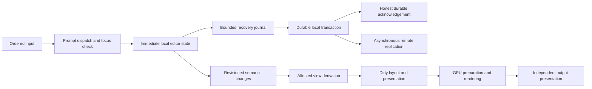

# Park interface overhaul — change report

This is the single active report for the owner-requested responsiveness overhaul of 2026-11-11. It supersedes the execution order and automation instructions archived below. The original Records remain preserved until the owner chooses to remove their native identities; they are historical source material, not a second active queue. This report must be updated in place. Do not start another performance plan or silently mark old acceptance work complete.

The [checkpoint](Development-cycle.lingua) and [execution order](execution-order.lingua) carry the live work. The sections below retain source receipts and revision-specific measurements.

## Application artifact verification — 2026-11-21

The installed Nix launcher and the running Park executable both returned `e5f68e7b20e811be73f5b4b0ecf7326fcb3b3547` from `--build-info`, with `optimized: true`, target `x86_64-unknown-linux-gnu`, and the UI, Instinct and Park features enabled. Git ancestry confirmed that the release contains freeze fix `083dfa95686f71905a5fe7e373262526de085b1d`. The Linux application build and `publish-main` succeeded for that exact revision. [Release run](https://github.com/lince-social/lince/actions/runs/44927273878)

The Park measurement packaging job for the same run verified the probe archive checksum, checked the optimized probe and application identities against the full revision and Linux x86-64 target, and uploaded artifact `14718044666`. GitHub reports SHA-256 `d4df7441da3de18e8751f19cf3e0d5178a63215227c698d733eed5f4736bf1a7` for the uploaded artifact. This receipt establishes the artifact match. Standalone probe execution still needs the local executable. [Packaging job](https://github.com/lince-social/lince/actions/runs/44927273878/job/136937509019)

## Checkout verification — 2026-11-20

On `eb01745e`, all 32 Python runner/report tests and all three Anicca requirements tests passed. The source inventory audit also passed. Evidence is in `target/park-verification-eb01745e.rWMXKI3H/`. Prepared execution for P134 and P124 and native rule coverage for P140 remain open.

The P134 source plan selects 15 cases for 21 rows with 265 declared pair oracles. It exposes 1,809 missing pair oracles and three inapplicable pairs, with R01 and R10 still assigned to physical acceptance. `coverage-plan.json` records the exact selection and scope before execution.

The application release job failed to compile the DRM client sampler because its nested map value types were ambiguous. The explicit types compile and all 32 `xtask` Park validation tests pass, including preservation of negative deltas and missing measurements. The CLI rejects empty, unknown and extra Interface selection arguments with exit status 1. The companion measurement probe failed on a Protein virtualized-edit fixture compiled into the runtime library. That fixture is now gated to interface unit tests. The isolated worker check exposed compositor-only consumers that need feature gates while keeping worker capture and command handoffs available. Both repaired Park configurations and standalone Laboratory test code pass `cargo check --tests`. The isolated source receipt records the patches and compile logs. Automatic runtime discovery loaded the installed ELF and confirmed revision `08c087f4` with its graphics metadata. The prepared run still needs executables and a matching application.

## Installed Park measurement — 2026-11-20

The running compositor and installed Nix wrapper both identify the optimized `08c087f41e34113158a8b880180229899e5ee196` release. The checkout at `eb01745ea710047332cb01dc72f03341b92d72cd` contains the newer measurement and Laboratory changes. This visit establishes evidence for the running release. Raw reports are in `target/park-current-08c087f4.PrXRZQow/`.

| Measurement | Result and scope |
| --- | --- |
| Private correctness | 97/97 interface cases passed. Native pixels, resize and two-output mapping passed in the private fixture. |
| Private Edit, 120 samples each | Empty p95 24.79 ms, worst 32.37 ms. Inactive-content p95 26.11 ms, worst 33.23 ms. Both passed the fixture gate. |
| Private worker, 120 input samples | Quiet CPU was 0.031% of one core. Input to completed publication p95 was 44.35 ms against 33.4 ms, with a 49.79 ms worst sample. |
| Mixed scene | The pointer click failed to focus the presented editor again. The installed runner aborted that case before its interaction cohorts could complete. The combined suite exited 1. |
| Private observer | All 50 reports and final drain arrived with zero recorded losses. Mixed typing was absent and system-body coverage was incomplete in typing, scroll, active and pan. There were 8,058 aggregated hardware GPU timings without source-frame identity and zero physical-output records. |
| Running Park, 30 s ambient window | 147.46% of one core across the process. The canvas thread used 68.90% and compute-pool threads 47.90%. Resident memory was about 1.31 GiB with 319 MiB swapped. Both active i915 clients used render engines at 9.78% and 18.21% of the window. Ordinary activity was uncontrolled, so P64 quiet acceptance remains open. |
| Active output modes and dispatch | eDP-1 1366×768 at 60.059 Hz and HDMI-A-1 1920×1080 at 60 Hz, both scale 1. Forty read-only Wayland round trips reached 0.56 ms p95. The connection exposed no `wp_presentation` global. These are mode and dispatch observations. |
| Live Firefox 160, external monitor | At 100% zoom, a private local 720p60 H.264 clip recorded 4 browser-reported drops out of 1,800 frames in 30 s after a 5 s warmup. This is 0.13 drops/s and 59.87 frames/s after browser-reported drops. Warmup recorded 22 drops out of 299. The browser-reported result meets the 0.5 drops/s cutoff for this sample. P15 still needs the matched Niri source and workload and simultaneous P16 scanout evidence. |
| Firefox graphics/process attribution | A 6.14 s window within playback observed both Park and Firefox on i915 `0000:00:02.0`. Firefox's observed client render counter progressed at 11.29% of the window. Its sampled video-engine counter had no increase. The RDD process used 11.90% of one core. This leaves decoder placement unconfirmed. |
| Installed Laboratory headless | The bounded 180 s run emitted 42 passes and 14 failures before timing out. Several private practice cases exceeded their own 30 s bounds. It returned no final stress report. |

In the private open/reveal phase, exclusive owner CPU averaged 1.960 ms per queue submission over 607 calls. Phase observation averaged 1.857 ms, and Bevy's pending command-buffer submission averaged 0.735 ms over 607 calls each. These costs belong to the traced private workload. Measure the collector overhead with a matched control on the newer artifact. Firefox's frame callback arrived 747 times while its cumulative `presentedFrames` counter advanced by 1,797. The browser metrics provide different views of playback. The live binary started without frame or phase telemetry, so the Firefox result cannot establish Park's physical frame delivery or interaction latency.

The active queue retains worker latency, the mixed-focus regression, full workload and physical acceptance, and revision-specific verification of the newer changes. The first remaining measurement boundary is a matching `eb01745e` build and prepared bundle with live capture configured at startup.

### P43 — Private worker input delay

Across 120 sequential Edit toggles on optimized `08c087f4`, input delivery to a prepared frame was the longest segment in 99 samples (p95 26.47 ms, maximum 31.14 ms). Queue wait reached 17.13 ms p95 and the wait from frame preparation to GPU readiness reached 13.46 ms p95. The worst enqueue-to-publication sample took 49.56 ms, including 31.14 ms of frame preparation. The trace reports no dropped input records. Local analysis is in `target/park-p43-input-attribution.Q5urvXaW/analysis.json`.

The worker can service the next input after the current frame and its geometry, input, and capture state have been prepared. The existing loop already drains eligible input before waiting for the prior GPU result. Shortening synchronous preparation is the next place to investigate. Preserve ordered input and pending target revalidation at that boundary. The private trace times the whole preparation interval and does not tie it to an individual system or physical presentation.

### P60 — Surface derivation and application

In the same optimized `08c087f4` trace, 607 paired open/reveal spans average 0.064 ms for surface derivation and 0.133 ms for application. Their p95 values are 0.176 ms and 0.298 ms, respectively. In the report windows containing the private worker Edit toggles, the 243 paired spans average 0.036 ms and 0.078 ms. These are elapsed times on the native owner. The worker-window exclusive CPU means are 0.072 ms for surface synchronization and 1.371 ms for graphics queue submission. The trace windows do not assign individual surface calls to specific inputs. Local analysis is in `target/park-p60-surface-attribution.m05d0ghm/analysis.json`.

Keep the existing synchronous derivation and application. The measured derivation is small, and the native surfaces and shader effects share one allocation budget. Further splitting needs evidence of a larger independent batch, including snapshot, scheduling, and application costs.

### P83 — Export submission on the native owner

In the optimized `08c087f4` Edit-toggle report windows, `lince_park::graphics::queue_submit` averaged 1.395 ms wall time and 1.371 ms exclusive owner CPU across 243 calls on the native owner. The maximum wall time was 3.002 ms. Submission was the largest named product cost by exclusive CPU in those windows. The opt-in phase observer used more CPU. Submission's owner CPU was 98.3% of its elapsed time. These samples quantify CPU work, with no per-input join or hardware GPU timing. Local analysis is in `target/park-p83-foreground.y26ivpmy/analysis.json`.

Keep live World reads and import-wait state on the native owner. The bounded handoff demonstrated by P62's private prototype moves the corresponding render epoch and the existing shared GPU context to the export owner after frame state is captured. Render and export must retain their order, and output textures, client upload leases, and source allocations must survive through completion. Preserve submission error scopes, and publish only with matching scene, input, output, and capture revisions. P62 still owns the complete-path validation with clients and filtered capture before any production scheduling change.

### P138 — Engine read gate during Cell refresh

An optimized `08c087f4` warmup window had a 75.368 ms read-gate maximum and a 75.366 ms Cell refresh maximum. Two archived `dbd5cf34` typing runs show near matches at 69.849/69.845 ms and 69.463/69.459 ms. A single archived reveal window recorded one 16.016 ms read hold, one 16.013 ms refresh, and four query calls totaling 15.364 ms. These are window-level correlations supported by source nesting. The backend readings have no operation identifiers for an event-level join. Local analysis is in `target/park-p138-access-attribution.aOIlOW6B/analysis.json`.

The shortest safe lifetime established by the current code ends when the authorized query and materialization return an owned response batch. The local Cell bridge already sends and wakes after that gate is released. An earlier release would need a coherent, versioned snapshot and authority revalidation before applying results. These recordings establish the boundary for this path. They leave the effects of a narrower gate on contention and correctness unmeasured.

## Approved Park work — 2026-11-20

- **P148 source complete.** Compile pointer settings, external commands, keyboard persistence, display settings persistence, compositor overview, and final composition tests under the feature that provides their production dependencies. Worker-capable focus and raster tests and the shared display helpers retain their coverage. Selector names are preserved. Verification starts with the worker-only and full test-build checks and continues with the affected existing selectors.
- **P140 source complete.** Lingua rule discovery preserves source locations and hides the text of metadata comments from presentation. The fast Laboratory suite reports mapped IDs, source Record UIDs and line locations for Protein and Edit geometry. It refuses invalid mappings. Its focused discovery and Laboratory tests await execution. The Nix source filter carries the single bundled rule document used by the suite.
- **P141 source complete.** The mandatory Protein case uses a private in-memory Cell and waits on its feed wake signal. The driver rechecks the control identity, focus and pointer bounds before dispatch, while target-specific layout and glyph checks replace whole-scene stabilization in this case. Stop, Close and failure restore the workspace after the worker finishes. The mandatory case, stale-click regression and worker cleanup cases await execution. P146 still owns the rendered pixel check.
- **P142 source complete.** The same Protein case opens and closes the menu with ordinary input, selects Kind with the keyboard, types `plain` and runs the query through the local Cell. It checks the exact matching row and visible result title. The structural oracle checks glyph masks, effective contrast, inherited clipping, viewport bounds and opaque UI above the text. The native app installs Bevy's separate pointer-focus bridge, which the current Bevy version requires for pointer-driven focus. The case and visual negative controls await execution.
- **P145 source complete.** Case results carry the Rust registration and Lingua rule sources. The existing ordered catalogue serves Laboratory and `cargo xtask test-interface [all|protein|edit|input]`. The default local check and desktop CI use that command. The installed Park check waits on the same bounded worker, and the prepared executable pins the full selection. Build and execution remain pending.
- **P146 source complete.** The mandatory Protein case renders the interactive fixture into a private 800×720 target. It compares the closed, expanded and selected captions with the same frames after hiding only the caption text. Sampling stays inside the glyph mask. A failed paint comparison retains bounded crops. Desktop CI declares the Mesa Vulkan runtime. Adapter behaviour, pixel comparisons and startup costs await execution.
- **P134 source complete for private coverage.** The prepared runner selects exact fixtures from the finite pair registry and records observed outcomes and missing oracles. Laboratory imports its report. The joined source checks cover local body updates across Pretty, Split, query views and cold reopen (R02), dirty Record identity and durable recovery across live virtualized sort and filter changes (R03), scroll/style hit testing (R04), the first themed frame after a held query reply (R05), keyboard and timer progress during ordered private Terminal streaming (R06), current pixels and input after workspace reveal (R07), a submitted readback across output-source and privacy replacement (R08), and IDE Save and close with recovery after a process kill (R09). Execution and physical R01/R10 acceptance remain pending.
- **P155 closed.** The November 9 receipt for `dcc20703` records all 27 Python runner/report checks passing. The suite includes the changed-fixture negative control preserving the independent unchanged case. The relevant comparison and test sources are unchanged since that receipt.
- **P147 source complete.** The optional prepared Protein lifecycle uses one private Laboratory scene to check preview before spawn, readable result text, row-template projection, stable identity on live update, and view removal that preserves the Records. The routine suite keeps its current size. The added case and cold/warm timing await execution.
- **P124 source inventory complete.** The source reconciler maps startup, Store and Laboratory registrations to seventeen workflow owners. The prepared bundle can carry the source hashes, build revision and unavailable selectors. The source audit assigned all inspected registrations. Packaging and execution await approval.
- **P86 source audit complete.** The ranking uses the saved revision-specific evidence for Cell refresh/access, native readiness/layout, export and cold pipeline work. Castle readiness now skips the initial-visibility member list for already presented roots. Its traversal, camera and member buffers can be reused across roots during the pass. The existing source retains readiness checks, camera publication, diagnostics and wake behavior. Runtime checks and current cost measurement remain pending.
- **P94 closed.** The owner reports the database-lock toast is no longer a problem. P136 still covers local editing and durable acknowledgement.

The owner approved eight validation items, seven build or fullscreen comparisons and 31 optimization investigations. The active queue contains 83 P-task Records. The workspace release profile enables full LTO, and the main CI recipe sets ThinLTO. Freeze the effective build recipe before comparing either. Neither the comparison nor P148 compilation ran in this source pass.

## Measurement tooling and installed baseline — 2026-11-19

Park successfully ran optimized revision `08c087f41e34113158a8b880180229899e5ee196` after the login repair. The installed binary ran the private responsiveness suite while the desktop stayed open. Saved files are in `target/park-measurement-08c087f4.s8HwGd/`, with `target/park-measurement.latest` pointing to the capture. Use `app-build.json` for build identity, `suite.jsonl` for results, `phases.jsonl` for the observer and `live-sample.json` for the brief desktop sample.

| Installed check | Result |
| --- | --- |
| Interface correctness | All 97 checks passed, including Protein filter text and selection and Edit geometry. |
| Native pixels, resize and output mapping | Passed in the private fixture. |
| Edit latency | p95 39.05 ms in the empty scene and 40.26 ms with inactive content against 33.4 ms. Worst samples were 45.97 ms and 58.81 ms. |
| Worker quiet and input | Idle CPU was 0.050% of one core. Input to completed publication p95 was 64.31 ms against 33.4 ms. |
| Mixed workload | The real pointer click failed to focus the native editor. The old suite returned early and lost the Edit timings for that case. Typing, scroll, drag and pan coverage remained incomplete. |
| Observer | 61 phase reports with no reported transport losses. 8,052 aggregate native GPU timing samples lacked source-frame identity. There was no GLES hardware timing or physical-output attribution in this capture. |

The running compositor had neither trace flag enabled. The eight-second process sample used roughly 1.50 CPU cores and 1.0 GiB RSS under unclassified load. It establishes neither idle cost nor frame cadence. The private suite overlapped the active desktop, so it supplies a baseline with known scope and no matched speedup percentage. In its open/reveal phase, the scheduler observer, GPU submission and render-schedule work were among the largest observed costs. Inclusive schedules, observer CPU and GPU waits cannot be added to estimate latency.

Source deliverables completed for this cluster:

- **Laboratory (P104).** **Load Park report** opens the existing suite’s JSON or JSONL. It shows case results, budget comparisons, incomplete coverage and build identity, and includes the source report in Laboratory export. The combined suite keeps its existing execution path.
- **Frame/output attribution (P153).** Opt-in trace links the originating Bevy render to extraction, export, async GPU pass results, GLES import and the actual native image sampled for each physical output. Native GPU timing follows the workload and phase where rendering started. The offline report joins input observations by frame, output, timestamp and clock only when the expected image was sampled. DRM timestamps and dispatch-clock observations stay separate. Full verification updates are outside the measured pixel-only phase.
- **GLES and resource ownership (P70/P67).** GLES host elapsed and owner CPU are distinct from optional asynchronous hardware command intervals and later fence/DRM observations. The observer can sample selected same-user peer PIDs and compare per-device, per-client engine counters between adjacent samples. Counter loss, device coverage and shared clients need to be considered before drawing a utilization conclusion.
- **Wake and hotspot attribution (P36/P66).** Full updates carry overlapping source reasons, with coalesced requests and unavailable frame outcomes visible separately. The offline reader groups timing and loss by workload and phase, ranks exclusive owner CPU and derives p50/p95/p99 from merged histogram buckets. Timing windows carry process, capture, revision and profile identity. The suite preserves partial timings when a later oracle fails. A failed native editor focus attempt leaves typing absent and allows other actions to be measured after the button release.

When execution resumes, run the verified optimized binary’s `--park-performance-check` and load the final report into Laboratory. Analyze the phase log with `cargo xtask park validate attribute PHASES_LOG`. A traced physical process uses `LINCE_TRACE_PERFORMANCE=1`, an absolute private `LINCE_PERFORMANCE_LOG` and `LINCE_PARK_TRACE_FRAMES=1` at startup. With both flags enabled, the bounded observer carries frame links in the same report and exposes drop counts. Standalone frame tracing still sends links to stderr and can be supplied with `--frames FRAME_LOG` for the matching process. Check overhead against a matched capture-off run, and retain actual DRM coverage, Firefox device/decoder evidence, wake ownership and any unobserved timestamps. GLES hardware timer support depends on the driver. Daily-use acceptance requires separate physical observations.

No compilation, execution, installation or reboot followed the switch to source-only work. The observed results above belong to the installed binary. The new tooling has no compiled or physical verification yet.

## Park login blocker, 2026-11-19

SDDM opened the Park session and UWSM launched the Nix package for `fccb2fe69641`. Park selected a DRM device, then the `park-canvas` thread panicked while Bevy initialized `PostUpdate`. The journal identifies a loop from UI layout through editable text and actions back to UI layout, and a loop from transform propagation through Bevy menu focus and UI post-layout back to Time Castle rendering. SDDM returned to its greeter when the compositor exited. The startup plan preparation service separately refused the database at its read-only schema check.

The fix restores text edits and action handling before layout. The existing glyph pass synchronizes the current viewport after layout, so the input system can use the last presented bounds without a second scan. Time Castle renders after its required UI layout and before 3D transform propagation. The presentation app omits Bevy’s built-in MenuPlugin because Lince uses its own menus and the built-in plugin orders editable input behind 3D visibility.

The isolated debug canvas probe passed startup, rendering, independent output views, shared captures, reconnects and GPU export with the development Mesa vendor settings. All 97 interface checks passed, including Protein filter text and selection, Edit panel geometry, same-update font changes and retained layout/input ordering. Neither probe opened the personal database or booted a physical Park session. Verify the repaired release’s actual running revision and the separate startup plan preparation service on the next Park login before resuming P153 → P70 → P67 → P36 → P66.

## Owner review — what changed and what is really left, 2026-11-17

This review changes the plan and explanation only. No production code, tests or fixtures are edited, and no compilation, execution or measurements are performed. The owner intends to push, judge a later binary and then authorize testing. Stop after this report; the older source-coding instruction is not permission to start another round now.

### Count the actual remaining work

The registry contains **488 recorded implementation mechanisms**, not 488 independent bugs, speedups or equal-sized tasks. The live checklist contains **471 detailed verification/acceptance obligations**: 456 VERIFY-labelled entries and 15 broader edit/reveal/input/render/settling entries. These are written obligations, not a claim that 471 runnable selectors exist. They cover overlapping workflows and can share a combined run where there is a suitable oracle.

This review recorded **85 open P-task Records**. See the November 20 receipt and live task index for later closures and priorities.

| Open P-task category | Count | Actual unfinished deliverable |
| --- | ---: | --- |
| Measurement and attribution | 6 | Verify and use the implemented P153/P70/P67/P36/P104 tooling and produce the P66 ranking. |
| Implemented source awaiting verification | 24 | Check correctness, total resources and speed; do not reimplement the selected reduction. |
| Daily product acceptance | 6 | P136 saves; P65 interaction latency; P64 quiet resources; P135 combined behavior; P16 both displays; P15 Firefox under the same load. |
| Source inventory and bloat audit | 2 | P124 registration/workflow/oracle completeness and P86 active-bloat ranking are unfinished. |
| Conditional performance candidates | 32 | Further changes only after a residual cost and safe boundary justify them. |
| Deferred work | 15 | Eight validation deliverables and seven compiler/dependency/fullscreen experiments. |
| Total open P Records | 85 | Overlaps the detailed checklist; do not add 85 to 471. |

**There is no additional specifically selected unnecessary-work fix waiting behind the 488 recorded mechanisms in the current queue.** This is a statement about the queue, not a claim that every wasteful computation is gone. The source inventory is incomplete, the combined batch is unverified, and 32 conditional performance candidates remain unimplemented. Examples include safe transaction coalescing, engine/request-lane concurrency, further input dependency removal, full viewport virtualization, retained pan/drag/scroll transforms, per-output damage, DMA-BUF/export reuse and a coherent main/render overlap. The plan must not automatically implement all of them merely to empty the list.

Remaining support work includes physical linkage verification (P153), the P124/P86 inventory, P148's worker-only feature-gate failure, and the deferred P134/P147/P140/P141/P142/P145/P146 coverage work. Five compiler/profile experiments (P96/P97/P98/P100/P99), unused-dependency selection (P90) and fullscreen direct scanout (P57) stay separate. The [native index](execution-order.lingua) retains the definitions and IDs.

### What computation was removed, and what must stay correct

The table summarizes source intent and representative implementations. It is not a proof that every gate/cache is correct or that the complete candidate runs faster. The detailed receipts below and `measurement-changes.json` retain the individual changes, paths, expected effects and metric boundaries.

| Family | Previous unnecessary work and current source reduction | Behavior that must remain; principal uncertainty |
| --- | --- | --- |
| Data delivery and query fanout | Share immutable messages and row snapshots; inspect routing before copying; reuse equal query results; scope Fact invalidations to affected subscriptions and gather bounded ready notices into one refresh wave. | Each consumer must receive current data. Mutation acknowledgements, terminal bytes, input transitions and auditable events remain ordered and lossless; snapshot coalescing cannot be applied indiscriminately. |
| Record typing and local saves | Share unchanged CRDT field text across views, avoid materializing an unrelated body for a title edit, act on real input/deadlines, prepare recovery/canonical work once, bound checkpoint decisions and reserve a workspace-save slot before full capture. | Local echo, exact persisted text, undo/history, permissions, recovery and truthful acknowledgement remain. This is not blanket per-character transaction batching; save queue/backpressure and durability still need whole-path checks. |
| Styling, text and layout | Narrow invalidation to real dependencies, retain equal resolved/paint values, shaping inputs and glyph geometry, separate caret/selection geometry, share display traversal, avoid unchanged layout/component writes and lazy-build collapsed fields. | Live themes, inheritance, reparent/removal, IME, glyphs, bounds and first reveal must update. A missed dependency could recreate stale/missing/blinking content; these are high-priority correctness checks. Full viewport virtualization is not implemented. |
| Castle/control presentation | Retain unchanged rows, labels, choices, previews and status instead of rebuilding UI trees. Apply the family across Fiote, Kanban, Protein, Karma, Calendar, Todo, Transfer, Source, notifications and terminal controls. Route replies by current owner and prepare shared catalogs once. | Focus, drafts, error/retry, accessibility, current reply ownership and removed/revealed items must remain correct. Cold opening and fully changing scenes can still be costly. Retention is extra state that must retire. |
| Canvas input and ordering | Share current camera/modal/hit geometry, fuse repeated lineage work, avoid unrelated geometry, index requested sibling/focused-window prefixes within an immutable pass and reuse render-order preparation. | Hit order, clipping, transient families, current focus and same-tick hierarchy/output changes must agree with pixels. Current-pass indexes do not become cross-frame authorization or geometry caches. Small scenes may pay more index overhead. |
| Canvas physics and navigation | Index relevant participants, avoid disabled pairwise forces, reuse rotation/radius/link inputs, preserve unchanged configuration and write changed bodies/joints; use elapsed-time cooling. Borrow workspace identities and bound newest-valid history selection. | Real forces, intentional animation, manipulation holds, wakeups, collision and fallback persistence remain. Quiet settling and no retained-memory growth are unverified for the combined batch. |
| Rendering, surfaces and assets | Reject inactive/clipped work where permitted; reuse unchanged mesh/material/image/overlay preparation; share terrain/formula and room/layer inputs; process actual lights/texture jobs; avoid duplicate intermediate geometry and identical publication. | Required pixels, precision, text sharpness, both outputs, capture/overview demand, privacy and GPU consumer lifetimes remain. Most changes reduce CPU preparation; they do not establish zero-copy rendering, independent damage or full CPU/GPU overlap. |
| Backend reads and algorithms | Use required columns/UIDs/existence instead of unused full Records, batch compatible reads, borrow validated input, index membership/order and retain bounded working sets. Share immutable role/policy preparation only inside its valid phase; add the Karma lookup index migration. | Fresh authority at mutation boundaries, exact filtering/sorting/ties, current transaction state, malformed/error ordering and returned data remain. SQL batching can change observation boundaries; it requires concurrency checks. Migration 0046 is unapplied. |
| Message, file and payload processing | Avoid repeated whole JSON/text/payload copies, prepare message descriptions once, read selected attachment chunks together, and carry privately owned decoded-length evidence through final restoration validation. Reuse Lingua/Source draft and projection preparation. | Exact encoding, attachment length/digest, size limits, final semantic validation, canonical file content, concurrent edits and error order remain. Verified evidence must not escape attached to mutable data. |
| Background presentation and admission | Stop hidden display-only readers, use real deadlines/completions, skip idle work, and refuse/defer inadmissible work before constructing expensive snapshots. | Recording/audio, necessary rules/sync, action completion, heartbeats and durability are not display-only. Reveal, cancellation, retries and the final wakeup must work. Fewer wakeups are not a win if a required event is missed. |

Representative source boundaries re-read for this review: `native/cell_bridge.rs` owns `Arc<ServerMessage>` delivery; `native/workspace/storage.rs` reserves capture admission; `native/token_style/presentation.rs` uses equality-guarded publication; `nucleus/message/restoration.rs` privately owns verified attachment lengths until canonical validation consumes them; `store/message_content.rs` retains chunk/size/integrity checks while batching reads; `topology/stacking/inputs.rs` borrows the World for current-pass indexes and keeps the 32-step transient limit. These spot checks support the stated mechanisms; they do not constitute an exhaustive audit or execution pass of 488 changes.

The strongest source-level cases are removal of duplicate copying, repeated derivation from unchanged owned input, discarded preparation and identical writes. The more delicate cases are invalidation, hidden-demand gating, batching, asynchronous ownership and reuse of validation evidence. They need appropriate behavior oracles, not only lower CPU counters. Indexes, maps, retained UI, extra bookkeeping and instrumentation add costs of their own; they are not automatically profitable in tiny or changing workloads.

### What we actually know about speed and lost information

**The current combined source-only batch has no measured overall speedup and no full correctness pass.** Some constituent work predates this phase and has version-specific evidence; that does not validate subsequent edits. The owner's last session feeling reasonably good is useful experience, not a matched comparison for the current working tree.

Earlier receipts record real improvements and contrary results. The optimized inactive-camera/save-handoff comparison reports about **9.6–9.7% lower native-update elapsed time during its broad typing replay**, with text extraction falling substantially. That same report still fails strict performance gates and records a severe intermittent Fiote save-confirmation regression: p95 **1040.573 ms**, with up to **3.864 seconds continuously unsaved**. The preceding debug graph-amplification comparison reduced whole-process CPU about **35–36%** and steady response medians about **9–10%**, while its initial worst response worsened. Those are historical scoped results, not percentages for this unbuilt batch. Keep their exact context and failures in the receipts below.

Information is preserved in several forms, with explicit limits:

- All **488 entries** retain an ID, owner, intended mechanism, expected outcome, primary/secondary metrics and source paths. All **759 distinct referenced paths** exist at this review. A path's existence is not proof that its mechanism is correct or fully instrumented.
- **448 entries** include a separate attribution note; **40** rely on their mechanism/expected text and report receipts rather than a dedicated attribution field. Of **1,560 distinct primary metric labels**, **55** are shared by multiple mechanisms, and **19 mechanisms have no exclusive primary label**. A timing improvement in a shared scope cannot be assigned independently to each change. Even an exclusive label does not provide causal isolation from coupled changes.
- The earlier section **“Fresh verification after the evidence-directory loss”** already records that some old raw captures were lost. Later frozen-source checks were recorded afresh, but missing earlier captures were not reconstructed. This review reads the repository receipts, not private result directories, and does not claim that every historical artifact still exists.
- Source receipts, stable Record IDs, rejected alternatives, previous failures and the lossless archive are retained. The current batch has not generated runtime evidence that could be lost; its uncertainty comes from not having been run. The large accumulated change set makes diagnosis and isolated attribution harder even though the rationale is recorded.
- The 471 written checks are coverage obligations, not proof of executable coverage. P124/P134 and the deferred fixture/paint work remain open. We must report missing or unsupported checks rather than treating a successful subset as complete validation.

### What the review changes in the plan

The former flat 85-row queue is split into implementation verification, acceptance, missing measurement, incomplete inventory, conditional proposals and deferred work. Completed source mechanisms are kept out of the implementation queue. No unresolved check is deleted just because code exists, and no conditional idea is promoted to a known defect. The 488-entry registry, 471 detailed obligations, all 85 P identities, 212 native Record IDs, original archive, workload definitions and existing hard requirements are preserved.

**Next-session priority, 2026-11-19.** Use the [measurement receipt](#measurement-tooling-and-installed-baseline--2026-11-19) and [execution order](execution-order.lingua) for the current first cluster. The former reboot and source-coding handoff has been superseded.

## Earlier measured status before the source-only batch

Historical optimized comparison, 2026-11-15 UTC: verified CI probe `dbd5cf34` is compared with `be25ae50` in both run orders. Four broad recordings preserve 960 inputs each; ten real-field recordings preserve 145 edits and exact reopen each; every recording passes the 97 mandatory native cases and loses no required trace data. Mixed typing p95 improves 2.1–6.2%, and its native update costs 9.6–9.7% less elapsed time. Kanban canonical confirmation p95 improves 23.0–26.3% to 97.650–99.279 ms, with 1.1–2.3% more process CPU and mixed typing results. Fiote normally improves to 103.310–107.036 ms, but one reversed candidate reaches 1040.573 ms and ten pending edits. That failure remains open; a successful repeat does not erase it. No run passes overall strict responsiveness. An earlier live report was “better, still janky, less than 1s” on `f3459bfb`. In the current review, the owner says the last used binary felt reasonably okay; its revision and paired timings are not established here. Physical daily desktop acceptance remains open.

The populated-reveal failure remains a priority: optimized `dbd5cf34` takes 1.689 seconds for the first input with 200 Records, then 262.199 ms and eventually 110.702 ms. The paired control takes 1.620 seconds, 259.420 ms and 155.995 ms respectively. Construction still stalls; the later response reduction does not fix the opening. The shared inactive-camera gate now has optimized verification: typing extraction falls from 1.887–1.903 to 1.158–1.165 ms per update, with main interface work nearly unchanged. Preserve the empty-view and field costs alongside this scoped saving. The later bounded glyph-result reuse remains debug-verified and awaits its separate optimized comparison.

Retained local-save handoff, 2026-11-15: canonical edits now progress as soon as recovery is durable without another UI update, through the existing bounded authorized connection. All 51 final focused checks pass. Optimized correlated traces confirm that the ordinary durable-to-admission p95 falls from roughly 32–37 ms to zero. That does not remove waiting behind an earlier in-flight edit: the slow Fiote recording has much longer recovery/commit intervals and a growing durable backlog. Keep the existing handoff and investigate that separate tail, foreground response and resource amplification. The report below preserves the debug costs, optimized failure and reconnect checks; typing and the yellow-border complaint are not resolved.

Latest short-edit work, 2026-11-14: shared input clipping now skips 1,948 impossible targets/update in the populated Kanban fixture. Against its repeated debug control, pointer CPU falls 138.162 → 37.824 ms/update, title echo p95 855.516 → 621.376 ms and canonical acknowledgement p95 1742.362 → 1263.954 ms. Fixed-protocol attributed native CPU falls 5.2%, while canonical commits rise 33 → 44 and query executions 1,190 → 1,292 as the loop processes more updates. Whole-process resource savings are not established. The wider 960-input comparison preserves behavior and lowers pointer CPU, but overall typing p95 still rises slightly, 300.494 → 305.411 ms. These are scoped debug gains and recorded tradeoffs, not optimized or live acceptance. The larger ancestry prototype and an incorrectly ordered clip prototype are removed; retain only the shared clip rejection after cheap filters.

Latest save-path investigation, 2026-11-14: the real 145-keystroke Kanban case starts 39–40 scheduling-forecast snapshots in the observer controls, with 38–39 completed calculations discarded and no successful publication during the editing interval. Each discarded completion still broadcasts a general query refresh. This is measured background amplification, not proof that the database write itself accounts for the full input delay. Process CPU is now measured across all threads for the fixed edit cohort. A conditional journal-invalidation prototype passed recovery/trigger checks but showed no established resource or responsiveness gain across the surrounding controls; it is removed. Keep the diagnostic counters and prioritize the discarded-forecast/refresh cycle alongside the still-expensive native path. Strict edit and desktop acceptance remain failed.

Retained save-path reduction, 2026-11-14: superseded scheduling forecasts no longer broadcast a general query refresh when replacement work is already queued. In that populated 145-edit debug comparison, general refreshes fall from 32–34 to 3, queries from 1,173–1,241 to 714, and measured process CPU from 41.781–42.305 to 39.923 seconds. Typing and acknowledgement tails also improve against both controls, with their variation retained below. This does not solve slow editing: echo p95 remains 719.748 ms, acknowledgement p95 1473.927 ms, and the yellow warning persists. The later attempt to stop obsolete forecasts at revision fences is tested and removed: it restarts expensive copies more frequently and worsens both CPU and tails.

Latest retained save-path change, 2026-11-15 UTC: shared database snapshots now use SQLite's native page-copy API instead of rebuilding the database with VACUUM or serializing it into a whole-database memory buffer. Three current matched debug pairs reduce process CPU per 145 edits by 7.1%, 16.3% and 20.0%; snapshot-copy await time falls 46–82%. Latency gains are mixed: one Kanban acknowledgement p95 worsens 14.2%, both candidate Kanban runs reach the yellow warning while their controls do not, and Fiote latency is essentially unchanged. All exact edits/reopens and 93 native cases per recording pass, but all strict timing gates still fail. Two settled Fiote attempts fail before editing because the scene remains awake after 60 seconds in both control and candidate; retain that unresolved failure. The remaining native update takes 274–367 ms in these debug editing scenes, with shared pointer capture alone using 40–45 ms CPU/update. Prioritize that foreground work and optimized verification; less background CPU is not evidence of an instant editor or a fixed desktop.

Latest rejected input experiment, 2026-11-15 UTC: grouping fresh component reads through one entity reference lowers pointer-capture CPU by 28–33% in the populated field case and improves its typing tails. It does not establish a net interface gain: both complete mixed-scene comparisons have worse typing/scrolling and longer native updates, including the reversed run order. The two-file prototype is removed, with source restored exactly to the retained native-copy control. Preserve the negative results below. Prioritize bounded foreground construction and retention of unchanged work; do not mistake a cheaper inner lookup for removal of the repeated whole-scene work.

Current verification of the shared text change, 2026-11-15 UTC: all 94 native checks and all 960 broader interaction outcomes pass their correctness checks. Full-scene timings remain close to the control; the opening reduction does not establish faster ongoing editing. Both real-field 145-edit pairs preserve exact focus/order/reopen, but process CPU and echo latency are essentially unchanged. Fiote's longest continuously unsaved interval worsens from 11.412 to 15.083 seconds, and all four fields reach the yellow warning. Keep that negative observation. Strict performance gates remain failed, and optimized-candidate and physical-session verification remain open. The preceding release job timed out after two hours before uploading its probe; a bounded CI timeout correction accompanies this batch.

Latest shared-metric verification, 2026-11-15 UTC: a source-identified quadratic collection before parallel work is removed from both icon and layout metric callers. First-update metric owner CPU falls 93–94% in the large-view debug pairs; that is not whole-app CPU. All 95 native cases and all 960 broader outcomes pass correctness. Ongoing interaction and short-field timing are mixed: Kanban echo/acknowledgement improve, but its unsaved interval grows; Fiote echo/acknowledgement worsen and its unsaved interval grows from 5.570 to 14.977 seconds. Those failures remain open. Optimized-candidate and physical daily-use validation are still required.

Evidence availability, 2026-11-14 13:02 UTC: a filesystem recheck found both repository `target/` and the previous private evidence directory `/home/user/.local/state/lince/park-overhaul-20261111/` absent. The cause is unknown. Source, this report and its lossless archive remain intact. Historical results and hashes below record observations made before that loss; statements that old private receipts are retained describe their earlier state, not current availability. Those raw captures, frozen controls and helpers cannot presently be reopened or rehashed. The final retained-source verification was interrupted without an accessible result and is not counted as passed. Fresh verification is recorded separately below in a new directory; it does not restore the old raw captures.

Latest text-dependency investigation, 2026-11-15 UTC: the clean matching-observer pair confirms that retaining unchanged field wrapping reduces the 200-row second response from 16.571 to 4.398 seconds in debug, while the first stays near 26 seconds. Post-opening layout text-measure inputs fall from 21,745 to 569. All native and broader outcomes remain correct, but ordinary interaction stays slow and Fiote acknowledgement tails worsen in both run orders. The temporary cause observer doubles its own typing CPU cost, so it is removed after identifying the defect. The reduced final source passes 97 native cases and all 960 broader outcomes, and retains a 4.478-second second response. Broader input remains essentially unchanged; final Kanban editing reaches the yellow warning and Fiote acknowledgement remains slow. Current-fix optimized and physical-session verification remain pending.

Latest rejected save experiment, 2026-11-15 UTC: avoiding durability barriers on disposable forecast copies reduces copy-worker await by 70–85% in four current debug pairs, but does not establish a net editing/resource gain. Kanban acknowledgement improves by 25.0% and 2.4%; Fiote is essentially unchanged in one order and worsens 14.5% in the other. Typing echo improves in none of the pairs; process CPU rises 0.9–5.1% in three and is essentially unchanged in the fourth. The candidate and its added API/tests are removed, with the six source files restored exactly to `228b5bf6`; retained native copying and real-save durability are unchanged. Preserve the failed experiment below. The next work remains reducing unnecessary forecast/query amplification and attributing the shared save queue, not declaring short fields fast from a smaller copy span.

Latest retained forecast/query reduction, 2026-11-15 UTC: forecast notifications now refresh only Calendar and Schedule subscriptions, preserving full refreshes for general changes. Four matched real-field debug pairs execute 27–45% fewer queries, and all eighteen focused checks, 97 native cases per recording and 960 broader interaction outcomes pass correctness. CPU and latency results remain mixed; one Kanban repeat grows its continuously unsaved interval from 8.947 to 15.073 seconds and starts showing the yellow warning. Keep the scoped removal of unrelated work, with those tradeoffs visible. This does not close instant editing, save acknowledgement, optimized verification or physical desktop acceptance.

Latest rejected foreground experiment, 2026-11-15 UTC: bounded complete-row construction cuts the 200-row debug worst pause about 92%, but full results take 2.34–2.36× as long and measured system-owner CPU rises 65–66%. All 101 corrected native cases and full reveal correctness pass. The standalone scheduler and its tests/counters are removed; exact retained source is restored. The next foreground work must remove the repeated preparation/layout cost exposed by the extra updates, rather than repeat this admission-only change.

## Incident and what the evidence says

The owner reports approximately one minute between opening a Ghostty tab or entering Edit and a visible response, including an almost empty active workspace. This is a failed product, regardless of isolated benchmark passes. The installed and running boot binary was `baf7fadc54212d857392e1df7969b4c3f7f77814`, an optimized release, not a debug build. No causal percentage of the minute-long delay has yet been established.

The boot's 30-second capture-off recording measured 28.36 seconds of CPU in `park-canvas` (94.53% of one core), about 24.34 seconds across four SQLite workers, and effectively no CPU in the physics worker. Process CPU was 228.87% of one core. Aggregate machine CPU hides this saturation. The record does not establish a controlled quiet interval, but it rules out assuming the canvas thread was mostly asleep during that recording. GPU utilization is not evidence that CPU work should simply be moved to the GPU.

Private nested controls using the installed optimized binary, networking disabled, no credentials, and separate empty databases distinguish an empty layout from the saved layout without its live Records. Neither reproduced a minute-long frame. They expose cold shader/pipeline stalls, but do not reproduce the populated live-data path. This is a scope distinction, not an excuse to dismiss the owner's report. Exact timings and the subsequent representative reproduction belong in the results section below.

Why earlier rounds did not establish success: the previous ledger explicitly leaves populated daily interaction, physical presentation, and end-to-end input acceptance open. Many measurements concern small, private, unoptimized, or otherwise restricted fixtures. Improvements to those owners were shipped while the product's primary failure remained unproven. Later deliveries also addressed startup, credentials, and compaction; they are not demonstrated performance improvements. We cannot claim every binary was slower without matched recordings, but the current owner's experience is an unequivocal acceptance failure.

## Objective and boundaries

Make the central path from input to visible feedback short, bounded, and independent of unrelated data and background work. Unchanged content must cost close to nothing. An empty visible workspace must remain responsive when other workspaces contain substantial data. A normal scene of 20–30 varied native items plus Firefox and Ghostty on both monitors must approach the actual refresh rate without recurring stalls.

Keep data, save guarantees, ordering, focus, IME, clipboard, capture privacy, lock safety, accessibility, output geometry, physics semantics and supported rendering intact. Do not achieve a result by deleting the user's workspace, disabling features globally, weakening permissions, throwing away tool/action results, dropping key transitions, or permanently reducing visual quality. Reuse existing mechanisms when they express the right ownership. Delete competing work and redundant state; do not add a separate scheduler/cache to every feature.

The current source-only instruction above supersedes the earlier execution procedure. For a later authorized verification phase, work in Niri with private headless/native GPU or bounded nested fixtures; keep personal data, compositor/session changes and startup agents outside that fixture scope. Any private database inspection must use an isolated manually constructed Cell runtime with no Fiote, wire, effect worker, background supervisor or credential access. No compiler runs during a measured interval. These are future verification boundaries, not permission to execute in this phase.

## Central ownership audit

1. Backend-to-interface delivery: immutable shared messages, routing before copying, bounded admission, and no multiplicative copying into unrelated consumers. Snapshot state is different from ordered mutation acknowledgements and text/terminal streams; preserve those distinctions.
2. Work admission: input transitions must not wait behind unbounded background drains or a complete rebuild of every result tree. Bound work at resumable boundaries, retain unfinished work explicitly, and wake only when work is ready.
3. Retention: only changed content requires derivation. Avoid serializing, cloning, validating and indexing the entire canvas during routine frames. Keep exact invalidation at actual inspection, mutation, restore and persistence boundaries.
4. Presentation demand: visible outputs, active editors, capture and portals define demand. Inactive presentation should sleep while necessary data/automation semantics continue. A per-frame scan labelled “cached” is still work and must be charged.
5. Layout and text: avoid dirtying stable nodes; separate intrinsic-size changes from paint and transforms. A growing transcript or result collection must not rebuild all prior text each update.
6. GPU and output handoff: do not synchronously wait for shader compilation or unrelated native updates when a valid frame can remain displayed. Keep geometry, privacy and input mapping coherent with the image actually presented. Respect buffer lifetimes and per-output pacing.
7. Storage and queries: identify repeat reads, query feedback and access-gate waits. Only changed results should invalidate views. Preserve durable-save acknowledgement and authorization. Measure the whole fanout, not just the write transaction.

These are audit areas, not seven claimed fixes. A change is retained only with source review and evidence for its actual boundary. The implementation/results section must distinguish coded, locally verified, rejected and still unverified work. This is one broad coding batch; do not ship production experiment switches or request a fresh session per idea.

## One strict suite

The suite must fail on missing phases, missing input responses, timeouts, unsupported required hardware, empty selectors, mismatched source identity and dropped required measurements. No averages-only pass and no automatically relaxed budgets. Correct output and final state are required alongside timings. A private-frame publication is not physical input-to-screen latency.

| Workload | Required coverage | Gate |
| --- | --- | --- |
| Empty interface, cold then warm | Startup, open/close Edit, external-window geometry, two outputs | Warm command-to-completed-correct-frame p95 <= 33.4 ms, p99 <= 50 ms, worst <= 100 ms; cold readiness recorded separately |
| Empty active workspace with populated inactive workspaces | Hundreds of retained rows and rich text, retained canvas receipts, no view demanded | Same response gate; no recurring full rebuild; genuinely idle CPU <= 2% of one core after settling |
| Daily mixed scene | 20–30 varied items, native text/controls, ordinary windows, both outputs | p95 input feedback <= two refresh periods; p99 <= three; worst <= 100 ms |
| Backend pressure | Large snapshots, irrelevant messages, bursts, saves and terminal/agent output during input | Every ordered transition and receipt preserved; bounded retained backlog; no input starvation; unchanged messages produce no rebuild |
| Continuous activity | Typing, scrolling, dragging, pan/zoom and native animation | >= 97% of actual output refresh during continuous change; avoidable missed deadlines <= 1%; no pause > 100 ms |
| Local edits | Real Record fields in Fiote and Kanban: erase a title shorter than 20 characters and type 10 new characters; retain title/body, Unicode/IME, multiple-view, persistence and reopen coverage | Local echo p95 <= 33.4 ms, p99 <= 50 ms, worst <= 100 ms; local durable coverage p95 <= 100 ms and worst <= 250 ms for short warm edits, including queue time; accurate save feedback and no lost or duplicate edits |
| Lifecycle | Open/close, workspace switch, deletion, output resize, visibility, capture demand | No stale pixels, hit mapping, privileges, subscriptions or retained memory growth |
| Correctness floor | Protein filter glyphs and selection, edit-panel bounds, old input/lock/privacy invariants | Mandatory, exact nonzero cases; a timing win cannot hide a failed functional oracle |

These are strict acceptance targets, not current measurements. Hardware completion, native publication, actual DRM presentation and visible pixels must be labelled separately. The one suite/report must retain cold startup, warmed operation, quiet resource use, long-tail latency, queue age, database work, named systems and GPU work. Wall/CPU/GPU intervals overlap: do not sum nested spans as independent costs. Report before/after against the same fixture and environment. Overall product acceptance remains failed until the actual installed daily workflow passes.

### Required case: short Record edits in Fiote and Kanban

Owner report, 2026-11-14: deleting a title shorter than twenty characters and entering roughly ten new characters in Record-editing fields, including Fiote and Kanban, repeatedly leaves yellow borders and feels like slow local saving. This is a required daily interaction workload. The diagnostic results below now count actual writes and expose forecast/query amplification; the full cause of the owner's live delay remains unresolved. At `c7f5ad66`, the shared `save_feedback.rs` warning starts after ten seconds continuously dirty. A yellow border is therefore evidence to correlate with pending/confirmed state, not a transaction counter; verify the actual editor path and running revision for each component.

Use a synthetic local Record through the real Fiote and Kanban editing controls: remove `Small example title` (19 characters) one character at a time, pass through the empty draft, then enter `New title!` (10 characters). Cover ordinary typing cadence and a rapid burst, a single visible view and the normal 20–30-item scene, and quiet versus active query/sync work. Trace the shared editing path wherever the field is presented; do not substitute an unbound text Sand or a direct database/API edit for the user workflow. Repeat with the same Record shown in another component and with populated inactive workspaces to expose work unrelated to the edited field. Retain description editing and cover other Record fields where they use a distinct save path. Repeat the short-title sequence until each timing cohort has at least 120 logical changes; keep typing cadence, burst and workload cohorts separate when reporting percentiles.

Measure each stage separately: native input/visible echo; local revision and pending-edit queue age; CRDT/draft/history serialization; local database access wait, transaction and durable acknowledgement; query invalidation/result delivery; other views' reconciliation, text/layout and rendering; and sync publication/serialization. Record actual saves, transactions, query executions, payload bytes, rebuilt nodes, CPU time, tail latency and time in the unsaved/yellow state. Give each change a correlated revision through durable coverage, including changes safely covered by one batch. Use the existing performance recorder and private fixtures; retain failures and source/build identity. Local acknowledgement must follow the existing real durability guarantee and be measured separately from remote replication. Determine which stage delays it before blaming sync or the GPU.

The table's local-edit targets are new acceptance requirements, not claimed results. Ordinary short local edits must not reach the ten-second warning or leave a growing backlog. Do not make the benchmark pass by hiding the border, reporting success before durability, dropping edits/history, reducing authorization, disabling sync, or adding a long typing delay. Coalescing, incremental updates and narrower invalidation are candidates only where their ordering, recovery and convergence semantics remain correct. Preserve focus/selection/IME through the empty draft and subsequent valid text; verify the final exact value after a private reopen, with honest failure/retry feedback when persistence fails. Coordinate backend changes with the existing sync/history/database-lock work instead of duplicating that implementation.

## Implementation and measured results

### What this batch changes

The relevant problem is work amplification on the serial native owner. A visually empty workspace did not imply an empty native workload: retained areas on other workspaces could materialize entire Record trees, incoming messages were copied into many consumers, and small style changes discarded derived state for unrelated trees. Repeated whole-canvas capture added work even when nobody was asking for a canvas snapshot. These are shared interface mechanisms, not Firefox-specific optimizations. The saved-workspace reproduction below demonstrates multi-second stalls before this batch. It does not establish that every second of the reported minute came from these mechanisms.

| Shared boundary | Previous behavior | Retained implementation | Verification and limits |
| --- | --- | --- | --- |
| Cell to native interface | Independent readers cloned owned `ServerMessage` payloads, including large snapshots, before deciding whether they needed them. | `CellMessage` carries an immutable `Arc<ServerMessage>`. Consumers share the message, inspect routing/variant first, and copy only the data they need to retain. Ordinary message cursors and ordering remain unchanged. | Regression checks independent readers, pointer identity, real mutation acknowledgement ordering, and payload lifetime after message expiration. This does not introduce lossy coalescing or discard text/terminal/action results. |
| Protein query projection | A successful reply could dirty an unchanged area; inactive workspaces built row UI even without presentation demand. | Identical ready replies retain existing projection state. Undemanded areas retain logical results but defer new native row construction. Removed/revoked rows are still removed while hidden. Demand includes physical outputs, overview, portals and the active workspace. | Hidden-result readiness and zero materialized rows are asserted in the stress fixture. Functional cases check reveal, unchanged snapshots, another output, portal demand and revocation. Already-materialized hidden rows are retained; this is not full row virtualization. |
| Shared token derivation | A change in one tree invalidated cached style values across unrelated trees. | Invalidate changed nodes, their descendants and dependent previews. Only a theme change or initial setup invalidates everything. Preserve cached values across ordinary frames. | Exact resolver equivalence, reparenting, component removals, preview dependencies and unrelated-tree retention. Invalidation still scans retained cache entries; it is not a claim of zero bookkeeping. |
| Style and metric application | Stable nodes repeatedly prepared/resolved metrics and applied presentation values. | Apply only invalidated or actually changed bindings/nodes. Preserve authored numeric bases, including zero ratios and late fields. Process sufficiently large affected sets in parallel using the existing Bevy scheduler. Button roundness uses the shared cached resolver. | Spacing, padding, typography, icons, reparenting, late additions, zero values and both button kinds pass exact-value checks. No separate cache or scheduling framework was added per feature. |
| Canvas API and persistence | A 200 ms refresh repeatedly captured, cloned, indexed and validated the canvas. Up to eight API operations could run in one update. | Register the host cheaply; capture at an actual API request or persistence boundary. Admit one API operation per native update and wake again while work remains. Keep receipts, undo, schema refresh and recovery state. Move serialized-document validation to the existing storage worker before writing. | Invalid documents leave the last durable snapshot intact; quit still waits for flush. A single large API request or save capture can still occupy the owner: this change bounds admission, not the cost of an individual operation. |
| Surface reuse fingerprint | All glyph/geometry/image inputs were fed through the standard SipHash implementation. | Use Bevy's existing fast hasher for this non-cryptographic render fingerprint; keep every original input and the separate privacy/geometry fences. | Sensitivity regression checks camera, glyphs, clipping and changed images. No new dependency, reduced visual quality or omitted dirty field. |
| Castle readiness | Every glyph repeated a hash lookup for its atlas image, including consecutive glyphs on the same page. | Check a consecutive atlas page once while still visiting all glyphs and validating every page transition. No persistent readiness cache or weakened presentation gate. | Regression removes each page in a multi-page, repeating layout and requires readiness to fail until that page returns. Existing replacement-content stability remains mandatory. Measured mean owner CPU falls from 55.068 to 14.771 ms/call in the follow-up recordings. |
| Retained status/history panels | Sync overview changes destroyed and reconstructed the whole panel, including unchanged long subject labels and controls. Render also cloned the overview before discovering there was nothing to update. | One shared keyed-child reconciler preserves entities, unchanged text, control focus, order and independent child ownership. Sync describes rows only for dirty, presented panels, then changes only different values. | The regression holds 160 long history entries, reorders/removes rows, changes a button caption, preserves focus and unchanged text change-ticks, and checks hidden/reveal behavior. This is not a claim that every feature now uses keyed reconciliation. |
| Panel and inspection demand | Hidden Sync panels continued requesting overviews and rebuilding text. Information panels also rebuilt while hidden. Opening Edit walked the hierarchy for inspection even with every inspection overlay off. | Shared ancestor/workspace demand includes every physical output, overview and portal, without depending on stale layout readiness. Defer hidden presentation, stop hidden Sync inspection requests, refresh on reveal, and skip inspection traversal when it has no output to draw. | Existing logical synchronization and in-flight results continue. Tests cover inactive/secondary-output/preview/portal demand, disabled or display-none parents, reveal before layout, and inspection disable/cleanup. |
| Measurement delivery | Concurrent producers could lose a span or input sample merely because another thread held the recorder mutex, even far below its capacity. | Use Crossbeam's bounded concurrent queue for these two streams, preserving the existing capacity and explicit overflow counters. Text-invalidations get opt-in cause/byte counters. | Eight concurrent producers retain every one of 1,024 unique samples; deliberate overflow is counted exactly. Final representative capture has no lost reports, systems, spans or input traces and includes its final drain. Capture-off does not install the text diagnostic system. |
| Worker failure | A native thread panic could leave a fixture waiting without an immediately visible error. | Recognize an already-finished native worker before shutdown even if its error channel is empty. | The private fixture initially exposed this during a Bevy query conflict. This is failure reporting, not a claimed cause of the original CPU incident. |

Most changed files are consumers of the one shared-message representation. They are not separate feature rewrites. No optimization switches, alternative production renderer, private per-feature scheduler, compositor hot-restart mechanism or credential changes are introduced.

### Matched saved-workspace reproduction

The reference is one private read-only SQLite backup and the exact saved workspace document, copied freshly for each run. The fixture has five workspaces, ten Protein areas on inactive workspaces, 305 Records, and 754 saved placements including nested/generated content. **754 is not a claim of 754 top-level items on screen.** The manual Cell has no personal Fiote, wire or background service startup, and the process has no network namespace access. The live database is never opened by another Engine.

- Database SHA-256: `fc388506a42ae6207aeaab704cdeafa749c8bf2040eeed2939b3b03879929408`.
- Saved document SHA-256: `90c3c6ae6cf3acfd5baf707647b76251be0c6127c3be001afe5141438a55225e`.
- Before source: `baf7fadc54212d857392e1df7969b4c3f7f77814`; the old executable is preserved separately.
- Both comparison executables use the same local **debug** profile/features/linker/CPU environment. No compiler runs during either measurement. These are source comparisons, not predictions of optimized physical desktop latency.
- The common cohort is twelve Edit commands, each followed through the worker's input serial to completed GPU-frame publication. Twelve samples do not establish a reliable p99. Startup is reported separately. The candidate additionally runs thirty seconds of repeated actions to expose delayed background work.

| Common twelve-command cohort | Before | Candidate before the final readiness change | Interpretation |
| --- | --- | --- | --- |
| Profiling off: mean | 3,139.567 ms | 586.611 ms | 81.3% lower mean latency in this fixture |
| Profiling off: median | 597.670 ms | 400.094 ms | 33.1% lower; the mean alone overstates the typical-action gain |
| Profiling off: worst | 15,778.096 ms | 2,661.131 ms | Large old stalls reduced; remaining tail still unacceptable |
| Profiling on: mean | 3,278.017 ms | 731.061 ms | Same direction with named-stage observation enabled |
| Profiling on: median | 1,850.203 ms | 459.211 ms | Timing of late work changes the small cohort; do not generalize this percentage |
| Profiling on: worst | 11,974.720 ms | 2,820.230 ms | No assertion that all stalls disappeared |

Capture-off cold readiness was 3,985.094 ms before and 3,766.695 ms after. The candidate's capture-off soak completed 45 further actions: median 315.339 ms, p95 1,164.471 ms, worst 1,437.133 ms. Capture-on soak completed 47: median 314.468 ms, p95 581.669 ms, worst 1,319.026 ms. Different soak counts and asynchronous background timing prevent treating those two percentile sets as a precise instrumentation-overhead estimate. Both reveal recurring long-tail work. **This batch has not met the responsiveness target.**

Named exclusive owner-CPU observations explain the remaining work more usefully than machine-wide utilization. The old recording has thirty native updates; the candidate recording includes the additional soak and has 130. These are per-call means over different-duration recordings, not independent causal percentages for each source change:

| Native owner | Old mean CPU/call | Candidate mean CPU/call |
| --- | --- | --- |
| Shared style application | 176.627 ms | 3.561 ms |
| Token layout metrics | 77.668 ms | 2.327 ms |
| Protein update | 142.515 ms | 3.202 ms |
| Button roundness | 64.372 ms | 0.820 ms |
| UI text measurement | 223.311 ms | 23.186 ms; individual call still reaches 671.976 ms |
| UI layout | 122.059 ms | 23.673 ms |
| Surface fingerprinting | 64.275 ms | 24.760 ms |
| Castle readiness | 57.093 ms | 55.068 ms before the final atlas-check reduction |

Old style derivation counted 617,587 values in thirty updates; the candidate counted 12,393 in 130. Metric consumers needing resolved values fell from 293,125 to 5,315 across those respective recordings. Canvas captures were thirty / 665.989 ms total before and three / 28.840 ms total after. None of these totals should be added to overlapping wall, GPU or async wait spans. The older observer dropped 1,228 other system samples; the specific owners above each have the full thirty calls, but the complete old system inventory is not a complete CPU accounting. The candidate recording has zero lost reports, system samples, spans or input traces.

Final-source follow-up (`owner-after-atlas` and `owner-after-atlas-off`), after removing repeated adjacent atlas lookups:

| Profiling-off common cohort | Original source | Final source |
| --- | --- | --- |
| Mean, twelve Edit commands | 3,139.567 ms | 495.720 ms |
| Median | 597.670 ms | 306.513 ms |
| Worst | 15,778.096 ms | 2,602.246 ms |
| Cold readiness, separately | 3,985.094 ms | 3,600.885 ms |

This is an 84.2% mean and 48.7% median reduction for the common twelve-command debug cohort. It is **not** an 84.2% claim for Park as a whole. The final capture-off soak has 44 further actions: mean 438.179 ms, median 377.752 ms, p95 1,108.481 ms and worst 1,130.932 ms. Its mean and median are worse than the preceding candidate soak, while its tail improves. The capture-on soak is also worse than that preceding candidate: 42 actions, mean 471.562 ms, median 450.668 ms, p95 1,206.962 ms and worst 1,485.652 ms. Keep those contrary observations; do not select only the favorable common cohort.

The final capture-on common cohort has mean 559.382 ms, median 370.845 ms and worst 2,627.638 ms. Its complete recording has 144 native updates and zero lost reports/system samples/spans/input traces. Readiness CPU is 14.771 ms/call, versus 55.068 before the final change; text measurement remains 21.446 ms/call with a 695.423 ms outlier, UI layout 23.753 ms/call, and surface fingerprinting 26.668 ms/call. The narrower atlas change is retained for its measured CPU reduction and unchanged readiness semantics. It does not establish a uniform action-latency gain: background timing and different update counts remain coupled. Input waiting behind ongoing work and text/layout tails still need optimized attribution.

### Recurring text stalls attributed and removed from the representative replay

The follow-up begins at `4f2f9dea`. Its owner traces expose approximately 670–700 ms text-measurement calls recurring about eight seconds apart while other calls take only a few milliseconds. Opt-in invalidation counters and temporary component-owner attribution identify 160 Sync history subject labels carrying approximately 115,830 bytes, rebuilt together with hundreds of other panel nodes. The activity panel was on an inactive workspace. Source inspection confirms a full child-tree replacement on each changed overview, plus an unnecessary overview clone on ordinary render calls. This is a concrete trigger for repeated text/layout work in a visually empty workspace, not evidence that all of the reported minute-long delay has one cause. Temporary owner logging was removed; no Record contents were printed.

The retained-panel implementation follows an established rendering principle: keep stable display objects and invalidate changed content instead of reconstructing unchanged trees. Chromium's current paint documentation describes retained display items and invalidation at affected objects/subtrees; that is the relevant precedent, rather than replacing Bevy with another toolkit. Bevy already retains its ECS/text state; our panel builder was throwing that state away. [Chromium paint architecture](https://chromium.googlesource.com/chromium/src/+/refs/heads/main/third_party/blink/renderer/core/paint/README.md).

The same immutable saved-workspace fixture, graphics environment, debug profile and twelve-command protocol were used again. Each run gets a fresh copy, no services or credentials, no network access, and no competing compiler. A preserved `4f2f9dea` executable was repeated after the first candidate run. The final candidate was then measured with capture both on and off. These are matched private source comparisons, not optimized physical desktop measurements.

| Capture-off observation | Repeated `4f2f9dea` | Retained-panel final source |
| --- | --- | --- |
| Twelve Edit commands: mean | 497.106 ms | 341.986 ms |
| Twelve Edit commands: median | 308.333 ms | 213.760 ms |
| Twelve Edit commands: worst | 2,597.513 ms | 1,731.808 ms |
| Subsequent 30-second soak: samples | 45 | 63 |
| Soak mean | 419.329 ms | 231.519 ms |
| Soak median | 370.388 ms | 222.444 ms |
| Soak p95 | 1,030.429 ms | 283.334 ms |
| Soak worst | 1,141.146 ms | 373.418 ms |
| Cold initial readiness, separately | 3,901.031 ms | 3,692.870 ms |

The common twelve-command mean is 31.2% lower. Soak median is 39.9% lower and p95 72.5% lower. Soak sample counts differ because the duration is fixed; do not add these percentages to earlier changes or call them an overall Park speedup. The first retained-panel candidate independently measured a 223.346 ms soak median and 298.489 ms p95. The final repeat supports the same direction, but all of these latencies remain unacceptable.

The final capture-on run has 192 native updates, 40 reports, zero lost reports/system samples/spans/inputs and a final report. Its twelve-command mean/median/worst are 394.870/268.053/1,813.678 ms. Its 55-action soak has mean 302.099 ms, median 300.398 ms, p95 350.737 ms and worst 375.610 ms. Capture overhead remains material; performance claims above therefore use capture-off timings.

| Attributed native owner | Earlier `4f2f9dea` mean CPU/call | Retained-panel final mean CPU/call | Final maximum |
| --- | --- | --- | --- |
| Text measurement | 21.446 ms | 2.448 ms | 103.866 ms |
| UI layout | 23.753 ms | 20.659 ms | 39.618 ms |
| Surface fingerprinting | 26.668 ms | 4.108 ms | 8.060 ms |
| Castle readiness | 14.771 ms | 9.887 ms | 16.767 ms |
| Sync panel render | — | 0.085 ms | 0.213 ms |
| Inspection draw | — | 0.077 ms | 0.231 ms |

These are exclusive owner-CPU observations from different-duration runs, not isolated causal percentages. No fingerprint algorithm changed in this follow-up: fewer hidden history glyphs also reduce downstream fingerprint and readiness work. The final text diagnostics observe 1,815 invalidation candidates, 29,963 source bytes and 1,168 new blocks across the complete recording. They distinguish observed text/style/scale/unit/addition changes; Bevy's private missing-font retry flag is not exposed, so the counters must not be advertised as complete accounting of every possible text-measurement cause. A zero-size or inherited-invisible node before layout is not, by itself, proof of absent presentation demand.

The largest remaining recorded first-use stalls include synchronous pipeline processing at 1,224.574 ms owner CPU and initial upscaling pipeline preparation at 712.018 ms. Park explicitly enables synchronous pipeline compilation. Bevy 0.19.1 supports asynchronous preparation, but simply turning it on would allow missing pipelines to produce incomplete frames. Keep this as a separate cold-path obligation: readiness, completion-driven wakeup, shader errors, correct pixels and policy-valid prior-frame retention must be implemented together. It does not explain the sustained warm latency. Whole-scene layout, readiness, remaining per-frame system scans and input waiting behind that work remain candidates for further reduction.

### Strict suite and retained failures

The optimized application exposes `lince --park-performance-check`. It builds private fixture data, runs mandatory Protein/interface correctness first, and measures empty, populated-inactive and thirty-item/two-output scenes. Input uses the actual pointer/keyboard/manipulation path and requires exact characters, changed scroll offsets, visible drag positions and the final committed position. It includes worker idle CPU, input-serial publication, real GPU completion and pixel/output-mapping checks. `lince-park` also has a private `responsiveness` example for matched saved-state replays; it refuses directories without the explicit private-fixture marker.

Each timed interaction cohort has 120 samples. A single >100 ms sample fails its response gate. Missing phases, unnamed/missing system observations, dropped reports/spans, missing hardware GPU execution, an unfinished report, unknown source identity, a debug executable or the five-minute hard timeout prevent an overall pass. There are no automatically relaxed limits. Detailed capture is enabled only for the explicitly requested check. The existing bounded system-observation capacity was raised to cover this application's approximately 1,650 distinct observed systems without losing samples; capture-off does not pay that collection cost.

The first complete interaction run (`strict-final`, before the final atlas-check reduction) passes all 41 mandatory functional cases and all exact outcomes for 120 Edit commands in each scene, 120 Unicode inputs, 120 scrolls, 120 drag movements plus committed position, and 120 pan frames. It fails the debug latency gates and then exits 124 at the five-minute deadline before completing worker/pixel/final-report checks. That result is retained as **failed and incomplete**, not converted into a pass because the executable is unoptimized.

| Strict debug cohort, 120 samples each | p50 | p95 | Worst |
| --- | --- | --- | --- |
| Empty, Edit response | 88.112 ms | 100.104 ms | 106.063 ms |
| Empty active workspace, eight populated inactive areas | 103.252 ms | 125.025 ms | 140.222 ms |
| Thirty native items, Edit response | 330.148 ms | 452.718 ms | 465.745 ms |
| Mixed scene, exact Unicode input under query pressure | 382.917 ms | 557.158 ms | 628.780 ms |
| Mixed scene, directed scrolling | 291.808 ms | 370.292 ms | 509.265 ms |
| Mixed scene, dragging | 340.139 ms | 359.263 ms | 370.857 ms |
| Mixed scene, pan to completed GPU frame | 288.435 ms | 330.442 ms | 363.208 ms |

An earlier candidate run measured 0.097% of one core during the private worker's five-second quiet interval; it is an empty private worker observation, not the populated optimized desktop. It did not pass that run's response gate. A private suite pass, if obtained, must remain distinct from actual Firefox/Ghostty/20–30-item operation on both physical outputs.

Final source verification:

- The complete `lince` application passes locked/offline `cargo check` with both `instinct` and `park` enabled.
- Native interface and Park library test executables compile with `native-presentation`, `session` and `server-tests`. This compiles the full test code; it is not a claim that every test was executed.
- All 25 `native::canvas_host::tests` pass, including ordinary action dispatch, invalid-state rejection, unsaved draft preservation, bounded canvas contracts, guarded undo, restart identity and saved receipts.
- Both `responsiveness::tests` pass: missing/lost observation coverage, insufficient samples, nonfinite values and a single over-budget freeze cannot pass acceptance.
- The `fast_interface_rules` wrapper passes after running all 42 required functional cases and checking their exact, unique registration in Laboratory. Protein Add filter runs first. The new multi-atlas readiness/removal case passes together with replacement-content stability, token invalidation, late/zero metrics, renderer sensitivity and durable/private storage checks.
- Test execution above uses isolated temporary data and no credentials/network access. No release application is compiled locally.

The final-source strict run (`strict-final-source`) repeats all 42 functional cases successfully, completes all three scene cohorts and all 120-input typing/scroll/drag/pan cohorts with correct state, and completes the worker publication cohort. It again exits 124 at five minutes while entering the final graphics proof. Its response gates fail; the deadline is not increased to obtain a pass.

| Final-source strict debug cohort | p50 | p95 | Worst |
| --- | --- | --- | --- |
| Empty, Edit response | 90.080 ms | 97.590 ms | 104.503 ms |
| Empty active workspace, populated inactive areas | 102.445 ms | 112.952 ms | 124.464 ms |
| Thirty native items, Edit response | 310.078 ms | 434.983 ms | 447.289 ms |
| Mixed scene, Unicode input under query pressure | 372.140 ms | 538.207 ms | 581.072 ms |
| Mixed scene, scrolling | 281.334 ms | 351.744 ms | 518.459 ms |
| Mixed scene, dragging | 332.669 ms | 347.446 ms | 366.865 ms |
| Mixed scene, pan | 280.116 ms | 328.071 ms | 365.204 ms |
| Empty worker, queued input to GPU-completed publication | 146.651 ms | 170.932 ms | 179.571 ms |

The final empty worker's five-second quiet interval consumes **0.110% of one CPU core**. The interrupted trace contains 295 valid reports, all seven required phases, named bodies for each interactive phase, 1,150 native-main/post-update-CPU/GPU-completion observations and 1,002 query-execution observations. Hardware GPU intervals are present. Emitted reports record zero dropped reports, systems, spans or inputs, but the watchdog prevents the final drain/report, so this is explicitly **incomplete coverage**, not a successful coverage gate.

The final native graphics proof is then executed separately with a compatible EGL driver and **passes**: exact rendering checks, independent output views, shared captures, reconnects and GPU export. The Vulkan path rejects CPU adapters and the EGL proof selects a non-software device. This closes that focused correctness check; it does not turn the timed-out suite into a pass or establish physical desktop frame pacing.

### Corrections made while validating this batch

These failures are retained so they cannot become fabricated performance evidence:

- The first shared-style candidate exposed Bevy's conflicting-query check. The changed-node query and mutable presentation query now use a `ParamSet`; the corrected native application and interface cases run successfully.
- The initial synthetic inactive fixture requested the default 100-row page while asserting 300 rows, then a subsequent fixture implicitly assigned its populated workspace to a physical output. Both runs were stopped and rejected. The final fixture explicitly requests 300 rows, assigns workspaces to both outputs, asserts the published assignments, waits for all eight full result sets and requires zero inactive row trees.
- The mixed-input fixture used global projected coordinates with `Presentation::pointer`, which expects coordinates local to the focused output. The helper now focuses the actual output, verifies a visible hit target, and converts coordinates using published viewport/frame origins. It does not assign keyboard focus directly. All 120 exact Unicode checks then pass; the ordinary pointer implementation was not weakened to accommodate a test.
- The private launcher's environment whitelist initially omitted EGL/GBM settings. Preserving those names alone was insufficient: `devShells.default` does not supply an EGL vendor, and this debug executable's glibc 2.42 cannot load the host Mesa 26.2.6 build requiring glibc 2.43. The failed default and host-driver attempts are retained. The successful private proof uses the Mesa 26.1.2 EGL vendor/GBM directories from the existing Nix development dependency closure, matching the debug executable. `devShells.interface` and the installed wrapper already define matching runtime defaults; no production graphics-loader change or software fallback is used. The saved-workspace timing comparisons use the same development environment before and after and do not execute this separate EGL pixel-import proof.
- The old system-observation bound loses samples in this application's larger inventory. The bound was increased and loss remains a hard acceptance failure. The complete representative candidate recording has zero reported loss; the deadline-terminated strict run still lacks its final report and remains incomplete.
- The broader test build caught a malformed expression inside a new `serde_json::json!` test fixture. It was corrected before shipping; a normal application check alone would not have checked that `cfg(test)` code.
- The first final `fast_interface_rules` wrapper run passes all 42 bodies but fails catalogue membership: the renderer-fingerprint case had been added to the fast list without registering it in the full Laboratory catalogue. Registration was fixed, the assertion now names any missing/duplicate cases, and the entire wrapper rerun passes.

### Retained-panel verification and recorder correction

The final native executable passes all 48 fast functional cases, including the mandatory Protein dropdown first, readable glyphs, Edit bounds, retained Sync controls/focus, keyed child ownership, output demand, inspection cleanup and concurrent trace retention. The separate hardware graphics proof passes exact rendering, independent output views, shared captures, reconnects and GPU export with the compatible existing Mesa development driver. The five pure performance-recorder tests pass, including bounded overflow, concurrent distributions and report backpressure. The preceding 47-case native test wrapper also verifies exact Laboratory registration; the added recorder wrapper is registered through the same local case macro used by both lists. Both Main scheduling tests pass with the preserved startup/deferred/custom-order behavior.

The first retained-panel capture lost one span despite a maximum of only 171 spans in a report and a 2,048-span bound. The old producer used `try_lock`, so mutex contention could discard a sample without a full queue. That capture remains incomplete evidence. The final bounded-queue implementation retains all samples in both its concurrent regression and the representative replay, without relaxing any acceptance limit. The queue crate was already in `Cargo.lock`; only the direct interface dependency edge was added. No package version was upgraded.

The final application passes locked/offline `cargo check -p lince --features instinct,park`. No local release build is part of this validation.

The final strict run, `retained-final-strict`, again passes all 48 functional cases and every exact interaction outcome in the completed cohorts. It fails the response gates and exits 124 at the unchanged five-minute deadline during the final graphics proof. The separately completed graphics proof above passes; the combined suite remains **failed and incomplete**.

| Retained-panel final strict debug cohort, 120 samples each | p50 | p95 | Worst |
| --- | --- | --- | --- |
| Empty, Edit | 89.232 ms | 100.209 ms | 107.448 ms |
| Empty active workspace, populated inactive areas | 101.847 ms | 111.898 ms | 119.662 ms |
| Thirty native items, Edit | 297.698 ms | 312.152 ms | 346.770 ms |
| Mixed scene, Unicode input under query pressure | 360.810 ms | 522.440 ms | 540.523 ms |
| Mixed scene, scrolling | 288.650 ms | 364.793 ms | 539.814 ms |
| Mixed scene, dragging | 335.369 ms | 354.514 ms | 358.146 ms |
| Mixed scene, pan | 284.537 ms | 331.918 ms | 361.190 ms |
| Empty worker, input to completed publication | 144.853 ms | 167.912 ms | 173.855 ms |

Do not generalize the saved-history replay improvement to this entire synthetic scene. Mixed Edit tails improve, but several other timings are similar or worse than the preceding strict run. Scrolling p95, for example, is 364.793 ms versus 351.744 ms. The synthetic Sync panel does not contain the saved fixture's long history; this follow-up has not solved the broad mixed-workload cost. The private empty worker's quiet CPU is 0.099% of one core, not a populated-desktop idle result.

The interrupted trace has 294 reports, all seven required phases, hardware GPU intervals, 1,193 native-main/post-update-CPU/GPU-completion observations and 1,055 query-execution observations. Emitted reports lose zero systems, spans, inputs or reports, but there is no final drain because of the deadline. That is incomplete coverage, irrespective of the passing complete representative capture. `retained-final-validation.json` in the private evidence directory records source hashes and check results. All 16 archived source hashes remain exact. Delivery uses a source push for CI; no Actions wait, binary installation or session change is part of this batch.

### Optimized private acceptance on `4f2f9dea`

The first broad overhaul's completed CI artifact was tested privately in Niri. Its archive checksum, embedded full revision, target and optimized flag were verified; a private copy uses the installed Nix runtime's loader and library paths. No installed binary, user session or personal database was changed. This revision precedes the retained Sync-history fix at `8dde455c` and the readiness changes below. These results are neither a before/after shipping comparison nor measurements of the current source.

The complete strict run finishes within its five-minute deadline. All 42 functional cases in that revision pass, as do the exact typing/scroll/drag outcomes, worker publication, and GPU pixel/resize/output-mapping checks. The **overall result is failed**: the mixed scene misses its latency and motion budgets, and the old recorder loses 24 span observations. There are 68 reports, a final drain, all required phases and system bodies, hardware GPU observations, and no lost reports, system samples or input traces. The previously implemented bounded span queue addresses the old contention-loss path, but does not retrospectively make this recording complete.

| Optimized private cohort, 120 samples each | p50 | p95 | Worst |
| --- | --- | --- | --- |
| Empty, Edit response | 16.418 ms | 19.500 ms | 21.439 ms |
| Empty active workspace, eight populated inactive areas | 18.013 ms | 24.356 ms | 31.194 ms |
| Thirty native items, Edit response | 38.471 ms | 49.914 ms | 82.799 ms |
| Mixed scene, Unicode input under query pressure | 42.697 ms | 52.587 ms | 95.085 ms |
| Mixed scene, scrolling | 34.895 ms | 47.066 ms | 84.731 ms |
| Mixed scene, dragging | 37.787 ms | 44.727 ms | 50.423 ms |
| Mixed scene, pan to GPU completion | 33.882 ms | 40.821 ms | 45.197 ms |
| Empty worker, input to completed publication | 26.989 ms | 32.363 ms | 37.153 ms |

Cold readiness is 2,050.797 ms for the empty scene, 1,101.584 ms for populated inactive workspaces and 1,997.701 ms for the mixed scene. Quiet empty-worker CPU is 0.0257% of one core. The latency table measures private native publication/GPU completion, not physical input-to-screen latency or Firefox performance. In particular, the 33.882 ms pan median does not establish actual display FPS.

The optimized typing phase attributes 4.456 ms of exclusive CPU per native update to Bevy UI layout, 1.885 ms to Protein update, 1.133 ms to Castle readiness, 1.097 ms to UI border extraction and 0.954 ms to text extraction. The named native-update interval averages 33.372 ms; its main schedule averages 21.109 ms and render update 7.442 ms. GPU submission-to-observed-completion averages 7.247 ms and includes queue/wait time. These intervals overlap and must not be added as independent CPU costs. The recorded GPU diagnostic paths are much shorter than that completion interval, but do not establish a complete, additive GPU budget. Main-thread work, repeated scene processing and serialized handoff remain stronger candidates than an unsupported blanket CPU-to-GPU migration.

A measurement-boundary flaw was also found: construction of the next worker inherited the previous pan phase, and the final graphics proof inherited the worker's input phase. The suite now marks both preparation boundaries as warmup. The old pan phase's 124 updates therefore include transition work; its aggregate cannot be described as 120 purely warmed pan updates. Its explicit 120-sample interaction timings above remain intact. Evidence: `ci-4f2/receipt.json`, `ci-4f2-strict.log`, `ci-4f2-strict.jsonl` and `ci-4f2-strict-summary.json` in the private evidence directory.

### Readiness bookkeeping and Record-copy removal after `8dde455c`

The retained implementation updates the existing layout-stamp map only for changed components, removals and disable/re-enable transitions. It no longer allocates and rebuilds the complete map on every update. Bevy's periodic `CheckChangeTicks` event clears these retained raw counters; the next post-layout snapshot rebuilds the complete map once. Without that reset, a long-running process could compare rebased component ticks with old cached values and hold readiness indefinitely. This issue was found in final review before shipping; the regression checks reset with only part of the tree otherwise changed. Castle traversal uses cached typed ECS queries instead of repeatedly resolving individual components through `World`; it still checks the entire relevant subtree, current text layout, every required image page and layout readiness. Capture-ready and presented markers are written only when their values change. These are query and bookkeeping changes, not a cache that declares old content ready.

Kanban now borrows source rows, retains only UID/quantity data needed across mutation, and builds one UID-to-first-position map per column. It avoids copying complete Record JSON and repeated linear position searches while preserving duplicate-row counts and first-duplicate ordering. Spatial influence similarly borrows Record properties during its read-only calculation. Hidden logical effects, ordinary Record changes and room/column behavior remain enabled.

A more elaborate ready-root cache was implemented, tested and removed. Maintaining its invalidation dependencies cost more than the traversal it replaced: readiness plus its change observer averaged 10.020 ms of exclusive CPU per update, against 7.333 ms with the simpler typed traversal. Its captured soak median was 305.544 ms versus 290.999 ms. Passing functional checks did not justify retaining that extra state. The reparenting, visibility and late-layout regressions written during the experiment remain useful and are kept; no alternate runtime path remains.

The final representative capture (`readiness-reset-on`) has 207 native updates, 39 reports, a final drain and zero lost reports/system samples/spans/inputs. Against the earlier `8dde455c` captured replay, Castle readiness averages 6.363 rather than 9.887 ms of exclusive CPU per call, layout-stamp bookkeeping 0.669 rather than 1.165 ms, and Kanban update 4.235 rather than 4.963 ms. These are observations from separate private debug recordings, not isolated shipping speedup percentages. UI layout remains 18.312 ms per call, area-force preparation 5.696 ms and physics preparation/simulation 6.492 ms in this fixture. Unchanged owners also run faster in this later recording; do not attribute all of the difference to these edits or to the counter-reset safeguard.

The preserved `8dde455c` executable was repeated with capture off against a fresh copy of the same fixture. The final candidate was then measured with capture off; no compiler or other test ran during either measurement.

| Capture-off matched debug replay | Repeated `8dde455c` | Final candidate |
| --- | --- | --- |
| Twelve Edit commands: mean | 321.815 ms | 313.263 ms |
| Twelve Edit commands: median | 204.256 ms | 189.929 ms |
| Twelve Edit commands: worst | 1,636.997 ms | 1,677.974 ms |
| Subsequent 30-second soak: samples | 67 | 67 |
| Soak mean | 201.936 ms | 200.323 ms |
| Soak median | 190.882 ms | 192.407 ms |
| Soak p95 | 258.029 ms | 266.016 ms |
| Soak worst | 360.819 ms | 296.890 ms |
| Cold readiness, separately | 3,919.043 ms | 3,560.365 ms |

The common twelve-command median is 7.0% lower, but its worst sample is worse. Soak mean falls only 0.8%; median and p95 are slightly worse, while the worst sample improves. The earlier matched pair measured a 221.694 → 212.040 ms soak median with p95 273.641 → 279.854 ms. Thus a steady-state latency improvement is not consistently demonstrated. Retain the straightforward CPU/copy reductions, but do not describe these results as a broad responsiveness fix or hide the contrary tails. Before the counter-reset safeguard, the captured soak measured 291.982/413.080/514.415 ms median/p95/worst; the final capture measures 255.851/344.738/356.669 ms. The final baseline is also faster than its earlier repeat, so this cross-run difference is not a measured benefit of the safeguard. Capture overhead and asynchronous work remain material. Acceptance is still failed.

An initial follow-up capture lost one system observation. The system aggregator still used `try_lock` and could discard an otherwise valid sample during a reporter swap or shard collision. Its existing small critical section now takes the mutex; the reporter only swaps the map while holding it and serializes outside the lock. Name/capacity bounds and explicit loss accounting remain. This opt-in observer change is not a production speedup. The regression records 16,000 observations across 32 producers while snapshots drain concurrently and verifies exact counts and exclusive CPU totals. The final captured replay loses no observations.

Verification: all 51 mandatory fast interface cases pass with Protein Add filter first, including the final cache-reset regression; all six Castle cases, fourteen Kanban cases and six spatial-influence cases pass. The six focused performance-recorder checks pass. GPU rendering, independent outputs, shared captures, reconnects and export checks pass. The full application passes locked/offline checking with `instinct` and `park`. The strict-suite warmup-marker edits are compiled; rerunning the optimized suite remains required. The final private replay and graphics checks exercise the edited runtime paths. Final evidence is in `readiness-reset-{on,off,control}/`, `readiness-reset-interface.log`, `readiness-reset-pixels.log` and `readiness-final-validation.json`. No local release build, personal-data Engine, live Park session, installation or reboot was performed.

### Affected UI roots: retained layout, clipping and stacking work

The optimized mixed typing recording places UI layout at 4.456 ms of exclusive CPU per update, clipping at 0.708 ms and stacking at 0.754 ms. The representative debug replay places layout at 18.312 ms. Source inspection identifies work beyond numerical solving: the existing driver walks every tree to synchronize hierarchy and then walks every tree again to refresh geometry, even when Taffy reuses its numerical result. Clipping and stacking also traverse unchanged trees. These observations justify changing this shared boundary; skipped-work counts alone will not establish a full-frame gain.

The candidate patches the pinned Bevy UI driver. It still uses the same Taffy solver, layout rules, rounding, geometry calculation, clipping and stable sibling ordering. Component changes and removals identify affected roots; hierarchy synchronization visits changed parents, and geometry/clipping traverse affected roots. Structural disable/re-enable transitions conservatively refresh layout. Stacking is retained until hierarchy, ordering, membership or an externally changed computed index requires rebuilding. There is no alternative runtime mode, replacement renderer or feature-specific cache. The two root sets are reusable scratch storage, not a persistent tree of copied layout inputs. A rare root carrying both Node and GhostNode retains conservative hierarchy synchronization because the two root roles share Taffy children.

`crates/vendor/bevy-ui` preserves the published 0.19.1 source and its MIT/Apache licenses. The cached registry archive SHA-256 is `8a2f97c39dadfef97dbe295fc1ce212825bb9fda2becc8f558d1d7e7d7dbbedf`; all thirty copied upstream files were compared against that archive before editing. The package is a workspace member so its engine regressions can run directly. The original layout, clipping and stack entry points remain only as test oracles, excluded from production builds. The numerical layout and recursive geometry/clipping calculations remain unchanged. The patch must earn the maintenance cost of a pinned engine override.

All 68 engine unit checks currently pass. The added differential case compares geometry, transforms, clips and stack order over 320 transitions and their subsequent stable updates, including nested sizing, scale, scroll, reparenting, component removal/re-addition, z-order, overrides and external computed-value changes. The original reference is forced to fully synchronize Node/Children inputs: its own stale parent-layout result after Node removal must not become the acceptance oracle. Separate cases cover disable/re-enable, replaced layout storage and eleven ghost-hierarchy transitions. A static 2,080-node scene performs zero additional geometry visits over twenty updates; changing one of its thirty-two roots visits its own sixty-five nodes. Those are correctness/work-elimination checks, not latency measurements.

The normal native interface suite gains a scroll/reparent/clip/input-order/disable-re-enable check while keeping Protein Add filter first. All 52 fast interface cases pass on the final executable. The full application passes locked/offline checking with `instinct` and `park`. The final hardware-GPU probe passes rendering, independent output views, shared captures, reconnects and export. The declared Protein glyph/selection and Laboratory-first requirements and Edit-panel geometry requirement remain covered by mandatory cases. No hardware or day-to-day requirement is inferred from those focused checks.

The preserved `a3e3ca59` executable and the candidate use the same debug profile, graphics environment and verified saved-state reference described above. Each replay receives a fresh private copy, with no services, credentials, networking or live database access. No compiler or other test runs during a measurement. The final paired capture-off replay, after all source and packaging cleanup, gives:

| Final capture-off saved-state replay | Repeated `a3e3ca59` | Final candidate |
| --- | --- | --- |
| Twelve Edit commands: mean | 327.089 ms | 305.370 ms |
| Twelve Edit commands: median | 196.846 ms | 178.756 ms |
| Twelve Edit commands: worst | 1,672.832 ms | 1,677.072 ms |
| Subsequent 30-second soak: samples | 66 | 71 |
| Soak mean | 208.566 ms | 178.902 ms |
| Soak median | 201.680 ms | 167.264 ms |
| Soak p95 | 289.874 ms | 269.978 ms |
| Soak worst | 313.299 ms | 274.121 ms |
| Cold initial readiness, separately | 3,885.973 ms | 3,638.275 ms |

The final soak mean is 14.2% lower, median 17.1% lower and p95 6.9% lower. Its worst sample improves, while the twelve-command worst is slightly worse. An earlier capture-off candidate has a 164.933 ms soak median and 228.662 ms p95, compared with 192.343/266.657 ms before and 187.126/258.866 ms in a repeated baseline control. Its worst sample was 342.174 ms against about 321.5 ms in both controls, approximately 6.4% worse. Both matched comparisons support lower typical steady processing time, but neither proves every tail improves. Earlier baseline cold readiness also beat the candidate, so a reliable cold-start improvement is not established. The earlier measurements remain in the evidence; they are not replaced by the more favorable final tail. These are private debug source comparisons, not release latency or physical FPS claims.

A separate paired capture-on run attributes the changed boundary directly. Both recordings include a final drain and lose no reports, systems, spans or inputs. Per-call exclusive owner CPU is:

| Shared owner | `a3e3ca59`, 171 calls | Candidate, 173 calls |
| --- | --- | --- |
| UI layout | 23.059 ms | 17.924 ms |
| UI stacking | 4.074 ms | 2.200 ms |
| UI clipping | 4.145 ms | 2.269 ms |
| Combined exclusive CPU of these three systems | 31.279 ms | 22.393 ms |

The three systems together use 28.4% less mean exclusive CPU in this recording. This sum is restricted to distinct exclusive system CPU observations; it is not a sum of nested wall/GPU spans. The captured whole-run soak does **not** improve: mean 378.960 → 380.839 ms, median 364.206 → 377.813 ms and p95 472.912 → 479.998 ms, with worst 655.917 → 589.635 ms. Other preparation owners remain substantial and some get slower in the recording: physics 8.397 → 8.871 ms, Castle readiness 7.874 → 7.958 ms, area forces 7.453 → 7.450 ms and Kanban 5.373 → 5.617 ms per call. The opt-in phase observer itself costs about 12 ms per update. Capture changes the workload and the captured and uncaptured pairs were taken at different times; do not derive a precise observation-overhead percentage from them. Retain the simpler traversal reduction because the functional checks and repeated capture-off comparisons support it, not because lower owner CPU guarantees better end-to-end latency.

The broad strict debug run is still **failed and incomplete**. All 52 mandatory correctness cases and the exact interaction outcomes completed through the mixed scene. Each cohort below has 120 responses:

| Strict debug cohort | p50 | p95 | p99 | Worst |
| --- | --- | --- | --- | --- |
| Empty: Edit | 95.143 ms | 103.442 ms | 112.966 ms | 114.266 ms |
| Empty with eight inactive areas: Edit | 106.538 ms | 117.639 ms | 123.622 ms | 126.478 ms |
| Thirty mixed items under query pressure: Edit | 282.820 ms | 303.058 ms | 321.715 ms | 323.626 ms |
| Mixed: typing | 359.749 ms | 545.667 ms | 559.411 ms | 560.601 ms |
| Mixed: scrolling | 265.272 ms | 328.211 ms | 431.026 ms | 514.750 ms |
| Mixed: dragging | 316.257 ms | 348.821 ms | 364.998 ms | 375.590 ms |
| Mixed: pan | 263.190 ms | 315.684 ms | 351.386 ms | 352.741 ms |
| Worker input to completed publication | 152.241 ms | 175.243 ms | 181.039 ms | 183.108 ms |

Cold readiness is 5,300.111/5,353.625/14,368.444 ms for the empty/inactive/mixed fixtures, respectively. Quiet worker CPU is 0.102% of one core. The final pixel case rejects the local EGL environment for missing `EGL_EXT_device_base`: this invocation omitted the matching Nix Mesa paths, mixing the debug build's Mesa 26.1/glibc 2.42 environment with the host Mesa 26.2/glibc 2.43. The standalone final GPU probe uses the matching paths and passes; that does not convert the strict run into a pass. The process hits its unchanged five-minute deadline and exits 124 without the final suite coverage/result object. The performance stream does finish its own final drain with zero lost observations. A final performance report and a completed, passing test-suite report are distinct. The suite also rejects debug executables for acceptance; neither debug timings nor a graphics-environment failure justify weakening its limits.

Final packaging preserves and installs both Bevy UI licenses in UI packages. The vendored code replaces the legacy `core::f32` import with primitive constants, and six existing test literals get explicit `f32` types, so the newly local dependency does not introduce fatal warnings under the application's warnings-as-errors build. These edits do not change runtime layout calculations. All 68 engine unit tests pass after those warning fixes; Nix syntax validation and the final full application check pass. The final native and GPU checks and capture-off pair use executables rebuilt after the complete cleanup. The pinned engine override is a maintenance obligation when updating Bevy, not an invitation to fork unrelated toolkit behavior.

Private evidence: `layout-upstream.json`, `layout-baseline-source.json`, `layout-candidate-source.json`, `layout-final-source.json`; `layout-{before,after,control}-off/`, `layout-{before,after}-on/`, `layout-final-{control-off,off}/`; `layout-strict-debug.{log,jsonl}`, `layout-strict-debug-summary.json`, `layout-final-interface.log`, `layout-final-pixels.log`, and `layout-final-validation.json`. Source/executable hashes distinguish the measured versions. Acceptance remains failed until the optimized saved-workspace and physical daily workload meet the existing targets.

### Optimized Park visit — `f3459bfb`, 2026-11-14 UTC

The owner entered Park and requested measurements before returning to Niri. The running process is the installed optimized `f3459bfbcd52deb8bf511ce01b72b6d60d462ed0`, verified through its actual executable, installed build metadata and SHA-256 `cadda5c7728eec9dfcece0dc208c7621c2c7d2d5db1994fe62cbc3263641773c`. The machine reports an i7-1165G7, eight logical CPUs, about 15.4 GiB RAM and Intel i915 graphics. Read-only Wayland output discovery confirms eDP-1 at 1366×768, 60.059 Hz, and HDMI-A-1 at 1920×1080, 60 Hz, both scale 1. No application build, installation, compositor restart or personal-data Engine was started for this visit.

The owner completed the requested Edit open/close, chat typing and available canvas-drag interactions and reported: “better than before, still a little janky, less than 1s overall, but needs improvement.” This is qualitative human evidence, not a stopwatch measurement or a pass against the millisecond targets. Individual human action timestamps are unavailable. The three live recordings are separate from the isolated suite, with no compiler or test workload running alongside them:

| Live process observation | Requested quiet baseline, 30 s | Requested interaction period, 45 s | Follow-up, 20 s |
| --- | --- | --- | --- |
| Total CPU, percent of one core | 211.90% | 204.44% | 203.85% |
| Native canvas thread | 71.00% | 70.91% | 70.60% |
| Four SQLite workers combined | 53.87% | 51.71% | 51.45% |
| Compute pool threads combined | 37.17% | 37.36% | 37.60% |
| Process read-returned bytes (`rchar`) | 2,234,438,319 | 2,738,100,474 | 814,342,621 |
| Actual storage-read bytes | 0 | 61,440 | 32,768 |
| Native canvas runnable-queue wait | 69.10 ms | 91.59 ms | 30.18 ms |

The follow-up also records per-thread I/O: SQLite workers account for 773,279,744 of 814,342,621 read-returned bytes, approximately 95%, through 188,789 reads in twenty seconds, with zero storage-read bytes on those threads. This is substantial repeated database/cache work; it is not 773 MB of disk traffic. The sample does not identify the SQL statements or prove which view/service requests them. Read contents were not inspected. The live canvas thread spends very little of each interval waiting runnable for a CPU, so lack of available CPU time alone does not explain the delay. Compute workers are already active; the evidence does not justify treating absent parallelism as the sole cause.

GPU fdinfo is deduplicated by DRM client ID. The two active render clients account individually for approximately 16.0%/18.3% in the baseline, 11.6%/19.8% during requested interaction, and 11.5%/20.0% in the follow-up. These are per-client engine counters, not physical FPS or an additive GPU utilization guarantee. The process initially has no swap; its later observations reach about 239 MiB swapped. System I/O pressure is also elevated, while memory-pressure stalls and major-fault counts are small in these intervals. Both facts remain in the raw resource recordings; neither is sufficient to assign the jank to swapping or storage. The sampler itself uses roughly 1.3–1.6% of one core.

Twenty read-only `wl_display.sync` requests measure compositor dispatch round trips at median 0.208 ms, p95 1.785 ms and maximum 4.490 ms. This small cohort shows that the Wayland dispatch path can answer promptly while the desktop feels janky. It does not measure input processing, native updates, client drawing or physical scanout. Detailed in-process tracing was disabled when this live session started and cannot be switched on through the existing recorder; no debugger injection or security-setting changes were attempted. Consequently these live samples cannot provide per-system attribution for the personal canvas.

The same installed executable then runs `--park-performance-check` in a private HOME/config/data/runtime directory and network namespace, with the installed graphics metadata rather than the local debug environment. It uses synthetic data and manual fixture Cells without personal Fiote or wire startup. The real Park session remains running throughout, and its resource counters are saved alongside the suite. This makes the run a valid functional/acceptance observation under concurrent desktop load, **not** a controlled before/after comparison with earlier suites taken in Niri. It completes in 71.05 seconds, exits 1 because timing gates fail, and identifies itself as optimized at the exact running revision.

| Optimized strict cohort, 120 samples each | p50 | p95 | p99 | Worst |
| --- | --- | --- | --- | --- |
| Empty: Edit | 22.405 ms | 30.614 ms | 33.148 ms | 33.759 ms |
| Empty with eight inactive areas: Edit | 24.736 ms | 32.119 ms | 34.011 ms | 36.334 ms |
| Thirty mixed items under query pressure: Edit | 49.043 ms | 59.855 ms | 92.180 ms | 99.954 ms |
| Mixed: typing | 54.628 ms | 65.219 ms | 115.028 ms | 127.225 ms |
| Mixed: scrolling | 46.312 ms | 55.921 ms | 61.407 ms | 102.425 ms |
| Mixed: dragging | 49.267 ms | 56.489 ms | 60.260 ms | 60.555 ms |
| Mixed: pan | 46.415 ms | 52.884 ms | 54.304 ms | 58.545 ms |
| Worker input to completed publication | 35.693 ms | 46.811 ms | 48.899 ms | 49.102 ms |

Empty and populated-inactive Edit cases pass their existing gates. The mixed scene and worker input case fail. All 52 mandatory interface cases pass, Protein Add filter first, including readable choices/selection and Edit-panel geometry. Exact interaction outcomes and final pixels/output-mapping checks pass. The timing stream has 81 reports, its final drain, all required phases/systems/stages, hardware GPU execution, and zero lost reports, systems, spans or inputs. The final suite coverage/result object is present; this is a **complete measured failure**, unlike the earlier debug timeout. Cold readiness is 2,390.044/1,708.160/2,510.957 ms for empty/inactive/mixed scenes. Private empty-worker quiet CPU is 0.0198% of one core; that must not be substituted for the live application's roughly two-core workload.

For the 120-update mixed typing phase, mean native-update wall time is 45.142 ms, main-schedule wall time 28.771 ms and extraction wall time 4.086 ms. Submission-to-observed-GPU-completion is 5.187 ms and includes queue/wait time. These intervals overlap and cannot be added as independent costs. The largest ordinary exclusive CPU owners include UI layout 4.306 ms, Protein update 2.637 ms, camera driver 1.987 ms, text extraction 1.311 ms, border extraction 1.257 ms, native physics preparation 1.249 ms, Castle readiness 1.164 ms, capture fingerprinting 1.021 ms and UI stacking 0.960 ms per update. The opt-in phase observer itself takes 2.406 ms. Clipping is 0.683 ms. Recorded GPU pass intervals are much shorter than the whole update, but do not constitute an additive accounting of all GPU work. Warmup still includes individual upscaling-pipeline and pipeline-queue calls reaching 676.956 and 610.003 ms of exclusive owner CPU, respectively.

A second substantial signal is asynchronous Record access contention inside the synthetic workload: during typing, 42 write-access waits average 771.059 ms and reach 1,376.497 ms, while the associated write-held intervals average 0.439 ms. Six read-held intervals average 914.272 ms and reach 1,412.680 ms. These are elapsed asynchronous spans, not CPU usage or added input latency, and the small read cohort does not establish a reliable percentile. They strengthen the need to inspect gate lifetime and query/refresh fanout alongside rendering. They do not prove those exact waits occur on the personal data path. Coordinate any changes there with ongoing sync/history/DB-lock work instead of duplicating it.

The raw evidence and capture/analysis scripts were originally stored privately under `/home/user/.local/state/lince/park-overhaul-20261111/visit-f3459bfb-20261114T0005Z/`. That directory was absent at the 13:02 UTC availability check and remains absent on the later feedback recheck; the cause is unknown. The figures above survive in this report, but the original live traces cannot currently be reopened or verified. The repeated receipt of the same human feedback is not a second measured Park visit. No raw personal Record contents or screen images were collected. The Park measurements for this visit are finished, and the later process check confirms Niri is running with no Park process; subsequent coding and private fixtures can continue there.

### Query amplification investigation in Niri — unchanged `f3459bfb`

After the owner returns to Niri and Park has stopped, the same installed optimized executable runs the private strict suite again, with its own installed graphics metadata and no compiler running. It finishes in 55.03 seconds. Empty Edit p95 is 22.015 ms, populated-inactive Edit 23.712 ms, mixed Edit 41.982 ms, typing 53.461 ms, scrolling 42.251 ms, dragging 42.255 ms, pan 39.349 ms and worker publication 32.280 ms. All 52 interface correctness checks and final pixels/output mapping pass. Mixed interaction still fails. This is an environment control, not a source-code improvement or a matched measurement of compositor overhead.

The 69 trace reports include the final drain, every required phase/system/stage and hardware GPU work. However, 52 span samples overflow the bounded recorder, so coverage correctly fails. Exact interaction cohorts are complete, but this recording must not be described as complete per-stage accounting. Recorded typing-phase write-access waits still average 676.468 ms across 39 calls while write-held intervals average 0.339 ms; seven read-held intervals average 631.734 ms. Query execution records 261 elapsed samples averaging 19.488 ms. Removing concurrent Park therefore does not remove the long guarded refreshes. These remain asynchronous elapsed measurements, not CPU totals or physical input latency.

The source reruns every subscribed Protein serially for each refresh, including identical definitions, inside the existing read-access scope. A structural inspection of the frozen workspace snapshot finds 19 serialized query definitions, 12 distinct, with one definition repeated eight times. Those are saved definitions, not a count of current live subscriptions. The first experiment shares successful identical results inside one event only, preserves each alias and its Sync activity, and leaves the authorization boundary in place. Distinct queries, intervening edits, unsubscribe/replacement, failed queries and permission changes require correctness checks. Repeated trigger attribution remains separate work; this experiment does not establish the cause of all live SQLite activity.

Private control evidence and the ensuing query experiment belong in `/home/user/.local/state/lince/park-overhaul-20261111/round-query-20261114/`. The prior debug replay executable is frozen there with SHA-256 `9181a2aa1bfe1d66437ff89b83fde0ff6da796d4f61c39ab4a125022475f1f00` for comparisons after rebuilding. No personal workspace is modified by these fixtures.

### One result per identical query in each event — local query checks

`Session` now evaluates equal subscribed Proteins once within a refresh or Fact event and fans the successful rows out to their original subscription IDs. Structural equality includes source, predicates, fields, includes, aggregation, order and limit; it does not serialize a query in the hot path. It uses the response already being constructed, not a persistent result cache. The next event executes a fresh query. Failed queries still report their own errors, subscriptions keep separate Sync activities/history, Nearby refreshes update their existing last-value state, and the existing login, visibility, access guard and selective Fact invalidation remain in place. Refresh no longer clones and reinserts the unchanged subscription map. Initial Subscribe messages and the independent ephemeral tick retain their existing behavior.

The file-backed synthetic query benchmark has 300 Records with 4 KiB descriptions. Each condition performs twelve warmed refreshes. Two runs of the frozen old test executable and two of the candidate are interleaved, without compilation during measurement. They are debug builds; these timings are not shipping latency or an estimate of the entire desktop's improvement.

| Subscription condition | Old median per run | Candidate median per run | Actual query executions over 12 refreshes | Cached bytes read over 12 refreshes |
| --- | --- | --- | --- | --- |
| Eight identical queries | 64.592 / 62.949 ms | 11.179 / 10.597 ms | 96 → 12 | About 109.23 → 13.65 MB |
| Thirty-two identical queries | 257.912 / 269.860 ms | 25.252 / 21.250 ms | 384 → 12 | About 436.91 → 13.65 MB |
| Thirty-two distinct queries | 253.285 / 265.672 ms | 264.283 / 265.374 ms | 384 → 384 | About 436.91 MB in both |

For the eight-alias condition, average read-guard hold falls from 64.330–64.998 ms to 10.533–10.880 ms, and measured process CPU over twelve refreshes falls from 0.94–0.96 s to 0.16 s. With 32 aliases, holds fall from 256.043–269.770 ms to 21.694–23.069 ms and CPU from 3.77–3.99 s to 0.36–0.40 s. The read reduction is 87.5%/96.875%; `rchar` is cached file-read volume, not physical storage traffic. Distinct-query work is unchanged, with CPU 3.76/3.94 s before and 3.90/3.91 s after. Its timing ranges overlap and one pair is slower; no distinct-query speedup is claimed. These short runs do not establish a fine-grained overhead bound.

Twenty-six transport checks pass: three new batch regressions, fifteen existing session tests, four login tests and four Sync-service tests. The new cases compare rows against independent query execution, retain per-alias history, change data between events, replace/unsubscribe aliases, exercise failed reads without stale results, separate local/remote visibility and revoke a grant, and preserve quiet ephemeral ticks after refresh. The manual benchmark is deliberately ignored in ordinary concurrent test runs and was executed separately. Saved-canvas response timing and the native interface gates are checked separately below; neither the large query reduction nor these backend checks constitute daily-use acceptance.

### Saved-workspace countercheck and graph amplification

The identical-query optimization does **not** establish better saved-workspace responsiveness. Two capture-off replays of the old debug executable have steady medians of 207.238/210.319 ms; two batching-only replays have 211.216/206.701 ms. The respective p95 values are 291.623/252.242 ms and 263.591/294.190 ms, with 65 steady responses in every run. Typical response is essentially unchanged. The twelve initial Edit commands also retain a roughly 1.7–1.8 second worst response. These matched negative results are kept alongside the synthetic query win.

A complete captured pair reduces executed queries from 109 to 96, but total read-guard occupancy is nearly identical at 37.527/37.449 seconds. A single query still takes approximately nine seconds, and a guarded refresh reaches approximately 9.6 seconds. The recordings each contain 38 reports, their final drain, and zero lost observations. Async query, refresh and guard intervals overlap; their totals must not be added or labelled CPU time. The first batch's new span/counter names were not yet in the interface recorder's allowlist, so these two traces do not contain the new batch metrics. The bridge now admits fixed numeric batch, source-specific query, Record selection/materialization and graph measurements; arbitrary names and private contents remain rejected.

Isolation on the same frozen database distinguishes query selection from enrichment. The twelve distinct saved query definitions complete individually in at most 139.843 ms cold and 79.923 ms warm. Adding generic built-in source probes still exposes no nine-second query. In contrast, requesting relation links for 248 Records takes **16,758.668/16,743.635 ms** in two successive debug samples. Threads for the same number of Records take 501.569/423.308 ms. The link implementation reloads the complete selected relationship graph once per returned Record, then scans it again for each traversal hop. Serialized templates explain why the simple saved query alone did not reproduce that work: enrichment is added by the interface.

The replacement loads the same authorized query's graph once and indexes incident edges. Per-Record traversal visits incident candidates, preserves original global edge order at every hop and retains direction, depth, cycle, duplicate-link, quantity and name-resolution behavior. The graph belongs to one query only; subsequent queries observe fresh data, with no persistent cache or access-boundary change. Empty results and aggregation avoid graph loading. The existing selector and all non-link includes retain their behavior.

The independent old full-scan oracle matches the indexed traversal in 4,992 graph/direction/depth/root combinations. A database integration check verifies one load for twelve returned Records, zero unnecessary description decoding, exact filtered links, fractional quantities, subsequent retractions and empty selection. All 27 Protein unit/query/relation checks and all 26 transport/session/login/Sync checks pass with the graph change.

On the same frozen-data link workload, the replacement takes **127.399/87.858 ms**, compared with 16,758.668/16,743.635 ms: 99.24%/99.48% less elapsed query time in these two debug samples. All forty before/after query-shape hashes, row counts and result/error classifications agree. The independent graph oracle supplies the exact output checks; the private profiler deliberately does not export Record payloads. The unchanged thread include remains 506.102/449.818 ms, so no thread-query improvement is claimed. Receipts preserve the source and executable identities, fixed fixture and raw timings. Native interface response and resource use are separate measurements below; this query percentage is not a whole-desktop improvement claim.

### Saved-workspace result after sharing and indexing the graph

The final native examples use the same debug profile and `session` features as the preserved `f3459bfb` baseline, with matching Nix Mesa paths. Each replay receives a fresh copy of the exact frozen database and document. The first capture-off pair runs baseline then candidate; the second reverses that order. No compiler or other test runs during either pair. The workload is twelve Edit transitions followed by thirty seconds of repeated transitions, spaced 250 ms after each response; faster replies therefore produce more completed soak actions.

| Capture-off observation | Baseline, first / second run | Candidate, first / second run |
| --- | --- | --- |
| Whole-process CPU time, including startup | 88.312 / 88.186 s | 56.612 / 57.149 s |
| Wall duration | 40.706 / 40.152 s | 40.007 / 40.061 s |
| Soak completed actions | 73 / 73 | 75 / 76 |
| Soak median response | 159.202 / 157.036 ms | 143.763 / 142.377 ms |
| Soak p95 response | 230.507 / 231.978 ms | 219.911 / 215.165 ms |
| Soak worst response | 268.337 / 357.995 ms | 262.230 / 252.964 ms |
| Twelve initial actions: median | 174.391 / 172.669 ms | 154.611 / 154.052 ms |
| Twelve initial actions: worst | 1,661.280 / 1,658.249 ms | 1,769.065 / 1,721.940 ms |
| Cold readiness, separately | 3,800.073 / 3,560.933 ms | 3,605.500 / 3,425.544 ms |

Whole-process CPU falls 35.9%/35.2% while completing slightly more actions in similar wall time. Steady medians improve 9.7%/9.3%, and steady p95 improves 4.6%/7.2%. **The initial worst response regresses about 6.5%/3.8% and remains unacceptable.** Cold preparation has not been fixed. These are repeated local debug comparisons; they establish less work and a modest steady response improvement in this fixture, not an optimized desktop FPS or idle-CPU result. The graph fix earns its place by eliminating the measured read amplification, preserving output and reducing actual fixture CPU; the negative cold tail stays recorded.

A final captured replay has 38 contiguous reports, its final drain, and zero lost reports, systems, spans or inputs. Compared with the preceding complete batching-only trace, the remaining Record-access and query spans are:

| Inclusive asynchronous observation | Batching only | Final graph candidate |
| --- | --- | --- |
| Read-held calls / total / maximum | 36 / 37.449 s / 9,601.060 ms | 41 / 7.640 s / 821.215 ms |
| Query calls / total / maximum | 96 / 37.440 s / 9,046.070 ms | 211 / 7.625 s / 422.689 ms |
| Refresh calls / total / maximum | 4 / 27.870 s / 9,601.043 ms | 9 / 6.586 s / 821.197 ms |
| Write-access waits: calls / mean / maximum | 28 / 2,308.385 ms / 9,517.000 ms | 46 / 95.125 ms / 821.140 ms |

The faster query path completes more queued refreshes, so the work counts are deliberately shown. These overlapping elapsed spans cannot be summed as CPU or direct input delay. The new graph counters show nine graph loads for 972 per-Record projections, instead of a load for every projection; mean graph load is 70.327 ms and mean incident-edge projection 0.185 ms. The event batch reuses 75 successful query results. Source-specific spans now identify the remaining long query as Record work: maximum selection is 70.198 ms, materialization 408.683 ms. The separately measured thread enrichment remains a candidate within that materialization; this trace does not identify each include's share. Refresh and write waits below one second are much better than nine seconds but still exceed the responsiveness target.

All 52 fast native interface checks pass on the final executable, with readable/selectable Protein filters first, Edit-panel bounds and the numeric-only performance bridge exercised. The separate hardware-GPU probe verifies rendering, independent output views, shared captures, reconnects and export. The final locked/offline application check passes with `instinct,park`. The strict optimized suite from the Park visit remains the current product acceptance failure; no local release build or new installed-session claim is substituted for it.

Private receipts in `round-query-20261114/` include `graph-query-comparison.json`, `graph-native-source.json`, `graph-*-checks.log`, `graph-native-{fast,gpu}.log`, `graph-{control,candidate}-off*/`, `graph-candidate-on/`, build logs and the replay/summarization helpers. Exact executable and source hashes distinguish these from the preceding batching-only measurements. The single report retains both successful work elimination and unsuccessful or regressed end-to-end results.

### Thread selection and retained exclusive queries — follow-up to `bd519b79`

The remaining thread enrichment repeats four vocabulary-binding reads and a relation query for every returned Record. The frozen database has twelve active thread relations attached to eight Records, while the enrichment probe returns 248 Records. The new query-scoped selection resolves those bindings once and reads related subjects in one SQL statement, using the same `json_each` pattern already used by `records::get_many`. It groups by the actual resolved relation target and keeps the old predicate-family, retraction, deletion, deduplication and ordering behavior. Message projection, pagination, creator/social metadata and call summaries retain their implementation in a dedicated thread module; the transfer view uses that same implementation. No cross-query cache, additional permissions or new service is introduced.

The grouped-store regression compares every returned Record field and order with the original individual lookup, including feature aliases, duplicate roots/edges, more than 1,100 requested identities, missing/quoted identities, retractions, deletion and changed feature bindings. The Protein check uses 64 roots, separate thread limits/cursors and later deletion; it requires one selection and one relation batch and preserves empty roots. Those two checks pass, as do twenty existing Record-query and three relation-context tests.

The broader Protein `features` suite reports **24 passed and five failed**. A separately built unchanged `bd519b79` control reproduces exactly the same five failures: `availability_reflects_active_outgoing_promises` expects the absent `planned` field; `nested_record_filters_cover_text_dates_relations_and_assignee` creates an ambiguous `part-of` meaning; `threads_include_keeps_an_empty_thread_without_a_message_predicate` fails its vocabulary precondition; `threads_include_resolves_sender_name_from_the_actor` has setup rejected by the bounded mutation policy; and `visibility_gate_is_the_one_read_boundary` expects one visible result and receives two. These are recorded failures, not newly passing checks or a claimed full feature-suite pass. This performance batch does not rewrite those expectations or change access policy. Baseline and candidate sources/executables, logs and restoration receipts are private in `round-thread-20261114/`.

The native trace also charges roughly 3.7 ms of exclusive CPU per call to Kanban update in the saved-workspace replay, which contains a Kanban. Its routine queries reconstruct Bevy query state every frame. The retained change uses Bevy's built-in exclusive `QueryState` parameters for the same three queries, leaving the update body, ordering and output intact. The new native case checks late archetypes, board disable/re-enable/removal, stale parts and released-card membership. The new control/candidate captures measure 3.822/3.501 ms of exclusive CPU per call across 225/231 updates. That modest difference does not establish a major cause or justify a broad rewrite of every exclusive system; other owners also vary between recordings. Keep the simpler framework-owned query lifetime and its correctness check without claiming an isolated percentage of whole-interface improvement.

The same 248-Record thread probe runs in baseline/candidate/candidate/baseline order with compilation stopped. The two baseline runs take 475.750/451.563 ms and 481.375/421.920 ms for cold/warm samples; the candidates take 55.196/40.578 ms and 53.538/43.858 ms. That is approximately 88–91% less elapsed thread-query time. All forty query hashes, row counts and error classifications agree across all four runs, including the unchanged link/numeric/shader and built-in-source controls. Three existing subscription-batch regressions also pass. These are local debug query results, not physical input or whole-desktop improvements.

The final native suite passes all **53 cases**, with Protein Add filter first and the existing readable-text and Edit-panel geometry checks intact. The GPU probe passes native rendering, independent output views, shared captures, reconnects and export. The exact final native source/executable hashes are verified against `native-source.json`.

Four saved-workspace runs use fresh copies of the same database/document, tracing disabled, matching debug profile/features, and no concurrent compiler. The order is control/candidate/candidate/control. These repeat the existing twelve-command cold cohort and thirty-second Edit soak; they are not physical desktop latency measurements.

| Capture-off observation | Control A | Candidate A | Control B | Candidate B |
| --- | --- | --- | --- | --- |
| Startup | 3,891.724 ms | 3,680.894 ms | 3,749.782 ms | 3,476.300 ms |
| First twelve actions: median | 152.313 ms | 150.038 ms | 199.687 ms | 155.736 ms |
| First twelve actions: worst | 1,821.201 ms | 1,818.090 ms | 1,890.343 ms | 1,759.376 ms |
| Soak action count | 76 | 76 | 72 | 75 |
| Soak median | 143.580 ms | 141.862 ms | 153.721 ms | 148.400 ms |
| Soak p95 | 214.300 ms | 246.466 ms | 231.987 ms | 226.394 ms |
| Soak worst | 273.089 ms | 284.177 ms | 284.406 ms | 285.865 ms |
| Whole process CPU | 57.272 s | 55.024 s | 60.352 s | 55.438 s |
| Whole run wall time | 40.861 s | 40.162 s | 40.906 s | 40.010 s |

The candidate uses 3.9%/8.1% less total CPU in these bounded replays. Typical warmed latency improves only 1.2%/3.5%; p95 worsens 15.0% in A and improves 2.4% in B, while worst latency worsens in both. The small repeated cohorts and asynchronous background timing do not establish a stable tail improvement or its cause. Retain the demonstrated query-work reduction, but do not describe this as smoother whole-interface behavior or acceptance. Peak resident memory is about 10–15 MiB higher in the candidate runs; this observation is not a leak diagnosis.

The captured control/candidate have 38/40 contiguous reports, final drains and zero report/system/span/input loss. Both contain 41 read-held intervals, 48 write waits and nine refreshes. Read-held elapsed totals fall from 7.853 to 5.484 s, with maxima 887.985/615.006 ms; refresh totals fall from 6.810 to 4.668 s. Record materialization maxima fall from 414.098 to 194.487 ms across 183/180 materializations. Write-wait means remain 93.559/91.000 ms, with maxima 889.981/639.898 ms. Query counts differ, 208/204, and elapsed asynchronous spans overlap: these are not additive CPU savings or measured input-to-screen delay. The candidate's 27 thread selections take 64.965 ms total, including 27 batched relation lookups; 36 nonempty thread projections take 153.136 ms total. Repeated refresh work and broad read-access lifetime still deserve attention, while authorization, revocation and durable acknowledgements must remain correct.

Native work still dominates much of the action path: the candidate's UI layout averages 12.595 ms of exclusive CPU, physics preparation 5.975 ms and Area forces 4.942 ms per update in this debug capture. Cold pipeline queue processing has a 1,256.365 ms individual call. These are specific remaining owners, not proof that the physics worker is busy or that low GPU utilization is a GPU-placement fault. The next batch should address unchanged native preparation and refresh fanout rather than keep treating enrichment speed as the product outcome.

Private evidence, including both source generations, test failures, query comparisons and all six new native recordings, is in `round-thread-20261114/` under the retained evidence directory. The full application check with `instinct,park` passes. Final validation preserves the source/executable identities and all sixteen archived Record bodies exactly. The existing optimized product acceptance failure remains authoritative; this source has not been installed or tested in a new physical Park session.

### Native Area preparation ownership — follow-up to `32449dc2`

The next capture separates work previously grouped under physics preparation. In the same private saved-workspace debug replay, 219 native updates perform 438 Area-effect updates and 439 field preparations. Field preparation averages 3.665 ms per call and the following spatial-force calculation 1.650 ms. Physics-body synchronization averages only 0.511 ms, terrain preparation 0.111 ms and Protein motion preparation 0.257 ms. This does not support blaming a busy physics solver: repeated source preparation is the larger measured cost. The capture has 38 contiguous reports, its final drain and zero recorded loss.

The first candidate retains the routine ECS queries through Bevy's existing exclusive system parameters and cached-system mechanism. It also borrows the Protein configuration when reading ordering rather than cloning the whole configuration. Field preparation falls to 2.360 ms per call across 445 calls, with spatial forces at 1.332 ms across 444 calls. A second candidate retains immutable Area definitions in the existing prepared field collection and avoids invalidating force derivations for an equal filter update. Field preparation falls to 1.651 ms per call; its counters record 4,884 definition reuses and eleven rebuilds. All 69 native cases pass at that intermediate source. These exploratory captures do not establish a whole-interface CPU reduction: process CPU remains about 61–62 seconds in each roughly 42-second captured run.

Source inspection finds another repeated operation in this same owner: `InfluenceArea::validate` validates stored Protein queries through JSON serialization, and the spatial-force consumer separately validates and clones the same Area configuration. The retained implementation shares the prepared, validated definitions with that consumer. Its index belongs to the existing field collection; it replaces the temporary lookup previously reconstructed during every refresh. An unchanged ordinary definition keeps its validation result through Bevy change tracking. Changed, newly seen and invalid definitions still take the canonical validator; removing a generated-group exception requires validation again. Spatial forces retain their prior query iteration order, current placement, membership and physics update points. No simulation step, wake, filter, scope or permission is removed.

The final source passes all **76 native cases**, Protein Add filter first, and the GPU rendering/output/capture/reconnect/export probe. The expanded common suite includes the existing force, immunity, scaling, live ordering and spatial geometry cases. New checks cover late archetypes, pinning, disabled/re-enabled Areas, workspace/reparenting changes, filter removal, equal filter updates, changed definitions, invalid-to-valid recovery, generated-group removal and cleanup. The shared application check with `instinct,park` also passes. The three relevant declared interface rules remain mapped to passing cases. Backend code is unchanged in this batch; the five pre-existing Protein feature-suite failures recorded above remain unresolved.

The final capture has 228 native updates, 457 field preparations and 456 spatial-force updates. Field preparation averages **0.721 ms**, about 80% below the instrumented control's 3.665 ms. The complete Area-effect stage averages **0.910 ms**, about 83% below 5.326 ms; spatial-force calculation averages **0.183 ms**, about 89% below 1.650 ms. These are overlapping stage observations, not additive savings. Definitions are reused 5,016 times and rebuilt eleven times. Across the application, 131 canonical Area validations total 13.782 ms. All 38 reports are contiguous, include the final drain and record zero loss. Full scans, sorting membership and other per-pass work remain; this is not a claim of fully demand-driven simulation.

Four fresh saved-workspace runs compare the final source with unchanged `32449dc2`, tracing disabled and compilation stopped, in control/candidate/candidate/control order. Both binaries use the same debug profile/features. Each run has twelve initial Edit actions followed by the same thirty-second soak; differing completed action counts remain visible.

| Capture-off observation | Control A | Candidate A | Control B | Candidate B |
| --- | --- | --- | --- | --- |
| Startup | 3,970.621 ms | 3,813.453 ms | 3,666.045 ms | 3,715.782 ms |
| First twelve actions: median | 166.594 ms | 152.058 ms | 166.528 ms | 161.593 ms |
| First twelve actions: worst | 1,985.915 ms | 1,958.159 ms | 1,821.638 ms | 1,854.803 ms |
| Soak action count | 74 | 76 | 74 | 75 |
| Soak median | 146.105 ms | 141.876 ms | 146.580 ms | 143.681 ms |
| Soak p95 | 227.868 ms | 203.231 ms | 215.919 ms | 246.410 ms |
| Soak worst | 302.738 ms | 289.354 ms | 268.814 ms | 310.493 ms |
| Whole process CPU | 57.663 s | 56.343 s | 56.218 s | 56.459 s |
| Whole run wall time | 41.210 s | 40.507 s | 40.209 s | 40.307 s |

Typical warmed latency improves 2.9%/2.0%, but p95 improves 10.8% in A and worsens 14.1% in B; worst latency improves 4.4% in A and worsens 15.5% in B. Total CPU falls 2.3% in A and rises 0.4% in B, with slightly more completed candidate actions. There is no demonstrated stable whole-process CPU or tail-latency win. Retain the large, functionally verified removal of repeated Area work and the modest median improvement, without presenting this as resolution of the product failure or assigning the mixed tails to a proved cause.

The larger remaining native owners are UI layout at 13.332 ms, Castle readiness at 6.320 ms, Kanban update at 3.649 ms and capture fingerprinting at 3.383 ms of exclusive CPU per update in this final debug capture. Cold pipeline processing still has a 1,205.769 ms individual call. The unchanged backend has read-held intervals up to 625.112 ms and Record materialization up to 188.130 ms. These values direct the next work toward native layout/scene preparation and refresh ownership rather than further small tuning of Area definitions.

The new measurement stages and definition reuse counters are opt-in and contain only numeric values. Private source/executable identities, frozen intermediate executables, complete native checks and four captured/four capture-off recordings are in `round-native-20261114/`. All sixteen archived Record bodies are preserved. No optimized release build, binary installation, compositor restart or physical Park acceptance run occurred. The existing optimized acceptance failure remains open.

### Intrinsic layout inputs — follow-up to `a3b1052f`

UI layout was still the largest recurring named native owner. The first candidate separated geometry-only changes from Taffy computation and visited only affected branches when numerical inputs were unchanged. It passed all 69 engine tests and the 76-case native/GPU checks. In a 265-node deterministic scene, a leaf outline change needed three geometry visits instead of 265. The representative saved workspace did not benefit: traced UI layout was 13.491 ms in the control and 13.503 ms in the candidate. With tracing disabled, warmed medians were 142.052 → 140.824 ms and 142.728 → 143.339 ms; p95 was worse in both pairs, 192.878 → 206.716 ms and 188.021 → 243.372 ms. The runtime shortcut and its hierarchy bookkeeping were removed. Its expanded nested/ghost geometry transitions remain as correctness coverage. This is a rejected experiment, not a pending implementation task.

The new opt-in layout observer measures input synchronization, Taffy computation and geometry application separately, along with numeric counts of changed inputs and visited nodes. It does not collect text, Record identifiers or user content. The unmodified-behavior instrumented capture averages 2.167 ms of synchronization, 5.991 ms of computation and 4.899 ms of geometry application per update. Its 231 updates scan 379,024 nodes, observe 30,522 changed content measures and perform 362,416 geometry visits. The existing plain-text observer sees only 2,124 measurement candidates: it does not cover the editable-text sizing producer. Treating those candidates as all text measurement would misidentify the owner.

An initial shared-input candidate makes equal converted styles, equal fixed/image measurements and already-empty measure removal idempotent in the existing Taffy store. It passes the engine/native/GPU checks but alone only reduces traced layout from 13.267 to 12.932 ms per update. Just 41 content-only updates are eliminated. Typed counters rule out images as the dominant cause. This motivates fixing the editable-input representation rather than adding another image-specific shortcut.

The retained implementation gives the existing editable-text width/height descriptor a concrete `NodeMeasure::TextInput` variant. Its sizing formula is unchanged. The producer no longer heap-allocates an opaque custom measure for every update, and the shared layout owner can compare that descriptor with the one already stored in Taffy. Equal measurements retain the numerical result; actual width/height, style, scale, hierarchy and removal changes still invalidate it. Arbitrary custom measures and shaped text measures remain conservatively fresh. Node changes still refresh geometry, including border radii that are not numerical layout inputs. There is no separate editor cache, no blanket layout run condition, and no alternate optimization mode. This differs from the rejected P60 cache/gate experiments preserved in the archive.

The final typed capture observes 27,012 editable-input measures and eliminates 26,898 content-only invalidations. UI layout falls from **13.267 to 9.239 ms of exclusive owner CPU per update**, about 30%. The child wall-time stages fall from 2.167/5.991/4.899 ms to **1.984/3.679/3.382 ms** for synchronization/computation/geometry. These child intervals and the parent CPU interval have different clock scopes; they are not independent additive savings. Geometry visits fall from 362,416 across 231 updates to 238,344 across 237 updates, about 36% fewer per update. The capture has 38 contiguous reports, a final drain and zero recorded loss. Input producers still run and may mark components changed: the existing 64-editor idle regression still observes 1,536 EditableText, ContentSize and TextLayoutInfo tick changes over 24 updates. The improvement is retained layout work, not a claim that all upstream editor churn has stopped.

The final source is compared with unchanged `a3b1052f` using fresh copies of the same verified private database/snapshot, identical debug profile/features, no concurrent compilation and no performance tracing. The order is control A, candidate A, candidate B, control B; each has twelve initial Edit actions followed by a thirty-second soak.

| Capture-off observation | Control A | Candidate A | Control B | Candidate B |
| --- | ---: | ---: | ---: | ---: |
| Startup | 3,884.137 ms | 3,677.800 ms | 3,642.988 ms | 3,670.790 ms |
| First twelve actions: median | 152.762 ms | 139.290 ms | 148.936 ms | 138.167 ms |
| First twelve actions: worst | 1,882.149 ms | 1,811.129 ms | 1,788.044 ms | 1,873.273 ms |
| Soak action count | 77 | 77 | 76 | 77 |
| Soak median | 141.582 ms | 139.325 ms | 142.595 ms | 141.832 ms |
| Soak p95 | 191.429 ms | 215.418 ms | 240.554 ms | 179.775 ms |
| Soak worst | 299.400 ms | 284.430 ms | 310.841 ms | 290.165 ms |
| Whole process CPU | 56.620 s | 55.221 s | 55.905 s | 55.012 s |
| Whole run wall time | 41.008 s | 40.007 s | 40.258 s | 39.955 s |

The first twelve action medians improve 8.8%/7.2%; warmed soak medians improve only 1.6%/0.5%. Whole process CPU falls 2.5%/1.6%, with one extra completed action in candidate B. Warm p95 worsens 12.5% in A and improves 25.3% in B; worst warm latency improves 5.0%/6.7%. This supports retaining reduced layout work and modest CPU/typical-latency gains. It does not establish a stable p95 improvement or a shipping desktop speedup. The traced whole-process CPU remains approximately 61.5 seconds in a 41-second run despite the cheaper layout stage.

Final validation passes **71 Bevy UI engine cases with ghost nodes, 65 without, all 76 mandatory native cases, the GPU rendering/output/capture/reconnect/export probe, and the full application check with `instinct,park`**. The full-traversal oracle explicitly retains unconditional style/context replacement, so it does not share the candidate's invalidation shortcut. New differential checks cover equal/changed fixed, image and editable-input measures, arbitrary custom measures, clears, scale, visual bounds and border radii; existing 320-transition layout/hierarchy coverage remains. The existing hardware idle-editor/pixel/transition regression and real-keyboard glyph/save/fresh-reopen regression both pass. Protein Add filter stays first; readable selectable Protein choices and Edit-panel usable geometry remain covered by their mandatory cases. This is not universal visual certification. The five pre-existing backend Protein feature failures remain unchanged and were not rerun in this batch.

The remaining costs are still substantial in this debug recording: native update averages 150.956 ms wall time, main schedules 94.285 ms, extraction 10.648 ms, pointer capture 4.710 ms and input-control collection 2.118 ms. These nested intervals must not be added. Castle readiness averages 6.370 ms of exclusive CPU; capture fingerprinting 3.425 ms. Cold pipeline processing still reaches 1,260.764 ms in one call. Read-held backend intervals reach 611.723 ms and write waits 660.080 ms. The capture-only phase observer also consumes time; its cost cannot be presented as a demonstrated normal-runtime bottleneck. The next work must continue eliminating unnecessary scene/input preparation and refresh work, with explicit attribution of these larger delays, rather than continuing to tune the now-retained editable measure.

Private source/executable identities, rejected and intermediate executable snapshots, all seventeen recordings and final check receipts are in `round-layout-20261114/`. All sixteen archived Record bodies remain unchanged. No local optimized release build, binary installation, personal-service activation, session restart or reboot was performed. Optimized physical Park and daily-workflow acceptance remain failed/unverified; these debug results do not close them.

### Status reads and subscription refreshes — follow-up to `f5af6594`

The next recording separates Record materialization into schema fields, display names, work metadata and other includes. Across the same private saved-workspace replay, materialization consumes 2,693.991 ms of accumulated await time, schema fields 741.590 ms, work-log identity lookups 125.402 ms and display-name preparation 94.229 ms. These are nested scopes, not additive CPU savings. Nine subscription refreshes consume 4,953.163 ms and the longest read-held interval reaches 639.830 ms. Optimizing the small work-log lookup would leave most of that repeated refresh work intact, so no work-log batching or terminology cache was implemented.

Source inspection identifies a direct cause of unnecessary refreshes. Karma requests `RosterStatus` every five seconds. The generic Action dispatcher interprets a successful result with no Facts as a reason to invalidate subscriptions unless the Action is in its preview exceptions. Status and history reads were missing from those exceptions. A status poll therefore asks every affected connection to repeat its queries and deliver their results. The transport and Engine also both acquire exclusive access for these reads. Two new regressions reproduce the problem on the previous behavior: a status read invalidates subscriptions, and it cannot complete while an independent read scope is held.

The shared Action classification now identifies nine inspected operations as reads: roster status, saved-mail status, outgoing-mail inspection, file-sync status, connected-canvas inspection, Fiote activation history, Karma rule history, saved-command inspection and Record-authority inspection. Both transport and Engine use that classification for access ownership, and the dispatcher excludes them from mutation-driven query invalidation. They still execute their current permission and visibility checks and return fresh data. Authenticated signed requests retain their outer exclusive scope for intent bookkeeping. Existing preview exceptions remain intact. Unreviewed Actions retain conservative write handling; `MailboxStatus` in particular remains a mutation because it sweeps expired bundles.

All **26 focused backend cases pass**: four new inspection regressions, fifteen existing session cases, three subscription-batch cases and four login/revocation cases. The new coverage checks all nine responses, no spurious notification or sync-op write, status freshness after a real configuration change, notification for an actual mutation without Facts, concurrent read access, exclusion of a writer until readers finish, and denied/failed reads. A mailbox fixture proves that the similarly named mutating status operation still refuses a read scope, performs expiration and publishes a change notification. Its initial missing-registration fixture error was corrected; the final case passes against the real foreign-key constraints. No authorization rule or mutation acknowledgement was weakened.

The final traced replay retains eight status inspections but reduces subscription refreshes from **nine to one**. The remaining refresh completes in the report ending 6.123 seconds into the run; the subsequent recurring refreshes disappear. Its trigger is not identified by this capture. Both traced runs finish with 38 contiguous reports, a final drain and zero lost reports, systems, spans or inputs. The materialization observers added before the behavior change are present in both versions.

| Traced saved-workspace observation | Previous behavior | Final candidate |
| --- | ---: | ---: |
| Executed queries | 205 | 53 |
| Query rows | 6,726 | 1,506 |
| Messages drained by the interface | 288 | 72 |
| Subscription refresh await, accumulated | 4,953.163 ms | 597.586 ms |
| Read-access held, accumulated | 5,837.100 ms | 1,605.826 ms |
| Record materialization await, accumulated | 2,693.991 ms | 586.152 ms |
| Write-access wait, accumulated | 3,673.497 ms | 894.330 ms |
| Longest read-access hold | 639.830 ms | 597.604 ms |
| Longest write-access wait | 608.038 ms | 654.290 ms |

These asynchronous intervals overlap and must not be added or described as CPU savings. There are about 74% fewer executed queries, with 72% less accumulated read-held time and 76% less accumulated write-wait time. The maximum write wait is worse, despite the lower total; the change eliminates repeated invalidation, not the cost of a necessary full refresh. Native update still averages 146.591 ms in the debug capture. Neither this result nor the owner's improved-but-janky live feedback closes the responsiveness targets.

The final runtime is also compared with the unchanged `f5af6594` executable with tracing disabled. Each receives a fresh verified copy of the same private database/snapshot, the same debug profile/features and graphics environment, and no concurrent compiler or other test. Run order is control A, candidate A, candidate B, control B. Each run contains twelve initial Edit actions and a thirty-second warmed soak, with a 250 ms pause after each completed soak action.

| Capture-off observation | Control A | Candidate A | Control B | Candidate B |
| --- | ---: | ---: | ---: | ---: |
| Startup | 3,865.224 ms | 3,723.339 ms | 3,650.003 ms | 3,732.429 ms |
| First twelve actions: median | 139.844 ms | 138.651 ms | 139.091 ms | 138.406 ms |
| First twelve actions: worst | 1,794.375 ms | 1,874.180 ms | 1,954.064 ms | 1,862.082 ms |
| Soak action count | 77 | 78 | 77 | 78 |
| Soak median | 140.797 ms | 136.333 ms | 140.864 ms | 132.245 ms |
| Soak p95 | 178.596 ms | 157.167 ms | 180.478 ms | 164.736 ms |
| Soak worst | 295.149 ms | 232.541 ms | 286.990 ms | 224.112 ms |
| Whole process CPU | 54.964 s | 49.532 s | 55.783 s | 49.339 s |
| Whole run wall time | 40.457 s | 39.858 s | 40.009 s | 39.859 s |

Whole-process CPU falls **9.9% and 11.6%**, while each candidate completes one more soak action. Warmed medians improve **3.2% and 6.1%**, p95 **12.0% and 8.7%**, and worst warm response **21.2% and 21.9%**. Initial-action medians improve less than 1%; first-use worst latency and startup remain mixed. Retain the shared read classification and its lower query/CPU work. These are two matched private debug comparisons, not an optimized desktop speedup claim. They do not measure physical input-to-screen latency or prove that all live SQLite churn has stopped.

All **76 mandatory native cases**, the GPU rendering/output/capture/reconnect/export probe, and the full application check with `instinct,park` pass on the final source. Protein Add filter remains the first native case; readable selectable Protein choices and usable Edit-panel geometry are covered. The two manual subscription benchmarks remain explicitly ignored, not counted as passing. The five pre-existing Protein feature failures remain outside this batch and were not rerun. No additional hard rule specific to inspection scheduling was found in the declared Records.

Source and executable identities, the two traced recordings, four capture-off recordings, comparisons, negative baseline regressions and final validation receipts are saved privately in `round-schema-20261114/`. All sixteen archived Record bodies remain exact. No local optimized build, installation, personal-service activation, session restart or reboot was performed. This batch ends with a source push; it does not watch Actions or claim optimized physical acceptance.

### Idle editable text — follow-up to `02c72cc9`

The next source audit follows the remaining change propagation in the native frame. The earlier 64-editor hardware fixture observed 1,536 changes each to `EditableText`, `ContentSize` and `TextLayoutInfo` during 24 untouched updates. The current Bevy UI producer constructs a mutable editor driver every frame, even when the editor's own retained layout is valid, and unconditionally assigns the same cursor geometry. Those writes mark the components changed and cause later size, scrolling, binding and readiness consumers to revisit unchanged fields. The direct editable-layout system is only 0.665 ms per update in the latest debug capture; the experiment must measure its downstream work rather than claim that this one owner explains all lag.

The retained change consults the existing editor layout-validity API before refreshing, reads valid layouts immutably, and assigns cursor geometry only when its value changes. It adds no second layout cache, change detector or execution mode. Actual width/style/text changes still use the existing layout and generation path. A new mandatory native case exercises idle change ticks, selection, Unicode insertion, width/font reflow, IME preedit/commit, cursor blinking, focus loss and isolation between editors. The hardware idle/pixel regression now rejects false idle invalidations. All three component-change counts are **zero across 64 editors and 24 untouched updates**, while the exact rendered reference and subsequent editing transitions still pass. The older 1,536-count recording establishes the false invalidation, not a matched hardware timing comparison.

The saved-workspace comparison uses the unchanged `02c72cc9` executable and the final candidate, the same debug profile/features and graphics environment, fresh verified fixture copies and no concurrent compiler or other test. Both traced runs contain 243 native updates, 71 warmed soak actions, 38 contiguous reports, a final drain and zero lost reports, systems, spans or inputs.

| Traced saved-workspace observation | Previous behavior | Final candidate |
| --- | ---: | ---: |
| Editable-input measure updates | 27,696 | 839 |
| All changed measure inputs | 31,840 | 4,984 |
| Equivalent-measure no-ops | 27,581 | 724 |
| UI roots computed | 3,650 | 3,650 |
| UI geometry nodes visited | 243,846 | 243,846 |
| UI layout: mean exclusive CPU/update | 8.917 ms | 8.514 ms |
| Castle layout bookkeeping: mean exclusive CPU/update | 0.683 ms | 0.410 ms |
| Editable layout producer: mean exclusive CPU/update | 0.660 ms | 0.678 ms |
| Native update: mean wall time | 147.606 ms | 146.969 ms |
| Whole process CPU | 56.483 s | 56.213 s |

Editable measure updates fall **97.0%** and layout bookkeeping does less work, but real root computation and geometry visitation counts do not change. The editable-layout producer itself is slightly slower. The roughly 0.4% native-update reduction is small, not evidence of a desktop latency fix. Exclusive CPU observations and nested wall spans use different clocks and must not be added together.

With tracing disabled, the run order is control A, candidate A, candidate B, control B. Every run completes twelve initial Edit actions and 78 warmed actions during a thirty-second soak, with a 250 ms pause after each completed soak action.

| Capture-off observation | Control A | Candidate A | Control B | Candidate B |
| --- | ---: | ---: | ---: | ---: |
| Startup | 3,783.952 ms | 3,614.895 ms | 3,699.144 ms | 3,703.244 ms |
| First twelve actions: median | 140.691 ms | 138.751 ms | 141.780 ms | 124.175 ms |
| First twelve actions: worst | 1,822.310 ms | 1,798.001 ms | 1,859.101 ms | 1,830.171 ms |
| Soak median | 135.441 ms | 137.489 ms | 134.378 ms | 134.574 ms |
| Soak p95 | 220.629 ms | 154.999 ms | 159.710 ms | 204.317 ms |
| Soak worst | 250.020 ms | 230.731 ms | 233.923 ms | 252.941 ms |
| Whole process CPU | 49.212 s | 49.242 s | 49.336 s | 48.334 s |
| Whole run wall time | 40.104 s | 39.811 s | 39.808 s | 39.815 s |

There is **no consistent end-to-end latency gain**. Whole CPU is essentially unchanged in pair A (+0.06%) and 2.03% lower in pair B. Warmed medians are 1.51% and 0.15% worse; p95 improves 29.75% in A but worsens 27.93% in B. Retain the simpler, accurate change handling and the eliminated invalidations, not a claim that this resolves the main slowdown. The evidence argues against another round of speculative editor caching: larger frame and first-use costs remain the priority.

All **77 mandatory native cases**, **71 Bevy UI unit cases with ghost nodes**, both exact hardware regressions for idle editors and real keyboard typing, the GPU rendering/output/capture/reconnect/export probe and the full application check with `instinct,park` pass. The typing regression verifies rendered glyphs, local autosave and a fresh reopen. Protein Add filter remains first; readable selectable Protein choices and usable Edit-panel geometry remain covered. The first build rejected the new unregistered native case under denied warnings; registering it in the mandatory suite corrected that failure before all final checks and measurements. No additional hard rule specific to editor scheduling was found in the declared Records. Backend and unrelated feature suites were not rerun for this change.

Source/executable identities, all six recordings, comparisons and validation receipts are saved privately in `round-editor-20261114/`. The sixteen archived Record bodies remain exact. This is private unoptimized evidence; optimized physical latency and daily-use acceptance remain open. No local optimized build, installation, personal-service activation, session restart or reboot was performed. This batch ends with a source push without watching Actions.

### Area hover invalidation — follow-up to `bc1edfe6`

The next audit follows recurring native layout work. A temporary source-location diagnostic, built with Bevy's `track_location` feature, attributes 9,560 Node writes to Area behavior hover handling. During its 212 warm updates, that producer writes forty unchanged delete-button layouts per update: 8,480 writes, **76.8% of the diagnostic's warm style writes**. It also reinserts unchanged row clickability. These writes occur even without a hovered row. The saved fixture's retained Areas therefore keep dirtying their UI roots during unrelated interaction. The diagnostic prints only source locations/counts, uses the private copied workspace and was removed before ordinary-build performance comparisons. Its timings are not a control/candidate comparison.

The retained change updates visibility and clickability only when their existing values differ. It adds no stored hover cache or alternate execution path. The new mandatory native regression checks unchanged ticks with hover absent/present, both pointer routes, nested button hits, edit-mode transitions and recreation of a removed preview. Its first fixture incorrectly assumed that the preview resource already existed before the first hover; that assumption was corrected. The corrected case fails on the old implementation because a stable hover advances both component timestamps, then passes with the fix. All other 77 mandatory native cases pass in both runs.

Both ordinary debug executables use the same features, graphics environment and verified private database/snapshot, with no concurrent compiler or test. The traced control processes 243 updates and 71 soak actions; the candidate processes 246 updates and 72 soak actions. Both recordings have 38 contiguous reports, a final drain and zero lost reports, systems, spans or inputs.

| Traced saved-workspace observation | Previous behavior | Final candidate |
| --- | ---: | ---: |
| Changed Node styles, total | 14,259 | 4,627 |
| UI roots computed, total | 3,650 | 1,958 |
| UI geometry nodes visited, total | 243,803 | 217,640 |
| UI roots computed per update | 15.021 | 7.959 |
| UI layout: mean exclusive CPU/update | 8.497 ms | 8.019 ms |
| Clipping: mean exclusive CPU/update | 1.654 ms | 1.356 ms |
| Token style application: mean exclusive CPU/update | 2.024 ms | 1.849 ms |
| Token metric application: mean exclusive CPU/update | 1.332 ms | 1.208 ms |
| Castle readiness: mean exclusive CPU/update | 6.082 ms | 6.062 ms |
| Native update: mean wall time | 146.963 ms | 145.381 ms |

After accounting for the update count, there are **68% fewer style notifications and 47.0% fewer root computations**. Layout CPU falls 5.6%, but the layout-computation span itself is essentially unchanged (3.528 → 3.511 ms/update); much of the eliminated work belongs to smaller roots. Readiness still traverses the relevant trees, and the whole update improves only about 1.1%. These observations do not establish a shipping latency gain. CPU and nested wall intervals must not be added as independent savings.

The capture-off order is control A, candidate A, candidate B, control B. Every run receives twelve initial Edit actions followed by a thirty-second soak with 250 ms pauses after completed actions.

| Capture-off observation | Control A | Candidate A | Control B | Candidate B |
| --- | ---: | ---: | ---: | ---: |
| Startup | 3,894.801 ms | 3,654.199 ms | 3,634.382 ms | 3,625.152 ms |
| First twelve actions: median | 137.585 ms | 136.455 ms | 140.448 ms | 136.443 ms |
| First twelve actions: worst | 1,737.124 ms | 1,806.476 ms | 1,826.900 ms | 1,754.112 ms |
| Soak action count | 78 | 78 | 79 | 78 |
| Soak median | 138.032 ms | 138.684 ms | 136.975 ms | 136.481 ms |
| Soak mean | 136.356 ms | 137.073 ms | 135.460 ms | 136.396 ms |
| Soak p95 | 219.252 ms | 216.593 ms | 222.970 ms | 215.268 ms |
| Soak worst | 244.601 ms | 258.875 ms | 229.561 ms | 228.424 ms |
| Whole process CPU | 49.025 s | 49.010 s | 49.750 s | 48.929 s |
| Whole run wall time | 40.361 s | 39.859 s | 40.158 s | 39.759 s |

Warm p95 improves **1.2% and 3.5%**, but medians are effectively unchanged (+0.47% and −0.36%), and mean response is slightly worse in both pairs. Whole CPU is unchanged in A (−0.03%) and 1.65% lower in B, where the candidate completes one fewer action. The worst warm response is 5.84% worse in A and 0.50% better in B. Retain the simple elimination of false writes and its measured reduction in layout work; do not describe the result as a meaningful overall responsiveness fix. These results lower the priority of further unmeasured setter sweeps and reinforce the need to attribute the larger complete-frame costs and input waiting.

All **78 mandatory native cases**, the GPU rendering/output/capture/reconnect/export probe and the full application check with `instinct,park` pass on the final source. Protein Add filter still runs first; readable selectable choices and usable Edit-panel geometry remain covered. No additional hard requirement specific to hover invalidation was found in the declared Records. The source-location probe and `track_location` build feature are absent from the delivered implementation. Existing shader, input, readiness, permission and durable-edit behavior was not replaced by this change; focused verification does not re-certify every archived hardware workflow.

Source identities, the negative regression, the diagnostic recording, six matched ordinary-build recordings and final receipts are private in `round-node-writes-20261114/`. All sixteen archived Record bodies remain exact. No optimized local build, binary installation, session restart or personal-service activation was performed. The batch ends with a source push without watching Actions. Optimized physical and daily-use acceptance remain open.

The cold-path source audit also confirms that Bevy's upscaling preparation explicitly blocks for its first pipeline, separately from Park's synchronous compilation setting. A flag change alone would leave that wait. Asynchronous compilation remains a separate obligation requiring completed-frame publication, wakeup and shader-error handling together.

### Complete native/export/GLES input replay — follow-up to `32d4a156`

The next experiment extends the existing offered-input prototype through an actual hardware GLES consumer. The earlier test stopped at ready publication and deferred all reading until the trials ended. The new consumer owns its EGL context on one thread, reuses exactly two output targets, imports and draws every published native image, and records completion of both output fences. Its publication channel has capacity one. Context initialization, shader warmup and final pixel readback are outside timing. No production render scheduling, input path, pool size or graphics setting changes.

The fixture retains the existing two 640×480 outputs, sixteen visible native trees with text and child nodes, one editable input and an input-driven visual marker. Each variant receives the same offered schedule: eight sparse keys 240 ms apart or twenty-four sustained keys 40 ms apart. Forward and reverse process orders compare ordinary serial rendering with the existing worker-owned export overlap. These are current-source **debug** experiments; they do not predict the optimized populated desktop or physical presentation.

| Input to both GLES fences completed | Serial, forward / reverse | Overlap, forward / reverse |
| --- | ---: | ---: |
| Sparse median | 112.151 / 114.388 ms | 115.035 / 117.847 ms |
| Sparse p95 | 127.132 / 122.098 ms | 123.678 / 129.525 ms |
| Sustained median | 149.701 / 148.932 ms | 142.584 / 145.760 ms |
| Sustained p95 | 193.732 / 194.762 ms | 178.139 / 182.425 ms |
| Sustained process CPU | 1,278.760 / 1,264.244 ms | 1,836.579 / 1,852.150 ms |
| Sustained completed frames | 10 / 10 | 14 / 14 |

Overlap lowers sustained median delay **4.75% / 2.13%** and p95 **8.05% / 6.33%**, but uses **43.62% / 46.50% more CPU** and finishes the stream **4.30% / 5.78% later**. Much of that CPU increase comes from producing forty percent more frames for the same twenty-four keys; CPU per frame also rises 2.59% / 4.64%. Sparse median delay worsens 2.57% / 3.02%, with about 1.9% more CPU and mixed tail results. This is a measured resource/latency tradeoff, not a blanket prohibition on parallelism or small gains. Keep the prototype and stronger diagnostic; these results do not justify enabling it in production before optimized benefit and ownership requirements are established.

The consumer itself averages **0.762–1.005 ms** across the eight cohorts, with a maximum of 2.143 ms. Sustained native Main averages 44.869–46.990 ms and Render update 24.136–26.252 ms in this debug fixture. GLES overlaps later Main work, but **never overlaps a later Render CPU interval in these runs**. Therefore this experiment measures the immediate full consumer path; it does not close the separate contention question of GLES consumption while newer Vulkan work is active. Do not turn the absence of that contention here into a general GPU synchronization claim. These observations continue to prioritize expensive native preparation and rendering over the immediate GLES consumer.

Both process orders pass all **78 mandatory native cases**, with Protein Add filter first. All 128 offered keys retain their order and exact editor state. All 80 retained native frames pass the existing input-prefix, independent geometry, current-marker and quiet-output glyph/hash checks after timing; the final GLES result of each cohort agrees with that same oracle. Warming also compares both complete GLES outputs against their native source pixels. Intermediate GLES images are consumed and fenced, but only the final one is read back per cohort. The response marker is not proof of first entered-glyph paint. Producer jitter stays below 0.224 ms. External clients, Records/persistence, capture-policy changes, lock/output transitions, physical presentation and long-term production resource ownership remain outside this fixture.

The focused test build succeeds without compiler diagnostics, and both complete runs exit successfully in about 46 seconds. No compiler or other test runs during either measurement. The first private summarizer incorrectly treated the test harness's inline first `PASS` as a missing case; parsing the actual prefixed line confirms all seventy-eight cases without changing the tests or their results. Source hashes, the compiled executable identity, raw per-input/frame/consumer intervals, pixel receipts and `summary-v1.json` are retained privately in `round-consumer-20261114/`. The test has no production experiment switches; no optimized application was built or installed locally and no session/service was started or restarted.

Release delivery also needs to stop outrunning its own build. A single read of recent main runs found six canceled intermediate runs after the last successful `f3459bfb` build. The workflow uses `cancel-in-progress: true` for the main branch. At the start of this follow-up, run **43567505304** was building `32d4a156c5a9f2f38b5f88ecc22004d6b465be80`; another immediate push would cancel it again. Preserve this build while local investigation continues. Do not repeat those canceled revisions as if they supplied optimized verification, install an unverified binary, or busy-poll Actions. Local diagnostic work can be committed without triggering another main build.

### External pointer motion no longer demands a full native update — follow-up to `ebc1e0d4`

The next shared-path audit finds that every pointer movement publishes a native pointer sample and wakes the entire native canvas, even when the actual recipient is an external Wayland client. Merely removing the wake is insufficient: the worker also consumes pending motion during client-pixel updates and treats that motion as a reason to run Main again. This can defeat the existing client-pixel path during ordinary browser or terminal interaction. It is a concrete source of unnecessary work, not an established explanation for all minute-long delays.

The retained change keeps coordinates and their epochs in the existing capacity-one pointer slot. External-only motion delivers to the client immediately without demanding native work. The worker consumes the latest position before actual native work or queued actions, while pixel-only client updates leave it pending. Prefetching the first queued action keeps pointer application before action handling; button/keyboard barriers and ordered queue delivery remain. Passive coordinates do not start a native visual-latency sample that could become arbitrarily old before the next action.

Entering native content, leaving it, native grabs/manipulation, file drag, modal/overview/shortcut-capture interaction and display magnification retain native updates. A cached Bevy query also preserves updates for relative-cursor consumers and cursor-bound terrain, including conservative cases where their visibility has not been narrowed. This does not introduce a user setting, benchmark switch, alternate renderer, new queue or per-feature scheduler. Required native updates still have their existing substantial cost.

The negative regression uses a real private Wayland client, Vulkan native frames and GLES output composition at 1000×720. It disables fixture physics equally for the control and candidate, settles first, then offers 120 changed positions at scheduled eight-millisecond intervals. It counts actual native Update executions and client-delivered positions. Both versions use the same debug profile and no concurrent compilation or other test. The previous input implementation fails the zero-unnecessary-updates assertion:

| External motion stream | Previous input path | Candidate |
| --- | ---: | ---: |
| Offered changed positions | 120 | 120 |
| Positions received by the client | 120 | 120 |
| Native updates, including settling afterward | 18 | 0 |
| Process CPU during the offered stream | 1,554.157 ms | 398.574 ms |

The observed process-CPU reduction is approximately **74.4% in this fixture**. That number includes the test dispatcher and GLES composition and is not an optimized desktop, FPS or input-to-screen result. Earlier candidate executions also have zero native updates and measure 378–388 ms process CPU; they are development checks, not an independent balanced statistical cohort. The completed regression additionally verifies nine subsequent client-color commits against current GPU pixels without native updates, current coordinates at the next queued action, correct click recipients, native entry/exit wakeup, continued coordinate delivery to a registered native motion observer, and restored sleep after that observer is removed.

All **78 mandatory native cases** pass with Protein Add filter first, preserving readable/selectable glyphs and the Edit geometry checks. The actual queue-full native scroll regression and the two-output focus regression pass; the latter covers click delivery, pointer-following under queue pressure, popups, IME and lock ownership. A real file drag crosses outputs without stale hover or source movement. The 16-Sand native settling regression also passes: each of six native pointer inputs produces exactly one completed publication before sleeping. Together with the new motion case, these are five passing hardware regressions around the changed boundary, not a pass for every historical input test.

Two existing test setup assumptions needed correction to reach their assertions: focus settings now require the Park Customization link and its Focus accordion, and explicitly arranged magnification test windows must be placed relative to the current camera center. No production settings layout, shortcut, camera behavior or assertion was changed. After these corrections, the larger magnification/constraints test exposes a lost pointer lock after changing the factor from 2× to 2.25×. Restoring exactly the three previous input-admission files and recompiling the same corrected test reproduces the same assertion failure. The candidate is restored afterward. The failed zoom/lock check remains **unresolved**, and its later confinement/destruction cases were not reached; it is not counted as a passing magnification suite or attributed to this optimization.

The final session/server-test build and the normal session build check both succeed without compiler warnings or errors. Source snapshots, all attempted build/test receipts, the negative control, motion counts, CPU observations and the matched zoom/lock failure are retained privately in `round-motion-20261114/`. All sixteen archived Record bodies remain unchanged.

Release run **43567505304** has now completed successfully at `32d4a156c5a9f2f38b5f88ecc22004d6b465be80`. Its immutable Linux artifact is **14105086811**. A private download under `release-32d4a156-20261114/` writes `download-receipt.json` when finished; verify its exit status, archive checksum and packaged build identity before using it. Acquisition is not installation or acceptance. This follow-up can now be pushed without cancelling that completed build. The next measurement should use that optimized artifact for the preceding accumulated changes; the external-motion fix belongs to the subsequent build. No live Park session, personal data/service, binary installation or compositor restart is part of these checks.

### Optimized comparison exposes query-to-interface amplification — follow-up to `47cd5bcf`

Run **43567505304**, artifact **14105086811**, was downloaded successfully. The archive checksum, target, packaged revision and the private executable's actual `--build-info` agree on optimized `32d4a156c5a9f2f38b5f88ecc22004d6b465be80`. The original ELF is preserved; only a private copy has its interpreter and runtime-library paths adapted to the same installed Nix dependencies used by optimized `f3459bfbcd52deb8bf511ce01b72b6d60d462ed0`. Neither binary was installed or launched as the desktop. The external-pointer fix in `47cd5bcf` is not part of this release comparison.

An initial repeat terminated with SIGBUS on a SQLite worker while the filesystem had approximately 40 MB free. This is an incomplete run, not a performance result or a proven explanation of the earlier desktop incident. The preceding pair is excluded too. Superseded private compiled executables were removed with a path/hash receipt; all source, raw measurements, fixtures and personal data were preserved. The fresh runner checks available space before starting and samples it during execution. Its four measured runs had no concurrent compiler or live Park session.

The fresh order is old C, new C, new D, old D. Each process uses a new private HOME/database/cache and disabled networking under Niri. The core workload, Cargo dependency lock and build settings are unchanged between these revisions: thirty items drawn from thirteen native kinds, two virtual output sizes, eight inactive Areas and 300 synthetic Records. The native functional suite grows from 52 to 78 cases, so total process CPU and total suite duration are not identical-workload comparisons. This is a synthetic native-owner-to-completed-GPU measurement with tracing enabled, not the saved personal workspace, external application latency or physical scanout.

| Cohort, 120 exact responses per run | Old p95, C / D | New p95, C / D | Change in mean of the two p95 values |
| --- | ---: | ---: | ---: |
| Empty, Edit | 19.084 / 20.094 ms | 20.835 / 20.635 ms | +5.9% |
| Empty with populated inactive Areas, Edit | 22.956 / 21.340 ms | 21.858 / 22.011 ms | −1.0% |
| Mixed scene, Edit | 47.197 / 41.575 ms | 36.548 / 36.476 ms | −17.7% |
| Mixed scene, typing under query pressure | 53.446 / 49.211 ms | 87.613 / 87.525 ms | **+70.6%** |
| Mixed scene, scrolling | 40.667 / 39.847 ms | 37.477 / 37.831 ms | −6.5% |
| Mixed scene, dragging | 40.275 / 40.800 ms | 36.352 / 36.614 ms | −10.0% |
| Mixed scene, pan | 39.080 / 39.954 ms | 37.141 / 36.524 ms | −6.8% |
| Worker input to completed publication | 33.694 / 33.309 ms | 32.829 / 33.227 ms | −1.4% |

All four runs complete their functional cases, exact interaction outcomes and pixel/output checks, but **none passes overall performance acceptance**. The typing regression is repeatable: its new median is approximately 81 ms, compared with 37–41 ms in the controls. Several better cohorts do not establish a net desktop improvement. The earlier first pair's apparently faster typing, obtained before storage exhaustion was discovered, must not replace these fresh repeated results.

The diagnostic distinction is important: individual query execution becomes faster, but much more resulting work reaches the serial native owner. During typing, the controls drain 231–232 Cell messages; the candidates drain 4,879–5,293. Protein receives 40 row replies in each control and 848–920 in the candidates. Mean query-execution await falls from approximately 18–20 ms to 4.5–4.7 ms, while the input loop explicitly requests query invalidation after every character. Faster completion can therefore deliver many more refresh batches during the same fixed number of input actions. These are measured counts, not a claim that every query or message is unnecessary.

For C's typing phase, exclusive CPU per native update changes from 1.850 to 14.636 ms in Protein update, 0.519 to 9.216 ms in Record extensions, and 0.244 to 4.518 ms in Ontology. Native Main averages 54.373 ms and the full native update 66.611 ms in the candidate; GPU submission-to-completion averages 6.134 ms. This points to message processing and repeated data work ahead of additional layout micro-optimizations or unmeasured CPU/GPU repartitioning. Source inspection finds `record_extensions::receive` constructing `json!(rows)` before checking whether the request ID and source belong to it, Ontology cloning matching results and dirtying its view unconditionally, and every refresh returning complete subscription snapshots even when content is unchanged. Protein already checks equal rows before rebuilding, but still receives and compares those large payloads. These are next-fix candidates, not changes claimed implemented here.

The complete timeline also reveals a measurement defect. The span ring admits only 2,048 entries per reporting window, while some observed windows require more than 3,000. New C/D lose 6,400/6,552 raw span events; old D loses 80 and old C loses none. Sequence continuity, final reports, all aggregate system samples and input samples survive. The reported response arrays remain complete, but missing raw spans prevent a complete timeline/coverage pass. No gate is weakened. The bounded capture-only span ring is increased to 16,384 entries; capture-off behavior is unchanged. Both focused debug builds succeed. All 78 mandatory native cases pass, including concurrent trace producers and overflow accounting, with Protein Add filter first and the glyph/selection/Edit-geometry checks intact. No additional declared rule specific to trace capacity was found. Loss-free optimized verification still requires the subsequent binary.

Evidence, exact identities, resource samples, all attempted receipts, raw reports and the compact comparison are under `release-32d4a156-20261114/`. The four fresh recordings are `comparison/{old-c,new-c,new-d,old-d}`. The original human interaction recording and the report of “better, still janky, less than one second” remain preserved under `visit-f3459bfb-20261114T0005Z/`; they are not new observations of `32d4a156`. At this checkpoint CI run **43573416021** was still building `47cd5bcf`, so the correction was committed locally as `1f8f758f` without cancelling it. That run completed successfully before the following delivery fix. No local optimized build, installation or session restart was performed.

### Suppress unchanged query delivery before the native owner — follow-up to `1f8f758f`

The retained production change addresses the amplification identified above. Each subscription retains its last exact result. Identical query aliases share immutable rows within the session, including across unchanged refreshes, instead of retaining a separate large copy per alias. Each automatic refresh still executes the fresh, authorized query for every distinct query definition. Only a changed result is delivered. Initial subscriptions and explicit reloads still return complete snapshots. Query errors and session/access failures clear the retained result so recovery delivers it again, even if its content matches the pre-error state. Permission revocation must publish the new empty result. Unsubscription releases ownership. Mutation acknowledgements, query history and collaboration streams remain intact.

The native Record extensions receiver now checks request ID and source before constructing JSON or copying a reply payload. This removes unrelated work even when real changed results must be delivered. There is no new delay, debounce, experimental production branch, per-feature scheduler or permission cache. Changed results still use complete snapshots and still incur copies at delivery boundaries; this is not a complete delta or shared-row transport implementation. Retention is bounded by the existing subscription count, not by a new byte budget.

The new automatic-delivery regression fails against the previous production implementation, then passes with the fix. Forty-one transport checks pass, covering equivalent and distinct queries, initial/explicit snapshots, actual changed rows, action acknowledgements, current visibility and permission revocation, query/session failures and recovery, sync history, ephemeral data and shared-row lifetime. Five native Record extension checks pass, including unrelated large replies, matching IDs from the wrong source, correct replies and source-specific connection invalidation. Fourteen real native Cell bridge checks pass, including live Fact/non-Fact updates, write acknowledgements, independent consumers and message order, wakeups, unsubscription, bounded queues and disconnect ownership.

The first complete candidate recording exposes one obsolete expectation in the common suite: a delegated query expects a repeat result after a different Record changes. Its assertion is corrected to require no redundant reply while separately proving that the query activity still executes. Revoking permission must still emit an empty update. With that test-only correction, all **78 mandatory native cases pass**, with Protein Add filter first, readable/selectable glyphs and Edit bounds preserved. The measured production source is unchanged. The original failed common-suite result remains in the recording; it is not relabelled as a pass.

The comparison uses the same debug profile, synthetic data, tracing, installed Mesa dependencies and eight 120-response cohorts as the frozen `1f8f758f` control. No compiler or other test runs during either recording. It is a native input-to-completed-GPU comparison under Niri, not optimized desktop or physical input-to-screen acceptance.

| Cohort | Previous p95 | Candidate p95 | Change |
| --- | ---: | ---: | ---: |
| Empty, Edit | 102.153 ms | 100.234 ms | −1.9% |
| Empty with inactive content, Edit | 108.318 ms | 106.649 ms | −1.5% |
| Mixed scene, Edit | 274.068 ms | 271.148 ms | −1.1% |
| Mixed scene, typing under query pressure | 472.635 ms | 348.385 ms | **−26.3%** |
| Mixed scene, scrolling | 259.862 ms | 256.845 ms | −1.2% |
| Mixed scene, dragging | 311.423 ms | 313.131 ms | +0.5% |
| Mixed scene, pan | 281.997 ms | 281.019 ms | −0.3% |
| Worker input to completed publication | 167.368 ms | 166.600 ms | −0.5% |

Typing median falls from **446.304 to 304.307 ms**, and worst observed delay from 503.230 to 361.298 ms. The other cohorts show little change; this pair does not establish a broad interaction speedup. All 960 timed input outcomes and the pixel/output checks complete. Both debug traces have contiguous reports, finalization and zero lost reports, system samples, raw spans or input samples. The control exceeds the internal 300-second deadline after producing every workload result and its final trace, before producing the overall verdict. The candidate completes in about 292 seconds and reports failure. **Neither passes the strict performance gate.** These observations do not replace optimized verification of the earlier typing regression.

The named costs explain the useful part of the result:

| Typing-phase observation | Previous | Candidate |
| --- | ---: | ---: |
| Cell messages drained | 5,445 | 13 |
| Cell message wake requests | 5,491 | 12 |
| Protein row replies received | 944 | 0 |
| Unchanged results suppressed | 0 | 5,474 |
| Fresh query rows materialized | 110,789 | 110,789 |
| Protein update, exclusive CPU/call | 48.856 ms | 4.115 ms |
| Record extensions update, exclusive CPU/call | 34.562 ms | 0.165 ms |
| Ontology update, exclusive CPU/call | 26.476 ms | 0.154 ms |
| Native Main, elapsed/update | 320.544 ms | 178.286 ms |
| Complete native update, elapsed/update | 410.691 ms | 271.762 ms |
| Render update, elapsed/update | 57.321 ms | 56.263 ms |
| GPU submission-to-completion, queue elapsed | 1.882 ms | 1.975 ms |

Each named consumer has 120 calls. CPU and elapsed measurements are different quantities; overlapping stages must not be added as exclusive shares. The same **1,320,900,000 Record body bytes** are still read in this phase. Query results are freshly computed; the reduction comes from preventing unchanged data from reaching the native owner. UI layout remains about 23 ms exclusive CPU/update, and Render update remains about 56 ms elapsed in this debug scene. Work elimination at delivery is useful but does not solve those whole-frame costs.

A separate file-backed benchmark uses 300 synthetic Records with 4 KiB bodies, twelve refreshes per cohort, and fresh private processes in old/new/new/old order. Eight identical subscriptions reduce mean process CPU across the two runs from 140 to 115 ms per twelve refreshes; thirty-two identical subscriptions reduce it from 345 to 100 ms. Query and within-batch reuse counts remain equal. However, **thirty-two distinct queries regress**: mean process CPU rises from 3,280 to 3,695 ms, approximately **12.7%**, and mean median refresh latency rises from 220.330 to 255.043 ms, approximately 15.8%. The exact comparison/retention work has a real backend cost, even while suppressing all 384 repeated output messages. CPU is sampled in ten-millisecond process ticks; the timing excludes result consumption while CPU includes the fixture's result validation/destruction. The old fixture verifies complete deliveries and the candidate verifies any delivered rows.

Peak RSS across the entire benchmark is 128.4–128.7 MiB in the controls and 128.9–140.5 MiB in the candidates. This includes initialization, all three cohorts and allocator retention; it is not a steady-state memory or leak measurement. Keep these costs visible in the optimized comparison. Retain the shared delivery fix for its measured end-to-end typing and owner-CPU reduction, without claiming that every backend workload improves or that the optimized regression is closed.

All evidence is private under `round-fanout-20261114/`: the negative control, frozen control identities, exact measured source diff, build/check receipts, full raw traces, `comparison.json`, and `query-resources-{results,summary}.json`. The final rebuild changes only the common test expectation after the measured production candidate. No local optimized application, live Park session, personal service, installation or restart was part of this work.

### Remove per-Record work-log ID reads — follow-up to `98bcb189`

The next trace points to another concrete amplification: the typing phase performs **36,057 work-log identifier reads**, although the synthetic Records have no work logs. `record_schema::attach` executes one SQL request per selected Record whenever `work_logs` is requested, including default full projections. It also returns each property's serialized value even though only its identifier is used. This occurs inside the shared query read scope and can delay writes as well as consume CPU.

The retained change selects only Records whose loaded work metadata contains logs, then reads identifiers in batches of at most 512 selected Records. Empty or unrequested log projections issue no identifier query. The SQL preserves the old object-value filter and per-Record ordering by start value and property, including null starts and ties. Existing positional fallback IDs remain unchanged. It selects identifiers without returning unused property values and moves each identifier into its result. There is no persistent cache, new database schema, production switch or change to log totals/running-time calculation. Authorization still selects the permitted Records before enrichment.

The negative regression observes twelve unnecessary reads for twelve empty Records on the previous implementation. The candidate passes nine focused checks across work-log projection, existing Record schemas and body projection. They cover absent/empty metadata, 513 populated Records across the batch boundary, Unicode content, null/tied starts, scalar properties, fallback IDs, identifier edits, pagination, unrequested fields, exact quantities, current visibility and permission revocation. One initial permission fixture created public Records and therefore did not exercise its intended restriction; adding explicit owner-only visibility rules fixes the setup without weakening the one-visible-Record assertion. The benchmark's first build also needed its temporary-directory setup corrected to use the existing private artifact directory; no dependency was added.

The repeated file-backed query comparison uses 300 synthetic Records with 4 KiB bodies, full default projection, twelve measured queries after warming, private HOME/database/network namespaces and no concurrent compiler or other test. Populated Records contain five log values, including null/tied starts and one fallback ID. Process order is old A, new A, new B, old B; exact output checks run in every cohort.

| Complete query observation | Previous A / B | Candidate A / B | Change in paired mean |
| --- | ---: | ---: | ---: |
| Empty logs, median wall time | 33.758 / 31.961 ms | 13.939 / 12.451 ms | **−59.8%** |
| Empty logs, mean process CPU/query | 44.001 / 41.377 ms | 20.903 / 14.924 ms | **−58.0%** |
| Populated logs, median wall time | 51.684 / 50.306 ms | 26.318 / 27.230 ms | **−47.5%** |
| Populated logs, mean process CPU/query | 65.234 / 62.960 ms | 33.597 / 36.542 ms | **−45.3%** |

Identifier queries per twelve refreshes fall from **3,600 to zero** for empty logs and from **3,600 to twelve** for populated logs. Peak RSS across both cohorts in each process is 77.1/78.1 MiB for the controls and 80.8/66.7 MiB for the candidates; this mixed initialization-inclusive observation is not a steady-state memory result. These are debug query measurements, not whole-interface percentages. The preceding thirty-two-distinct-query retention regression uses a narrower projection without work logs and remains a separate unresolved cost.

A fresh full native pair uses the verified previous `98bcb189` executable and the candidate, identical debug features/graphics dependencies, thirty mixed native items, eight inactive Areas, 300 synthetic Records and both output sizes. No compiler, query benchmark or other test overlaps either recording. All **78 mandatory native cases**, all 960 exact timed input outcomes, and the pixel/output checks pass in each run. Protein Add filter remains first; the readable/selectable glyph and Edit-bound requirements remain covered. Both traces have contiguous reports, final drains and zero losses in all four channels. Both complete with an explicit failed performance verdict; neither is a timeout or a passing desktop result.

Typing p95 changes from **348.771 to 319.159 ms (−8.5%)**, median from 307.301 to 299.914 ms (−2.4%), and worst observed delay from **371.307 to 394.202 ms (+6.2%)**. The pan p95 also rises 2.9%; other cohort p95 changes lie between −1.1% and +0.9%. These are one native pair with 120 samples per interaction, not a statistically established tail improvement. The direct query work reduction is much larger than its observed effect on input latency.

| Native typing phase | Previous | Candidate |
| --- | ---: | ---: |
| Work-log ID lookups | 36,057 | 0 |
| Record schema enrichment, mean elapsed/call | 3.151 ms | 0.491 ms |
| Record materialization, mean elapsed/call | 8.510 ms | 5.954 ms |
| Full query batch, mean elapsed | 204.812 ms | 171.838 ms |
| Read-access hold, mean elapsed | 170.576 ms | 144.146 ms |
| Write-access wait, mean elapsed | 67.760 ms | 53.104 ms |
| Native Main, mean elapsed/update | 181.179 ms | 177.675 ms |
| Complete native update, mean elapsed/update | 274.656 ms | 267.190 ms |
| Render update, mean elapsed/update | 56.374 ms | 55.979 ms |

Both typing phases have 119 query batches and 762 write-wait observations. Boundary timing gives 143/142 read-held intervals and 1,429/1,428 materializations. These overlapping elapsed spans are not additive CPU shares or direct durable-edit latency. Both still read **1,320,900,000 Record body bytes**. Required row projection, repeated selection and the much larger native Main/render costs remain; this change does not implement general SQL predicate/limit pushdown or solve the remaining input tails. Retain the lower query work and waits, then prioritize the shared frame path over further work-log refinements.

Evidence is private in `round-work-log-20261114/`: exact frozen control identities/source, attempted and final build/check receipts, the expected negative failure, four query benchmark runs, `comparison.json`, both native raw traces and `native-comparison.json`. The first native runner attempt stopped before launch because the control copy was not finished; after its handle completed and its hash was verified, the actual control ran once. Before building, the repository's existing locked cleanup implementation removed 68 superseded incremental snapshots, approximately 13 GiB of logical cache data. Source, final compiled variants, measurements and private fixtures were preserved. The original cleanup helper's module-path build error and corrected implementation hashes are recorded too. No local optimized application, installation, personal-service activation, live Park session or restart was part of this work.

### Optimized delivery verification — `98bcb189`

CI run **43581017919**, artifact **14110471910**, completed successfully. Archive checksums, packaged metadata and the private executable’s actual build information agree on optimized `98bcb189460b268002f1e125ea5155dcac2ba6c6`. The original ELF is preserved; a private runtime copy uses the same installed Nix dependencies as the `f3459bfb` control. This release includes the unchanged-query delivery fix and enlarged trace ring. It precedes work-log batching at `dbf5dc8a` and the Sync change below. No binary was installed or launched as the desktop.

Four fresh processes run in old A, new A, new B, old B order under Niri, with private HOME/database/cache, disabled networking and no compiler or other test running concurrently. The core workload, dependency lock and build settings are unchanged: thirty varied native items, two output sizes, eight inactive Areas, 300 synthetic Records and 120 exact responses per cohort. The mandatory functional suite has 52 cases in the control and 78 in the candidate, so total suite CPU and duration are not identical-workload comparisons.

| Optimized cohort | Old p95, A / B | New p95, A / B | Change in mean p95 |
| --- | ---: | ---: | ---: |
| Empty, Edit | 20.083 / 20.988 ms | 20.169 / 20.213 ms | −1.7% |
| Empty with inactive content, Edit | 22.373 / 22.832 ms | 22.255 / 23.428 ms | +1.1% |
| Mixed scene, Edit | 42.681 / 44.753 ms | 36.676 / 37.321 ms | −15.4% |
| Mixed scene, typing under query pressure | 49.835 / 54.897 ms | 47.354 / 47.107 ms | **−9.8%** |
| Mixed scene, scrolling | 43.553 / 43.584 ms | 37.638 / 36.200 ms | −15.3% |
| Mixed scene, dragging | 40.659 / 39.504 ms | 37.556 / 37.114 ms | −6.9% |
| Mixed scene, pan | 37.337 / 38.663 ms | 38.625 / 36.677 ms | −0.9% |
| Worker input to completed publication | 33.877 / 32.735 ms | 33.509 / 33.565 ms | +0.7% |

The preceding large optimized typing regression is no longer reproduced. Candidate typing medians are 39.008/38.482 ms against 41.851/42.131 ms in the controls; worst observed typing responses are 50.363/52.385 ms against 86.923/85.628 ms. These short repeated cohorts do not establish rare-tail or daily-desktop guarantees. **All four runs still fail overall performance acceptance.**

During typing the controls drain 232 Cell messages each; both candidates drain two, with no Protein row replies. The candidates suppress 2,876/2,903 unchanged results while still freshly materializing 58,630/58,975 query rows. Main averages 17.129/17.152 ms against 20.176/20.480 ms; the full native update averages 28.997/29.083 ms against 32.027/32.337 ms. Render update remains approximately 7.4–7.5 ms in both versions. These overlapping elapsed stages are not additive CPU shares. The fix removes repeated delivery work but leaves substantial query and complete-frame cost.

Every mandatory functional case, all 960 exact timed input outcomes and the pixel/output checks pass in all four runs. Protein Add filter is first, with readable/selectable glyphs and Edit bounds covered. Both candidate traces have complete phase/system/stage coverage, hardware GPU execution, finalization and **zero losses in all four channels**. Old A is also loss-free. Old B loses 91 raw span events with its original small ring; its complete response arrays survive, but its timeline coverage correctly fails. That failed control trace is preserved. The larger ring’s optimized verification is complete for this workload; the older lossy recordings are not relabelled.

Evidence is private under `release-98bcb189-20261114/`: verified download/runtime identities, all four traces and resource recordings, receipts, summaries and `comparison-summary.json`. This is native-owner-to-completed-GPU evidence under Niri. Physical presentation, live application input, durable title/body edits, populated idle resource use and the distinct-query comparison/retention cost remain separate obligations.

### Unchanged Sync snapshots no longer rebuild controls — follow-up to `dbf5dc8a`

Fixed numeric attribution, enabled only with performance tracing, assigns newly created text blocks to their nearest native item kind. In the unchanged control’s 120-frame typing phase, **2,600 text blocks are created**: 876 under Sync, 860 under Configuration, 858 under Organ and six under Work Timer. Configuration embeds Sync, and Organ embeds those configuration controls. The shared panels therefore account for 2,594 new blocks while an unrelated editor is being typed into. Every new block is accounted for; no Record text or private identifiers are recorded.

The plugin-catalog and Record-offer watchers reread current state after global query changes or their five-second timer, then publish identical snapshots. Their native receivers clone those results and rebuild controls. This path is independent of the Cell subscription delivery fix. Blob Sync already compares retained values on the native owner but still receives duplicate publications and wakeups.

One shared publication helper now compares each fresh typed result with the existing watch-channel value before publication. Identical results retain that value without notifying or waking the native owner. Actual changes, first results, errors and recovery still publish; action replies are unchanged. Backend reads and current permission checks still execute. The plugin catalog gains typed equality; there is no additional retained cache, schema change, background service, experimental production switch or delayed acknowledgement.

All **13 focused Sync tests pass**, including the two new snapshot tests, existing plugin/offer/blob controls, saved settings, typing preservation and directory save/restart behavior. The new tests cover repeated identical snapshots, changed and empty results, errors/recovery, slow readers, wake counts and receiver closure. Both full native replays pass all **78 mandatory cases**, 960 exact timed input outcomes and pixel/output checks. Protein/glyph/Edit requirements remain covered. Both traces finalize with contiguous reports and zero lost reports, system samples, raw spans or input samples. Both complete with a failed performance verdict, rather than a timeout.

The matched comparison uses the frozen attribution-only control and candidate, identical debug features, graphics dependencies and workload. The candidate publishes no new Sync snapshots during typing and retains **1,507 unchanged snapshots**. Text creation falls from **2,600 to six**, all six belonging to Work Timer. Scroll and pan create no new text blocks; required Edit controls still build normally.

| Typing-phase work or cost | Control | Candidate |
| --- | ---: | ---: |
| New text blocks | 2,600 | 6 |
| Text-measure source bytes | 164,542 | 4,382 |
| Hierarchy updates | 5,206 | 18 |
| Changed geometry inputs | 5,208 | 20 |
| UI stack, exclusive CPU/update | 11.695 ms | 1.491 ms |
| Text measurement, exclusive CPU/update | 11.369 ms | 2.615 ms |
| Clipping, exclusive CPU/update | 8.082 ms | 1.317 ms |
| Native Main, mean elapsed/update | 172.937 ms | 138.220 ms |
| Complete native update, mean elapsed/update | 260.194 ms | 233.623 ms |
| Render update, mean elapsed/update | 54.752 ms | 57.773 ms |

Main time falls **20.1%**, while complete native update time falls 10.2%. Typing median changes from 293.276 to 266.173 ms, p95 from **316.694 to 304.541 ms (−3.8%)**, and worst observed response from 352.027 to 324.818 ms. Other cohort p95 changes range from −5.6% to +0.8%; pan is the small regression. Worker worst response also rises from 177.133 to 181.925 ms. This is one debug pair, not an optimized or physical desktop improvement claim.

Residual work is substantial. Layout still scans **669,480 nodes** over the typing phase, computes 786 roots against 790 before, and consumes 21.362 ms exclusive CPU/update against 21.729 ms. Castle readiness rises from 10.564 to 12.113 ms, capture-origin extraction from 6.025 to 7.277 ms, and Render update rises 5.5%. The capture-only phase observer costs 10.692 ms and is not ordinary production work. Query-batch await rises from 167.390 to 174.688 ms; mean write-access wait rises from 51.373 to 64.399 ms, with 758/752 observations. These overlapping async intervals are not CPU shares or direct save latency, and one pair does not establish the cause of every rise. Keep the shared work elimination for its measured Main/input benefit; do not claim that all affected owners improve.

The next investigation should explain why stable scene nodes still require this layout/readiness/extraction work, then reduce it at the correct invalidation and resource-lifetime boundaries. The large drop in false geometry changes with nearly unchanged scanning gives a stronger target than further refinements to the removed Sync publication loop. Fresh backend queries still run; that remaining cost must not disappear from the ledger.

Evidence is private under `round-scene-churn-20261114/`: frozen executable identities, measured source patches, owner-balanced traces, focused-test/build receipts, `native-comparison.json` and the final validation manifest. The candidate trace has 262 complete reports; its control has 270. A local debug build was deliberately interrupted before exhausting disk space, then resumed successfully after removing superseded compiler cache and completed test executables. All source, raw evidence, fixtures and frozen controls were preserved. Final formatting changes only pre-existing wrapping/optional trailing commas in two touched files; their bytes are verified against rustfmt output from the exact measured source. No local optimized application, installation, personal-data Engine, Park session or restart was part of this work.

### Unchanged password masks no longer invalidate whole panels — follow-up to `43bfcbd7`

The retained Sync snapshots remove control creation but leave a separate invalidation source. Numeric trace attribution now covers every text-measure candidate, not only newly created blocks. It remains opt-in and records item kinds and counts, never text or private identifiers. In the unchanged control's 120-frame typing phase, 786 text measurements contain 240 each from Sync, Configuration and Organ, plus 66 from Work Timer. The fixture has two of each of those three kinds. All six embed the same Workspace Sync password field, whose empty mask is assigned again every update. Both password-protection passes also mutate the pending-edit vector when there is nothing to remove. The expensive consequence is renewed text measurement and layout, not the few bytes of mask text.

Workspace Sync now uses the existing shared value-preserving text setter for its mask. It reads at most 32 Unicode scalar values and selects a slice of a fixed mask rather than allocating an unchanged string. Each protection pass inspects pending edits before mutating them. Real password changes still update the mask; equal-length replacements and additions beyond the existing 32-bullet limit preserve its layout. Copy and cut remain suppressed, ordinary edits and paste requests retain their order, and synchronization, timers, hidden-field treatment and password accessibility semantics are unchanged. No new runtime cache, feature switch or scheduler is introduced.

The new mandatory native case fails on the unfixed code while all other 78 cases pass. With the fix, all **79 cases pass** in both the focused interface run and the strict suite. The regression runs the real native text/layout systems and Workspace Sync maintenance: empty and populated idle ticks stay stable, Unicode insertion and composition work, masks have glyphs, same-length/capped edits retain mask layout, clearing removes glyphs, and both protection passes remove only copy/cut while preserving normal input and paste requests. Protein Add filter remains first; its readable choices/selection and Edit-panel geometry pass.

The matched native replay uses the frozen attribution-only control and candidate, identical debug profile/features, synthetic 30-item workload, private HOME/network namespace and matching graphics environment. No compiler or heavy analysis runs during either timed interval. Each replay verifies 960 exact input outcomes and final pixels/output mapping. The control has 263 reports and the candidate 254; both finalize, cover all required phases/systems/stages including hardware GPU work, and lose zero reports, system samples, raw spans or input samples. The candidate completes in 273.717 seconds, exiting with a performance failure rather than a timeout.

| Typing-phase work or cost | Control | Candidate |
| --- | ---: | ---: |
| Sync/Configuration/Organ text measurements | 720 | 0 |
| All text measurements / computed UI roots | 786 | 60 |
| Geometry nodes visited | 397,074 | 5,340 |
| UI nodes scanned | 669,480 | 669,480 |
| UI layout, exclusive CPU/update | 21.068 ms | 3.956 ms |
| Native Main, mean elapsed/update | 139.927 ms | 119.652 ms |
| Complete native update, mean elapsed/update | 236.003 ms | 217.819 ms |
| Render update, mean elapsed/update | 58.102 ms | 59.741 ms |
| Typing p95 | 307.489 ms | 284.104 ms |

Layout CPU falls **81.2%**, Main time **14.5%**, complete native-update time **7.7%**, and typing p95 **7.6%**. The remaining 60 text measurements belong to Work Timer; its legitimate time updates continue. Required Edit controls still build, and Configuration still changes during pan. Other populated-cohort p95 improvements are Edit 7.3%, scroll 5.1%, drag 6.3% and pan 6.1%. Empty/inactive Edit p95 rises 1.6%/1.4%; worker worst response rises from 172.784 to 178.841 ms. This is one debug pair, not a demonstrated optimized or physical-desktop gain.

The remaining large owners shift away from layout. Capture fingerprinting is 12.225 ms exclusive CPU/update against 10.455 ms, Castle readiness 12.036 ms against 12.058 ms, and capture-origin extraction 7.456 ms against 7.318 ms. Render update rises 2.8%. The capture-only phase observer costs 10.777 ms and must not be attributed to ordinary production use. Mean write-access wait is 66.073 ms against 61.659 ms across 752 observations each; these are overlapping async elapsed intervals, not CPU shares or direct save latency. Keep the verified work elimination and its net input benefit, record these rises, and investigate the remaining whole-scene preparation/extraction/render costs instead of repeatedly optimizing the now-small mask writer.

Evidence is private under `round-text-invalidation-20261114/`: source hashes/patches, negative and positive interface runs, full control/candidate traces and summaries, owner-balanced attribution, `native-comparison.json` and `validation.json`. The frozen candidate executable SHA-256 is `a45a48bf00a74b1d2da791c0c522be2a8ad8ccbd30624f9026a0f6e4af2d9b78`. The already-finished live Park capture and the owner's qualitative response remain preserved in `visit-f3459bfb-20261114T0005Z/`; their hashes were rechecked. The session is Niri. No Park restart, installation, personal-data Engine or reboot was part of this follow-up. **Strict performance acceptance remains failed.**

### Rejected: sharing ownership-component reads within one pointer snapshot

The wider frame accounting identifies pointer-snapshot capture as a larger elapsed interval than the individual readiness or render-fingerprint systems: **21.055 ms/update during typing**, inside a 28.181 ms frame-input interval in the latest debug control. These are elapsed spans; they do not yet separate owner CPU, blocking or scheduling. They are also outside the named Bevy system list, so ranking only that list misses this input cost.

The experiment reused immutable ancestor-component reads within one snapshot, through one bounded ownership reader shared by the pointer candidates. It preserved the ordinary ownership calculation and read live input-activity state on every request. A full table fell back to direct reads. The focused regression covered repeated shared ancestors, zero/small/full table bounds, interactive versus descriptive access, activity loss and return while the same reader remained alive, hiding, reparenting, canvas replacement, lock and despawn. It passed, together with the existing accessibility action and text checks.

The full candidate passed 91 mandatory native cases, all 960 exact input outcomes, final pixels and output mapping. Its 255-report trace finalized with all required phases/systems/stages and zero lost reports, system samples, spans or inputs. It completed in 273.357 seconds with the strict performance verdict still failed. The matched control is the frozen password-mask candidate, with the same debug profile, synthetic workload and private Niri environment; neither timed interval had concurrent compilation or heavy analysis.

| Typing-phase interval | Control | Experiment |
| --- | ---: | ---: |
| Pointer snapshot, mean elapsed/update | 21.055 ms | 21.044 ms |
| Complete frame-input preparation | 28.181 ms | 28.185 ms |
| Complete native update | 217.819 ms | 216.671 ms |
| Typing p95 | 284.104 ms | 276.883 ms |

Other pointer-capture phases improve by roughly 0.9–3.3%, but the targeted typing interval and full frame-input interval are effectively unchanged. Mixed Edit p95 rises 1.6%; dragging's worst sample rises from 283.241 to 302.073 ms. Lower typing/scrolling p95 and lower backend waits in this one pair do not establish a benefit from the ownership reader. **Remove the runtime experiment:** there is insufficient demonstrated benefit for the added table, API and ownership-path refactor. No alternate implementation remains. This does not prove pointer preparation is irreducible; it says ancestor metadata reuse alone did not explain the dominant interval. Split filtering, camera/projection work, ownership, lineage construction and copying, and distinguish CPU from waits before choosing the next refactor.

The locked Bevy dependency, version 0.19.1, provides a concrete reference in `bevy_ui/src/picking_backend.rs`: `NodeQuery` groups node-component reads, and `UiStack.partition` lets its picking backend resolve a camera once per ordered slice. Park currently resolves camera/surface/projection state per candidate while scanning every stack node for each output. Compare these boundaries after attribution; preserve original stacking, clipping, displayed-surface provenance and fresh action ownership. This is an untested simplification candidate, not evidence of a gain or permission to reuse stale authorization.

Keep the eleven existing accessibility regressions in the common fast native suite, making them mandatory for subsequent input/presentation changes. They cover Unicode limits, keyboard ownership, stale actions after activity/canvas/modal/mapping changes, disabled controls, secret-text export, selection validity, output ownership, reveal intents and current-versus-presented text. Protein Add filter remains first. The cache-specific test is removed with its implementation. The final retained source therefore contains 90 mandatory native cases and the previously verified password-mask optimization, not this ownership experiment.

Before the evidence-directory loss, `round-surface-preparation-20261114/` held the frozen experimental executable/source patch, complete trace and `native-comparison.json`. The experimental executable hash observed then was `1e236115c9ddc39f500800d783ecca12caf42f4cc1425e66f220aeb6e00b2372`; its results must not be presented as measurements of the final retained source. Final retained-source checks were not verified before that loss; the fresh 90-case verification below replaces that pending check without reconstructing the missing receipts. The previous optimized release for `43bfcbd7` completed successfully as Actions run `43590726013`, so publishing the retained source no longer cancels that verification artifact. No installation, Park session, personal-data Engine or reboot is part of this round.

### Fresh verification after the evidence-directory loss

A clean focused **debug** build of the retained source at `5792f0f2` plus the eleven accessibility registrations completed with unchanged Rust/build-input hashes. Its private `--interface` run passes **all 90 mandatory cases** in 13.050 seconds, with Protein Add filter first. The rejected ownership-reader runtime is absent: pointer code matches the committed implementation exactly, and ownership code differs only in test-module registration. These are new checks, not a claim that the interrupted earlier build succeeded. The frozen debug executable SHA-256 is `81a007a0cd0e2679cb92f948f4cdb6510f659c8af03f0b3ecc6f2fe82ed71dae`.

Actions run `43590726013` supplied optimized release `43bfcbd7b50ce2e245b63be284ebcf924ec7ba56`. Its packaged and executed build identities agree; the archive checksum matches. The executable SHA-256 is `64050c38341f0fcbd08657abf1209a8d77203b1b7c479129108f6f512a1d6ef6`. It was **not installed**. The separate private run uses Niri, fresh HOME/XDG directories, disabled networking and synthetic data, with no compiler or heavy analysis during measurement. It includes work-log batching and Sync retention, but predates password-mask retention and the eleven added mandatory checks.

The optimized suite completes in 51.645 seconds. All **78 native checks in that artifact**, **960 checked input samples**, and pixel/resize/output-mapping checks pass. All required phases, named system bodies, stages and hardware GPU diagnostics are present in 62 finalized reports, with zero lost reports, system samples, spans or inputs. The strict performance verdict is still **failed**:

| Fresh optimized workload | p95 feedback | Worst feedback |
| --- | ---: | ---: |
| Empty workspace, Edit | 19.628 ms | 25.374 ms |
| Empty workspace with inactive content, Edit | 21.588 ms | 27.921 ms |
| Thirty mixed items under query pressure, Edit | 37.614 ms | 43.379 ms |
| Mixed typing | 42.232 ms | 48.478 ms |
| Mixed scrolling | 33.936 ms | 39.794 ms |
| Mixed dragging | 37.788 ms | 42.930 ms |
| Mixed pan | 38.530 ms | 41.304 ms |
| Private worker input to completed publication | 33.403 ms | 34.313 ms |

All 120 pan samples exceed the 16.667 ms native rendering budget. The worker's p95 narrowly exceeds 33.4 ms; retain the exact verdict rather than rounding it into a pass. Its isolated idle CPU is 0.028% of one core, which does **not** certify the populated live desktop's idle state. Cold readiness is 2.028 seconds for the empty fixture, 0.928 seconds with inactive content, and 1.716 seconds for mixed content. None of these intervals measures physical input-to-screen presentation.

During typing, the complete native update averages **25.197 ms elapsed**: Main is 13.734 ms, extraction 2.910 ms, and Render update 7.116 ms. Frame-input preparation is 1.785 ms, including **1.112 ms pointer capture**. Image export is 3.378 ms, including 3.107 ms in export submission; GPU submission-to-completion is 4.293 ms. These are nested/overlapping intervals, not additive independent costs. Submission-to-completion includes waiting and is not GPU execution time. The old 21.055 ms pointer result was a debug measurement on a different source state; the difference is **not** a demonstrated pointer optimization.

Largest named typing CPU owners include UI layout at 1.779 ms/update, camera rendering at 1.427 ms, Record projection at 1.049 ms, border extraction at 1.041 ms, text extraction at 0.868 ms, Castle readiness at 0.853 ms, capture fingerprinting at 0.754 ms and provenance extraction at 0.627 ms. The phase observer itself costs 1.701 ms of exclusive CPU/update during capture; do not attribute that to normal capture-off use. Rank the next work using this optimized whole-frame accounting, including rendering and export, instead of promoting a debug hotspot solely because its absolute number is larger. The already-coded mask fix still needs optimized measurement before further layout changes are justified.

The typing trace records 2,824 suppressed unchanged query results and 1,104 suppressed unchanged Sync publications, while 728 text-measure candidates and 391,912 geometry visits remain in this pre-mask release. Read-access hold averages 61.944 ms over 64 observations and write-access wait averages 63.198 ms over 384; these are overlapping asynchronous elapsed intervals, not CPU shares or direct durable-save latency. Focused real-edit fanout, distinct-query costs and populated daily idle work remain open. No causal percentage for work-log batching or Sync retention is claimed from this single new run without its old controls.

Fresh private evidence is in `/home/user/.local/state/lince/park-overhaul-20261114T130626Z/`: build/source receipts, exact rollback verification, frozen executables, the 90-case log, optimized run/trace, phase attribution and `validation.json`. The trace SHA-256 is `c3b6a47b0d55c516305c949dda7833654e1f83fe914512e17e38a42b31ded0cb`. The optimized CLI emits native checks as structured results rather than `PASS` lines: its initial wrapper receipt's zero line count is not coverage; `validation.json` derives the correct 78 cases from the final suite verdict. The user’s feedback and older aggregate observations remain in this report, but their missing raw captures have not been recreated. No Park session, personal-data Engine, installation, startup-agent activation or reboot was performed.

### Export CPU attribution — 2026-11-14

The fresh optimized baseline leaves approximately 3.1 ms inside export submission without identifying whether it is CPU execution or waiting. The retained change reuses the existing opt-in thread CPU observer around complete export, `wgpu::Queue::submit`, and actual completion-worker polling. It adds no alternate renderer, queue, timer framework or rendering policy. The strict suite now fails when any of these three owner measurements is absent. Native-system coverage is checked independently: export spans alone cannot satisfy it. The final six focused tests pass after that guard is tightened, and an independent inspection of the saved 246-report trace confirms that it meets both sets of coverage requirements. GPU commands, synchronization, completion limits, deadlines and output ownership are unchanged.

The debug control and instrumented candidate are frozen separately, with exact source receipts and no compiler during either timed interval. The candidate completes all 90 native cases, 960 checked input samples and the pixel/resize/output-mapping case. Its 246 reports include every required phase and owner, hardware GPU observations, a final drain and zero losses in all four measurement categories. The strict performance result remains **failed**, and debug timings are not release acceptance. Three CPU-observer tests, two strict-suite coverage tests and the completion-state test pass. The initial `session`-only test-library build hits pre-existing feature-gated dead-code errors; the repository's `session,server-tests` configuration builds and runs all six focused cases successfully without suppressing warnings.

For the candidate's 120 mixed typing updates:

| Owner | Calls | Elapsed ms per native update | Owner CPU ms per native update | Exclusive owner CPU ms per native update |
| --- | ---: | ---: | ---: | ---: |
| Complete export | 120 | 3.971 | 3.937 | 0.813 |
| Export queue submission, nested inside export | 120 | 3.156 | 3.124 | 3.124 |
| Completion polling, separate thread | 272 | 0.224 | 0.216 | 0.216 |

Submission therefore spends about 99% of its measured interval executing on its CPU thread in this debug workload. It is not a 3 ms measurement of GPU execution or a predominantly sleeping wait. The separate submission-to-observed-completion stage averages 1.729 ms; it includes asynchronous scheduling and waiting. Do not add the parent export, its nested submission, and the asynchronous completion interval as independent wall costs. Scroll and drag submission show the same pattern, about 3.1 ms CPU per native update. Optimized owner CPU still needs measurement; the similar optimized submission wall time alone does not establish that its entire breakdown is identical.

The candidate's typing p95 is 281.727 ms versus the fresh debug control's 267.888 ms; complete native update averages 204.672 versus 204.122 ms. This observational change is not a performance optimization, and one sequential pair does not establish a causal latency effect. The capture is used for ownership attribution, not as a claim of faster daily use. Tracing remains opt-in; capture-off overhead has not been independently quantified.

Pinned `wgpu` source shows resource tracking, driver submission, retirement and callbacks within submission. Its [Queue callback contract](https://docs.rs/wgpu/29.0.4/wgpu/struct.Queue.html#method.on_submitted_work_done) also places callback execution on the submitting/polling caller. The current two outputs already share one export submission. Adding another batching layer would not remove a duplicate per-output submit. The remaining investigation must distinguish core bookkeeping, driver work and retirement before promoting a handoff or buffer-lifetime change. Main/update and render costs from the optimized baseline remain larger priorities than this debug subinterval.

External stack sampling was attempted only on private child processes. Both hardware-cycle and software CPU-time recording were denied; a separate software-counter check succeeds, which is not permission to assume sampling works. No sampled profile was obtained. No security settings, capabilities or session state were changed. The internal CPU trace above is complete and does not depend on those failed profiler attempts.

Fresh private evidence is under `/home/user/.local/state/lince/park-overhaul-20261114T130626Z/render-export-135124Z/`: frozen executables, source/build/test receipts, `control-analysis.json`, `attribution-analysis.json`, coverage output, and profiler failure logs. Candidate executable SHA-256 is `b90dbbfd3aed1be6fa334f6b12bdfe7848abe2942c7180c091bdf8ed0d5420c1`; trace SHA-256 is `17c216af62219735e218b51516ab597c1f57842c993d5d32a099c002f70582e8`. The preceding optimized `2d8e7ada` Actions run `43601613105` was still building at the last check; no newer optimized result or installation is claimed.

### Surface fingerprint lookups — retained simplification and rejected hashing rewrite, 2026-11-14

`fingerprint_captures` looked up each included capture twice and its image up to three times while inspecting one immutable extracted frame. The retained version resolves the capture once and the image once, then uses the same references for availability, dynamic-image dirtiness and texture identity. Every original hash operation and input remains intact. There is no extra retained cache, dependency/invalidation scheme, allocation, renderer branch or production experiment switch. The existing mandatory fingerprint regression now also checks glyph color/position changes, stable independent captures, restoration to the original fingerprint and removal of both capture owners. It remains registered in the 90-case common suite.

The frozen control is built from `90a26e83`; the retained candidate differs in exactly one Rust/build input, `crates/interface/src/native/topology/surface_render.rs`. Both full private debug suites complete all 90 native cases, 960 checked input samples and the native pixel/resize/output-mapping case. Both have every required measurement owner/phase, hardware GPU observations, a final drain and zero losses. The control has 243 reports and the retained candidate 242. Protein Add filter remains the first case. **Both strict performance verdicts are still failed.**

| Workload | Control fingerprint exclusive CPU ms/update | Retained lookup-only CPU ms/update | Change |
| --- | ---: | ---: | ---: |
| Typing | 11.332 | 10.358 | −8.6% |
| Scroll | 9.516 | 8.519 | −10.5% |
| Drag | 9.289 | 8.581 | −7.6% |
| Pan | 9.214 | 8.440 | −8.4% |

During typing, render update averages 55.563 → 55.017 ms (−1.0%) and complete native update 202.194 → 201.747 ms (−0.2%). Main is 111.018 → 111.641 ms (+0.6%). Typing p95 is 262.013 → 264.839 ms (+1.1%); scrolling p95 is +2.1%, mixed Edit −0.9%, dragging +0.7% and pan −0.4%. These small mixed response changes are not a demonstrated whole-desktop latency gain. Retain the simpler code for consistent reduction of the measured owner and objectively removed lookups; verify optimized behavior before claiming a release percentage. The source-image workload counters match: 4,560 considered/reused targets and 1,080 visible requests during typing. These counters describe target reuse, not a claim that all raster passes were skipped. No compiler ran during any timed capture. A low-CPU artifact download was concurrent with the final lookup-only run; its scope is recorded instead of claiming a completely quiescent host.

Rejected experiment: replacing per-float writes with array hashing, including a grouped glyph array, passes correctness but increases fingerprint CPU from 11.332 to 11.998 ms (+5.9%) in the full debug pair. Typing p95 rises 19.0%, but unchanged Main/extraction/input stages also rise; that entire slowdown cannot be causally assigned to the hash operation. A separate within-process ABBA test isolates the operation using the same pinned Bevy hasher. Across sixteen interleaved trials, the debug kernel increases CPU per glyph from 128.339 to 141.276 ns (+10.1%); the standalone kernel compiled at optimization level 3 increases 6.517 to 11.219 ns (+72.1%). This is a tiny hashing program linked to the existing dependency artifacts, not a locally built optimized application or a release desktop benchmark. The source audit confirms that FoldHasher already packs small numeric writes. The array rewrite is removed completely; do not reintroduce it on the assumption that another batching layer must be faster. The enhanced behavior regression is retained.

Private receipts, source hashes, all three frozen application fixtures, complete traces, `comparison.json`, `comparison-lookup.json`, rejected patch and standalone-kernel source/results are in `/home/user/.local/state/lince/park-overhaul-20261114T130626Z/fingerprint-1428/`. Control trace SHA-256: `a7c066279ebed27730f07efbe36d4333ce265ffe45ca418f1ae01da54ea7b9ef`. Retained candidate executable SHA-256: `9112956f0248907d533ec07d6e1525e1b58326ca1745a5f079187b73d2bc7e80`; trace SHA-256: `3714a21b4e1ffc82adb0d9c506ca2aed43191487f5217fb853a98cb649ec3f5e`. Optimized Actions run `43601613105` for `2d8e7ada` has now succeeded; its artifact download is still in progress at this checkpoint. No installation, session startup or reboot occurred.

### Matched optimized password-mask verification — 2026-11-14 15:05 UTC

Both private release executables identify themselves as optimized, with packaged metadata matching their actual `--build-info`: control `43bfcbd7b50ce2e245b63be284ebcf924ec7ba56` and candidate `2d8e7ada6332c5a179a3814fb623aafb60d63ce5`. The candidate includes unchanged mask retention, its diagnostics and registration of the existing accessibility checks; it precedes `90a26e83` export CPU attribution and `044d44a6` lookup removal. Those later changes are not measured by this pair. The same isolated synthetic two-output workload ran candidate then control, with no compiler, source changes, personal database, service startup or desktop installation. This is one matched pair, not repeated trials or physical presentation.

All 78 control and 90 candidate native checks pass, with Protein Add filter first. Both complete the same 960 checked input samples and native pixel/resize/output-mapping checks. There are 63 control and 62 candidate reports, every required phase and owner for those revisions, hardware GPU observations, a final drain and zero dropped reports/system samples/spans/input traces. Both strict performance verdicts remain failed.

| Private input to completed frame, p95 ms | Control | Candidate |
| --- | ---: | ---: |
| Empty Edit | 19.520 | 19.647 |
| Edit with populated inactive workspace | 21.607 | 21.540 |
| Mixed Edit | 35.723 | 34.260 |
| Typing | 40.411 | 37.143 |
| Scrolling | 34.257 | 32.060 |
| Dragging | 35.985 | 35.717 |
| Pan | 35.653 | 33.365 |
| Empty worker input | 32.648 | 31.470 |

Across 120 typing updates, named layout exclusive CPU falls 1.846 → 0.235 ms/update (−87.3%), Main wall time 13.667 → 12.078 ms (−11.6%) and complete native update 25.056 → 23.553 ms (−6.0%). Native UI computation falls 0.997 → 0.001 ms/update and geometry propagation 0.603 → 0.001 ms/update. UI roots computed fall 728 → 8, text-measure candidates 734 → 8 and geometry-node visits 391,912 → 712. The 720 recurring empty-mask invalidations are gone; the remaining small differences include timer/startup-boundary work. Both runs still scan 669,480 UI nodes and make 212,000+ cached style reads during typing: stable derivation does not yet mean zero traversal work.

Extraction is 2.894 → 2.944 ms (+1.7%), Render 7.099 → 7.095 ms (−0.1%), input preparation 1.727 → 1.888 ms (+9.3%) and image export 2.688 → 2.723 ms (+1.3%). These unaffected or worsened costs are retained in the evidence; one ordered pair cannot establish why each changed. Export submission is 2.431 → 2.458 ms and observed asynchronous completion 4.939 → 4.583 ms; neither is a hardware GPU execution interval and they must not be added to nested CPU costs. Both phases have 4,560 surface targets considered/reused and 1,080 visible requests. Target reuse is not a claim that extraction or all drawing was skipped.

Typing p99 improves 43.928 → 39.184 ms and worst 49.272 → 41.067 ms, but every one of the 120 pan samples still exceeds the 16.667 ms refresh period. Cold readiness is 1.777 → 1.764 seconds for the empty fixture and 1.724 → 1.733 seconds for mixed content. The empty worker's settled idle CPU is 0.026% → 0.029% of one core; this does not measure the populated live desktop. The remaining sustained and cold costs require further work.

Private identities, raw traces, source receipts and `comparison.json` are saved in `/home/user/.local/state/lince/park-overhaul-20261114T130626Z/optimized-mask-1502/`. Control executable SHA-256: `64050c38341f0fcbd08657abf1209a8d77203b1b7c479129108f6f512a1d6ef6`; candidate: `d111bace06d3c2f386bc0978ec3271e2caf03fcae53eb4390451b40294a6e8d6`. Control trace SHA-256: `d9f4627fa96d129b528f7fef255b2dd0202300a192f9d746d129b336e9a3e42f`; candidate: `055a419f7c9cbbeceafcdcc443b1a8c914970cc90f61ea354dd09afa91b6f3a0`. Candidate Actions run `43601613105` and artifact `14118107581` completed; archive checksum and extraction are verified. The subsequent owned commits `90a26e83` and `044d44a6` have been pushed without installing or restarting anything.

### Hidden Record views consume changed data once — 2026-11-14

The row reconciler left an invisible view permanently dirty until it could draw. Each later native update rebuilt a hash set of every result ID to check removal, even when that view had no materialized rows. This made the cost of using one workspace depend on the result counts of other, unchanged workspaces. A dirty date-ordered view could also repeat sorting while waiting for presentation.

The retained implementation distinguishes changed logical data from deferred row presentation with one boolean in the existing Area state. A hidden view processes removal/revocation when data changes, consumes that dirty work, and retains the obligation to materialize its latest state on reveal. A view without rows does not build an ID set. Subsequent hidden frames check demand without revisiting every result. Visible reconciliation clears the deferred obligation. Queries, authorization, ordered action acknowledgements, configuration, background behavior, availability/draft handling and the existing physical-output/overview/portal demand rules remain in their existing paths. There is no per-Record cache, new worker or optimization setting.

The existing mandatory hidden-view regression now covers multiple updates while hidden, stable existing rows until reveal, reveal without another reply, portal demand without another reply, removal and connection revocation while presentation is deferred. The candidate passes all 90 native cases, Protein Add filter first. Both matched full private debug runs complete all 960 checked input samples, pixel/resize/output-mapping checks, required phase/native/export owners, hardware GPU observations, final measurement drains and zero report/system/span/input losses. The control has 242 reports and the candidate 240. **Both strict performance verdicts remain failed.** The frozen control is `044d44a6`; exactly three Rust/build inputs change: `protein_area.rs`, `protein_area/rows.rs` and the existing `protein_area/tests.rs`.

| Mixed workload | Control Record projection CPU ms/update | Candidate | Change |
| --- | ---: | ---: | ---: |
| Typing | 3.637 | 0.997 | −72.6% |
| Scroll | 3.112 | 0.793 | −74.5% |
| Drag | 3.069 | 0.801 | −73.9% |
| Pan | 3.087 | 0.800 | −74.1% |

In the typing phase, Main averages 111.653 → 109.475 ms (−2.0%), complete native update 202.213 → 199.407 ms (−1.4%), extraction 19.560 → 19.391 ms, Render 55.319 → 54.496 ms, input preparation 28.560 → 26.720 ms and image export 3.740 → 3.561 ms. Typing p95 falls 271.208 → 262.152 ms (−3.3%), scrolling 217.811 → 210.051 ms (−3.6%), mixed Edit 243.111 → 235.788 ms (−3.0%), dragging 260.217 → 257.317 ms (−1.1%) and pan 245.500 → 244.829 ms (−0.3%). Empty Edit is slightly worse, 93.314 → 93.654 ms (+0.4%). These are one matched debug pair; incidental changes in unrelated owners are not all assigned to this fix. Optimized validation remains pending.

A second pair replays a fresh private read-only SQLite backup and the latest saved workspace snapshot. It contains 305 Records, five workspaces, eleven saved Areas and three saved Sands; those structural counts are not counts of everything on screen. Database SHA-256: `28881afa4b87f76d25074186a4d3f336918e43800b6575ced3a9d34ebd8b3d61`; saved layout: `e8ee8051c244c8674aa29f048f14da7a231659ea1f52a43453faa0585ea536ed`. Each process receives a fresh copy, private HOME/XDG and a network namespace. The existing example constructs a manual Cell with no Fiote, wire, effect worker or personal supervisor startup. An Engine only opens the disposable copy; the live database is opened read-only solely for SQLite's backup API. The source backup and snapshot remain unchanged.

Both saved-state replays finish successfully with the same 184 native updates, 104 published controls per response, twelve initial Edit responses and 76 additional soak responses with consecutive input serials. All reports are retained with a final drain and zero losses. Their twelve-command mean is 290.319 → 287.361 ms and median 158.437 → 154.382 ms; the first-use worst response remains 1,743.569 → 1,744.025 ms. Across the 76 soak responses, mean is 148.731 → 148.343 ms, but median is worse, 149.556 → 153.978 ms. **The saved-workspace response is effectively unchanged in this pair; do not claim a meaningful improvement to the owner's daily workflow.**

The complete reporting windows within the final twelve seconds cover 11.098/11.542 seconds and 56/59 native updates respectively. Normalized Record projection CPU falls 1.836 → 1.656 ms/update (−9.8%); native update averages 121.991 → 120.917 ms. The warmed remaining owners include Castle readiness (5.427 ms CPU/update), Kanban update (3.222), UI layout (3.108), surface fingerprinting (2.796) and source/scene preparation. These are debug observations from this saved-state fixture, not comparable release percentages. Cold pipeline processing still reaches 1,228.171 ms exclusive CPU in one body and upscaling preparation 665.535 ms in another. Keep their separate boundaries; do not add those peaks or use lifetime averages as warmed costs. Inspection of Kanban identifies repeated unfiltered hierarchy walks for its column labels; the follow-up below narrows and measures that traversal. Cold readiness and whole-scene work remain larger unresolved problems.

All fresh raw captures, frozen executables, reference inputs, build/source receipts and reproducible analysis helpers are private under `/home/user/.local/state/lince/park-overhaul-20261114T130626Z/hidden-projection-1517/`. Candidate executable SHA-256: `493fc79d2093a6f26ee2ddb219a043f0d20522d5f9e75ef865fc12999fd15ca4`. Synthetic control trace: `2c1dedf266e979dc9deba2455e1689206baf6dffacb47dd1f1e6cbc120ef834a`; candidate trace: `9cb8ae515977cbbcffcd2ca2c3bc39e8d39441074f17b3a8349bce3f653e9475`. Builds finish before sequential timed captures, and measured sources remain unchanged. No optimized application build, personal startup, installation or session restart occurred. The preceding optimized Actions run `43607758251` for `044d44a6` is still in progress at this checkpoint; hold this follow-up locally rather than cancelling that run with another push.

### Kanban label traversal narrowed and measured, 2026-11-14

The saved-workspace trace identified a repeated hierarchy walk: each of the seven Kanban columns queried every `ChildOf` entity, then rejected everything without a private column-title or status role. The retained change uses one typed, archetype-filtered Bevy query, retained by the existing exclusive update system. It visits only those label roles and keeps the same parent/grandparent ownership rule and status precedence. Query iteration refreshes archetype membership, including headers created during the same update. One-shot store previews construct the same query locally. No additional cache, worker, setting or visibility gate is introduced; column mutations, Record ordering, card movement and persistence remain on their existing paths.

A new mandatory native case checks labels created after the query first runs, a new label archetype, direct and nested labels, two independent boards, unchanged text change-ticks, reparenting, added/removed roles, both roles together, despawn and unrelated/deeper text. It shares the existing Kanban fixture. The native catalogue and fast suite include it exactly once, with Protein Add filter still first. All 91 native checks pass both alone and within the full private GPU suite.

All sixteen Kanban unit cases also pass, including task creation/transfer/exit, room placement and saved-state behavior. The full-catalogue assertion then exposes eighteen existing accessibility, influence and hover cases missing from that catalogue despite running in the fast suite. Three missing registrations repair this; the rebuilt final-source test passes with all 91 fast cases represented exactly once. Timing captures below precede those three registration additions. The Kanban runtime source and timed-fast-suite source remain unchanged; the exact catalogue-only difference is saved privately, and no final-source GPU timing rerun is claimed. The earlier broader Park unit build failed on existing unused test-helper warnings under its selected feature set and is not counted as passed. Successful unit verification uses `cargo test -p lince-interface --features native-presentation --lib` with the recorded focused selectors and private environment.

Two saved-workspace pairs use frozen control `c370c3e0` and the candidate, with the same private backup and saved layout described above. The first control precedes the candidate build; its candidate follows that build. After the full suite, a second pair runs candidate then control without a compiler or heavy analysis between the timed runs. This reverse-order repeat is necessary because the first pair also shows increased costs in unchanged owners. The table uses complete reporting windows within the final twelve seconds, normalized by native updates; each window covers 11.655–11.877 seconds and 59–61 updates.

| Saved-workspace measurement | First control → candidate | Reverse-order pair, control → candidate |
| --- | ---: | ---: |
| Kanban exclusive CPU, ms/update | 3.062 → 1.075 (−64.9%) | 3.233 → 0.988 (−69.5%) |
| Complete native update, ms/update | 121.305 → 131.125 (+8.1%) | 125.402 → 123.550 (−1.5%) |
| Soak response mean, ms | 148.203 → 150.729 (+1.7%) | 152.241 → 149.979 (−1.5%) |
| Soak response worst, ms | 181.403 → 183.164 | 191.189 → 185.401 |

**Retain the reduced label work; do not claim a reliable whole-desktop gain.** The Kanban owner falls in both pairs, while total response is mixed and the reverse pair's roughly two-millisecond frame saving is small. Four runs preserve 104 published controls, all twelve initial Edit responses and every subsequent input serial, with 75–76 soak responses each. They finish with 183/182/181/182 native updates and 37/37/36/39 reports in execution order, final drains and zero report/system/span/input losses. Cold startup varies from 3.490 to 5.467 seconds; those cold figures are not assigned to this label change. First-use Edit still reaches 1.733–1.854 seconds. The representative workload remains far too slow.

The candidate's full private debug suite completes all 960 checked inputs, pixel/resize/output-mapping checks, required phase/native/export CPU owners and hardware GPU observations. All 261 reports survive with a final drain and zero losses. **Strict timing acceptance fails.** Typing p95 is 286.968 ms, dragging 310.276 ms and pan 404.354 ms, with a 787.424 ms worst pan sample. This run is slower than the previous debug checkpoint and is not a matched synthetic before/after claim. The synthetic scene has no Kanban board; its Kanban update consumes only 0.036 ms CPU per typing update. Keep the bad whole-frame results visible and investigate larger shared costs rather than interpreting a lower label cost as success. Optimized verification of this change remains pending.

The slow pan phase also records a 708.119 ms native-update maximum, a physics-system maximum of 163.758 ms wall / 93.198 ms exclusive CPU, and text-measurement maxima of 51.848 / 51.631 ms. These are per-scope maxima that may occur in different updates; they must not be added or assigned to the single worst input without alignment. Physics already has a bounded catch-up loop of at most eight fixed steps. Inspect why that work remains active during pan and separate preparation, fixed steps and scheduling before changing time semantics or adding parallelism. Cooling and the bound are present; neither proves that the active frame cost is small. Verify these leads on the optimized workload before ranking debug peaks as release costs.

Receipts, immutable reference inputs, frozen executables, raw captures and analysis helpers are private under `/home/user/.local/state/lince/park-overhaul-20261114T130626Z/kanban-labels-1541/`. Candidate executable SHA-256: `e076b970b793d5ca41d5f8889a22024bf89736fc57514a81a3a327818ee150eb`; control: `493fc79d2093a6f26ee2ddb219a043f0d20522d5f9e75ef865fc12999fd15ca4`. Final unit executable: `032ff0fe502bde99059d79f9f4f49dc3243dac11b3c53c28b4b640cdb9be1dee`. Full-suite trace: `2df404e1d4a4b1f41df4cf6beea68f928c0d8788c4b3f6298631575e894c8ad5`. Saved traces in execution order: `f33281488c0114013236f84ea6060d0b780d0623e025fb08d76ba28ce009d983`, `cab5f6da42ffba528b2627d9140f7caf7b91ac6cdceb3d0e790b63d6268d68dd`, `20037e6d62ee2757341da9bc1c6dbb3b66033be47cc0659ec045ff16cb58fa34`, `23a4592e47e4702abfea08e576a0c027d3988125bfe617d2826f917f7b504de5`. Every timed command verifies unchanged Rust/build inputs. The preceding optimized Actions run `43607758251` for `044d44a6` succeeded at 15:56 UTC, releasing the hold on shipping these follow-ups. No optimized application build, personal startup, installation or session restart occurred.

### Optimized surface fingerprint and export attribution — 2026-11-14 16:39 UTC

The private control is optimized `2d8e7ada6332c5a179a3814fb623aafb60d63ce5`; the candidate is optimized `044d44a6283f20655e9eb5cd7ef2c31970d77189`, from successful Actions run `43607758251`, artifact `14120737490`. Archive checksums, packaged metadata and each executable's actual `--build-info` agree. The source difference is the retained lookup reduction plus export CPU attribution and its required coverage. It predates the hidden-row and Kanban changes at `c370c3e0`/`9133a961`. Neither executable is installed or used as the desktop; Niri remains the session.

Two preliminary captures detected compiler interference and are excluded from the timing comparison, regardless of their results. An unrelated project's existing watcher was left running. Both replacement captures use the same once-per-second compiler monitor and report no detected compiler activity; sampling cannot exclude a compiler that starts and exits between samples. Monitor wall overhead is 0.457/0.523 seconds across 50/51 checks, with 0.027/0.029 seconds of Python monitor-thread CPU; the latter excludes the `ps` child CPU. The final pair is control then candidate, under the same private HOME/XDG, network isolation and pinned Mesa environment, with unchanged source receipts. It is one pair, not repeated-trial or physical-desktop evidence.

| Measured boundary | Optimized control | Optimized candidate | Interpretation |
| --- | ---: | ---: | --- |
| Typing fingerprint exclusive CPU/update | 0.785 ms | 0.702 ms | 10.5% less CPU in this owner; all fingerprint inputs retained |
| Pan fingerprint exclusive CPU/update | 0.688 ms | 0.652 ms | 5.2% less CPU in this owner |
| Complete native typing update | 23.326 ms | 23.631 ms | 1.3% worse; no whole-update speedup demonstrated |
| Typing Main / Render | 11.878 / 7.117 ms | 12.077 / 7.108 ms | Main grows; Render is approximately unchanged |
| Typing input preparation | 1.745 ms | 1.856 ms | 6.4% worse in this pair |
| Typing input-to-completed-frame p95 | 38.551 ms | 40.991 ms | 6.3% worse; both miss the two-refresh-period target |
| Drag input-to-completed-frame p95 | 36.989 ms | 38.213 ms | 3.3% worse |
| Worker input-to-publication p95 | 34.431 ms | 34.166 ms | 0.8% lower; still fails its strict gate |

Both runs complete 90 native cases with Protein first, all 960 checked input responses, pixels, resizing and current output mapping. Coverage passes with hardware GPU execution, final drains and zero report/system/span/input losses: 61 control reports and 63 candidate reports. The candidate additionally proves nonzero coverage of all three new export CPU owners. Minimum pan response is 24.790/24.060 ms, so neither run has a sampled pan response inside 16.667 ms. **Both overall strict verdicts remain failed.** The new instrumentation and a single shared-machine pair limit causal conclusions about small whole-frame changes; the narrower work reduction is supported by the unchanged fingerprint contract and lower measured owner CPU.

The optimized candidate attributes typing export submission to **1.616 ms exclusive CPU and 1.644 ms wall per update**. Export preparation outside that nested submission costs another 0.266 ms exclusive CPU. Completion polling runs on its separate worker: 631 calls across 120 typing updates, totaling 1.154 ms exclusive CPU and 1.175 ms wall per native update. These are not all serial additions to the native frame. Observed submission-to-completion is 5.732 ms and overlaps other work; it is not measured GPU execution time. The optimized submission CPU is smaller than the earlier debug 3.124 ms, so that debug number must not drive the next priority ranking. Other substantial typing owners include camera rendering (1.431 ms), Protein update (1.112 ms), border extraction (1.059 ms), Castle readiness (0.925 ms) and text extraction (0.874 ms). The opt-in observer itself measures 1.692 ms and is not always-on production work.

Read-only source inspection also rules out two premature changes. Bevy's UI camera mapper already caches the last successful camera; another identical cache would duplicate it. Disabling synchronous pipeline compilation alone does not eliminate first-use blocking: the upscaling preparation explicitly blocks on its blit pipeline. Native surface drawing also skips unavailable pipelines and wakes again. A correct asynchronous change still needs coherent previous-frame retention, completion wakeup and shader-failure handling rather than a lone flag change.

Fresh identities, rejected captures, clean logs/traces, compiler-monitor receipts, per-owner analysis and `comparison.json` are under `/home/user/.local/state/lince/park-overhaul-20261114T130626Z/optimized-export-verify/`. Control executable SHA-256 is `d111bace06d3c2f386bc0978ec3271e2caf03fcae53eb4390451b40294a6e8d6`; candidate is `785dd94a865a917dfefabbbd4bc88f3f640de87a95a1e1d1be97f244c531f332`. Clean trace hashes are `61831d0ab17d3a7be475a66a68e3dbcf9a2f2b7561593949e7603d6056c641bc` and `a057d6e671867fa3e5cbff51b426d6591d91b67871773df1d7a50e1e0ce7705a`. No local release application build, personal-data Engine, installation or session restart was performed.

### Build the saved-workspace probe with application release features — 2026-11-14

The remaining representative-data gap cannot be closed by repeating debug timings or weakening the application's private-suite argument guard. `crates/lince/Cargo.toml` now exposes `park-responsiveness` as an example pointing at the existing `crates/park/examples/responsiveness.rs`. CI builds that same source from package `lince`, with `--release --features instinct,park`, default UI enabled, and the release job's existing target/LTO/compiler environment. There is no duplicate fixture implementation or new production behavior switch.

The probe adds an early `--build-info` branch identifying its package, version, revision, optimization state, architecture and OS. CI requires the current revision, optimized x86-64 Linux output, the application package, and matching application revision/version. It packages the probe, both metadata files and checksums in the separate `park-measurement-artifacts-x86_64-unknown-linux-gnu` artifact. Normal application publication/install patterns select only `lince-binary-artifacts-*`. The existing private marker, manual Cell without Fiote/wire/supervisor, and explicit fixture directory remain unchanged. The application's `--park-performance-check` continues rejecting additional data-directory arguments.

Local verification uses a **debug** probe, not a locally built release application. Its Cargo artifact records exactly `default, instinct, park, ui`; identity is `9133a961-probe-candidate`, with the exact source/build hashes retained. The build completes in 572.418 seconds, with unchanged Rust/build inputs. The early identity branch creates no user-data files; missing arguments, nonexistent directories, absent markers and wrong markers all fail. The invalid-fixture database sentinel remains byte-identical with no additional database files. All **91 native checks pass**, Protein Add filter first.

The same frozen debug probe completes the existing saved-workspace replay with private HOME/XDG and network isolation: twelve initial Edit transitions and 76 soak transitions, all ordered input serials, final measurement drain and zero lost reports/system samples/spans/input traces. The original reference remains unchanged. Forty compiler-monitor samples detect no interference. Warmed soak mean is 145.750 ms and worst is 169.872 ms; this is an unpaired functional replay with a different feature build from the earlier standalone probe, **not a performance gain or optimized acceptance result**. A matching CI artifact is still required to measure this representative workload in release mode.

Workflow YAML, shell syntax, seven metadata acceptance/rejection cases and separation from shipping-artifact download patterns pass. The existing cache-identity checks pass 11 cases; source-timestamp/cache checks pass 12 in the Nix development shell. An initial bare-host timestamp-test invocation could not select a Rust toolchain and is not counted as a code failure or a passed check. Formatting and owned-file whitespace checks pass. No Rust runtime algorithm or user configuration changes in this follow-up.

Private proof is under `/home/user/.local/state/lince/park-overhaul-20261114T130626Z/frame-work-next/`: build/source receipts, frozen probe, identity/directory-guard checks, native results, workflow checks and saved replay. Probe SHA-256 is `690e45898b2152dbd4dcdc2ec6162bbc9f80b2901d245e32d6dca6ec007572d3`; replay trace is `7c738eedb4020619a98dc2bccf864af78d7726237780664dd5e067261a0a003a`. Reference database/document hashes are `28881afa4b87f76d25074186a4d3f336918e43800b6575ced3a9d34ebd8b3d61` / `e8ee8051c244c8674aa29f048f14da7a231659ea1f52a43453faa0585ea536ed`.

At the delivery check around 16:55 UTC, main and remote main still identify `9133a961e936ce91002f54040f15cfb975090e50`, whose Actions run `43614483675` remains in progress. Hold this follow-up locally instead of cancelling that build with another push. The first CI probe archive, its optimized saved-state results and physical desktop acceptance remain pending. No Actions polling loop, installation or session restart is added.

### Rejected preparation-wake consumption prototype — 2026-11-14

The saved-workspace trace suggested redundant native work: approximately two updates per Edit action, including one settling frame. A focused real-worker regression confirmed that two calls to `WakeSignal::ring` during input preparation cause two publications on the existing worker even though the next frame can serve both calls. The candidate distinguished canvas-thread wakes from external requests and consumed only preparation wakes immediately before a native frame. It preserved wakes raised during the frame and external pointer requests arriving after the latest-pointer channel had already been read.

The focused candidate passes seven hardware-worker checks: preparation requests publish once; three wakes raised during actual frame execution retain four required publications; a concurrent pointer request reaches its requested coordinates; quiet pointer input still publishes once; stationary hover, bounded edge scrolling and asynchronous Record loading/deletion still wake correctly. The pointer fixture initially inspected state after shutdown had cleared focus; it was corrected to observe the live state before shutdown. All 91 native interface checks also pass, Protein filtering first. These establish correctness of the exercised cases, not a useful performance improvement.

Four matched private saved-workspace captures ran control → candidate → candidate → control, using the same application-root debug feature set, frozen database/document, network isolation and manual Cell without services or credentials. All 353 input responses are ordered, all traces end with the final drain and zero lost reports/system samples/spans/input traces, and one-second compiler monitoring detects no interference. The reference remains unchanged. This is debug private-worker publication, not optimized physical presentation.

| Pair | Warm soak transitions, control → candidate | Mean response, control → candidate | Whole replay CPU, control → candidate |
| --- | --- | --- | --- |
| Control first | 76 → 76 | 145.182 → 145.961 ms (+0.54%) | 41.727 → 41.588 CPU-seconds (−0.33%) |
| Candidate first | 76 → 77 | 144.800 → 144.369 ms (−0.30%) | 41.886 → 42.646 CPU-seconds (+1.81%) |

Whole-replay CPU includes cold preparation and is not normalized to a fixed transition count; the second candidate completes one additional soak transition. Tail update frequency remains about 5.1 updates/second in every capture, with approximately two updates per input and 29–30 settling frames in each 11.3–11.9-second tail. Native update cost rises from 117.617 to 118.388 ms in one pair and 118.227 to 120.694 ms in the other. These results do not establish a resource or responsiveness gain. Consuming preparation wakes alone does not remove the representative workload's continuing frames. Do not treat the artificial two-to-one publication regression as proof that this mechanism explains the daily delay, or clear all wake flags and risk losing concurrent input.

The production prototype and its new test/helper changes were removed; both source files match `1b4c065a` exactly. No experiment switch or extra wake state is retained. A future scheduling change must identify the actual work requesting continuation and preserve its readiness/ordering requirements. The current priority remains the measured preparation, extraction and rendering costs on representative optimized data, rather than repeating this prototype unchanged.

Private sources, rejected patch, build receipts, final worker checks, four traces and `comparison.json` are in `/home/user/.local/state/lince/park-overhaul-20261114T130626Z/input-wake-1707/`. The control probe is `690e45898b2152dbd4dcdc2ec6162bbc9f80b2901d245e32d6dca6ec007572d3`; candidate is `a1df8201af4fa276f8c9f5cf841fc60052c0a922630b996e013ddfacc06ddad2`. Rejected patch SHA-256: `b7a9fb393c04882683303472659a9785c7bcd4a24071027bcab9e613973555a6`; comparison receipt SHA-256: `3fbee5bb3a8ad50267136af9f624b01d86b041f9c667870a96a9cbf63e130ca6`. No optimized application was built locally, installed or started, and no session was restarted.

At this delivery boundary, Actions run `43614483675` for `9133a961` completed successfully at 17:20:55 UTC, and remote main still identifies that revision. The earlier hold is resolved: the release-probe tooling and this report can now be delivered together without cancelling that build. Verification of the first optimized probe archive and representative release replay remains open; do not claim it from these debug results.

### Borrow unchanged configuration and initialize empty results correctly, 2026-11-14

The read path copied the complete Protein configuration before comparing it with the applied configuration, while login synchronization copied it again just to inspect its source. Filter publication also copied a configuration before determining whether anything had changed. The shared reader now supports borrowing; callers copy only data they actually retain or mutate. Applied configuration is copied only after a difference is found. Window Record restoration first checks whether metadata identity or placement needs restoring; its exact local single-Record validation still runs before every insertion or replacement. This removes repeated draft-query compilation for unchanged metadata without another cache, generation counter or production experiment switch. The initial current-configuration copy needed across mutable World operations remains; this is not a claim that every configuration copy has disappeared.

Focused testing exposed an existing correctness error in the identical-result fast path. Authentication marks an area ready before its first query result. An initial empty snapshot then compared equal to the empty initial data, skipped initialization, and left the login panel in Loading. The unchanged `53613ce9` test executable reproduces the same failure, so it was not introduced by borrowing. Deduplication now requires a nonzero result revision. The first empty result initializes the view; subsequent identical snapshots and updates preserve its revision and keep the form hidden. Subscription/source/authentication guards are unchanged.

The final focused checks pass **87 Protein tests** (one existing performance diagnostic remains ignored) and **four window-metadata tests**. They include initial-empty-result/repeated-delivery/reconnect behavior, credential separation, query/source changes, hidden/revoked data, preservation of a live editor's draft and capture binding, and invalid remote, multi-Record, UID-mismatched or zero-placement configuration refusing to insert or replace metadata. The independent common native suite passes all **91** checks, with readable/selectable Protein filtering first and edit-panel bounds included. These are the applicable `protein-laboratory`, `protein-readable-text` and `edit-panel-geometry` declarations in `Lince.lingua`; this batch does not re-certify all hardware/privacy workflows.

Four matched private saved-state debug recordings use control → candidate → candidate → control. Each contains 12 initial edit transitions and 75 soak transitions: all **348** input serials are ordered, with final trace drains, zero lost reports/system samples/spans/input traces, unchanged reference files, and no detected compiler interference. The table uses complete report windows within the final twelve seconds for per-update CPU and native-update time. Whole-replay CPU includes cold preparation and is a different scope.

| Pair | Protein update CPU, control → candidate | Mean warm response, control → candidate | Native update, control → candidate | Whole replay CPU, control → candidate |
| --- | --- | --- | --- | --- |
| Control first | 1.858 → 1.454 ms (−21.7%) | 151.524 → 153.826 ms (+1.5%) | 128.337 → 128.029 ms | 44.041 → 45.309 CPU-seconds (+2.9%) |
| Candidate first | 1.886 → 1.534 ms (−18.6%) | 153.868 → 153.793 ms (−0.05%) | 130.210 → 128.748 ms | 44.718 → 45.212 CPU-seconds (+1.1%) |

Keep the simpler read path and required first-result fix with this scoped evidence, while leaving optimized verification open. The debug pair demonstrates less CPU in the changed owner, not a net whole-interface gain: whole-replay CPU is slightly higher, the first pair has a 282.694 ms candidate response outlier, and warm responses remain about 154 ms. Both the initial-result correction and read changes are present in the candidate, so the aggregate difference is not an isolated causal estimate for either one. Further query micro-optimization is lower priority after the optimized result below; do not keep expanding this family while larger preparation/extraction/rendering costs remain.

One earlier control capture overlapped the end of the native suite and is explicitly excluded, not silently reused. The private runners now acquire one exclusive file lock for fixtures and Cargo builds; all four runner rejection checks pass. A formatting-only traversal was removed before the final probe build; no incidental formatter changes are retained. No optimized application was compiled locally.

Evidence is in `/home/user/.local/state/lince/park-overhaul-20261114T130626Z/config-reads-173412Z/`. The candidate is based on `53613ce9` plus `complete-candidate.patch` SHA-256 `460a16ba70a15dc1ea5f8a5dbcff8da253032063603adaf298133b2e2556091d`. Both saved-state probes use application-root debug features `default, instinct, park, ui`. Control binary: `690e45898b2152dbd4dcdc2ec6162bbc9f80b2901d245e32d6dca6ec007572d3`; candidate: `156fcfce9d562c647f56bc4bdb80424040d89bfa02ff50f6cbaca64466620d39`. `comparison.json` SHA-256: `26dbb3a51527ae776266c2cfc7d80422e69d2256854c0bb8332bce1a059b9d7c`. The exact build inputs, baseline failure, final test receipts and excluded recording are retained privately.

### Fresh optimized comparison of the shipped projection changes, 2026-11-14

Downloaded the completed `9133a961` application artifact from Actions run `43614483675` without installing it. Verified the archive/package checksums and the actual executable's `--build-info` against the packaged metadata in a private HOME/XDG and network namespace: optimized release, features UI/Instinct/Park, exact revision. ZIP SHA-256 is `5ce85e85bd5eb97aece1db90121552400617d2706d4d5f3cb9673bfa30957d44`; executable SHA-256 is `85cbc480ad442bbc7ebec1152a4374462be84f3472839b4c5d192d54d16561c7`. Package and identity receipts are under `.../optimized-9133a961/` beside the private round above.

Ran the same strict suite with `9133a961`, then the frozen optimized `044d44a6` control. These verify previously shipped hidden-row deferral and filtered Kanban traversal; **the new configuration/empty-result patch above is not in either release binary**. Native checks pass 90/90 on the control and 91/91 on `9133a961`, always Protein first. Both exercise 960 checked inputs, hardware GPU completion and pixel/output/resize oracles, with 63 reports, every required phase/system/stage/export owner present, the final drain and zero measurement loss. Compiler monitoring finds no interference. Private completion/publication is not physical scanout.

| Measured boundary | Optimized `044d44a6` | Optimized `9133a961` |
| --- | --- | --- |
| Typing: Protein update exclusive CPU/update | 1.157 ms | 0.133 ms (−88.5%) |
| Typing: native Main wall/update | 13.295 ms | 11.598 ms |
| Typing: native extraction wall/update | 3.116 ms | 3.422 ms |
| Typing: Render wall/update | 7.188 ms | 7.460 ms |
| Typing: complete native update | 25.215 ms | 24.110 ms (−4.4%) |
| Empty active / populated inactive: edit p95 | 25.045 ms | 19.405 ms |
| Mixed edit / typing p95 | 38.201 / 40.922 ms | 35.823 / 41.064 ms |
| Mixed scroll / drag / pan p95 | 36.017 / 38.913 / 35.942 ms | 32.626 / 38.248 / 34.388 ms |
| Worker input-to-completed-publication p95 | 32.959 ms, passes | 34.240 ms, fails |

The projection reduction is large at its owner, and this pair observes a smaller native-update improvement. It does not prove a broadly smoother desktop: typing's tail is unchanged, extraction and Render increase, the worker-input case crosses its bound, and **all 120 pan samples in both runs miss 16.667 ms**. Overall strict acceptance remains failed. Quiet private-worker CPU is about 0.02% of one core in each run; this is not the populated daily session's quiet-state guarantee. Empty-case cold readiness is 1.858 → 1.970 seconds and mixed cold readiness 1.803 → 1.809 seconds. One matched pair is not an isolated causal attribution for every driver/render fluctuation, and percentages must not be added to earlier pairs.

The current optimized typing owners include queue submission 1.820 ms CPU/update; border extraction 1.190; text extraction 1.040; Castle readiness 1.013; fingerprinting 0.723; and mesh allocation 0.641. Completion polling uses another 1.301 ms on its separate worker. The opt-in phase observer's 1.767 ms is diagnostic overhead, not a production feature to blame for ordinary desktop lag. Native input preparation is 1.877 ms, including 1.173 ms pointer capture. These observations shift priority away from the now-0.133 ms Protein update toward whole-scene preparation/extraction, render lifetime and submission/retirement. Do not interpret submission-to-completion wall time or low GPU utilization as measured GPU execution.

`optimized-comparison.json` SHA-256 is `a84883dda81449e3881cf097af5ecb7be4ba421560fc29d3ae0a7f4f17f577d7` in the same private round. Control trace SHA-256: `4f1c75e8850fec9e3aace111cd69d9a24bc75e3788c1a6c81dd08a2379b504e8`; candidate release trace: `43e974956b15cb608cdbc9c5a33df0d2aea45436b31863dcaa80d179ebcc2df4`.

At the delivery check, Actions run `43620909058` for `53613ce9` still has its Linux release build running. Hold this new source/report commit locally so another main push does not cancel it. The first optimized saved-workspace probe remains pending that artifact; neither a debug replay nor the application's synthetic suite substitutes for it. No application was installed, no Park session or personal startup agent was started, and no session was restarted.

### Convert paint colors when styles change, 2026-11-14

Pinned Bevy UI rendering converts stored colors to linear channels during every extraction, including four border edges and text runs. Tokens keep their authored RGBA bytes, but native paint components now receive linear colors when a style is created or changed. Existing invalidation and component-change checks still decide when to write. `TokenValue::color()`, serialization, color-picker values and explicit icon palette bindings retain their existing representation. No per-frame conversion cache or alternate renderer is introduced. This follows the owner's preference for cheaper frequent reads and infrequent style writes.

The new regression exercises every 8-bit channel value across background, text, four border edges, outline, cursor and image paint. It requires exact linear-channel equality, exact RGBA byte round-trip, unchanged authored tokens and unchanged component ticks over three idle updates. Existing theme/inheritance and same-tick consumer checks remain. The common native suite initially ran 91 cases because the new case was missing from its fast selection; that incomplete coverage was rejected. After registration, all **92** common cases pass, with the required visible/selectable Protein filter first and edit-panel geometry intact. The glyph contrast oracle now compares colors in the same linear space, so different enum representations cannot masquerade as contrast.

Caller verification finds two customization assertions comparing color representations rather than displayed values. They now compare exact linear channels, without tolerances. A separate saved-style restart test also fails on the frozen unchanged baseline with `ArchetypeExists`: it registers required Bevy components after creating entities. Its fixture now installs styling before entity creation. The final focused run passes **26** checks, including customization, persisted styles, token application and parsing; **69** additional icon, picker, corner-control, Protein and Record-binding checks pass on the same paint implementation. These last edits change test fixtures/oracles only, after the performance recordings; the measured production paint code is unchanged. No additional color-specific hard declaration was found. The applicable `protein-laboratory`, `protein-readable-text` and `edit-panel-geometry` requirements remain mapped to the common checks.

Four private debug saved-workspace recordings use control → candidate → candidate → control, the same frozen SQLite/document references, isolated HOME/XDG and disabled networking. Each run completes 12 initial Edit transitions and 76 soak transitions: **352** ordered inputs in total, final drains, zero lost reports/system samples/spans/input traces, unchanged references and no detected compiler interference. Per-update values below use complete report windows within the final twelve seconds; whole-replay CPU includes cold startup and is a separate scope.

| Pair | Border extraction CPU, control → candidate | Text extraction CPU, control → candidate | Extraction elapsed, control → candidate | Warm response mean, control → candidate | Whole replay CPU, control → candidate |
| --- | --- | --- | --- | --- | --- |
| Control first | 1.680 → 1.034 ms (−38.5%) | 1.250 → 0.968 ms (−22.6%) | 9.554 → 8.318 ms | 146.217 → 145.622 ms | 42.839 → 41.891 CPU-seconds (−2.2%) |
| Candidate first | 1.761 → 1.080 ms (−38.6%) | 1.276 → 1.002 ms (−21.5%) | 9.705 → 8.499 ms | 145.935 → 146.191 ms | 41.973 → 41.993 CPU-seconds (+0.05%) |

Retain the repeated extraction work reduction, without claiming a whole-interface latency improvement. Style-application CPU rises 0.7–1.5%; native-update elapsed falls 1.4% in the first pair and rises 1.9% in the reverse pair. Render-update elapsed rises 0.5–2.8%. Candidate soak outliers are worse: 198.234 versus 175.388 ms and 211.287 versus 182.351 ms. These observations remain in the result; this pair of repeats does not isolate the cause of each rise. The change is a small reduction in repeated work with no new cache ownership, not evidence that stuttering is resolved. Optimized comparison is still required.

The complete candidate debug suite finishes without a timeout in 254.281 seconds. All **960** checked inputs, all 92 native checks, final pixels and output/resize mapping succeed. Its **239** reports include every required phase/system/stage/export owner, hardware GPU execution, a final drain and zero loss. Strict timing acceptance still **fails**; for example, mixed typing p95 is 260.559 ms and worker-publication p95 is 158.768 ms. These are unoptimized fixture timings, not new measurements of the installed release or a comparison with its roughly 41 ms typing result.

Evidence is in `/home/user/.local/state/lince/park-overhaul-20261114T130626Z/linear-colors-180919Z/`. The measured control is the previous `ccb2653a` paint path, executable SHA-256 `156fcfce9d562c647f56bc4bdb80424040d89bfa02ff50f6cbaca64466620d39`; candidate `57861188b0831e4ebd2d0954ed49caca495e6fcdc71f2067197f408e893dc85f`, measured patch `27a1f6493ca5fbefd860f684f2135fc11a048bb25fc68df184813a09e46b9462`. Both probes use application-root debug features `default, instinct, park, ui`. `comparison.json` SHA-256 is `7ace52a6d6ba16bacebf6aebcd192a2e4be8421a4e9ac4737e082608212081e6`; the final patch including caller-test corrections is `73f27cc11ea325a2a7742d0f9a4a408bb55afab37a81d882071eb3ab303b3074`. Final focused-test executable SHA-256 is `5c031aad8aebd55236c1c89b63d194c58503d8a850b1617011969a360e82c639`. Original failures, successful reruns, build-input identities and full trace receipts remain private.

### Rejected before implementation: blocking the shared GPU completion poll

The optimized completion worker costs about 1.301 ms CPU/native update in the preceding release capture, but replacing its short checks with one long `Device::poll(Wait)` is not a safe simplification. Pinned `wgpu-core` 29.0.4 holds the device fence read lock through that wait, while `Queue::submit` needs a write lock on the same fence. A long completion wait would therefore hold up new submissions. This is a source-level rejection, not a measured prototype or speedup. The exact source hashes and lock locations are in `gpu-poll-audit.json`; no completion behavior was changed. Any replacement must preserve submission-specific completion, failure reporting, resource lifetimes and the existing deliberately stalled-GPU regression.


### Populated reveal exposes an unbounded foreground stall — 2026-11-14

The existing application-root measurement probe now has `--projection-reveal`, an attribution workload using the same native/GPU helpers and the common interface checks first. It creates a private manual Cell with 300 synthetic Unicode/rich-text Records, loads a single hidden Protein area with 1, 20 or 200 results, then reveals that workspace on one output while typing into a native editor on the other. The test uses the normal output/focus and input paths, checks every resulting character in order, verifies both workspace/output assignments and the exact query/materialized-row counts, and waits for completed GPU publication. It does not inject text into the owner's session or use the personal database.

The initial diagnostic mistakenly assumed that moving a workspace preserves the focused output. The production API intentionally focuses the destination. The harness now returns focus through the normal output-focus API and verifies that the existing editor is restored before typing. The first attempt is retained as a fixture failure, not evidence of lost production input. A subsequent capture reproduced the stall but lacked its final drain when the time limit fired. The retained probe now publishes its bounded incomplete result and drains measurements before returning failure. An attempted launch during a still-finishing build was refused before any fixture started; the measured rerun began only after build completion and executable freezing.

The final **debug** capture verifies all **92 common native cases**, with the required visible/selectable Protein filter case first, plus the separate pixel/output-mapping probe. It retains 179 reports, hardware GPU readings, a final drain and zero dropped reports/system/span/input samples. Source inputs remain unchanged and the compiler monitor records no competing compiler. The artifact download was paused during timed measurement. These checks establish input and measurement integrity, not acceptable performance or physical scanout.

| Revealed Records | First input to completed frame | Second input | Worst subsequent input | Recorded inputs / outcome |
| --- | --- | --- | --- | --- |
| 1 | 528.466 ms | 309.874 ms | 116.169 ms | 12, completed; exceeds response targets |
| 20 | 4,773.770 ms | 3,044.507 ms | 342.346 ms | 12, completed; exceeds response targets |
| 200 | 49,753.267 ms | 32,465.393 ms | 2,534.544 ms | 6, stopped at the 90-second diagnostic limit; command exits 1 |

All logical rows are materialized in the first update in each cohort. This does not prove every offscreen row was painted. The preceding incomplete recording observed 50,565/32,457 ms for the first two 200-row inputs, so the large stall repeats; the difference between these runs is **not** a measured optimization. Twelve or six samples do not establish p95/p99 acceptance.

For the final 200-row first update, native Main takes **49,199.086 ms**, while Render update takes 65.263 ms and native extraction 86.092 ms. Named exclusive owner CPU includes static-text measurement **11,414.802 ms**, editable-text layout **8,851.054 ms**, applying text edits **7,527.416 ms**, token metric preparation/application **7,046.703 ms**, and Protein update **4,789.688 ms**. These owner measurements and enclosing wall spans must not be added as independent costs. The one-row cold case also spends 194.350 ms CPU in pipeline preparation. The measured long stall is primarily CPU-side preparation before rendering, not evidence that all these operations belong on the GPU.

The pinned-source audit identifies work to test at that boundary: `rows::reconcile` constructs the whole page synchronously; Record cards retain both the raw editor and the formatted body, with the raw editor set to `Display::None`; editable layout still visits matching hidden editors; `EditableText::new` queues an initial TextEnd action whose Parley implementation refreshes layout; and changing any `ComputedNode` calls Parley's width setter, which unconditionally invalidates layout. These are inspected mechanisms and optimization candidates, **not implemented fixes or individually measured causal savings**. Skipping logical edits to a hidden field would be incorrect. Delayed visual preparation must preserve text, selection, IME, style changes, intrinsic sizing and correct first reveal.

The next large boundary is bounded foreground construction/preparation and accurate presentation demand, including the resulting downstream text/style/layout work. A per-area row allowance alone can still amplify across many areas. Measure shared admission and eventual completion, replacement/cancellation, immediate revocation, grouping/order, focus and drafts, then the cost of the fully retained scene. Do not rank another small unchanged-query or paint conversion above this demonstrated transition merely because the old steady-state suite is easier to run. Optimized replay of this new workload and actual desktop latency remain required; no production row-construction behavior changed in this diagnostic addition.

Private evidence: `/home/user/.local/state/lince/park-overhaul-20261114T130626Z/projection-reveal-184906Z/`. Frozen final executable SHA-256 `02550585f33216ed9affb12e3bc98680dc46ab131b94de2bde34606073a945f8`; final trace `db79d73175eb35d848ade88fd5a101ee531533140f79b14556a1f3e2a0a83780`; analysis `8d54a46096353cbb158824311df941b57f1ee465a55f3f698bf5abbf91190d7c`. The probe is built with the root application's exact `default,instinct,park,ui` features, opt-level 0, on `2486c30e` plus the retained diagnostic patch. No optimized local application build, installation, Park startup or session change occurred.

### First CI-optimized saved-workspace probe — 2026-11-14

Run `43620909058` finished its release and measurement-artifact jobs. The separate `deploy-nixos` job failed; it was not used to install or run anything here. The downloaded measurement ZIP matches GitHub's artifact SHA-256 `3ca641cf015e91d985f84e4661d95c27a7c7612d06d187d1422129574db07a26`. The nested archive and executable checksums, probe/application metadata, exact revision `53613ce910307836083f72189c65479fce0af10f`, root package/features and a private `--build-info` execution agree that this is an optimized CI build. It precedes the local `ccb2653a` configuration borrowing/empty-result fix, `2486c30e` linear-color change and the new reveal diagnostic; it does not verify those later changes.

The same frozen saved-workspace reference was copied into a private HOME/XDG/network namespace and opened by the manual Cell without Fiote, wire, supervisors or credentials. The live database remained unopened. All 121 action serials are ordered and completed: twelve initial Edit toggles followed by 109 in the thirty-second soak. Both reference hashes remain unchanged; no compiler ran during the measurement. The capture has 33 reports, 253 native updates, its final drain and zero dropped reports/system/span/input samples.

| Optimized saved-workspace cohort | Result |
| --- | --- |
| Cold readiness | 1,140.117 ms |
| First twelve Edit actions | Mean 62.984 ms; median 25.132 ms; worst 477.572 ms |
| Thirty-second soak, 109 actions | Mean 27.075 ms; p95 35.233 ms; p99 39.752 ms; worst 41.174 ms |
| Last complete report windows, 84 updates / 11.072 seconds | Native update 16.263 ms/update; Main 10.672; extraction 1.328; Render 3.422; input preparation 0.589; image export 1.119 |
| Whole fixture resource use | 9.280 CPU seconds over 33.743 wall seconds during repeated activity; not an idle measurement |

The last-window named exclusive owner CPU includes phase observation 1.868 ms/update (measurement-only), queue submission 0.949, camera driver 0.542, Castle readiness 0.416, completion polling 0.381, border extraction 0.349, layout 0.338, Protein update 0.325 and text extraction 0.261. These are smaller steady-state boundaries than the newly reproduced cold reveal; they are not additive with the enclosing stages. The soak still misses the 33.4 ms p95 target, and the initial 477.6 ms tail remains unacceptable. This is the first available optimized saved-state baseline, not a paired improvement claim or a comparison percentage against debug builds. The workload retains inactive populated areas; it does not exercise the new populated reveal, active Firefox/Ghostty, physical scanout, all twenty–thirty visible items or long-running live services.

Private evidence: `/home/user/.local/state/lince/park-overhaul-20261114T130626Z/optimized-probe-53613ce9/`. Executable SHA-256 `8d9014dd8fd235b4b1000dd11f98cd5550bd99234710a204a5210b6ed099a524`; trace `35c57c91fd579c44c58fa50279449893001fd747ad7d556b3416ce7f5905c941`; analysis `e6016c8752619035247c927510c6ada403084870ba8379bbe40b6db92c1ce576`. The executable is a private control, not an installed binary. No Park session, service restart or reboot occurred.

### Defer visual text preparation under Display::None — 2026-11-14

The shared vendored Bevy UI text path now defers static measurement/glyph preparation and editable visual layout when the entity or an ancestor has `Display::None`. It follows parent links through ghost nodes. Static text keeps its pending measurement/recompute flags; editable text keeps its layout generation and a pending hinting change until reveal, with removed editors retired from that pending set. An unchanged visible editor avoids the ancestor walk. `Visibility::Hidden` alone still prepares text for Castle readiness. Queued logical edits, Record binding, persistence and sync continue through their existing paths. Initial editor cursor placement still invokes logical text editing/shaping; this change does not remove that remaining cost.

The new native regression first fails on the frozen baseline because hidden fields prepare glyphs before being shown. On the candidate it verifies direct/inherited `Display::None`, a ghost ancestor, real text edits and font changes while hidden, delayed hinting-only changes, reveal/reparenting, exact glyph positions/atlas references against a visible control, and `Visibility::Hidden` preparation. The existing idle-editor check also passes, including stable component ticks, selection, Unicode/IME, resize, font changes and cursor blinking. The first full run passes 92/93 checks and stops before timing: the geometry-only scroll/reparenting test requires nonempty glyphs but relies on unrelated hidden Edit-panel text for them. Its scene now has an explicit visible `Scroll` label; its geometry, clipping, ordering and glyph requirements remain intact. The final common suite passes **93/93**, with Protein's visible/selectable Add filter first, edit-panel geometry, readiness and Record-binding checks preserved. No new text-specific hard declaration was found beyond the existing `protein-laboratory`, `protein-readable-text` and `edit-panel-geometry` rules.

A fresh frozen control and candidate use the same application-root **debug** profile/features and private synthetic 1/20/200-row reveal workload. Every measured character and output assignment is checked; both runs pass the separate GPU pixel/output oracle, finish their trace drain and lose zero reports, system samples, spans or input traces. No compiler interference occurs. The 200-row control completes six inputs before exceeding the 90-second diagnostic budget; the candidate completes all twelve in about 86.4 seconds. That diagnostic completion does not satisfy the 100 ms response target. Materialized row counts still do not prove that all offscreen rows have painted.

| Reveal workload | First input, control → candidate | Second input, control → candidate |
| --- | --- | --- |
| 1 result | 512.662 → 514.286 ms (+0.3%) | 306.460 → 278.350 ms (−9.2%) |
| 20 results | 4589.250 → 3916.638 ms (−14.7%) | 2960.574 → 2134.468 ms (−27.9%) |
| 200 results | 49394.732 → 39885.520 ms (−19.3%) | 32188.992 → 23265.443 ms (−27.7%) |

For the first 200-row update, editable visual layout falls from **8825.437 to 126.580 ms exclusive CPU (−98.6%)**; static measurement falls from **11478.260 to 10779.842 ms (−6.1%)**. Native Main elapsed falls from 48824.506 to 39355.038 ms. Extraction/Render are separately 100.363/70.713 → 82.799/64.551 ms; do not sum overlapping stages or add CPU to wall time. Logical text edits still consume 7562.987 ms CPU, shared token layout 6886.538 ms and Protein update 4637.492 ms in the candidate's opening update. Later 200-row inputs remain roughly **2.2–2.5 seconds**. Avoiding hidden visual work removes a large cold cost; the foreground still admits far too much work, and optimized/live responsiveness remains unproved.

Four accepted saved-workspace replays use the same frozen reference and control → candidate, then candidate → control ordering. Each uses a fresh private copy, manual Cell, private HOME/XDG, disabled networking and no Fiote/wire/supervisor. All **350** ordered input serials and all 104 controls are retained, with final drains and zero measurement loss. One additional candidate run is excluded because the monitor detects a brief compiler invocation in another repository; its original receipt remains. Whole-replay CPU includes startup, and the runs have different soak counts because the soak is time-bounded.

| Saved-workspace pair | Soak response mean, control → candidate | Soak worst, control → candidate | Whole replay CPU, control → candidate |
| --- | --- | --- | --- |
| Control first | 143.738 → 150.097 ms (+4.4%) | 170.520 → 182.853 ms | 41.930 → 43.444 CPU-seconds (+3.6%) |
| Candidate first | 149.922 → 149.717 ms (−0.1%) | 212.216 → 288.350 ms | 43.353 → 42.493 CPU-seconds (−2.0%) |

Retain the shared cold-work reduction with these limits recorded. The saved-workspace runs establish no consistent ordinary-response or resource improvement, and the candidate's worse outliers remain unresolved. Complete native-update time in the final complete twelve-second report windows rises 116.320 → 123.655 ms in the first pair and 122.551 → 125.263 ms in the reverse pair. Static measurement there rises 1.119 → 1.388 ms CPU/update in the first pair; the broader fluctuation is not isolated to that owner. Verify these boundaries on an optimized artifact before claiming a daily-use gain. The Fiote/Kanban short-field save case remains **EDIT-1/EDIT-2** below; this visual change does not establish faster durable saves.

Private evidence: `/home/user/.local/state/lince/park-overhaul-20261114T130626Z/hidden-text-192953Z/`. Frozen control executable SHA-256: `02550585f33216ed9affb12e3bc98680dc46ab131b94de2bde34606073a945f8`; final candidate: `9efcd6a7b800b83b3a1d243e1b1d9722c457028709b17eee289d1724c6529581`, revision label `c7f5ad66-hidden-text-v2`. Measured patch: `27228ae60a74cc4871cb5d2f6478455b90952f26472c32f4811e93986f47335a`. Reveal traces: control `e41dbf1e40de5a297ddc4cf21a12dd2aba2a5d7b2123e9ee6c8ee452f2581463`, candidate `a83fbdf1f313c453a71b1db3631c7d3bc85d8428d7238df57b0f401be26cc012`; candidate analysis `14f7b587b03a75df7d15b8d2f58c22b744d42841cb2588eb927626763392b895`. The four-replay summary hash is `a460134102b5944678a885d2c2aed826f43eb519b93c3807b081dedaa5d2f911`. Source guards, build identities, baseline failure, corrected native case, excluded capture and all accepted raw traces are retained. No optimized local build, installed-binary change, session start or restart occurred.

At this delivery check, Actions run `43631046785` for `c7f5ad66` still has its Linux release job in progress. Hold this new source/report commit locally so another main push does not cancel that build. Optimized validation of the hidden-text change remains pending.

### 2026-11-14 — Real Fiote/Kanban short-field diagnostic and first baseline

The owner-reported field-edit workflow is now represented by `park-responsiveness --record-edits fiote|kanban paced|burst quiet|mixed`, using the existing recorder and common native suite. This is diagnostic implementation, **not a save-path optimization or a completed responsiveness task**. The new `behavior-checks` observer reads the binding's applied revision, recovery-journal coverage, pending request IDs and existing feedback state; it does not alter input, persistence, confirmation or sync behavior.

Each invocation first runs all 93 native cases, with Protein's visible/selectable Add filter case first. It then creates a fresh file-backed private database, opens the actual Fiote Name or Kanban title field, focuses it through the published pointer mapping, and injects 145 ordered key transitions. Five alternating title replacements each pass through an empty draft. Paced input is scheduled every 100 ms and burst input every 8 ms, without waiting for the previous save. Delivery delay remains part of response/save latency. The probe verifies the exact native field value after each completed GPU frame, preserves the original focused entity, follows recovery and canonical acknowledgements, waits for the queue to drain and reopens SQLite to verify the final title. Bursts naturally share revisions and requests; 145 logical inputs are not 145 independent frame or transaction samples.

The mixed fixture adds 24 varied neighboring Sands, another presentation of the same Record on the active workspace and eight same-Record presentations on an inactive workspace. It uses one 1920×1080 output, eight preparatory frames and then begins typing. It does **not** establish that physics has settled, that all neighboring items are visible, or that the full two-output daily workload passes. Treat it as editing immediately after a populated scene is constructed. Fresh private HOME/XDG, an isolated network namespace, compiler exclusion, source guards and the measurement lock were used. Fiote has only a passive host in this synthetic database, with no connected model, credentials, external wire or activation supervisor; the reopened activation table is checked to be empty. The personal database/session and personal agents were not opened or changed.

All eight cohorts completed: **1,160 logical inputs**, exact final reopen in every case, retained focus/order checks, 93/93 native checks per invocation, actual GPU completion and timestamps, final trace drains and zero report/system/span/input loss. Every cohort **fails** the strict timing targets. These are unoptimized debug probes at production source `5f0d0150`, not measurements of the installed release, and not an improvement comparison. Save times below are when the interface observer sees acknowledgement, including frame/queue delay; they are not SQL transaction durations. GPU completion plus the checked native value is not physical scanout or a pixel-by-pixel glyph oracle.

| Cohort | Input → completed frame p95, ms | Recovery coverage p95, ms | Canonical acknowledgement p95, ms | Canonical commits / journal writes | Warning observed |
| --- | ---: | ---: | ---: | ---: | --- |
| fiote-paced-quiet | 167.6 | 254.1 | 348.3 | 145 / 164 | no |
| fiote-burst-quiet | 223.1 | 337.7 | 450.3 | 11 / 12 | no |
| kanban-paced-quiet | 223.3 | 342.2 | 461.4 | 124 / 126 | yes |
| kanban-burst-quiet | 257.8 | 393.6 | 528.4 | 9 / 10 | no |
| fiote-paced-mixed | 962.6 | 1462.6 | 1963.7 | 31 / 32 | no |
| fiote-burst-mixed | 928.1 | 1416.1 | 1866.4 | 3 / 4 | no |
| kanban-paced-mixed | 1026.9 | 1626.9 | 2152.4 | 29 / 30 | yes |
| kanban-burst-mixed | 975.3 | 1479.8 | 1959.8 | 3 / 4 | no |

Each cohort also performs one final journal clear. Transaction count depends on frame batching: quiet paced Fiote makes 145 canonical commits and 164 journal writes, while its quiet burst makes 11 and 12. Quiet paced Kanban makes 124 commits and 126 journal writes; its burst makes nine and ten. This confirms that write volume must be counted directly instead of inferred from border changes. It does not establish that the required recovery/history writes can safely be removed.

Attribution gives a more useful next direction than blaming sync alone:

- Quiet paced Fiote's canonical change service averages **13.260 ms**, recovery write **5.839 ms**, and Record write-access wait only **0.004 ms**; observed canonical acknowledgement p95 is **348.323 ms**. Quiet paced Kanban's corresponding service averages **13.436 ms**, recovery write **6.315 ms**, and write-access wait **0.004 ms**, against acknowledgement p95 **461.448 ms**. Source inspection confirms recovery completion and action acknowledgements advance the pending queue through successive `record_binding::update` frames. Attribute those frame boundaries and their background handoff before treating all save latency as disk or lock time. Do not subtract overlapping averages from percentiles to invent a causal percentage.
- Kanban executes 1,488 queries in its quiet paced cohort versus Fiote's 290. Their query-batch elapsed means are **28.762 ms** and **5.531 ms** respectively. In the mixed paced cohorts, these means are **40.193 ms** and **25.878 ms**, and other Record access work also appears: aggregate write-access wait reaches roughly **20–22 ms mean**, with **105–109 ms maxima**. This is a separate mixed-scene pressure signal, not evidence that the edited field alone held those waits. Existing equal-query reuse remains active; inspect changed-result fanout and background callers before adding another cache.
- Mixed paced native-update elapsed means are **316.393 ms** for Fiote and **347.884 ms** for Kanban. Named exclusive CPU systems rank physics first at **63.271 / 69.616 ms per update**, Castle presentation at **16.440 / 17.159 ms**, and Protein at **9.733 / 16.021 ms**. Capture fingerprinting costs **12.971 / 11.479 ms**; Kanban's time-Castle update also averages **15.048 ms**. These costs belong to the wider scene, while the editing control itself remains intact. Measure motion/cooling and a settled counterpart before declaring physics the steady-state cause; do not remove movement/correctness to win the test. Nested frame/system/backend spans overlap and must not be summed as independent elapsed time.
- Quiet paced Kanban stays continuously unsaved for **11.514 seconds** across the repeated typing sequence and triggers the existing ten-second warning even though its worst individual observed canonical acknowledgement is **482.019 ms**. The warning currently measures continuous unconfirmed state, not the age of the oldest unfinished save. Mixed paced Kanban also warns; it still drains and reopens correctly. Keep slow saving, sustained typing and warning semantics distinct. Changing or hiding the warning is not a performance fix.

The eight checks cover title fields, cadence and this constructed mixed scene. **EDIT-1 stays open** for optimized-artifact verification, a settled mixed counterpart, active external query/sync pressure, description/IME and distinct scalar-save paths, per-change cross-thread attribution and visible daily-session confirmation. **EDIT-2 stays open**: no production save-path optimization was made in this diagnostic batch. Use this baseline to reduce measured shared work and unnecessary frame-bound acknowledgements while preserving recovery, authorization, history, convergence, current views and honest failure/retry feedback. Coordinate actual backend edits with the existing sync/history/database-lock work.

Private receipts, frozen probes, source identities, per-frame receipts, raw traces and analysis are in `/home/user/.local/state/lince/park-overhaul-20261114T130626Z/record-edits-2010/`. Matrix summary SHA-256: `00725b759937349fdd5ad5868d06162a59f5a108385467c8e0b65c4debac312d`. Probe hashes: initial Fiote quiet paced `511d6403ab34bf4812172a76c67e23830eace201320c239e3d76f470e45020c0`; corrected Kanban quiet fixture `904f8116bedbfa497b39abec98b166c06da46343284cb9b2e8d6ec730e165363`; final mixed/remaining-burst fixture `c9e9b011e178d491ffb393c02419528dd773ef383d513caa5d997d03ec2fd83b`. These revisions differ in diagnostic setup/formatting, not in production save behavior. Retain the two excluded setup failures: missing Kanban assertions before task creation and failure to restore the active output after creating inactive workspaces. They were corrected without weakening the visibility/focus oracles. The initial probe compiler type error was corrected before any fixture ran.

Delivery: keep this diagnostic/report commit and the preceding hidden-text commit local while Actions run `43631046785` for `c7f5ad66` remains in progress; a new main push would cancel it. No release build, binary installation, Park start or session restart was performed for this batch.

### 2026-11-14 — Settled short-field edits and input preparation attribution

The real Record-edit diagnostic now accepts `settled` alongside `quiet` and `mixed`. It builds the same populated scene and waits for three consecutive completed frames with no awake physics bodies, with a hard sixty-second deadline. It records body counts and awake edit frames; it does not freeze bodies, disable physics or alter solver settings. Two uncontaminated debug Kanban captures naturally settle 26 bodies after 32.8 and 31.1 seconds, with **zero awake frames throughout editing**. Both preserve all 145 logical changes, editor identity/focus/order, exact reopen and all 93 mandatory native checks, with Protein Add filter first and zero lost reports, system samples, spans or input traces. Both still fail the unchanged latency targets.

The first settled capture measures visible-response p95 **866.175 ms**, recovery-coverage p95 **1,307.993 ms** and canonical-acknowledgement p95 **1,768.738 ms**. Physics cooling therefore works in this fixture, but does not explain away the slow editing. These acknowledgement observations remain frame-quantized upper bounds, not individual SQLite transaction durations. The yellow warning still appears during sustained typing; no save semantics or warning policy was changed.

The profiler previously omitted Avian's named child systems, attributing their exclusive CPU to enclosing observed work. Its shared accepted-name filter now includes `avian3d::`; a real capture exposes 115 distinct Avian names. This corrects attribution, not physics performance. In the first settled edit phase, the native physics owner consumes 3.934 ms CPU/update, while pointer snapshot preparation consumes 145.870 ms elapsed/update outside the prior named-system list.

Opt-in pointer instrumentation now records one aggregate sample per snapshot for filtering, projection, ownership, ancestry/actions and result construction, plus candidate/target counts and a named CPU scope. It does not emit a trace event per node. The clean repeat gives this breakdown across 40 edit frames:

| Pointer snapshot work | Mean elapsed/update |
| --- | ---: |
| Filtering | 10.275 ms |
| Camera/surface/projection selection | 7.250 ms |
| Ownership context | 68.503 ms |
| Ancestry and action validation | 45.339 ms |
| Result construction | 4.691 ms |
| Complete snapshot | 136.967 ms |

The named snapshot scope measures **136.397 ms exclusive CPU/update**: this interval is computation, not mostly waiting. Each frame visits 4,980 stack candidates and builds 2,515 targets. Ownership plus ancestry accounts for about 83% of the snapshot interval. The clean repeat still has visible-response p95 **804.351 ms** and canonical-acknowledgement p95 **1,648.638 ms**. These are differently instrumented observations, not a production before/after speedup. Both probes are unoptimized; do not transplant these absolute costs onto the much smaller optimized mixed fixture above.

Prioritize redundant ancestry/ownership work in this populated workflow. Cloning nested item-clip geometry was a plausible candidate, but the entire projection stage is only about 5% here; no geometry-sharing optimization was implemented. The previously rejected ancestor-component reader remains removed. A future change must eliminate measured work rather than merely introduce another lookup table, preserve all fresh ownership/privacy/action checks, and rerun the frozen case. The current batch changes diagnostics only; it does not claim EDIT-2 is fixed.

Evidence is private under `/home/user/.local/state/lince/park-overhaul-20261114T130626Z/physics-attribution-01/`. The first observer probe SHA-256 is `53721f51fe4763133727bf6d8f4d51b93cb08b7509e7d87a6221525b1f74621d`; the pointer observer is `b42d2f5aabd2b10550c5cec21b1700e86f859932118f7c44195802c74ce7e3cf`. Clean traces hash to `f77005a9af789b5f311d5f91090bf4d36a7a917113dfd69a02699e904f9c8892` and `5ae225f589127c4bcd07a8868841df917112e53df8fb12ce39cc9e9cd786fc08`. Source guards confirm unchanged build/capture inputs. Exclude `pointer-control-settled`: its compiler monitor detected a foreign compiler during startup; retain that failure receipt without using its timings. The clean repeat detected no competing compiler. No personal database, Park session or binary installation was involved.

The final guarded debug test build succeeds. **All 18 focused checks pass** in private HOME/XDG directories with networking disabled: four pointer geometry/ownership tests, three system/CPU observer tests including nested Avian spans, and eleven performance accounting tests. The captures separately retain the mandatory Protein readability/selection and Edit geometry checks. No live desktop or physical-display acceptance is claimed. The lossless archive hash is unchanged.

Delivery of the preceding observer batch: the retained hidden-text work and these diagnostics were pushed in `7b37966962238d1abb0163d4f87d755b7bd7ef79`, after Actions run `43631046785` completed. That earlier run's Linux release, tooling and publishing succeeded; its optional server deployment failed separately. The observer batch has its own Actions run, `43640142393`. Do not mistake the old delivery prerequisite for an instruction to cancel that newer build.

### Shared pointer clipping: reject work before ownership traversal

The settled title-edit capture identified a concrete waste source: a pointer snapshot prepared ownership and complete ancestor/action paths for controls wholly outside their scroll clip. Such controls cannot satisfy the existing exact hit test. The retained implementation rejects these nodes after the existing cheap visibility/size/pickability filters, reusing the same node, transform and clip reads. It then follows the original projection, ownership, stacking and action checks for every remaining candidate. This removes work at admission instead of caching authorization or adding a feature-specific scheduler.

The rejection is conservative: only axis-aligned transforms with finite bounds are culled, with a rounding margin at clip boundaries. Rotated/sheared and nonfinite geometry retain the original path. The exact rounded-node and clip hit tests still run. Fresh geometry checks for an already-held pointer deliberately omit this new intersection rejection, preserving the existing drag/revalidation path. No production experiment switch, new dependency or persistence policy is introduced.

Private debug comparison, 2026-11-14, based on `7b379669`. Every row uses the same real Kanban title field, 145 scheduled logical edits, naturally settled 26-body mixed scene, isolated synthetic database and network namespace. No compiler interference was observed. All input order/focus, exact reopen and trace-completeness checks pass; physics is awake for zero measured edit frames. These are frame-observed echo/acknowledgement times, not SQLite transaction durations or physical display latency. Every row still fails the strict short-edit timing gate.

| Variant | Native updates during edits | Pointer CPU ms/update | Echo p95 ms | Canonical acknowledgement p95 ms | Total attributed native/system CPU for the 145-edit protocol, ms |
| --- | ---: | ---: | ---: | ---: | ---: |
| Frozen control, repeated | 38 | 138.162 | 855.516 | 1742.362 | 16405.612 |
| Shared ancestry per snapshot, first run | 45 | 67.041 | 781.492 | 1681.492 | 15669.569 |
| Shared ancestry per snapshot, repeat | 46 | 64.805 | 688.227 | 1411.834 | 15750.553 |
| Clip rejection before cheap filters, first prototype | 49 | 42.808 | 658.197 | 1326.773 | 15989.817 |
| Clip rejection after cheap filters, retained | 50 | 37.824 | 621.376 | 1263.954 | 15553.784 |

The final candidate prepares 567 targets instead of 2,515 from the same 4,980 candidates per update: 1,948 expensive target preparations are unnecessary. Its complete input-snapshot stage takes 38.111 ms, including 9.400 ms filtering, 1.775 projection, 15.629 ownership, 9.967 lineage and 0.766 result preparation. Compared with the repeated control, pointer CPU is about 72.6% lower, echo p95 27.4% lower and acknowledgement p95 27.5% lower. Total attributed native/system CPU falls only 5.2% over the fixed logical protocol because the faster loop executes more updates. This is not whole-process CPU, and overlapping frame/native-update spans must not be added as independent costs. The preceding control also varied from 136.397 to 138.162 ms pointer CPU; do not treat one pair's small differences as a universal causal percentage.

The sustained paced sequence still reaches the yellow warning: the last candidate reports 11.412 seconds continuously unsaved, maximum two pending requests, and exact final reopen. Its echo worst is 663.954 ms; canonical acknowledgement worst is 1319.728 ms. More updates also cause more existing save work: canonical commits increase 33 → 44, draft writes 35 → 47 and query executions 1,190 → 1,292. These counts are for the same 145 logical changes; they do not mean every key caused a separate transaction. Native/system CPU measurements alone cannot certify lower whole-process resource use. Removing impossible input targets helps, but does not solve the shared edit/save amplification or satisfy the owner's request for effectively instant short local edits. Preserve EDIT-1 and EDIT-2, including whole-process CPU and write/query work per logical edit.

The larger ancestry alternative is removed from active source. It shared immutable ancestor metadata only within one snapshot, passed 95 native checks in both targeted recordings, and approximately halved pointer CPU. Its fixed-protocol attributed CPU gain was only about 4%, with different latency tails. The smaller clipping candidate removes more unnecessary work and measures better short-edit response. This is not evidence that shared ancestry is intrinsically useless; combining the approaches remains unmeasured. Frozen binaries, exact source patches and both results are retained privately. The earlier component-reader cache rejection elsewhere in this report is a different experiment.

The first clipping prototype also exposed why broad validation matters. It performed bounds work before existing cheap rejection: the mixed suite scanned 11,158 candidates/update and counted 9,332 early clip skips, but only reduced actual prepared targets from 120 to 100. Mixed typing pointer CPU increased from 22.918 to 23.580 ms/update, and typing p95 from 300.494 to 311.102 ms, despite the much better populated-title result. Both runs preserve all 960 checked inputs, 93 native checks, pixels/output mapping and all four zero-loss counters. This prototype is superseded by the ordered check above; its broad regression remains recorded rather than hidden by the targeted improvement.

The retained ordered check completes the same wider suite with all 960 checked inputs, all 93 native checks, correct pixels/resize/output mapping, measured GPU execution, every required attribution phase and zero loss in all four counters. There is no compiler interference or source change. Its mixed typing pointer CPU is 20.919 ms/update versus 22.918 in the control; scrolling 20.228 versus 22.897, dragging 20.460 versus 22.284 and pan 20.378 versus 22.059. The earlier clipping-stage CPU regression is removed. Whole-update costs and overall tails remain mixed: typing attributed native/system CPU rises 255.385 → 257.263 ms/update, while scrolling falls 221.068 → 218.365, dragging 276.317 → 275.128 and pan 223.289 → 222.120. These are individual scoped comparisons, not additive gains.

| Wider debug cohort, 120 checked inputs each | Control p95 ms | Retained p95 ms | Control worst ms | Retained worst ms |
| --- | ---: | ---: | ---: | ---: |
| Empty Edit toggle | 132.888 | 102.752 | 193.521 | 155.067 |
| Empty active workspace, populated inactive workspaces | 134.713 | 108.541 | 171.472 | 158.497 |
| Mixed-scene Edit toggle | 288.264 | 258.962 | 357.554 | 270.192 |
| Mixed typing under query pressure | 300.494 | 305.411 | 389.231 | 324.605 |
| Mixed scrolling | 240.831 | 232.356 | 281.537 | 236.581 |
| Mixed dragging | 299.818 | 297.194 | 321.382 | 320.702 |
| Mixed pan | 279.924 | 277.516 | 287.780 | 291.820 |
| Worker input to completed publication | 174.008 | 171.714 | 183.804 | 183.852 |

Mixed typing p99 also rises 313.660 → 323.847 ms and pan p99 285.173 → 290.691 ms. A single pair does not establish the cause of these smaller changes in other owners. Keep them visible while retaining the simpler shared work reduction and its substantially larger populated-title benefit. All 120 pan frames still exceed 16.667 ms. The separate empty-worker idle reading is 0.114% of one core versus 0.122%; it does not represent an idle populated daily workspace. Every latency cohort and overall acceptance still fail. Optimized and physical daily confirmation remain required.

Verification: the retained app-root diagnostic and focused Park test harness build in debug mode; all five focused pointer tests pass, including sampled hit preservation across scale, rotation, negative scale, edge positions, changing clips and nonfinite geometry. Both the short-title and wider candidate runs pass all 93 common native checks, including Protein first/readable/selectable choices and Edit geometry. Strict latency acceptance remains failed. No optimized application was built locally, and no installation, personal database access, Park session start or reboot occurred.

Private evidence: `/home/user/.local/state/lince/park-overhaul-20261114T130626Z/input-ancestry-01/`. Frozen control SHA-256 `b42d2f5aabd2b10550c5cec21b1700e86f859932118f7c44195802c74ce7e3cf`; ancestry candidate `b7f3f96d9d06be806baa5b0dd617f05e1fea7a285cc4eae570957151dde71cdb`; early-clip prototype `aa901daaa480aa98dfa43639f529d6b635fe29a1129b4e53c143dc28c1cd039e`; ordered candidate `753159cedbac19b369f2500d559c490aadb9c9ae2e23a83e92305838c5444942`. Ordered short-title trace SHA-256 `dac7ed89ae12c6bbaa2abb6ae2eb029a0ec798d602106da51600c3c482993cde`; ordered wider-suite trace `978fac79047dc5b22ad4a6e6ff85f37e1eef96fa73f7f551100916770ce6212f`; wider control `007288419c65db892cfce1d76e4fdec430601ccf87cc7feda6da9a7f83c350ab`. Source guards confirm unchanged Rust/build inputs during every accepted build and capture. The ordered candidate's only Rust differences from its control are the pointer implementation, focused regression and one aggregate counter. Keep the original archive exact.

Delivery checkpoint, 2026-11-14 22:01 UTC: Actions run `43640142393` for the preceding `7b379669` batch is still building the Linux release. Commit these retained changes locally, but hold the next push while that run is active because the workflow cancels the previous run on a new push. Do not wait idly or start an optimized local build to bypass this hold; continue independent work from the saved evidence. No installation or session change is part of this batch.

### Short Record edits: forecast amplification measured; journal-only prototype removed, 2026-11-14

The owner's Fiote/Kanban requirement remains a strict daily-use obligation above. Retained diagnostic changes add whole-process CPU and elapsed time for the same 145 scheduled logical edits, projection snapshot/step/cache-hit deltas, refresh-event source counters, and forecast calculation/snapshot/publication/supersession/notification measurements. They use the existing recorder; they do not add a production experiment switch or change saving, query ordering or scheduling behavior. Process CPU includes every thread in the probe, including its recorder, from scheduled editing until the final local acknowledgement. It excludes setup, reopen and unfinished background work. It is not GPU time, whole-machine CPU, or a complete accounting of work that finishes after acknowledgement.

Three private debug captures use the same populated, physically settled Kanban case, 100 ms input cadence, both synthetic output mappings and exact 145-key protocol. All preserve order/focus, every response and exact final reopen, pass all 93 mandatory native checks with Protein first, record GPU execution and finish with zero loss in all four recorder counters. There is no compiler interference. Physics remains asleep throughout the edit interval. The intervening candidate changes only journal invalidation behavior; the same frozen observer control is run before and after it.

| Debug cohort | Process CPU seconds / 145 inputs | Echo p95 ms | Durable recovery p95 ms | Canonical acknowledgement p95 ms | Forecast snapshots started | Query executions |
| --- | ---: | ---: | ---: | ---: | ---: | ---: |
| Observer control, first | 40.826 | 576.716 | 876.742 | 1210.261 | 40 | 1496 |
| Conditional journal invalidation, removed | 41.735 | 666.967 | 1012.249 | 1354.027 | 38 | 1331 |
| Same observer control, repeated | 41.804 | 693.942 | 1067.547 | 1455.651 | 39 | 1394 |

The first control has 49 canonical commits and 51 draft writes across 54 native updates. It observes 49 Fact refreshes and 39 general refreshes. All 39 completed forecast calculations are superseded; the fortieth snapshot is still unfinished at the measurement boundary. Those discarded completions nevertheless emit 39 general query notifications. The repeated control again records 38 superseded completions, 38 general refreshes, zero publications and zero cache hits, with 44 canonical commits and 45 draft writes across 48 updates. Counts are not one save per key, and a yellow field border is not a transaction counter.

The first control's forecast calculation spans total 15.150 seconds of await time, with 7.614 seconds in their nested snapshot spans. Query batches total 3.479 seconds of await time. Canonical transaction bodies total 0.113 seconds across 49 commits, and their commit-await spans total 0.541 seconds; draft writes total 0.526 seconds of await time. These concurrent/nested intervals must not be summed, treated as CPU attribution, or presented as independent causal percentages of end-to-end latency. They do establish that the loop needs investigation beyond optimizing a tiny transaction body. Native scheduling, input preparation, frame completion and acknowledgement delivery remain substantial, separately observed costs.

The removed prototype made the four local recovery-journal tables invalidate forecasts only when Karma Program revisions exist, following the existing conservative rule for delivery bookkeeping. Actual Record changes still invalidated forecasts. Old unconditional triggers were upgraded; repeated installation, insert/update/delete, no-op updates, program-present behavior and canonical changes passed two focused trigger tests. All eight existing file-backed draft recovery tests passed, including exact reopen/history, offline backlog, stale requests, compaction/failure atomicity, isolation and migration. An initial mock omitted the required commit-sequence table; that fixture was corrected before these passes. The prototype and its focused test are preserved privately, not retained in the codebase.

The candidate publishes three forecasts and has one cache hit, but still starts 38 snapshots and discards 35 calculations. It performs 41 canonical commits and 44 draft writes across 47 updates. It does not establish a process CPU saving or a consistent response improvement: its result lies within the surrounding control variation. The first pair alone would have suggested a regression, which the repeated control does not establish causally. All three fail the strict latency targets. Continuous unsaved intervals reach 11.487, 15.006 and 9.152 seconds respectively; the first two observe the warning. Remove the journal-only change as an unproved standalone performance optimization, rather than keeping it because query counts fell or functional checks passed. Do not reintroduce it unchanged as a demonstrated fix. More precise dependency invalidation may still be useful as part of a measured solution to the whole feedback cycle.

**Follow-up completed:** superseded-forecast notification coalescing was implemented and measured in the following receipt. It is no longer a candidate to code; retain its publication/error/retry/identity/authorization boundaries and the later optimized and daily verification obligations.

The retained Rust/build inputs match the frozen observer control byte for byte after removing the prototype and incidental formatting changes. The observer's first launch failed before test execution because it lacked the Nix runtime library environment; its receipt remains, and only the three complete Nix-environment captures above count as evidence. No optimized application was built locally, and no personal database, session start, installation or reboot was involved. The applicable Protein-first/readable-selection and Edit-geometry requirements pass in all three native runs. Other live/hardware obligations remain open.

Private evidence: `/home/user/.local/state/lince/park-overhaul-20261114T130626Z/save-fanout-01/`. Observer control SHA-256 `51059b5fbcc3a119058a91a4c52e5fbd2d497c1365db22343d078c5c07dc532d`; removed candidate `bac408e85521d41bc4300cfb01db29dca41b773b23883b7c264af1cc6eb3aad1`. Trace hashes, in table order: `13e6da42260d7f3efb82adb07a6828c59f481b34effd47ff26d78a332ba869bf`, `68cd453d041e2926baf72fa28047ccb8fbc246ecea6c1139472150db704fbaf8`, `33c125b27baa7e591a0892c1d1aa1ea1cc0029190f759a701a8efd70f3e8b52f`. Frozen binaries, source identities, receipts, full analyses and `journal-only-rejected.patch` remain private. The original archive remains exact.

Delivery checkpoint: the retained clipping change is already committed locally as `802124b8`. At the latest check, 2026-11-14 22:31 UTC, Actions run `43640142393` for predecessor `7b379669` remains in progress. Keep the diagnostic/report changes committed locally and hold the next push while that run is active; do not cancel it with a new push or install an unverified artifact. The next coding target is the measured forecast/refresh feedback, followed by matched edit/resource validation; optimized/live coverage is still pending.

### Retained: coalesce superseded forecast refreshes while replacement work is pending, 2026-11-14

The prior observer exposed a shared feedback loop: a discarded forecast published no new data, but still woke every general-query subscriber. The retained `finish_request` boundary advances the existing projection queue under its mutex and releases that mutex before notifying subscribers. It suppresses a general refresh only when the completed result is superseded and a replacement is already queued. Successful results and error handling still notify. A superseded final request still notifies so subscribers can request a current result instead of remaining pending forever. Request context/window and runtime configuration move together into the next calculation. No new editor scheduler, debounce delay, experimental production switch or independent cache is added.

The same existing recorder now distinguishes supersession detected from the copied snapshot's revision from supersession rejected at final publication, and counts coalesced notifications. General invalidations from other causes, Fact delivery, query authorization and durability are untouched. Source review confirms that native `SyncEvents` still listens to the Fact stream and that real publications/explicit invalidations still reach other general-watch consumers. The general watch also wakes plugin-catalog and several background service checks, so redundant notifications can amplify work beyond the directly counted session queries. That wider saving is not isolated as a separate causal percentage here.

Five focused projection checks pass: a sequence of superseded replacements progresses without refreshing unchanged results; the final stale request wakes a fresh retry; non-superseded results notify even with pending work; a real private Engine follows change notifications through successive source revisions and obtains a current, reusable cached forecast; and the existing escaped-payload budget regression remains green. The initial test build exposed a duplicate test-module name introduced by this patch; the new cases were merged into the existing module before the passing build and run. There are no production test hooks or feature switches.

The frozen debug candidate was measured first, followed by the same frozen observer control twice, using the settled populated Kanban fixture and 145 scheduled logical edits at 100 ms cadence. All three runs pass all 93 native cases, with the required readable/selectable Protein case first and Edit geometry covered, preserve order/focus and exact final reopen, retain GPU execution and finish with zero loss in all four recorder counters. Physics remains asleep throughout. No compiler runs during measurement. The separately owned CI-artifact downloader was verified and paused for all captures, then resumed; its state and output identity are recorded privately.

| Current debug cohort | Process CPU seconds / 145 edits | Echo p95 ms | Durable recovery p95 ms | Canonical acknowledgement p95 ms | General refreshes | Query executions |
| --- | ---: | ---: | ---: | ---: | ---: | ---: |
| Candidate, retained | 39.923 | 719.748 | 1103.734 | 1473.927 | 3 | 714 |
| Observer control | 41.781 | 898.949 | 1398.949 | 2266.233 | 34 | 1241 |
| Same observer control, repeated | 42.305 | 847.892 | 1295.768 | 1724.670 | 32 | 1173 |

Measured process CPU is about 4.4–5.6% lower and query executions about 39–42% lower against these controls. Echo p95 is about 15–20% lower; acknowledgement p95 about 15–35% lower. Keep the control variation visible rather than selecting its slowest tail as a universal gain. The first control and candidate each perform 39 canonical commits; the repeated control performs 37. Native updates are 45 for the candidate and 44/41 for the controls. The CPU interval covers all process threads, including the recorder/probe, from scheduled editing to local acknowledgement. It excludes setup, reopen and unfinished background work. These are scoped debug observations, not release, physical input-to-screen or whole-machine results.

The candidate coalesces 34 redundant notifications. It still starts 38 forecast snapshots, completes 37 superseded calculations and publishes none during the measured editing interval. Of those 37, 35 reach final publication before the source-revision guard rejects them; only two already have a copied snapshot revision different from the request. The controls start 35/33 snapshots and discard 34/32 completed calculations. Snapshot/calculation work has not been removed by this change. For file-backed stores, `Store::snapshot_into` uses `VACUUM main INTO`: it copies the database, not just the edited title. Source review also locates Schedule demand in the fixture's Time components. Calendar and Time feeds need a later shared demand audit that includes required background timer/audio behavior; simply unsubscribing every hidden item would not preserve those semantics.

Candidate calculation-await spans still total 15.170 seconds, with 7.374 seconds in their nested snapshot spans. The controls record 15.137/15.110 seconds of calculation await and 7.701/7.210 seconds of snapshot await. Query-batch await falls from 3.891/4.058 to 2.838 seconds. These nested and concurrent await intervals are not CPU costs and must not be added together. They rank the next investigation: identify the earliest point a calculation is known obsolete and avoid remaining work safely, while preserving snapshot/configuration identity, cache publication guards, final freshness and independent simulation callers' snapshot semantics. Do not blindly rebase an old request onto a new revision or cancel SQLite work in a way that leaves uncontrolled background copies running.

The candidate's echo p99/worst remain 763.593/777.944 ms and acknowledgement worst 1519.748 ms. Control echo worsts are 1298.949/924.670 ms and acknowledgement worsts 2433.178/1810.906 ms. Continuous unsaved time still reaches 15.265 seconds in the candidate, versus 9.449/15.249 in the controls; the candidate and repeated control observe the yellow warning. All strict edit latency gates still fail. Preserve the meaningful reduction in useless shared work, but do not describe the field-editing problem or overall desktop performance as solved. The previous journal-only prototype remains removed.

Private evidence: `/home/user/.local/state/lince/park-overhaul-20261114T130626Z/forecast-refresh-01/`. Candidate SHA-256 `d751e9cbacae3b1a7d7970c927d30e9a89b8d60c2be2e63af00f84aebd21031a`; control `51059b5fbcc3a119058a91a4c52e5fbd2d497c1365db22343d078c5c07dc532d`. Trace hashes, in table order: `7a6cba40ba7fce785414b9f461599ab1147f3dbf530103300c69cf6edb4e2e01`, `9fdda0566ba0dd9dd5964cbb179071c95054ce04df50a14b23c271c3759a7662`, `4f2eff9259f5b91f5143975c6465bc45ce28e810753183ebc1e877c023553014`. Frozen binaries, source/build identities, unit receipts, capture receipts, complete traces and comparison data remain private. No optimized application was compiled locally and no installation, personal database access, Park start or reboot occurred. The archive and owner-authored Lingua files remain unchanged.

The delivery hold has ended: predecessor Actions run `43640142393` completed successfully for `7b379669`. Its immutable measurement artifact is `14135056944`. The 286,036,846-byte ZIP finished downloading and matches GitHub’s expected SHA-256 `1125322c74a840e8724865fee9f0dea492941266e73a473fea16a819c2c85185`. Acquisition is verified; runtime identity verification and an optimized replay remain pending. Nothing was installed. Deliver this retained queue reduction together with the preceding clipping and observer commits after final source checks, then continue from the saved measurement evidence. Do not claim optimized acceptance from these debug captures.

### Removed: revision fences that restarted expensive forecasts sooner, 2026-11-14

A tested prototype rejected a background forecast before copying when its request revision was already old, after an awaited copy when the live source changed, and before each virtual simulation step. Explicit snapshot calculations remained unrestricted; private connections closed before temporary-file cleanup. Eight projection checks and the transfer snapshot regression passed. An initial transfer-test filter selected zero cases and was correctly rejected; the exact regression was then selected and passed. Those correctness results did not establish a performance benefit.

The first current settled Kanban pair uses the retained coalescing control and the same 145 scheduled logical edits. Both runs pass all 93 native cases, including Protein first/readable/selectable and Edit geometry, preserve input order/focus and exact reopen, and finish with zero loss in all four recorder counters. No compiler runs during capture. The strict latency gates fail in both.

| Debug cohort | Process CPU seconds / 145 edits | Echo p95 ms | Canonical acknowledgement p95 ms | Snapshots started | Simulation steps |
| --- | ---: | ---: | ---: | ---: | ---: |
| Retained coalescing control | 35.017 | 760.612 | 1579.416 | 26 | 25 |
| Revision-fence prototype, removed | 39.450 | 921.530 | 1921.530 | 38 | 1 |

CPU rises about 12.7%, echo p95 21.2%, and acknowledgement p95 21.7% in this pair. The prototype stops seven calculations before private-runtime opening and 29 at the simulation boundary, but starts twelve more full-database copies. General refreshes rise from one to eight and query executions from 646 to 748. Its copied-snapshot opening totals 2.684 seconds, runtime setup 0.761 seconds, revision checks 0.141 seconds and snapshot copying 7.987 seconds. These are elapsed await spans, not additive CPU attribution. The single recorded simulation step takes 11.754 ms: avoiding steps alone does not remove the substantial work before them. The candidate avoids the yellow warning in this run, but that does not outweigh its worse total CPU and latency evidence.

The fence implementation and its three new tests are removed; the prior queue/freshness tests remain. Do not repeat this prototype unchanged or claim that fewer simulated steps means a faster interface. This one negative pair is not a universal bound on cancellation strategies. It is sufficient to reject this implementation as an established gain and prioritize the cost of each database copy and private setup before further restart work. Preserve the normal scheduling behavior for the next copying comparison.

SQLite's [VACUUM documentation](https://sqlite.org/lang_vacuum.html) describes database rebuilding and notes that its backup API uses fewer CPU cycles; it also warns that VACUUM can change implicit row IDs. The [backup API contract](https://www.sqlite.org/c3ref/backup_finish.html) requires exclusive destination use and exactly one finish call per initialized backup. A page-copy experiment must preserve a consistent source snapshot under concurrent writes, output completion, cancellation and connection ownership. Avoid replacing rebuilding with a whole-database RAM allocation or moving blocking copying onto the interface owner.

Private evidence: `/home/user/.local/state/lince/park-overhaul-20261114T130626Z/forecast-stale-01/`. Frozen prototype SHA-256 `45bbaf212b54b5c3d50218cf2a880159e31557c2ae772f9d3f1099cd6166e78f`; control `d751e9cbacae3b1a7d7970c927d30e9a89b8d60c2be2e63af00f84aebd21031a`. The source patch, build identities, test receipts, complete traces and analyses remain available. CPU scope excludes setup, reopen and unfinished background work, as in the prior comparison. No optimized or live-session improvement is claimed.

### Retained: copy database pages instead of rebuilding snapshots, 2026-11-15 UTC

`Store::snapshot_into` now uses SQLite's native backup API for both file-backed and in-memory stores. The old file path ran `VACUUM INTO`; the old memory path allocated and wrote a serialized copy of the entire database. The shared replacement holds an explicit source read transaction, reserves a new destination, and copies in 256-page steps on a blocking worker. SQLx's raw-handle guards exclude its connection workers during the native calls. Cancellation is checked between steps, an initialized backup is finished exactly once, and source rollback, destination close and file synchronization complete before successful return. Existing destinations remain protected. A failed or cancelled destination is not promised usable. This copies the whole database; it does not yet eliminate its size-dependent I/O or private-runtime initialization.

SQLx `0.8.6` and its existing `libsqlite3-sys 0.30.1` dependency are pinned together because the raw-handle ABI is semver-exempt. No additional system package is required. The owner's portable-backup caller still performs its own deletion and final VACUUM sanitization; that export contract is unchanged. Five additional forecast spans distinguish opening the copied database, runtime setup, preparation, simulation and close. They and the page counter are observational; there is no production experiment switch or extra per-editor scheduler.

Ten focused checks pass: three new file/schema/sparse-rowid/concurrent-WAL/cancellation cases, the existing memory-snapshot isolation case, five projection cases and the accepted-deadline/return transfer regression. The cancellation case deliberately occupies the only blocking worker, aborts a queued copy, and verifies the source connection is released without copying its contents. The concurrent-write case verifies one consistent generation and SQLite integrity while copying a 16 MiB synthetic payload. These are focused checks, not a rerun of every snapshot caller. The unit build precedes the five observer spans; Store/Cargo/test bytes match exactly, and the final application-root debug probe compiles all final observer code.

The matched edit recordings use the same real fields, synthetic data, private HOME/XDG and network namespace, 100 ms typing cadence and 145 logical changes. Kanban runs control/candidate and then candidate/control. Fiote runs candidate/control in the moving mixed scene; it is a separate cohort. Every complete recording passes all 93 native cases, with the mandatory readable/selectable Protein case first and Edit geometry checked, preserves ordered input/focus and exact final reopen, and contains completed GPU work, final recorder drain and zero loss in all four counters. No compiler runs during capture. All six performance verdicts correctly fail the strict timing requirements; a process exit of 1 is not relabelled as a performance pass.

| Debug editing cohort | Process CPU seconds / 145 edits | Echo p95 ms | Durable recovery p95 ms | Canonical acknowledgement p95 ms | Yellow warning |
| --- | ---: | ---: | ---: | ---: | --- |
| Kanban control, first pair | 36.492 | 666.509 | 1146.900 | 2202.588 | No |
| Kanban native copy, first pair | 33.883 | 659.385 | 1004.093 | 1339.624 | Yes |
| Kanban native copy, reverse pair | 33.209 | 725.927 | 1099.821 | 1835.703 | Yes |
| Kanban control, reverse pair | 39.660 | 778.984 | 1207.483 | 1607.483 | No |
| Fiote native copy, moving scene | 30.904 | 935.457 | 1446.798 | 1946.798 | Yes |
| Fiote control, moving scene | 38.614 | 938.393 | 1460.633 | 1938.393 | Yes |

Retain the shared copy change for lower whole-process CPU in all three pairs: 7.1% and 16.3% for Kanban, 20.0% for Fiote. This is not a pooled or optimized-desktop percentage. Kanban echo p95 improves 1.1%/6.8%, but acknowledgement improves 39.2% in the first pair and worsens 14.2% in the reverse pair. Fiote's echo and acknowledgement are essentially unchanged. The candidate Kanban fields remain continuously unsaved for about 11.4 seconds versus 5.6 seconds in the controls and cross the warning threshold. Keep that regression visible; do not hide it by delaying saves, suppressing warnings or reporting confirmation before durability. CPU includes all process threads, the recorder and probe from scheduled typing through local acknowledgement, but excludes setup, reopen, GPU time and unfinished background work. It is not a whole-machine or lifetime resource measurement.

Total snapshot-copy await falls from 7.801 to 1.608 seconds in the first Kanban pair, 7.074 to 3.810 seconds in the reverse pair, and 6.724 to 1.227 seconds in Fiote. These are overlapping elapsed spans, not additive CPU. Snapshot counts are 31→44, 34→36 and 35→34 respectively: the improvement comes from cheaper copying, not a claim that copying disappeared. More forecasts now finish while current. Successful publications rise 1→44, 0→26 and 5→34, while query executions rise 850→1496, 714→1156 and 416→544. This exposes the next shared background question: whether a forecast publication unnecessarily refreshes unrelated queries. Preserve Pending→Ready/error transitions, current results, authorization and final freshness; suppressing all notifications would be incorrect.

Settled Fiote is explicitly **not** covered by those numbers. Control and candidate both pass the native correctness suite, then fail the pre-input cooling gate after 60 seconds, with 26 bodies still awake (178/186 settling frames respectively). No edits run, and neither attempt is a process timeout or compiler-contaminated capture. Keep both failures and investigate why the scene cannot settle; do not extend the timeout or merge moving and settled workloads to manufacture acceptance.

The remaining foreground costs are larger than any claimed latency success: shared pointer capture uses 40.021/44.160 ms CPU per Kanban update and 45.463 ms in Fiote; total native update elapsed is 273.740/289.734/367.391 ms. Protein update, Castle presentation, fingerprinting and layout also remain material owners. The next high-value input question is why stationary-pointer typing must rebuild shared target/ownership information when those inputs have not changed. Preserve geometry, stacking, clipping, modal/output ownership, current actions, focus/removal and held-pointer revalidation. The earlier ancestor-lookup prototype remains rejected; this is an ownership/invalidation investigation, not permission to repeat it or rank unrelated debug and optimized scenes together.

Private evidence: `/home/user/.local/state/lince/park-overhaul-20261114T130626Z/snapshot-copy-01/`, including all receipts, `comparison.json`, `excluded-fiote-settled.json`, source hashes and the exact candidate patch/new files. Frozen debug candidate SHA-256 `04be0fb874cf4593e20761da75eb5ffcff9e84cb79af6d6248e6338686311b38`; control `d751e9cbacae3b1a7d7970c927d30e9a89b8d60c2be2e63af00f84aebd21031a`. Optimized artifacts and the physical daily workflow still need matched verification. No personal database, Park session, startup agent, installation or reboot was used for this experiment.

### Removed: grouped entity lookups improved the pointer owner but regressed the broader replay, 2026-11-15 UTC

The experiment reused one fresh Bevy `EntityRef` for adjacent component reads in pointer filtering/lineage and shared accessibility ownership. It added no cache, scheduler, retained data or experiment switch. The same current visibility, disabled-state, action, modal, output and activity checks still ran. Five existing focused pointer regressions passed, followed by four complete real-field recordings and four complete broad recordings. Both comparisons used control/candidate followed by candidate/control, with identical source within each variant and no compiler during capture.

The four settled Kanban recordings each preserve all 145 ordered logical edits, focus, exact final reopen, all 93 native checks, completed GPU work, final measurement drain and zero loss in all four recorder counters. Their measured gains are real within this scope:

| Settled Kanban debug cohort | Process CPU seconds / 145 edits | Pointer CPU ms/update | Native update elapsed ms | Echo p95 ms | Canonical acknowledgement p95 ms |
| --- | ---: | ---: | ---: | ---: | ---: |
| Control, first pair | 34.316 | 42.053 | 298.047 | 761.828 | 1558.602 |
| Grouped reads, first pair | 33.729 | 28.227 | 283.024 | 680.539 | 1517.799 |
| Grouped reads, reverse pair | 34.284 | 28.276 | 273.539 | 630.486 | 1291.853 |
| Control, reverse pair | 32.765 | 39.522 | 286.124 | 692.351 | 1392.351 |

Pointer CPU falls 28–33%, echo p95 about 9–11%, and canonical acknowledgement p95 about 3–7%. Whole-process CPU instead varies from 1.7% lower to 4.6% higher. Canonical commits rise 40→43 and 42→45; query executions rise 1343→1411 and 1428→1530 for the same logical input counts. Both candidate runs reach the yellow warning; only the first control does. These are the same process-CPU scope and durability/feedback distinctions as the retained-copy experiment, not a claim that each character is one write or that saves are now instant.

The broader suite changes the decision. Each of the four full recordings completes all 960 exact input outcomes, all 93 native checks with readable/selectable Protein first, final pixels/output mapping, GPU evidence, final drain and loss-free attribution. All strict performance verdicts remain failed. The 30-item mixed scene is preserved; the first pair's typing phase has identical 1,338,960 pointer candidates, 12,000 captured targets, 669,480 scanned UI nodes and 56 physics steps. A larger scene does not explain its slower candidate.

| Broad debug typing/interaction measurement | First pair: control → grouped reads | Reverse pair: control → grouped reads |
| --- | ---: | ---: |
| Pointer CPU per typing update, ms | 20.976 → 17.448 | 21.026 → 17.938 |
| Complete native typing update, mean elapsed ms | 212.903 → 233.756 | 205.340 → 234.322 |
| Typing p95, ms | 290.248 → 326.082 | 282.940 → 309.062 |
| Scrolling p95, ms | 220.863 → 246.063 | 216.225 → 238.989 |
| Dragging p95, ms | 346.524 → 308.138 | 273.650 → 309.562 |
| Pan/zoom p95, ms | 278.481 → 284.081 | 256.435 → 286.719 |
| Worker input p95, ms | 178.585 → 181.692 | 159.088 → 178.994 |
| Empty Edit p95, ms | 97.857 → 108.507 | 105.251 → 109.755 |

The changed owner is cheaper in both broad pairs, yet native update elapsed rises about 10%/14%, typing p95 about 12%/9%, and scrolling p95 about 11% in each. The first dragging gain does not repeat; the second candidate is slower. Empty-workspace Edit also worsens in both pairs. Inactive-workspace Edit is mixed, 102.077→113.063 ms first and 116.007→115.155 ms second. The complete command durations are 279.936/293.240 seconds and 270.135/293.502 seconds for control/candidate, but include setup and verification and are not steady-state responsiveness metrics.

Unchanged owners also get slower: Castle presentation in typing rises 11.534→13.500 ms CPU/update in the first pair and 12.033→12.982 in the reverse pair. The cause of those collateral timing differences is unresolved. A one-time host temperature/frequency/load observation between pairs does not establish a thermal, scheduler or background-application explanation, and there are no matching continuous host measurements for the first pair. Do not normalize away those regressions, infer CPU/GPU causality, or present this as an optimized/live result. The repeated broader slowdown is sufficient to reject this implementation as an established net gain, despite the useful field-specific improvement.

Both modified Rust files are restored to the retained control. All 3,171 recorded Rust/build-input hashes match its frozen source; the control itself completed two full suites and two field runs in this round. No production switch, cache or abandoned runtime path remains. This rejection is specific to the tested implementation and evidence, not a new rule against small wins or ordinary `EntityRef` use. Do not repeat the same substitution unchanged. The remaining problem still includes repeated whole-stack capture, ownership derivation, layout/extraction and unbounded populated-view construction.

Private evidence: `/home/user/.local/state/lince/park-overhaul-20261114T130626Z/pointer-lookup-01/`, with `edit-comparison.json`, `full-comparison.json`, all eight traces/analyses, source/build/test receipts and the rejected patch. Frozen rejected candidate SHA-256 `969f16bcab1288df6154e2f55828bc12e07c4fef762d1489f0ff702345158259`; retained control `04be0fb874cf4593e20761da75eb5ffcff9e84cb79af6d6248e6338686311b38`. The four full trace hashes are recorded in the comparison file. No personal database, Park session, startup agent, binary installation or reboot was used.

### Retained: skip cursor-driven shaping and identical-width invalidation, 2026-11-15 UTC

The existing CI-optimized `7b379669` probe reproduces the populated foreground problem without starting Park or using personal data. Its first/second responses are 217.883/134.459 ms for 20 rows and 2391.380/1229.300 ms for 200. In the first 200-row update, named exclusive owner CPU includes 484.155 ms static text measurement, 431.023 ms token metrics, 327.727 ms applying text edits, 265.091 ms Protein update and 159.636 ms UI layout. These are observations of that optimized build, not predictions for the later debug candidate or independent percentages of its total latency. All 93 native checks, 36 ordered inputs, eventual row counts, GPU/pixel/output checks and final loss-free drain pass; strict timing does not.

Shared editor initialization was calling `move_to_text_end`, which refreshed the whole text layout before deriving an endpoint already known from the buffer length. The vendored Parley implementation now sets that logical cursor directly, preserving upstream affinity and the existing selection-generation behavior. Layout remains deferred until a consumer needs it. Its `set_width` also leaves the existing layout valid when the width is equal; a height-only geometry update must not re-shape unchanged text. Real width, text, scale and style changes retain their existing invalidation. These are two changes at the same text-preparation boundary, with no new cache, scheduler or experiment flag. Their separate causal timing contributions have not been isolated.

The new mandatory native case compares the direct endpoint against the old layout-derived result across empty/ASCII/combining/emoji/Arabic/mixed-direction text, wrapping, trailing line separators, replacement and active IME composition. It checks exact selection, unchanged text/composition, deferred layout, eventual dimensions and cursor geometry. The existing editor-retention case additionally checks height-only resizing preserves generation and glyph/atlas placement, while actual width reflow and edits still work. All **94** registered native cases pass, with readable/selectable Protein first and Edit geometry checked. The finished changes preserve `[protein-laboratory]`, `[protein-readable-text]` and `[edit-panel-geometry]`; no Record requirement was edited.

The source comparison uses the same frozen debug control (`76a83cc9` native-copy source), graphics environment, private synthetic fixtures and application features. It runs control/candidate and then candidate/control. Each capture keeps all 36 exact inputs, complete row materialization, output assignments, independent GPU/pixel proof, final recorder drain and zero loss. No compiler or source mutation occurs during measurement. First-response samples are cold reveal observations, not cohorts large enough for a reliable p99.

| Debug populated reveal | First pair: control → candidate | Reversed pair: control → candidate |
| --- | ---: | ---: |
| 20 rows, first response | 3727.506 → 2829.700 ms | 3508.867 → 2816.747 ms |
| 200 rows, first response | 41188.126 → 32382.669 ms | 39113.656 → 32610.584 ms |
| 200 rows, second response | 23211.946 → 23022.434 ms | 22829.857 → 22909.463 ms |
| 200 rows, first-update `apply_text_edits` owner CPU | 7861.494 → 1.012 ms | 7373.883 → 1.089 ms |

Retain the change for repeatable first-response reductions of 24.1%/19.7% with 20 rows and 21.4%/16.6% with 200. The second 200-row update remains about 23 seconds, and subsequent responses remain roughly 2.2–2.6 seconds. The later 20-row worst response instead rises slightly in both pairs, 346.186→357.378 ms and 336.275→337.320 ms. Static text measurement, token derivation, row construction and layout still run through the large result without a bounded foreground admission path. Removing eager cursor shaping does not complete that task.

The complete broader pair preserves all 960 checked inputs, 93 control/94 candidate native cases, correct output/pixels, completed GPU work and loss-free final attribution. Every timing verdict still fails. This single broader pair checks the measured tradeoffs; small differences are not established daily-use gains.

| Broad debug response, 120 samples per cohort | Control p95 | Candidate p95 |
| --- | ---: | ---: |
| Empty Edit | 95.032 ms | 93.041 ms |
| Empty active workspace, populated inactive content | 101.625 ms | 99.260 ms |
| Mixed scene, Edit | 245.271 ms | 243.387 ms |
| Mixed scene, typing | 276.404 ms | 275.249 ms |
| Mixed scene, scrolling | 223.840 ms | 214.268 ms |
| Mixed scene, dragging | 272.526 ms | 269.164 ms |
| Mixed scene, pan | 257.402 ms | 253.533 ms |
| Worker input to completed publication | 157.480 ms | 158.311 ms |

Mean native update in the typing phase is 206.040→204.715 ms. The scrolling worst response worsens, 257.145→267.249 ms, and worker worst worsens, 162.733→169.543 ms. The empty worker's quiet interval uses 0.121%/0.118% of one core; this is not populated-desktop idle CPU. Keep these limits instead of inferring a general resource or responsiveness improvement from shorter complete command duration.

The owner's short-field workflow is also checked against the same frozen control, using 145 ordered logical changes through the actual component controls, including the empty draft and exact final reopen. Kanban uses its settled mixed scene; Fiote uses the moving mixed scene because its separate settling failure remains unresolved. All native, focus/order, GPU and final loss-free drain checks pass. These are fixed editing-to-local-acknowledgement cohorts across all process threads, including recorder/probe but excluding setup, reopen, GPU time and unfinished background work.

| Debug short-field cohort | Process CPU seconds / 145 edits | Echo p95 ms | Durable recovery p95 ms | Canonical acknowledgement p95 ms | Longest continuously unsaved seconds |
| --- | ---: | ---: | ---: | ---: | ---: |
| Kanban control | 34.024 | 593.418 | 895.056 | 1200.973 | 15.205 |
| Kanban candidate | 34.236 | 592.403 | 892.472 | 1192.639 | 14.958 |
| Fiote control | 30.890 | 695.311 | 1188.374 | 1588.374 | 11.412 |
| Fiote candidate | 30.977 | 696.248 | 1142.675 | 1542.675 | 15.083 |

There is no established ongoing-edit CPU/echo improvement. All four reach the yellow warning and fail the strict timing gates. Fiote's longer unsaved interval is retained as a negative result despite its slightly lower acknowledgement p95. Canonical commits are 49 in each Kanban run and 42 in each Fiote run for the same 145 changes; the border is not a per-keystroke transaction counter. The background save/query amplification and foreground input costs remain open, with honest durability and failure feedback preserved.

Private evidence: `/home/user/.local/state/lince/park-overhaul-20261114T130626Z/foreground-01/`, including `comparison.json`, all eleven completed trace/analysis sets, the separate native check, build/source guards and frozen patch. Debug candidate SHA-256 `e314c6dd163caa24dfff7c095914e765c593069cdf7a35e6e8feec6b5b0894f0`; retained control `04be0fb874cf4593e20761da75eb5ffcff9e84cb79af6d6248e6338686311b38`; older optimized reference `d342111c65c96718b96e40f17521c46382343fa9732f0216ff995034f68e5ba8`. The initial optimized launch failed because the extracted member lacked executable mode; granting its user executable bit changed no bytes, and that failed launch is excluded. The first candidate reveal completed successfully, but its copied wrapper initially recognized only the full-suite summary and incorrectly reported missing native coverage. Its independent analyzer verifies all 94 cases and trace coverage; the original receipt is preserved, and the corrected wrapper also verifies the repeat. No optimized application was built locally, and no personal database, Park session, startup agent, installation or reboot was used.

### Retained: linear traversal for bulk metrics, 2026-11-15 UTC

The shared layout/icon metric systems used Bevy ECS 0.19.1's `par_iter_many_unique_mut` with an already-unique `EntityHashSet`. Before starting parallel work, that API calls ordinary `collect` into `UniqueEntityEquivalentVec`; its `FromIterator` checks each incoming entity with a growing `Vec::contains` search. The pinned dependency explicitly documents quadratic construction. This is unnecessary serial work before useful parallel work, not evidence that metric calculations should move to the GPU. The older optimized 200-row recording has at least 44,520 required metric consumers; that input implies at least 990,992,940 logical equality comparisons in this conversion. This is a source-derived lower bound, not a measured hardware counter. Sources: [Bevy query implementation](https://docs.rs/bevy_ecs/0.19.1/src/bevy_ecs/system/query.rs.html), [Bevy unique-vector implementation](https://raw.githubusercontent.com/bevyengine/bevy/v0.19.1/crates/bevy_ecs/src/entity/unique_vec.rs).

Both application callers now use the existing query's parallel traversal and the existing pending set's membership check. Each matching entity is visited once; only pending entities reach the unchanged metric application. Existing thresholds and the serial sparse path remain intact. There is no new cache, unsafe code, dependency/vendor patch, scheduler or experiment flag. The parallel branch scans matching query entries beyond the pending subset, so very large scenes with relatively sparse bulk changes still need separate scaling evidence. The algorithmic quadratic conversion and its extra unique-vector allocation are removed, not every bookkeeping scan.

A new mandatory native regression creates 2,400 metric/icon consumers in two subtrees, changes inherited spacing, padding, typography and icon tokens for 1,200, then verifies exact values, width/radius bindings and unchanged change-ticks in the other subtree. A subsequent unchanged update must leave both trees clean. Both large parallel branches execute. All **95** native checks pass, including readable/selectable Protein first and Edit geometry. The result preserves `[protein-laboratory]`, `[protein-readable-text]` and `[edit-panel-geometry]`; no Record requirement was changed.

The frozen control is the retained `0f795fa7` shared-text implementation; both binaries use the same debug profile/features and private synthetic fixtures. The first pair runs control/candidate, and the second candidate/control. Every reveal capture preserves all 36 ordered inputs, complete eventual row counts, output assignments, GPU/pixel checks and the final loss-free recorder drain. No compiler or source mutation overlaps a capture. These first/second response samples are opening diagnostics, not enough samples for a reliable p99.

| Debug populated reveal | First pair: control → candidate | Reversed pair: control → candidate |
| --- | ---: | ---: |
| 1 row, first response | 455.380 → 449.187 ms | 464.501 → 479.041 ms |
| 1 row, second response | 264.071 → 255.652 ms | 259.838 → 264.788 ms |
| 20 rows, first response | 2880.382 → 2705.504 ms | 2767.966 → 2749.293 ms |
| 20 rows, second response | 2076.812 → 1927.817 ms | 1999.142 → 1922.937 ms |
| 200 rows, first response | 32854.683 → 25654.197 ms | 31975.992 → 26354.464 ms |
| 200 rows, second response | 22931.878 → 16190.030 ms | 22629.648 → 16298.347 ms |
| 200 rows, first-update metric owner CPU | 7257.668 → 451.976 ms | 6943.366 → 461.726 ms |

Retain the fix for repeatable 200-row first-response reductions of 21.9%/17.6%, second-response reductions of 29.4%/28.0%, and first-update metric owner CPU reductions of 93.8%/93.3%. These are not whole-process CPU or physical desktop percentages. Twenty-row first responses improve 6.1%/0.7%; one-row first response improves 1.4% in one pair and worsens 3.1% in the other. The later 20-row worst response is also mixed, 338.208→350.460 ms and 350.535→329.814 ms. Later 200-row responses still reach 2.440–2.467 seconds. Construction, static text measurement and layout still process the large page synchronously. Foreground admission/virtualization remains unimplemented, and all strict timing gates remain failed.

The broader pair preserves every one of its 960 ordered interaction outcomes, 94 control/95 candidate native cases, correct pixels/output mapping, GPU evidence and loss-free final attribution. Its timings are mixed; do not infer a general interaction speedup from the opening gain.

| Broad debug response, 120 samples per cohort | Control p95 | Candidate p95 |
| --- | ---: | ---: |
| Empty Edit | 95.212 ms | 93.536 ms |
| Empty active workspace, populated inactive content | 99.325 ms | 100.463 ms |
| Mixed scene, Edit | 240.967 ms | 241.887 ms |
| Mixed scene, typing | 276.904 ms | 285.924 ms |
| Mixed scene, scrolling | 213.245 ms | 217.042 ms |
| Mixed scene, dragging | 271.654 ms | 271.927 ms |
| Mixed scene, pan | 256.064 ms | 248.815 ms |
| Worker input to completed publication | 155.122 ms | 158.003 ms |

Mean native typing update falls slightly, 205.030→203.532 ms, while typing p95 rises 3.3%, scrolling p95 rises 1.8% and worker input p95 rises 1.9%. Scrolling worst rises 219.993→244.256 ms and worker worst 162.123→165.441 ms; dragging and pan tails improve. Empty-worker idle CPU is 0.132%→0.113% of one core, not populated-desktop idle CPU. This is one broader pair, with modest opposing changes; preserve the observations instead of attributing every variation causally to the metric edit.

The owner's short Record-editing case remains mandatory. Each field capture sends 145 exact logical changes through the real controls, including the empty draft, and verifies input order/focus, local durable coverage, no remaining pending edits and exact reopen. Kanban uses its settled mixed scene; Fiote remains the moving mixed scene because its independent settling failure is unresolved. Process CPU covers all process threads during scheduled editing through local acknowledgement, including recorder/probe, excluding setup, reopen and unfinished background work. All native, GPU and loss-free final-drain checks pass; all strict field timing gates fail.

| Debug short-field cohort | Process CPU seconds / 145 edits | Echo p95 ms | Durable recovery p95 ms | Canonical acknowledgement p95 ms | Longest continuously unsaved seconds |
| --- | ---: | ---: | ---: | ---: | ---: |
| Kanban control | 33.285 | 622.129 | 1020.718 | 1413.417 | 11.538 |
| Kanban candidate | 33.750 | 596.279 | 908.564 | 1212.245 | 15.022 |
| Fiote control | 31.758 | 676.992 | 1031.985 | 1379.564 | 5.570 |
| Fiote candidate | 30.714 | 724.791 | 1124.791 | 1527.124 | 14.977 |

Kanban echo p95 improves 4.2% and acknowledgement p95 14.2%, while process CPU rises 1.4% and the continuously unsaved interval grows. Fiote process CPU falls 3.3%, but echo p95 rises 7.1%, acknowledgement p95 rises 10.7%, and its unsaved interval grows from 5.570 to 14.977 seconds. The Fiote control does not reach the yellow warning; its candidate does. Both Kanban runs reach it. These are material negative observations, not an instant-save result. Canonical commits are 48→49 for Kanban and 43→42 for Fiote; corresponding query executions are 1,615→1,666 and 688→672. The border is not a per-character transaction counter. The retained change removes an established large-view algorithmic cost; it does not close the short-edit or background-amplification obligations.

Private evidence: `/home/user/.local/state/lince/park-overhaul-20261114T130626Z/foreground-02/`, including `cause.json`, `comparison.json`, ten completed trace/analysis sets, the separate 95-case native run, frozen patch and build/source guards. Debug candidate SHA-256 `f77a42219493a934fb432c8505a0d5929b840d056b9d9d87d223507753ba6c5c`; control `e314c6dd163caa24dfff7c095914e765c593069cdf7a35e6e8feec6b5b0894f0`. The current candidate has no optimized or physical-session verification. No personal database, Park session, startup agent, installation or reboot was used, and no optimized application was built locally.

### Text dependency ordering and unchanged Record-field wrapping, 2026-11-15 UTC

The existing shared text pipeline had two separate problems. UI token/style preparation could run after Bevy's text invalidation detector. A native regression changes an inherited font size and compares the current glyph geometry with a directly styled reference: the unchanged runtime leaves the old `214 × 24` layout where the reference is `357 × 96`. The other 95 cases pass. Ordering `UiSystems::Prepare` before `detect_text_needs_rerender`, with measurement already following detection, makes the current style visible in the same update and preserves the following unchanged update. All 96 cases pass. This adds the missing dependency between existing phases; it does not introduce another scheduler or a text-layout cache.

That correctness fix does **not** establish an opening-performance improvement. In the matched private debug reveal pair, the 200-row first response changes from 26,041.725 to 26,722.401 ms, the second from 16,432.554 to 16,960.969 ms, and the worst of the remaining ten from 2,470.877 to 2,628.283 ms. First-update static-text measurement owner CPU remains roughly 11.1–11.2 seconds. Both recordings complete all 36 ordered inputs, the correct row/output assignments, pixels, GPU execution and final trace drain without loss or compiler overlap. Retain the slower observations; do not attribute the bulk repeated preparation to the missing schedule edge.

A temporary extension to the opt-in recorder distinguished displayed text candidates with new blocks, root/span font changes, content changes, hierarchy changes, line-layout changes and no currently observed cause. These are candidate flags, not counts of successful shaping calls, and the last category can include previously latched work. The diagnostic observes 21,701 displayed candidates with line-layout changes in the eleven updates following the initial 200-row reveal. Only 201 have current new-block/content/font causes. This directs the investigation to shared field presentation rather than assuming repeated database writes or font loading.

`protein_area::presentation::fields::apply_field` assigns every descendant's wrapping even when its value is unchanged. A real Record-field regression changes only the body field's width: all eight retained editor/label/paragraph `TextLayout` change ticks advance despite identical wrapping. The other 96 cases pass. The shared setter now mutates wrapping only when its value differs. The regression also changes height, disables wrapping and restores the original wrapping, so retaining an unchanged value cannot suppress actual configuration changes. All 97 native cases pass, including the required first Protein dropdown case, readable text and Edit-panel geometry checks.

The first fixed 200-row capture consumes 569 layout text-measure inputs after opening instead of the diagnostic control's 21,745; displayed line-layout candidates fall from 21,701 to 201. This is evidence that redundant work is removed in the fixed input cohort, **not an accepted timing speedup**. The first capture overlaps another Cargo build, and its process-monitor thread exits early on a spaced process name. A second capture, after thirty compiler-free seconds, again overlaps separate Nomad builds. Both preserve all 97 native cases, exact reveal/input outcomes and a final lossless trace, but neither qualifies for latency comparison. Their raw timings remain in the receipts and must not be selected as clean samples.

The private monitor now splits process rows into exactly four fields and must finish normally; a concurrent compiler or unfinished monitor rejects a recording. Earlier invalid receipts remain invalid. The source guard still covers Lince's runtime, vendored crates and build inputs; unrelated untracked `plugins/` projects, which are outside this workspace's members and path dependencies, are excluded explicitly. An earlier test-fixture lookup incorrectly assumed a direct body-field parent; the corrected regression traverses the actual nested field tree before reproducing the runtime defect. Keep those failed attempts in the evidence rather than presenting them as runtime regressions or successful measurements.

After external compilation ends, a clean candidate-first/control-second pair completes with matching expanded observers, all 36 ordered inputs, exact row/output assignments, pixels, GPU execution, completed compiler monitoring and final lossless drains:

| Rows | First response, control → candidate | Second response | Worst of the following ten |
| --- | --- | --- | --- |
| 1 | 465.698 → 471.776 ms | 256.409 → 261.099 ms | 126.947 → 113.831 ms |
| 20 | 2,768.805 → 2,805.582 ms | 1,957.642 → 971.231 ms | 335.173 → 358.855 ms |
| 200 | 26,117.932 → 26,166.644 ms | 16,570.769 → 4,398.072 ms | 2,469.077 → 2,480.012 ms |

The large second response improves 73.5%; the first response and subsequent large-scene tail remain essentially unchanged. In that clean pair, both initial updates consume 24,506 text-measure inputs. Across the following eleven updates, consumption falls from 21,745 to 569 and displayed line-layout candidates from 21,701 to 201. Static-text measurement owner CPU averages 948.718 → 35.940 ms per update across that eleven-update window, which includes the expensive second response. This is not a steady-state or whole-application speedup. Initial static measurement still uses 11,059.361/10,816.953 ms CPU.

A broader comparison against the frozen `5b2f7086` runtime completes all 960 exact outcomes and the final pixel/output checks in both variants. Typing p95 is 278.891 → 280.060 ms, scrolling 213.234 → 218.497 ms, dragging 268.432 → 268.896 ms, and worker input 154.701 → 155.178 ms. Native-update wall time during typing averages 201.802 → 205.115 ms. All strict timing gates remain failed. These results do not establish improved ongoing interaction.

The real Record fields each preserve all 145 logical inputs, focus/order, final durable coverage and exact reopen. Process CPU includes every thread during scheduled editing through local acknowledgement, including the probe and recorder; it excludes setup, reopen and unfinished background work.

| Field pair | Echo p95, control → candidate | Canonical acknowledgement p95 | Process CPU | Longest continuously unsaved interval |
| --- | --- | --- | --- | --- |
| Settled Kanban | 585.418 → 579.925 ms | 1,188.451 → 1,183.054 ms | 33.957 → 34.333 s | 9.168 → 9.248 s |
| Moving Fiote, control first | 649.260 → 676.320 ms | 1,331.987 → 1,879.439 ms | 31.357 → 30.879 s | 11.435 → 15.844 s |
| Moving Fiote, candidate first | 663.744 → 747.649 ms | 1,353.884 → 1,610.743 ms | 31.436 → 31.105 s | 15.227 → 15.167 s |

Kanban is essentially unchanged; neither run reaches the yellow warning. Both Fiote pairs have worse echo/acknowledgement tails despite slightly lower process CPU, and all four Fiote runs reach the warning. Preserve these negative observations. In the first Fiote pair, both variants make 44 canonical commits; query executions fall 704 → 608, pending requests rise from a maximum of two to four, and nine forecasts become superseded in the candidate. Maximum canonical persistence await rises 17.511 → 205.442 ms and snapshot-copy await 43.080 → 388.009 ms. These are observed waits, not proof that the unchanged backend was regressed by wrapping, nor proof that external storage activity caused the difference.

The aggregate full/field comparison also includes the new diagnostic observer. Its exclusive typing CPU rises from 4.721 to 9.575 ms/update, while native Main wall time rises from 114.575 to 119.670 ms/update. The observer expansion is therefore removed after identifying the shared invalidation; keep its evidence, not its recurring scan cost. The original recorder and phase attribution remain. This does not retrospectively erase the worse field results or prove that the observer accounts for all their tails. The reduced final source builds successfully and is frozen as `retained-text-candidate`, SHA-256 `7eca3dfba4e047a4b1a142654bdfb8ee64395b6e4c6099ff019ae5108ee6f1ab`; its final-source verification is now complete. The first clean comparisons above use the earlier expanded-observer candidate, not this reduced executable.

The initial construction stall, ordinary input latency, yellow-save duration and production acceptance remain open. Do not enable the previously tested parallel-render prototype merely to add concurrency: its stronger native/export/GLES replay already found substantially greater CPU cost and unresolved ownership/consumption prerequisites. The next foreground change must address the construction–measurement–layout chain, not repeat an unchanged rejected cache or overlap experiment.


Final-source verification, with the original recorder restored: all **97** native checks pass, all **960** broader inputs preserve their outcomes, and all three real-field recordings preserve all **145** edits, focus/order, exact reopen and final durable state. Every capture has unchanged source, a completed compiler monitor without conflicts, current GPU/pixel/output checks and a final lossless trace drain. The reduced reveal measures 26,251.010 / 4,478.405 / 2,499.167 ms for the 200-row first response, second response and worst of the next ten responses. The repeat-work benefit survives observer removal; the first burst remains unbounded.

Against the original-recorder control, broader typing/scrolling/dragging p95 is 278.891 / 213.234 / 268.432 → 279.821 / 215.657 / 271.812 ms. Main/native-update means are 114.575 / 201.802 → 118.094 / 203.322 ms. The text observer itself returns to 4.917 ms CPU/update, close to the control's 4.721. There is no established ongoing-input improvement.

| Final original-recorder field comparison | Echo p95, ms | Canonical acknowledgement p95, ms | Whole-process CPU, seconds | Longest continuously unsaved, seconds |
| --- | --- | --- | --- | --- |
| Settled Kanban, earlier control → final candidate | 585.418 → 603.077 | 1188.451 → 1211.303 | 33.957 → 33.688 | 9.168 → 14.933 |
| Fiote, fresh control → final candidate | 659.874 → 661.773 | 1343.925 → 1349.355 | 31.595 → 30.340 | 15.214 → 14.911 |

Final Kanban reaches the yellow warning while its control does not. Both final Fiote recordings reach it. Fiote's approximately 4% lower process CPU is a scoped pair result, with 48 → 47 editing frames and 44 → 41 forecast snapshots; it is not evidence of faster acknowledgement or a general four-percent improvement. Preserve the earlier expanded-observer Fiote regressions as well. All strict edit/interaction timing gates still fail. Keep the small shared runtime fixes for the verified repeated-work reduction and same-update text correctness, not as a claimed cure for daily editing.

Evidence is in `/home/user/.local/state/lince/park-overhaul-20261114T130626Z/foreground-03/`: the ordering pair, `text-causes.json`, the valid failing wrapping regression, the clean 97-case native result, both rejected timing captures, `invalidated-captures.json`, and frozen source/build identities. Expanded-observer debug candidate SHA-256: `bfb903f45b5f046176a824987764753c5f600de3c0085c9d4e5da3b935849fda`; the reduced candidate is identified above. No optimized application was built locally, and no personal database, Park session, startup agent, installation or reboot was used.

### Optimized predecessor confirms distinct rendering and local-save failures, 2026-11-15 UTC

[CI run 43664301635](https://github.com/lince-social/lince/actions/runs/43664301635) completes successfully for `0f795fa70387d5e8f48825c86d5c0615cce4f957`. Its measurement artifact SHA-256 is `382eb5f1116f77dd9a259a5bca1255b03cb30a0d13ad1c14617994308e6bf81b`; the verified executable is `becb27855ba81b09c3d0fc9f7310fbe8b9421c1b404d9e9a922f3a8014f461cf`. The release recipe, embedded identity and matching application/probe metadata establish an optimized Linux x86_64 build. The artifact is extracted privately, never installed. Download and extraction finish before timing. This revision includes clipping, forecast coalescing, native snapshot copying and editor-shaping/width retention, but predates linear bulk metrics, font-ordering and field-wrapping retention. It is a new release baseline, not optimized verification of those later fixes or an isolated causal comparison of the earlier changes.

All 94 native cases pass in each recording, Protein first; all 960 broader outcomes and both complete 145-edit sequences preserve correctness, pixels/output mapping, final durability and exact reopen. Source stays unchanged, compiler monitors complete without conflicts, and GPU measurements/final trace drains have zero losses. A hardcoded debug label in the private full-suite analyzer is corrected according to the actual optimized metadata; the before/after analysis is preserved and only its scope string changes, not measurements or verdicts.

| Optimized workload | Measured response |
| --- | --- |
| Empty / populated-inactive workspace, Edit p95 | 19.322 / 20.627 ms |
| Mixed 30-item scene, typing / scrolling / dragging p95 | 32.640 / 28.158 / 30.054 ms |
| Mixed scene, pan p95 | 28.540 ms; still above the 16.667 ms 60 Hz budget |
| Worker input to completed publication p95 | 30.941 ms |
| 200-row reveal, first / second / later-ten worst | 2025.420 / 1175.887 / 216.017 ms |

The mixed 60 Hz acceptance gate still fails. Native update averages 20.947 ms during typing: Main 10.917 ms and extraction 1.867 ms are nested parts, not additional independent costs. Exclusive CPU owners include pointer capture 1.719 ms, queue submission 1.706 ms, camera driver 1.380 ms, completion polling 1.141 ms, Castle readiness 0.764 ms and capture fingerprinting 0.668 ms per update. The opt-in phase driver itself uses 1.612 ms exclusive CPU. These are private native/GPU timings, not physical input-to-screen or installed-desktop acceptance.

| Optimized real title editing, 145 logical inputs each | Echo p95 | Durable recovery p95 | Canonical acknowledgement p95 / worst | Continuous unsaved maximum | Process CPU |
| --- | --- | --- | --- | --- | --- |
| Settled Kanban | 64.122 ms | 285.434 ms | 1215.130 / 1514.278 ms | 5.281 s | 25.944 s |
| Fiote with moving neighbors | 67.632 ms | 279.221 ms | 1485.252 / 1681.114 ms | 3.880 s | 25.180 s |

Both edit gates fail despite no ten-second yellow warning in these two release recordings. Pending requests peak at 15 and 17. Recovery-journal durability, canonical acknowledgement and border-warning duration are distinct; do not collapse them into “saved instantly.” The paced release runs execute 145 canonical commits each, versus fewer coalesced update-level changes in debug. Cross-profile timing/CPU differences do not establish a retained patch's gain.

The existing trace exposes amplification and waits without another observer: Kanban/Fiote perform 108/107 forecast snapshots, 107/106 completed forecasts become superseded, and no forecast cache hit is observed during the edit cohort. General refreshes are already coalesced to 19/7; queries still execute 2788/1216 times. Draft writes plus clears total 243/234. Snapshot-copy await totals 5.813/5.863 seconds, with maxima 473.192/453.858 ms. Canonical transaction bodies peak at only 1.693/1.674 ms, while transaction-start await peaks at 329.111/178.968 ms, commit await at 82.114/136.744 ms and draft-write await at 518.343/227.589 ms. These overlapping waits are not additive CPU shares and do not prove that snapshots caused every save tail. They identify the save queue, durable-storage boundary and obsolete background work as priority candidates; additional glyph tuning alone cannot remove these measured acknowledgement delays.

Source inspection finds journal-before-canonical dispatch and one in-flight canonical request per document in the shared Record binding, plus a 150 ms fallback wake. No intentional one-second debounce appears in that dispatch path. That observation does not attribute the full measured tail: correlate the saved per-frame pending/revision receipts with the existing persistence/query/snapshot spans before changing queue or durability semantics. Preserve the previously rejected journal-only and restart-at-revision-fence experiments; do not repeat them unchanged. Evidence and frozen release identity are under `foreground-03/optimized-control-0f795fa7/` and `foreground-03/optimized-current-*` in the private root above.

### Release job timeout correction, 2026-11-15 UTC

The preceding [release run for `1c970186`](https://github.com/lince-social/lince/actions/runs/43651724337) built native Lince successfully, then hit the job's two-hour limit during the separate optimized measurement-probe build. GitHub's check annotation explicitly reports the two-hour maximum; cache save, packaging and artifact upload were skipped. This is a failed delivery, not an available optimized candidate or a test failure in the performance changes.

The Linux job budget is now 240 minutes, with each of its two builds capped at 105 minutes, leaving a bounded allowance for setup, caching and artifacts. Release optimization, application/probe identity checks and tests remain intact. All eleven existing CI cache-identity checks pass; no YAML linter result is claimed. The corrected predecessor job now succeeds and its optimized probe is verified above. Later metric/text fixes still require their own release artifact. [GitHub workflow timeout semantics](https://docs.github.com/en/actions/reference/workflows-and-actions/workflow-syntax).

### Rejected: disposable snapshot durability changes do not establish a net editing gain, 2026-11-15 UTC

The candidate targeted a real source of work: each forecast copies into a fully synchronous SQLite destination, explicitly synchronizes the completed file, then opens that disposable copy with fully synchronous WAL connections for its simulated writes. Both `/tmp` and the private edit fixture are on the same Btrfs filesystem on this machine. SQLite documents the durability/performance distinction and the use of synchronous OFF for disposable databases. This supports investigating the boundary; it does not establish an interface improvement. [SQLite synchronous modes](https://www.sqlite.org/pragma.html#pragma_synchronous).

The tested patch added `Store::temporary_snapshot()`, returning an owning private-directory handle whose `open()` used synchronous OFF only on its fresh copy. It accepted no caller-supplied database path. Forecast calculation kept that handle until private connections closed. Real Records, recovery journals, ordinary opens, durable backups, source transactions and native page-copy consistency retained their guarantees. There was no experiment switch or alternate editor save path. The patch and its tempfile dependency promotion are now removed.

Twelve focused checks passed on the candidate: five snapshot cases covering per-connection source/temporary durability, rollback, sparse-row identity, isolation, cleanup, concurrent-WAL consistency and cancellation; five forecast queue/freshness/budget checks; the memory-snapshot regression; and the accepted-loan/deadline/return forecast regression. The frozen application-root debug candidate then completed eight real-field recordings, with 145 ordered logical edits and exact reopen in each, plus a broader 960-input run. All nine passed 97 mandatory native cases, including Protein first/readable/selectable and Edit geometry, and preserved GPU work, output mapping, final drain and zero recorder loss. Sources remained unchanged and no compiler ran during capture. All strict performance gates still failed.

Each row is a separate matched control/candidate cohort; the second pair for each surface reverses execution order. Kanban has 26 naturally settled bodies and zero awake edit frames; Fiote is the moving mixed scene, not the unresolved settled case. Values are frame-observed response times in debug, not physical-display latency or transaction duration. CPU covers all process threads during scheduled editing through local acknowledgement, excluding setup, reopen, GPU time and unfinished background work.

| Cohort | Echo p95, control → candidate (ms) | Canonical acknowledgement p95 (ms) | Process CPU (seconds / 145 edits) | Copy-worker await total (seconds) |
| --- | ---: | ---: | ---: | ---: |
| Kanban, first pair | 554.492 → 606.060 | 1745.392 → 1308.705 | 33.037 → 34.730 | 3.729 → 0.554 |
| Kanban, reverse pair | 559.780 → 569.596 | 1191.368 → 1162.655 | 33.563 → 33.862 | 1.730 → 0.520 |
| Fiote, first pair | 660.231 → 660.630 | 1349.247 → 1340.867 | 30.270 → 31.380 | 1.502 → 0.420 |
| Fiote, reverse pair | 654.539 → 686.823 | 1335.975 → 1529.763 | 31.259 → 31.195 | 1.532 → 0.461 |

The copy reduction is repeatable, but it is not a whole-process resource saving. In the first Kanban pair, more completed forecasts raise general refreshes from 34 to 50 and query executions from 1445 to 1700; the candidate reaches the yellow warning while its control does not (15.498 versus 5.605 seconds continuously unsaved). All other field recordings reach the warning. The reverse Fiote run regresses acknowledgement p95 by 14.5% and echo by 4.9% despite essentially unchanged process CPU. The wider candidate preserves all 960 outcomes and is close to the earlier retained-source run: typing 279.821 → 275.752 ms, scrolling 215.657 → 214.418 ms, dragging 271.812 → 271.740 ms. That unpaired broader observation does not establish an isolated patch gain.

Decision: remove this candidate because the current pairs establish cheaper copies but no reliable net improvement for the owner's field-editing workload. This is not a blanket ban on tradeoffs or on disposable storage modes. Do not repeat the patch unchanged; first remove the repeated setup/refresh work or identify a workload where its end-to-end benefit outweighs the costs. All six modified source files are restored exactly to `228b5bf6`, without removing the previously retained native page-copy implementation. The candidate patch, binary, source identities and positive/negative receipts remain private. The existing frozen `foreground-03/retained-text-candidate` is the retained implementation; a leftover target-directory executable from this trial is not proof of the restored source's identity.

The pending peaks in the prior optimized captures are bracketed against ordered native binding updates, with approximately 26 ms of timestamp uncertainty. Their preceding two seconds contain about 1.75/1.67 seconds of draft-write await in Kanban/Fiote. The existing Engine/Store observer has aggregate windows, not individual backend event timestamps: absence of those spans is not zero work and cannot prove which competing operation caused each wait. This limitation is explicit in the saved correlation receipt. The inner copy-worker and open-snapshot spans retained their meanings in this trial; the rejected candidate's outer snapshot span also included creating the private directory. Do not derive a precise barrier-cost percentage from that outer span or add overlapping await intervals as CPU.

Evidence is private in `/home/user/.local/state/lince/park-overhaul-20261114T130626Z/save-ack-01/`. The final rejected patch has SHA-256 `0c8b6a7c2d6316a230b5911d2e1f0bb7f8d278542140989be5bb89683d7fc026`; `decision.json` records each pair and its scope. The preceding `228b5bf6` release job, run `43674603826`, has a CLI watcher using a 300-second interval. Hold another push while that job is active. No installation, Park session, personal-data Engine or reboot is part of this batch.

### Retained: forecast notifications refresh their actual query consumers, 2026-11-15 UTC

EDIT-2B removes measured amplification at the shared invalidation owner. Previously a completed forecast used the same general invalidation as unrelated data or permissions. Transport consequently reran ordinary Record/Concept subscriptions and workspace/collaboration refresh work, even though only Calendar and Schedule consume the cached forecast. The prior coalescing change suppressed obsolete-completion notifications when replacements were pending; it did not distinguish forecast publication from general invalidation.

The retained implementation carries general and forecast revisions through the existing watch channel. When notifications coalesce, any changed general revision selects the full refresh; forecast-only changes select Calendar/Schedule through the same dependency predicate used to request their forecasts. The transport path keeps its normal session/access checks, current query execution, error/recovery handling and explicit full reloads. It skips unrelated subscription, workspace and collaboration work only for that narrow event. Existing scalar revision readers use the wrapping sum of the two counters, preserving their previous every-notification epoch and permission-change checks. Other generic watch consumers still receive all notifications; this patch does not claim to eliminate unrelated background-worker wakeups. Snapshot construction, forecast calculation, save durability and acknowledgement semantics are unchanged.

All eighteen focused checks now pass in private network-isolated fixtures: two notification-order/initialization checks, the real forecast/subscription integration, five existing subscription behavior checks, four login/permission checks and six forecast queue/freshness/expiry cases. A watcher created with an already-pending change conservatively emits a full refresh rather than swallowing or narrowing it. The integration proves actual completion and incomplete/error/recovery transitions execute only the two forecast consumers among 35 distinct subscribed queries; general and explicit refreshes still execute all 35. Actual forecast/general notifications preserve the old scalar epoch increments, and revoked sessions remain rejected. Sixteen old direct counter writes now call the existing general-change notifier, keeping their meaning in one owner. The initial missing-writer/type-inference build failures and the error fixture's rejected non-JSON value remain recorded; the final fixture tests an unsupported status within valid JSON without changing the database constraint.

Eight field recordings compare the frozen retained-text control with the application-root debug candidate, reversing execution order for each surface. Each sends 145 real logical edits through the component field, preserves focus/order through the empty draft and reopens the exact final title. Kanban has 26 naturally settled bodies and zero awake edit frames; Fiote remains the moving mixed scene because its separate settling failure is unresolved. Every recording passes all 97 native cases with Protein first, verifies GPU work, drains the recorder without lost reports/systems/spans/inputs and records no concurrent compiler or source change. All strict timing verdicts fail.

| Matched debug field cohort, control → scoped refresh | Query executions | Process CPU seconds / 145 edits | Echo p95 ms | Canonical acknowledgement p95 ms |
|---|---:|---:|---:|---:|
| Kanban, first pair | 1241 → 900 | 31.762 → 31.790 | 560.469 → 574.355 | 2097.156 → 1165.027 |
| Kanban, reverse pair | 1649 → 900 | 33.092 → 32.030 | 544.022 → 564.862 | 1144.022 → 1149.892 |
| Fiote, first pair | 568 → 396 | 29.555 → 30.659 | 649.572 → 662.614 | 1636.390 → 1347.286 |
| Fiote, reverse pair | 672 → 396 | 30.661 → 30.199 | 663.396 → 656.111 | 1349.448 → 1326.675 |

The query reduction repeats in all four pairs: 27.5%, 45.4%, 30.3% and 41.1%. Total query-batch await falls 23–40%; these overlapping elapsed spans are not additive CPU savings. Whole-process CPU changes range from 3.2% lower to 3.7% higher, so no consistent overall CPU gain is established. Kanban echo worsens 2.5%/3.8%; Fiote echo worsens 2.0% in one order and improves 1.1% in the other. The large first-pair acknowledgement gains do not repeat in the reverse controls: snapshot await varies substantially in the unchanged controls, and the new code does not change copying. Do not attribute the full 44%/18% acknowledgement reductions to notification scoping.

The yellow warning remains a failure to investigate, not something suppressed to improve the result. The reverse Kanban control stays continuously unsaved for 8.947 seconds without a warning, while the candidate reaches 15.073 seconds and warns. Both first Kanban runs and all Fiote runs warn. Fiote's unsaved interval is essentially unchanged in the first pair and falls 14.977 → 11.387 seconds in the reverse pair. Preserve all these outcomes. CPU covers all process threads from scheduled editing through local acknowledgement, including recorder/probe but excluding setup, reopen, GPU time and unfinished background work. All forecast starts in these edit intervals have a recorded publication or superseded outcome; no forecast/query counters or await spans appear in the following `reopen` reports. There is no delayed queue of skipped unrelated queries. This audit does not turn the cohort CPU into a whole-process lifetime measurement.

The complete broader comparison preserves all 960 checked interaction outcomes, native checks, readable Protein text, Edit geometry and output/pixel mapping with loss-free attribution. Mixed-scene typing p95 is 284.667 → 281.860 ms, scrolling 213.469 → 212.742 ms and native update elapsed 202.721 → 202.800 ms. Those nearly unchanged foreground timings do not establish a whole-interface speedup. Retain this small shared removal of demonstrated unrelated work; the remaining priorities are the save queue, excessive forecast setup and bounded foreground work. Optimized and physical daily-use verification remain open, and the actual short-field workload must meet its original budgets.

Evidence is in `/home/user/.local/state/lince/park-overhaul-20261114T130626Z/forecast-scope-01/`, including `comparison.json`, individual traces/receipts and the initial failures. The candidate is built from `214980e1` plus the scoped-refresh patch with application-root opt-level 0, SHA-256 `197e36388aa679e0ddb76223c0dd96ad07e3a177ae2d2ee9b9700f04f3613361`; the unchanged retained-text control is `7eca3dfba4e047a4b1a142654bdfb8ee64395b6e4c6099ff019ae5108ee6f1ab`. These are not optimized or physical-display timings. No personal Engine, release application build, installation, session switch or reboot was performed.

### Correlated local-save handoffs: debug delay is mostly between UI updates, 2026-11-15 UTC

EDIT-ACK-1 needs per-request evidence rather than another sum of overlapping aggregate spans. The binding currently persists its recovery journal, waits for a UI update to observe that result and dispatch the canonical change, then waits for a later update to consume the acknowledgement. The shared bridge also serializes requests with query refresh work. These are source-confirmed boundaries, not measured shares of the owner's delay.

The retained diagnostic adds opaque per-process operation identities and point marks to the existing opt-in bounded span recorder. It records queueing, recovery scheduling/start/durability/observation, dispatch/service entry, access admission, transaction begin/commit and response delivery/observation. The real field probe correlates its 145 scheduled inputs with these marks and keeps observed-frame durability distinct from actual worker completion. No request payload or Record text is added to the trace, and unknown labels are rejected. Existing span loss accounting covers the added marks. No save behavior changes, alternative runtime paths or new queues are introduced; disabled diagnostics do not hash identities or collect the draft's operation list.

Two focused nucleus checks pass. The application-root debug probe builds with unchanged source and is frozen as `8a51f178-save-flow-observer`, SHA-256 `00fffe69753cd09430639e8b9f507fb5573ef0fc7f4934a67ac64051df97faba`. Four real-field recordings run in control-Kanban, observer-Kanban, observer-Fiote, control-Fiote order. Every recording passes all 97 native checks, Protein first, all 145 logical inputs with focus/order and exact durable reopen, real GPU completion and zero trace losses. No compiler or download overlaps the captures. All four strict timing verdicts fail.

| Same debug save behavior, observer comparison | Process CPU control → observer | Echo p95 control → observer | Canonical p95 control → observer | Longest continuously unsaved control → observer |
| --- | --- | --- | --- | --- |
| Settled Kanban | 32.092 → 31.521 s | 563.936 → 611.633 ms | 1160.814 → 1255.166 ms | 11.496 → 15.195 s |
| Fiote with moving neighbors | 29.757 → 30.487 s | 718.102 → 671.339 ms | 1518.102 → 1356.254 ms | 14.907 → 15.068 s |

These are observer checks, not optimization wins. CPU changes −1.8%/+2.5%; latency moves in opposite directions, and all fields reach the warning. Do not claim zero measurement overhead or attribute the differences to a save improvement. The original uninstrumented controls remain preserved.

All 48 Kanban and 43 Fiote requests have exactly one complete causal chain. Mean request-queued → binding-acknowledged time is 592.366/686.764 ms. Recovery-write completion → next UI observation contributes 291.543/335.104 ms; response queue → UI routing contributes 195.056/194.977 ms; routing → binding consumption contributes 84.318/133.630 ms. Together those serial UI handoffs occupy 96.4%/96.6% of that particular elapsed interval. They are not CPU percentages and exclude input admission and completion of the final visible frame. Recovery writes themselves average 6.078/6.659 ms; canonical commit averages 4.560/4.679 ms. Bridge queueing averages 0.272 ms in Kanban. The debug evidence supports removing unnecessary frame dependencies and reducing foreground update cost; it does not establish the cause of the earlier optimized one-second tails or justify bypassing durability, authority or ordering.

The first analyzer correctly refuses four Kanban inputs whose supposed new request predates their delivery. Exact replay explains them: two delete/retype groups return to the same field value within a completed frame, so no new mutation is needed. The corrected analysis identifies these groups explicitly, preserves all 145 original correctness/echo/acknowledgement measurements, and keeps their existing-state coverage separate from the 141 inputs that create mutations. It does not invent new save times or drop the failure receipt. All 145 Fiote inputs map to new mutations. Evidence, the corrected complete chains, original analysis failure and matched comparison are in `/home/user/.local/state/lince/park-overhaul-20261114T130626Z/save-flow-01/`, especially `comparison.json` and `observer-*-flow.json`.

The predecessor CI run `43674603826` succeeds for exact revision `228b5bf640e61ca6b53cf33137a46084109dbcec`. Its optimized probe is downloaded and verified privately, including archive checksums, application/probe manifests and isolated runtime build identity; executable SHA-256 `b259244d27b1f880214e32a26080f79f8ad1e56bc91960edb4d47761060704ae`. It is not installed and no session starts. This artifact contains the retained text/metric changes but predates scoped forecast refresh and these request marks. It can verify those earlier changes; attributing current release save handoffs still requires a matching optimized artifact.

### Optimized text/metric predecessor: opening still blocks input, 2026-11-15 UTC

The verified `228b5bf6` optimized probe above now completes the full 960-input suite, the 1/20/200-row reveal diagnostic and both real 145-input title cases. All four runs pass their 97 native correctness cases, complete trace/GPU attribution and zero-loss checks; all exact inputs, focus, durable reopen and checked pixels/output mapping remain correct. Source is unchanged during each run, with no concurrent compiler or download. This revision predates scoped forecast refresh and per-request operation marks. These new recordings are not fresh paired causal comparisons with `0f795fa7`.

| Optimized `228b5bf6` workload | Result |
| --- | --- |
| Empty / populated-inactive workspace, Edit p95 | 19.851 / 20.619 ms |
| 30-item mixed scene, typing / scrolling / dragging p95 | 35.624 / 28.818 / 30.961 ms |
| Pan / worker input p95 | 29.274 / 31.795 ms |
| Reveal 1 / 20 / 200 rows, first response | 135.271 / 198.532 / 1694.165 ms |
| Reveal 200 rows, second / twelfth response | 260.302 / 155.955 ms |
| Kanban echo / recovery / canonical p95 | 64.842 / 98.430 / 133.188 ms |
| Fiote echo / recovery / canonical p95 | 69.234 / 315.625 / 1388.655 ms |

Overall strict acceptance still fails. Kanban's observed canonical tail is much lower than the earlier release recording, but Fiote remains slow; do not attribute the difference to the text changes without a matched control. Pending requests peak at 1/17, longest unsaved intervals at 0.143/5.154 seconds, and process CPU is 29.274/25.703 seconds per fixed cohort. Neither field reaches the ten-second warning, which does not mean either meets the typing or canonical target. The release save attribution question remains open.

The three initial reveal updates together spend 546.581 ms exclusive CPU in text measurement, 312.838 ms in Protein projection, 186.545 ms in UI layout and 149.966 ms in text preparation. Subsequent updates still traverse substantial UI: their aggregate exclusive owners include Castle readiness, text extraction, layout, capture fingerprinting, pointer capture and token styling. These totals span three different row counts and are not a per-frame 200-row breakdown. Surface counters show 227 requests with only 4 visible during the three opening updates, and 2,497 requests with 121 visible during the following 33 updates. This makes unnecessary preparation of inactive surfaces a concrete next audit, alongside the still-unbounded construction/text/layout path. Evidence is `save-flow-01/optimized-228-{full,reveal,kanban,fiote}-*` in the private root above.

Separating the same trace into its six chronological opening/typing cohorts identifies the actual 200-row costs. Its first update spends 501.620 ms exclusive CPU in text measurement, 283.471 ms in Protein update, 164.843 ms in layout, 129.766 ms in text preparation and 178.488 ms across the two inherited camera/target propagation owners. Over its following eleven updates, Castle presentation totals 220.747 ms CPU, text extraction 208.141 ms, layout 188.220 ms, fingerprinting 148.879 ms, token styling 136.353 ms and pointer capture 134.865 ms. These are owner CPU costs, not independent end-to-end delays or a paired change measurement. The one-row cold opening instead spends 94.660 ms in pipeline preparation. Keep cold compilation, populated construction and repeated steady work separate when choosing the next change. The trace-hashed breakdown is `camera-extraction-01/optimized-228-row-cohorts.json`.

### Retained: reject inactive cameras before shared UI extraction, 2026-11-15 UTC

Bevy's camera extraction removes actual render-view components when `Camera::is_active` is false, but `bevy_ui_render::UiCameraMap` accepted the surviving `RenderEntity` identity. Text, images, borders, decorations, gradients, shadows, materials and cursor extractors share this mapper; they could therefore allocate and prepare draw data for an inactive camera that would not render it. The retained change checks camera activity at this existing shared boundary. It preserves render identity and the cached image, and an active camera is eligible again on the next extraction. It adds no alternative production path or scheduler.

The locked upstream `bevy_ui_render` 0.19.1 source and licenses are vendored with only the shared mapper change and its lifecycle test. The lockfile changes only this crate's source/checksum; unrelated resolver changes were excluded. The crate joins the workspace so `cargo xtask test-all` selects its test; the current release workflow does not run all Rust unit tests. The focused check covers two camera identities, repeated mapping, disable/reactivate, removed mapping, replacement mapping and despawn. Three actual GPU capture cases also pass: public updates with private pixels omitted, frozen public shader pixels with private targets restored, and removal of a private child from a paused cached surface. These exercise capture's temporary camera reactivation and preserved paused-state restoration, including the one-Main-update constraint.

Fourteen timed recordings use frozen application-root debug binaries: two reveal recordings, four full 960-input recordings and eight real 145-input field recordings. Every recording passes the 97 mandatory native cases, Protein first, plus its exact input/state/pixel checks, GPU completion and loss-free final drain. Source guards remain unchanged; no compiler overlaps a capture. The full compiler-artifact multisets match all 1,729 feature/profile entries. The timings below are private native-frame observations, not optimized or physical input-to-screen latency. All strict performance gates still fail.

| Full-scene p95, control → candidate (ms) | First pair | Reverse-order pair |
| --- | ---: | ---: |
| Empty Edit | 91.387 → 92.093 | 92.103 → 93.566 |
| Edit with populated inactive content | 100.871 → 97.223 | 97.585 → 98.829 |
| Mixed Edit | 239.659 → 223.157 | 241.052 → 221.998 |
| Mixed typing | 273.705 → 266.540 | 276.782 → 269.060 |
| Mixed scrolling | 212.399 → 203.013 | 216.061 → 195.507 |
| Mixed dragging | 272.663 → 253.181 | 269.464 → 254.076 |
| Mixed pan | 254.565 → 234.020 | 252.390 → 237.635 |
| Worker input to publication | 154.033 → 157.661 | 156.290 → 155.287 |

The mixed-scene reductions repeat in both orders, from 2.6–2.8% for typing to 4.4–9.5% for scrolling and 5.7–8.1% for dragging/pan. Mean typing native-update time falls 201.052 → 186.837 ms and 202.555 → 187.770 ms. In the first pair, native Main instead rises 114.961 → 118.056 ms; this is a rendering-preparation saving, not a fix for foreground computation. Text-extraction CPU per typing update falls 3.579 → 1.708 ms. Empty Edit regresses 0.8%/1.6%; inactive-content and worker results are mixed. Keep those costs visible rather than claiming a universal gain.

First reveal of 200 rows remains essentially unchanged: 26.119 → 26.133 seconds in debug. The last of its twelve checked responses improves 2.136 → 1.662 seconds. Across the 33 follow-up updates of the separate 1/20/200-row cases, text-extraction exclusive CPU totals 1037.176 → 233.664 ms. That 77.5% reduction belongs to this owner and cohort, not whole-app CPU or the 200-row case alone. The initial construction/measurement/layout stall remains FOREGROUND-1.

| Actual title edits, control → candidate | Process CPU seconds / 145 edits | Echo p95 ms | Canonical acknowledgement p95 ms | Longest continuously unsaved seconds |
| --- | ---: | ---: | ---: | ---: |
| Kanban, first pair | 31.977 → 31.926 | 561.604 → 560.213 | 1142.354 → 1146.839 | 11.436 → 15.096 |
| Kanban, reverse pair | 32.407 → 31.872 | 557.796 → 576.497 | 1143.671 → 1154.139 | 15.048 → 11.476 |
| Fiote, first pair | 29.780 → 30.295 | 640.627 → 657.735 | 1632.930 → 1347.947 | 15.319 → 15.223 |
| Fiote, reverse pair | 30.215 → 30.046 | 639.975 → 646.437 | 1307.114 → 1322.062 | 9.242 → 5.648 |

The field pairs establish no consistent save-latency or process-CPU benefit. All Kanban runs and the first Fiote pair reach the yellow warning; neither reverse Fiote run does. Correct final reopen and absence of a warning do not satisfy the instant-save budget. Kanban is naturally settled with zero awake edit frames; Fiote retains moving neighbors. CPU includes every process thread during scheduled editing through acknowledgement, including the probe/recorder, and excludes setup, reopen and unfinished background work. Retain EDIT-ACK-1 and the distinct durability/acknowledgement measurements; do not present this extraction change as resolving the owner's short-title complaint.

The initial probe build failed with missing dependency metadata in `lince-sandbox`; its receipts remain. The later application-root build without the compiler-cache wrapper and the capture-test build both succeed. That sequence does not prove the cache caused the failure. Evidence, complete comparison including negative results, source identities and upstream hashes are in `camera-extraction-01/` in the private root above. Control SHA-256 is `00fffe69753cd09430639e8b9f507fb5573ef0fc7f4934a67ac64051df97faba`; candidate is `564262bfaef27da0dbbb9b9c4bad4a2d107738155a823ea628f6ee7dfec85d66`. Keep the shared gate for the repeatable mixed-scene savings with correct capture behavior. Optimized comparison and actual daily-desktop acceptance remain open. The preceding `be25ae50` build must finish before a push supersedes its required release save-attribution artifact.

### Forecast lifetime audit: not the demonstrated short-title cause, 2026-11-15 UTC

The initially proposed closed-consumer title-edit reproduction is removed from the active queue after inspecting the actual action predicate. `Engine::act_authorized` refreshes retained forecast context only for `SetExtension` in the `work` namespace and `ChangeRecord` work/work-metadata mutations; ordinary title mutations do not take that path. The measured mixed Fiote/Kanban fixtures contain four active Time Castles, and dependent `Session::execute` queries explicitly request forecasts. Their measured snapshot amplification is real, but it is not evidence of forecast work caused by a closed consumer during title editing. Existing simulation tests also require work edits to refresh a previously requested forecast without another request. Do not remove that behavior on the unproved assumption that all retained context is unused. Prioritize the correlated save stages and active-query fanout; a distinct forecast-lifetime redesign would need evidence and preservation of the direct-consumer contract. No runtime change was made for this hypothesis.

### Removed: fewer false disclosure changes did not establish a net interface gain, 2026-11-15 UTC

The optimized 200-row reveal cohort above computes 2,202 UI roots and visits 521,959 geometry nodes across eleven follow-up updates, while only four surfaces are visible in each update. A source audit identifies an unconditional `Node.display` assignment in shared `record_layout::toolbar_visibility`: the compact-properties control is written on every update even when its display value is identical. Bevy treats that mutable write as a changed layout input. This is avoidable invalidation; the measurements below show that it is not sufficient to explain the repeated whole-root layout.

A new common native case uses two real Record cards and checks stable layout inputs through normal, title-only, expanded, hover and keyboard-focus states, preserving controls and focus. Its unchanged-source baseline build succeeds and its isolated run fails at the expected unchanged-layout assertion. The candidate guards the identical display assignment at this existing owner, with no new cache, scheduler or save path. All seven shared Record-layout tests then pass, including the previously failing case. The case also joins the mandatory native catalogue, which now passes 98 checks, Protein first. The complete application-root control/candidate artifact feature/profile multisets match all 1,729 entries.

Eight first-order timed debug recordings complete: two reveal, two full 960-input and four real 145-input field runs. Every run passes its required 97 control/98 candidate native cases, exact input/state/reopen checks, GPU completion and zero-loss final drain. Source stays unchanged; no compiler or download overlaps a recording. Every strict performance verdict still fails. These are private debug measurements, not optimized or physical desktop acceptance.

Across the reveal's 33 follow-up updates, false style-change signals fall by exactly 2,431, from 5,322 to 2,891. Computed roots remain 2,437 and geometry visits remain 574,595 in both binaries. Layout owner CPU is essentially unchanged, 2560.427 → 2584.984 ms in aggregate. The 200-row first/second/twelfth response is 26123.968/4388.812/1637.488 → 25572.881/4344.482/1573.989 ms. The small timing differences do not establish that this guard fixes construction or repeated whole-tree work. Camera activity assignment already has an equality guard, and the actual canvas root removes its `Node` from the `GhostNode`; neither is another demonstrated identical-write defect.

The first full-scene pair is nearly neutral: mixed typing p95 is 269.531 → 265.632 ms, scrolling 198.959 → 197.912, dragging 253.082 → 256.270 and pan 232.268 → 231.194. Do not describe those small mixed differences as a meaningful overall speedup.

| Real field, control → candidate | Process CPU per 145 edits | Echo p95 | Canonical acknowledgement p95 | Longest continuously unsaved |
| --- | --- | --- | --- | --- |
| Settled Kanban | 32.597 → 32.432 s | 573.949 → 560.032 ms | 1843.686 → 1152.122 ms | 16.129 → 15.002 s |
| Fiote with moving neighbors | 30.321 → 30.393 s | 655.965 → 641.635 ms | 1325.150 → 1500.168 ms | 11.423 → 15.695 s |

All four first-order fields reach the yellow warning. Existing correlated marks decode complete causal chains for every request. Four reverse-order field recordings also preserve all correctness, source and trace checks. Reverse Kanban echo p95 is 574.511 → 605.469 ms, canonical acknowledgement 1184.211 → 1397.662 ms and process CPU 31.591 → 31.583 seconds. Reverse Fiote echo is 664.699 → 686.117 ms, acknowledgement 1344.735 → 1502.076 ms and CPU 30.591 → 29.935 seconds. Fiote acknowledgement worsens in both orders; Kanban gains do not repeat. The reverse candidates avoid the yellow warning while their controls reach it, which does not make their worse acknowledgement tails a pass. Remove this standalone guard and its added regression/catalogue entry: the smaller false-change count did not remove whole-root work or establish a net interface gain. The source is restored exactly to `1cc4d333` for those two files, and the failed experiment remains here. Keep EDIT-ACK-1 and FOREGROUND-1 open. Evidence, the removed patch and frozen candidate `b8e2031b7cc65cf308a1d851b3852c73a3f7e89e10f8f311d1ce076a441661d2` remain in `record-disclosure-01/` in the private root above.

### Optimized save attribution: unnecessary UI handoffs remain, 2026-11-15 UTC

Exact revision `be25ae50d3e2108a1b58686cc328d7176ceb4630` succeeds in CI run `43683469682`. Its optimized probe is downloaded and verified against artifact checksums, application/probe manifests and isolated runtime build identity; executable SHA-256 `e26abdcd2e1e81b372f18623ce9c659f12e5cd13cbb63dab17f111780fc0298a`. It contains scoped forecast refresh and per-request save attribution, but predates inactive-camera admission and the removed disclosure guard. No installation or session start occurs. Three subsequent optimized recordings retain all 97 native checks per run, all 960 broader inputs or 145 real field edits, exact focus/order/reopen, GPU completion, zero trace loss and unchanged source. All strict timing gates fail. The fixture continuously updates between scheduled inputs with only a 1 ms loop sleep; it does not deliberately postpone acknowledgements until the next 100 ms keystroke.

| Optimized real field | Echo p95 | Observed recovery p95 | Canonical acknowledgement p95 | Process CPU per 145 edits | Longest continuously unsaved |
| --- | --- | --- | --- | --- | --- |
| Settled Kanban | 61.716 ms | 100.690 ms | 140.807 ms | 28.046 s | 662.524 ms |
| Fiote with moving neighbors | 69.369 ms | 106.301 ms | 143.585 ms | 27.911 s | 232.823 ms |

Each field has 145 unique complete correlated request chains. Mean queued → binding-acknowledged elapsed time is 73.301/72.292 ms. Recovery completion → UI observation averages 27.375/31.552 ms; response delivery → UI routing 19.491/18.591 ms; routing → binding consumption 7.314/10.251 ms. Together these serial UI handoffs occupy 73.9%/83.5% of that interval. They are not CPU shares, exclude input admission/final frame completion, and cannot be subtracted from unrelated percentiles. The bridge queue averages only 0.048/0.063 ms; speculative parallel session/query execution is not justified by this cohort. Recovery persistence averages 7.245/4.920 ms and canonical commit 6.665/5.028 ms. Kanban still has individual 122–129 ms commit/acquisition/persistence outliers. The earlier one-second optimized Fiote result does not repeat; this unpaired artifact/recording does not isolate why it changed.

The optimized full suite records empty/inactive Edit p95 20.085/20.468 ms, mixed Edit 30.606, typing 34.623, scrolling 28.597, dragging 30.270, pan 28.987 and worker-pressure input 31.016 ms. The populated fields still require 21.785/24.198 ms per native update, with pointer capture around 2.2 ms exclusive CPU and presentation metrics around 1.5 ms. These are separate fixture scopes. Foreground work and local-save handoffs remain distinct targets; no physical scanout or daily acceptance is established.

This evidence motivates the shared change implemented below: submit the canonical edit after its recovery journal is durable without waiting for another UI update. Preserve its place in the existing bounded connection queue, principal/authentication ordering, independent crash recovery on disconnect, errors/backpressure, exact CRDT order and truthful acknowledgement. Do not send through an asynchronously captured stale sender after Login/Logout has overtaken the edit. Prove progress without another native update and cancellation-safe ordering before measuring; keep journal observation separate from the new critical path in the trace analysis. Private evidence is in `record-disclosure-01/optimized-be25-*`; subsequent handoff work belongs in `save-handoff-01/`.


### Retained: local saves advance after recovery without another UI update, 2026-11-15 UTC

A new private native-binding regression makes one Unicode edit through the actual bound editor, calls the binding update once and then observes canonical storage without any further interface updates. The unchanged production baseline builds successfully and fails the expected two-second behavior deadline; this is a liveness regression, not a replacement for the strict latency budget. The retained implementation admits the request immediately into the existing bounded local connection queue, holds it until its independent recovery write succeeds, and then uses the ordinary authorized session handler. Its pending receive survives cancellation by other actor events, so later login/control commands cannot overtake it. Failure or abandonment skips the undurable command, while disconnect does not cancel the independent recovery journal. Remote transports keep their existing queue and prior-durability path. There is no second command queue, parallel session actor or production experiment switch.

All 51 final focused checks pass: eighteen native Record-binding checks, five ordered-queue checks, three recovery checks, fourteen bridge checks, ten reconnect/catalogue/assertion-consumer checks and the real bulk-crossing capacity regression. These cover one-update canonical progress, recovery after disconnect with views open or closed, failed journals/retry, Unicode/IME/multiple views, full queues, cancelled receives and normal sender/batch-reservation semantics. A dead connection relinquishes its old in-flight marker when replaced; the retained request retries through the new connection and produces exactly one canonical receipt. Both disconnect regressions reproduced stale waits before their corrections. Existing native consumers now use the shared sender type, with their behavior otherwise preserved.

Eight matched real-field captures reverse execution order for each surface; every capture preserves all 145 logical inputs, actual focus/order, exact durable reopen, 97 native checks with Protein first, GPU completion, source identity and zero lost reports/systems/spans/inputs. Kanban is naturally settled with zero awake editing frames; Fiote has moving neighbors. Every strict timing verdict still fails. A separate candidate native run also passes all 97 checks. Final source review repeats the applicable declared Protein-first, readable-filter and Edit-geometry requirements; those common native cases remain mandatory and pass. Saved-change feedback still follows persistence and acknowledgement.

| Debug real-field cohort, control → retained handoff | Echo p95 ms | Observed recovery p95 ms | Canonical acknowledgement p95 ms | Process CPU seconds / 145 inputs | Maximum pending requests |
| --- | ---: | ---: | ---: | ---: | ---: |
| Settled Kanban, first pair | 605.037 → 566.087 | 1035.321 → 860.990 | 1423.175 → 860.990 | 31.717 → 32.485 | 3 → 1 |
| Settled Kanban, reverse pair | 559.558 → 561.240 | 846.441 → 845.996 | 1138.849 → 845.996 | 30.817 → 31.657 | 2 → 1 |
| Fiote, first pair | 650.222 → 715.190 | 992.244 → 1192.363 | 1976.738 → 1192.363 | 30.205 → 29.609 | 4 → 1 |
| Fiote, reverse pair | 645.239 → 677.577 | 978.020 → 1111.256 | 1309.710 → 1111.256 | 29.887 → 29.287 | 2 → 1 |

Retain the shared handoff for its proven independent progress and repeated acknowledgement improvement: 25.7–39.5% in Kanban and 15.2–39.7% in Fiote. Keep its costs visible. Kanban CPU rises 2.4–2.7%; Fiote echo worsens 5.0–10.0%, observed-recovery p95 worsens 13.6–20.2%, and reverse Fiote's worst canonical response rises slightly, 1345.239 → 1357.179 ms. Fiote cohort CPU falls about 2%, but canonical requests also fall 44 → 43/42 as more inputs share updates. That is not evidence of general CPU efficiency. Kanban canonical commits are 49 → 51 and 52 → 51; query counts are 879 → 915 and 919 → 916. The first Kanban pair starts 49 → 53 forecasts, and its reverse pair 44 → 53. Faster acknowledgement does not itself remove background amplification. CPU includes every process thread during scheduled editing through acknowledgement, including the recorder/probe, and excludes setup, reopen, GPU time and unfinished background work.

All Kanban runs and both first-order Fiote runs reach the yellow warning; neither reverse Fiote run does. Longest continuously dirty time is 15.233 → 14.908 seconds and 15.119 → 11.519 seconds in Kanban, and 15.625 → 11.462 and 8.975 → 8.655 seconds in Fiote. Continuous typing can keep the field dirty across many individually confirmed requests; these durations are not individual transaction latencies. Neither the warning behavior nor the strict instant-edit budgets are resolved.

Correlated traces demonstrate the intended causal change: all 187 candidate requests begin canonical service before the UI observes their recovery result, versus zero of 189 control requests. The derived readiness point is the later of queue admission and actual durable recovery, both prerequisites for service; UI observation is a separately reported concurrent branch. Every recorded request retains its complete original marks and causal ordering. Re-decoding the earlier optimized fields preserves their 145 complete chains and original total elapsed times. The reverse Fiote analyzer initially rejects four inputs with no request identity. Exact replay and matching frame receipts prove they type then delete the same two characters within one frame, returning to an already-confirmed value with zero pending requests and no unsaved state. The corrected analysis separates those four unchanged-state inputs from the 141 mutation inputs, retains all 145 original latency/correctness measurements and preserves the original failure log. It does not invent a save request or timestamp.

The matched broader replay preserves all 960 outcomes and 97 native checks, correct pixels and loss-free attribution. P95 response times change by roughly 0–3%: empty Edit 92.940 → 90.768 ms, inactive Edit 98.669 → 98.383, mixed Edit 224.008 → 219.810, typing 257.930 → 257.353, scrolling 196.644 → 193.393, dragging 254.759 → 248.064, pan 235.690 → 233.120 and worker-pressure input 156.395 → 153.944. These essentially stable broader results do not establish a general interface/FPS speedup. Foreground work and response-delivery/UI-consumption waits remain priorities.

Evidence is in `/home/user/.local/state/lince/park-overhaul-20261114T130626Z/save-handoff-01/`, including `comparison.json`, the expected-failure receipts, all individual traces and final focused results. The application-root debug candidate is `1cc4d333-save-handoff`, SHA-256 `6433160a905caf8a7105b58b9babe77f130b9c2702ce4a12bc2bee5e58352633`; control is the frozen inactive-camera implementation, SHA-256 `564262bfaef27da0dbbb9b9c4bad4a2d107738155a823ea628f6ee7dfec85d66`. All 1,729 artifact feature/profile entries match. The timed candidate predates the final one-line dead-sender reset for documents whose views have all closed and its regression; those final changes pass the 51 focused tests. The normal connected field path is unchanged by that correction. Matching optimized verification of the full final source and physical daily-use acceptance remain open. This batch uses private fixtures and makes no personal-data change, installation, Park session start or reboot.

### Removed: bounded row construction multiplies expensive update work, 2026-11-15 UTC

The exact `dbd5cf34` debug application control reproduces the populated-view stall with the retained save handoff and inactive-camera gate included. A candidate keeps the prepared page and resumes complete Record construction across updates, shares a row/subtree budget across areas, rotates admission fairly, discards superseded pending results and removes revoked rows immediately. It keeps the existing complete field trees and actual-height placement; no estimated geometry, incomplete shells, alternative production pipeline or runtime experiment switch is introduced. This is an admission experiment, not viewport virtualization.

The first accounting implementation incorrectly uses `Entities::len()` as a live-node count. That API counts allocated indices and misses reused slots; two captured runs consequently admit uneven batches of up to 32 rows. Those artifacts and results are preserved as a rejected intermediate version, not final evidence of the intended bound. The corrected version walks only each admitted row's actual subtree with a reused scratch stack and applies a shared 32-row/2048-node budget, allowing one complete row to cross the remaining allowance. A rich-card regression fills, removes and reopens the same view and requires the same batch bound after entity-slot reuse.

The initial candidate passes 91 selected nonignored Protein checks; one existing performance diagnostic is ignored. Two old large-page tests originally expected 200 rows after one call; they now explicitly drain preparation while retaining every row-count, grouping, ordering, geometry and identity assertion. The corrected application passes all 101 common native cases, including fairness, full completion, pending snapshot replacement, current-template/grouping replacement, draft/focus preservation, immediate revocation and entity-slot reuse. Protein filter readability/selection remains first; Edit bounds remain mandatory. All corrected reveal cases complete with ordered inputs, correct output assignment, checked pixels, GPU completion, unchanged source identity and zero lost reports, systems, spans or inputs. Strict response timing still fails. The added construction tests are removed with this rejected implementation, rather than asserting a scheduling behavior the final source does not implement.

| Private debug reveal, exact control → corrected candidate | Worst input-to-completed-frame response ms | Time until every row is materialized ms | Instrumented system-owner CPU seconds across the measured workload | Ordered inputs |
| --- | ---: | ---: | ---: | ---: |
| 1 row | 479.219 → 481.006 | 481.081 → 482.926 | 1.757 → 1.735 | 12 → 12 |
| 20 rows | 2848.285 → 980.976 | 2850.151 → 3674.815 | 6.426 → 6.946 | 12 → 15 |
| 200 rows | 26325.255 → 2168.317 | 26327.090 → 61605.907 | 48.638 → 80.123 | 12 → 51 |

For 200 rows, first feedback arrives in 951.048 ms rather than 26325.255 ms and the worst uninterrupted response shrinks 91.8%. However, full materialization takes 134.0% longer and measured system-owner CPU rises 64.7%. There are forty opening updates rather than one, followed in both versions by eleven further checked updates after full materialization. Those additional updates carry real additional ordered input. Do not divide by the larger input count and present that as a resource saving. The CPU column sums recorded exclusive system-owner CPU; it is not whole-process CPU, GPU execution or physical scanout. The faster post-completion tail follows substantially more prior updates/settling and does not prove a cheaper steady-state code path.

A control rerun after the corrected candidate reproduces the conclusion: 200-row worst response is 26060.018 ms, complete materialization 26062.319 ms and instrumented owner CPU 48.175 seconds. Against that control, the candidate costs 136.4% more full-result latency and 66.3% more measured CPU. For twenty rows its full-result latency costs 28.9–34.3% and CPU 8.1–11.3% across the two controls. This is one corrected candidate recording bracketed by two controls, not a replicated paired optimized result. No release or live-desktop gain is claimed.

The attribution explains the cost. Across the 200-row opening, static text measurement remains 11044.112 → 11325.738 ms of exclusive owner CPU. Protein update grows 4734.392 → 6804.735 ms, UI layout 2061.938 → 5882.459 ms and presentation styling 1758.701 → 5252.902 ms. The corrected opening additionally spends 5261.012 ms in Castle presentation and 3804.083 ms in pointer-target capture. Splitting construction repeatedly pays for the accumulating scene. Neither shorter first feedback nor eventual correctness removes that work.

Remove the standalone construction scheduler, its counters and new tests. All five owned source files are restored byte-for-byte to `dbd5cf34`; existing retained optimizations and the owner's short-field coverage remain. The wider 960-input and real-field suites are not rerun for a candidate already rejected on this measured resource/completion cost. This is a decision about this experiment, not a blanket policy against performance tradeoffs. Reconsider admission together with measured removal of repeated preparation and layout; do not repeat this rows-only scheduler unchanged or substitute allocated-slot counts for work accounting.

Evidence is private under `/home/user/.local/state/lince/park-overhaul-20261114T130626Z/foreground-04/`: both controls, two initial-candidate recordings, the corrected recording, source/build receipts, loss checks, comparison summaries, rejected patches and exact-restoration receipt. Frozen control SHA-256 is `c011d2d91b47fdd35968ab55b05b9e985c6e0a49dfa9f3491fffbf438cf72931`; corrected candidate is `962cd1b0f4a797065386504ce1137932fcd81f5fa3e273877b5d56f835fc2bc6`. All builds are debug, application-root, default/UI/Instinct/Park; timed captures have no compiler overlap. No Park session, installation, reboot, personal database or startup-agent change occurs.

### 2026-11-15 — Retained bounded glyph-shaping reuse; distinct text and real-field checks

The next foreground measurement attributes the large opening stall to actual static-text preparation, rather than assuming a GPU or scheduling problem. Optional diagnostics now count consumed bytes/spans, hidden candidates and failed measurements around the existing text iterator and pipeline call. They do not traverse the text hierarchy a second time or record text contents. Four byte-size timing buckets are disjoint; no-wrap and multi-span readings overlap those buckets and must not be added to them. Timers are installed only with the existing performance recorder enabled.

In the initial attribution capture, the 200-row opening makes 24,507 text-measurement attempts: 4,607 short blocks and 19,900 medium multi-span blocks. The latter consume 10.040 seconds of pipeline wall time, inside 10.944 seconds of static-text system wall time. Another 5,210 hidden candidates are skipped. This is not evidence of accidental quadratic duplication: the fixture deliberately gives each populated Record 100 rich paragraphs, and the selected initial root Record has no such body. Preserve that stress case, but do not infer a general cache benefit from identical fixture text alone.

The retained `park-projection-reveal-v2` diagnostic therefore keeps the original 1/20/200-row cases and adds a 200-row case drawn from 30,000 distinct paragraphs. Its focused test verifies uniqueness and equal byte count, character count, markup and Unicode load. Distinct paragraphs still contain shared words and font/script segments; this is not an all-cache-miss benchmark. All four cases require full row materialization, ordered native input, correct output assignments and twelve checked responses from the point of completion, followed by the existing GPU/pixel checks.

**Implementation and decision.** Keep a bounded cache of font-space glyph results inside the existing Parley shaping context. Reuse requires exact segment text plus actual font blob/index, synthesis, point size, direction, script, language, features and variations. Font selection still runs against the current collection, so replaced fonts and changed fallbacks do not reuse a result merely because a family handle matches. Each caller constructs its own clusters, brushes, metrics, wrapping, cursor geometry and layout. No Bevy entity identifiers or whole mutable layouts are shared. The existing small LRU machinery holds at most sixteen results, with limits on input bytes, feature/variation count and output glyph count; larger inputs retain the ordinary reusable shaping buffer. There is no experiment switch or extra worker/queue. Retain this scoped work reduction with the measured resource and save-path tradeoffs below; overall responsiveness is still failing.

Both frozen debug artifacts contain the same diagnostics, workloads and `dbd5cf34` save handoff. The performance change between them is glyph-result reuse; additional source differences are the new integration tests and an incidental formatting-only change restored before the candidate build. Neither artifact is a local release build. The first paired reveal results are:

| Case | First completed response, control → candidate | Recorded exclusive owner CPU, whole reveal cohort | Static-text owner CPU during opening |
| --- | --- | --- | --- |
| 1 row | 470.957 → 470.008 ms | 1722.062 → 1732.122 ms (+0.6%) | 4.896 → 4.637 ms |
| 20 repeated rows | 2860.198 → 2599.891 ms (−9.1%) | 6617.244 → 6151.174 ms (−7.0%) | 1098.749 → 831.025 ms |
| 200 repeated rows | 26.021 → 23.692 s (−9.0%) | 48.579 → 46.093 s (−5.1%) | 10.871 → 8.651 s (−20.4%) |
| 200 distinct rows | 25.737 → 24.261 s (−5.7%) | 48.321 → 46.550 s (−3.7%) | 10.820 → 9.768 s (−9.7%) |

Both reveals finish every row and all 48 scheduled responses, with 97 mandatory native checks per run and zero dropped reports/system/span/input measurements. The first native check opens Protein Add filter and checks readable, selectable choices. Full completion improves alongside the worst opening response; no partial-row admission is counted as completion. Recorded exclusive system-owner CPU is not whole-process CPU, and nested timing dimensions are not summed. Every strict 100 ms reveal gate still fails. This debug stress result does not establish a physical-desktop or release-build percentage.

The broader control/candidate runs each preserve all 960 inputs, pixels, resize/output mapping, GPU completion and loss-free measurements. Native p95 response changes range from about −0.5% to −2.7%; worker publication is effectively unchanged (154.212 → 154.383 ms). Across the matched measured phases, recorded exclusive owner CPU changes range from −0.84% to +0.38%. Treat the ordinary-interaction result as small/near-neutral, not evidence that day-to-day lag is solved. All broad timing gates remain failures.

**Real short-field saves.** Eight paced, populated-scene recordings exercise the actual Kanban and Fiote fields, with first and reverse run orders. Every recording preserves all 145 logical edits, focus/order, durable completion and exact reopened value. Every strict timing gate fails. These are the same erase-short-title/type-ten-characters workflows required above, with real local persistence; they are not text-only microbenchmarks.

| Field / order | Visible response p95, control → candidate | Canonical acknowledgement p95 | Editing-cohort whole-process CPU change | Longest continuous unsaved interval |
| --- | --- | --- | --- | --- |
| Kanban / first | 692.653 → 704.486 ms | 1047.190 → 1060.161 ms | +2.18% | 11.693 → 11.536 s |
| Kanban / reverse | 736.620 → 697.751 ms | 1217.578 → 1054.105 ms | +1.22% | 5.123 → 11.476 s |
| Fiote / first | 706.535 → 662.407 ms | 1325.905 → 1000.306 ms | +0.85% | 9.089 → 8.742 s |
| Fiote / reverse | 659.754 → 662.053 ms | 1036.783 → 1001.683 ms | +2.41% | 11.504 → 11.560 s |

Keep the CPU increases and mixed echo/acknowledgement results visible. More forecast snapshot/publication work completed in the first candidates: Kanban snapshots 39 → 40 and publications 32 → 40; Fiote snapshots 41 → 43 and publications 30 → 43. These counts explain why an isolated text-owner reduction cannot be reported as a whole-process save-speedup. The long unsaved interval is a continuous state across ongoing typing, not per-edit durable latency: brief clear frames split the reverse Kanban control's interval, while that split is absent in its candidate. Its +124% interval change remains recorded; neither this interval nor the yellow border alone counts transactions or certifies confirmation correctness. Keep EDIT-1 and its warning-duration obligation open.

The attempted settled Kanban control failed before input: the populated scene did not settle within the unchanged 60-second limit. Preserve that failed receipt. Active-load pairs were then run under their explicit `mixed` workload; they do not replace or pass settled coverage. SETTLE-1 now also includes this newly observed Kanban control failure, alongside the earlier Fiote failure.

**Checks and next measured work.** Five new interface integration tests compare warmed shaping against fresh contexts across Unicode/RTL/combining text, feature and variable-font changes, scale/quantization, changed brushes/spacing, inline boxes, independent wrapping/cursors, font replacement/context changes, eviction and long text. The distinct-paragraph fixture test also passes. Building the Park library tests exposed an obsolete raw-channel return annotation from the prior sender change and unused test-only accessors; the annotation now uses the shared Sender, the world accessor is limited to its server-test feature, and the unused timing accessor is removed. The final library test target compiles; no assertion was weakened and these repairs change no runtime code path. The native checks include `protein_area_filter_visible_and_selectable` and `edit_panel_usable_bounds`, preserving the applicable Protein text/laboratory and edit-panel geometry declarations. Other archived hardware/daily-use obligations are not recertified here.

The remaining 200-row opening owners are still large: static text 8.651–9.768 s, Protein construction 4.558–4.705 s, UI layout 1.971–1.999 s and style application 1.705–1.763 s of recorded owner CPU. The eleven post-completion updates still spend roughly 2.9 s in Castle presentation, 2.36 s in style application, 2.25 s in layout and 2.0 s in pointer capture in total. Attribute remaining text preparation and whole-scene work at those boundaries before adding more scheduling or caches. The earlier rejected row-batching experiment remains rejected.

Evidence is in `/home/user/.local/state/lince/park-overhaul-20261114T130626Z/foreground-05/`: build/source receipts, `static-text-attribution-analysis.json`, four-case analyses/comparisons, the two broad analyses, eight field analyses and `shaping-field-comparison-all.json`, focused unit receipts, and the failed settled control. Frozen control SHA-256 is `cd8fdd6f2cc391d298588597ba0c6b9538bec93cc7388b6f799c94799449d72a`; candidate is `d1f769ebb8cb371561dae119e3816a2f9a24cf637e4c40836365b057d46df2c5`. Source/build inputs remain fixed within every build/capture, no concurrent compiler is observed during measurements, and private HOME/XDG plus network isolation are retained. Later changes after freezing are test-only build repairs. Kernel stack sampling was denied before its fixture started; no security setting was changed and that attempt is not timing evidence.

The optimized predecessor build [43703140428](https://github.com/lince-social/lince/actions/runs/43703140428) completed successfully at exact revision `dbd5cf34f8847f9461e59cb1b29d13c324749065`, including its measurement artifact. Its optimized save-handoff comparison is recorded in the following receipt; that historical next step is complete. The glyph candidate still needs its own optimized comparison and matching checks. No binary installation, Park start, session switch or reboot was performed in this batch.

### 2026-11-15 — Optimized save handoff and inactive-camera verification; intermittent save backlog remains

CI run `43703140428` completes successfully for `dbd5cf34f8847f9461e59cb1b29d13c324749065`. The downloaded probe is verified against archive and member checksums, matching optimized application/probe manifests, and isolated runtime build identity. Its executable SHA-256 is `17e07ecc00bd97d3f06b6fda3be79fc0e2bf72d4df68902dcb8e927c834e220f`. The frozen optimized control is `be25ae50`, SHA-256 `e26abdcd2e1e81b372f18623ce9c659f12e5cd13cbb63dab17f111780fc0298a`. The source difference contains both inactive-camera admission and the durable save handoff. Overall percentages describe that bundle; the correlated save marks and extraction owners distinguish their measured boundaries. Neither artifact contains the later glyph-result cache.

Ten real-field captures, four broad captures and two reveal captures use private HOME/XDG directories, disposable databases and an isolated network namespace. No compiler or download overlaps a timed run, and each source receipt stays unchanged. Each capture passes all 97 native cases, starting with readable/selectable Protein Add filter; all input/order/focus, exact field reopen, final pixels/output mapping, actual GPU completion and required trace-loss checks pass. Every field and broad strict performance verdict still fails. The reveal diagnostic completes successfully but all three cases fail its existing 100 ms response limit. These are private optimized native/GPU results, not physical desktop acceptance.

The paired title workload still deletes a 19-character title through the empty draft and types ten replacement characters, repeating until it has 145 logical inputs. Every capture has 145 complete canonical request chains and 145 canonical commits. Four Kanban captures satisfy the unchanged settling prerequisite, in 2.286–8.231 seconds, and remain asleep during editing. Fiote uses the explicitly active mixed workload and remains awake throughout; this does not pass its separate settled-coverage obligation.

| Optimized field, control → candidate | Process CPU seconds / 145 inputs | Echo p95 ms | Observed recovery p95 ms | Canonical confirmation p95 ms | Longest continuously unsaved ms |
| --- | ---: | ---: | ---: | ---: | ---: |
| Kanban, control then candidate | 28.029 → 28.665 | 64.124 → 62.663 | 98.068 → 97.884 | 134.778 → 99.279 | 145.382 → 132.508 |
| Kanban, candidate then control | 28.435 → 28.756 | 57.326 → 63.600 | 94.107 → 97.554 | 126.897 → 97.650 | 264.270 → 253.342 |
| Fiote, control then candidate | 28.176 → 28.370 | 71.334 → 68.564 | 107.174 → 102.722 | 145.334 → 103.310 | 238.949 → 173.128 |
| Fiote, candidate then control | 28.214 → 27.867 | 68.455 → 68.950 | 105.043 → 222.354 | 143.695 → 1040.573 | 463.666 → 3863.902 |
| Fiote, targeted repeat, candidate then control | 28.112 → 28.349 | 69.594 → 69.974 | 106.074 → 105.890 | 145.084 → 107.036 | 263.258 → 176.661 |

Kanban confirmation p95 improves 23.0–26.3%, while process CPU rises 1.1–2.3% and reverse-order echo worsens 11.0%. Two Fiote comparisons improve confirmation by 26.2–28.9% at 0.7–0.9% more CPU; the other has a serious 624% p95 regression. Do not average it away. No recording reaches the ten-second warning, but the slow candidate has ten pending edits, a 1335.675 ms worst confirmation and 3.864 seconds continuously unsaved. Continuous-unsaved duration spans successive edits and is not individual-save latency. CPU covers all process threads during scheduled editing through acknowledgement, including the recorder, and excludes setup/reopen and unfinished background work. Snapshot counts also vary: the slow Fiote candidate starts 124 versus 151 forecasts in its control, so its slightly lower CPU does not establish cheaper completed work. Other pairs start 143–152 forecasts for 145 edits; downstream amplification is still substantial.

**Causal result and remaining failure.** Ordinary candidate durable-to-admission p95 is zero, versus 31.956–37.301 ms in the controls; the intended frame dependency is removed. Response delivery, binding consumption and final frame completion remain separate waits. In the slow Fiote recording, recovery persistence p95 rises to 128.757 ms, canonical write acquisition to 53.543 ms and canonical commit to 80.229 ms. Durable edits waiting for admission reach 771.903 ms p95 and 1095.993 ms worst as the pending queue grows. These are separate elapsed intervals, not additive percentile or CPU shares. The source still submits only the front pending request while the document has one in-flight request, and consumes its confirmation on a UI update. Attribute that backlog progression and the storage delay together before changing admission; the trace does not prove the frame-independent handoff caused the underlying persistence slowdown.

The targeted Fiote repeat preserves the failure and returns to ordinary timing. It adds the same bounded one-second system I/O-pressure sampler to both recordings, with no runtime change: whole-capture full-pressure totals are 12.953/13.112 seconds over approximately 23-second candidate/control captures. Those system-wide intervals overlap other activity and do not identify a responsible process or establish the cause of the earlier, unsampled slow run. Do not dismiss that run as external interference. Reproduce controlled storage delay/backpressure and verify ordered recovery, bounded backlog and final visible acknowledgement on both sides of the handoff. Keep strict save acceptance open.

| Broad optimized p95 ms, control → candidate | First order | Reverse order |
| --- | ---: | ---: |
| Empty Edit | 20.139 → 20.146 | 19.943 → 20.300 |
| Edit with inactive content | 20.480 → 20.534 | 20.801 → 20.473 |
| Mixed Edit | 30.476 → 27.645 | 29.447 → 27.447 |
| Mixed typing | 35.014 → 34.294 | 34.360 → 32.242 |
| Mixed scrolling | 29.184 → 28.236 | 27.884 → 27.662 |
| Mixed dragging | 31.508 → 30.168 | 31.862 → 30.229 |
| Mixed pan | 29.692 → 28.022 | 29.938 → 28.174 |
| Worker input/publication | 30.952 → 30.573 | 30.974 → 30.640 |

Each broad run preserves all 960 outcomes. Typing native-update elapsed time falls 21.564 → 19.492 ms and 21.419 → 19.344 ms, reductions of 9.6–9.7%. Main remains 11.289 → 11.218 ms and 11.178 → 11.148 ms; extraction falls 1.887 → 1.165 ms and 1.903 → 1.158 ms. Text-extraction exclusive CPU falls 0.647 → 0.081 ms and 0.656 → 0.079 ms. These nested intervals are not independent contributions to add together. The result supports retaining the shared inactive-camera gate, with its modest empty-view costs preserved. It does not solve the 60 Hz or short-field echo budgets; the real fields still spend 21.8–24.0 ms per native update, plus separately measured input/publication work.

The paired 1/20/200-row reveal preserves all 36 responses, full row materialization, final output checks and loss-free attribution per binary. First response is 126.622 → 132.754 ms for one row, 198.723 → 201.844 ms for twenty, and 1620.002 → 1688.863 ms for two hundred. The 200-row second response is 259.420 → 262.199 ms; its twelfth improves 155.995 → 110.702 ms. This single reveal pair establishes neither a cold-opening gain nor a pass. Removing inactive draw preparation helps later work while construction/text/layout still block the foreground.

Keep both retained implementations. Close the pending optimized comparison, but replace its save task with the unresolved storage/backlog tail and retain live rendering/field acceptance. Do not reimplement the completed handoff, weaken save feedback, raise timing budgets or repeat rejected caches/schedulers. Private evidence and comparison scripts are in `/home/user/.local/state/lince/park-overhaul-20261114T130626Z/save-release-01/`; no probe installation, Park start, reboot, personal-data mutation, local compilation or runtime source change occurs in this verification batch.

### Ordered local-save backlog — 2026-11-15

The short Fiote/Kanban title replacement remains a required day-to-day workload, with separate visible-feedback, durability, acknowledgement and continuous-unsaved targets above. The intermittent optimized Fiote result remains a failure: 1040.573 ms p95 acknowledgement, ten pending edits and 3863.902 ms continuously unsaved. A passing repeat does not erase it. This candidate targets the remaining interface dependency between already-durable local changes; it does not establish a fix for the underlying storage delays.

A private native-binding regression fills the real 64-slot reply channel with ordinary subscription replies, creates three Unicode edits, and checks that all three are in recovery storage while the canonical Record is still unchanged. It then drains transport replies without another interface update and requires the final canonical value, exactly one receipt per edit, both views reconciled and recovery cleared. The original implementation fails at the no-more-interface-update progress assertion. The candidate passes it. The full-queue variant keeps the unsent suffix durable and resumes it in order when capacity becomes available; it does not claim that unadmitted work can advance without its producer.

The shared local connection now admits an ordered prefix of eligible Record changes through its existing bounded queue. Recovery gates still precede execution. Its existing Session owner completes each request and cancels dependent requests on failure before another can run; independent edits and control commands retain their order. The binding tracks the admitted prefix in its existing pending list, consumes real acknowledgements and renews its sequence on retry or connection replacement. Direct remote connections retain their previous single-request acknowledgement and retry behavior. No extra payload queue, worker, protocol variant, early success or weaker storage transaction is introduced. A session-level failure without an operation ID retains its original reply and also reports the failure against the unconfirmed edit, so the field can show failure and offer its existing retry action.

All **60 focused tests in seven groups** pass on the final candidate: request ordering/cancellation and capacity; native bindings and recovery; bridge behavior; reconnects; component catalogue and scalar/assertion controls. This includes failed-first-edit cancellation, correction with retained dependent edits, submission immediately after connection replacement, full local queue pressure, Unicode/IME, undo, multiple views and exact-once reopen. Two initial fixture errors exceeded the subscription limit or used invalid operation IDs; those fixtures were corrected without relaxing their assertions, and their failed receipts remain saved. Source/build identity and the original failing binary are retained under `/home/user/.local/state/lince/park-overhaul-20261114T130626Z/save-backlog-01/`. The required native Protein/edit-panel checks remain part of the upcoming complete diagnostic captures.

Timing comparison against the frozen, production-equivalent `d5048aca` debug control is pending while the source-only pass below expands the candidate. Do not mark the performance task complete or claim a release/live-desktop saving from these correctness tests. The final application-root probe and paced/burst Fiote/Kanban pairs must preserve all 145 inputs, final storage and focus, named-stage attribution, whole-process CPU and loss-free traces; the broad suite must retain all 960 responses and 97 mandatory native cases. Keep the observed storage tail, warning duration and background-work costs visible.

### Source-only removal of unnecessary work — 2026-11-15

The current owner instruction prioritizes implementing known unnecessary-work reductions before execution. This batch is present in the working tree and remains unbuilt, untested and unmeasured. The earlier sixty correctness checks apply to the ordered-save candidate described above. The changes below require subsequent verification against the existing acceptance obligations.

- Record editing shares materialized CRDT field text across views for each document version, compares borrowed editor text, collects selection anchors when reconciliation needs them, and groups views by document. Description and scalar editors react to relevant changes. Remote carets use an available text layout directly. Cursor presence retains encoded anchors and uses a five-second idle keepalive, with the existing short interval for changed or retried publications. Typed source keys replace repeated JSON serialization during in-memory binding lookup.
- Record rows, property snapshots and applied Area configurations share immutable allocations. Physics and other metadata consumers consequently clone shared handles. Query editors copy drafts when their contents change. Area configuration retains the configured and effective snapshots, including the disabled-owner case that previously rebuilt a normalized configuration on each update. Property refreshes borrow field contents, reuse the existing property-container traversal, and keep unchanged editor, label and accessibility values. Message progress and attachment content have independent retained trees.
- Protein grouping computes categories before sorting, shares category references within the update, maps category positions once, and builds row offsets with prefix sums. Group target construction, membership and stale-group removal use indexed collections. Date ordering computes its date key once per row and uses copy-on-write when it needs a private ordering. Pagination controls persist across result updates. Record sections retain their structural filled-field state, row and binding change ticks, and weak snapshot identity. Changed snapshots use one Record lookup map per Area update, including direct publication before row reconciliation. Toolbar activity shares ancestor sets across cards and updates its five layout properties directly.
- Style resolution tracks the style-bearing fields of text Sands independently of their contents. Unchanged icon colors retain their resolved state. Save feedback owns the final field border while base styling supplies its ordinary geometry, reducing repeated competing writes. Static text layout retains results when its shaping inputs and effective bounds agree. Text protection over materials and shaders batches inherited Surface-token resolution through the same cache. A resumed style resolver invalidates retained results when component-removal events have expired during its inactivity.
- Pointer capture shares camera projection and modal information across targets within each capture. Render extraction rejects fully clipped axis-aligned quads and glyphs before generating render entities. Castle readiness retains each text layout's atlas dependencies, and prepared-image tracking reuses its existing set.
- Shader feeds decode their extension and quantity at publication and use typed source/Record keys. Record effects share immutable extension data, borrow Area configuration, and update preview state and geometry when values differ. Floating effects index slots and labels once per update and share the camera rotation lookup. Surface effects borrow their existing configuration and copy an effect when the preview needs a replacement. Rounded material surfaces retain their mesh inputs and generate outlines and vertices when those inputs change. Material and overlay configuration shares a retained snapshot, and material construction and shadow-marker writes follow actual changes.
- Motion cooling uses elapsed time, skips disabled pairwise repulsion, reuses inverse rotation and radii, and builds link indices when links exist. Workspace holes retain validated outlines for unchanged Areas while reading current placement and workspace eligibility.
- Transport subscriptions intern equal queries and reuse their results within one event, including ephemeral queries. Snapshot and Update publications retain shared row allocations through the local transport and read-only Area, Protein, assertion, assignee, access-control, Organ, ontology, calendar and library views. Serde encodes these snapshots as row arrays. Mutable consumers take ownership or use copy-on-write. Ontology sorting borrows rows and caches title sort keys. Opening preferences decode borrowed values and move the previous entry map for comparison. Protein query comparisons use the typed query, with serialization at its command boundary. Forecast availability reads cache metadata, runtime identity skips redundant database writes, and forecast payload decoding follows release of its read transaction. Isolated forecast calculations reuse metadata-only Record reads and batch occurrence metadata and extension lookups. Timezone participates in request coalescing.

- Editable controls compare borrowed text before allocating changed drafts. Parley's shared split-text representation supplies a borrowed contiguous view for parsing and hashing, joining around an IME preedit when necessary. Accessibility eligibility and ownership queries capture the context they consume. Action execution retains its full captured-context comparison and uses the already-validated control to determine supported actions.
- Editable rendering tracks glyph-layout generation independently from selection generation. Caret and selection movement update their geometry while retaining glyphs and run geometry. Selection rectangles reuse their allocation, atlas lookup occurs once per glyph run, and inactive carets retain their geometry until the editor or focus changes. Static measurement, static layout and editable layout share an ancestor-display traversal within each system pass. Their results are cleared before the next pass so display and hierarchy changes remain current.
- Style and metric consumers select controls from changed components and the resolver's existing invalidation set. Token and override reads use borrowed data and the framework's internal-key collections. Global style invalidation still reaches every affected control. Large metric updates retain the earlier linear parallel traversal, including its avoidance of the dependency's quadratic unique-vector conversion. Closed customization panels defer derived summaries and field readback until their Edit root is active, while export completion continues to be serviced.
- Area sorting retains one shared arrangement containing membership, targets and ranks. Unchanged inputs reuse that arrangement and borrow Record identifiers during comparison. Grouped pagination partitions the requested page and sorts its displayed rows, retaining original indices as tie-breakers. Record snapshot reconciliation reuses its validation identity set. Physics preparation captures focused ancestors once per pass and continues checking current placement and manipulation holds for each item.
- Store and engine JSON readers borrow SQLite text during decoding across Record extensions, rules, schedules, sync, transport, commands and related consumers. Cached projection payloads retain their database rows until decoding and release the read transaction before decoding their status and payloads. Forecast setup reads its initial positions and revision together. A calculation whose private input revision remains unchanged reuses its initial manual schedule and skips the final whole-Record read and extension decode. Changed calculations still collect their final schedule from the isolated database.

- Record filtering performs synchronous matching over prepared inputs. It borrows predicate keys, normalizes search terms once, and resolves repeated concept, location and Organ dependencies once per query. Default title ordering computes normalized keys once per row. Scalar ordering borrows existing values, preserves missing-value behavior and the previous signed HLC ordering, and uses borrowed assertion-priority lookups. Assignee ordering and field projection use batched title-only reads for selected people. Work-date ordering reads extensions for the selected Records.
- Chat projection batches message-page extensions, reply and reference relations, creation metadata and replica roots. Display metadata reads creator names directly from the existing eligible-person relation. Replies use metadata-only Record rows. Shared Record decoding now includes related-message and reference bodies in the body-byte counter, which matters when interpreting older receipts. Message limits, cursors, reference ordering and private-identity presentation continue through the existing projection path. Record materialization selects includes that survive its requested field projection after normal query validation.
- Concept presentation indexes terms, hidden terms and terminology choices once, normalizes search inputs once and reads selected Lingua memberships in batches. Availability projection shares promise, private-policy mapping, handoff and loan inputs across selected Records in one read transaction. Per-Record indexes select relevant promises and mappings. Private-effect quotes reuse the already resolved application and loan adjustments. The batch uses one loan timestamp and preserves exact arithmetic, reservation rules and incomplete-result reporting. Exact SQLite numeric readers borrow their mantissa text.
- Layout collection captures each item's scope and ordering once, shares viewport calculations within the pass, filters text children before sorting and reuses indexed cycle-detection storage. The solver keeps its child lists in place, combines fill-count and fixed-size accumulation, and reuses grid scratch arrays across its passes.
- Appearance controls share one override catalogue per root during panel construction and each active update. Active updates borrow override maps, while panel construction owns the snapshot it needs across UI mutations. Summaries retain typed source values and format their text when those values change. Invalid input clears the retained summary so a corrected value restores its status text.
- Numeric shader projections borrow raw extension values and retain decoded object branches across requested paths within one projection. Exact decimal parsing, path limits and per-object validation remain in the shared reader. Record and namespace lookups borrow their keys.
- Optional Record includes batch selected facts, promises, extension documents, numeric extension fields and reference-reader names. Fact summaries select the displayed metadata and retain each Record's independent newest-first limit. Reference-reader names come from the existing contact relation in the same query. Private-transfer filtering still applies during projection. Contact scope decoding produces either parsed fields or the original malformed value in one pass.
- Availability preparation reads local occurrences once for the selected transfer/exchange pairs. Remote promises share their projection's occurrence allocation, and revision replacement uses an index while retaining the previous final order. Simulation-table availability is resolved within the shared preparation. Commitment calculation reuses the private policy already loaded in its transaction and retains the existing effective-policy validation.
- Spatial physics finds collider parts through their body's existing child relationship and removes stale-body colliders in one selection pass. It reuses each group's inverse rotation and writes body metadata when values change. Two-dimensional group joints are constructed when creation or an edited anchor requires them.

The continuation adds these source changes to the same unverified batch:

- Pointer candidates capture ownership, ancestor visibility/eligibility, lineage and current action generations in one bounded walk. Ordinary accessibility calls retain their allocation-free ownership path, and action execution keeps its current-context checks. No cross-frame ancestry cache is added. Diagnostic attribution changes: the combined walk is now in pointer `Ownership`; `Lineage` covers the remaining eligibility checks, so compare their combined cost with earlier captures.
- Frame geometry and retained window/overview arrays use shared immutable allocations. Equal geometry reuses its previous snapshot. Touch and tablet reconciliation return before geometry collection when there are no active contacts/tools. Output geometry visits the root's actual children and hoists shared viewport/layer calculations; it retains entity-disabling filters, current placement, projection, clipping and final ordering.
- Record cards create property containers first and construct a collapsed field's editor/content on its first reveal from the current Row snapshot. Native expand/filled-property controls, custom presentations, undo and availability restoration share materialization. Already constructed editors remain allocated when collapsed, preserving drafts and history. Property refresh skips content that does not exist yet. Specialized assertion/thread/timer/extension controls no longer format an unused generic JSON display value first. This is lazy construction of collapsed fields, not viewport virtualization or a repeated-update row scheduler.
- Static Record field definitions are shared across read-only interface, transport and mobile consumers; the owned schema API remains available. Editable content-size measurement follows actual sizing/font/target inputs rather than every text, selection or caret change, with font-asset and component-addition invalidation retained.
- A forecast with no simulation dependencies reads its metadata and manual schedule from one consistent transaction instead of copying/opening the database and constructing a private Engine. Conservative guards retain isolated simulation for programs, recurrence, frequencies, schedule/occurrence state, signals, effects, loans/promises, remote transfer references, roster/runtime restrictions and projection-key conflicts. Record identity and payload budgets remain checked, and publication still checks the source revision. The transaction releases before row/extension decoding. This only removes snapshots for the guarded manual-only case; the owner's active Karma/startup database may continue through the isolated simulation path.
- Park queues asynchronous pipeline compilation and wakes from task completion. Shader-cache updates and error reporting defer on a busy compiler mutex, preserving ordered updates and completion wakeups, including a cancelled older compilation. Missing assets wait for an asset revision rather than rescheduling identical failed jobs. Frame export/input acknowledgement wait for active compilation; suspended presentation still publishes its existing empty frame. Explicit blocking frame/probe APIs remain blocking. The final screen-copy/upscaling preparation honors the same host-owned publication boundary rather than forcing a hidden synchronous wait.
- That pipeline integration vendors the published Bevy 0.19.1 `bevy_render` and `bevy_core_pipeline` sources, preserving their licenses and dependency versions. Behavioral edits are confined to `render_resource/pipeline_cache.rs` and `upscaling/mod.rs`; Cargo patches and lock identities select those sources. Ordinary hosts without a completion waker retain their frame-preparation wait. This adds a dependency maintenance obligation and needs full rendering verification; it is not a completed asynchronous text system or wider frame-overlap implementation.
- Capture-target auditing reuses each contributor's exact classification within its immutable-world audit and borrows writer/history collections. Per-audit results expire before the world can change. Alias handling, missing provenance, exclusion traversal/budgets and the later filtered-image validation remain in place; this does not skip the whole-scene policy audit.
- While pipeline compilation delays publication, uploaded client buffers retire through the existing submitted-GPU-work callback after their pixels have been retained. The prior compositor frame remains subject to existing capture-policy/output validation. This changes neither successful input acknowledgement nor GPU resource ownership into an early completion claim.

Source formatting and read-only call-site review are the only checks performed on this continuation. No test, build, benchmark, application launch, ship, install or reboot has run. Its specific verification must cover collapsed-field reveal after data/authentication changes, custom field settings/labels and undo, Unicode/focus/drafts, missing/hot-reloaded/failing shaders, completion races, input ordering while compilation is pending, compositor fallback privacy/output replacement, client buffer retirement, manual forecast equivalence and fallback guards. The declared readable-Protein-text, Protein Laboratory and Edit geometry requirements remain unchanged and their runtime checks remain pending.

Source review covered current callers, ownership changes, save/recovery boundaries, current pointer revalidation, and the declared Edit-panel and Protein requirements. Readable glyphs, selectable filter choices, usable Edit geometry, input ordering, IME, durable acknowledgements and actual performance remain runtime acceptance obligations. Existing fixtures and examples received the type adaptations required by shared immutable data. The additional text-layout generation, inherited style updates, hidden/revealed controls, grouped page boundaries, focus-driven motion holds and unchanged/changed forecast calculations require verification with the full batch.

Grouped query ordering, nested predicate evaluation, normal and private message pages, include field selection, batched availability and loan boundaries, layout parent cycles and ordering, and invalid-to-valid appearance controls require verification with the full source batch. These changes remain unbuilt, untested and unmeasured.

The later include and availability changes also require exact-number and escaped-key coverage, independent Fact limits and ordering, protected history, contact-name eligibility, remote revision replacement, shared occurrence selection and simulation-effect checks. Collider rebuilds, disabled parts, body removal and joint anchors remain part of the affected physics verification.

The source-only mechanisms identified in the preceding passes are recorded above. Their implementation does not establish that the full known-work audit or functional/performance acceptance is complete. The guarded manual-only forecast path and completion-driven pipeline preparation require verification. General simulation still uses an isolated database; cold text work that is actually necessary, viewport virtualization and wider rendering overlap remain separate unresolved design/measurement questions. Do not describe these as implemented or restart the rejected blanket layout gates, ancestry caches or row scheduler. Physical-monitor latency, long-running resource use and the daily twenty–thirty-item workload remain unverified. This source batch establishes no achieved latency or CPU percentage, and the earlier 70/30 estimate is not a measured completion metric.

### Source-only reconciliation and backend continuation — 2026-11-15

The owner requested another pass through all known Park `.lingua`, `.md` and `.json` work lists, followed by coding any overlooked unnecessary work. This pass performs source inspection and editing only. No test, build, measurement, application/session launch, shipment, installation or reboot runs.

- Six completed implementation tasks (P51, P102, P125, P151, P152 and P154) are removed from native work navigation and retained as short evidence chapters with their original Record identities. P157 is also retired: the current CI measurement archive already omits the obsolete duplicate application ELF. Fifteen implemented tasks now request only their outstanding verification. The obsolete November 9 candidate, missing setup entries, first-login/compaction next actions and initial session-install proposal no longer drive the current queue.
- Native entrance, cycle, checkpoint and task navigation point to this report and the current source-only boundary. The packaging usage/validation guides also drop obsolete never-built and first-install claims and broken links to anicca/Park.md; their reusable procedures are not another active work queue. park-fixtures.json contains reusable inputs, not pending implementation tasks, and is unchanged. Conditional ideas remain conditional: full list virtualization, broad render overlap, new style representation, transaction coalescing and post-commit reaction detachment are not implemented or justified merely by being proposed. Historical evidence and the lossless archive remain unchanged.
- Canonical text preparation now shares immutable head/body text for roots untouched by the validated normalized delta. This avoids materializing a large unchanged description during each title edit. Candidate isolation, full validation, history/snapshot limits and commit-only publication remain. Full CRDT snapshot/history processing is still present; this is a bounded removal of one repeated cost.
- Checkpoint admission uses one transaction-local threshold query and stops after enough matching CRDT operations, instead of separately reading the checkpoint and counting the whole matching tail. The new operation participates before commit. Remote relay still reads current ownership at the same boundary, but selects only that column rather than decoding a second full Record. Transaction, history and authority semantics are preserved.
- The existing diagnostic registry now admits the field-sharing counters and the manual-only forecast-read counter added by the previous source batch, so later attribution does not silently discard those signals. The candidate manifest groups current source mechanisms by measured owner, with shared/overlapping costs explicitly unproved. Workload scene inputs are unchanged, but removing obsolete setup metadata changes the manifest bytes; future comparisons must retain the actual hashes and case identities.

Verification of implemented mechanisms stays separate from the continuing source audit and evidence-dependent follow-ups. Do not rebuild mechanisms already recorded as implemented. Canonical history preparation, necessary cold shaping and large visible-list construction still have real costs; this source audit does not prove all of them unnecessary or establish a desktop speedup. Required Protein glyph/filter and Edit geometry declarations remain intact; runtime compliance is not recertified during this no-execution pass. Rejected alternatives retain their existing Build/report evidence; this pass adds no executed rejection.

### Source-only description retention — 2026-11-15

P119's concrete full-preview rebuild was still present in the current source. `description::set` destroyed every non-shader child on each changed description; the earlier changed-input filtering did not remove that cost. The shared renderer now keeps parsed block views. Exact unchanged prefixes/suffixes and compatible middle blocks retain their root entities. Ordinary paragraph edits update changed text spans; plain code blocks retain their label. Changed structure rebuilds its block, while matching images, diagrams, shaders and live subscribed transclusions retain resources and activity state. Removed roots retire before replacement construction, and sibling ordering uses the existing retained-children family, including its independent-child preservation. Unchanged child order returns before constructing its membership set or touching hierarchy.

The full parser still runs for a visible source change: references, lists, fences and cross-block syntax retain their original interpretation. Reuse follows parsed values, current ownership and the source/base/Record/ancestor context. It does not cache authorization. Existing live feeds continue to process data and access loss. One-shot source transclusions are deliberately refreshed at the original boundary because they lack a live freshness contract; rejected view/subscription admission remains retryable on a later edit. The retained parsed representation has a memory cost that remains to be measured.

Raw-mode local edits stop before hidden preview materialization. Opening Pretty/Split reads the latest editor value and reconciles the preview before showing it. This changes presentation preparation only; input, undo, recovery/canonical saving and subscription service continue independently. Description counters now distinguish retained, patched and rebuilt blocks from total parsing bytes and calls.

This implementation is unbuilt, untested and unmeasured. Existing renderer call sites and source-level ownership/lifecycle paths were reviewed, and edited items were formatted. No fixture, build, benchmark, app or session was executed. The P119 task is now verification-only; its new work does not close overall field or physical performance acceptance. The known-work audit remains open: an earlier source-only closure statement was not proof that every documented repeated-work path had been implemented.

### Source-only rule reaction membership — 2026-11-15

The canonical post-commit reaction path still enumerated all Records in each interested concept (including repeated descendant traversal) for each changed Record, then used `contains` to answer a single membership question. It now reads only the changed live Record's active predicate ancestry in one recursive SQL statement. `UNION` deduplicates shared ancestors and terminates cycles, matching the previous traversal's visited-set semantics. The query preserves active assertions, deleted-subject filtering and inherited membership without an additional long-lived cache. Repeated changed UIDs within the same reaction wave are deduplicated in place before those pure lookups.

Direct dependency readers and the index's previous-membership readers remain, so removal can still trigger a rule that depended on the former membership. The final BTreeSet keeps rule execution order/deduplication, and each subsequent wave queries current membership again. Required reactions are still awaited under the existing execution/access boundaries. This removes work inside that wait; it does not detach effects, acknowledge early or establish that required reaction completion can be skipped. The existing complete-member API stays available where callers actually need all members.

Record existence and name resolution in rule dependency construction also loaded complete Record rows, descriptions and an identity subquery merely to read a UID or check presence. Dedicated active-Record `exists` and `resolve_uid` projections now answer those questions without materializing unrelated fields. The shared `Engine::resolve` helper uses the UID projection too, retaining its `@` handling and missing-Record error. Lookup timing, deleted-Record filtering, action authorization and the index's revision/freshness boundary remain. Full Record reads remain where their contents are used; no cross-operation resolution cache was added.

The new diagnostic stage and counters report membership-query elapsed time, query count and returned ancestry size through the existing registry. Code review, formatting and whitespace diff review only: no SQL execution, tests, compilation or measurement was performed. Current ownership, hierarchy/retraction/deletion, duplicate/diamond/cycle membership and old-versus-new reader union still require verification. The broader source audit and physical performance acceptance remain open.

### Source-only terminal and Command output — 2026-11-15

P128 still had concrete repeated work in its presentation and adapter paths. A changed terminal row cleared every run and rebuilt its text/font/layout entities. The renderer now uses the shared retained-child family keyed by cell column: unchanged rows retain their trees; changed rows reconcile runs and change only differing text/style/geometry. Removed runs retire through the same owner. The screen background participates in row reuse because it determines whether a blank run needs a visible background. Cursor and screen writes are conditional. The previous frame and row-entity vector are transferred during synchronous application instead of cloned or queried again per row. The presentation implementation is isolated in `terminal/presentation.rs`; the old rebuilding implementation is removed.

Command history reconciliation transfers its existing owned runs/entries rather than cloning full scripts and directories. One membership set replaces the per-entry scan through all runs. Captions retain their visible-field projection, including the current local UTC offset, so an unrelated history change does not reformat unchanged headers or dirty Stop controls. Sibling order uses shared retained ordering. Current-directory comparisons borrow the editor value; only a changed setting or an actual Run request needs an owned string. Terminal/Command consumers select relevant message variants before retaining shared payloads. Existing producer notifications already distinguish output from history changes, and journal summary reads are already bounded; this pass preserves those mechanisms instead of adding polling or another history cache.

The libghostty adapter previously resolved an export name and checked its Wasm signature on every call, including many calls for each displayed cell. A typed API now binds the bundled exports once per terminal instance, then calls those handles directly. The original signatures, named errors, memory/fuel limits, grapheme limits and terminal semantics remain. The worker shares immutable frame ownership with the presentation side and suppresses identical screen publications/wakes; new input and terminal replies still wake the interface even when pixels are unchanged. Input byte accounting is maintained at enqueue and reset by the existing take operation, rather than summing the entire queued input on each append. The consumer reuses that transferred count and scans its pending queue only when new input is appended; empty worker deliveries cannot enlarge the queue. The existing one-MiB input limit, ordered commands, output retention and cancellation are unchanged. No render-state dirty API was guessed: full Wasm frame extraction still occurs after the existing bounded command batch, and a single command's necessary processing is not newly preempted.

The existing diagnostic registry now distinguishes Wasm snapshot preparation, native terminal presentation, Command history reconciliation, retained/reconciled rows and runs, and published/unchanged frames. These scopes include interacting mechanisms and cannot be added to obtain an independent causal percentage. The current source also contained a duplicate `mod command_changes` declaration; it is removed as an integration correction.

Source inspection and formatting only; no tests, compilation, SQL execution, benchmark, live terminal/application or session was run. P128 now requests verification of the implemented reductions and attribution of any remaining service-bound failure, rather than repeating their implementation. Full output correctness, ABI compatibility, memory, input latency and physical acceptance remain unproved. The wider source-only audit remains active.

### Source-only accessibility projection and publication — 2026-11-15

The active accessibility text export repeated camera/surface/owner validation, ancestor traversal, geometry lookup and display-mapping lookup for every text cluster. Surface projection also rebuilt the same perspective coefficients and allocated a four-point Vec for each cluster. The shared projection path now prepares an `AccessibilityProjection` borrowing the current immutable World/view/geometry for one export. A field reuses that preparation for its clusters; the type cannot survive a mutable-world phase. Surface-to-canvas projection coefficients are prepared once through `ContentMapping::canvas_projection`, and the existing single-point API delegates to that same math. Four corners remain an array. The original pixel-to-surface normalization, perspective/finite checks, clipping, output mapping and direction handling remain; no ownership decision is cached between frames.

Text neighbour links now use the contiguous output range already owned by each source group, instead of building a second per-cluster neighbour map and looking every entry up again. Existing source-character identity, Unicode boundaries, selection conversion, previous/next links and node/depth limits remain. Full text generation and the wider candidate-tree reconstruction still occur; this implementation does not claim those costs are solved or disable accessibility.

At publication, Park previously cloned and sent the complete merged TreeUpdate whenever any node or focus changed. The existing full snapshot is still retained for equality, provenance and comparison, but the adapter now receives only new/different nodes, changed tree metadata and current focus. Initial attachment, an explicit tree refresh/reset or a changed tree identity sends a full snapshot. Parent child-list changes carry removals/reparenting; removed nodes are not sent. This follows the installed AccessKit 0.24.1 TreeUpdate contract read from its local source. Per-output presentation receipts, catalog replacement, fresh action validation, epochs, lock/visibility retirement and late-attachment demand remain at their existing boundaries. Consumer-inactive export was already gated and was not replaced. The delta uses a bounded temporary borrowed-node index; its bookkeeping and all-changed cost remain to be evaluated against the avoided cloning/delivery.

The existing diagnostic registry now records full tree preparation, text projection, multi-output composition and publication diff separately, plus prepared projections, visited clusters and candidate/emitted nodes. Nested timings overlap and do not establish independent speedup percentages. Source inspection, formatting and whitespace review only: no tests, compilation, measurements, application/session use or system changes ran. The obsolete P131 instruction to repeat the already implemented input-value/mask optimization is removed. P131 now verifies these implementations while keeping broader incremental construction conditional on evidence. The source-only audit and overall acceptance remain open.

### Source-only queued Fact invalidations — 2026-11-15

The shared transport event source previously refreshed subscriptions once for every queued Fact notification, even though each query reads the latest committed state. Duplicate-result suppression happened after those reads. It now gathers at most 64 immediately ready Fact invalidations per event, without a timer or waiting to fill the batch. A lone notification retains the allocation-free path; later notifications remain queued. Receiver lag, including lag while gathering, retains the full-refresh/resubscribe fallback.

Session selects every subscription affected by any Fact in that batch, then runs its current-state refresh once. Existing equal-query result sharing, per-subscription sync accounting, explicit full snapshots, errors and unchanged-result suppression remain. A subscribed collaborative document exports one delta from its last version per affected UID, in first-seen order, rather than repeating the same current-state lookup. The ordinary read access scope, login/subject checks and per-Record access checks remain. This stream does not execute rules or persist Facts: durable history, commands, post-commit reactions and save acknowledgements retain their existing paths. General, projection, ephemeral and presence notifications remain distinct.

The existing fact-event counter still counts represented notifications; a separate counter records multi-Fact batches. Compare those with query-batch/execution and collaboration stages, not with total FPS alone. The bound limits notification gathering, not query execution time: a slow query or ordinary request can still delay the lane. P106's wider fairness work and P121's conditional request isolation remain open; do not present this implementation as either. Source consumers in native, mobile and the remote transports forward these events through the shared Session path. No worker, authorization cache, extra durable queue or test-mode switch was added.

Source review and formatting only; no tests, compilation, SQL execution or measurements. REFRESH-VERIFY below owns the remaining correctness/resource comparison. The native checkpoint, storage chapter and candidate manifest now point to this implemented reduction rather than another instruction to build it. Earlier completed-work retirement and P119/P128/P131 verification-only task cleanup remain in place; the historical archive and reusable fixture data are unchanged.

### Source-only File Explorer retention — 2026-11-15

The existing Explorer already materializes only a bounded visible range, but crossing a row boundary, changing selection or applying a listing update cleared and recreated every visible button and label. Its presentation now uses the shared retained-children family. Overlapping visible rows keep their entities, text and action ownership; newly visible rows are created and departed owned rows retire. The key includes source generation, absolute row index, full file/root/type/depth identity, grid mode and the separate remove-root role. It does not rebind a pressed slot to another file after replacement or merge duplicate presentations from overlapping roots. Retention remains bounded by the existing 160-entry window plus its root controls; full directory-row flattening remains.

Changed selection updates background only. Size/column changes update owned placement fields without overwriting theme-owned borders. Caption preparation runs only when its inputs change, and updates visible text, tooltip, accessible name and authoring name together. Row/path actions, keyboard navigation, scope validation, open/remove behavior and existing scroll/reveal calculations remain. The implementation lives in `file_explorer/presentation.rs`, using the existing shared controls and reconciliation rather than another list framework.

Streamed directory batches were already sorted by the existing file worker. The UI nevertheless sorted the complete accumulated directory again for every completion, including empty final batches. It now records only directories whose nonempty batches require combination and sorts each once before the next row-model preparation. Cancellation, generation/request identity checks, truncation and errors stay in the existing worker/reply path. Search results now occupy the view's single owned row model directly; unrelated listing completions no longer clone the entire search-result list just to repaint it. While that search model is active, unused directory requests are cancelled through their existing flags, new directory prefetch stops, and pending directory sorting waits for a directory-model consumer. Search itself, file watching and IDE change notifications keep their original paths. Returning to a directory resumes the existing request machinery. Ordinary directory construction keeps its Vec and does not incur a new shared-snapshot allocation.

Separate existing-registry stages cover listing sorting, row-model preparation and visible presentation; counters distinguish actual sort entries, derived rows, retained search models, admitted/cancelled directory requests and created/retained buttons. Request counts describe admission/cancellation, not completed I/O or bytes. Their bookkeeping, retained key memory and all-changing cases remain part of later evaluation. P84 now asks only to verify this concrete implementation. No tests, compilation, application runs or measurements ran: source review and formatting only. File access stays in the existing bounded worker and creates no database Records, as the File Explorer/IDE Record declares. No Explorer-specific hard `|>` requirement was found; the shared Protein/Edit declarations are unchanged and runtime compliance was not recertified. The wider source audit and physical performance acceptance remain open.

### Source-only media presentation and GIF ownership — 2026-11-15

Video presentation rewrote Node width/height every update, copied its Settings/source/resource snapshot even when no session was starting, and replaced status text for unchanged Paused/Idle states. Video now uses the existing image containment calculation through a shared change-aware helper, borrows settings until a new session needs ownership, and uses the shared status updater. The still-image path already guarded unchanged sizes; that guard was consolidated, not newly invented for images. Genuine viewport/aspect changes still update sizing. Position settings also remain unchanged when the reported position is identical.

New video pixels still update their Image asset. The ImageNode binding is written only when the handle actually changes, including retirement to the default handle. The current vendored Bevy image-size system reads the current asset dimensions without requiring Changed<ImageNode>, and render extraction reads current image assets. Surface-capture fingerprinting also marks captures dirty from extracted image additions/modifications; it does not need an artificial same-handle write for each frame. Source review covers that dependency, but dimensions changing under a stable handle and current rendered pixels remain verification obligations. CPU image preparation/asset publication is measured separately from actual GPU upload/completion; the new byte counters do not claim GPU transfers.

GIF playback now consumes its already-decoded frames, moving each owned RGBA buffer into publication instead of cloning it and retaining the original buffer until playback ends. Seek selection, frame numbering, deadlines, duration, limits and the existing latest-frame reply mechanism are unchanged. Full predecode still occurs; the change removes the subsequent full-buffer copy and lets consumed frames leave the decoded collection. The frame-preparation stage excludes the scheduled sleep and its byte counter describes transferred payload ownership, not a measured allocation or speedup percentage.

Visibility, output/capture eligibility, pause/seek semantics, audio, recording, signal authority and worker lifetime policies remain at their existing boundaries. This does not implement P129's broader conditional producer-demand redesign. No media-specific hard `|>` declaration was found; the Recorder and shared Protein/Edit behavior declarations remain unchanged. Source review and formatting only: no tests, compilation, media playback, file decoding or measurements. MEDIA-VERIFY below and the attribution manifest retain the unproved correctness/resource work. Overall performance acceptance and the source audit remain open.

### Source-only dormant image writes and Sync demand — 2026-11-15

The P80 audit found that every sampled render-attachment or storage-capable texture forced its containing capture dirty, even when its camera producer was inactive. The existing capture history now records a content serial when the existing successful surface/camera/alias path acknowledges an encoded write. It retains no claim about hardware completion. Extraction shares one image-writer/dependency table; multiple writers are combined conservatively. For a known image whose current camera writers are all inactive, the surface fingerprint incorporates the observed write serial. Existing CPU asset changes and texture identity still invalidate uploads, replacement and resize. An active writer, storage usage, unknown/removed writer, absent write history or filtered capture uses the conservative redraw path. Seeded provenance does not manufacture a content serial. Stale image serials retire with GPU assets. This does not suppress active camera rendering or add a new scheduling policy.

The same extraction path visits retained image identities under the existing history lock, eliminating a full map/Arc clone when only keys are needed. The writer table also supplies capture provenance inputs; there is no second parallel target index. Existing normalization, privacy budgets, alias isolation, readiness, missing-pipeline retries and rendering order remain. The fingerprint stage and new dormant/dynamic image-reference and encoded/reused pass counters expose later evaluation. Per-node reference counts accumulate locally before publication. They count observed references and encoded passes, not GPU completion or unique images.

The continuing audit found display-only Sync plugin and offer watchers querying every five seconds and after query notifications even while their panels were hidden. Both now use one shared snapshot-demand helper to retire only their Watch component when the established output/preview/portal/ancestor visibility rules report no presentation demand. The existing Drop aborts that read worker. Revealing the panel creates a new immediate snapshot watcher. In-flight Job components, commands, drafts, backend sync and transfer lifetimes are retained. Blob-transfer snapshots also feed non-UI training/automation consumers and remain outside this display-only gate; removing their hidden work requires accounting for those consumers, not a blanket visibility test.

A visible plugin catalog also repeatedly cloned the entire installed-package list, traversed overlapping dependency closures and issued approval queries for each package. The catalog now reads enabled approvals once and projects availability from one installed-package snapshot. An indexed reverse dependency graph propagates each missing, changed or disabled dependency once; valid cycles retain the live reader's existing acceptance behavior. Diagnostics and binding statuses reuse the enabled-ID set. This changes descriptive catalog projection only: plugin execution still calls the existing fresh approval/authorization reader. No approval, package, migration or personal data was changed. Catalog await and synchronous dependency-projection spans plus read/package/edge counters are registered; their nested/await costs must not be summed as independent CPU durations.

P77 and P80 now ask only for verification of these implemented scopes. P88's shared coordinate-preparation deliverable was already implemented by the accessibility pass, so its duplicate queue entry is removed; its stable Record points to P131/ACCESS-VERIFY without another test task. Current native navigation, the attribution JSON and checkpoint reflect these changes. Historical evidence and the lossless archive remain unchanged. Formatting and source review only: no tests, compilation, SQL execution, measurements, application launch, installation or reboot. The known-work audit is not a proof of exhaustiveness, and overall performance acceptance remains open.

### Source-only transfer presentation and Sync deadlines — 2026-11-15

The continuing source audit found that Blob Sync cloned complete snapshots from its watch channel, scanned existing transfer children repeatedly, and rebuilt a changed transfer's file list and action controls on each progress update. Its latest semantic snapshot is now separate from its last presented snapshot. Both are shared immutable values; unchanged transfer values are reused from the immediately preceding snapshot after exact equality in the read worker. That sharing is local to one watcher, bounded by its current list, and does not replace fresh owner-scoped backend reads. The interface receives Arc handles instead of another deep manifest copy. No process-global content cache or cross-owner sharing was added.

The shared retained-children family now indexes recipient and transfer rows and orders them from the current snapshot. Stable transfer rows retain their heading, peer label, file subtree, optional status labels and action controls. Progress changes update the progress label; actual heading, destination, error and action-shape changes update their own parts. Unchanged manifests preserve their file list and expansion. Extra file labels are constructed on first expansion and retained across collapse/reopen; the list's shared source is advanced with the current transfer model. A real manifest change rebuilds that file subtree. Recipient action identity includes its current ID/label/discovery kind. The empty states also have retained identity. Existing limits, text, Accept/Decline/Cancel behavior and backend authorization remain.

A hidden Blob Sync panel keeps its latest transfer state for the existing Instinct/practice completion readers without reconciling hidden rows. Reveal reconciles the latest snapshot. Unchanged visible snapshots skip presentation entirely. Action jobs and the transfer service keep their existing lifetime. The transfer watcher itself remains active because those non-UI consumers still rely on it; this change does not claim that all hidden transfer reads or database manifest decoding are eliminated. Snapshot preparation, presentation, reused models, created/retained/reconciled rows and actual file-label creation are registered for later attribution.

Sync history's separate permanent three-second timer is removed. Its existing refresh interval and outstanding-response limit now feed the shared WakeDeadline, which is cancelled with presentation demand and rearmed from the actual next deadline. Sending an action also arms its response/retry deadline, including actions occurring after the poll system, so recovery does not depend on another input event. Opening/revealing still requests current state, failures retain retry behavior, and incoming replies advance the next deadline. The response receiver filters its own status/error messages before taking owned handles or mutable state. This avoids cloning and processing unrelated Cell messages. Backend synchronization, history retention and durable writes are unchanged.

Only source inspection and formatting were performed. The existing Blob Sync source fixture received the Arc type adaptation but was not compiled or run. The declared Protein glyph/filter/Laboratory and Edit-panel geometry requirements remain unchanged; runtime compliance and resource gains are unproved. BLOB-PRESENTATION-VERIFY and the expanded SYNC-DEMAND-VERIFY below own the remaining checks. No tests, compilation, SQL execution, application launch, measurement, ship, installation or reboot occurred.

### Source-only reply ownership and retained Sync choices — 2026-11-15

Directory Sync previously visited every Sync Castle for each Cell reply, repeatedly formatted subscription IDs during that search and rebuilt the entire Protein choice list on every publication. Subscription IDs are now created once with their owner. Admitted saves and subscriptions have direct reply routes; unrelated messages are filtered before taking owned message handles. Live request collection copies IDs only for subscriptions that need admission. Removed owners retain only subscriptions still waiting to send Unsubscribe through their original connection; a full queue retries and a closed connection retires. Request construction follows connection validation and capacity reservation, avoiding query construction when no request can be admitted. Save completion, explicit reload and disconnect retain their existing draft/confirmation rules.

Protein choices use the existing shared retained-children owner, keyed by exact Record identity and caption with a separate All local Records entry. Unchanged choices keep their buttons/actions; renamed choices replace the affected control and current query order determines child order. Status and enabled-state updates avoid identical Text, Node and accessibility writes. Initial switch role/label/toggled state is installed during construction. This does not cancel semantic directory subscriptions, change the Protein query, cache authorization or overwrite newer directory/format/selection drafts on ordinary updates.

The legacy RecordEditor save path also scanned every editor for every action acknowledgement, including acknowledgements belonging to other features. Successful save admission now records the owner, and replies look up that owner and recheck its exact pending ID. Removed/changed owners release their route; disconnect keeps the existing failed-save and draft behavior. Unrelated success replies and snapshots are filtered before retaining handles. Errors still reach existing notifications, and warning/error payloads are borrowed through the acknowledgement handler. Repeated queue-full status text no longer dirties the label. Canonical TextBinding/Loro persistence, commit order, durable acknowledgement and required writes are unchanged; this is a separate legacy feedback path, not a claim that database/save costs are solved.

Reconciled the Park Records, report, attribution JSON and packaging references as source documents. Superseded P70 native-GPU timing instructions and current-tense claims about the old sync/history/DB-lock/Karma delegation were removed. Completed mechanisms remain receipts instead of coding tasks; unresolved verification and conditional experiments remain explicit. The original report archive, Record identities, historical evidence and reusable workload/packaging fixtures are preserved.

Source review and Rust formatting only. Existing fixture setup now registers saves through the production admission helpers; no fixture was executed. The new reply/choice counters and scoped library/save-feedback stages support later evaluation. SYNC-DEMAND-VERIFY and EDIT-1E own the remaining functional, allocation and latency checks. No compilation, tests, SQL execution, benchmarks, installed-binary check, shipping or session action occurred. Runtime correctness and net gains are unproved.

### Source-only Sync snapshot and row preparation — 2026-11-15

The catalog and pending-offer readers used the broad query-change stream as if every notice changed their source tables. They now use a shared refresh owner that admits initial/periodic reads and general changes, ignores forecast-only revisions, consumes already-visible general notices with an admitted periodic read, and skips missed polling intervals instead of replaying current-state reads. Plugin status/command mutations still publish general changes. The five-second freshness fallback and immediate first read remain. Changes arriving during a read remain pending. Display-only watcher retirement, owner/practice-cell selection and action-job lifetimes are unchanged; Blob Sync's separate semantic watcher is not converted to this projection filter.

Both workers now publish shared immutable snapshot values. The UI takes Arc handles instead of deep-cloning catalog/offer results; opening plugin settings borrows the contribution and Protein list from the current shared catalog, and moves the editable binding into its form without a second settings copy. This is per-watcher sharing, not a global cache or a replacement for fresh authorized backend reads. Each presented owner still has its own watcher.

The catalog and pending-offer lists now use the shared retained-children family. Unchanged package/binding/delivery/offer rows keep their controls; changed structured rows rebuild only their own contents, while simple outcome/refusal/status labels update in place. Catalog binding-status/count changes and delivery-result changes keep their action controls whenever action inputs are unchanged. Independent editor/preview drafts are not list children and remain untouched. Current query order is preserved, removed rows retire, and repeated offer/history identities retain separate occurrences.

Cross-row inputs are part of reconciliation. Pending offer equality includes its current move or transfer invitation, including the transfer revision used by its actions. Delivery retry eligibility includes the current binding/provider contribution, resolved once with indexed first-match lookup rather than rescanning and formatting all qualified contributions for every delivery. Changed eligibility updates that delivery's controls. Existing action arguments, request identities for unchanged controls, explicit acceptance/cancellation rules, backend revalidation, captions, empty states and error handling remain required.

Source review and Rust formatting only; existing source fixtures were adapted to the snapshot ownership change but not executed. SYNC-DEMAND-VERIFY now includes projection/general/timer admission, delayed reads, row retention, dependency changes and action/draft checks. Scoped presentation stages, read-admission/skipped-notice counters and created/retained/rebuilt row counts support later attribution. No tests, builds, SQL execution, benchmarks, installation or session actions ran. Allocation, retained-memory, all-changing overhead and whole-workflow gains remain unmeasured.

### Source-only Fact scope and query result identity — 2026-11-15

The Cell refresh loop previously ran the full single-Fact invalidation predicate repeatedly for every subscription and every Fact in a queued wave. Protein now owns one borrowed FactChanges scope for that wave. It lazily derives the set of affected Records only when a local exact-UID/direct-field query can use the existing narrow invalidation rule. Broad queries, delegated subjects and empty waves do not allocate that set; a burst affecting only one Record also needs no set allocation. Other cases retain conservative refresh. The single-Fact public entry point delegates to the same policy rather than maintaining a second set of rules.

The narrowing conditions are unchanged: the exact canonical collab payload, no actor or cause UID, UserEdit cause, exact existing zero-delta representation, nonempty Record identity, a sole nonempty UID filter, permitted direct fields, no aggregation and the original absence of derived/includes/extension dependencies. Any Fact outside that proof makes the narrow queries refresh conservatively. Ephemeral sources still follow their separate notices. The borrowed scope is dropped before asynchronous query execution; no authority, Fact or result state is cached across waves. The existing bounded Fact batching, collaboration deltas, per-alias Sync history, fresh query execution and authorization/revocation behavior remain.

The same review found a result-sharing edge: subscriptions for one query that observed different revisions could preserve separate equal row vectors indefinitely. Each refresh now chooses one result allocation for that query and every successfully refreshed alias converges to it, even when an alias's visible data is unchanged. Change publication still follows exact value equality and explicit full-snapshot requests. A small per-query comparison memo reuses equality decisions for aliases sharing an old allocation. It retains only weak allocation identity, so old row payloads can be freed normally; the memo expires with the refresh wave. Empty subscription sets return before preparing any invalidation work.

Invalidation-selection time, exact result-comparison time and performed/reused comparison counts are registered as nested parts of the existing query-batch owner. REFRESH-VERIFY owns equivalence and lifecycle evaluation, including divergent alias histories and release of old values. P121's broader request parallelization remains conditional; request/effect ordering was not changed on the assumption that a slow request exists. This pass was source review and Rust formatting only: no tests, compilation, SQL execution, measurements or session actions. No latency/resource gain is claimed yet.

### Source-only scoped cursor preparation — 2026-11-15

Each requested Record previously called a cursor reader that copied and sorted the entire local/remote presence store before discarding other Records. A Cell cursor refresh repeated that operation for every subscribed editor. The shared Presence reader now selects borrowed entries first, preserving origin/session ordering, youngest-route deduplication and expiry. A refresh prepares the subscribed Record set once and copies only each Record's admitted cursor payloads, with the existing 256-per-Record limit. The single-Record and full-snapshot APIs use the same selection policy. Cursor buffers live only for that refresh; no permission, timestamp or cross-refresh data cache is introduced.

Fresh session, Record and local cursor-owner authorization still gates delivery. Preparation takes one internal snapshot before those per-Record checks; denied Records are removed and publish the existing empty update. Wire replies select only requested Records before preparing their payloads or checking their send policy, keeping the existing per-entry authority checks and global 256-entry accepted-response limit. Required kind/owner reads use narrow active-Record projections rather than loading title, description, quantity and identity metadata that this path never consumes. The existing canonical relay ownership read shares the same owner-only Store helper at its original read boundary.

Repeated joins, leaves that remove no cursor/membership and empty peer updates with no existing route no longer notify every presence subscriber. Real membership/cursor removal and expiry pruning still notify; accepted cursor heartbeats still refresh their timestamps and notify as before. Peer exchange keeps its existing active interval and keepalive behavior. Its active check no longer constructs a sorted Record list just to ask whether viewers exist; the actual subscription list retains only the first 64 sorted borrowed IDs while visiting memberships, then clones that bounded prefix. Workspace presence similarly removes an addressed participant directly from that workspace, keeping the all-workspaces disconnect path for a full leave.

Preparation/selection time and visited/selected/materialized entry counts identify this owner; cursor-refresh and wire-preparation spans include their awaited checks. Selection is nested within preparation, which is nested within its refresh/wire owner: do not add them as independent totals. Notification counts show actual wake requests, not network exchanges or delivered frames. PRESENCE-VERIFY owns ordering, expiry, revocation, caps, lifetime and complete-cost evaluation. The exact costs remain unknown until that later authorized phase.

The plan pass also removes stale claims that every matching style source change clears the complete resolver cache or that all SandText metadata changes invalidate styling: the current code narrows entity/descendant invalidation and compares the actual style-bearing text fields. Theme changes, missed removal history and initial resolution still require conservative full invalidation. P106 now excludes the already implemented bounded Fact-notification wave from new queue work; P108 records the completed cursor preparation beside the existing editor deadlines. Packaging/usage references, fixture JSON and the Build failure trail remain references/evidence, not additional outstanding implementation queues. The lossless archive is unchanged.

Source review, Rust formatting and whitespace review only. No tests, compilation, SQL execution, benchmarks, installation or session actions. This is an implemented candidate with unresolved correctness/performance acceptance; it is not evidence of a measured speedup or a claim that conditional design questions are solved.

### Source-only authored-item maintenance — 2026-11-15

The follow-up read confirms that Fact-driven collaboration already selects affected Record IDs and exports one complete delta per Record in a bounded wave; that path is not reimplemented. The next concrete amplification was native authored-item maintenance. Every frame cloned each complete Content definition before checking the reconciliation deadline, then cloned its full original/recovery/added/applied state and rebuilt a complete string-keyed part lookup to maintain a few authored parts.

Editing now owns one shared immutable snapshot. Read-only maintenance takes a shared handle; index/reconciliation forks the snapshot only when its working copy changes, keeping the previously published recovery baseline intact on failure. Unchanged snapshots are not republished. Normal maintenance collects host identities without Content copies, derives each host's nesting depth once for ordering, and resolves the actual maintained part/parent directly from the existing maps. Full Content is copied only at the existing due reconciliation. No cross-owner shared mutable draft or global authority cache is introduced.

The canonical authoring API supplies borrowed edits for inspection and validation. Native defaults lookup copies only the selected defaults instead of all edits for each new part, and fallback capture occurs once when needed. A sibling-name count replaces repeated sibling scans; a lazy per-phase layout-ID index replaces repeated whole-part searches while retaining the first match in part-ID order. The index ends before the world can change. Removed-subtree membership is prepared only when action restoration needs it, then reused across that phase. Existing validation, ownership/part limits, rejection cleanup, draft protection, action routes, hierarchy ordering and recovery behavior remain.

Token identifiers and parsing are generated directly from the same enum variants used by serialization; authoring no longer allocates a JSON Value/string merely to find a token. Frequent maintenance compares borrowed overrides before cloning changed values. The shared style applicator writes only differing authored fields and marks a live Node changed only when its final state differs, including the forced hidden state of removed parts. This avoids cloning unrelated grid/track data and avoids a false change when a hidden part's authored display value is reapplied. Geometry, Area size/center, applied size, unchanged added definitions and normalized Content similarly retain equal values. Necessary text/layout/style work still follows actual changes.

Authored event routing now owns a shared immutable table of only its actual behavior/link/removal/entity dependencies. Styling, text and recovery-default changes do not rebuild that table. Enabled routes are indexed by part and event in the existing behavior/link ID order; event delivery borrows queued/visited identities while its shared table remains alive. Original listener names and scopes are retained, identical listener/scope values are not republished, and an unmatched initial event returns before allocating a traversal. Matching actions are still decoded and invoked at execution time with the existing live target checks, Laboratory suspension, breadth-first link order and 256-visited-pair limit. No authority or action default is frozen during route preparation. Source-level rejection/error semantics remain those of the existing invocation path.

These changes do not replace the 200 ms reconciliation interval or eliminate full snapshot validation. Dynamic native subtree discovery, cold construction and required authored behavior still run. Broader event-driven reconciliation would need a complete dependency/lifecycle design; skipping that work merely because edits are unchanged is not justified. Native maintenance, indexing, reconciliation, route-preparation and event stages plus host/maintained-part/reconciliation, actual snapshot-copy, live-style-write and route-rebuild counts support later attribution; the stages nest and must not be summed as independent totals. Event spans can also contain the synchronously invoked action work.

Source review, touched-region Rust formatting and whitespace review only. The existing authoring fixtures, token serialization checks and declared readable-Protein-text, Protein Laboratory and Edit geometry requirements were consulted; no tests or runtime acceptance were executed. AUTHORING-VERIFY owns correctness and full-cost evaluation. No compilation, benchmarks, SQL execution, session actions or measured speedup claims.

### Source-only clipping ownership and component references — 2026-11-15

Source inspection found two producers of the same derived canvas clips: Bevy's default pass visited the native subtree, then Lince's pass rewrote it using scaled bounds and layout-parent constraints. Disagreeing outputs could create repeat change notifications as well as duplicate traversal. This is a demonstrated source mechanism, not measured attribution of the reported stalls. P89's selected implementation now has one owner per subtree. A `UiClippingBoundary` publishes the incoming ancestor clip; the default pass stops there, and the native owner applies display, override, layout and overflow rules. The plugin installs/removes ownership with CanvasView, leaving hosts without the native clip plugin on Bevy's normal path. Boundary addition/removal participates in default clipping invalidation.

Native clipping follows the same logical UI hierarchy as Bevy, including transparent ghost nodes. It starts only at canvases with no reachable enclosing native owner, so nested canvases are visited once and cannot queue contradictory insert/remove commands from separate traversals. A different owner's boundary receives its incoming clip and stops native descent. Each pass prepares a layout parent's transformed content bound and next-parent link once, while retaining the existing nearest-to-farthest intersection order, missing-parent traversal and depth limit. Extracted text runs share one prepared clip per eligible text entity. Scratch values are cleared every pass and oversized capacity is retired; no cross-frame geometry or permission cache is added. The original bounds formula, including open axes, remains unchanged.

The shared Component/ComponentState reference collectors now append into one destination through nested authored/builtin/native/composed values. Their public read and mutable-reference APIs preserve order, duplicates and start-call references; intermediate per-level vectors are removed. Rebinding prepares and sorts the declared references once before validating all requested keys, instead of rewalking the component for every key. Workspace Sync's additional control/origin references, fresh authorization, mutable replacement rules, native-setting refusal and final validation remain unchanged. AUTHORING-VERIFY includes these shared consumers; there is no claim that reference preparation accounts for a particular backend latency.

**Plan reconciliation:** inspected the known Park trail, packaging references, machine manifests and related Build references. Previously completed measurement, panel, surface and delivery work remains retired; unverified implementations retain only their acceptance obligations. P89 is now verification-only for this selected overlap, and the already retired P157 is removed from the active stage-assignment prose. The checkpoint no longer asks to implement clipping preparation. The lossless archive, stable Record identities, fixture data, owner requirements and unrelated changes are preserved.

**Verification boundary:** source review, Rust formatting and whitespace inspection only. No tests, compilation, benchmarks, SQL execution, personal-data access, shipping or session actions. The readable Protein text and edit-panel geometry requirements remain unchanged; their visual/input coverage and the mandatory Laboratory case are not executed here. New clipping stages and operation counters allow later attribution; small/all-unique scenes, allocation overhead and retained capacity still need evaluation. No measured speedup or claim that the complete source audit is exhausted follows from this pass.

### Source-only shared-workspace preparation — 2026-11-15

The shared-workspace adapter repeatedly materialized every control's owned path, event and JSON action to answer existence, membership or exact-invocation questions. It also built per-component/per-action Record sets before combining them into the layout's set. These are source-visible repeated operations, not measured contributors to the desktop stalls.

Component/ComponentState now expose one borrowed, stoppable reference visitor; their existing ordered-list APIs collect through that visitor and retain duplicates and start-call ordering. Workspace preparation extends that traversal with exactly the same composition-origin, declared-control, policy and typed-edit references. Full public Record sets remain sorted/deduplicated. Membership and permitted-view checks can stop at their answer without building owned sets, while the layout's unique-reference limit stops at the first excess identity. Pure existence checks no longer decode unrelated declarations. Typed action/policy decoding borrows the input JSON rather than first copying the whole Value; current validation and error handling remain.

One borrowed declaration walk serves owned enumeration, native button construction, existence checks, import notices and invocation. Invocation prunes branches outside the requested path while preserving any-match behavior for duplicate IDs, named-event/button distinctions and exact current action equality. Control-ceiling validation keeps the first over-limit declaration, preserves ordered checks and the existing SAVEPOINT/ROLLBACK/RELEASE sequence, and borrows only the needed actions. These SQL simulations enforce domain/ceiling constraints and were not removed. Fresh actor/original-author checks, workspace audiences, access ceilings, policy suspension, review, transactions and effect ordering remain at their existing boundaries; no permission or decoded-action cache was introduced.

Layout validation reuses its uniqueness map for Area/suspended-control lookups; deletion prepares surviving placement IDs once. Policy-preview reference preparation is shared within that check, conflict IDs are borrowed, and portable composition conversion consumes owned children instead of cloning each nested subtree. These are operation-local derivations, not persistent caches. Shared-workspace Record labels now lazily index an incoming result once, format each actually presented Record once, preserve first-match behavior for duplicate result IDs, and write Text only when its final content changes. No-owner/empty-result paths avoid preparation; missing rows preserve the previous behavior. The native control UI copies only the action/path data its actual buttons must retain.

**Verification boundary:** source review, Rust formatting and whitespace inspection only. Existing shared-control/authority/review/edit fixtures were located as later coverage, not executed. No tests, builds, SQL execution, measurements, session changes or personal-data inspection. Reference preparation and layout-validation CPU, required control-verification awaits, changed label counts and native presentation have separate signals; nested durations must not be added. The existing action/permission declarations and Protein/edit-panel requirements were left intact; visual/runtime acceptance remains unproved. P124 records this family as inspected, not the entire feature inventory as complete.

### Source-only JSON budgets and canvas history — 2026-11-15

**Status:** implemented in source only. No tests, compilation, measurements, application/session launch, shipping or personal-data access. This receipt supersedes the checkpoint's pending JSON-buffer implementation candidate; it does not establish a runtime gain or complete the broader audit.

- `nucleus::json::encoded_len` runs the standard compact JSON serializer into a counting writer. More than 150 size-only call sites across nucleus, engine, store, transport, Fiote and interface no longer allocate the discarded encoded payload. Escaping, raw values, number formatting, evaluation order, error mapping, fallbacks and existing limits stay with the same serializer and callers. Counting completes rather than stopping at a limit and hiding a later serialization error. The shared SHA-256 consumer streams the same bytes for canvas request identity, canonical authoring hashes and native request fingerprints; canonical ordering is unchanged. Actual wire/storage/signature payload encoders still retain their required bytes. Lean Park server and utils dependency boundaries are unchanged.
- Canvas State clones share immutable snapshots and registry descriptors. Undo receipts share before/after snapshots; mutations make one writable snapshot, including full undo, which selects the historical source before copying. Native staging no longer deep-copies the entire undo history. Existing mutable consumers use copy-on-write so editing current state cannot change retained history. Serde's shared-pointer support preserves the existing value-shaped JSON; the in-memory successful byte-count cache is not serialized. Normalizing the latest applied snapshot invalidates its size. Recovery validation, receipt count/byte limits, at-least-one-receipt retention, fresh registry/component validation, idempotency, revision checks and staged cancellation remain in place.
- Canvas inspection now copies only its requested placement page and workspace metadata, without first collecting every matching placement and copying the complete snapshot. Initial native State construction no longer validates and synchronizes the same newly constructed State a second time. Identical shared snapshots skip native deep comparison; distinct snapshots still compare by value before application.
- Execution schedules carry their admitted encoded byte charge with the immutable schedule. Draining one Cell preserves order, moves its selected schedules out and reuses survivor charges instead of serializing all survivors again under the control lock. Saturating budget accounting and error fallback remain; an empty retained collection releases its backing allocation. Projection-cache budgeting and transfer-history sizing use the same counting helper. Public directory reply budgeting borrows its result/authority slices instead of cloning a temporary JSON object on each size check.

**Later attribution:** `json-size-preparation` and `json-hash-preparation` plus value/byte counts identify encoded work, not allocation savings or frame gains. `canvas-mutation`, snapshot-copy/history-size-reuse counts and existing native host timings identify mutation ownership. `execution-schedule-admission` and `execution-schedule-drain` include lock waiting and work; they are elapsed spans, not CPU time. These stages overlap; do not add them. Compare whole input/update/CPU and retained-memory cost, including tiny/all-changing cases and incremental-hash overhead, before claiming a benefit. A copied-snapshot counter describes this mutation staging boundary, not every snapshot allocation in Lince.

**Source review and reconciliation:** reviewed public State consumers, schema/ownership/error/budget boundaries and feature dependencies; adapted existing fixture source to the shared snapshot type without executing fixtures. Formatter/source and whitespace review are the only checks for this pass. The declared edit-panel geometry and Protein glyph/Laboratory requirements are unchanged and remain subject to later execution. The active Park Records and JSON now describe these reductions as implemented, remove the stale coding next-action and repair references to the migrated workflow document. Historical receipts and the lossless archive remain intact. Conditional worker, caching, authority and durability proposals remain conditional; they are not unfinished implementations of this family.

### Source-only Record reads and command preparation — 2026-11-15

**Status:** implemented in source only; no tests, compilation, SQL execution, measurements or session actions. The previous goal turn made source progress; this continuation removes additional concrete read/copy work without treating the broader performance objective as complete.

- The store now exposes current active-Record head, body and head/body projections. Canonical editor initialization requests text only; writability uses the existing kind/owner projection; composition checks read only the existing body. Extension-inspector labels read only heads. Message author, reply-parent and draft-target kind checks likewise avoid full Record rows. These paths no longer fetch unrelated columns or run the identity-assertion subquery just to discard them. Each read retains its current call/await boundary and missing/deleted behavior. Permissions, visible-field policy, generated-document checks, messages' writer/operator rules, transactions, commits, sync and acknowledgements are unchanged; this is not a no-op-write or permission-cache implementation.
- `assertions::object_exists` asks whether the existing linked-object relation contains a target, or any object, without loading full linked Records. Automatic-call attachment, reply-parent membership, delegated message authorship, draft-thread attachment and reference-only message content use it. It keeps `record_assertion_link`, current feature aliases, retraction filtering and active target Records. The target condition is added only when needed; predicate/subject/target values remain bound parameters. Callers needing complete rows retain the existing query. Subject activity, access and caller policy are not silently added or removed from this relation.
- Component reference resolution stages only resolved IDs, then applies them after every resolution succeeds. Builtin canvas components no longer need a whole-tree clone to preserve failure isolation, and canonical composition validation no longer clones a tree solely to discard its resolved copy. Structural validation, the original button-before-event validation phases, duplicate/reference order and current resolution checks remain. Action decoding borrows JSON instead of first cloning the source tree. A lifetime-explicit visitor lets automatic-call checks borrow their declarations; their preparation shares the action/origin traversal while the existing authorization/check order remains. Typed actions still stay owned until authorization because malformed-action checks must finish at the original boundary.
- The canvas broker shares its immutable registered descriptor list with each selected request. In-flight command checking retains only the expected result kind, identity/name and revision, then moves the owned request into dispatch instead of cloning its mutation payload. Fiote origin wrapping moves the owned component into its wrapper; the request remains unpublished until the same validation completes. Request fingerprinting uses the existing streamed JSON hash. Reply validation, export hashes, receipt revisions/IDs, registry selection, idempotency, pending/timeout/cancellation and revocation behavior remain required.

**Attribution:** head/body/text and assertion-existence read spans identify narrowed database awaits; component reference resolution and authorization have separate elapsed spans. `canvas-command-preparation-await` ends before dispatch and includes nested component validation/resolution, not native response waiting. These are overlapping elapsed/wait observations, not CPU timings or measured gains. Compare real short-field/message/component workflows, allocations, rows/bytes decoded and total process/input cost; neither reduced preparation nor a faster query establishes durable-save or desktop acceptance.

**Source review:** inspected call sites, existing component/canvas fixtures, active-row/query predicates, feature aliases, result matching, staged reference ownership and checked error order. Reviewed applicable Lince declarations; edit-panel geometry and Protein glyph/Laboratory requirements are unchanged, with no runtime claim. Rustfmt and whitespace review only. Later verification below is still open; the source inventory and checkpoint identify the next actual remaining read family.

### Source-only linked-Record decisions and native registry reuse — 2026-11-15

**Status:** implemented in source; no tests, compilation, SQL execution, measurements or session actions. This closes the two concrete coding candidates in the previous checkpoint. It does not close runtime acceptance or claim that every remaining conditional proposal is a defect.

- Communication participation now asks for direct membership, enumerates only active group IDs and checks a selected active subject inside each group. Thread/Transfer lookup reads only active target IDs; message-thread validation reads at most two distinct `(uid, kind)` targets because only absent, unique and ambiguous cases affect the result. A shared query builder preserves the full-row readers' predicate aliases, retractions and selected-side activity. Subject and object activity are deliberately different contracts; raw assertion-ID readers remain unchanged. Group traversal, awaited policy checks and transfer ambiguity/error ordering are retained. Communication token resolution uses the existing UID-only resolver.
- Transfer presence decisions now use the same `transfer JOIN record` relation as `get` without decoding an unused Transfer. No active, visibility or revision policy filter is added. The transfer-origin, writer, participant and permission checks stay at their existing boundaries. Thread name selection reads distinct heads without sorting or Record bodies and uses a set instead of repeatedly scanning and formatting against every full Record. It still selects the first available exact `Thread N` spelling while holding the same thread-creation lock.
- Native canvas descriptors now have one retained immutable snapshot per calling thread, keyed by the currently resolved local timezone and selected language. The existing timezone lookup still runs on each request; either key changing replaces the retained registry, while old snapshots survive only through their existing owners. Reviewed defaults are static data apart from that explicit timezone input; Sand names/descriptions also follow the selected language, including initial language selection after an early English fallback lookup. Repeated commands, save synchronization, authoring/composition, custom Castle validation and placement share the snapshot instead of rebuilding strings, setting maps and serialized example states. The owned registry API remains available to callers that need to modify their own copy. State construction/refresh and broker registration accept the shared value while retaining all validation; descriptor identity does not bypass snapshot, authority or host-lifecycle checks.
- Component factories construct their fallback only when no string state was supplied. A valid saved state no longer builds a default just to discard it; malformed supplied JSON still returns its original error rather than falling back. Existing placement validation and native spawn behavior remain.

**Attribution for later execution:** subject membership, selected IDs/kinds/heads and Transfer presence have separate database-await spans. `native-canvas-registry-preparation` includes the fresh timezone lookup and records registry builds/reuses. These are elapsed/nested observations and structural reuse counts, not CPU savings or speedup percentages. Compare repeat commands, local saves, multi-item reopen and full input/resource cost, including retained schema memory and cold/timezone-change work.

**Reconciliation:** reviewed the Park task Records, native execution index, current report, attribution JSON, workload JSON, owner Park Record and Linux Park guides. Removed the now-obsolete participant/thread/Transfer and registry coding instructions from the checkpoint and source-inventory candidate list. Updated the workflow family and attribution recipe to the completed source mechanisms. Existing completed implementations stay out of the active coding queue; unexecuted checks remain verification-only. Workloads, historical evidence, stable Record identities and the original-source archive are preserved. The packaging guides describe reusable procedures and do not reopen completed personal setup work.

**Source review only:** checked the selected-side SQL relation, query projections/order, bounded ambiguity, exact thread naming, schema ownership, fresh timezone behavior and factory error paths against their callers; ran formatter/source and whitespace review only. No additional feature-specific `|>` requirement was found for these read/schema mechanisms. The edit-panel geometry and Protein readable-text/Laboratory requirements remain unchanged; their execution is deferred with the rest of the batch.

### Source-only native canvas capture and application — 2026-11-15

**Status:** implemented in source only. The preceding goal turn made code progress; this continuation follows the native capture/application owner. No tests, compilation, measurements, SQL, app launches or session changes were performed. The broader source-only goal and performance acceptance remain open.

- Canvas capture now reads its actual presentation metadata through one native adapter. It no longer constructs a full recovery Placement with cloned authored/backend component trees, composition captures, layout/editor/host state and unrelated attachments, only to discard those fields. Full recovery/storage capture remains intact for its real consumers. Sand text is captured once per content projection instead of repeatedly walking/copying children; selected-item owners are resolved once per snapshot rather than inside each placement scan. Record reference collection deduplicates borrowed strings before allocating its sorted result.
- Prepared settings strings move directly into JSON string values. This preserves their serialized contents while avoiding the extra copy from passing an already prepared String through `json!`. Appearance fallbacks are lazy. Native restore, authored setting/layout validation and event invocation deserialize borrowed JSON at their existing boundaries; action defaults and execution authority remain fresh rather than being frozen into installed routes.
- The same metadata adapter compares requested fields with the live entity before writing. Identical room/member/material/light/binding, pin/group/pose, order/events, spatial, workspace membership, geometry, camera and selection values retain their ECS state. This avoids marking unchanged values or removing/reinserting their components just because another placement changed. Missing required values are still inserted; actual optional changes retain their remove/insert lifecycle. Comparisons use current native state, including newly spawned/reconciled content, rather than assuming the old command snapshot still describes it. Area bounds likewise change only when their values do. Group IDs are validated/decoded once before mutation.
- Workspace application reuses its existing maps and moves retained desktop/layout state into the next entries instead of cloning each selected Workspace again. Restored trash entries move out in their original order, with the same live-before-trash first-match priority. Only newly deleted history and the pre-disposal snapshot needed when real placement lifecycle hooks can run remain copies. Saved-Record rebinding, deletion/trash semantics, output order, camera fields and all protection/authority/validation gates remain. New workspace defaults are lazy; reading the active camera no longer clones its complete desktop state.
- Following translated Sand labels exposed one more registry input: the selected language. The preceding source-only registry reuse now keys that alongside the timezone, preserving startup language selection without an unbounded cache or per-item registry copies.

**Later attribution:** `native-canvas-content-preparation` separates content work inside snapshot capture; `native-canvas-placement-application` covers validation, staging and application. `native-canvas-placement-values-updated` counts changed logical values written by the metadata/geometry/camera/selection helpers; optional replacement can involve more than one ECS operation, and the counter is not a count of every world write. Existing snapshot, authoring and native-update spans overlap these stages. Compare full input/CPU, retained memory, content size and unchanged/changed populations before attributing any runtime gain.

**Source review:** followed metadata conversions, native defaults, group error timing, workspace/trash ownership, disposal hooks, saved-Record bookkeeping and selection/owner lookup. The implementation keeps the declared edit-panel geometry and Protein glyph/Laboratory requirements unchanged; their runtime checks remain deferred. The report, checkpoint, native inventory/workflow map and attribution JSON now treat these reductions as implemented and preserve their exact unproved verification.

### Source-only workspace save admission — 2026-11-15

**Status:** implemented in source; unbuilt, untested and unmeasured. This is a source-confirmed feedback loop, not a measured explanation of the owner's earlier stalls.

`workspace::persist` previously captured canvas recovery and the entire workspace before finding that the single pending-save slot was full. It dropped that prepared document, marked saving due again and repeated the capture on later native updates. Admission now reserves the existing slot before either capture. An ordinary full-queue attempt retains the pending-save request and returns without capture; the existing worker/timer completion signals service the retry. The slot releases on worker receipt or abandoned capture, preserving one executing document plus one queued/preparing document. Explicit quit-time flushing still waits for durable completion. Shutdown closes admission without letting an unsubmitted capture retain a sender, and worker exit wakes waiting admission. No worker, polling timer, unbounded queue or durability shortcut was added.

Workspace snapshot construction also stops cloning saved Record presentations that a live presentation will immediately replace. Uncaptured retained Records still copy into recovery, with the same live-query winner and final UID order. The storage worker moves its no-longer-needed canvas ID into the saved-revision receipt.

Snapshot validation, periodic recovery capture, serialization, private atomic writes, valid-snapshot retention, error reporting and successful revision acknowledgement remain. Many mutations still rely on periodic capture: skipping all unchanged-looking captures without complete invalidation would be unsafe. This workspace-recovery path is separate from canonical Record edits and does not close P116's transaction analysis.

The existing observer now names admission/flush waits, snapshot preparation and storage validation/encoding/commit/prune, with admitted/deferred/prepared counts. These counts are not durable saves; background elapsed spans overlap foreground work and are not CPU costs. Source review covered slot ownership, send-error drop order, abandoned captures, worker exit, flush and retained Record precedence. Runtime concurrency, recovery and resource results remain WORKSPACE-STORAGE-VERIFY.

### Source-only atomic work-metadata preparation — 2026-11-15

**Status:** implemented in source; no SQL, tests, compilation or measurements executed.

WorkMetadata replacement repeatedly parsed/scanned old work logs for every incoming log and shifted the remaining vector on matches. It now decodes the old starts once and uses operation-local FIFO indexes. Literal timestamp strings, first-unused duplicate matching, generated IDs, incoming order and ordered old-key retractions remain. Empty replacement avoids decoding old values entirely. The seeding decision uses EXISTS instead of counting every matching register.

The same atomic request previously reread, encoded and rewrote the complete work extension for each scalar field and rebuilt the full log projection after each log register. It now owns one staged work value, applies accepted scalar registers to that value, loads the final accepted log projection once when needed, and validates/writes the final extension once. Every register, ordered sync operation, change-history entry, receipt, Fact, authorization check and existing commit/acknowledgement boundary remains. At this receipt, individual Work/WorkLog/Timer operations and remote register application kept immediate projection. The later Timer transaction receipt below extends final projection to that whole request; ordinary Work/WorkLog and remote single-property operations retain their immediate behavior. The extension revision trigger now runs for the final projection instead of each intermediate materialization; it still advances the Record revision and retains its missing/exhausted-revision checks. A valid complete replacement is checked as a final state, so a temporary union of old and replacement logs no longer fails the aggregate limit before ordered retractions finish; invalid final state still rolls back the whole transaction. This does not merge separate requests or detach reactions.

Slug arbitration already stores its new register before resolving competing claims. It now returns after that arbitration instead of executing a second identical register upsert. Value equality alone still does not suppress a legitimate newer collaborative operation. Property byte-limit checking uses the shared streaming JSON counter, and occurrence-link validation deserializes borrowed JSON instead of cloning it.

Source review covered the original query ordering, duplicate/invalid old log handling, register ranking, legacy seeding, the sync/history code executed inside the transaction, final validation and schema triggers. The existing observer names work-log preparation, projection reads/writes and log loads; write counts describe successful SQL statements that may still roll back, not durable commits. P120/WORK-PROPERTY-VERIFY owns the unexecuted correctness and complete-cost checks. The required Protein and Edit-panel rules are unchanged; their runtime verification remains deferred.

### Source-only prepared timer presentation and final work restoration — 2026-11-15

**Status:** implemented in source only. The preceding goal turn made source progress; this continuation removes additional repeated work. No tests, compilation, SQL execution, measurements or session actions were performed.

The WorkTimer update previously parsed every historical start/end timestamp and summed all completed logs on every native update. Each displayed form then scanned the whole log list to find its entry and parsed its timestamps again. Reconciliation cloned/sorted complete log values and repeatedly searched all forms and log IDs. The shared standalone/Record presentation now owns one immutable prepared log set per actual source change: parsed times, saturated completed total, dynamic-duration indexes, first-ID lookup, stable display order and completed captions. Reconciliation borrows that snapshot through Arc and uses an operation-local form index. Ordinary updates calculate only dynamic durations; completed captions are borrowed and only changed labels are materialized. Empty/default, literal source strings, timestamp offsets, fractional-second truncation, future starts, invalid-start zero and invalid-end running fallback retain their prior calculation rules. Required running/standalone wakes remain unchanged.

Timer reference handling borrows contiguous text and allocates the normalized reference only when a new subscription is needed. Form maintenance compares borrowed editor text against accepted/attempted values before owning a save payload. Duplicate population reconciliation and identical list-display writes are removed. Existing field identity/order, blank-entry behavior, local dirty text, IME/paste deferral, pending-save barriers, reference switching, retry, persistence and acknowledgement paths remain. Prepared state is derived, bounded by the current source log set and absent from serialized LocalTimer data; it is not an additional recovery format or global cache. The stopped-label strings and indexes trade retained memory for repeated work; the complete cost remains unmeasured.

The existing observer now identifies work-timer update, log preparation, form reconciliation and row presentation, with a prepared-entry count. Preparation and presentation spans can nest within update; the entry count is not timestamp-parser calls, writes, ticks or wakeups. Existing fixture source was adapted to the new private presentation type, without executing it.

The backend's `project_work_registers` now restores accepted scalar fields and logs into one work value, then validates/writes that final value once in the same transaction. It no longer writes the scalar projection and rereads/rewrites the full extension for logs. Register precedence, required final validation, immediate operation boundaries, error rollback and acknowledgement stay; the extension revision trigger advances for the final projection instead of intermediate materializations. Invalid intermediate combinations that are repaired by authoritative final registers are not the acceptance boundary; invalid final state still fails. This extends P120/WORK-PROPERTY-VERIFY rather than completing P116's separate canonical transaction proposal.

Canvas toolbar ordering also avoids reinserting the same tooltip marker/source bundle on every PostUpdate. Missing markers or changed sources still receive the original complete bundle, retaining its insertion lifecycle. Existing ordering, scrolling, hover/focus and Edit placement are unchanged; verify the existing toolbar/help cases with FOREGROUND-1. This does not reopen completed controls UX work.

**Source review:** traced every current WorkTimer log replacement/reset and its standalone/Record consumers; reviewed duplicate-ID/order behavior, borrowed editor comparison, row retirement, model serialization and backend transaction/trigger ownership. The declared Time Castle distinction, confirmed-work behavior, Protein glyph/Laboratory requirements and Edit-panel geometry are unchanged. Source formatting/whitespace review is not executable correctness or a performance result. TIMER-PRESENTATION-VERIFY and the extended WORK-PROPERTY-VERIFY retain those obligations.

### Source-only caller and plan reconciliation — 2026-11-15

**Status:** implemented in source; unbuilt, untested and unmeasured. The follow-up caller audit removes copied JSON trees immediately consumed by typed deserialization in native button/event construction, composed settings, workspace policy validation/application and policy-draft editing, and Time/Frequency/Karma subscription rows. These paths deserialize borrowed source values with their existing types. Workspace recovery moves its consumed hidden-Record value instead of cloning it. Actual typed results, validation/error handling, source routing, selection, action ordering, authorization and publication remain. Timer reference changes also move their newly prepared String into the accepted subscription state.

These are scoped caller reductions, not a new cache or permission shortcut. Source review covered the derived representations and custom scalar deserializers; runtime parity and allocation/latency gains are unproved. JSON-VERIFY, COMPONENT-PREPARE-VERIFY and WORKSPACE-VERIFY include the affected workflows. Existing complete-owner observations do not isolate these small caller changes; the attribution manifest says so rather than inventing a percentage. The toolbar counter records changed metadata-bundle insertions only.

**Plan reconciliation:** audited the live Park trail, attribution/workload JSON, owner Park Record, related Build reports and reusable Linux rollout/validation procedures. Removed stale instructions to reconstruct named-body attribution and to assume an old backend delegation is active. Completed reductions remain receipts or verification-only entries; original source archives, fixture inputs and historical results are preserved. Broader concurrency, transaction coalescing, viewport virtualization and CPU/GPU-placement proposals still require evidence; they are not established wasted work merely because the plan lists them. The active source-to-workflow inventory is not claimed exhaustive.

**Source review only:** rustfmt parsed the fifteen touched Rust files and formatted the complete timer update function; JSON source, attribution IDs/paths, the unchanged original-source archive and whitespace were inspected. No compiler, test, benchmark, SQL query, application/session or personal-data operation ran. The applicable edit-panel geometry, Protein readable-text and mandatory Laboratory requirements remain unchanged in source; their runtime proof remains deferred.

### Source-only clock preparation — 2026-11-15

**Status:** implemented in source; unbuilt, untested and unmeasured. Time Castle retains one immutable settings snapshot and its validity per actual value change. Its feed and presentation paths share that snapshot, replacing repeated settings-tree copies and validation. Actual value comparison covers direct edits, restoration and same-tick changes; this is ephemeral state, not a persistence/schema change.

Selected schedule sources retain their last successful compiled Record-query selection. Authored/default sources and the complete Protein Area configuration remain the derivation inputs. Area existence, owner ancestry/workspace, practice Cell and connection state are read live; neither permission decisions nor query results are cached. Rejected source compilation remains live because a non-Record draft can reach time-dependent rolling-window diagnostics. Original error precedence is preserved.

An unchanged prepared selection and projection window skip rebuilding and serializing the subscription query. Actual changes still use the original serialized wire key and filter comparison: different authored inputs yielding the same query do not reset the subscription or selection. Window advancement, source changes, queue retries, reconnect and cancellation keep their existing decisions. Retiring a feed now keeps only the source, subscription ID and sender needed for cancellation, releasing its query/window/preparation immediately.

The existing observer identifies feed/presentation work and settings/source/subscription preparation, with preparation counts. These are nested owners, not additive CPU savings; a source count includes unsuccessful attempts. Snapshot memory and comparison costs must be included in later evaluation. Required clock motion, rasterization, semantic deadlines, hidden behavior and audio/capture are unchanged. CLOCK-PREPARATION-VERIFY owns verification; this is no longer an implementation TODO under the feature inventory.

### Source-only Frequency and Karma presentation — 2026-11-15

**Status:** implemented in source; unbuilt, untested and unmeasured. Frequency search retains matching references and copies only the selected page before native construction. Blank searches skip per-row formatting/lowercasing. Changed result sets build an immutable first-UID index used by countdown lookup; duplicate IDs preserve the former first-match behavior. Field capture compares borrowed editor text to the current draft/search and allocates only changed values, preserving query order and final search-change behavior even with duplicate fields.

Karma selection, pause/delete preparation and controls borrow rules and copy only the action data they need. Blank searches skip text preparation. Hover controls write only actual visibility/disabled transitions. Column fitting reads children directly and creates replacement vectors only when the computed widths differ. Draft capture and observation avoid unchanged text copies; suggestion generation, focus/selection updates, linked-field unlinking on edits, required actions and canonical persistence remain. Full row construction still owns the data it needs while mutating the native World; no blanket update gate or new worker was added.

Named preparation/capture/countdown/list/column stages extend the existing observer. The Frequency counter counts entries prepared on changed results, not ticks, writes or frames. No individual percentage follows from a combined total. PLANNING-PRESENTATION-VERIFY owns exact content/order, editing, resource and latency checks; P124 and the workflow inventory record these paths as implemented without claiming the broader inventory complete.

**Source and plan review:** rustfmt parsed ten touched Rust files; changed functions were formatted without reformatting unrelated work. Reviewed the actual query validation, grid-track representation, row replacements and private fixture callers. The fixtures were mechanically adapted, not executed. Reconciled the Park trail/index, attribution JSON and packaging references; completed coding is evidence or verification-only, while unproved concurrency, transaction, layout, GPU and virtualization proposals remain conditional. The Build failure museum’s old next-step instruction for GPU timing now points to the completed evidence instead of reopening it. Original report archive, Record identities, fixture inputs and existing declared behavior are retained. Protein readable text, its mandatory Laboratory case and Edit-panel geometry remain requirements; runtime proof is deferred. No tests, compilation, benchmarks, SQL, application/session or personal-data operations ran.

### Source-only shared feed, Calendar, Todo and Kanban preparation — 2026-11-15

**Status:** implemented in source; unbuilt, untested and unmeasured. Protein Area readers now receive borrowed typed subscription/revision/status identity rather than formatting a String on every read. Row-only consumers in Calendar, Kanban, Map and Shader therefore no longer prepare an identity they discard. Assertion Castle and Calendar compare the typed identity and own it only when publishing a changed view. The subsequent Map preparation pass below replaces its private encoded hash with typed local identity; no wire or persisted key changes. The now-unused feed Display conversion is removed. No feed readiness, authorization, source revision or current status is cached away.

Assertion Castle derives rows and choices directly from borrowed source data instead of copying the complete JSON result set first. Batch/drag suppression, manual-order invalidation and the stale-list guard before renumbering remain. Calendar uses separate source/picker/projection revision fields instead of concatenating strings. Its local projection feed retains the full successfully validated source configuration and selected year/month/timezone: unchanged inputs avoid query compilation, month-window preparation and serialization. Live Area lookup and source restrictions still run; invalid configurations retain validation/removal. Changed inputs producing the same wire query update preparation without resubscribing. Failed sends, source changes, projection errors and existing subscription retirement retain their original behavior. This does not add a new reconnect mechanism or suppress semantic deadlines.

Todo adopts the existing immutable result allocation when all rows are valid; mixed invalid results retain the original filtered ownership and errors. Page rendering borrows the retained result set instead of copying even its displayed JSON rows. Repeated delivery of the identical shared snapshot does not rebuild an unchanged ready list; selection is still reconciled, including duplicate IDs, and pending dirtiness/status messages still apply. Distinct allocations continue through the normal presentation path rather than assuming generic JSON equality preserves every displayed numeric representation. Stale-subscription lookup borrows IDs; successful acknowledgement, undo, errors, local drafts and subscription ordering are unchanged.

Kanban retains immutable first-ID rank maps while the current ordered ID lists are unchanged, and drops obsolete maps on missing source/columns. Equal newly allocated ID lists share the retained map but replace its input identity, avoiding a full equality scan on subsequent updates. Readiness/configuration/source checks still come from the live Protein order path, so retained maps are not authorization or membership caches. Each maintenance pass resolves columns once, reads current card properties through their existing immutable allocation, and stops a unique-column search after finding a second match. Text quantities compare as borrowed text; only changed retained card state owns them. Non-text quantities retain exact serialized identity, including signed zero and malformed data. Geometry, membership, drag/release, room ownership and action readiness remain live.

Kanban group, group-pose and attachment components now write only actual changes. Existing group/room transforms and valid same-frame placement remain the contract. Rank retention introduces bounded UID-map storage per view and must earn that cost; counts, labels and genuine movement still require work. No blanket sleeping rule or worker was added.

The existing observer names Calendar projection update/preparation, Todo result/list/update and Kanban maintenance/order preparation. Counts cover successful Calendar query preparation, copied valid Todo rows in the invalid-row fallback, prepared unique Kanban ranks and actual pose/attachment component writes. Nested spans are not additive savings; shared feed identity changes have no separate per-call timer. Nine touched Rust files were parsed by rustfmt; only edited whole functions/types were formatted. One existing assertion fixture's invalidation assignment was adapted to the private identity type, not executed. Source review covered all feed callers, order publication and applicable Protein readable-text/Laboratory and Edit-panel requirements. FEED-PRESENTATION-VERIFY, TASK-QUEUE-VERIFY and KANBAN-PREPARATION-VERIFY retain execution. No compiler, tests, measurements, SQL, application launch or personal-data operation ran.

### Source-only Map, date-picker and shared Castle preparation — 2026-11-16

**Status:** implemented in source; unbuilt, untested and unmeasured. Map previously recompiled its selected Protein and copied/serialized/hashed the viewer, invitation, Record list and bounds during ordinary stale-request checks. Those keys are private equality state, not a wire or stored identifier. The path now retains successful query preparation against actual configuration, viewer, authority, invitation, ordered Records, feed version and bounds. Immutable scope/query identity is shared across camera changes. Live Area/scope lookup, current visibility and existing permission/provider checks remain. Failed compilation stays live because rejected source diagnostics can depend on time. Exact compiled-query text distinguishes representations; finite bound bits distinguish signed zero while nonfinite bounds share the former JSON-null identity. The actual request retains its raw bounds and the existing wire payload/generation/debounce/retry/cancellation behavior.

Map's live feed borrows the current ID sequence and owns it only when changed; an actual request copies at most its existing two-Record batch after the pending/deadline checks. Incoming pages borrow their feature array and decode locations directly. Operation-local membership/last-index maps replace repeated row and marker scans, retaining first-row title/order, last-feature marker replacement (including an invalid last feature), and live markers. List construction copies only the displayed 128 rows and prepares marker membership once. Existing 128-page/2048-window limits, continuation, source resets and request semantics are unchanged. MAP-PREPARATION-VERIFY owns evaluation. Retained request Config/query/scope allocations are bounded by the current view and in-flight identities but are **not** included in the existing tracked row-buffer estimate; diagnostic scope now says so. Total retained memory, allocator overhead and resource benefit remain unmeasured.

Calendar's picker retains parsed field text/property/entity order, row, active editor and timezone. Unchanged inputs avoid materialization/date parsing/key construction; current Calendar start/end/selection is still reconciled, including reopening/resetting the same picker. Changed fields keep the former last-field-wins and key behavior. Position updates compare only the five fields they own instead of cloning the entire Node. Shader Castle borrows configuration, selection and status until a replacement is needed; same hidden-card markers and status text are not rewritten. Shared Castle projection still computes live geometry for every card, then changes layout/scale only when different. Draft restoration, shader creation, rendering cadence, saving and access boundaries are unchanged. PICKER-PREPARATION-VERIFY and CASTLE-PRESENTATION-VERIFY own evaluation.

The review also found ordinary JSON equality could conflate representation-only query changes. A shared allocation-free structural comparison now protects retained Map/Calendar/Time query inputs, including signed zero and object iteration order; Time's retained settings also notice those source edits. General Record/JSON equality is unchanged. This is supporting correctness work for the existing preparation reductions, not a new cache or measured optimization. FEED-PRESENTATION-VERIFY and CLOCK-PREPARATION-VERIFY include this edge and malformed/size-boundary controls.

The observer adds Map request/page/list/live, picker sync/preparation, Shader presentation and shared Castle projection stages; counters record prepared identities, copied live-request IDs, parsed picker fields and actual layout/scale writes. Nested elapsed stages are not additive CPU savings. Source review parsed 16 touched Rust files with rustfmt, formatting only edited regions and new modules. Existing Map fixtures were adapted to the private key API, not executed. Protein readable-text and mandatory-first Laboratory checks, Edit-panel geometry and current data/action permissions remain required; runtime proof is deferred. No tests, compiler, measurements, SQL, application/session or personal-data operation ran.

### Source-only work validation and Timer transaction projection — 2026-11-16

**Status:** implemented in source; unbuilt, untested and unmeasured. WorkMetadata validation parsed each present start/due value four times: its own field read, endpoint validation, range validation and range derivation. The shared scheduling layer now provides a borrowed validated `Endpoints` pair. Existing string APIs parse once and delegate to the same ordering/range math; WorkMetadata reuses its already parsed values. Date-only/mixed/instant ordering, offsets, estimate rounding, occurrence behavior, overflow and error precedence are preserved in source. These are source operation-count reductions, not measured timing gains.

WorkMetadata's parsed-result and validation-only APIs share one ordered reader. Record creation/property updates, simulation record checks and native WorkTimer validation no longer retain a parsed log vector they discard. The rule schedule projection validates the full metadata and derives its occurrence range from those same parsed fields without retaining logs. Single-log checks share shape/timestamp validation and include the exact original metadata-envelope byte budget while borrowing the log instead of constructing/copying a temporary JSON object/array. Complete metadata replacements reuse the initial full input's size/log validation for unchanged subtrees and tombstones; identity/rank checks and final validation of merged higher-ranked state remain. No invalid stored or remotely supplied log is admitted through that internal replacement path. WORK-VALIDATION-VERIFY owns parity/error/budget and complete-cost evaluation.

One Timer request stopping several active logs previously seeded/queried/projected/validated/encoded/wrote the whole work extension after each accepted register. It now retains the individual register/sync/history order and validates new logs, then reads and writes one final validated extension before the same Fact/receipt/checkpoint and transaction commit. It does not combine requests or defer durable acknowledgement. No-op/stale registers do not cause a new projection read/write. Ordinary Work/WorkLog and remote single-property operations retain immediate projection. The extension revision trigger advances for the final materialization instead of intermediates; it remains monotonic, not an operation count. Source review of sync logging, replica-root reads and extension triggers found no consumer requiring those intermediate work values. P120/WORK-PROPERTY-VERIFY owns later validation; separate text/recovery/history transaction coalescing remains conditional.

The remote property route now reads only the existing active-Record Organ projection for its owner comparison instead of decoding the full Record and identity subquery. The same active/missing/unowned distinction and fresh writer/relay checks remain; RECORD-READ-VERIFY covers it.

The existing observer records work-metadata preparation and single-log validation, with parse-result/validation-only/single-log API request counts. These are request counts, not log/parser calls or writes; nesting with canonical preparation must not be added as CPU savings. Existing work projection/log/register counters cover Timer's changed operation counts. Nine touched Rust files were parsed with rustfmt; changed source regions were formatted. No tests, typechecking, compilation, SQL, measurement, application/session or personal-data operation ran. Existing Facts/saved-feedback semantics, Protein text/Laboratory and Edit-panel requirements remain; runtime proof is deferred.

### Source-only local sync operation preparation — 2026-11-16

**Status:** implemented in source; unbuilt, untested and unmeasured. Both pool and transactional local sync logging separately queried the local device identity and then resolved the operation's replica root. A shared fresh SQL statement now returns both. It preserves the current device selection and Record/extension/assertion/Fact root relations, including absent, deleted, unowned and unsupported-table cases. This removes a separate statement/await (and pool acquisition in the pool path) for mapped operation types; both logical lookups still occur. Unsupported types already needed only the device query. The pool path now observes identity and root in one read snapshot instead of two independently timed reads. No identity, routing or permission decision is retained across operations, and assertion-version enrichment keeps its existing preceding read/error behavior.

Local append and transactional logging also duplicated HLC collision/retry insertion. One borrowed `LocalOperation` description now supplies the common insertion path without owning/copying payloads. Pool callers acquire one connection for the bounded retry sequence instead of reacquiring for each insert/current-clock read; transactional callers use their existing connection. The first supplied or generated stamp, eight-attempt bound, actor-clock adoption, SQL/error propagation and caller-specific exhaustion text remain. Successful local insertion returns its actual sequence directly; unreachable local no-insertion branches are removed. Remote duplicate/no-insert behavior remains distinct and unchanged.

Every operation, individual history record and outbox update remains; insert/outbox SQL constants are unchanged. History's existing per-Record/time indexes and retention work remain. No transaction, request, save acknowledgement or permission boundary is merged or weakened. Shared preparation does not solve P116's separate durability/coalescing question. SYNC-LOG-VERIFY owns future parity, resource and latency checks, including concurrent pool routing changes and connection lifetime.

The observer names context-read and insertion elapsed stages and counts actual context-query attempts and local insertion attempts, including failures. Insertion includes pool acquisition in the pool path and the existing transaction's insert/retry work in the transactional path; it excludes subsequent history/outbox work. Context and insertion are sequential, but their enclosing canonical/native scopes overlap them. Whole-operation CPU/latency, pool occupancy and the cost of the combined SQL remain unmeasured. Rustfmt parsed both changed Rust files; static review confirmed unchanged insertion/outbox SQL and removal of obsolete duplicate helpers. No tests, typecheck, build, SQL, runtime measurement, session or personal-data operation ran.

### Source-only notification and Fiote reply preparation — 2026-11-16

**Status:** implemented in source; unbuilt, untested and unmeasured. Notification presentation used to copy every active toast message on every update and clone the full notice list again when rebuilding a panel. One immutable local snapshot now owns notice text and the prepared toolbar/badge captions. Panels, toasts and badges borrow that snapshot across World mutation. Active toast IDs retain their occurrence counts in a shared map, so stale-card matching no longer scans the notice list for each card; each stack indexes its existing IDs once per pass. Notice order, recurrence, close-versus-delete, the bounded diagnostic log, wake subscription, focus restoration, modal stacking and new-root reconciliation keep their existing decisions. This is not a new notification service or a blanket update gate. The log is still snapshotted on revision changes, and changed notification panels still rebuild as before.

Fiote now makes one owned immutable status snapshot per received reply and shares it among panels, setup presentation and question synchronization. It filters unrelated Cell messages before retaining event handles. Full old/new status serialization runs only for Manage and Connections, the views that actually consume that comparison, and skips the identical shared reply on a second application. Browser/agent comparisons likewise run only in their consuming view. Existing comparison semantics remain for relevant changed replies; no status, authority, request or error is suppressed. The Laboratory browser's deliberate local mutation uses copy-on-write to preserve per-panel isolation. Existing fixture sources are mechanically adapted, not executed.

Repeated agent tool visibility and activity text writes now occur only when those fields differ. Conversation choices share their already-required JSON projection rather than deep-copying it for both retention and rendering; the direct-mode sentinel is compared without allocating a temporary value, and command target labels are prepared once per session command list. The ordinary choices projection/command decoding and required status construction remain. No provider call, save, permission prompt, cancellation or acknowledgement boundary changes.

The existing observer adds notification presentation/snapshot preparation and Fiote reply/comparison scopes, plus snapshot/comparison/card-construction counts. Snapshot counts include initial notification construction and received Fiote replies respectively; card counts include real toast and history-panel construction. Notification badge PostUpdate work is outside the notification render scope. Full-comparison spans nest in reply presentation; do not add their elapsed times or infer speedup from avoided copies alone. Include shared-snapshot lifetime, small-scene allocation/hash overhead, all-changing replies and complete input/process cost in later evaluation.

**Source/plan review:** rustfmt parsed nine touched Rust sources, with edited regions formatted only. Call sites and existing fixture types were reviewed; no typecheck, tests, build, measurement, SQL, app/session or personal-data operation ran. The declaration that dismissed feedback does not undo an action remains; no additional Fiote/notification-specific `|>` rule was found. Protein readable text, its mandatory first Laboratory case and Edit-panel geometry remain unchanged and unverified for this batch. The Park trail/JSON scan preserves genuinely pending checks and conditional experiments, removes the obsolete forecast-candidate and save-handoff next steps above, and points completed feature preparation to receipts instead of reopening it. The original archive, Record identities and fixture workloads are unchanged.

### Source-only command, mention and message metadata preparation — 2026-11-16

**Status:** implemented in source; unbuilt, untested and unmeasured. The message-command picker previously rebuilt its built-in and agent lists, copied every command and lowercased every searchable caption on every update. Catalog entries now own immutable prepared search text; unchanged catalog updates retain their identity. The picker compares borrowed current search text and catalog identity before preparing its bounded 64-row selection. It retains indices into that snapshot instead of copied command payloads, and unchanged visible results keep their existing entities. Keyboard selection still resolves the current search/catalog before the later refresh system, so it cannot accept stale displayed data. Built-in order, duplicates, exact substring/case matching, the 128-thread catalog cap, draft locks, literal mode and command insertion/suffix behavior remain. Search preparation adds retained lowercase data; full memory and small-scene costs require evaluation.

Mention candidates likewise prepare lowercase fields when a reply supplies rows. Filtering/sorting uses borrowed candidates and the original stable rank (exact slug, slug prefix, lowercase heading, raw UID); only the twelve retained results are copied. The popup compares a typed snapshot sharing those results instead of formatting a Debug string every update. Input reconciliation compares committed text before joining an IME split, no longer copies a dismissed-text tuple, and reads the current binding only when requesting a subscription. Mention/transcript subscription cleanup borrows active IDs within the existing resource ownership scope and skips absent/empty registries; retry and closed-sender decisions remain.

Mention link painting previously cloned the complete text editor and every link on each frame, then changed that temporary editor's selection once per link. Parley's new read-only range-geometry method uses the same cursor affinity and selection geometry against an already current layout, validates raw-text character boundaries, and leaves live selection/layout generations untouched. Normal painting borrows that layout and link list. Dirty layouts or invalid ranges fall back to the original isolated preparation, discarding any partially prepared rectangles first; the fallback now emits geometry through the existing callback without a separate rectangle vector per link. Current clipping, scroll/scale mapping, pointer actions, accessibility and link removal remain. This avoids an unconditional editor copy without ignoring dirty layouts or changing the live editing state.

Usage presentation now compares/copies only the existing last-sixteen-report window it renders. Changes exclusively outside that window no longer rebuild unchanged visible reports; source/history data is untouched. Agent progress parses its borrowed steps JSON directly rather than cloning it first. Existing text, timestamp/cost formatting, order, malformed-input handling and saved-feedback behavior remain.

The observer separates command catalog/selection/presentation, mention input/candidate/link preparation and usage presentation, with actual preparation/materialization/fallback counts. Nested stages are not additive; candidate normalization occurs at reply ingestion outside selection timing, transcript cleanup is outside mention input timing, and keyboard matching precedes Update. Compare whole response/CPU/allocation cost as well as these scopes; no speedup is established. Source review checked SplitString/IME ownership, stable ranking, current keyboard inputs, callback affinity and cleanup retry paths. Rustfmt parsed seven touched Rust files and formatted edited regions only; the existing mention fixture was mechanically adapted. No compilation, tests, SQL, measurement, provider/peer communication or app/session/personal-data action ran. Applicable Protein text/Laboratory and Edit-panel rules remain unchanged; runtime proof is deferred. The broader feature inventory and daily acceptance remain open.

### Source-only shared message drafts and retained previews — 2026-11-16

The composer save-admission path previously copied its input text before checking whether it changed, then copied attachment content into the retained draft and again into the bounded writer queue. It now compares borrowed text first and shares one immutable saved snapshot with that queue. Draft content uses copy-on-write storage and retains structural validation for unchanged content; every explicit mutation invalidates it. Queued snapshots stay isolated, and clearing a composer does not copy its old attachments merely to discard them. The existing disk schema, limits, per-path coalescing, queue capacity, retry/error handling and actual send-time validation remain. The remembered snapshot still means queued, not confirmed durable; this change does not turn it into a durability acknowledgement or combine message and Record saves.

Draft presentation now uses the existing retained-children owner. Local occurrence keys survive append/removal, distinguish identical attachments and are replaced on conversion; keys are not serialized. Unchanged preview controls, loaded bytes and playback/decoding state survive unrelated changes and failed sends. Shifted rows receive current Remove/Convert indices. Removed or converted rows retain the existing child-drop cleanup. The binding belongs to the composer lifetime. This removes full-list destruction, repeated attachment preparation and unused attachment-label formatting at those events, while keeping actual changed-content work. The extra row container, identity bookkeeping, Arc operations, retained snapshots and bounded validation cache require whole-interaction/memory and layout/accessibility evaluation; no runtime gain is claimed.

Question schema admission now uses the shared exact compact-JSON byte counter. Fiote request fingerprints use the shared streaming SHA-256 consumer and one lowercase-hex output; acknowledgement comparison borrows the current target, text and content. The digest still covers the same compact JSON tuple. Actual sends still own their outbound content and accepted replies still clear only a matching draft. JSON-VERIFY owns the byte/digest/limit checks. MESSAGE-DRAFT-VERIFY and MESSAGE-DRAFT-VIEW-VERIFY below own the composer checks. New save-admission, file-write, structural-validation and presentation spans plus snapshot/copy/validation/row counters describe these boundaries; background file time is not UI CPU, and nested spans must not be summed.

### Source-only buffered JSON file publication and plan reconciliation — 2026-11-16

Message draft, assistant request, Cell Fiote settings, resource catalogue, resource reference and HTTP-cache metadata publication now buffer serializer fragments before writing their temporary files. Each buffer is explicitly flushed before the existing sync/rename boundary. Existing fsync and directory-sync calls remain at their original callers; paths that did not promise fsync still do not. Serialization/storage bytes, temporary-file permissions, publication order and error propagation stay governed by the same serializer and file APIs. Buffering uses bounded extra memory rather than a full encoded payload. An already-present exact resource reference returns after the existing locked fresh catalogue read, avoiding a no-change rewrite; genuinely new references retain their ordering and 64-location bound. Resource timestamps, catalogue registration and HTTP-cache validation semantics are unchanged. JSON-FILE-VERIFY owns error, persistence and write-count evaluation; no file, network or personal-data operation was executed during this source pass.

The Park document audit removes obsolete forward instructions for completed P113 trigger attribution, P118 scoped query invalidation and P149 narrow body reads, and points P137 to its implemented field-text verification. Historical measurements and unresolved whole-text replacement evidence remain. Completed mechanisms are recorded here and in the attribution manifest rather than repeated as coding assignments in the organizer, queue and P124 inventory. Packaging references and fixture JSON remain reusable procedures/inputs, not new unfinished-work lists. The original report archive and stable Record identities are retained.

Source review and rustfmt parsing only: no compilation, typecheck, tests, SQL, benchmarks, app/session launch, provider/peer calls, installation or reboot. All current changes remain unbuilt, untested and unmeasured. Existing fixture source received only required type adaptations. General rendering/physics/GPU/transaction proposals remain conditional; this pass does not certify every reachable feature or runtime acceptance.

### Source-only Fiote avatar preparation and publication — 2026-11-16

The Fiote character update repeatedly walked avatar ancestry for selection, residency and density, then recomputed density once per palette/static fallback and new scene. One fresh Demand now captures each avatar's visibility, palette and measured size, and shares the same bounded density with those consumers. Palette fallback also resolves inherited kind once per avatar rather than once per color. No cross-update cache or new visibility policy is introduced: parent display/visibility, theme overrides, UI/window scale and computed sizes are read again each update. Empty avatar sets skip density preparation. Direct portrait creation still captures its current density when needed.

Scene selection compares the desired sorted palette/layer sequence before allocating or moving the scene collection. Actual changes retain the existing palette-reuse, saved playback, loading/failure, layer and slot-limit behavior. Residency borrows Character through the existing World resource-scope mechanism, mutates existing component/asset values and publishes the same target visibility/size; it no longer builds a plan Vec, clones each image handle or searches the scene collection again per entry. An available animated image bypasses unused static-portrait preparation. Settings captions are not constructed when no SettingsPanel exists. Existing portrait retention remains bounded by present palette groups.

Camera active flags, model transforms and RenderedPalette components now publish only changed values. Pause/resume calls are skipped when every active animation already has the requested state; behavior time, transition lifetimes, actual animation work and wake/render cadence are unchanged. Material role application preserves Bevy's AssetMut wrapper through immutable comparisons instead of coercing it to a mutable StandardMaterial first. Only a different base color, emission or alpha mode takes a mutable dereference. The pinned Bevy 0.19.1 source shows that this dereference triggers the asset change guard; the same source confirms pause/resume only change the paused bit. This removes a concrete path to false asset modifications, not a measured count of GPU uploads or a proof of total rendering improvement. Real animation remains necessary work.

Avatar preparation, scene selection, residency, portrait preparation, animation and motion effects have separate spans. Counters cover prepared inputs/densities, attempted scene reconciliations, portrait preparation and actual camera/transform/material value changes. Material counts also include initial raw-material preparation; scene reconciliation can retry pending assets without producing a scene. Do not equate these with displayed frames, uploads, CPU time or reduced latency, and do not sum nested frame/phase spans. The existing residency fixture source was adapted to use the same fresh Demand capture; no fixture was executed. Avatar preference saving also uses the buffered-file publication mechanism, retaining pretty JSON, its newline, fsync and atomic replacement; JSON-FILE-VERIFY now includes this seventh sink.

AVATAR-PREPARE-VERIFY and AVATAR-PUBLISH-VERIFY below own evaluation. Existing appearance, static sharing, theme, reduced-motion and residency fixtures remain required, along with image equality, lifecycle and complete-frame checks. No directly applicable new avatar-specific `|>` declaration was found; the existing Protein/glyph/edit-panel rules and their suite requirements remain unchanged. This is source review and rustfmt parsing only, without typecheck, tests, compilation, measurements, app/provider activity or personal-data operations. Wider feature coverage and physical daily performance remain open.

### Source-only stored-message controls and retained parts — 2026-11-16

Stored step buttons previously prepared and retained a whole-message replacement per button, then copied it again on activation. Question forms retained another full content copy per question and copied it before validating local answers. A dedicated stored-content owner now holds one shared observed snapshot. Controls retain only its entity and protocol part index; a real action prepares one replacement from the latest observed content. Question answers are validated before that preparation. The existing SetExtension dispatch, current backend authorization, validation, save queue and acknowledgement remain authoritative. This avoids independently stale copies of already-observed unrelated parts; it does not provide atomic part patches or resolve concurrent changes that have not arrived in the view.

Stored parts reconcile by their existing protocol index. Exact unchanged parts keep attachment previews and unsent question forms when another part changes. Identity/binding changes clear the old ownership; changed part kinds, question content/state and pending-question expiry still rebuild the affected controls. Expiry continues to be evaluated at content refresh, not by a new timer. The whole StoredPart vector is still decoded before exposing a result, including entries beyond the visible cap, preserving the unsupported-format fallback. Each retained row releases its previous full-message snapshot when the current one arrives, preventing one historic snapshot from being pinned per row. References, attachment chunk indices and actual cleanup retain their original meaning. Added wrapper nodes need layout and accessibility verification.

Step lists retain their status owner and individual rows by protocol step index. Only changed steps format labels and replace actions; unrelated content changes preserve save feedback and controls. Actual status cycling and save result routing remain on the existing action path. STORED-MESSAGE-VERIFY and STEP-PRESENTATION-VERIFY own deferred evaluation. New stored-content, action-preparation and step-list spans and snapshot/replacement/part/row counters describe source work, not confirmed persistence, pixels or measured savings.

The separate read-only Agent-plan view now also retains its heading and step-text entities. It compares only the inputs it actually displays: state and steps. State-only updates change the heading without cloning or decoding unchanged steps; unrelated progress metadata does no presentation work. Changed steps retain the original whole-vector decoder and steps_text formatting, publish only different text and hide invalid steps as before. Null progress clears its owned section; returning progress or missing/reparented labels rebuilds from current data. Both creation paths use dedicated progress/content sections. MESSAGE-PROGRESS-VERIFY covers label identity, input/format/error parity, ownership and layout. Its span covers preparation, the decode counter includes failed attempts and the text-update counter includes initial creation; these are not runtime performance results.

### Source-only transcript text publication and queue reconciliation — 2026-11-16

Transcript replies now borrow thread IDs and message bodies directly from the reply, preserving exact separators, the latest-256 heading, empty-body handling and missing/error captions. Presentation compares those chunks with existing text before allocating. Identical text leaves the Text component untouched; a true prefix extension appends only the new suffix. Replacements and truncation construct replacement text and release the previous allocation, so a short error/caption does not retain a once-large transcript buffer. Collapsed status/preview captions use the same publication path. This removes the intermediate body-reference vector, whole joined string on unchanged/append-only replies and front insertion for the heading; actual changed text layout still runs. TRANSCRIPT-PRESENTATION-VERIFY owns exact-content, lifetime and end-to-end checks. The byte counter records logical appended/replacement bytes, not reallocation copies, layout, GPU uploads or wire traffic.

The Park organizer, inventory, workflow table, attribution manifest and checkpoint now classify these mechanisms as implemented rather than queued coding. The stale next instruction to inspect stored messages/transcripts is removed. Earlier receipts, unresolved verification, conditional proposals, stable Record identities and the lossless original archive remain. Reusable packaging instructions and workload/fixture JSON are not incomplete first-install tasks and are unchanged. The broader P124 inventory and runtime acceptance remain open. The Lince Record search found no additional message/progress-specific `|>` requirement. Existing Protein readable-glyph/mandatory Add-filter and Edit-panel geometry requirements remain in the deferred suite; this source review cannot establish rendered compliance.

Source review and rustfmt parsing only. No compilation, typecheck, tests, measurements, SQL, application launch, provider/peer communication, installation or reboot. No measured speedup or complete-codebase claim follows from this pass.

### Source-only extension field, feed and reply preparation — 2026-11-16

Extension views previously scanned every Input once per owner, copied its current and observed text before comparing them, serialized the source/target/catalog key per owner and again for every feed-owner pair, and cloned the complete Inspection before checking its version. The update now captures changed fields in one pass across current eligible owners; explicit actions keep their owner-specific capture boundary. Borrowed text is compared before preparing values. Each View retains a typed immutable feed key, checked against current settings. The feed owner groups current consumers once and copies sorted distinct schema IDs only when membership changes. Source, target and catalog identity live in that key instead of duplicate Feed fields. Missing/empty targets, Local versus Organ, schema aggregation, the 256-feed admission order, 128 pending cap, current deadlines and timeouts are preserved. The lifecycle implementation moved into record_extensions/feeds.rs, not a second scheduler. This does not add a hidden-view policy or suppress required inspection refreshes.

Feed versions are checked before dirty-draft comparison or preparing the small presentation delta. Inspections are held once behind Arc and borrowed/shared by the UI, rather than copied every frame or every render. Normal inspection replies decode from borrowed JSON; normal picker replies share their existing row snapshot. An unexpected Snapshot for inspection retains the old decoder rejection path. Acknowledgements inspect the needed schema/revision fields without normalizing the entire reply or cloning a saved request just to discover its kind. Actual mutable drafts, outbound saves, undo originals, retries, current source authentication, failed/expired operations and backend authority remain. Successful inspections still replace the stored snapshot even when PartialEq suppresses a version change, preserving fresh encodings and values. Invalidated access clears data and drafts through the original path.

Extension rendering now borrows preset descriptions from the shared schema, omits the redundant added-preset vector and lowercases each search needle once. Apply/Detach construct their actual request directly from the draft; Select borrows its field definition from the shared inspection. The initially narrowed value-draft copies are superseded by shared draft snapshots in the later receipt below. Whole schema-form rendering still exists; this receipt does not claim viewport virtualization, fully retained extension controls or zero update work. EXTENSION-INPUT-VERIFY, EXTENSION-FEED-VERIFY and EXTENSION-REPLY-VERIFY cover this source family. Counts describe field/key/schema-list/snapshot preparations, not saves, pixels or measured gains.

### Source-only extension backend inspection and thread reconciliation — 2026-11-16

Extension inspection now consumes each owned stored-value object instead of cloning its JSON before the same complete decoder. Schema priority comparison borrows IDs, schema name sorting prepares its lowercase key once per entry, and preset references populate the concept/object sets in one pass without an intermediate preset vector. The concept-label query selects only referenced IDs using the already-used SQLite json_each parameter mechanism; it no longer returns the entire concept table and filters it in Rust. Actual Record permissions, schema validation, byte/catalog budgets, label/object caps and source reads remain fresh. Both old and new concept queries have no ordering contract; when the 4096-label bound is exceeded, the arbitrary admitted label subset may differ while relevant labels and the more flag remain bounded. Do not claim exact overflow-subset identity. EXTENSION-INSPECTION-VERIFY must cover that limit and complete end-to-end behavior. Its async elapsed span includes database/permission waits; the concept-row counter is returned matches, not database pages scanned or UI CPU.

Thread page reconciliation now borrows reply IDs for retention/deduplication and looks up existing pages/messages before allocating owned map keys. The existing owned message order is replaced only on an actual order change; only then are ordered entities and new owned IDs prepared. The same seen-ID set supplies removal and prepend detection, eliminating a second membership set. Message refresh, author grouping, transcript updates, duplicate-message first occurrence, page selection, pagination and lifetime cleanup remain on their existing paths. THREAD-ORDER-VERIFY covers those behaviors. The parent reconciliation span contains message/content/transcript work and must not be added to its nested spans; order/ID counters describe logical publication, not all allocations or rendered frames.

The current Park index, checkpoint, workflow inventory and attribution map classify these reductions as implemented with execution deferred. This pass used source review and rustfmt parsing only, plus document/diff consistency. Existing extension fixtures were mechanically adapted to the typed keys/shared values, never executed. No compilation, typecheck, tests, measurements, SQL execution, application launch, provider/peer calls, installation or reboot. No additional extension-specific `|>` rule was found; readable Protein text, the mandatory Add-filter case and Edit-panel geometry remain deferred checks. The broader P124 inventory and runtime acceptance are still open.

### Source-only shared extension drafts and schema validation — 2026-11-16

Schema and value editors now use one DraftData owner for a shared immutable baseline and current value. New drafts initially share those values; presentation clones references instead of entire schemas/maps. Explicit edits use copy-on-write, with no implicit mutable dereference exposed. Dirty checks can return immediately while baseline/current share identity and still perform the original content comparison after edits, including reverting to the baseline. Value setters skip only exact unchanged JSON representations and removing an absent key; actual Apply/Save dispatch remains. Rejected limits and no-op moves are checked before taking mutable data. The acknowledged Undo map shares the original baseline until added-key tombstones require an owned copy; Undo requests still own their outbound values and preserve attached/detached behavior. Field/schema revisions, validation, retry contents, access invalidation and pending/confirmed state remain outside this local sharing mechanism.

This removes deep schema/value copies on form rendering and duplicate initial baseline construction. It deliberately moves some copy cost to the first actual edit, and any retained read snapshot may require another copy before a write. EXTENSION-DRAFT-VERIFY must evaluate first-edit latency, repeated typing, read-only forms and memory together. The new copy counter counts copy-on-write data preparations, including undo-map detachment, not all allocations, outbound serialization or durable writes. Whole control-tree rendering is unchanged; this is a data ownership reduction, not proof that all form work is minimal.

Schema transition checks now use a ValidatedSchema borrowed view built by the same structural validation pass. Plain validation still releases each field's choice set immediately. Transition callers retain those already-built choice sets and a field lookup, replacing repeated linear searches for preserved field/choice IDs. The validated type has private construction and borrows its schema; it cannot be reused after mutating that schema. Native SaveSchema calls either ordinary validation or transition validation once. The backend retains resolved-schema validation for existing-schema updates through the unchanged transaction and reuses it for preservation checks. Initial input validation, validation after preset resolution, current permissions, transaction checkpoints, idempotency receipts, expected revisions and overflow/error behavior remain. Creation uses plain validation, with the existing-schema fallback if stored state unexpectedly requires it. Retained indexes are released before storing the owned schema. EXTENSION-SCHEMA-VERIFY includes unchanged first-error order and memory held while waiting for transaction admission; fewer repeated traversals do not establish a net gain.

The extension commit helper also encodes result data once, borrowing those exact bytes for the receipt insert and moving the same string into the history Fact. Both writes, signing, checkpoints, commit ordering and acknowledgement remain. EXTENSION-RECEIPT-VERIFY covers exact bytes and failures; the preparation span covers encoding only, not SQL/commit latency, and its counter is attempted payload preparation rather than successful transactions.

The organizer, checkpoint, workflow inventory and attribution map no longer describe extension draft copying or repeated schema validation as pending coding. Source review and rustfmt parsing only; no compilation, typecheck, tests, measurements, SQL execution, app/provider/peer use, installation or reboot. Existing fixture source remains unexecuted. No additional extension-specific `|>` requirement was found; the established Protein glyph/Add-filter and Edit-panel geometry requirements remain deferred. Broader P124 coverage, whole-form presentation evaluation and runtime acceptance remain open.

### Source-only extension selection and assertion ownership preparation — 2026-11-16

Extension validation, preset previews and backend Apply now share borrowed selected-choice resolution. The existing selection parser retains lexical order, shape/duplicate checks and its error policy. Empty/single selections keep direct lookup; multiple selections prepare a borrowed choice index once. Missing choices remain explicit entries so preview can skip them while saves retain their errors at the same traversal position. The first matching choice remains authoritative even for an unvalidated duplicate definition. Native choice labels and archive checks use ordered-ID membership instead of repeatedly searching selections. Single-choice actions no longer copy old selection strings that they immediately discard; old-value validation remains.

Preset previews retain their ordered list and borrowed membership set together, reusing the same preparation for original/current fields while those snapshots share identity. Changed drafts still prepare the actual original selection; preview order, exact preset equality, labels and tolerant invalid-field behavior remain. The backend keeps ordered resolved presets and an indexed membership view sharing the same allocations. It preserves the existing rule of comparing the next raw preset with previously resolved presets, including repeated resolved outputs from different unresolved spellings. Resolution and authorization are still performed in the same order; no permission, vocabulary or name-resolution cache was introduced. The resolved-value membership set is released before transaction admission. Arc ownership adds allocation/reference overhead, so small lists must be evaluated alongside large overlapping selections.

The new backend preparation module decodes StoredValues directly from the already-read JSON snapshot, without first cloning that JSON subtree. It copies untouched field data and moves submitted keys/values into their replacements; it no longer clones fields that are overwritten or copies managed assertion receipts only to clear them later. Several submitted fields share one borrowed definition lookup, while zero/single-field operations avoid that index. Validation order, null removal, unknown-field errors, archived/type rules and detached values remain.

Assertion ownership is prepared lazily, at most once per Apply, from the same immutable snapshot: borrowed sets identify references from other schemas and existing owned receipts. That replaces rescanning every schema's assertion list for each removal or existing assertion. Detached schemas and tolerant malformed unrelated entries retain their existing treatment. An owned receipt in the decoded current schema is already present in the raw all-schema ownership set, so the duplicate current-schema scan is removed. All actual assertion reads/writes, permission checks, revision checks, full-snapshot comparison, transaction checkpoints, idempotency, manual-assertion protection, signing and acknowledgements remain. The decoded old values and resolved-preset membership index are released before transaction admission. The raw snapshot and its borrowed ownership index remain until the assertion work finishes, then are released before extension publication. The index is per operation, never a cross-save cache; its memory may still live through transaction waits.

Source review also corrected the schema-form field-type control's stale access to the old draft baseline member. Whole-form reconstruction remains governed by its existing render boundaries and is not claimed retained. The receipt describes CPU/data preparation reductions, not fewer SQL calls, a measured gain or complete P124 coverage. `extension-preset-preparation-await` includes awaited resolution; synchronous preparation stages and counters describe their own work and must not be added to overlapping presentation/save totals. Source formatting/parsing and document consistency only; no typecheck, build, tests, measurements, SQL, app/provider/peer execution, install or reboot. Existing Protein glyph/Add-filter and Edit-panel geometry obligations are unchanged and unexecuted.

### Source-only Ontology catalogs, knowledge snapshots and subscription identity — 2026-11-16

Ontology previously marked its presentation dirty for every matching catalog reply, then rebuilt lists and choosers while repeating sorting and reference searches. Its immutable Catalog now owns the shared reply plus lazily prepared row-index vectors for title order, chooser order, Organ choices and UID lookup. Indexes contain row positions, not copied JSON, IDs or titles, and disappear with their snapshot. Equal-title ordering stays stable; chooser order still compares caption then UID. UID lookup retains the first source occurrence; chooser captions separately retain the first sorted caption for duplicate IDs, including the virtual no-object choice. Names, empty strings, missing fields, pagination and reference fallbacks retain their original rules.

Presentation now borrows titles/reference names, materializes chooser captions/actions only for the displayed page and borrows displayed Record/Concept rows. History, terms and knowledge tabs no longer sort an unused general list. Action preparation reuses the snapshot's UID lookup; this also removes a selected-Concept validation/clone repeated inside each term-search predicate. Reply admission compares exact JSON representation, with an Arc identity shortcut; unchanged replies retain data/indexes and no longer trigger control reconstruction. Initial readiness, restored readiness, automatic Organ selection and explicit action dirtiness still trigger rendering, and status handling continues on each reply. No fresh authorization, source filtering or backend validation is cached. First-use index construction, equality comparisons and per-snapshot index memory are costs to evaluate, especially for tiny/all-changing catalogs.

Knowledge sources/results/cache lists, inspected items, history/publication output and review/preview payloads now have shared immutable snapshots. Rendering clones their ownership references instead of their contents; review and preview can share the one received result snapshot. Selected claims retain their index within the immutable current item rather than a duplicate claim document; every normal item replacement/clear resets that selection. Controls still own their outgoing action data, and reading-page, preview and claim limits remain. The existing snapshot receiver still prepares independently owned subtrees/arrays where their lifetimes differ, so this does not claim zero-copy reception. Idle filter capture compares borrowed text before copying a changed value, including the existing composing/unavailable-field fallback. Import-file selection moves its already-owned field text when no loaded-file replacement is selected. Worker polling, cancellation, provider requests, approved saves and UI reconstruction for actual changes retain their boundaries.

Organ Castle now prepares its four deterministic subscription IDs once per view and reuses them for reply matching, reconnect and ordinary maintenance. Organ and Ontology active-subscription sets borrow existing IDs; only actual stale retirement or subscription attempts copy IDs for owned messages. Organ reply matching collects only matching owners/topics, and its local-roster extension comparison runs only for a changed roster reply that can use the result. Queries, accepted subscription state, sender selection, blocked-practice behavior, full-queue retry, connection-error broadcasts, expiry and worker processing retain their order and conditions. No provider/peer operations were executed during this pass.

New stages/counters cover Ontology reply admission, requested index preparation, payload copying, presentation, filter preparation and subscription identity, plus Organ maintenance/identity construction. Index preparation may nest when Organ choices request the shared chooser index; counters describe index entries, snapshot preparations or render calls, not frames, committed mutations or all allocations. The existing large knowledge-content fixture was mechanically adapted to shared item ownership and remains unrun. Source review, rustfmt parsing and document/diff consistency only: no typecheck, build, tests, measurements, SQL, application/provider/peer execution, installation or reboot. The Protein readable-glyph/Add-filter and Edit-panel geometry rules are unchanged and their visual/runtime checks remain deferred. Wider P124 coverage and performance acceptance are still open.

### Source-only scoped replies, policy drafts and password presentation — 2026-11-16

Native and mobile Visibility/Location handlers now pass borrowed replies to their shared controls. Request ownership is matched before allocating an error or decoding a success; native Map live feeds use the same admission order. Unrelated action results no longer cause complete JSON copies in each handler. Accepted context, address, invitation and view data deserialize directly from the existing wire value. A Map marker takes ownership of its decoded view rather than cloning it. Owned entry points remain for local failures and existing fixtures; the Location compatibility entry point borrows its owned value during decoding. Typed accepted results still allocate their required strings. No shared authority cache was introduced.

Pending-ID selection, mobile prefix consumption, draft-scope rejection, source/Record/authority/recipient checks, invitation and live-location expiry, failure cleanup, polling deadlines, explicit saves and provider request order remain. The Location timestamp is now read only for an accepted live-control request, immediately before its existing capture/application work. Reply spans start after owner selection and include accepted application/redraw or request scheduling; they are not isolated decoder timings and exclude unmatched routing scans. The copied message envelopes still share their original payload ownership.

Access-control presentation compares the editor's borrowed split text before allocating a contiguous draft. It remembers the latest invalid draft in addition to the last valid rendered signature, avoiding repeated parse failures without replacing the valid controls. Composition and pending paste still defer preparation; reverting to the valid signature preserves the current controls. Every explicit Save/selector/mutation still reads and validates current text. This retains at most one additional invalid draft within the field's existing 65,536-character limit; memory and tiny/rapidly-changing cases remain to evaluate.

Password masks now share one changed-only publisher across access control, owner backup, Protein login, Fiote session, Location and mobile login. Equal text neither allocates nor marks Bevy Text changed. Actual changes reuse the display string's capacity, and capped controls inspect at most 32 Unicode characters. Location preserves its existing uncapped display. Missing-field handling, secret copy/cut protection and accessibility behavior are unchanged; no password or additional secret snapshot is retained or recorded. The counter records display updates only, not text or password length. Existing mask-query collection remains.

Reconciled the active organizer, execution queue, source inventory, workflow map and checkpoint: these implementations are verification-only, alongside the previously completed Ontology, extension, backend and canvas work. All 24 known Park Markdown/Record/JSON paths were inventoried; reusable packaging procedures, declared behavior, fixture/workload definitions and the lossless historical archive remain. Source review/rustfmt parsing and document/diff checks only; no typecheck, tests, build, measurements, SQL, provider/peer communication, app launch, installation or reboot. No measured speedup is claimed. Protein glyph/Add-filter and Edit-panel geometry rules remain unchanged and unexecuted.

### Source-only Trust ownership, input capture and retained evidence preparation — 2026-11-16

Trust now retains read-only context/results in immutable, shared snapshots, with allocation-free empty state. Main, analysis, claims, recipe, custody, serving, root and remote presentation borrow those snapshots instead of deep-copying the same JSON on redraw. Contact/claim/recipe/remote reviews and selected claim documents share typed immutable ownership; actual user-authorized sends still construct the required owned requests and perform the existing current-scope/hash validation. This is ownership reuse within the existing view, not an authorization or network-result cache. Real accepted replies still trigger the established presentation rebuilds.

Reply dispatch ignores unrelated message kinds, selects only matching pending owners with borrowed IDs, and checks their current generation before preparing payloads. Session/connection resets still clear every relevant view. Borrowed decoding removes intermediate JSON copies from review, hash, query, measurement, policy and artifact preparation throughout the Trust controls. Identity/measurement normalization remains at its original accepted-reply boundary. Remote local analysis and its result share the original reply; the renderer borrows the local field and preserves the original unavailable checked timestamp. This can keep the original reply's additional fields alive while the local-analysis alias remains; scope resets and view removal still release ownership. Typed accepted data and explicit outbound actions still require their own data.

Changed Trust fields are captured in their original query order. Single-field edits use a direct lookup, while multi-field batches prepare target groups only for changed owner/key pairs and reuse one input scan until a Person change rebuilds controls. Replacement controls are then re-resolved for later captured edits. Observation strings reuse capacity, changed values move into the model, and identical observations avoid change flags. Duplicate keys, fields without editable text, missing owners, per-edit generation changes, invalid rule indices and the two existing scheduled capture boundaries retain their original behavior. No cross-frame entity index or new worker was added.

Trust's JSON presentation uses four explicit, lazy projections: complete result, document, artifact and reviewed artifact. Their exact pretty serialization, Unicode character count and 4,096-character page byte boundaries are prepared once per immutable snapshot/projection. Remote review's public question/recipient projection is also lazy and shared. Main disclosure, serving, custody and remote pages reuse this preparation; signature rows borrow the original array. Full disclosure display remains full, existing pagination/clamping and empty/malformed-field output remain, and explicit portable-copy paths retain their own canonical serialization. The fixed projection slots and retained strings/page indices have bounded ownership, but they add memory and first-use work that still need evaluation.

Profile claim checks now retain typed metadata and the same result snapshot used by the view. Each new entry's JSON byte charge is calculated once; eviction sums retained charges with exact array brackets/commas instead of reserializing old payloads. The eight-entry limit, byte ceiling, extra admission separator allowance, duplicate removal before size rejection, FIFO eviction, current reader/source/hash matching and explicit recheck behavior remain. The cache and rendered check no longer copy complete check payloads. Existing fixture source was adapted only for the private representation changes; none was executed.

The organizer, inventory, workflow map and attribution registry record these as implemented with four unrun verification obligations. Broader reachable-source coverage remains open. Source review/rustfmt parsing and document/diff checks only; no typecheck, tests, compilation, measurement, database execution, provider/peer communication, app launch, shipping, installation or reboot. Existing Protein readable-text/Add-filter and Edit-panel geometry requirements remain unchanged and unverified. This receipt makes no desktop-performance claim.

### Source-only canonical worker notifications and sync cadence reads — 2026-11-16

Forecast completion and expiry already have a separate `QueryChanges.projection` counter, and transport subscriptions already distinguish those events from general refreshes. Eight background worker watches nevertheless treated both counters alike: ordinary sync, social publication, gossip, reviewed evidence requests, announcement queries, saved searches, saved-mail delivery and local claim recipes. These workers consume canonical Records, retained evidence, jobs and deadlines rather than the derived scheduling forecast. In particular, a forecast-only notification could mark claim recipes dirty and schedule fresh database work despite unchanged recipe inputs.

The Engine now exposes a filtered `GeneralQueryChanges` receiver over the existing watch channel. It returns when the general counter changes, consumes projection-only updates internally, and conservatively delivers an already-pending notification when construction cannot establish a clean baseline. Mixed/coalesced notifications keep their general change. A cancelled wait can consume an irrelevant projection notification; a general change is recorded only as the wait returns. Receiver state persists across the existing `select!` waits, with the same channel-closure handling. There is no forwarding task, secondary channel, new timer, event delay or authority cache. Tasks can still wake to filter a notification; the reduction is avoided worker passes, not zero scheduler wakeups.

Only those eight worker watches use the new receiver. Initial passes, meaningful query notifications, original Fact delivery, coalescing delays, periodic retry/expiry/maintenance deadlines, worker supervision and actual network request authorization remain. Existing query-revision guards and the full query watcher stay unchanged for their current consumers. Worker-health reporting does not itself publish query changes, so the implementation does not invent a worker-health feedback fix. Source inspection, not execution, established these dependency boundaries.

The sync runner's interval selection now asks the store for the minimum eligible catch-up interval. The aggregate preserves the original Record join, nonzero `sync_in`, positive interval and exact blocked-trust exclusion; it adds no deleted/kind filter. The runner applies the existing 5–300-second clamp and 30-second empty fallback. Clamping is monotone, so clamping the minimum produces the same result as taking the minimum of individually clamped values. The path still performs one fresh SQL read per pass, but no longer selects contact titles/bodies, copies contact metadata, decodes scope JSON, orders contact rows or constructs a Contact vector merely to choose a scalar duration. SQL was changed as source only; none was executed.

The attribution counters count delivered/filtered notifications per receiver, not unique source events or all worker passes. The interval span includes database acquisition/wait, not exclusive CPU. Actual worker reductions, timer fairness, closure/cancellation and contention must be checked later with mixed forecast/general/Fact activity and real optimized workload evidence. Six source modules were parsed with rustfmt; only the new module was formatted. Document/diff consistency checks preserve the existing historical archive, Record identities and workload assets. No typecheck, tests, builds, measurements, SQL, provider/peer communication, app launch, shipping, installation or reboot. No performance gain or runtime-rule pass is claimed.

### Source-only Demeter preparation and solver status lifecycle — 2026-11-16

Demeter's editor actions, reply application, view construction and workspace capture previously cloned a component containing the complete catalog, solver outcome, production projection and managed-task rows. Those read-only payloads now share ownership. The catalog owns four lazy row-index vectors for food/offer/template identity and nutrient-reference lookup, used by labels, result rows and template selection. Stable sorting and lower-bound lookup preserve the first matching duplicate; absent/non-string keys remain absent. Empty/single-row collections use their direct lookup. Actual vocabulary/offer edits use copy-on-write and retire the derived indexes; no global cache or alternate authority source was introduced. Reply decoding now borrows JSON directly instead of first cloning a generic tree. Workspace capture no longer makes a component copy that it immediately discards after collecting editor input. These presentation payloads remain excluded from the saved workspace format.

Input capture compares borrowed, composition-aware field text before allocating a changed draft value. It stages draft text and dirty/stale flags before validation, preserving failed-entry recovery, then parses a candidate against borrowed initial values and bounds. Only the validated candidate replaces the configuration. All authored Demeter configuration types now provide exact structural equality, including DecimalValue's mantissa and scale, replacing the two full configuration-to-JSON allocations formerly used for change detection. Editor-limit validation is separate from configuration validation so capture does not validate the same configuration twice. Normal restore still validates both. The generation used by pending saves advances on newly captured text, rather than on every recapture of an edit since the last render; actual newer edits still invalidate an earlier save acknowledgement. First-time field seeding, field-specific drafts, malformed values, composition and asynchronous save handling remain verification obligations.

A matched, current-session solver poll containing no result object now updates its status and polling lifetime directly, without capturing the form, cloning its configuration or rebuilding its controls. In-progress typing and composition stay in the live controls until the existing action/workspace capture boundaries; polling itself no longer destroys them. Result-bearing replies still capture drafts, decode their outcome and render it. Missing/error replies retain their existing handling. Status text uses the shared changed-only publisher. This is specifically progress presentation, not a blanket rendering gate or a stopped solver; cancellation, explicit save/solve/project/accept actions and the 250-ms polling policy remain.

The shared optimizer backend used to serialize the entire saved Run twice on every poll, including its immutable input snapshot, simply to compare status. It now keeps candidate state/message separately and prepares the exact before/after run values only when those fields change. A real transition still uses the original guarded managed write, actor/read/controller checks, result persistence, Facts, and result integrity path. The before/after snapshots are encoded once each instead of encoding the new value again for the write. Database reads and result checks remain fresh; this change claims no reduction in query count or idle SQL acquisition.

Source review covered the ordinary Meal-preparation declarations: user-edited requirements, stale results, separate review/accept actions, retained stock/forecast distinctions and existing solver behavior. Their nutrition/optimization math was not changed. The existing edit-panel geometry, readable Protein text and mandatory Protein Laboratory rules remain pending runtime evaluation with the complete batch. Thirteen touched Rust modules were syntax-parsed with rustfmt; implementation formatting was kept local, while fixtures and the metric registry were only parsed. Existing fixture and visual-example source received ownership adaptations only. No typecheck, tests, builds, SQL, measurements, provider/peer communication, app launch, shipping, installation or reboot was performed. Source reductions are not demonstrated speedups.

The spans include editor capture, reply application, presentation, workspace capture, catalog index preparation and optimizer polling/transition preparation. Parent spans include their nested work; the optimizer poll span includes asynchronous waits and must not be read as CPU time. Counters count prepared draft values (including first seeding), accepted status-only replies, index construction/entries and prepared run transitions, not keystrokes, avoided total frames or successful committed Facts. First-use sort cost, index retention, copy-on-write edits, tiny/all-changing inputs and whole-workflow latency still need comparison.

### Source-only Simulation input, scenario and live observation lifecycle — 2026-11-16

Simulation registered capture on every PostUpdate and also before its commands. Each capture copied the full scenario editor and all Record/check/Transfer/setup fields into temporary Strings, then reassigned the component even when none of that text changed. The shared capture helper now compares the editor's borrowed committed text against the retained field and allocates only actual differences. Missing owners are discarded before preparation. The four field families retain their existing capture order, form bindings and committed-text behavior during composition; no changed-component/timing gate can miss a same-frame edit. Source edits still invalidate their owning data when captured. Idle field scans and borrowed equality remain; this is not a claim of zero idle CPU.

The authored scenario is now an immutable shared Source whose serialized value remains exactly the original JSON string. Its parsed Scenario (or parse error) and original captured-base digest are prepared lazily and belong to those exact bytes. Cloning Simulation state, handing it to a job or retaining it for workspace recovery no longer copies the scenario text. Record/check/Transfer/limit/sharing panels reuse the parsed value; mutable editing and runner boundaries obtain independent drafts. Source replacement retires the derived data; setting identical bytes retains it. Validation, run preparation, current-Cell copying and fresh source checks are still performed at their original semantic boundaries. The base digest uses the same `(proposal.source, proposal.records)` content as before rather than a weaker metadata key. Cache retention and first-use latency still require evaluation.

Saved artifact bundles now have shared read-only ownership. Sharing UI borrows its saved scenario and coverage instead of cloning both, and the public preview still selects and copies only the reviewed material. The Karma import path retains only matching scenario Sources, then copies the selected checks/settings after confirming there is exactly one. These changes do not publish data, run simulations, mutate live Records or bypass the existing explicit run/save/discuss controls.

The live captured-Record watcher now compares revision/deletion metadata in batches of at most 512 requested IDs, rather than acquiring a query for every Record. The store helper preserves requested order, duplicate requests, missing/deleted mismatch handling and ordered decoding errors; empty input performs no SQL. It is an advisory observation, not guarded-write validation or a transaction-wide snapshot across batches. A whole batch is fetched even if its first row mismatches, so early-mismatch and tiny-input tradeoffs must be measured. The existing authoritative `get_on`/`check_expected_on` functions remain unchanged.

Forecast-only query notifications no longer rerun this watcher: projection completion/expiry changes derived projection data, while the original captured source fingerprint excludes `projection_*` tables. General query updates and Facts remain subscribed. The already-present Fact backlog is consumed before a fresh observation because this watcher uses Facts solely to invalidate its sample; later arrivals stay queued, and no timer/delay was added. Changed/unavailable/source-dirty observations are represented as small typed values. The worker publishes and wakes the UI only on a transition; the UI prepares one message per updated owner and applies only changed Text in one label pass. Closing the panel/removing the owner still aborts the watcher, and reopening/replacing the captured base still samples again.

Source inspection checked the existing isolation and fingerprint boundaries in Simulation proposals, the declared ordinary Record/workspace behavior, and the shared edit-panel/Protein requirements. No shared geometry or glyph code was changed; those runtime rules remain unverified. Twelve touched Rust modules were syntax-parsed with rustfmt. Existing inline fixtures received only source-ownership adaptations. No typecheck, tests, compilation, SQL execution, measurement, application launch, provider/peer communication, shipping, installation or reboot was performed. No measured performance gain is claimed.

The attribution distinguishes full capture spans, parse/base-digest preparation and live revision read waits. Field counters count copied changed values, not keystrokes; parse counters include invalid input; status counters count published transitions; coalesced Facts are invalidations rather than discarded effects; revision row counters include fetched rows before short-circuit decoding. Compare complete input/resource tails, first-use/retention costs and small/all-changing/early-mismatch cases before accepting the batch.

### Source-only Transfer input, draft and snapshot preparation — 2026-11-16

Transfer copied every visible text field and the prior search string on each PostUpdate, then rewrote its component even while idle. Regular capture now visits inputs once across owners, compares borrowed committed text, and stages only differences. Duplicate controls retain last-control precedence, including a return to the original value. Independent field writes are applied only if the final value differs; searches still reset pagination and rebuild in the original owner order. Action-time capture remains immediate. This removes the repeated owner-by-all-input traversal, unchanged text allocations and spurious component invalidation; the input scan, comparisons and small changed-field maps still cost work.

Transfer snapshot admission now compares borrowed ordered rows and the original viewer context before copying. A ready, identical snapshot no longer deep-copies every row merely to discard the copy. Changed and unready snapshots retain their original processing, viewer-change cleanup and presentation. Status labels use the existing changed-only text helper. Record/unit subscriptions, full changed-view rendering, authority, action replies and explicit refresh behavior remain unchanged.

Audience capture first checks whether a panel exists, then compares its current source/person/revision using borrowed values. Ordinary Transfers without that panel no longer prepare its scope each update. The definition is copied lazily on the first actual typed difference, with its original all-or-nothing error behavior and review invalidation. The shared visibility editor retains one prepared policy or parse/validation error per authored rule set. Changed text, explicit control actions, target/data changes and new saved context retire it. Repeated audience reads share the prepared policy; current context still determines decisions and current source/revision still gates saves. The cache contains no grant, authorization decision, source data or expiring review. Expiry/delay parsing and borrowed field/rule comparisons remain. Matched audience replies deserialize directly from borrowed JSON after their existing scope/request checks.

Shared Transfer form preparation now borrows the original JSON until an assignment or normalization actually changes its encoding. It preserves sequential overlapping JSON-pointer behavior and discards all candidate changes on validation failure. The existing exact-encoding comparison preserves signed zero and object order; ordinary semantic equality still controls request-ID renewal and participation-review invalidation exactly as before. Public-history terms deserialize from the candidate by reference and are still validated. Public/selected audience normalization and explicit proposal/agreement/delivery boundaries remain. Field conversion, choice validation and necessary changed-payload copies are not removed.

The attribution registry adds separate input, snapshot, audience/policy and form owners. Nested audience/policy spans overlap and must not be added. Copied-field counts are prepared values, not keystrokes; form-update counts are semantic payload changes, not transactions or allocations; prepared-policy counts include failures. The source changes introduce no new timer, worker, external action, save delay or optimization switch. Tiny/all-changing input, first-use, error and retained-memory costs remain unmeasured.

Reconciled all 24 known Park Markdown/Lingua/JSON paths. Completed mechanisms remain source receipts or verification-only obligations rather than renewed coding requests; conditional proposals require evidence. Packaging instructions remain reusable references. Historical evidence, stable Record identities, workload definitions and fixture assets are preserved. Seven touched Rust modules were syntax-parsed with rustfmt. No typecheck, tests, compilation, application/SQL execution, measurements, provider/peer communication, shipping, installation or reboot occurred. Shared edit-panel geometry, Protein interaction and readable-glyph requirements are source-preserved and still require runtime acceptance. No speedup is claimed.

### Source-only sound membership and shared Area barrier preparation — 2026-11-16

Sound Areas previously copied every eligible Area definition and every ordinary canvas item on each update, including updates with no active sound source. Each Area then filtered the same whole-canvas list, cloned Record/binding data and rebuilt its membership map. The source-only replacement uses cached ECS query descriptions, retains only active source handles and copies item geometry once into the root/workspace groups that actually have sources. It does not narrow the original item/source eligibility. No-source updates skip the item query; an already-empty runtime is left alone, while newly departed sources still receive their original Stop request before retirement.

Crossing state now retains its member table and copies sound settings only when a source is first observed or those settings change. A two-state visit mark removes absent/blocked members after every complete sample, so it cannot retain an unseen entry through a later epoch. Initial observation and changed sound settings remain silent. A newly admitted member starts outside, removed members do not synthesize leave sounds, and simultaneous edges still produce at most one request per distinct enter/leave path. Active samples borrow Record/filter/binding inputs and compute each participation point once. Required audio/recording progression and explicit preview controls are not throttled. Retained table capacity and active sampling cost still need evaluation; this is not a claim of zero idle CPU.

The existing spatial blocker predicate is now shared by single-target traversal and an operation-scoped borrowed barrier list. A batch prepares the applicable source/root/workspace barriers, source-side containment and placements once, then evaluates changing target points and current Record/filter bindings against them. The list cannot outlive its immutable World borrow. There is no cross-frame geometry, membership, authority or decision cache. Single-target callers keep short-circuit traversal without a barrier allocation. The original generated-shield exclusions, activity checks, root/workspace constraints, missing-source behavior and force-only Containment distinction remain; the separate flat effect predicate is untouched.

Sound membership uses one barrier list per active source. Area mutation snapshots reuse one list per exact source/root/workspace tuple across Records and their points, retaining the original record scopes even for a source outside that scope. Protein placement reuses each target's list across its unchanged-world settling steps; each new trial point still gets a fresh containment/filter decision. Zero-step placement does not prepare barriers. Placement also carries only target identity/order/placement metadata across its setup boundary and borrows full Area definitions while calculating, instead of cloning every candidate's complete configuration. Area mutation collection now copies a source identity only when adding it to the retained Record group. Original placement ordering, fallback, filter readiness, budget, step count, RoomFrame and final canonical mutation gates remain.

Sound control capture now copies status text only when its label differs and writes an Area's sound path only when the valid draft differs. A recordings-library revision still rebuilds its suggestions, but does not mark an identical Area definition changed. Recorder refresh reads clone the error only after a revision difference is found. No audio event, explicit refresh, file operation, recording, effect application or playback permission is removed.

New spans cover sound sampling/control capture, barrier preparation, mutation snapshot collection and placement preparation. Counters separate scoped items, area/member evaluations, playback requests, changed status/path writes and prepared barriers. Barrier spans are nested within their consumers and must not be summed with them. Batch preparation may do more up-front work for one target or an immediate first-barrier hit; lists and retained member capacity may increase memory. Those tradeoffs and end-to-end gains are unmeasured. Existing sound fixtures were mechanically adapted to the retained membership shape; no fixture was run or new execution performed.

Nine touched Rust modules were syntax-parsed with rustfmt. The shared Area/source/visibility/Protein contracts were inspected; declaration identities and historical receipts remain intact. Shared edit-panel geometry, mandatory Protein filter interaction and readable glyphs still require runtime acceptance. No tests, compilation, typecheck, application/SQL execution, audio-device access, provider/peer communication, measurements, shipping, installation or reboot occurred. The source-only batch remains unverified.

### Source-only Protein draft ownership and presentation retention — 2026-11-16

Protein drafts now share an immutable authored JSON snapshot. Its encoded-size/bounded-storage check and pure normalization/decoding are prepared once per snapshot, including invalid-input errors. Mutable access detaches shared data and clears the derived state before exposing the JSON; serialization still contains the original JSON only. Name/slug bounds remain fresh. Compilation still runs the original validation, completion and ordering checks in their original order because rolling-window validation depends on the current clock. No authority, database result, vocabulary binding or time-dependent decision is retained by this snapshot. The owned compilation API remains available where callers need to change or consume the typed query.

Native run/save, result comparison, presentation eligibility, selector controls, window validation and practice setup borrow the prepared typed query where full ownership is unnecessary. Selector actions copy only the predicates they actually need. Full Record, Kanban, Organ and canvas construction use the same authored representation; existing mobile/Park/native fixtures received only mechanical ownership adaptations. Copying the raw draft now happens at a real shared-write boundary, so first-edit latency and simultaneous snapshot memory must still be checked. This does not eliminate every query traversal or every owned result at API boundaries.

Direct Protein result subscriptions and externally published results now share one exact-encoding row-admission path. Identical row sets do not recollect columns, advance the presentation revision or rebuild the table. Query/current/error transitions remain visible; representation changes such as signed zero remain observable. Changed rows collect borrowed keys and copy each distinct column name once. Rendering keeps immutable row/column ownership and reads the visible 20-row page without copying its JSON. A real result or page change still reconstructs its original controls; full row virtualization or incremental table layout is not claimed.

Status changes update the existing status label and tooltip; they request a full initial output only when no label exists. Duplicate saved-Protein library snapshots no longer recreate the editor. Opening/closing the library still renders immediately, including an empty library; accepted responses still update the loading/error/status feedback. Changed rows, explicit Run/Save/Stop, source cancellation, reconnect handling, pagination and actual editor actions retain their original paths. No timer, debounce, new worker or feature switch was added.

Attribution separates draft storage preparation, pure decoding and live validation; result preparation includes the exact-encoding comparison. Result/editor presentation and library comparison have their own spans, while changed status publications are counted. These spans can nest inside the native update and must not be summed as independent costs. Pointer reuse avoids scanning an already-shared snapshot; independently allocated identical snapshots still require comparison. Tiny/all-changing data, Arc/OnceLock bookkeeping, first edits and retained memory may offset a reduction and remain unmeasured.

All 24 known Park Markdown/Lingua/JSON paths were reconciled. These mechanisms are implemented source receipts with verification-only obligations, not a new coding queue. Stable Record identities, the lossless historical archive, workload/fixture assets and unrelated edits remain intact. Eighteen touched Rust modules were syntax-parsed with rustfmt; no compiler, tests, measurements, applications, SQL, external communication, shipping, installation or reboot ran. The edit-panel geometry and Protein Laboratory/readable-glyph rules remain source-preserved but are not runtime-certified. No desktop speedup is claimed.

### Source-only shared-workspace replica reconciliation — 2026-11-16

Native shared-workspace installation still cloned the response's full layout JSON before decoding, cloned the previous typed layout and replica map, and repeatedly searched whole element lists for removals and matching presentations. The new replica module decodes from the borrowed response and prepares a reconciliation before mutating the World. Incoming identities form one membership set; sorted borrowed previous definitions support matching without copying component payloads. Valid unique-ID layouts avoid the former nested full-layout scans, while duplicate previous identities retain any-match lookup semantics. Existing replica maps and cleanup-list capacity are reused; only new/replaced identities need owned map keys. Metadata, source routing, policy invalidation, review state and existing subscription admission remain fresh.

The authoritative local layout now has immutable shared ownership. Error/read-only restoration passes that same typed layout to application instead of serializing it into a temporary JSON snapshot and decoding it again. A shared layout bypasses redundant old-definition comparison; application still reads current entities and their actual geometry. No protocol, saved schema, canonical data or subscription permission is cached by this ownership change. Required subscription refreshes, response ownership, queue-full retry, source teardown and host-side action guards remain. Removed-owner teardown moves its cleanup state instead of copying it and retains failed unsubscribe work for the next update.

Geometry is installed only when the native CanvasItem differs. Both installation and movement detection now use one conversion from authored f64 geometry to native f64 positions/f32 sizes. Previously, comparing the converted f32 size back to the original f64 could continually report a resize for an unchanged fractional dimension, driving repeated restoration or proposals. The comparison now uses exactly the representable native size; authored dimensions keep their original precision and real native edits remain detectable. This is a source-identified feedback-loop risk, not a measured explanation of the owner's whole-desktop stalls.

Unchanged controls remain in place. Newly created/recreated replicas build their labels and controls once, rather than creating placeholders and immediately deleting them. Content retention also accounts for composition outer size, since child placement derives from it. Recreated content receives its Record placeholder instead of retaining an empty second label. Existing Record labels survive genuine geometry-only updates; policy-disabled controls and changed component definitions still rebuild. Actual geometry, label and content writes have separate counters.

Top-level replica Record summaries now prepare a first-row UID lookup only when a real label needs one. Reference visitation stops at the first declared Record, and unchanged concatenated text is compared as borrowed pieces before any String is created. Nested composition label formatting keeps its distinct original quantity representation. Selection actions borrow the selected Element and copy only their requested identity rather than its entire component tree. Maintenance reuses its owner query description and copies a draft only when its committed value changes, preserving the original missing/composing fallback and draft-base capture. Identical policy baselines are not cloned; representation-only changes still replace the baseline, and unsaved policy text plus unavailable-policy clearing keep their original rules.

Attribution separates response decoding, reconciliation preparation, full application, top-level labels and whole maintenance. Application contains preparation and control construction; maintenance can contain restoration, so nested elapsed times must not be summed. The geometry-write counter covers changed existing CanvasItems; initial entities are counted by content construction. Snapshot-decoding counts include invalid responses, replica differences include removals, and draft counts describe copied values rather than keystrokes. Small/empty/all-changing layouts, temporary indexes, retained map/list capacity and complete source/authority lifecycle costs remain unmeasured.

Six touched Rust modules were syntax-parsed; existing fixture calls were only adapted to maintenance's cached-query system signature. No typecheck, tests, compilation, application/device/SQL execution, measurement, communication, shipping, installation or reboot occurred. The shared edit-panel/Protein rules and ordinary workspace/Record behavior were checked at source boundaries only; live geometry, glyphs and Laboratory acceptance remain unverified. All known Park plan paths keep completed coding out of the active implementation queue; historical evidence, native Record identities and workload/fixture assets remain intact. Wider P124 coverage and daily performance acceptance are still open.

### Source-only access-control catalogue and Role presentation — 2026-11-16

The access-control list still cloned every matching user/Role JSON row and sorted that full copy whenever an eight-row page was rendered. Catalogue rows now share immutable ownership with lazy row-position indexes for each tab's stable name order and identity lookup, plus source-ordered Role-name and permission-key projections. Paging borrows only the displayed rows; editor selection, standing refresh and action preparation reuse first-source identity lookup. Missing names/IDs, equal-name order, duplicate IDs, permission-key duplicates and source order retain their original meanings. A real new response replaces its own derived state; raw JSON encoding changes still replace the stored snapshot even where the original semantic comparison does not mark the list dirty. No permission decision, source readiness, action validation or authority preview is cached by these indexes.

Exact immutable JSON sequence comparison is shared by the access catalogue, Ontology catalogue, Protein results/library and nested JSON arrays. It preserves signed-zero and object-iteration-order distinctions and skips traversal for the same slice. Existing consumers retain their own change-admission policy rather than conflating representation equality with Record or permission semantics. Global access-catalogue responses/errors now invalidate or notify only global consumers; scoped practice catalogues keep their own response/error path. Reconnect, refresh, explicit mutation, ready/unready transitions and password clearing retain their existing boundaries.

Role choice dropdowns retain their entities when their displayed names/order have not changed. Role permission regions with or without rename controls retain controls when the exact key/order/on-off projection is unchanged; changed projections retire only their own previously rendered children. The permissions-only editor retains its surrounding heading and original hierarchy, and changes to editable metadata still rebuild the appropriate form. Retention checks the owned presentation roots, while every submitted permission action still consults the current catalogue and original backend guards. Pristine Role-name refreshes change the text only when the name changed and update the expected revision only under the original pristine/confirmation guard. Unchanged refreshes therefore preserve text selection instead of resetting the editor. Policy text formatting borrows the source Value, creating a fallback only when absent.

Attribution separates snapshot admission, lazy indexes, whole list presentation, Role choices and permission projection/building. List presentation includes related Role refreshes, so nested spans must not be summed. Index counters count row/key positions, not heap bytes or authorized operations; snapshot preparation counts actual retained-data replacements. Presentation counters count rebuilt regions, not successful mutations. Index storage, projection comparison/retention, first-open latency and tiny/all-changing catalogues still need evaluation. Existing raw source/subscription work and the rebuilding of a genuinely changed visible list remain; no database-query reduction or whole-desktop speedup is claimed.

Eight touched Rust modules were syntax-parsed. Existing catalogue fixtures received only snapshot-construction/mutation adaptations, including explicit derived-index invalidation; no new fixture was run. No compiler, tests, benchmarks, applications, device/SQL operations, external communication, shipping, installation or reboot ran. Ordinary user/Role authority, source isolation and the shared edit-panel/Protein requirements were reviewed at source boundaries; runtime rendering and behavior remain unverified. The current native plan and attribution registry record these mechanisms as implemented with verification-only obligations, preserving the historical archive, Record identities and workload/fixture assets. P124 coverage and final daily-performance acceptance remain open.

### Source-only canvas selection and menu preparation — 2026-11-16

The shared selection input path copied, filtered, sorted and deduplicated every existing selection on every frame, even when it was already canonical. It now checks current eligibility and strict ordering in place and prepares an owned replacement only when normalization is required. Restored unordered/duplicate selections still normalize; removed, hidden, excluded, practice-disallowed and different-workspace targets still drop through the existing eligibility rules. Escape and gesture interruption keep their previous behavior. Input and drawing reuse their query descriptions and scratch capacity rather than rebuilding root queries and temporary lists each frame.

Selection drawing borrows the selected entities, reuses its mark buffer and skips viewport work for a root with neither selection nor marquee. An empty frame still retires existing overlays. Actual geometry, visibility, projected bounds and parentage remain fresh; the earlier changed-only Node/parent writes remain intact. No persisted visibility/permission/geometry cache or event-order shortcut was added.

Canvas menus calculate grouping and pinning options in one borrowed companion traversal instead of allocating multiple lists and traversing them separately. Group/date checks and menu bounds use the same borrowed membership iterator; pin actions collect only their final filtered mutation targets. Menu root/window query descriptions persist while their results remain current. Membership filters reject unrelated children before deeper eligibility work, empty marquee expansion avoids a second full child scan, and already-validated selected items are not checked again during the same immutable expansion. Group actions compare borrowed room-parent identities instead of copying every room/parent string into a HashSet. Child/selection ordering, whole-group expansion, Area pin exclusions, same-room grouping and ordinary action guards remain unchanged.

Attribution separates selection maintenance, complete drawing, complete menu preparation/application and marquee evaluation. The normalization counter describes repaired selections, not pointer events; marks count prepared outlines, not pixel changes. Marquee includes group expansion; menu includes geometry and any control rebuild. Fresh eligibility and geometry still cost work, scratch capacity follows the largest seen selection/root set, and empty/small/dense/all-changing cases remain unmeasured. These source changes do not establish an FPS or latency gain.

Four touched Rust modules were syntax-parsed. Existing fixture calls were mechanically adapted to the cached-query system signature and menu option shape; none ran. No typecheck, compilation, tests, measurements, application/device/SQL execution, communication, shipping, installation or reboot occurred. The shared edit-panel and Protein declarations were reviewed without changing their behavior or claiming live acceptance. All 24 known Park documentation/JSON paths keep completed coding out of pending implementation; verification and P124 coverage remain open. Native Record identities, fixture assets and the historical archive remain intact.

### Source-only inspection scene preparation and retained overlays — 2026-11-16

Edit-mode inspection previously rebuilt every outline, connector and text label whenever any prepared mark changed. Preparation and rendering now have separate owners. The retained drawing keeps compatible primitive slots, updates changed Node/transform/text values, creates only new/missing/incompatible primitives and retires removed ones. Moving one outline no longer recreates unchanged labels or their layouts. Existing root placement, global layer, font sizes, token styling, non-pickable behavior and the computed mark sequence remain. A label-style or primitive-kind change recreates that slot. Structural slot shifts can still require updates/replacements; this is not an identity-keyed graph cache. Actual retained-node stacking/overlap and glyph behavior require runtime verification.

Preparation borrows the current Inspection state and reuses its query, traversal, membership, mark and preview buffers. One current tree walk carries exclusion, workspace eligibility, inherited hidden state and Castle depth; excluded/inactive branches need no repeated descendant ancestor walks. Root ancestors and live workspace-hole status are still read for each preparation. Bounds are prepared lazily once per entity within that root's pass. The original entity-sorted contour/link/tooltip recipe remains, including outer Castle/group membership, Area/setting exclusions, target fallback bounds and hidden-source previews. No temporal eligibility, authority, source or geometry decision is cached.

Contour-only mode without a focused family skips unused connection descriptions. Visible-source connection preparation visits explicit names by reference, moves generated names and owns text only for emitted labels; the public owned connection API preserves its ordered results. Target eligibility, current action descriptions and box ownership guards remain fresh. Hidden previews reuse traversal scratch and append at most the original 160 Unicode characters rather than cloning and joining every descendant text in full. Original entity order, Text-before-editable precedence, empty-value separators and the Hidden Sand fallback remain.

Input reuses its hover ancestry buffer and publishes Inspection only when its existing selection/hover/suppression fields actually change. Click/hover toggles, the last-primary-press rule, control exclusions, Deselect suppression and edit-mode resets keep their original order. Five setting labels use fixed borrowed strings instead of formatting identical text each frame. Drawing avoids waking for a changed recipe whose clamped geometry/text produces no actual write; unchanged recipes avoid application writes, and obsolete prepared label strings are cleared while retaining buffer capacity.

Attribution separates inspection input, full scene/mark preparation and overlay application. Prepared-node/mark counts describe visited eligible nodes and planned primitives; creation/retirement/update counters describe actual overlay operations, and label-update counts exclude initial creation. Buffers retain high-water capacity, mark text still needs preparation, and small/dense/all-changing or structurally shifting scenes can have different costs. No measured FPS, latency, CPU or allocation gain is claimed.

Four touched Rust modules were syntax-parsed; existing family/preview fixtures and direct drawing calls were mechanically adapted, never executed. The shared edit-panel/Protein declarations remain unchanged and unverified at runtime. No typecheck, compilation, tests, measurements, SQL/application/device execution, communication, shipping, installation or reboot occurred. All 24 known Park plan/JSON paths continue to separate completed coding from unrun verification and unexamined P124 coverage; native Record identities, workload assets and the lossless archive remain intact.

### Source-only canvas toolbar normalization and reveal controls — 2026-11-16

The toolbar previously copied its child lists, collected pinned/scrollable controls and stable-sorted them every PostUpdate even after their hierarchy was correct. Its ordering owner now inspects current children and priorities by reference, checks tooltip metadata, and normalizes only a noncanonical hierarchy/order. Repair buffers and the query description persist; current child order is compared as an iterator after reparenting instead of copying another list or rewriting the same relation. Metadata-only repair does not force sorting or reparenting. Initial control creation also reuses its Added<CanvasView> query and pending-owner buffer, preserving the existing creation/filter schedule. Existing direct priority-zero controls remain pinned; controls already inside the scroll region keep their original priority rules, stable ties, focus and scroll state. The earlier changed-only tooltip metadata reduction remains in place.

Reveal-control preparation now indexes current corners once per pass instead of constructing and scanning a corner query for every toolbar. Toolbar/corner queries, pending-owner lists and focus/index scratch retain capacity. Current focus ancestry is prepared lazily at most once when edit mode, hover, hide delay and Always show do not already reveal the bar; theme color/transparency resolve once for the pass. This is operation-local preparation, not a temporal focus/theme cache. Hover and the original one-second hide deadline are evaluated each time; HideDelay is published only when it actually changes, and the existing delayed wakeup remains.

Corners are siblings of their toolbar under the canvas root, so removing a toolbar did not remove its reveal corner. The owner pass now retires a corner and its owned glyph children when its CanvasToolbar no longer exists. A disabled toolbar that still owns its marker is retained. The original first-current-match rule for duplicate corner markers remains; creation, dimensions, left-bottom placement, accessibility, glyph colors, pin/scroll hierarchy and expansion controls keep their existing values. Actual bar changes and orphan retirement share one redraw request for the pass.

Attribution separates complete toolbar maintenance and corner updates; counters cover checked controls, normalization passes, actual hide-state writes, prepared corners and retired orphan roots. Current controls are still inspected linearly. Scratch/index capacity follows peak owner/control counts, and tiny/single-toolbar, all-changing and disabled-owner costs remain to evaluate. No measured resource or responsiveness gain is claimed.

Five touched Rust modules were syntax-parsed. Existing toolbar/corner and notification fixtures received only system-call/clock-state adaptations and were not executed. The edit-panel geometry declaration, shared tooltip behavior and Protein declarations remain unchanged; physical layout, focus, glyph and Laboratory acceptance is still open. No typecheck, compilation, tests, measurements, SQL/application/device execution, communication, shipping, installation or reboot occurred. All 24 known Park plan/JSON paths keep completed implementation as receipts and verification-only obligations; native Record identities, historical archive and fixture assets remain intact. Wider P124 coverage remains open.

### Source-only shortcut settings and input matching — 2026-11-16

Desktop key dispatch previously reconstructed all desktop bindings for every event, repeatedly resolving Mod, splitting/joining modifier strings, parsing keys and allocating/filtering binding vectors. Mouse manipulation and held-shortcut checks repeated portions of the same preparation. Settings now own an immutable shared configuration with lazy prepared trigger/error, desktop and pointer tables. Clones share the authored data and its preparation. A real override/removal/modifier change detaches the authored configuration when necessary and invalidates its derived tables; setting an identical normalized override or resetting an absent override retains them. All mutators preserve their original staged versus atomic-validation boundaries.

Only authored syntax and static command metadata are prepared. Validation still walks the original Shortcut::ALL order, returning the same parse/conflict/recent-hold error precedence; modifier staging still checks syntax without adding full conflict acceptance. Unbound behavior, the Alt-mode ToggleEdit default, reserved focus/editing/VT keys and repeat flags retain their existing rules. Serialized Settings still contain only overrides and mod_key, with the original defaults, field order and unknown-field rejection; equality/debug also exclude prepared data. Invalid stored configurations retain errors for validation while input lookup ignores invalid triggers as before. Keyboard-layout labels remain a current display-time lookup.

Key dispatch and mouse matching now search borrowed prepared candidates directly. Host presence, modal ownership, Overview/Recent exceptions, current modifiers, scoped bindings, focus and window eligibility are still checked by the existing event paths. Public owned-list/snapshot APIs retain their return types and ordered values; they copy only the requested output instead of first building another complete intermediate list. The absent-settings fallback shares one immutable default. Root installation borrows prepared desktop bindings and constructs local action sequences only for bound commands. Event preparation, quarantine, repeats/releases and forwarding order were not redesigned.

The first read of a configuration prepares all declared shortcuts, including any later parse errors, so its startup/first-use cost and retained tables must be included in evaluation. That pure work replaces repeated parsing; it is not a cached permission/focus decision. Preparation, key matching, pointer matching and owned snapshot generation have separate spans; preparation can nest in a consumer span, so times must not be summed. The preparation counter counts settings snapshots actually prepared, not events or accepted configurations. Tiny/default, malformed, frequent-edit and many-clone cases remain unmeasured.

Five touched Rust modules were syntax-parsed. Existing fixture APIs were preserved and no fixtures were executed. Shared edit-panel/Protein declarations and ordinary action/validation boundaries remain unchanged; runtime key routing, shortcut editing and Laboratory acceptance remain unverified. No typecheck, compilation, tests, measurements, SQL/application/device execution, communication, shipping, installation or reboot occurred. All 24 known Park plan/JSON paths keep completed coding as source receipts with verification-only obligations; native identities, archive and fixture assets remain intact. Wider P124 coverage remains open.

### Source-only keyboard snapshots and ordered batch retention — 2026-11-16

Prepared keyboard events formerly copied their complete held-key list again for desktop dispatch and pointer matching. A per-window Held owner now keeps the logical-key map and a shared immutable ordered key-code snapshot. Actual membership changes invalidate that snapshot; repeats and logical-key replacements with the same physical membership retain it. Empty memberships share one lazily created empty snapshot, avoiding a fresh Arc allocation whenever the last key is released. Every prepared event keeps its own original membership view after later presses/releases, and shortcut quarantine extends its destination sets directly without an intermediate set copy. Logical modifier publication now writes ButtonInput only when the pressed value changes; the original transitions, role decisions and focus-repair behavior remain.

Keyboard preparation reuses its raw-event vector, mentioned-key set, initial pointer-mask map and PrimaryWindow query. Pointer preparation retains its observed-window set and returns the mask storage for the next fresh pass. Global focus loss advances the raw cursor and discards the batch before copying events that cannot be dispatched. Initial pointer masks are still captured before the key batch; interleaved pointer/key events, host-mask precedence, per-event positions and final modifiers keep their original ordering. Current focus, window existence, layout roles and host observations remain live decisions rather than cached eligibility.

Shortcut capture and desktop dispatch retain their consumed vector capacities. Capture preserves buffered-before-current ordering, swallowed-key quarantine, modal transitions and the original retained-event clearing on a transition. Recycling never replaces newly queued events. Native pointer manipulation copies only the event and modifier data it actually consumes, excluding the held-key snapshot and other unused fields. Owned KeyboardInput values are still copied where an independent cursor or mutation of World requires ownership; this is not a claim that event processing is allocation-free. Membership-changing inputs still create snapshots and retained buffers keep their peak capacity, so tiny/all-changing/burst and memory comparisons remain necessary.

Five spans separate preparation, host observation, pointer preparation, capture and dispatch; host/pointer time is nested in preparation, and dispatch can contain shortcut matching. They must not be added as independent total costs. Counters record prepared packets, actual new held snapshots (including at most one process-wide empty snapshot) and changed logical-key writes, not rendered responses or guaranteed savings. Nine touched Rust modules were syntax-parsed; the existing pointer fixture constructor was adapted without execution. No compiler, tests, measurements, SQL, applications, devices, communications, shipping, installation or reboot ran. Required edit-panel geometry, Protein Laboratory coverage and readable glyph declarations remain unchanged in source, with runtime acceptance still open.

The 24 known Park documentation/JSON paths were reconciled again: completed coding remains in source receipts and verification-only obligations, not a duplicate implementation queue. Native Record identities, the lossless historical archive and fixture assets are preserved. P124 still owns wider source-to-workflow coverage; evidence-dependent concurrency, GPU, layout and transaction proposals do not establish an existing unnecessary-work defect.

### Source-only pointer batches, replay and inactive capture — 2026-11-16

Native pointer manipulation previously copied every WindowEvent, the complete raw button batch and a second keyboard-context vector before using only motion, button, focus-loss and Escape data. The batch owner now borrows the immutable message resources and prepared key contexts while assembling only those dispatch commands. Every keyboard event still advances the original ordered key match, including non-Escape keys; only Escape needs an owned packet. Matched modifier values are retained, while missing-match fallback still reads current state during dispatch. No pointer motion is coalesced or delayed, and unrelated window-event payloads are no longer cloned.

Raw button matching previously searched and removed the first equal event from a shrinking vector. Per-identity counts now match in one pass, then a cloned cursor walks the same immutable source to append unmatched events in their original order. Matching skips the first N equal occurrences exactly as the old removals did. The raw identity is the complete MouseButtonInput equality tuple in the installed Bevy source: window, button and pressed/released state. A separate raw snapshot and quadratic vector shifts are removed; actual mouse handling still runs in the original window-event-then-unmatched order with live drag/focus/modifier decisions.

The original swallowed set is projected directly into affected buttons. Reconciliation records each affected button's last consumed event, resets those independent button states, then restores their unconsumed suffixes in one ordered pass. Pointer-message filtering builds sorted occurrence indexes only when rewriting is necessary; Mouse and content pointers keep separate monotonic cursors and choose the same first matching button/state decision. Other pointer IDs, non-button messages and unmatched-message fallback retain their old rules. Matching vectors, dispatch commands and forwarded pointer storage retain capacity instead of rebuilding temporary collections; no publication schema or input ownership changes.

Shortcut-editor pointer capture now advances its cursors without copying raw events when neither a pointer shortcut capture nor a swallowed button exists. Active capture filters its reusable owned batch in place and retains swallowed-set/pointer-message storage. Modifier restrictions, release quarantine, captured-chord errors, button resets and the original all-pointer-ID filtering rule are preserved. The hostless and missing-resource paths keep their existing behavior. This is an inactive-work gate for the capture owner, not a general input skip.

Separate spans cover manipulation batch preparation, complete input, rewriting and shortcut pointer capture. Counters distinguish observed window/raw-button messages, prepared dispatch commands, forwarded pointer messages and capture-prepared events. Preparation/rewrite nest in complete input and must not be summed. Hash/index preparation and retained peak capacity may cost more in tiny or unusual input; no speedup or memory bound is claimed. Four changed Rust modules were syntax-parsed, and local Bevy source was read to verify event fields, cursor clearing and independent button transitions. Existing fixture APIs needed no changes and no fixtures were executed. No compiler, tests, measurements, applications, SQL, devices, communication, shipping, install or reboot ran. Required edit-panel geometry, Protein Laboratory coverage and readable glyphs remain unchanged in source; runtime acceptance remains open.

All 24 known Park documentation/JSON paths retain completed coding as source receipts and verification-only obligations. Native identities, the lossless historical archive and fixture assets remain intact. Wider P124 coverage and evidence-dependent proposals remain open; this pass does not claim the entire interface or backend is free of unnecessary work.

### Source-only shortcut conflict and editor presentation retention — 2026-11-16

Shortcut conflicts previously rebuilt singleton groups and linearly searched them on every request. The immutable prepared Settings owner now lazily groups triggers through an index, retaining the original Shortcut::ALL group and member order and ignoring invalid/unbound triggers exactly as before. All existing settings mutation invalidation applies to this derived cache. The public owned conflicts API keeps its return type; editor consumers borrow the groups. Validation retains its original parse/conflict/recent-hold ordering and is not replaced with conflict-list acceptance.

The shortcut modal previously rebuilt conflicts, change counts, display/search/accessibility/status text and a focus ancestry walk per row whenever focus or search changed. Presentation now has a source-derived row recipe keyed by exact draft/origin Settings and immutable keyboard-label ownership. It prepares the displayed values, lowercase search strings, validation error, conflict membership and original review/change counts together. The original distinction between keyboard-chord change counts and all-trigger row status is preserved, including pointer bindings. Filter/focus changes reuse that recipe; actual settings or label replacement prepares a new one. Current active settings still decide staleness, and explicit Save/review actions retain their independent validation and commit boundaries.

Query plans and summary/row/context buffers are retained. Each refreshed modal computes the current focus ancestry once, preserving the original depth bound and focused-row visibility exception. The search input is compared directly as Bevy's split-string view; raw text and its original Unicode lowercase conversion are materialized only after the value changes. Current command availability is still computed once per root in every summary pass, without caching past focus/geometry eligibility. Missing/removed modal owners, keyboard release and the refresh entry point keep their existing lifecycle.

Text, final accessibility labels, visibility and disabled state are written only when their values differ. Caption publication avoids writing a bare button label immediately before replacing it with its descriptive accessibility label. The original final labels and parent relationships are retained, and metadata can still be repaired on a refresh. Existing controls, drafts, selection and scroll entities remain in place. Prepared strings and source snapshots stay alive with the modal, so retained-memory and cold/all-changing costs remain acceptance questions rather than measured wins.

Conflict preparation, editor recipe preparation and complete presentation have separate spans, with counters for actual conflict-cache creation, prepared row count and changed text/accessibility/display/disabled component writes. The last counter is not a count of every component/resource mutation in the editor. Nested spans must not be summed. Six touched Rust modules were syntax-parsed; the local Bevy editable-text value API was inspected, and existing fixture signatures needed no adaptation. No compiler, tests, measurements, SQL, application/device execution, communications, shipping, installation or reboot occurred. Edit-panel geometry, Protein Laboratory requirements and readable glyph declarations remain unchanged in source; runtime behavior remains unverified.

All 24 known Park documentation/JSON paths retain completed coding as source receipts and verification-only obligations. Native Record identities, historical evidence and fixture assets are preserved. Subsequent configuration-review and settings receipts cover the additional implemented preparation; wider P124 source-to-workflow coverage and runtime acceptance remain open.

### Source-only configuration-review snapshots and publication — 2026-11-16

Configuration review previously serialized the base, draft and active settings into three new JSON values on every refresh before comparing them with the accepted snapshot. The shared snapshot owner now retains each typed value alongside its canonical JSON, sharing unchanged base/local/active parts independently. A completely unchanged source reuses the whole snapshot. Supported source types are explicitly sealed to the six current deterministic settings domains: bindings, complete layout, overview, focus, gestures and ordered opening-rule IDs. Their equality covers the serialized fields; Settings excludes only its nonserialized derived cache. Changed values still serialize in base/local/active order, and snapshot equality retains the original JSON semantics.

All six production readers still execute their current source/candidate validity checks before reuse. The review presentation keeps its latest observation separately from the accepted baseline, so a stable stale draft remains rejected while avoiding repeated serialization. It retains an equality result only while both snapshot identities remain unchanged. Explicit Confirm still performs a fresh owner/activity/workspace/output check, borrowed file-version check, source read and baseline comparison before the original resolved-proposal and apply logic. Presentation caches do not authorize an apply, skip composition/paste checks, change the accepted version or silently accept an external edit. Refresh comparison still explicitly resets its proposal/sequence as before.

File-version comparison borrows path/revision/error values instead of cloning them each frame. Review query plans, pending overlay storage and label presentation storage are retained; labels read their actual conflict choice directly rather than first copying the entire choice list. Invalid/closed owners retire their observed snapshots. Current status/error behavior, field sequence guards, selected choices, previous-owner/focus restoration and merge/apply payloads remain in the original paths. Candidate parsing and source extraction still run where those readers require them; this change does not claim to eliminate that work.

The shared settings text helper now accepts borrowed or owned strings. It compares before materializing a borrowed message and moves an owned String into Text when a real change requires it. This removes temporary String allocation for unchanged static/borrowed labels across its callers without adding an extra owned-string copy on updates. Its counter covers actual Text writes across all callers, not only configuration review and not allocations.

Source observation, changed snapshot preparation and complete review presentation have distinct spans; JSON-value and whole-snapshot counters count actual successful preparation. Source/snapshot spans can nest in presentation, while explicit Confirm also observes the source outside presentation. Overlapping times must not be summed. Typed values and encoded parts remain retained with the accepted/latest snapshots, so tiny/all-changing behavior and retained-memory costs remain unmeasured. Twelve touched Rust modules were syntax-parsed; all six reader signatures and the existing review fixture callback were adapted, with no fixture execution. No compiler, tests, measurements, SQL, applications, devices, communication, shipping, installation or reboot ran. Required edit-panel geometry, Protein Laboratory coverage and readable text remain unchanged in source; runtime acceptance stays open.

All 24 known Park documentation/JSON paths keep this as implemented source work with unrun verification, preserving native Record identities, the historical archive and fixture assets. Subsequent settings receipts cover the additional implemented field/view preparation. P124 coverage and runtime acceptance stay open; neither cached comparison nor a syntax pass establishes complete performance acceptance.

### Source-only settings field, layout and keyboard preparation — 2026-11-16

The shared settings field owner now retains the original parser's result, including errors, only while the ordered field identities, existence, exact raw values, composition state, pending-edit/paste presence and explicit non-field dependencies match. Current values are compared through borrowed SplitString access; stable inputs do not materialize new Strings. A miss runs the original parser before capturing its inputs, preserving each parser's readiness/error order. Contiguous parsing borrows text; discontiguous values still join when required. This cache retains pure preparation, not action authority, host state or active-file revisions.

Overview and gesture views retain their queries, owner-scoped candidates and active summaries. Gesture enablement is part of its draft key. Current active settings and host support remain fresh; clean drafts still reload after external changes, while dirty drafts retain stale/error behavior. Reload is followed by fresh preparation. Existing status messages are replaced or cleared under the original rules, and closed owners retire their draft entries. Save and review readers compare current inputs before reuse and fall back to original parsing when necessary.

Window-layout presentation now retains query/scratch storage and the global active-settings summary. It reads current workspace focus and width intent, resolves only requested native widths in one pass, and preserves the first matching item for each root. Geometry is never reused across passes. Per-summary text rebuilds only when its base or displayed width/intent changes; text and accessibility controls still repair changed or recreated presentation components. Width/height row labels are prepared once per kind/index and reused after reorder. Modal value observation retains strings and preserves the original rule that value changes clear action feedback but composition/pending changes alone do not. Draft preparation checks owner, complete origin settings, width/height boundary, flags and ordered live fields; Save/review keep fresh active-origin and validity checks. Reload, reset, reorder, focus and teardown paths remain in place.

Keyboard presentation retains page queries, draft parsing and only the host values it actually displays or uses for reply handling. Labels and unrelated keymap metadata no longer cause full snapshot copies during field refresh. Active-layout summaries and canonical repeat strings change with their sources; unchanged origin settings are not repeatedly republished. Current request IDs, responses, revisions, availability and busy state still govern the original branches. Successful replies preserve newer unsaved edits, failures remain retryable, clean drafts still normalize/load active fields, and Save still reads the actual host snapshot/request channel independently. Parsing no longer copies then trims every field and clones its strings a second time.

Separate complete-view spans cover overview, gestures, width settings and keyboard settings. Shared field preparation, candidate/value counts and summary counts cover all four owners; width-focused summaries and preset-label recipes have distinct counters. Counts describe actual preparation, not total allocations. Field preparation nests inside view work, and explicit action fallback parsing may occur outside those spans; totals must not sum overlapping durations. Retained owner maps and scratch capacity have memory costs, and constant/short/all-changing cases remain unmeasured.

Eight touched Rust modules were syntax-parsed, the local SplitString API and original action/reply/load branches were source-reviewed, and existing fixture call signatures remain compatible. No tests, compiler, measurements, SQL, application/device execution, communications, shipping, installation or reboot occurred. These are source reductions, not observed responsiveness gains. All 24 known Park documentation/JSON paths were reconciled: completed work is recorded here and in attribution entries, with only unexecuted verification remaining for these mechanisms. Native Record identities, historical evidence, benchmark criteria and fixture assets are preserved. Wider P124 inventory, conditional evidence-dependent proposals and runtime acceptance remain open.

### Source-only focus and opening-rule presentation — 2026-11-16

The settings caption/display path now publishes accessibility labels and display values only when they differ. Focus settings and application-opening settings previously rewrote these values each refresh, even while their text was unchanged. Gesture captions use the same shared helper. Focus choices use their exact static captions; active summaries and stale/action feedback are retained by their actual sources. Current policy/support, clean-draft reload, dirty-draft preservation, error text and Save eligibility stay live. Closed page owners release their feedback entries.

Opening-rule lists compare ordered identities, borrowed titles and typed rule/error/loading state before materializing presentation data. Changed entries capture new strings; unchanged refreshes retain the source and rows. The existing shared retained-children owner reconciles rows by UID occurrence, preserving duplicates and order without rebuilding every control when one rule changes. Row labels prepare only for changed data/index; first/last/invalid-rule controls update from current state. Enable/Disable text, accessibility labels, tooltips and authoring part names change together. Existing matching-control/index-fallback focus restoration remains on source changes; list scroll and unaffected control entities persist. Retained-child ownership rules preserve unrelated children. Typed status also distinguishes a valid rule from a same-text loading/error representation so control eligibility follows the current payload.

Rule-order validation still reads the current catalogue on every needed presentation/action. It now returns a borrowed problem description, formatting owned action errors only when requested. Presentation retains feedback by error kind, UID, error text and action message. Active order is borrowed during refresh; a clean external change copies the new order only when loading it. Save and review guards remain in the original paths.

Window decision views retain only their display dependencies: properties, matched rule and warning. Capturing a valid target yields both its current entity and inspection, removing a second root-child search. Display refresh still validates current metadata/placement/window/workspace and host availability; retained text does not select or authorize a replacement window. Closed-window descriptions, prior matching-rule fallback and the original unavailable-to-closed text transitions are preserved. Last-description and matching-rule components publish only on actual changes.

Opening request validation compares the live generation, ordered rule IDs, canvas, workspace and output view directly instead of constructing temporary owned revision/view snapshots. Missing/exhausted generations, invalid targets, wrong owners, view applicability, output order and all original equality checks remain effective; request creation still owns its captured data. The rule editor's stale check now borrows catalogue entries rather than copying raw JSON and decoded payloads. Its unchanged check compares the complete Rule/Window settings while preserving the original revision normalization, without cloning the candidate. Static stale messages and ordinary feedback are borrowed until a real Text change needs ownership.

Whole focus/opening/editor presentation, opening-page/window subpasses, changed rule-list preparation, editor validity and request validation have separate spans. Counters track actual shared label/display writes, feedback preparations, created rows, prepared row labels and decision descriptions. Shared counters span callers and nested durations must not be added; the subsequent editor receipt covers the additional draft, owner, presentation and reference-selection mechanisms. Nine touched Rust modules were syntax-parsed and source-reviewed. No compiler, tests, measurements, SQL, applications/devices, communications, shipping, installation or reboot ran. These source reductions do not establish a measured responsiveness gain or complete Park acceptance. The 24 known Park documentation/JSON paths retain completed source work as receipts and unrun checks, preserving Record identities, historical evidence and fixture assets.

### Source-only opening-editor ownership, drafts and reference selection — 2026-11-16

All four confirmed opening-editor coding tasks from the previous pass are implemented. The Editor owner component now stays installed while exclusive processing borrows its optional state, eliminating per-refresh component removal/reinsertion. State readers explicitly treat a borrowed slot as unavailable, preserving the old temporary-absence behavior for actions, completion routing and reference discovery. Normal restoration updates the slot; actual close still despawns the owner and releases its retained data. Existing keyboard-owner, captured-view, Save/reload/completion and focus paths remain separate from state ownership. Owner-query storage is reused.

The editor retains its complete pure Rule/Window candidate through the shared exact-field preparation owner. Its owned dependency recipe is checked by borrowed inspection and captured only on a miss. It includes revision, creating state, rule kind/enablement/match mode, condition property order, workspace, output and flags; the field sequence includes dimensions, condition values and the creation-name field when used. Field identity, existence, raw text, composition and pending edit/paste changes still invalidate the result. Original revision/property/condition/payload/name validation order is retained. Save rechecks current inputs before reuse, and current Record/owner/host eligibility remains outside the cache. Dimension and name validation borrow contiguous text; owned condition strings are created only when constructing an actual candidate. The shared helper's existing callers delegate to the same algorithm, without alternate runtime paths.

Form presentation retains workspace/output labels by the actual displayed selection, name and availability. Live workspace/display sources are checked each refresh; fixed flag captions no longer require formatting. Selected accessibility values publish only on a real change. Feedback retains its actual error/message sources and preserves pending/error/newline rules. Content controls are derived once for the private editor tree, rebuilt after valid content reload or condition-structure actions, and updated when pending/loading/reloading enablement changes. Those are the current construction paths for these controls. Retained IDs receive a fresh bounded ancestry/ownership check before a later enablement transition; removed or moved-out controls are not acted on. Unchanged refresh does not traverse the subtree. This does not introduce a general cache for arbitrary externally constructed UI trees.

Opening catalogue reference selection now retains its Page/Editor/window query plans and source snapshots. Per-source deltas maintain counts across active rules, page drafts, rule/window editors, captured windows and window panels, preserving deduplication and overlapping owners. Losing one owner cannot remove a key still referenced elsewhere; order-only or multiplicity changes preserve the final identity set. Strings are captured for changed sources and newly selected keys instead of rebuilding all sets on unchanged updates. Departed or temporarily unavailable owners retire their contributions. Reference caches belong to the Catalogue lifetime; they do not carry authority or cross a source reset.

Subscribe still executes on every catalogue update. Retaining desired membership does not skip retries, retirement, loading deadlines, sender changes, size limits or blocked/recovery state. When membership changes, existing selected keys and catalogue entry nodes are retained in place; only additions copy new keys and removals retire obsolete entries. Query/subscription payloads retain their original canonical identity order. No messages or SQL were executed during this source-only work.

Draft matching/preparation, content derivation/application and reference selection now have distinct spans and actual-work counters for form labels, content walks/controls and changed reference sources/keys. Shared field, feedback and accessibility counters also include other settings owners; the accessibility counter now includes selected-value writes. Nested durations must not be added, and whole-editor timing cannot independently credit owner-lifetime changes alongside the other mechanisms. Retained inputs, source snapshots, counts and buffers have memory costs that remain unmeasured.

Thirteen touched Rust modules were syntax-parsed and source-reviewed, including three fixture files mechanically adapted for borrowed subscription arguments and optional state access. No fixture, compiler, benchmark, measurement, application/device, SQL, provider/peer communication, shipping, installation or reboot ran. The four coding tasks were removed; the following checks retain their behavioral, lifecycle, work and memory obligations. All 24 known Park documentation/JSON paths keep completed implementation separate from acceptance, preserving Record identities, the historical archive and fixture assets. Wider P124 source coverage, conditional proposals and runtime acceptance remain open.

### Source-only external-command and touch/tablet settings retention — 2026-11-16

External-command pages now retain their component owner while borrowing the editor state for exclusive operations. Refresh retains its query and scratch storage, copies the host snapshot only when its contents change, prepares summaries and shortcut captions only when their sources change, and moves pending settings through reply handling instead of copying them every frame. No-page refreshes do not read/copy host settings; the retained snapshot is released when the last page closes. Status text borrows current messages, and captions use the shared actual-change Text/AccessKit publisher. Keyboard label availability, remapping and selected action are part of the binding-caption key. Current availability, revision, request IDs, pending outcomes and control enablement remain fresh.

External-command draft preparation reuses the shared exact-field mechanism. Its non-field key covers the selected action, every other command and the selected command metadata that field capture does not overwrite, or screenshot pointer mode. Program, arguments, directory, field identity/existence, composition and pending edits/paste remain exact dependencies. The original field/error order is retained. A successful field capture updates the draft even when complete-settings validation fails; an invalid full command must not discard typed edits. Screenshot defaults still remove their override, custom commands retain lock/capability metadata, and explicit Save still validates and checks the current host revision/channel. The cache retains pure capture and validation, not permission or action authority. Private editor caches retire with their page.

Touch/tablet refresh retains its query, current host snapshot and per-owner presentation. Device rows compare borrowed ID/generation/name values before preparing new rows; tool-button membership is reconciled when reported codes change. Source reset also rechecks membership. Unchanged device descriptions, output captions and mapping captions are retained, and the shared publisher still repairs changed presentation components. Advanced mappings reuse exact-field preparation, preserving the original parser's treatment of pending input. There is no blanket visibility gate: device maintenance and pending requests continue with collapsed panels. Host/device identity, persistent key, display connectivity, current availability and enablement are checked live. Closed owners retire their field/label/device caches, and no-page refresh releases the retained snapshot.

Touch/tablet draft comparison now runs only for a matching saved reply or a changed origin revision. It retains the pure preference parser and compares its selected-key insertion/removal plus untouched origin entries against the expected map without constructing another full settings map. Missing/replaced devices and ambiguous keys still reject the comparison, and current origins are never cached as authority. Explicit actions retain the original full candidate creation, validation and host/request checks. Contiguous calibration/mapping parsing borrows field text. All original save/reload, clean-load, newer-unsaved-edit, late/failure response and focus behavior remains represented in the source paths.

New spans cover complete external-command presentation, its draft work and complete touch/tablet presentation. New counters identify host-snapshot preparation, external binding captions and device descriptions/labels; shared field/text/accessibility counters remain applicable. Draft spans nest in presentation and explicit actions may parse outside those spans. Retained snapshots, captured values and per-owner source maps cost memory; tiny, cold, stale and continuously changing cases remain unmeasured. The pointer-settings path was also inspected: it already gates refresh on state/host/field changes, so this pass does not add a second generic cache there.

Seven touched Rust modules were syntax-parsed; the external-command fixture's eleven Page reads were mechanically adapted without changing its assertions. No tests, compiler, benchmarks, measurements, SQL, application/device execution, communications, shipping, installation or reboot ran. The 24 known Park documentation/JSON paths were reconciled; completed coding stays in receipts and attribution, with only unexecuted verification below for these mechanisms. Record identities, original archived evidence, workload/fixture assets and acceptance criteria are preserved. These source reductions do not establish runtime gains or complete P124's broader inventory.

### Source-only desktop resolution and geometry publication — 2026-11-16

The core desktop resolver now retains its visible-view queue, sorted candidate rows, output buffer and inline geometry preparation. Application-window identity is captured once per candidate rather than looked up during every sort comparison. The sort remains a total order through the unique live Entity index. Existing model floating/free state is found once per row; the transient-toggle branch rereads the resulting geometry after its mutation. Previously seen placement IDs retain their ordered set and apply removals/additions instead of building two new sets each pass. These are invocation-local observations: source membership, ownership, model state and geometry are still read at their original phase, and no whole layout pass is gated on a cached signature.

Free layouts no longer compute an influence stamp that their branch immediately discards. Other layouts reuse stamp vectors and exchange them with the retained last stamp on an actual change. The stamp still reads current component ticks, item/constraint identity, workspace settings and usable bounds. The influence prepass writes CanvasItem geometry only when values differ, then still refreshes Area inputs. Applying those inputs no longer builds a temporary Vec before iterating it. The source-dependent prepass, focus restoration and final solve remain in the same order; this is not a temporal Area or layout-result cache.

Resolver geometry now carries its rectangular compact clip as four inline corners. Publication compares those prepared rows against the current snapshot and changes only added/changed rows, removes only retired rows, and reuses output/row/polygon capacity. Ordinary unchanged resolution no longer allocates fresh compact polygon vectors merely to compare and discard them. Snapshot order, focus, complete mapping fields and revision rules remain exact; changed output metadata still publishes even when item geometry is stable.

Post-layout geometry publication now retains its managed query and per-invocation lookup/scratch tables. It reads the complete current ownership, output/workspace, preview, camera, scale and layout offset sources and prepares row patches against one unchanged snapshot. Only then does it apply the batch and increment the revision once. It does not clone the entire geometry snapshot or each nested polygon first. Output lookup retains first-match behavior; duplicate managed IDs retain the query's last-match behavior. Compact clips compare inline corners and reuse polygon storage on changes. Missing owners/outputs, invalid rectangles and non-reflexive external corner/polygon values retain the previous equality/publication behavior. Empty geometry skips unused lookup construction. The scheduled `desktop::publish` wrapper keeps its existing diagnostic identity.

Geometry publication and free-window focus following previously computed a complete ancestor clipping rectangle and discarded everything except its offset. Both already establish the presented item's existence, so they now use a dedicated layout-offset read. Callers that actually need clipping still use the full clipping path. The shared layout solver now constructs filtered columns and its visible-item lookup only on their first use within that invocation; free/tiled modes do not prepare unused column copies, ordinary free layouts do not prepare an unused lookup, and tiled mode does not allocate a result Vec that it immediately replaces. Pure-model builds keep these algorithm changes without gaining an engine dependency; the new counters are conditional on native presentation.

New spans distinguish desktop resolution, influence-stamp preparation and final geometry publication. Counters distinguish solver preparations, examined/published/removed rows and compact-clip preparation. Clip preparation counts are decisions, not heap allocation counts, and complete resolver time includes nested stamp/solver work. Retained buffers have a peak-capacity memory cost; active/idle, tiny/large, multiple-output and all-changing cases remain unmeasured. This pass does not claim that model validation/solving or the remaining scope scans are unnecessary as a whole.

Six touched Rust modules were syntax-parsed and the feature declarations, geometry invariants, callers, original phase order and schedule-name fixture were inspected. No tests, compiler, measurements, benchmark, SQL, application/device execution, communications, shipping, installation or reboot ran. All 24 known Park documentation/JSON paths were reconciled; these implemented mechanisms are receipts/verification rather than coding candidates. Native Record identities, original evidence, workload/fixture bytes and acceptance criteria are preserved. P124's remaining source coverage and runtime acceptance remain open.

### Source-only root-scoped desktop reads and shared validation — 2026-11-16

The resolver's candidate, influence, cleanup and suppression queries now use Bevy's maintained direct-child relationship index for the current canvas root. Each phase obtains the current children and still checks the actual ChildOf/workspace/component predicates. Candidate rows and influence sources keep their canonical total sorts; cleanup/member collection reuses one entity buffer. Unrelated roots and nested interface entities no longer participate in each root's query scan. This follows the existing topology output-view pattern and assumes a valid maintained ChildOf/Children relationship, not an independent cached roster. It does not reuse eligibility or geometry across phases.

Layout preference synchronization now captures only default width and application-opening mode, while reading the current gap. It no longer clones preset lists, opening-rule IDs and unrelated settings on every resolve. Missing configuration uses an immutable, lazily initialized default definition, not a new pair of preset vectors each time. Its workspace query and change queue persist. The original read/apply boundary, first matching workspace-ID handling and view/influence invalidation remain, including repeated imported IDs and rejected gaps. Opening actions retain their existing current-window, transient, retained-decision and rule checks.

Transient inheritance now retains both queries and phase buffers. Requested restored-owner IDs are indexed once per root's current children, with enough candidates to preserve zero/one/ambiguous results after excluding the requester itself. Only unresolved live-owner requests inspect stored and trash workspace models, in one bounded scan per requested root with early completion when all required IDs are found. Unique/ambiguous live matches skip that scan. Preparing this index observes only Children, LayoutBox and workspace models; the following restoration phase modifies transient markers and reports diagnostics without changing those sources. Restoration mutations preserve the captured query order. The ordinary transient query is collected afterward, so newly restored owners participate immediately; parent existence and workspace membership remain fresh ordered reads. Self/missing parents, ambiguity, retained inactive/trash owners and owner-loss feedback preserve their source branches. The index is rebuilt every invocation and retired when its requests disappear.

Shared desktop validation now prepares one unique item lookup and non-floating membership set for both workspace and row checks. Row validation derives row/home/group membership once, replacing repeated searches and home counts for every compact member. Unique home membership plus a required group-member home preserves the original exactly-one-home rule. Checked active/inactive group membership and row subsets prove the same arranged-versus-expected set without constructing another full expected set. The successful row check returns its temporary membership facts for fullscreen/scratch checks; application eligibility uses the same item lookup. Validation remains fresh for every call, retains all original item, row, home, compact, neighbor, focus, scroll, width, geometry and source-state invariants, and has no cross-edit validity cache or serialized model changes. Cheap invalid bounds can return before constructing further indexes.

New spans separate preference synchronization, transient inheritance, workspace validation and row validation. Counters describe sourced root children, requested owner roots, examined child/model rows, changed inherited memberships, actual gap writes and validation calls. Root-child sourcing is shared by resolver and inheritance; row validation nests in model validation, and these stages nest in complete desktop resolve. They are not additive independent totals. Native-only model counters preserve the optional engine dependency boundary. Source work is reduced, but tiny/all-changing cases and peak retained capacity remain unmeasured.

Eight touched Rust modules were syntax-parsed; existing hierarchy-query patterns, notification/marker mutation boundaries, setting callers and complete old validation predicates were source-reviewed. No tests, compiler, measurements, benchmarks, SQL, application/device execution, communications, shipping, installation or reboot ran. The 24 known Park documentation/JSON paths retain their native identities, original archives, benchmark criteria and fixture bytes. These four mechanisms are implemented and no longer coding candidates; only their unexecuted verification remains below. Wider P124 coverage and runtime acceptance remain open.

### Source-only focus observations and transient placement — 2026-11-16

Focus target lookup now checks the requested identity before running full eligibility on a root child. Managed identity retains precedence over LayoutBox identity, Children order still determines the first eligible match, and all pending/disabled/ownership/geometry/transient exclusions remain. Candidate enumeration borrows the matching workspace model once rather than finding it for every child. Its duplicate inspection-ancestry walk is removed because the common candidate predicate already performs it. Missing workspaces do not enumerate children. Equal previous/active/followed IDs share their result only through the immutable target-selection phase; subsequent world writes and later states/calls use fresh observations. Saved-focus snapshot and restoration similarly resolve equal last/active IDs once, while retaining native-only restoration and original first-match behavior.

Saved-focus restoration now owns its reusable root query and ordered request buffer. Preparation borrows current owner identities and saved entries, copies only missing state entries, and clones an owner identity only when installing or replacing that owner. An owner change queues its reset before all of its saved entries; unchanged owners queue only entries not already in FocusState. This preserves the original observation/application boundary: restoration clears only its own root before its entries and then adds states, so another queued root cannot make an already-present entry disappear. Application still rechecks current state membership, target availability, modal keyboard ownership, input ancestry, active workspace and usable bounds. Duplicate saved workspace IDs retain first-successful-restoration behavior. Pending targets, resource removal, changed owners, external application exclusion and explicit unfocus continue through the original branches. Every call still examines current saved-entry membership; this is not a temporal validity cache or a change-tick gate that could strand deferred restoration.

Dialog placement now evaluates minimized/restored/compact/scratch ancestry once per mapped identity and uses the resulting hidden-ID set for solution filtering. No filtering traversal is needed when that set is empty. Parent identity and the current stored/preview offset are prepared once from the immutable World. The following model changes affect free geometry and authored home sizing, not those hidden/ownership inputs. For visible transient candidates, only their own and parent IDs enter a temporary solution-position table; a single scan records each requested ID's first occurrence and stops once every requested ID is found. Later appends update the table immediately. No table is built without candidates. This removes repeated full-solution searches without topologically reordering already-solved descendants. The stable candidate order, 32-round progress limit, first duplicate solution occurrence, missing-parent/model handling, bounds/clamping, invalid-rectangle behavior, focus and authoritative set_free_geometry calls remain. Normal resolution, transfer projections and manipulation previews use this common path.

New spans distinguish complete focus resolution, target lookup, saved-focus restoration and transient placement. Counters distinguish inspected versus fully eligible target candidates, observed versus prepared saved entries, actual owner/state restoration, hidden exclusions, requested solution IDs, inspected solution rows and placement attempts/results. Target lookup nests inside restoration and focus resolution; these timings are not independent additive totals. Saved-entry inspection and required model writes remain. Source work elimination does not establish a runtime win: no-dialog, one-dialog, cold, all-changing, many-pending and retained-capacity costs still need comparison.

Six touched Rust modules were syntax-parsed; current focus/ownership declarations, native restore cases, the source read/write boundary, duplicate/first-match handling and shared placement callers were reviewed. No tests, compiler, measurements, benchmarks, SQL, application/device execution, communications, shipping, installation or reboot ran. The 24 known Park documentation/JSON paths keep their Record identities, original archive, benchmark criteria and workload/fixture bytes. These three mechanisms are implemented and are no longer coding candidates. Their verification remains below; broader P124 coverage and runtime acceptance remain open.

### Source-only shared solver preparation and ordering — 2026-11-16

Influence ordering now uses one shared selected-slot ordering helper for row members, column members, rows and columns. When no influence supplies an ordering value, the solver skips that preparation entirely while still applying scales and all normal solving. Otherwise keys are read once into invocation-local scratch; already ordered keys skip sorting and payload writes. A source ordinal makes equal container ranks stable, while member keys retain the original rank/PlacementId tie-break. Reordering applies destination-to-source permutation cycles by swapping existing payloads at selected positions. Unselected positions remain fixed, and nested row/column/member data moves intact rather than being deep-cloned. Both scratch families are reused across the invocation's containers. This does not cache ordering across model changes; populated scratch still allocates at the start of an invocation.

Hidden-item preparation now indexes compact membership once, preserving the first matching group's active/inactive decision even for malformed state passed to removal/navigation. It still returns only actual item IDs, with the same minimized and scratch-hidden conditions. Non-tiled and empty models do not build compact membership. A validated solve passes this current hidden-ID set into scrolling-column overflow splitting: that phase only moves column members and does not change the visibility inputs. Required validation and the normal current-state hidden() API remain.

Tiled row solving now builds compact-active membership once for its invocation. Each row prepares visible member/item references and compact/maximized flags once, accumulating the row flags in that same pass. Height calculation and placement consume those observations; one visible-row Vec is cleared and reused across rows. The original height fold, compact header handling, influence scale, width/height clamps, spacing, ordering and extent arithmetic remain. This removes repeated group searches and map lookups, together with a fresh scratch allocation per row. It does not skip required height-before-placement work or retain row eligibility across calls.

The public maximized-state query now searches for a scrolling column once rather than twice. The solver's maximized postpass excludes non-floating tiled/scrolling-column items before state lookup, because their layout already handles maximization. For the remaining floating scrolling-column items, explicit item state is authoritative: valid() establishes that floating items cannot belong to columns, and the intervening preparation only reorders/splits those columns. Other modes already use explicit item state. The existing override/header/clamp arithmetic and floating-flag changes remain intact; this removes column searches whose result was previously discarded without weakening the validity gate.

New native-only spans/counters cover influence-order preparation and actual payload swaps, hidden membership, row inputs and maximized candidates/overrides. These stages also occur in model operations outside the native resolver; aggregate them according to their containing call rather than treating them as independent frame totals. Pure-model builds gain no engine dependency. Empty/tiny, already ordered, all-changing, many compact groups and temporary-memory costs remain unmeasured; no combined runtime benefit is claimed.

Six touched Rust modules were syntax-parsed, with source review of selected-slot/stable-tie semantics, permutation-cycle direction, first compact-group handling, validated column membership, sizing arithmetic and shared callers. No tests, compiler, measurements, benchmarks, SQL, application/device execution, communications, shipping, installation or reboot ran. The 24 known Park documentation/JSON paths preserve native Record identities, archive evidence, workload/fixture bytes and acceptance criteria. These four implemented mechanisms are receipts plus verification, not remaining coding candidates. Wider P124 coverage and runtime acceptance remain open.

### Source-only manipulation preparation and preview ownership — 2026-11-16

Move/resize preview and commit now derive from one invocation-local immutable source owner. It runs the existing current gesture/root/workspace/target/parent/spatial/output/keyboard checks, borrows the current model, and prepares the entity map only when consumed. A baseline clone/solve/transient placement is likewise prepared at most once when dialog offset or change comparison needs it, including one failed result within the same observation. Dialog offset previously prepared that baseline, and ordinary change comparison then prepared it again; both now consume the same result. Successful proposal/application uses the same entity map instead of collecting it again. Neither model nor eligibility is cached across updates or commit, and commit still derives afresh. The unchanged-commit and tiled-move-outline paths still avoid an unnecessary change comparison.

Pure comparison now completes before preview publication. The intervening original writes only affect SpatialPreview, CompactViewportPreview/ItemPreview and private ephemeral outlines; the baseline solver and transient-placement path read model/managed ownership, parent/layout identity and placement inputs rather than those presentation components. Private outlines have no managed identity. Current source model cloning for the session's later revalidation basis remains. Commit retains its existing spatial/offset/rule/model/geometry/rebind/clear/focus/persistence order. Failed proposals still restore the session, and failed baseline comparison still yields the original empty changed set. Sharing a baseline through proposed solving can increase peak live memory; this needs later comparison alongside the avoided clone/solve work.

Change comparison now indexes the first baseline solved row per placement ID once. Proposed rows no longer search the complete baseline vector independently. First duplicate occurrence, absent IDs, rectangle equality and the rectangle-first short circuit before compact-viewport comparison remain. This is a temporary exact-source index; compact viewport computation and actual changed-ID decisions are not cached across attempts.

Preview ownership now keeps current and next ordered entries with their own hash membership in a private drag-session owner. Beginning an update clears only next scratch, publishing retires old entries absent from the new membership, and then swaps the buffers. Both vector and hash capacity are reused through the gesture and released with the session. Ordered/duplicate entries still drive cleanup in their original order; hashing is only for membership. Existing held/resizing queries use the published membership instead of searching a preview vector. Cancellation, failure and commit clear both ownership buffers with the original ItemPreview/CompactViewportPreview removals; spatial previews and outline cleanup retain their separate original paths. No ownership set replaces live validation or permission checks.

New spans cover complete preview/commit, proposal, entity collection, baseline solve, comparison and preview-membership publication. Baseline/collection work may nest inside proposal or comparison; do not add these inclusive totals together. Counters describe actual map/baseline preparation, indexed/compared rows, published ordered preview entries and cleanup entries. A cleanup entry may be duplicated or already gone, so it is not an actual component-write count. No correctness, latency, CPU, allocation or memory benefit has been executed for this batch.

Four touched Rust modules were syntax-parsed. Source review covered all proposal/commit callers, current validation, mutation boundaries, first/last duplicate lookup behavior, private preview components/outlines, held/resizing consumers, and existing source cases for cancellation, concurrent unrelated edits, nested dialogs, rotated/scaled resize and restored maximization. No tests, compiler, measurements, benchmarks, SQL, application/device execution, communications, shipping, installation or reboot ran. The 24 known Park documentation/JSON paths preserve Record identities, archive evidence, workload/fixture bytes and acceptance criteria. These three implemented mechanisms are now verification work; broader P124 coverage and runtime acceptance remain open.

### Source-only desktop controls and automation presentation — 2026-11-16

Desktop control maintenance now retains its queries, root scratch and owner-membership buffers. It reads current roots and control owners once per pass instead of searching all controls independently for every root. The existing focus and toolbar-tiling creation order remains; a panel-only tiling control still does not suppress the toolbar, and overview remains a placeable Sand rather than an automatically recreated control. Owner membership is rebuilt from current entities on each pass, not used as persistent authority.

Overview/focus/tiling presentation now retains five bounded help slots keyed by the actual displayed caption, optional prefix and effective shortcut text. Unchanged controls do not repeatedly clone settings, allocate shortcut/help strings, or rewrite accessibility labels. Query and entity-buffer capacity is reused. The shared settings helpers publish only actual text, accessibility and enablement changes; recreated or externally changed controls still receive current content. Focus/selection maintenance remains live and ordered per control, as do mode and binding reads. Language changes are compared through the currently returned token text. Empty families release their help slots. Retained query/buffer capacity and first-use/default-binding preparation still require runtime evaluation.

Automation status now discovers actual label/button consumers before reading or formatting presentation. With no panel it prepares no status message. With labels it retains one message keyed by exactly the fields and pause branch that affect the text, reusing its string buffer. Button-only consumers still receive current enablement without preparing unused text. Current labels/buttons are repaired through shared actual-change helpers even if the source is unchanged. The unavailable/locked/inactive/active strings, pause precedence and disabled conditions are preserved. Revoke and all command, permission, host and launch behavior are unchanged; cached presentation cannot authorize an action.

The maintenance/presentation spans and preparation/consumer/write counters separate retained work from actual publication. Unique owner counts are membership counts, and consumer counts are visits, not updates; complete parent cost and retained memory must be compared. Six touched Rust modules were syntax-parsed; this is not compilation or behavioral verification. Source inspection covered private constructor scope, focus maintenance, status branches and shared publication helpers. No tests, compiler, measurements, application/device execution, SQL, communications, shipping, installation or reboot ran. The two confirmed implementation tasks are removed. Their remaining checks are recorded below; wider source-to-workflow coverage under P124 and overall performance acceptance remain open. Follow-up source review also checked Record-binding admission/publication, transport subscription selection, general-query notification filtering and canvas geometry publication. The existing deadline, scoped-selection and actual-change boundaries remain in those inspected paths; this pass does not establish that all active workflows are free of unnecessary work. The 24 known Park documentation/JSON paths were reconciled without changing native Record identities, archived evidence or workload/fixture definitions.

### Source-only Record-binding preparation, input filtering and message routing — 2026-11-16

TextBinding now separates its attachment metadata from observed/confirmed text. Snapshot clones share the Record/source, property and status destination through one Arc; existing field reads and mutable access remain available through dereferencing. Metadata mutation uses copy-on-write, so a snapshot already captured for an update retains the same prior values that its former deep clone held. Observed/confirmed text still changes independently. Attachment construction now pays one allocation; this tradeoff and metadata-changing cases require later comparison. The existing Unicode-selection fixture was only adapted to the constructor, not executed.

The existing cached binding system owns reusable ordered and per-document member buffers. Every update still captures current eligible bindings, with the original Laboratory exclusion. The single focused entity moves to the front by prefix rotation, preserving the original stable order of all other fields. Grouping moves those snapshots into retained member buffers; it does not retain an old membership decision. Hidden fields remain members for already-admitted documents as before. Snapshot/text references are released at the end of each update, absent groups lose their member buffers, and the last field or absent Bindings resource releases the remaining view/table capacity. Initial document admission, focus priority, the 64-document limit, eviction, storage-event handling and per-document processing keep their original phase order.

Document identity lookup now borrows the current Source and UID. The existing Bevy/hashbrown map uses the standard randomized hasher explicitly; borrowed keys hash and compare the same tuple fields as owned keys. Gate/status/cursor/observation, admission, submission and retry paths no longer construct owned identities merely to look up a document. Group identities are copied only on first insertion; actual async storage jobs still own their keys. The selected dependency's borrowed-entry contract was inspected in source. This changes the private table implementation, whose cross-document iteration order was already unspecified; no new deterministic ordering is claimed.

The input permission gate still checks current Laboratory access, joined/writable/failed state on every pass. Denied fields now mutate EditableText only when a pending paste or one of the original prohibited text-edit variants is actually removed. Empty or navigation-only queues no longer trigger false component-change notifications. No mutation variant, selection behavior, IME permission condition or editing authority is relaxed.

Incoming Record-addressed collaboration messages now look up their exact source/UID directly, preserving the current recovery-join guard. Unrelated message variants are rejected before borrowing Bindings, and local-message collection filters before cloning shared payload handles and reuses a drained buffer. Session authentication/disconnect still affects every applicable source document. Action/error replies keep the original live pending/inflight, recovery-join and connection checks across all applicable documents; default join IDs are compared by their literal prefix and UID without formatting a temporary string. Delivery order per document, acknowledgement marking and payload ownership remain. No request, durable write, recovery step or backend effect is delayed or suppressed.

New observations cover binding preparation/grouping, permission filtering, local-message selection and incoming routing. Borrowed-key counts measure key preparation rather than map probes; group-creation counts measure new identities rather than every vector allocation. Preparation mechanisms share their owner and cannot be assigned separate gains from one total. Seven touched Rust modules were syntax-parsed, including the mechanically adapted fixture. Current consumers, copy-on-write field semantics, stable focus priority, borrowed-entry dependency API, routing branches and persistence boundaries were inspected. No tests, compilation, benchmarks, SQL, application/device execution, communications, shipping, installation or reboot ran. These source reductions remain unverified; P108/P124 coverage and the existing local-echo, save-backlog, populated-reveal and desktop performance criteria stay open.

### Source-only collaboration-cursor preparation and rendering — 2026-11-16

Received cursor lists now have an immutable shared snapshot. Exact repeated packets retain that snapshot; a changed packet replaces it and an empty packet/recovery clear releases it. Property membership and decoded relative focus cursors are prepared lazily for consumers. The property index preserves original packet order, and invalid base64/cursor decoding is retained only against the same immutable payload. Names, sessions, anchors and all other wire fields participate in the unchanged-packet comparison; no heartbeat, expiry, remote permission or delivery behavior is changed.

Document-relative cursor positions are memoized only inside one paint invocation. Every document's position preparation is reset before scanning editors, so edits, undo/redo, imports and restored state are consulted again on the next pass even when peer cursor bytes remain identical. The binding resource is owned outside World throughout that preparation and rendering, and the inspected production path exposes no asynchronous clone of these editor documents. No position or authorization result is treated as valid across frames. If all document cursor lists are empty, editor/property/document lookups are skipped while existing caret cleanup still runs.

Each editor now collects its requested scalar offsets, sorts only ordinal metadata, and walks its current Unicode prefix once. Results are written back to the original pending-caret order, preserving duplicate positions, zero/end positions, beyond-end clamping, property filtering and query order. This removes a complete prefix scan per peer caret without constructing a flat text copy. A single-caret or all-changing case may have different overhead; later comparison must include the complete path.

Caret reconciliation retains its queries and temporary buffers. Identity is an exact editor/session pair with shared owned keys and borrowed lookup; session strings are copied only when a caret is created. Pending projections share received snapshots instead of copying names/sessions, and labels borrow their name only at original creation time. Layout, affinity, scroll, padding, clipping, scale, optional typography, actual-change Node publication, duplicate-key handling and the missing-resource break/cleanup paths retain their prior behavior. A missing Bindings resource still does not despawn existing carets. Projection references are drained before idle; no-peer or absent-Bindings passes release presentation scratch capacity. Required fallback editor cloning remains: blindly reusing a moved selection would alter the original no-op behavior for a byte that is not a raw-text character boundary.

The full paint/prepare/Unicode spans are nested and must not be summed as independent CPU totals. Counts distinguish prepared snapshots, decode attempts including failures, document-position queries after successful decode, visited Unicode scalars, pre-clipping candidates, actual existing-node writes, creations and despawn requests. Four touched Rust modules were syntax-parsed. Source review covered packet identity, current document ownership, ordered byte projection, typed-key equivalence, frame-local memo lifetime, Parley fallback/IME behavior and cleanup. No tests, compiler, measurements, SQL, application/device execution, communications, shipping, installation or reboot ran. The three implemented mechanisms below remain verification work; no caret, editor-latency or whole-desktop gain is claimed.

### Source-only save-feedback publication and save admission — 2026-11-16

Save feedback previously wrote transient style-border state and cleared it again for clean fields, updated component state even when unchanged, rebuilt its field query and temporary vectors, and rewrote its wake state on every pass. Style providers now stage their base border without advertising that scratch value as a persistent component change. The final pass consumes the last provider's value, derives the current alert and publishes only actual feedback/geometry differences. Staging is deliberately retained: applying each provider directly would create intermediate geometry changes when providers disagree. Dirty-field precedence, current failure lookup, the original ten-second warning deadline, borderless/error appearance, current-theme restoration and ancestor failure propagation remain.

The final pass owns reusable query and scalar/color buffers. Its cached style system borrows the prepared color slice instead of taking a newly allocated vector. With no fields, buffer capacity is released and the previous style system is unregistered, releasing its token-resolution cache; it is registered afresh when fields return. Current inputs are still inspected each pass, and present fields still resolve current tokens. Wake scheduling computes its final state before publishing it, retaining existing deadline/expiry behavior rather than repeatedly writing the same resource.

Legacy Record-title saving now reserves one slot through the shared Cell sender before materializing the head, request ID and payload. A full queue retains the existing retry/wake/status behavior without constructing a request that cannot be admitted. Attempt numbering still advances in the original place, including rejected attempts. Admission order, request contents, retained drafts, closed-channel feedback and pending/acknowledgement transitions remain unchanged; no save is reported durable earlier. The sender's ordinary `try_send` uses the same reservation primitive.

The shared Record-binding status accessor now borrows the live document text. Work-timer feedback owns a copy only when the final displayed status changes, after its other labels are updated. Record-availability truncation consumes the borrowed text directly. This does not retain a stale status, change error wording, alter the saving protocol or make a pending write look complete. The existing TIMER-PRESENTATION-VERIFY obligation includes this continuation.

New observations distinguish feedback preparation, publication and styling, staged borders, actual state/geometry/wake writes, and admitted legacy-save preparation versus full-queue attempts. These timings nest inside the existing native save-feedback/update spans; they must not be summed as disjoint work. Staged-border counts are not geometry writes. Nine touched Rust modules were syntax-parsed; helper consumers, provider order, channel reservation, borrowed-input/unregistration APIs, feedback deadlines and status lifetimes were reviewed in source. No tests, compilation, benchmarks, SQL, application/device execution, communications, shipping, installation or reboot ran. The source batch remains unverified and unmeasured; wider P108/P124 coverage and runtime acceptance remain open.

### Source-only Record-target and availability preparation — 2026-11-16

Single-Record availability checks previously requested a complete display query merely to inspect its source, limit and predicate. That copied the compiled Protein, built/sorted/deduplicated display fields and derived includes that those checks discarded. Config now exposes its shared validated base query separately from display projection. Actual query consumers retain the original projection; identity checks use the base, and comparison-only callers borrow the target UID instead of copying it. Enabled/template/window/Protein validation, live rolling-window checks, error ordering and the exact singleton predicate/limit rules remain. No validity or access decision is cached.

Availability presentation no longer creates a one-element panel vector, copies the Record UID/source to construct a lookup-only binding, or formats status strings before checking their displayed values. One immutable preparation reads the current panel, configuration, creation/login/refresh/ready state and matching row. It uses the first matching row index both for availability and an actual restoration. Error/creation text uses a shared borrowed Unicode-scalar prefix; messages compare their prefix and suffix before creating a String. The final status is moved into Text once, preserving retry-label then status-label order even for aliased handles. A shared failed-message lookup returns the failure flag's current message from the same document lookup; it preserves the boolean failure API, including empty failure text. There is no saved-state inference, deferred failure display or altered request protocol.

Child visibility still checks all current children on every pass. It now collects only actual hide/restore work, including saving an original display value, re-hiding a child changed elsewhere, and removing a saved Hidden marker without a Node. An already-correct child needs no temporary entry. The old duplicate child vectors are gone. A login panel checks for an existing form without collecting it; logout still captures actual forms, clears passwords and removes those forms in the original order. Missing/RecordProperties transitions, row materialization/layout/field restoration, chrome exceptions, original child order and focus clearing remain. This does not gate availability on a stale revision or stop policing newly added children.

New spans cover target inspection, actual query projection, whole availability, immutable preparation and child visibility. Counts distinguish visited panels/children, materialized messages, projected queries and children requiring a marker/display transition; updated-child counts are not Node-write counts. Availability timings include their subphases and any required restore/form work. Seven touched Rust modules were syntax-parsed; the declared Protein access/readable-label behavior, query transformation and validation boundaries, borrowed-message lifetimes, Unicode limits, private visibility-marker ownership, retry/login/focus order and existing fixture source were inspected. No tests, compilation, benchmarks, SQL, application/device execution, communications, shipping, installation or reboot ran. The mechanisms are implemented; complete workflow coverage and performance acceptance remain unverified.

### Source-only item-property streams and inspector presentation — 2026-11-16

The attachment manager previously rebuilt an entity-to-owned-UID map each update, constructed Subscribe/Unsubscribe payloads before discovering a full queue, copied handles for every Cell message and searched every active stream for each relevant reply. Its exclusive system now owns a retained query, membership set and drained candidate/stale/message buffers. Current attachment validity, source ancestry, Laboratory restrictions, disabled-entity inclusion and channel identity are still inspected when a transport can admit work. Only new/replaced candidates copy their UID before World mutation; matching streams retain their identity. With no usable sender, every active stream retires as before without collecting unusable candidates. Last-consumer cleanup releases scratch and empty stream/index/retirement table capacity.

Retirement remains before subscription admission and message handling. Subscribe and Unsubscribe reserve the existing sender queue before creating their payloads. New query fields/link includes, retained baselines, closed/full-channel handling and the fifty-millisecond retry wake remain. Request IDs are generated only after admission rather than discarded on a rejected attempt. New independent subscriptions use eligible-query order; their former temporary HashMap iteration did not specify a cross-item order. Ordering/backpressure across several changing attachments is an explicit unrun obligation, not a claim of equivalence to one arbitrary previous iteration.

A maintained index maps the manager's generated subscription IDs to active items. Stream and index share the ID bytes, and admission/retirement update both through shared methods, including explicit detach. Message selection advances the same cursor in its original order, rejects unrelated variants/IDs before cloning their shared payload handles and routes selected replies directly. The original first matching row, restore-before-apply, baseline/window metadata overlay and unavailable/error handling remain; this pass does not remove those state transitions or change the subscription query. Repeated error text reuses its buffer with the same Unicode-scalar limit. Index/scratch memory must be included in the later cost comparison.

The item inspector retains its queries and scalar scratch while keeping cleanup before page collection. Metadata preparation borrows current title/application identity and allocates a replacement only when an actual field differs. Attachment summary and status compare borrowed text before owning a changed value, preserving summary-before-status publication even if handles alias. Current eligibility still drives the controls. Window-header captions borrow bounded title/application slices and compare their literal parts before creating a new caption when metadata changes; the existing changed-metadata gate and exact displayed text remain. No presentation cache grants access, freezes a Record identity or writes back window metadata to a Record.

New observations separate inspector metadata/feedback, window headers, attachment preparation, queue admission and message handling. Counts describe eligible items, copied candidate identities, selected replies, prepared subscriptions, deferrals and materialized metadata/labels/captions; they are not database writes, successful remote subscriptions or allocator counts. Timings nest under their owner. Six touched Rust modules were syntax-parsed; live source checks, shared queue reservation, stream/index lifecycle, cursor ordering, baseline/restoration boundaries, caption limits and existing fixture source were inspected. No tests, compilation, benchmarks, SQL, application/device execution, communications, shipping, installation or reboot ran. Source work is implemented; whole-workflow coverage, memory tradeoffs and runtime acceptance remain unverified.

### Source-only final attachment-property publication — 2026-11-16

The preceding routing pass intentionally left attachment application untouched. This continuation supersedes its restore-before-apply writes: a valid reply previously removed RecordBinding, published baseline properties, copied the selected reply and published the final properties/binding again, even when the final data was identical. Those temporary component changes could invalidate consumers that only needed the final state. Selected rows now remain borrowed through preparation. A small immutable projection represents the reply or retained baseline plus the two window-metadata overrides, and compares the complete result before materialization. Successful replies publish at most one actual RecordProperties replacement and change the binding only if its area/UID/source differs. Equal replies do neither; status clearing still happens.

Window metadata retains the old two-step value semantics without the temporary World mutations. Current window metadata overlays the baseline head/application fields; the effective baseline window_title, when present even as null, still takes precedence over its updated head when projecting the final reply. Missing properties, absent baselines, null/object baselines, missing versus explicit-null keys and window/non-window transitions keep their distinct outcomes. Invalid non-object/non-null window patch targets retain the original string-key-assignment rejection condition. The projection checks complete object membership and values, not a partial revision or hash; no unrelated field may disappear. Genuine errors, unavailable/malformed rows, detach and stale-stream retirement still restore the baseline and remove the binding, while equal restoration properties are no longer rewritten.

Materialization shares an unchanged baseline Arc and uses copy-on-write only when its window fields actually require a different object. This also replaces the old direct indexed mutation of shared RecordProperties data with the correct ownership operation. A changed reply is copied once; a repeated equal reply is not copied. Baseline mutation, wire data, query contents, message order, access checks, status truth and canonical Record storage remain unchanged. RecordProperties/RecordBinding declarations and the inspected changed/added/removed consumers have no synchronous component hooks requiring the discarded intermediate baseline. Actual binding presence changes still generate the corresponding lifecycle events.

The new property-publication span is nested under attachment message handling or retirement. Counters distinguish projection comparisons, whole-Value copies, actual properties insertions/removals, actual binding changes and replies without properties/binding writes. That last count does not mean no status-label change, and Value-copy counts are not copied bytes or allocator calls. Complete comparisons add work on genuinely changing large rows, so later acceptance must include quiet, all-changing and window-overlay cases plus downstream native/style/physics costs. Three touched Rust modules were syntax-parsed; projection membership, missing/null distinctions, window precedence, shared-data ownership and the existing component consumers were reviewed. No tests, compilation, benchmarks, SQL, application/device execution, communications, shipping, installation or reboot ran. The mechanism is implemented; runtime behavior and net performance remain unverified.

### Source-only Area-filter maintenance and match preparation — 2026-11-16

Area-filter maintenance no longer searches every subscription for each configured Area on every native update. A retained preparation owner keeps the ECS queries and scalar scratch, captures subscriptions before cleanup, and builds one fresh presence set after cleanup/reparenting. It then admits missing effect/change subscriptions in the original owner and effect-before-change order. On-demand controls still use the existing live lookup. Editor cleanup stays after `stop`, and publication captures subscriptions again after the intervening update phases. Default query visibility, duplicate existing subscriptions, missing-parent/member behavior, live configuration checks and teardown/disarming remain unchanged. The ordinary presence work is linear in subscriptions plus configured filters instead of their product; removal-specific editor scans remain. Scratch contains no Record payload or cached authorization and releases its capacities when no filters remain.

Dirty filter results now compare a borrowed set of Record IDs with the published membership before copying IDs/source into a replacement. Duplicate, missing and non-string IDs retain their original set semantics. The existing changed-only Matches publication and quiet-result gate remain; this does not introduce new membership suppression. Source/readiness changes still propagate and unavailable filters still disarm property changes before publication. An already-false Runtime dirty flag is no longer rewritten. Changed results still materialize owned membership; the borrowed comparison set adds a temporary table before that materialization, so fully changing and tiny-filter cases must be included in the eventual total-cost comparison.

Maintenance/publication spans and subscription-preparation, presence-lookup, row-inspection, ID-copy and match-write counts identify this mechanism. Prepared subscription counts include both phases; row counts include malformed rows, ID copies count distinct owned strings, and none of these counters are allocator calls or permission checks. Five touched Rust modules were syntax-parsed, and the existing fixture was mechanically adapted to the retained owner without running it. Source review covered lifecycle order, current-source checks, membership equality and disarm/dirty handling. No tests, compilation, measurements, SQL, applications, devices, shipping, installation or reboot ran. The implementation is no longer coding work; runtime behavior and net performance remain unverified.

### Source-only Record-projection preparation and payload ownership — 2026-11-16

The shared projection update now retains its ECS queries and scratch for editor/owner snapshots, configured membership, cleanup and local message handles. Preparation preserves the original boundaries: editor drafts first, Area owners before filter subscriptions, complete configuration capture before stopping removed owners, each editor cleanup after its stop, all local observation before remote-session update, and a fresh owner snapshot before owner-major local delivery. Source/Laboratory checks and configuration comparisons still run on current inputs; this is storage reuse, not cached admission. Configuration Arcs and message handles drain before idle, and no-owner cleanup releases capacity. Stable configured pointers and unchanged local sender identities no longer cause replacement writes/handle copies. Initial/replaced/closed connections retain their reconnect and failure paths.

Pending requests now reserve through the existing Sender admission path and move the original message into the queue. Full queues return that same owned message to the front; closed/missing senders keep the original interruption, notification and draft behavior. Successful remote sends retain only subscription identity/change metadata, then update session bookkeeping after the send. The same borrowed/owned metadata handler serves auxiliary subscription notification. Ordinary action payloads are not copied, and failed admission constructs no tracking metadata. Remote session delivery also borrows its selected reply for each receiving Area instead of cloning the ServerMessage per recipient. Observers, source filtering, message order, action/history acknowledgements and wake behavior remain in their original order.

The existing Protein result-snapshot family now accepts a shared immutable row allocation in both direct responses and Area-linked editor publication. Area editors no longer deep-copy each changed result array. The existing exact-encoding comparator can use its same-slice fast path on subsequent publications; separately allocated rows still receive the full comparison. Column extraction, query/current/error/status transitions and presentation invalidation retain their existing rules. Copy-on-write owners must continue isolating later changes, and editor retirement must release its retained snapshot. This extends PROTEIN-RESULT-VERIFY instead of creating a duplicate task.

New spans split projection preparation, local/remote message work and pending dispatch beneath the existing projection owner. Counts report prepared editor/configuration/message entries, local/remote deliveries, moved requests and full-queue deferrals; they do not establish durable completion or count allocator calls. The message phase includes global observers and remote-session polling. Seven changed Rust modules were syntax-parsed and ownership/phase/queue/source/encoding paths were reviewed without executing fixtures. No tests, compilation, measurements, SQL, application/device execution, communications, shipping, installation or reboot ran. The changes are implemented, with net cost and runtime behavior unverified. The following routing receipt supersedes the then-open local fanout/editor-preparation source follow-up; its verification remains separate from this ownership/preparation change.

### Source-only local reply routing and editor preparation — 2026-11-16

Local Record projection no longer passes every Cell packet through every local Area receiver. After the original local-observer/remote-session phases and owner capture, a lazily built batch index borrows message IDs and stores their ordered positions. It groups subscription/action/error replies and keeps connection/authentication events available to every eligible local owner. Each owner seeks the next candidate from its current subscription and action IDs, then checks the actual message kind/login state before delivery. The index owns no Record data, permissions or cross-update routing state and is not built for empty batches or batches without local projection consumers.

Fresh routing after every delivered packet is essential: assertion acknowledgement calls `send_next`, which can immediately register another action. The next search therefore reads the current Runtime state and starts strictly after the consumed packet. Newly owned later replies remain eligible; earlier packets are never replayed. Owner order, within-owner message order, observer/session boundaries, source classification at the original per-owner boundary, matching row validation, thread-request error handling, connection-wide events, action/history callbacks and notifications remain. Actual matching replies still run the existing receiver and publish at their original points; they are not collapsed into a last-value result.

Previously, unmatched non-error packets also called `mirror_editor`. Their first position is retained as an explicit presentation point when it is not already an admitted reply, preserving initialization and status/query freshness after earlier configuration/session work. Later unmatched packets have no effect on the mirrored inputs and no longer repeat query preparation/result comparison. The only admitted branch that returns without mirroring changes thread-request/error metadata, which is not a mirror input. There is no new cross-frame presentation cache or reliance on stale access decisions. Routing, index preparation and editor preparation have separate spans; counters expose unique indexed IDs, current-key lookups, actual local deliveries, explicit first mirrors and result-publication attempts. Per-ID position storage and repeated lookup of active request IDs add work in tiny/all-relevant/busy-action cases; complete comparisons must include those costs and memory, rather than treating fewer receiver calls as a measured gain.

While tracing chained assertion acknowledgements, the assertion reply lookup also stopped formatting a `-concepts` candidate string for every subscriber. It borrows the received ID's suffix-stripped prefix once, preserves exact base-or-derived ID membership and retains the original suffix-based destination choice even when a base ID itself ends with that suffix. Selection order, rows, redraw/error handling and subscription lifecycle remain. A separate reply span and inspected-subscriber/recipient counts keep this smaller mechanism attributable; it still scans the current subscriber collection.

Five changed Rust modules were syntax-parsed. Source review covered receiver branches, acknowledgement callbacks, live request creation, initial editor publication, subscription/login/source scopes, exact suffix equivalence and the absence of Runtime-change-tick consumers in this family. No fixtures, tests, compilation, measurements, SQL, applications, devices, communications, shipping, installation or reboot ran. PROJECTION-ROUTING is implemented and removed from the coding queue; PROJECTION-ROUTING-VERIFY and ASSERTION-REPLY-VERIFY retain the unexecuted behavioral/resource checks. Broader source coverage and physical performance acceptance remain open.

### Source-only date ordering from immutable inputs — 2026-11-16

Closest-date ordering previously used the broad UI `dirty` flag as its work gate. Template/layout/deferred-row work could therefore repeat date parsing, owned sort-key construction, copy-on-write of shared Record arrays and ID-list construction even when ordering inputs had not changed. The owner now remembers the current date and weak identities of the immutable row and order snapshots. An unchanged pair on the same date reuses preparation independently of UI dirtiness. Changed rows, copy-on-write edits or a new date invalidate row preparation. A changed order identity on already-prepared rows rebuilds only the ID projection, without reparsing date keys. Weak references keep the control-block identity from being reused but do not retain Record payloads; disabling date ordering clears them, and owner retirement drops them. The inspected row mutations use shared immutable data/copy-on-write, with no `Arc::get_mut` mutation path in this family.

An uncached pass prepares borrowed date/UID keys once and checks their existing order before asking for mutable rows. Already-ordered input keeps its shared allocation. Otherwise, original source ordinals make equal keys stable, and destination-to-source cycles move the payloads into the derived order. Sort keys no longer clone UID strings. The resulting UID sequence is compared as borrowed text before owning a replacement order vector; the original dirty/revision update remains conditional on that sequence actually differing. The owner releases its own old weak references before mutating, avoiding a needless Arc-header detachment during this pass. Other shared consumers retain copy-on-write isolation; a real reorder of shared data can still copy the row payload, and external copy-on-write edits may detach an Arc header while a weak identity exists. These costs belong in later comparison.

This also removes the old dependence on a later dirty pass when a new snapshot arrives on the already-recorded date: new snapshot identity is sorted during receipt before its query editor is published, even if the old state was clean. Date-distance, past/future tie behavior, date/UID ordering, stable equal keys, malformed/missing-date handling and ID filtering retain the same rules. Midnight wake scheduling and live source/access checks are unchanged. The new ordering span and reuse/key-preparation/reorder/ID-copy counters distinguish preparation from actual output work; reorder counts are not row-copy or swap counts.

Three touched Rust modules were syntax-parsed. Source review covered callers, snapshot/order assignment sites, copy-on-write mutation, stable ordering, permutation cycles, weak identity lifetime and revision/publication boundaries. No fixtures, tests, compilation, measurements, SQL, applications, devices, communications, shipping, installation or reboot ran. The mechanism is implemented; DATE-ORDER-VERIFY retains execution and whole-workflow resource acceptance. This is not a measured desktop gain or completion of the broader source inventory.

### Source-only property-edit ownership and status presentation — 2026-11-16

The shared work-log form copied every field into a fresh vector on each eligible update, even when nothing had changed or no commit trigger was present. It also cloned the complete Form and current Record for commands, cloned the Form again for replies/rebuilds, and copied the log collection and selected log while constructing controls. Preparation now compares the borrowed editor text with its initial/attempted values and evaluates the existing commit triggers before owning a submission. The form query is retained by its scheduled system. Missing-field defaults, IME/paste exclusion, new-log timestamp validation, automatic existing-log saves, Enter/blur behavior, attempted-value suppression and capture-before-command order retain their original rules.

Commands still check the first current matching Record before proceeding, and submitted Actions still pass through the existing fresh execution/authority/history path. Availability inspection borrows the shared row array; only a real rebuild temporarily holds an Arc to that exact snapshot across World mutation. Rebuilds copy their required binding/property identity, not the complete Form or Record. Successful existing-log replies take the pending vector, update the trimmed baseline metadata and move the original field strings into their confirmed values; newer drafts are left alone. Errors still clear pending without confirming those values. Add/remove replies rebuild only when current field text still matches the submitted values. Control construction borrows the logs and selected row; the installed form still owns its required property baseline. Scalar field saves now clone the binding after the pending/composition/unchanged/attempted gates, and the legacy head/body payload takes its selected string instead of cloning and discarding an extra head copy.

Protein status presentation now retains its ECS query, reuses a scalar owner buffer and one formatting String, and copies into a label only when the final text differs. It keeps the existing direct current-state subscription classification, including owners excluded by default entity queries; hidden/disabled label query behavior is unchanged. Missing Text is skipped, owner scratch is drained, and the formatting text is cleared after publication. Both buffer capacities are released after the last Status owner disappears. Numeric formatting and current-state inspection still happen for displayed labels; this is not a presentation cache or a claim of zero idle CPU. Changed labels still copy from the scratch string, with existing Text capacity reusable.

The property commit/command/reply spans, copied-field/rebuild counters and status presentation/label/write signals make these paths separately attributable in a later combined evaluation. Property copies count values materialized by the work-log helper, not every scalar binding or backend write. Command/reply spans are frontend handling, not durable acknowledgement latency; cached status dispatch overhead remains in the enclosing projection/update cost. Four Rust modules were syntax-parsed and source-reviewed; no tests, compilation, measurements, SQL, applications, personal data, communications, installation or reboot ran. PROPERTY-EDIT-VERIFY and RECORD-STATUS-VERIFY retain behavioral and whole-workflow resource acceptance. The known 24 Park plan/reference/fixture files were reconciled: completed mechanisms stay out of coding queues, unexecuted verification remains open, and historical evidence, stable Record IDs and fixture payloads are preserved. No measured performance gain or complete codebase coverage is claimed.

### Source-only retained Record geometry preparation — 2026-11-16

The Record layout pass rebuilt its editor/row queries, captured-row vector, per-Area height/group collections and per-gap offset vectors every time. These now belong to one retained geometry preparation owner under `protein_area/rows/geometry.rs`. It reads the same current editor, child geometry, configuration and grouping inputs at the original phase boundaries. Row/configuration handles are drained after placement, scratch values are cleared, keys absent from the current pass are removed and unused families release capacity. The grouped rows retain a per-pass consumed flag so each Area is placed exactly once at its original first-row boundary, including a missing-owner return. No row visibility, placement, geometry, source or authority result is cached across passes. The public `rows::layout` entry point and its existing direct callers remain intact; the retained state is owned by its cached internal system.

Grouped geometry is now a focused preparation owner in `protein_area/grouping/layout.rs`. Its line-height table also stores the line offsets; a single ordered band vector stores band heights and offsets. This replaces four repeatedly constructed ordered maps with one reusable current-line table and a reusable band vector. The table resets every line to its initial zero height/offset after each pass and removes untouched keys during the next preparation. Aggregation still follows incoming row order, and offset/height accumulation still follows the original ordered `(y, line)` sequence; no new sorting or floating-point reassociation is introduced. The current generated-group query and its scalar recipient buffer are retained, but recipients are captured after row placement as before, so intervening World changes are visible.

Horizontal/vertical target preparation reuses its keyed vectors, removes inactive categories and clears all entity/position entries after use. Final GeneratedGroup metadata and target membership/coordinates are compared against the borrowed prepared pairs before allocating an owned replacement map. Row entities are unique because the only input is the current Row query; the original identity/position semantics are retained. Existing target maps stay installed when equal. Reverse axes, gaps/columns, group/source geometry, rotation/elevation, reach, pinned/managed/room placement, initial settling and changed-only spatial updates retain their existing calculations and call order. All grouped scratch is released on a layout frame with no applicable grouped owner.

New row-layout/preparation and grouped-layout/preparation/application spans and row/map/target counts separate these costs for later combined evaluation. Timings are inclusive; cached-system dispatch remains in the outer native phase. Layout still inspects current children and recomputes positions every pass. Reusing storage has clearing/retention costs, changed target maps still allocate, alternating owners can change reusable table keys, and active buffers retain their high-water capacity until retirement. These are not measured savings or a reason to revive the rejected broad dirty-layout gate.

Five touched Rust modules were syntax-parsed and the source was checked against the existing placement/grouping callers and declared Protein presentation/access boundaries. No fixtures, tests, compilation, measurements, applications, SQL, personal data, communications, installation or reboot ran. ROW-GEOMETRY-VERIFY and GROUP-GEOMETRY-VERIFY retain equivalence, lifecycle and complete resource acceptance. Earlier implementation receipts remain outside coding queues; broader P108/P124 source coverage and runtime acceptance remain open.

### Source-only secret-editor and Record presentation admission — 2026-11-16

Protein login, Fiote secret fields and owner-backup passphrases previously called `pending_edits.retain` every update, even without a Copy/Cut command. Mutable access marked those EditableText components changed and admitted unchanged fields to downstream change-driven work. All existing password export guards now use the shared `controls::protect_password`: it reads the queue first and mutates only when removing an actual Copy/Cut command. Access-control and both Workspace Sync guard phases use the same implementation, replacing their duplicated conditional logic. Caller selection, phase ordering, retained edit order, other editing/IME/paste commands, ordinary-field clipboard behavior and password clearing remain unchanged. The counter records removed commands only; it neither reads secret contents nor proves a latency saving.

Protein login synchronization retains its query and drained working buffers. Form Organ identity is immutable shared text, so snapshots preserve the original identity across lifecycle callbacks without cloning its string each update. Current source/enabled checks still run for every captured form. Presence is rebuilt after removals; only missing forms require owned creation inputs. Headings/status messages are compared before ownership/publication, including aliased label handles. Reconnect alone owns a mutable Config; ordinary Login retains the existing live permission, Laboratory, pending-state and credential checks. Stage changes still clear password state/history/focus exactly as before. Temporary identity handles are drained and unused scratch released. Arc overhead and actual creation/callback costs remain subject to evaluation.

Record section membership now has one borrowed, duplicate-free iterator for object properties plus derived date/timer properties. New snapshots compare that membership with the installed set before owning names. Changed sets are immutable shared Contents; section snapshots, presentation-only changes, toggle/restore and arrangement share them instead of repeatedly cloning the HashSet and strings. The original empty-value/date/timer/quantity rules and first matching Record remain; actual source/snapshot observations still advance when contents match. Unchanged presentation/Contents assignments no longer mark Sections changed. Changed memberships still allocate and incur the preliminary comparison.

Toolbar visibility collects current hover/focus ancestry lazily, only for a visible default Record row whose minimal toolbar depends on that activity. One capture serves the toolbar sweep, with the original ancestry-cycle/duplicate handling and relation/focus precedence. Scalar recipients and ancestor sets reuse capacity, all entries clear after the sweep, and unused storage releases. Explicit arrangement creates its own current capture after its hierarchy changes. Always-visible, hidden or custom presentations do not require these ancestry walks; current availability remains checked. The sweep changes Node values without changing hierarchy, hover or focus, so its capture boundary preserves the prior result.

Eight Rust modules were syntax-parsed and source-reviewed. Added signals separate actual secret-command removal, login synchronization/publication, section membership preparation and toolbar activity. Nested times are inclusive; counters alone do not prove less complete-frame work, and cached dispatch remains in enclosing phases. No tests, compiler, measurements, applications, SQL, personal data, communications, installation or reboot ran. SECRET-EDITOR-VERIFY, LOGIN-PRESENTATION-VERIFY, RECORD-SECTIONS-VERIFY and RECORD-TOOLBAR-VERIFY retain execution and complete resource acceptance; earlier receipts remain outside coding queues. This is not proof of whole-codebase completion or a measured runtime gain.

### Assertion completion and Record arrangement source follow-up — 2026-11-16

Assertion completion now keeps typed input state instead of formatting a text/caret/visibility signature every update. It compares the current borrowed editor text before copying, retains the token range until text/caret changes, and invalidates choices when the existing catalog-reply path changes its rows. The token scanner finds only the active range rather than allocating every token range and scanning the remaining suffix. Quoting, escapes, caret byte boundaries, amount context, prefix rejection and current focus/disabled/composition/paste checks retain their meanings. Candidate search reuses one temporary join buffer; whole-string Unicode lowercasing and the original space separators remain. Stable cached sort keys avoid repeating lowercase allocation during comparisons; their temporary memory is part of future acceptance.

Keyboard handling removes intercepted pending edits only when present, copies dismissal text only for a changed Escape dismissal, and writes command flags only when their values differ. It still clears stale requests on eligible no-key updates and retains the modifier/IME/paste early returns. Selection is clamped and consumed as before; only an actual completion request clones its selected action. Equal choices (including label, replacement text and range) keep their entities, and an arrow press at a clamped edge does not rebuild identical controls. Changed results still reset selection. Root update borrows text for the unsaved-state check, and constructs both subscription payloads only after the existing atomic two-permit reservation succeeds. Subscription order, source authorization, queue-full retry and fresh completion range checks remain. Two existing fixture assignments received only the required Vec-to-Arc ownership adaptation; no fixture was executed or added.

Record section arrangement now publishes display, owned geometry fields, title border and captions only when their final values differ. Captions reuse existing String capacity. Compact presentation no longer builds an unused expanded-order map. Expanded groups inspect current child order before allocating a single stable-sort vector; equal-ranked children retain order. Fresh access/raw-presentation gates, property-parent decisions, hierarchy mutation order, current unmanaged-control capture, toolbar activity, first-reveal materialization and field refresh remain. There is no new frame-wide layout gate or cached permission decision.

The 24 known Park plan/reference files were reconciled: these implementations are recorded as completed source work, with ASSERTION-INPUT-VERIFY and RECORD-ARRANGE-VERIFY retaining execution obligations. The attribution registry now contains 218 mechanisms. Existing backend query sharing/reaction selection and earlier interaction/rendering/canvas reductions remain implemented; no completed mechanism is reopened as a coding task. Access-gate narrowing, post-commit separation, concurrency, GPU and broader inventory proposals remain conditional or unproved, not silently completed. Original evidence, product declarations, workload identities and acceptance thresholds are preserved. Four Rust modules were syntax-parsed and the changes source-reviewed; no tests, typecheck, compiler, benchmark, application, SQL, personal-data access, communications, shipping, installation or reboot ran. Neither a measured gain nor whole-codebase completion is established.

### Assertion update preparation and shared redraw data — 2026-11-16

Assertion updates now retain their field/chip queries, message cursor and phase-local buffers. With no registered subscriptions, the message cursor advances without inspecting/copying the batch; receive has no recipients that could register one, and new subscriptions are admitted later. Otherwise messages are filtered by the three variants that receive actually handles before cloning their Arc; every cursor entry is still consumed, relevant messages keep their original order, and current subscription matching still happens separately for each delivery. Payload handles drain immediately after delivery. Stale subscriptions are selected from one borrowed entry scan rather than re-looking up each key, with the same selection/retirement order. Field recipients are captured after reply handling, retirement and unsubscribe retries; chip recipients are captured after completion/submit mutations. Empty buffers release capacity, and no source/permission/result decision is cached. Keyboard lookup retains its query through the scheduled system parameter, preserving schedule placement and the first matching field. The single existing direct fixture call now uses cached system invocation; no test was added or executed.

Chip highlighting now builds one current union of hovered entities and their ancestors, rather than walking every hit's ancestry again for every chip. The shared ancestry primitive also replaces the identical Record-toolbar walk. Both callers retain their own capture boundaries and storage; no union survives into another update. The chip phase writes only border color/visibility, keeps exact-close keyboard focus semantics and current per-entity token resolution, and skips ancestry preparation when there are no chips. Duplicate ancestors and cycles stop at the first visited entity. Scratch entities are cleared after publication, with inactive capacity retired. This is an in-pass preparation, not a global input/hierarchy cache.

Assertion values now use an immutable shared Vec snapshot, so draw retains the same frozen values across World mutation without deep-cloning every JSON value. Actual draft append/remove uses copy-on-write; refresh owns replacement data only when the values differ. Chip labels borrow predicate/object/quantity/unit text and current catalog aliases, using one shared formatter for borrowed labels and owned Assertion values. Predicate-name precedence, URI-before-object selection, first catalog match (including missing alias), literal quantity text, escaping and label order remain. The previous-chip list uses a deque, eliminating repeated suffix shifts when existing chips are reused in order; arbitrary reorders still use the existing first matching UID semantics. Final child order is compared before owning a replacement list. Identical notice text/display no longer marks its components changed. Current catalog lookup and required formatting remain real work, not falsely claimed eliminated.

Seven Rust modules were syntax-parsed and source-reviewed. ASSERTION-PREPARE-VERIFY and ASSERTION-DRAW-VERIFY retain behavioral/resource acceptance; the existing RECORD-TOOLBAR-VERIFY also covers its shared helper. The attribution registry now has 220 mechanisms. New spans/counters distinguish preparation, key handling, chip presentation and drawing; nested timings are inclusive, system dispatch stays in enclosing phases, and Arc/deque/hash-table overhead belongs in complete resource comparisons. No tests, compilation/typecheck, measurements, application/SQL execution, personal-data access, communications, shipping, installation or reboot ran. Earlier implemented mechanisms remain out of the coding queue; wider source coverage and runtime performance are still unproved.

### Assignee picker preparation and retained presentation — 2026-11-16

The floating assignee picker no longer clones the whole current Record to inspect assignments, pending confirmations or a selection action. Its pending-overlay set borrows UID strings from the current Record and Pending components; the merge order remains the current child order. Open/update capture only the button/Area scalars they need, while Select still owns the binding and actual outgoing mutation across World changes. Successful Pending state is retired only after confirmation and the matching current Record selection, or the original missing-field condition. No persistence, history, permission or acknowledgement boundary changes.

Presentation now retains raw filter text, its normalized query, a weak identity of the current immutable people result and at most the existing first 100 matching rows. Only changed input is flattened/lowercased; only a changed normalized query or result identity rescans candidates. Empty-query matching avoids building unused searchable text, and nonempty matching reuses one head/slug join buffer with whole-string Unicode lowercasing. The 100-match limit still precedes UID validation. Equal choices retain their shared array. A typed view compares those choices, current borrowed selection flags and message text instead of allocating a debug signature every update. Selection is still prepared before an Enter action, and Select retains fresh eligibility/pending checks; the next presentation reflects its result. Current source lookup, pending-overlay preparation and geometry remain live.

Actual view changes reconcile rows through the existing retained-children family. Keys distinguish message/empty status from each person UID occurrence, preserving duplicate rows and order. Existing person buttons keep their identity; only changed checkbox/title text is written. New/removed people still create/retire their owned rows, and close drops the popup and its retained state. The normal retained-child ownership contract preserves independent children instead of destroying unrelated children. Caption and geometry formulas remain; identical width/left/top no longer mark Node changed. Retention deliberately preserves existing focus/hover identity across a selection update and requires physical keyboard/pointer verification.

The lifecycle path now retains picker/pending/window queries, message and scalar popup buffers. With no query-eligible picker, it advances the message cursor without copying a batch that has no recipient; otherwise only handled variants gain temporary Arc ownership. Each delivery still examines current pickers, keeps original order, preserves predicate unsubscribe behavior and global/prefix error matching, and writes only changed reply fields. Predicate suffix preparation is shared within a message. Replies precede confirmed-pending retirement, which precedes popup capture and current visibility/focus/position handling. Temporary handles drain and scratch capacity is released after the last eligible picker closes.

Four Rust modules were syntax-parsed and source-reviewed; the existing assignee fixtures were not changed or executed. ASSIGNEE-PRESENTATION-VERIFY/ASSIGNEE-LIFECYCLE-VERIFY retain exact behavior, ownership and complete resource acceptance. The attribution registry has 222 mechanisms. Timings separate filtering, actual reconciliation, reply processing and lifecycle preparation inside the full picker update; nested times are inclusive. Weak identity, bounded choice/view storage, key copies and the current borrowed selection table have costs, so tiny/all-changing and retained-memory comparisons remain required. No tests, typecheck, compiler, measurements, applications, SQL, personal-data access, communications, shipping, installation or reboot ran. Broader source coverage and runtime performance remain unproved.

### Presentation availability, review ownership and live fill inputs — 2026-11-16

Checking whether “Change presentation” is available no longer captures full Record JSON, editor drafts or saved presentation. Availability and real review share current configuration/workspace/source validation; both retain missing-binding and command-row exclusions. Availability skips row-content lookup when the configuration cannot reject command rows and needs no sorted review order. Ordinary Area configurations are borrowed; creating an editable presentation still owns its configuration. Full review preserves sorted live rows, first UID matches, null fallback and current query results. Row field discovery borrows the raw presentation because settings overrides do not change its field list. Draft capture resolves an actual property before owning its text and borrows identity/unsaved comparisons.

A Session now shares its immutable Probe across command/panel copies instead of deep-copying every captured Record and draft. Probe stores the typed ProteinDraft, whose serialized content is only name, slug and original JSON, avoiding redundant JSON serialization and sharing existing immutable query preparation. Apply still captures fresh source/drafts and compares contents; changed input still requires another review, and composition/pending paste still blocks application. Undo, permissions, source ownership and save/acknowledgement behavior are unchanged. Inherited fills are copied only when absent from the target.

Live fill input compares borrowed current text before owning a changed value and applies controls in their original query order, including duplicate controls for one field. The update retains queries and drained scalar/text buffers, captures Fill handles once per pass, borrows the Session and preview identities, and publishes only differing Text. The preview uses the shared borrowed Record display helper and copies only its displayed 256-character prefix for string/draft/fill values. Non-string formatting keeps the existing display semantics. Scratch capacity retires when the last Session closes. This does not claim that complete control-tree rendering or review row lookup is retained/indexed.

Five Rust modules were syntax-parsed and source-reviewed; existing presentation fixtures were preserved, not run. PRESENTATION-REVIEW-VERIFY and PRESENTATION-INPUT-VERIFY retain eligibility, freshness, order, Unicode, glyph, memory and complete-cost checks. The attribution registry has 224 mechanisms. Review capture, availability and input stages are separate boundaries; row capture counts only successful reviews, and preview prepared/updated counters distinguish formatting from publication. These are source mechanisms, not measured gains.

Reconciled all 24 known Park Markdown/Record/JSON files: implemented reductions remain evidence or verification-only work, and the latest checkpoint/inventory now includes this family. Historical archive, owner declarations, fixture identities and unresolved acceptance remain. Conditional transaction/concurrency/GPU proposals and wider source coverage cannot be declared complete from this inspection. No tests, typecheck, compilation, measurements, applications, SQL, personal-data access, communications, shipping, installation or reboot ran.

### Local history admission and bounded rule dependency propagation — 2026-11-16

The shared property-history hook now rejects unsupported mutation families before walking editor ancestry or searching Record results. Assertion creation captures no unused source row; retract/work-log inverses still read the current first matching Record after existing action/source validation. Pending state owns a submitted mutation only inside a typed Replay, because only a failed undo/redo needs that payload restored. Ordinary pending changes retain their actual inverse and confirmation metadata. Success, unchanged acknowledgements, rejected replay, missing owners and immediate submission errors retain their original stack behavior.

Text history now retains its scheduled queries and compares only editors whose EditableText or TextHistory changed. Composition/paste state belongs to EditableText; attach and explicit synchronization change TextHistory. Keyboard/focus/Scope/canonical-binding routing remains live and follows capture, in the original schedule position. Actual changed text still owns its history snapshot. The bounded past uses a deque, removing the oldest entry without shifting all survivors at the existing 256-entry boundary. Undo/redo moves the selected String into current and updates the editor from that owned value instead of cloning it first. The existing replay fixture was mechanically adapted to the typed Replay; its assertions were not changed or executed.

Karma value-dependency propagation no longer clones the full Record-to-reader graph in each round or scans all rules/Record readers for every dependency. A borrowed Record-to-rule lookup is prepared lazily once; a borrowed reverse-reader lookup is prepared lazily per immutable round. Only missing unique links are staged and owned, then merged after the whole round. This preserves the original synchronous round boundary and four-round limit, BTree ordering, duplicate suppression and early fixed-point termination. Condition parsing and current slug resolution retain their original sequence, awaits and errors. Rule-index revision/mutex behavior, required reactions, fresh execution checks, transaction and save acknowledgement boundaries are unchanged. This is not detached reaction execution or an authority/name cache.

Four Rust modules were syntax-parsed and source-reviewed. HISTORY-PREPARE-VERIFY and RULE-DEPENDENCY-VERIFY own exact behavior, resource and complete-path verification. The attribution registry has 226 mechanisms. New history stages/counters distinguish capture, source reads, required replay ownership, changed text candidates and actual history changes. Dependency timing includes existing resolver awaits; its graph substage measures reverse-index preparation, and counters distinguish rounds, prepared edges and genuinely added links. No percentage gain follows from these edits. No tests, compilation, typecheck, measurement, SQL/application execution, personal-data access, communications, shipping, installation or reboot ran.

### Shared Karma condition preparation and borrowed readings — 2026-11-16

Nucleus Condition now owns one immutable shared expression, authored source and ordered reading list. Parsing already produced that list for validation; it is retained instead of discarded and reconstructed for each consumer. Condition clones share the parsed representation. Reference mapping copies only the expression it actually rewrites, retains the authored source and derives the bound reading list once. The original owned `reads()` API remains available; production dependency, access, binding, schedule, Protein, import and interface consumers use the borrowed list. Token traversal order, duplicates, evaluation and reference-callback order remain. Debug and equality still describe source/expression, not preparation storage.

Store RuleCondition now owns a shared immutable source/binding snapshot with lazy pure parsed-result preparation, including deterministic parse/binding errors. Mutable source/binding access detaches shared inputs and clears preparation; gate/carry stay separate and are applied to each fresh evaluation. There is no global cache, authority/result cache or hash invalidation. All workspace construction sites now use its constructor; ordinary field reads/writes remain through the source/binding view. Database columns, projected JSON and validation/error boundaries are unchanged. The parsed result is cheap to return because Condition itself shares its immutable representation.

Preview and action/import validation retain their initially prepared unbound condition instead of parsing the same value again during access/evaluation. Changing gate/carry does not discard that preparation; subsequent binding/source mutation does. Value-rule evaluation moves its condition before setting the requested gate/carry, and shared-condition editing borrows its prior bindings and copies only the selected entries. All current record resolution, permission/revocation checks, reads, consequences, required reactions and transaction/acknowledgement boundaries remain live. No database result is retained by this pure preparation.

Seventeen Rust modules were syntax-parsed and source-reviewed. Existing nucleus condition fixtures are byte-identical; one existing social fixture was mechanically adapted to the constructor without changing inputs/assertions or running it. KARMA-CONDITION-VERIFY owns cache lifetime, COW invalidation, ordering, errors, content, authority and complete resource checks. The registry has 227 mechanisms. Parse, binding and RuleCondition preparation timings are nested; counters record actual cold preparation/attempts and produced reading entries, not saved time or executions. Snapshot/Arc/reading-list retention adds memory and cold-path costs that remain part of acceptance. No tests, compilation, typecheck, measurement, SQL/application execution, personal-data access, communications, shipping, installation or reboot ran.

### Rule storage and initial canvas placement source follow-up — 2026-11-16

Rule history insertion now copies the current bindings inside the INSERT, eliminating the immediate second UPDATE on create/revise/pause/resume. The existing later binding resolver still validates current targets and updates both current and historical bindings in the same transaction. Shared-field saves no longer rewrite historical name/slug when no identity edit was requested: the history INSERT already captured those values, and intervening field/boundary work does not change them. Actual identity edits retain their existing writes and ordering. Recurrence decoding borrows the row's cadence/consequence JSON and gate/carry text; field-kind decoding and authored condition columns also borrow their existing text. Decoding, validation, revision guards, idempotency, rollback, required schedule effects and acknowledgement boundaries remain. The full fresh rule read used for execution guards is deliberately retained, including its malformed-data errors.

Initial Protein placement now iterates eligible Areas directly with borrowed current Record properties and binding, removing the intermediate candidate vector and owned binding copy. MatchingAreas uses a stable minimum instead of fully sorting every target, then requests/scans row order only for the selected Area when that Area actually sorts. Settling placement performs no unused row-order lookup, but retains stable target order for identical floating-point force accumulation. Every eligible candidate still participates in filter-readiness admission before selection; current scope/activity/filter inputs remain live. After Settling/Budget setup the calculation borrows the Record again. Target metadata ownership, matching fallback, first-equal-ID behavior, RoomFrame, barriers, trial points, wakeups, 4096 budget and 16-step cap remain.

Four Rust modules were source-reviewed and syntax-parsed only. No fixtures were changed or executed. KARMA-STORAGE-VERIFY and PROTEIN-PLACEMENT-VERIFY own the unrun functional/resource checks; these source mechanisms are implemented, not coding TODOs. The attribution registry now contains 229 mechanisms. Row-decode counts include attempts; history-write counters describe successful SQL statements inside an uncommitted transaction, not confirmed saves. Async save/insert spans include database waiting. Placement counters describe admitted targets after complete readiness checks and actual selected-order lookup attempts; they do not count all examined Areas or prove a speedup. Compare full cold/warm/currently-changing workflows and resource costs rather than adding overlapping stages.

All 24 known Park-related Markdown, Lingua and JSON documents were reconciled. Existing completed source families remain outside coding queues; unexecuted checks, conditional proposals and broader P108/P124 coverage stay explicit. The original evidence archive, stable Record identities, owner behavior Record and workload/packaging fixtures are preserved. No tests, compilation, typecheck, measurement, SQL/application execution, personal-data access, communication, shipping, installation or reboot ran.

### Shared Area ordering and demand-driven effect publication — 2026-11-16

A single borrowed Protein order reader now serves Area effects, Kanban and initial placement. It retains filter-over-Protein precedence, the first non-change subscription in current query order, enabled/ready/exact-applied-config checks, source scope, empty versus absent order and ordered IDs. A single filtered owner uses the original short scan; a second distinct owner within the same immutable World borrow builds one first-match index. Repeated owners reuse that phase's lookup. The index cannot outlive the read phase and retains no authority or database result across updates. Kanban gathers all column orders in one cached-system invocation without discarded Source copies; placement reads only its scalar position. Empty order is a shared immutable empty value. Area fields share unchanged captured order snapshots and adopt equal newly allocated inputs without changing semantic revision, avoiding repeated copying/comparison of an unchanged new allocation.

Area-effect updates retain only entity IDs during preparation, then borrow each current item/Record/binding for calculation. Cached force lists are compared before cloning: an owned list is created only for an actual component replacement. Requested diagnostic reports remain owned and current. All calculation completes before component publication; the existing scale/report/force publication order is retained. Membership, pinning, active-hole scope, current filters, cache invalidation, scale/force formulas, tracked reports and stale-component cleanup remain. ID/membership/retirement scratch is reused, emptied after use and released on an empty population. Removal calls for absent scale/force components are omitted. The existing owned forces API remains available to its other callers.

Six Rust modules were source-reviewed and syntax-parsed; no fixtures were changed or executed. AREA-ORDER-VERIFY and AREA-EFFECT-PUBLISH-VERIFY retain exact behavior and resource acceptance. The attribution registry has 231 mechanisms. Order timing includes scoped lookup/index construction; examined entries count actual subscription visits, including the initial short scan, and snapshot preparation counts actual new captures. Effect counters describe processed items and actual force replacements/removals, excluding stale cleanup removals and scale/report writes. Existing outer timings overlap these stages. Index preparation for a small second-owner batch, snapshot ownership and retained scratch memory must be included in future cost comparisons; no speedup or acceptance pass is claimed. No tests, typecheck, compilation, measurement, SQL/application execution, personal-data access, communication, shipping, installation or reboot ran.

### Kanban header lookup and retained captions — 2026-11-16

KANBAN-HEADER-PREP is implemented. Header creation/geometry and label publication now share a cached header system. Current Parts are prepared once for the board; unique matches are checked live before use, and ambiguous or invalidated matches use the current query's first result. A missing future column does not repeat that scan because creation only inserts the current column's Part. Geometry, grouping, attachment and column processing retain their original operations. The source-area/order/count calculation and setup/arming/card-mutation paths are unchanged.

Label discovery follows each selected header's current Children and grandchildren, Bevy's maintained inverse of ChildOf, instead of scanning every label in the World for each column. It includes late-created and reparented controls, reads role/Text presence fresh, gives Status precedence and excludes deeper descendants as before. Independent label traversal follows hierarchy order; publication still processes columns in order. Header creation/geometry completes before label publication within the same exclusive update. Existing readable-text and label lifecycle expectations remain; no physical/rendering result is claimed.

Each board View retains only the prepared title/count captions for its live selected headers. Unchanged title composition is compared borrowed, and count text is formatted only when the scalar changes; preparation is skipped for unused label roles. Publication compares the actual current Text and copies only a changed value, so new or externally edited labels are corrected. Caption state stays in the existing View rather than adding a component to Parts and perturbing first-match query order. Removed columns, missing source and board destruction release their captions. Entity/label scratch is cleared after use, reused across calls and released on an empty active-column pass.

Four Rust modules were syntax-parsed and source-reviewed. One existing fixture was mechanically adapted to the slimmer maintain API; its inputs/assertions and the dedicated late-label/reparenting/role check are unchanged and unexecuted. KANBAN-HEADER-VERIFY owns the pending behavior/resource checks; the registry has 232 mechanisms. Header timing includes geometry and publication and overlaps Kanban maintenance. Part counts include the initial full scan and any duplicate/invalidated fallback; label-candidate counts include ordinary non-label descendants visited. Caption and Text-write counts are actual preparations and replacements, not rendered frames or saved time. Whole small/many-board costs, cold creation, retained strings/scratch and all-changing behavior still require comparison. No tests, typecheck, compilation, measurements, SQL/application execution, personal-data access, communication, shipping, installation or reboot ran.

### Borrowed Record layout persistence and current Kanban maintenance — 2026-11-16

Shared Record layout storage no longer builds owned identity keys and serializes Source on each comparison. Remember compares borrowed identity fields and writes only a changed LayoutBox or genuinely new entry. Forget uses disjoint component queries, checks for an actual match and removes all matching rows without copying the RecordBinding or Area identity. Restore retains query state and drained entity-ID scratch, then borrows each current binding and copies only the selected LayoutBox. First matching restore/remember entries and the existing one-shot Restored marker remain.

Snapshot preparation now keeps stored/live rows borrowed until duplicate resolution and owner/workspace filtering finish. Each distinct Source is encoded once per immutable preparation; keys retain the original serialized JSON ordering, including escaped Organ names. Stored duplicates and live replacements still use last-insertion precedence. Owner IDs remain borrowed, and current active/trash workspace membership is prepared once instead of searched per row. Only surviving final rows become owned. The returned Vec and changed root publication retain their required ownership; an equal SavedLayouts snapshot is left in place. The serialized schema and typed layout equality are unchanged. There is no retained source/owner/workspace authority cache.

Kanban update now carries only entity IDs through stale-Part cleanup, board maintenance and released-card cleanup, reusing drained scratch. Configuration is borrowed after initialization at the original source-resolution point. The card query is retained across maintenance calls; eligible cards contribute only IDs, then borrow their current Record and binding once after room/drag gates. The old per-card Record copy was an Arc clone, not a full JSON clone. A changed Card's owned quantity and scalar rank are prepared before the existing attach/configure/detach operations. Ordinary string quantities stay borrowed for comparison; non-string quantities retain exact JSON encoding, including signed zero and malformed source values. Initialization, current filters, unique-column selection, returned-drag behavior, layout mutation and rank publication keep their ordering. Missing sources and empty populations release scratch; no entity entries survive a completed pass. The preview and one existing fixture call use the slimmer maintain API; the fixture inputs and assertions are unchanged.

Kanban reply handling captures the original message wave as sequence IDs for Snapshot, ActionOk and Error. It checks the current pending map separately for every message, after earlier replies have created/retired requests or cleared them on disconnect. Only a currently owned reply gets an Arc; only a real Concepts unsubscribe copies the request ID. Unknown/duplicate replies remain ignored, missing-owner requests are still retired, connection errors still update every existing View and unsupported Update messages remain ignored. The exclusive handler does not modify CellMessage buffers, so Bevy's sequence lookup preserves the original wave and order without retaining all payloads. This does not coalesce, reorder or delay backend Actions.

Four Rust modules were source-reviewed and syntax-parsed. Source review covered the layout mutators/callers, saved schema and workspace/trash filtering, Kanban initialization/arming/card boundaries, every reply handler and Bevy's current message-buffer API. LAYOUT-RECORD-VERIFY, KANBAN-MAINTENANCE-VERIFY and KANBAN-REPLY-VERIFY retain unexecuted behavior/resource checks. The attribution registry now contains 235 implemented mechanisms. Timers overlap their callers and count preparation/publication, not saved CPU or durable acknowledgements; retained queries/scratch, source/workspace lookup tables, sequence lookup and required final ownership must be included in later whole-workflow comparisons. No tests, typecheck, compilation, measurements, SQL/application execution, personal-data access, communications, shipping, installation or reboot ran. This is source progress, not a measured speedup or completed performance acceptance.

### Shared current reply routing for tasks and catalogs — 2026-11-16

Todo and Ontology no longer invoke their receiver for every Cell message on every open view. A single ordinary consumer makes one forward metadata scan; multiple consumers share an immutable borrowed-ID index. Each view reads its current subscription and pending-action IDs again after every selected reply and resumes strictly after that packet. Duplicate/aliased IDs select one message position, connection-wide errors remain ordered and each handler keeps its original variant/ownership checks. Owner order is unchanged: that owner's replies finish before its subscription, draft/job and rendering work, then the next owner starts. The new index holds message identities, never an authority or mutable-request snapshot.

The index was extracted from existing Protein projection routing instead of creating a second implementation. Projection keeps its own authentication/connection classification, login guard, local-owner selection and first unmatched non-error editor-publication point. The original projection index stays lazy. Ordinary capture consumes the same unread wave, excludes variants the two receivers ignore and retains no payloads when there are no owners. Those consumers reuse cached owner queries and cleared entity/message buffers; no payload or entity entry survives a completed update, and empty input/population releases buffer capacity. The handlers, durable-save decisions, undo/history behavior, catalog contents, polling and backend Actions remain unchanged.

The shared index and consumer timings are registered with counters for classified positions, distinct IDs, indexed probes, actual linear-message visits and receiver candidates. Candidate counts can include an original handler's no-op when the same ID belongs to a different reply kind. Index construction, retained Arc handles, metadata scans, query/scratch memory and downstream rendering still count toward whole-workflow cost. Projection-specific and shared index counters overlap; timings are not additive saved time. Single-owner scanning avoids index allocation, but no measured speedup is claimed for any workload.

Six Rust modules were source-reviewed and syntax-parsed. Existing Todo/Ontology receiver fixtures and projection acceptance were inspected for the preserved boundary; no fixtures were changed or executed. TASK-CATALOG-REPLY-VERIFY owns the new shared selection/lifecycle checks, with PROJECTION-ROUTING-VERIFY retaining projection-specific behavior. The registry has 236 mechanisms. All remain source-only: no tests, typecheck, compilation, measurements, SQL/application execution, personal-data access, communication, shipping, installation or reboot ran. Broader feature coverage and runtime acceptance are still open.

### Current message-first ownership and borrowed Karma response data — 2026-11-16

Frequency and Karma now capture each original Cell message wave as sequence IDs, select a current recipient before retaining its Arc and use cached owner-query preparation. Kanban uses the same Wave helper with its unchanged variant predicate and current pending map. No payload is retained for unrelated replies. Query membership and pending IDs are read for each packet; selection is not cached across callbacks. The message buffers remain present and unchanged during these exclusive handlers. Sequence/recipient scratch is drained after use and empty waves release capacity; actual reply payloads are dropped after their handler.

Karma's route selection preserves the original priority: execution status, schedules, preview, commands, device setup before ordinary device access, history, readings, then ordinary subscription/action/error handling. First matching delegated owners and all matching ordinary owners retain current query order. Actual execution/reading routes retire their request; unmatched requests no longer incur a mutable map access. Frequency keeps subscription, acknowledgement and broadcast-error membership, including original malformed/stale owner behavior. An acknowledgement can still queue a follow-up save, deletion, pause or command inspection; the next packet reads that new state. Typed owned handlers retain their original capture, validation, status and rendering operations. The old setup receiver signature remains as a test-only compatibility adapter using the same pending-owner selection and production handler; existing fixture calls/assertions are unchanged.

Reply data preparation also removes unnecessary ownership. Schedule/command lists compare borrowed arrays before copying changed stored rows; date choices remain borrowed until actual storage, and date decoding borrows JSON. Transfer rows and acting-person identity are compared independently, so changing one does not copy the unchanged other field. History walks borrowed applications and decodes DecimalValue directly. Device endpoint/stream/configuration decoding borrows JSON while retaining all existing confirmation and authority checks. These are source changes only; no device, credential or personal-data operation ran.

Preview replies still capture both current drafts before retiring their pending request. A successful typed report now triggers fresh fingerprint and borrowed name-map preparation; errors, missing data and malformed reports do not build unused requests/names. Name lookup preserves last Record duplicate and later Rule precedence, and unknown names fall back to UID. Only final display text and the retained typed report are owned. Staleness, source revision, fingerprint comparisons, previous-report retention on failure and error/fallback text remain. Required UI refreshes after pending-state changes are preserved even when a stored list is equal.

Twelve Rust modules were source-reviewed and syntax-parsed. The original handler chain, delegated false/consumed boundaries, current-query selection, map retirement, callback-created requests, existing receiver fixture contracts and CellMessage buffer lifetime were inspected. RULE-REPLY-ROUTING-VERIFY and RULE-REPLY-DATA-VERIFY retain unexecuted checks; the registry has 238 mechanisms. New wave/selection/processing and preview/history scopes overlap their callers; examined owners, retained Arcs, unique names and copied-row counters describe work, not measured savings. Empty collection clears count zero copied rows. Include sequence lookup, query refresh, scratch/index capacity, typed decoding and final rendering in comparisons. No tests, typecheck, compilation, measurements, SQL/application/device execution, personal-data access, communication, shipping, installation or reboot ran. This does not close broader P108/P124 coverage or runtime performance acceptance.

### Current Frequency/Karma maintenance and changed form preparation — 2026-11-16

The requested source-only pass re-inventoried the 24 known Park `.lingua`, `.md` and `.json` files. Current implementation candidates were checked against the source/attribution receipts; reusable packaging procedures, the owner behavior Record, historical evidence and workload definitions are not unfinished coding lists. Completed selected source reductions remain receipts plus unexecuted verification, not instructions to implement them again. Broader conditional proposals and actual acceptance failures remain open.

Frequency/Karma maintenance now keeps query preparation and drained owner scratch, and each private live View owns its stable subscription identifiers once. Established subscriptions check borrowed IDs; only a real subscription attempt owns another ID. Cleanup borrows the original sender, keeping full-channel retry and closed-channel retirement. Karma execution cleanup uses current query membership instead of repeated linear searches of the owner vector and does not mutate Requests when no entry is stale. Original owner order, Frequency suspension, missing-View fallback, query filters, subscription-existence cleanup, five-second execution polling and source routing remain. These changes do not suspend semantic background work or add an authority cache. Live View IDs add bounded storage and are not persisted.

Preview/schedule captures now use cached disjoint queries and compare borrowed text with the current field before copying. Duplicate controls still apply in query order against the preceding result; missing/ignored fields retain their original handling. Unchanged capture does not mark KarmaCastle changed. Captures retain direct owner access for Disabled entities as the previous World lookup did, while input/candidate filters retain their original scope. Schedule maintenance preserves its separate capture-all then dirty/current-pending selection phases, actual query admission, failure/retry and confirmation behavior.

Preview maintenance captures every owner's current inputs before one shared report system observes component change ticks. Its request is a pure function of KarmaCastle. A request/fingerprint is prepared only when a report exists, remains current, and KarmaCastle or PreviewView changed. No-report, already-stale and unchanged-current cases avoid proposal clones, controlled-input parsing, validation, serialization and hashing. Changes between calls, incoming/new report state and each owner's draft share one system change window rather than a cursor advanced separately per owner. Required action and reply validation still call the same pure builder freshly. Staleness stays sticky until a reply replaces it; a semantically equivalent draft is still compared by fingerprint rather than declared stale by raw text alone. Pending/error behavior and stale-prefix repair remain, with no temporary copy of the old output.

Five Rust modules were source-reviewed and syntax-parsed, including the cached-system call sites and the installed Bevy 0.19.1 source's change-tick ownership. No tests, compiler/typecheck, benchmarks, application/device/SQL execution, personal-data access, shipping, installation or reboot ran. RULE-MAINTENANCE-VERIFY and RULE-FORM-PREPARE-VERIFY retain unexecuted acceptance. The manifest now records 240 implemented mechanisms. New spans describe complete maintenance and nested capture/fingerprint work; counters describe candidate owners, actual field copies and maintenance fingerprints, not saved Facts or a measured speedup. Include added live ID/query storage, system dispatch, first-use/all-changing behavior and total CPU/memory in later comparisons. This receipt closes these selected coding items only.

### Current Rule/Frequency hint and interaction preparation — 2026-11-16

This continuation made source progress after the preceding maintenance pass. Karma now prepares rich-text fragments from the borrowed current Rule before spawning labels. The final fragment/reading data keep their original order, source spans, first matching binding and consequence target override, without a whole Rule clone per field or an eager copy of the unbound reading. Existing fragment/condition parsing still runs where needed; this is not a replacement parser or a render-content reduction.

Karma reading updates retain query preparation and drain entity IDs instead of copying every slug, source and result. Each current source lookup produces a borrowed exact display key: Frequency has precedence over Record; status/head/quantity fallbacks, expression result and transient send errors remain. Keys compare the actual displayed inputs, including countdown seconds and freshly sampled local timezone offset. Only changed keys or externally changed Tooltip components format/own a new hint. Existing tooltip mutation ticks are read in the exclusive system's own change window so its prior publication does not invalidate every following frame, while an outside replacement is repaired. Keys add bounded per-reading copies of displayed strings, not complete Records/Rules/JSON or an authority cache.

Reading request eligibility remains live and separate: hovered complex readings retain the same pending check, wall-clock one-second retry threshold, source/authority check, queued request IDs and successful timestamp update. Failure text still appears only for the current failed attempt and clears when its inputs change. The existing wake setup and original countdown conditions remain, including scheduled timestamps outside the renderable date range. Actual replies and required background semantics were not deferred.

Frequency countdowns now use typed display inputs and retain their last schedule/next values. Quiet rows avoid final and intermediate text/date formatting; changed or externally replaced Text is still repaired. Fresh by-UID lookup, current workspace and Laboratory suspension checks remain. Exact signed saturating rounding, due-now/no-beat/invalid-date behavior and millisecond date formatting remain distinct from Karma's unsigned ceiling and numeric fallback. Both helpers still sample current local offsets, preserving timezone changes. Original String APIs delegate to the same formatters. Row construction prepares the schedule once instead of computing it inside details and again for the countdown component. Prefix strings are recopied only when that prefix changes; ordinary second changes replace scalar state.

Karma and Frequency field capture now use cached disjoint queries and borrowed EditableText, so required changed fields are copied directly without a temporary String or an entity-list pass. Current field comparison still precedes mutable component access. Frequency's first prior search value is retained only on an actual change, preserving the case where duplicate controls restore the original search without resetting pagination. Karma caret/focus-only input processing no longer marks the authoring component changed, and link invalidation skips inputs already dirty. Direct component access retains Disabled support; original candidate/input filters remain.

Karma row-control and column work now reuse query metadata and cleared/drained scratch. Hover/focus ancestry is still resolved live whenever controls exist, with original current pending checks and visibility/InteractionDisabled writes. An empty control population skips unrelated hit ancestry. Column fitting still reads the first six current children and uses the original scale/max/positive-width rules; it does not retain stale geometry. Resetting columns prepares one track array and copies it only to rows whose tracks actually differ. Public fixture/helper entry points remain unchanged.

Six Rust modules were source-reviewed and syntax-parsed. Existing fixture files and test blocks were unchanged and unexecuted; the Bevy 0.19.1 entity-reference/exclusive-system source was inspected for change-window ownership. RULE-READING-VERIFY, FREQUENCY-COUNTDOWN-VERIFY and RULE-UI-PREPARE-VERIFY retain unexecuted checks. The registry now records 243 mechanisms. New counters identify candidates, prepared/published hints, field assignments and actual resets, not saved Facts or speedups. Parent/child scopes overlap; include cached-system dispatch, timezone work, comparisons, first-use/all-changing behavior, fragment peak memory and retained display-key storage in later evaluation. No tests, typecheck, compilation, measurements, SQL/application/device execution, personal-data access, communications, shipping, installation or reboot ran. Broader source coverage and performance acceptance remain unresolved.

### Prepared Karma choices and retained dropdowns — 2026-11-16

Source-only continuation: ordinary suggestions now prepare sorted/folded elements and ordered shared-field candidates lazily per kind, against weak identities of current immutable Rule/Record/Frequency snapshots. Transfer suggestions retain ordered name substitutions and lazy folded labels, decode typed state from borrowed JSON and skip kinds that cannot emit candidates. Shared-field display labels check both UID and source, so another matching occurrence cannot inherit stale text. Selected-label storage is bounded to the current result. Rule/transfer snapshots are shared through Arc; visible list construction borrows matching Rules instead of cloning every Rule. Karma input queries and change-vector capacity are reused, with current text/focus/selection checks still performed.

The dropdown reuses the existing retained-child helper: shared-field IDs and element occurrence keys preserve matching buttons and labels, including duplicate ordinary/transfer choices. Changed command payloads and insertion ranges refresh, missing/reparented labels are repaired, and unchanged text/background/display writes are skipped. Original keyboard reset, Escape, IME/paste protection and current action dispatch remain. The public one-shot suggestion API retains its values/order. Catalog preparation does more cold folding than the old short-circuit search; per-owner source indexes and reconciliation bookkeeping must be charged in later full-workflow evaluation.

The related backend source pass removes temporary split-reference vectors and a final Record-ID copy from Karma access traversal. Permission checks, transfer/concept/Record lookup order, nesting/read limits, errors and the final unreadable-input refusal remain. KARMA-CONDITION-VERIFY owns this small follow-up. The inspected Area definition/filter copies already reuse unchanged Arc data or own current changed state; they were not removed merely because a clone exists.

The 24 known Park `.lingua`, `.md` and `.json` files were reconciled. Current coding/checkpoint entries now retire these selected implementations. Existing completion receipts already removed their work from task queues; archive evidence, native Record identities, product requirements, workload fixtures and genuinely unexecuted acceptance remain. No failed experiment was added to the Build trail because this pass did not execute or reject an experiment. The registry has 245 mechanisms, including two new attribution entries. Ten affected Rust files were syntax-parsed; existing test cases/assertions are unchanged apart from mechanical Arc fixture construction. No typecheck, tests, compilation, measurements, SQL/application/device execution, personal-data access, communications, shipping, installation or reboot occurred. Syntax parsing is not correctness or performance verification.

### Retained Karma rule rows and authoring panels — 2026-11-16

Source-only continuation: the previous choice-preparation turn made concrete source progress. The next inspected owner still cleared every Rule row on selection, filtering and changed replies, reconstructing unchanged rich text, reading state and controls. Rule rows now use the existing retained child reconciler with UID/occurrence keys. One list snapshot shares current Rules and unchanged drafts; first-UID and first-draft maps prepare each reading/draft lookup once. Display fields borrow the actual Rule/draft instead of constructing a cloned temporary Draft. Each retained row compares source, draft/index, effective first binding, active field, busy/create mode and font; actual changes reconstruct that row, while selection only updates its checkbox glyph and accessibility value. Visible order, duplicate behavior, child ownership and the original column reset/fitting algorithm remain.

The toolbar and draft/confirmation panel now retain their trees against typed current display inputs, current font and direct-child identity. Form comparison borrows the current draft and confirmation inputs; owning/formatting them occurs only for a changed panel. Pending state participates when an editor exists, preserving save-time disabling. Bulk-selection search runs only in the idle mode that displays those actions and filters current selected IDs before string preparation. The list supplies already-known header counts. Opening an already-edited cell no longer clones its Rule; new edits construct only the actual Draft, and save input preparation no longer clones fields before cloning their required action values. Current action/confirmation/authentication and canonical acknowledgement paths are unchanged.

The reduction has boundaries: source search and current index preparation still run, changed rows still rebuild their bodies, and column fitting is not redesigned. Shared snapshots, exact comparisons, keys and child metadata have costs. Later verification must include cold/all-changing and large/empty/multiple owners, not just unchanged calls. The retained panel guard checks direct children, not arbitrary descendant damage. Current source/draft slots and bindings are compared before retaining an editor or action subtree; presentation state grants no access or save authority.

Five Rust files were syntax-parsed and source-reviewed; existing UI fixture source is unchanged and unexecuted. RULE-LIST-VERIFY/RULE-PANELS-VERIFY retain the new acceptance obligations and the registry now has 247 mechanisms. Earlier receipts, Record identities, owner requirements, lossless archive and frozen fixture identities remain. No tests, typecheck, compilation, measurements, SQL/application/device execution, personal-data access, communications, shipping, installation or reboot occurred. No measured gain or whole-product completion is claimed.

### Retained Frequency controls and borrowed authoring data — 2026-11-16

Source-only continuation: Frequency list rendering no longer clones displayed Records and destroys every row for unrelated actions. Immutable source ownership and UID/occurrence reconciliation retain matching row, empty and pager entities. The retained state owns only the current page's body inputs and a weak source identity; it does not keep an old full result alive. Current source replacements still compare actual display inputs, real body changes rebuild that row, and countdown publication uses the current row separately. Original filtering, page clamping, duplicate order, first-UID action/tick lookup and source-reply admission remain. The shared presentation guard checks font and direct-child ownership for both Karma and Frequency.

Frequency form structure now retains its text editors and buttons across field changes, date refresh, paging/deletion actions and weekday toggles. Only changed field values and weekday labels/tooltips/accessibility are published; UID, editable-cadence, displayed timezone, font or owned-child changes rebuild the relevant structure. Current action/pending/revision guards remain authoritative. Rendering no longer clones a whole Draft/definition to compare an unchanged form. Date refresh prepares only its needed date, preserving untouched-field/revision checks and original elapsed/calendar/fallback formats; new edit Drafts no longer format a discarded default date or compile an irrelevant elapsed cadence.

The adjacent backend pass borrows selected/shared Rule source strings through preparation, builds new Rules directly with their final data and one formatted timestamp, borrows a current retry boundary, and projects a simple Frequency from a borrowed compiled activation. Necessary owned results, validation/access order, SQL reads/writes, transaction boundaries, errors and saved acknowledgements remain. This is removal of discarded preparation, not an assertion that database waiting is solved.

All 24 known Park `.lingua`, `.md` and `.json` files were reconciled again. Completed implementations remain receipts rather than coding tasks; current indexes and attribution now reflect these four reductions. Older runtime obligations and conditional proposals stay open. The registry has 251 mechanisms. Eleven affected Rust files were syntax-parsed and source-reviewed; existing fixture assertions were not changed or run. Native Record IDs, product requirements, frozen workload/packaging fixtures and the original report archive remain intact. No tests, typecheck, compilation, measurements, SQL/application/device execution, personal-data access, communications, shipping, installation or reboot occurred. No measured gain is claimed, and no unexecuted change is labelled a failed experiment in the Build trail.

### Retained schedule editing, outcomes and choice preparation — 2026-11-16

The preceding Frequency/backend pass made concrete source progress. This continuation found a remaining whole-panel rebuild in Karma scheduling: every changed outcome response destroyed the open editor, header and all schedules. The panel now uses shared retained children for independent regions and shares immutable row JSON. Equal current positions reuse their row allocation. Schedule groups retain unchanged data, while changed groups reconcile their heading and latest 50 boundary outcomes. Only changed visible parts format text and rebuild their child controls. Duplicate IDs, missing IDs, original order/truncation, cancelled headings and exact Open Rule/Cancel/Retry payloads remain represented; revision changes refresh retry controls where needed.

The editor retains name and boundary regions against current UID/range/font/ownership. Date-kind changes rebuild one boundary; ordinary field publication changes only unequal editor text, and gap/fold changes update the policy region. Date-choice and transfer-choice containers update independently. Transfer templates and ordered display names are prepared once for the current immutable transfer source/acting person and shared across start/end. Local-date alternatives decode borrowed JSON only on source change. Matching choice buttons retain identity and current action payloads; empty choice groups are hidden to preserve spacing. Current capture, pending/laboratory admission, date matching, save/retry and canonical confirmation paths remain.

The shared schedule model now retains only the revision of the fixed built-in UTC artifact instead of repeatedly constructing and hashing it. Local input dates use their own supplied timezone revision directly; current system timezone data is not cached here. Restored schedules prepare current boundaries in order and fill defaults only where absent, preserving the last current value and range semantics. Save preparation borrows the draft before owning its actual payload, and preview preparation no longer clones FieldDrafts before making the same required inputs.

These reductions add ownership containers, per-row Arcs and retained display/choice metadata. Current source comparisons, key preparation, actual changed parts and cold construction still have costs; later evaluation must charge all of them, including small/all-changing scenes. Direct-child and expected input ownership checks are not an arbitrary descendant-damage repair oracle. Eight affected Rust files were syntax-parsed and source-reviewed, with no new tests or fixture assertions. SCHEDULE-OUTCOMES-VERIFY/SCHEDULE-EDITOR-VERIFY/SCHEDULE-CHOICES-VERIFY/SCHEDULE-DRAFT-VERIFY preserve the unexecuted obligations. The registry has 255 mechanisms. No tests, typecheck, compilation, measurements, SQL/application/device execution, personal-data access, communications, shipping, installation or reboot occurred. No measured performance gain or completion of the overall goal is claimed.

### Retained command/device controls and split-text correction — 2026-11-16

Commands and Ailuros no longer clear their complete panels after a reply or local editor action. Both reuse the shared retained-child owner for header, editor and UID/occurrence result groups; Ailuros also retains its server-identity region. Unchanged groups preserve their entities. Added/removed/reordered results retain their original order and duplicate behavior. Command rows compare only their displayed caption and first five invocation summaries before rebuilding; device rows compare their displayed fields, current action revisions, refresh-time expiry and token availability. Equal presentation advances to the current source reference so obsolete metadata is not retained. A real changed row still rebuilds that row; this is not a per-glyph renderer or a claim of zero reconciliation cost.

Accepted command/schedule JSON shares immutable per-row values through one common publication helper. Ailuros decodes the required typed endpoint result once, reuses equal per-position endpoints and shares current rows between presentation, editing and firmware setup selection. Opening the editor or selecting setup no longer deep-copies an entire row. Actual save/configuration payloads still own their required strings. Setup worker lifetimes and the return-time checks of current endpoint/key/revision remain. No authorization result is retained, and token material is neither copied into presentation snapshots nor added to telemetry.

Both controllers retain cached field queries, compare before mutation and copy only changed text into existing buffers. Their forms retain unchanged target/mode/owned inputs and publish only actual changed values, preserving ordinary edits while results refresh. The Ailuros setup-reply path now captures the current access draft before updating presentation, preventing a setup reply from replacing uncaptured field text. Original pending/laboratory guards, save acknowledgement, source selection, text limits, read-only granted Signal field, commands, clipboard and device-operation paths remain.

Source review found an API mistake in earlier unbuilt Frequency/schedule/preview form changes: Bevy's value is a SplitString, not a String. Comparisons now use its supported borrowed-str operand, and the common controls helper copies both committed-text slices into a reused String with no intermediate materialization. Frequency search still retains the first pre-capture value and original duplicate-control/reset semantics. The same comparison correction applies to pristine access-role editing. These are source corrections, not passing compilation or IME evidence.

The new command/device spans and counters distinguish capture, accepted rows, construction, retained results and actual editor publication. Nested presentation/reply spans are not additive. Complete later evaluation must charge added containers, Arcs and identity metadata, current comparisons, cold/all-changing cases and input/layout ancestry; typed decoding and actual semantic work remain. Seventeen affected Rust files were syntax-parsed and reviewed against the existing Commands/Ailuros and shared text/save declarations. Existing Ailuros fixtures received only required shared-row construction/mutation and owned-UID adaptations; no assertions or tests were added or run. No typecheck, compilation, measurements, SQL/application/device execution, personal-data access, communications, shipping, installation or reboot occurred.

All 24 known Park Markdown/Lingua/JSON paths were reconciled. The registry has 257 implemented mechanisms; completed coding remains receipts/attribution, with the two controller checks below and earlier verification obligations still open. Stable Record IDs, the lossless historical archive and workload/fixture assets remain intact. P108/P124's broader source inventory, conditional proposals and actual daily-performance acceptance remain unresolved; this pass makes no percentage-complete or measured-speed claim.

### Borrowed Area edits, quiet control refresh and command data — 2026-11-16

Area name/property/geometry fields and force/scale/sorting controls previously cloned the complete InfluenceArea to change one value, including its saved Record presentations, polygons and query/configuration data. A shared narrow Edit candidate now validates proposed scalar values against the complete current Area by borrow and applies only the changed field. Ordinary Area validation uses the same predicate. Entry/exit editing copies and publishes only the affected crossing side. The full current saved-state/configuration/bounds/shape checks remain: this removes copies without caching earlier validity or treating validation itself as unnecessary. No-op values avoid component publication; invalid text still disarms pending Record changes. Explicit depth placement and layout edits retain their original point and order before publication.

Area and crossing autosave retain query metadata and drained buffers. Capture still selects all changed inputs before applying them in the same query order; numeric reconciliation and slider synchronization inspect current state afterward. Idle numeric reconciliation no longer formats a String before deciding whether its value changed. Composition, paste, focus, invalid-field and ownership guards remain. Error labels update only on changed text, and field-error inspection reuses a cached query. Empty consumers release retained phase buffers. The scheduled autosave function names remain in their original modules; this is not a new timing loop or removal of required background semantics.

Opening Area controls now copies only displayed values, prepares entry/exit field text directly and builds each text editor once instead of immediately replacing it with a second editor. Force/effect controls do not clone the Area. Generated Area names collect occupied names once per creation instead of scanning all Areas for each successive candidate. Original generated naming, scope, limits, labels, field restrictions, sorting/filter controls and later source reads remain. Initial presentation, displayed rule/name strings and a bounded name-membership set still cost work; this is not a retained replacement of the outer Edit panel.

Shared numeric PropertyRule matching now parses its expected decimal once and borrows actual string values. Non-string JSON still uses its original encoding before parsing, and exact numeric equality, absent/invalid values and length/nonempty restrictions are unchanged. Property-based value validation is shared with narrow Area rule editing. No new per-match timer is added to the hot loop; enclosing Area/consumer timing cannot establish this mechanism's isolated gain.

Source review also retains the declared separation between authorized reads, backend writes and confirmed saves. The related `edit-panel-geometry`, `protein-readable-text` and `protein-laboratory` requirements remain acceptance obligations: this code-only pass did not inspect rendered geometry/glyphs or execute the mandatory Laboratory case.

Backend command definition/inspection reads project current kind/routing or slug/head instead of materializing whole Records and identity assertions. Definitions, saved snapshots and query context decode from borrowed JSON; invocation preparation borrows definition configuration/host and constructs a fallback shell script only when needed. Singleton access inputs are borrowed through the existing shared guard. Read points, active/deleted predicates, current permission/definition/revision checks, replay/invocation order and durable effects remain. Metadata reads no longer decode unrelated Record body/quantity/identity columns; they are not a cached permission or full-Record validity result. New await spans include waits and nested work, not just CPU.

Eleven changed Rust files were syntax-parsed and source-reviewed. Existing Area/command fixtures and their assertions were not changed or executed. The source review covered the original validation predicates, disarming/layout/placement order, current ownership and permission boundaries, text-construction defaults and scheduled callers. No typecheck, compilation, tests, benchmarks, SQL/application/device execution, personal-data access, communications, shipping, installation or reboot ran. These mechanisms remain unmeasured. The four verification obligations below retain tiny/large/all-changing costs, memory, current behavior and complete interaction acceptance; the registry now has 261 mechanisms. Completed coding is recorded as evidence rather than pending implementation across the 24 known Park document/JSON paths. Record identities, historical archive and frozen workload assets remain intact; broader source inventory and daily-performance acceptance stay open.

### Area crossing preparation, admission and replies — 2026-11-16

Area Record-change snapshots now retain query metadata, borrow UID grouping keys and format each distinct source once. They preserve the original root/workspace/UID/Debug-source order, including escaped source names, first-presentation data, duplicate presentations, HeldPoint/layout/topology precedence and Disabled/remote/practice eligibility. Current filters are prepared once and grouped by root/workspace; each Record visits only that scope's filters. No empty filter buckets are allocated. Source identity is resolved once per grant's immutable sampling phase; per-Record practice permission and immunity checks remain current. Required RecordProperties snapshots already used Arc and still do. Temporary source/filter maps and Arc/query metadata have costs, particularly for tiny or all-changing scenes; this is not a temporal membership or permission cache.

Automatic activation retains query metadata and rejects disabled, paused, empty-change or already-armed Areas before repeated ancestry/activity/source reads. It still collects the full candidate list before preview/arm callbacks and checks all remaining current eligibility. Grant admission no longer clones an entire Area to adjust the expected color, opacity or followed position. An exhaustive borrowed comparison includes every Area field and preserves the original allowed exceptions and NaN behavior. Binding/attachment, placement, activity, workspace and hole checks remain. Preview model/source rejection gates now run before building a snapshot. Successful candidates retain the original snapshot-capture point before mutable field inspection; field-error rejection can still discard that snapshot. Admitted previews and grants keep the immutable settings needed for later decisions. Identical status messages avoid component publication. Crossing resolution adjusts its already-owned contribution data for entry-quantity precedence instead of cloning it again; conflict, capacity, cycle, retry and final submission ordering are unchanged.

Area mutation replies now use the existing immutable reply Wave. Capture advances the original cursor and selects action/error sequence IDs; current pending ownership is checked after activation/retries and before each retained reply. Connection failure keeps its original place in the sequence. Unrelated shared message handles are not retained, and accepted preview JSON decodes by borrow. The old payloads were already Arc-shared, so this removes handle traffic and the preview Value clone, not a previously nonexistent deep copy of every Cell message.

Backend transition-state reads no longer run a COUNT immediately before a quantity query that already enforces the same active UID predicate. The UID primary key and quantity reader preserve the missing/deleted outcome inside the same preview/apply transaction. Merge candidates extend directly from borrowed change slices, retaining validation and unchanged receiver state on conflict. Current authorization, canonicalization, assertion/assignment reads, replay and durable writes remain.

Five changed Rust files were syntax-parsed and source-reviewed; no fixture bodies or assertions were changed. The relevant declared separation of authorized reads, backend writes and confirmed saves remains represented in source. The related Protein glyph/Laboratory and Edit geometry checks remain unexecuted acceptance. No typecheck, build, tests, measurements, SQL/application/device execution, personal-data access, communication, shipping, installation or reboot occurred. The four verification obligations below and the 265-entry attribution registry record these implemented changes without claiming measured improvement. Completed coding is not a pending task; broader source inventory and full responsiveness/resource acceptance remain open.

### Influence inspection and recording-control preparation — 2026-11-16

Influence inspection now borrows eligible selected items instead of materializing the full selection to choose one. Its scheduled wrapper retains query metadata and drained root/report buffers, checks current eligibility in the original order, and publishes Inspected/Tracked only when their values change. Area-effect tracking copies the membership set only when it differs. Stale Reports still retire at the same point. Empty-root scratch is released; query metadata and the published resource remain. Edit's first-selection fallback uses the same borrowed iterator. This is current-state preparation, not a cached authorization or geometry decision.

Recorder and Area sound suggestions now share retained choice rows keyed by path and occurrence. Original order, duplicate paths, first-eight limit, selected marker, owner/action context, empty captions and font checks remain. Recorder library refresh keeps a valid search editor and its current focus/selection/composition rather than destroying it; missing ownership/direct children trigger reconstruction. Unchanged transport and selected-effect controls retain their existing nodes. Actual effect changes still rebuild that section. The shared Presentation check verifies semantic state, font and direct children; it is not evidence of arbitrary descendant repair or correct glyph rendering.

Recorder actions borrow the current model and selected effect instead of cloning the full per-recording effects map. Status, recording state, selected paths and identical slider values avoid model publication; slider guards preserve finite/clamped values, signed zero and creation of a missing explicit effect entry. Current action, permission, laboratory, preview/stop/record/save behavior is unchanged. Recorder and Area sound input/library maintenance retain query metadata and drained buffers, copying only changed text and preserving capture/application order. Buffers retire without their consumers. Empty or whitespace-only library searches return the original first eight paths without normalizing each discarded path. Nonempty matching, audio processing, file I/O and storage are unchanged.

Seven named spans and ten counters expose preparation, changed publications and retained/rebuilt presentation. They are attribution boundaries, not independent gains: choice presentation nests inside list/input refresh, cached-query initialization sits outside the inner span, and later comparison must charge complete caller/cold/update costs. Added row wrappers, keys, snapshots, query metadata and scratch capacity have costs; include empty/tiny/all-changing cases and lifetime cleanup. Exact shape, font, focus, current actions, Edit geometry and declared Recorder/Sound practice behavior remain acceptance obligations. Related Protein Laboratory/glyph requirements remain unexecuted.

Fourteen affected Rust files were syntax-parsed and source-reviewed. Existing Recorder, Sound Area and Influence fixture files/assertions were unchanged. All 24 known Park document/JSON paths were reconciled without rewriting stable Record identities, the lossless archive, product declarations or workload/fixture assets. The registry now has 269 implemented mechanisms and four verification obligations below replace any implication that this coding remains undone. No typecheck, tests, build, measurements, SQL/application/device execution, personal-data access, communications, shipping, installation or reboot occurred. Broader source coverage and daily performance acceptance remain open.

### Prepared influence descriptions and retained rule controls — 2026-11-16

The live Rules affecting a Sand panel previously cloned its prior signature, rebuilt current name vectors/debug signatures and formatted every description on each update, even when nothing displayed changed. It now compares borrowed typed display inputs, retains the last owned description and formats only actual input changes. Formatting writes one output directly rather than building a vector of per-line strings. If another writer changes the Text, the retained output restores it. Missing Text still receives no publication. Numeric comparisons preserve original f32/f64 widths and signed zero; unchanged nonfinite bit patterns do not force reformatting. Area names, removed immunity sources, group/pin/held/pending status, workspace warnings and mutation status remain fresh inputs. All original message precedence, report-entry order, filtering, punctuation and numeric precision remain represented in source.

Group-state inspection now uses one borrowed member traversal instead of allocating the whole group and revisiting it for each condition. Current short-circuit pin/held/pending decisions remain; no earlier eligibility is retained. Boundary-change explanations return borrowed literals/status text rather than allocating a String before description preparation. This does not remove pending/grant lookups or change activation, permission, durable-action or pause semantics.

The controls compare current typed root/workspace/settings/Area inputs instead of producing a debug-string signature. Shared retained children preserve unaffected workspace, request-limit, repeat-limit and per-Area sections; actual changed sections rebuild with the existing actions. Current names/settings are captured before construction, preserving query order and observer boundaries. Panel maintenance retains query metadata and drained ID/view buffers. A current report-membership set replaces repeatedly scanning every report entry for each Area. Selection and ownership checks remain fresh; captured views are processed in their original order, and scratch capacity retires after the last panel.

Three named spans and six counters distinguish complete panel work, description formatting/publication and control retention/reconstruction. Description/control stages nest in the panel span; cached-system initialization is outside that inner span. Charge complete cold/update cost, lookup-set preparation, duplicate retained description text, typed snapshots, row wrappers and scratch/query memory, especially tiny and all-changing cases. Changed input can format to the same rounded text; publication still compares actual text. Controls use the shared direct-child/font checks; this is not proof of arbitrary descendant repair or rendered geometry/glyphs.

Six changed Rust files were syntax-parsed and source-reviewed. Existing influence and Area-mutation fixture bodies/assertions were unchanged and unexecuted. Relevant shared action/permission and Edit geometry declarations were reviewed; Protein Laboratory/glyph and physical interface acceptance remain unexecuted. The two verification obligations below and the 271-entry registry replace pending implementation claims. Stable native identities, the lossless archive and frozen assets remain unchanged. No tests, typecheck, builds, measurements, SQL/application/device execution, personal-data access, communications, shipping, installation or reboot occurred. Broader source inventory and actual performance remain open.

### Access preparation without duplicate reads and discarded copies — 2026-11-16

Access loading reread each Role's permission keys and the person's Role membership inside an unchanged transaction read phase. It now carries that phase's membership and limited-role keys through policy/snapshot preparation, then discards the temporary map. Finalization requests no permission-preparation map because it only needs the fresh aggregate authority. Permission and policy queries retain their original initial order, bounds and validation. Finalizing staged changes still obtains fresh authority and dependency catalogs, compares the same sources, and prepares the proposed snapshot from that fresh phase. No permission decision is cached across writes or requests. Policy decoding borrows the stored JSON value instead of cloning it before producing the owned RolePolicy.

Finalization consumes its existing policy instead of cloning it. Unrestricted grant preparation returns before collecting properties or concepts when none of its four operations is admitted. Actual grants preserve operation order, every property and the original ordinary/unary, ordinary/readable-target and identity templates. Duplicate extension/concept keys are deduplicated while borrowed, before allocating their owned identifiers. Actual grant vectors still own their data and require copies; all graph, staged-change, selector, property, budget and permission checks remain. Current-ceiling projection traverses Records/concepts with set membership instead of scanning the full graph again for each ceiling member. Empty ceilings remain empty. This is not a change to authority or lock scope.

The policy-only graph caller previously cloned Record strings and every extension JSON value immediately before discarding the source content. A shared projection now consumes that caller's content while ordinary Access snapshots retain the borrowed/copying path they need. The store rejects duplicate metadata UIDs before projection. All five content/metadata consistency checks, metadata ordering and assertion/link/place projection remain. Metadata and ordinary snapshot copies still exist; global graph reads and full validation are intentionally unchanged.

Four spans and three counters identify authority-read await, grant preparation, graph projection and ceiling preparation, plus successful role-permission reads, actual unrestricted grants and moved Record contents. Await includes database waiting; nested timings are not additive. Charge the complete request, temporary limited-role map, borrowed deduplication sets, tiny/empty/all-changing workloads and owned versus ordinary graph paths. A small ceiling with an early match may not benefit from the new traversal; no universal speedup is claimed.

Five Rust files were syntax-parsed and source-reviewed without compiling or running them. Current store readers and callers establish immutable-phase reuse, metadata uniqueness and consumed ownership in source; this is not executed authorization proof. Existing fixtures were unchanged. Shared declarations requiring authorized reads, backend permission enforcement and truthful saved state were reviewed. Protein Laboratory/glyph, Edit geometry, strict responsiveness and physical-session acceptance remain unexecuted. All 24 known Park documents/assets were reconciled: completed implementations remain receipts and verification obligations, frozen workloads are preserved and conditional proposals are not recast as known defects. The three verification tasks below replace pending implementation claims; the registry has 274 mechanisms. No tests, typechecks, builds, measurements, SQL/application/device execution, personal-data access, communications, shipping, installation or reboot occurred.

### Edit workspace and store preparation — 2026-11-16

Opening workspace controls previously cloned every complete Workspace and TrashedWorkspace to read only their IDs, names and deletion times. Preparation now owns just those displayed fields. Desktop item/column/state collections and unrelated topology/color/geometry fields are not copied for these labels. The same source order, first numbered-workspace match, active editor, confirmation text, retention calculation and guarded action payloads remain. Workspace-name maintenance retains its query metadata, borrows committed text through the existing SplitString/Cow path and allocates a name only after the original nonempty/changed check. IME/pending-paste guards and ordered rename/caption updates are unchanged.

Store search previously copied and lowercased every input each update, copied all matching groups before applying them and traversed every entry's text even when clearing the search. It now uses persistent ordinary system queries, compares the current committed SplitString with the panel's exact last input and only prepares a changed value. The owned buffer reuses capacity; full joined text is still trimmed/lowercased together, preserving Unicode behavior across split preedit segments. Each panel keeps its own observation, so changes while disabled are noticed after reveal. Direct lookups explicitly include Disabled descendants/inputs/nodes, matching the former World access; panel iteration retains its original default eligibility.

Actual changed searches borrow the current groups, reuse one temporary descendant string and preserve depth-first text/space order. An empty search skips text traversal entirely. Visibility updates mark only actual display changes, preserving group-heading and entry order, missing-node handling and all current matching/action semantics. Search still reacts to input changes, as before; this does not introduce new live-catalog filtering or skip real nonempty matches. The extra per-panel input buffer and tiny/all-changing costs need to be charged, and it retires with the panel.

Three spans cover complete workspace presentation, rename maintenance and store filtering; three counters distinguish normalized inputs, nonempty entry inspections and actual visibility writes. They do not replace whole native update/resource measurements or prove visible geometry. Source review includes the existing workspace controls, direct schedule callers, SplitString implementation and Edit/permission declarations. Six Rust files in the combined access/Edit pass parse syntactically; no compiler, tests or measurements ran. Existing Edit fixtures and their assertions are unchanged. EDIT-WORKSPACE-VERIFY and EDIT-STORE-VERIFY retain functional, IME, geometry/glyph and full-resource acceptance. The attribution registry now has 276 mechanisms. This pass is complete as source work; broader inventory and product performance remain open.

### Lazy shared hit discovery and current drag preparation — 2026-11-16

The pointer-hit helper built a complete vector of all matching UI nodes before shortcut capture, unmanaged dragging and managed dragging could stop at their first decisive hit or blocker. It now yields the same reverse-paint-order matches on demand. All three consumers read the World during that search, so its immutable borrow bounds reuse and prevents retaining a hit decision into another event. Current size, visibility, picking, output target, camera, transform and clipping checks remain. The last camera's target/scaled-viewport point is reused only within this one immutable query; different cameras and rejected mappings are handled explicitly. No cross-frame index, stale geometry, changed blocking rule or input-event coalescing is introduced.

The iterator owns its small query state and aggregates visited/returned-node and camera-mapping counts, emitting once on drop rather than calling the observer for every node. The query span covers the iterator's whole lifetime, including consumer ancestry/blocker work between yields; it is not pure predicate CPU and must not be added to enclosing input spans. Complete scans and alternating cameras may see little benefit, so charge those along with early-stop cases and query-state/drop costs.

Manipulation preparation previously looked up every geometry item by rescanning the complete target vector. It now snapshots eligible targets into one current first-match index for the already selected output, preserving child order and the original first target for duplicate ItemIds. Spatial geometry still runs at its original mutable preparation boundary, including when no targets match, and owned results move directly into Hits. Published 2D geometry is filtered by output and target before cloning, avoiding the intermediate geometry vector and discarded clip/mapping copies. Result order, current eligibility, output identity and later drag/slot decisions remain unchanged in source. The small index is local to each preparation and is not a retained authority/geometry cache.

Named query/preparation spans and five counters retain attribution for traversal, mapping, target cardinality and matched published copies. Compare whole input/drag resources, including small or no-match cases; fewer visited nodes alone is not proof of responsiveness. POINTER-HITS-VERIFY and MANIPULATION-HITS-VERIFY own functional/geometry/privacy/order and resource checks. The source changes have not been compiled, executed or measured.

### Store preview inputs and retained dimension captions — 2026-11-16

Store entry construction previously read and cloned Sand text for every existing item even though only Square, Text, EditableText and WorkTimer previews consume that snapshot. New-item fallback text was likewise constructed for preview kinds that discarded it. Preparation now follows the existing consuming-kind boundary, at the same preconstruction snapshot point. Existing CanvasItem size and fixed panel/Operation/Terminal/Kamalie sizes bypass unused theme width/height resolution; other defaults retain their existing resolver inputs. Actual isolated preview-world construction, Sand creation, text application, image/snapshot copying and fitting remain. Shared preview worlds are not assumed safe and are not part of this change.

Dimension captions previously formatted and allocated the same rounded width/height string on every refresh before discovering that Text was equal. Their component now holds exact f32 input bits and the last rendered string. Changed inputs use the original formatter; unchanged inputs avoid formatting, while an altered Text is restored from the retained output. Exact bits preserve signed-zero/nonfinite distinctions. Rounding can produce identical output for changed bits, so publication still compares text. Missing source/StoredSand/Text retains the previous no-publication behavior. The short extra owned caption and current input comparisons remain costs, and the state retires with the label.

Two spans cover complete entry construction and preview refresh; counters report actual source text snapshots, refreshed dimension formatting and label publication. Cold initial label formatting remains inside entry construction, not the refresh-format counter. Compare all supported Sand kinds, feature-gated content, unchanged/changing labels, source/IME snapshots, empty/tiny/all-changing scenes, allocations, retained memory and usable glyphs/geometry. Five Rust files in this continuation were syntax-parsed and source-reviewed, without compiling or executing them. Existing Hand Camera and performance fixture bodies/assertions were unchanged. The Edit bounds, authorized-read/action and shared Protein declarations remain intact; their runtime acceptance is unexecuted. STORE-PREVIEW-VERIFY and STORE-DIMENSIONS-VERIFY retain the remaining checks. The registry has 280 mechanisms; broader inventory and actual performance acceptance remain open. No tests, typechecks, builds, measurements, SQL/application/device execution, personal-data access, communications, shipping, installation or reboot occurred.

### Shared role-policy composition and authority preparation — 2026-11-16

A Record checkpoint previously read role membership, permissions and policy JSON twice consecutively in the same transaction to derive operation and read policies. It now composes both outputs from one ordered phase. Existing single-policy callers use the same implementation with one output. Every stored policy is still deserialized, including after an earlier role makes an output unrestricted; malformed data, membership bounds and store validation are not skipped. Required read predicates and operation-matching grants retain their original order and permission rules, including delete-own and Restore. Borrowed contributions copy only needed fields; the final contribution moves them. Once a result becomes unrestricted, discarded predicate/grant output is no longer accumulated. Adding the person filter consumes existing predicates instead of cloning a discarded read tree. Fresh final authority/dependency reads after staging, global graph reads, transaction ordering and durable acknowledgements are unchanged.

The authority evaluator's private concept/relation adjacency, traversal queues and compiled membership sets now borrow identifiers already owned by the snapshot. Parsed meaning-set and input-predicate strings resolve to validated snapshot storage before retention. Current and proposed snapshots stay distinct; no authority/index survives its evaluation or invalidates a required graph read. Full identity/reference/duplicate/cycle/content/policy validation and every existing budget charge remain. Sorted values and traversal order are preserved; public results keep their owned representation. BTree nodes, current graph construction and validation still cost work, so reduced identifier copies do not imply that authorization is cheap or that the engine gate is narrower.

TextContains selectors now lowercase their search term once during preparation instead of once for each Record head and potentially again for its body. Whole-string Unicode lowercase, the head-before-body short circuit, empty needles, missing-content errors and original predicate/text budget charges remain. Record text still normalizes when actually matched. Cold/no-match or short-circuited selectors now pay this preparation even when unused; later comparisons must include that tradeoff rather than count all normalization as eliminated.

Four named spans and five counters retain attribution for role reads/decodes, graph/evaluation/membership preparation, concept edges and text-needle preparation. Await time includes SQL waiting; evaluation/membership spans contain graph preparation and are not additive. Role/decode/edge totals publish only after their complete phase succeeds, while requested-policy and needle counters reflect attempts/preparations. Five affected Rust files were syntax-parsed and source-reviewed. Existing performance fixtures/assertions, owner authorization declarations, native Record identities, historical archive and frozen workload/fixture assets are preserved. ROLE-POLICY-VERIFY, AUTHORITY-INDEX-VERIFY and AUTHORITY-TEXT-VERIFY retain exact functional/security/order/resource acceptance. The registry has 283 mechanisms. No tests, typechecks, builds, measurements, SQL/application/device execution, personal-data access, communications, shipping, installation or reboot occurred. Broader source coverage and actual performance remain unresolved.

### Notification preparation and shared scrollbar publication — 2026-11-16

Notification maintenance still rebuilt Bevy queries and temporary entity/set collections on ordinary frames after its earlier immutable-snapshot reduction. Setup, badge/panel/toast updates, dismissal and empty-stack cleanup now retain query metadata and drained scratch. Queries still observe current entities and the same default eligibility; direct child/geometry reads retain their original scope. Multiple roots use one current first-stack lookup, preserving the first matching stack and root iteration order; a single root retains its direct scan. Snapshot/message handles are borrowed or shared only where needed. Connection errors now stream through their existing cursor using ordinary read-only resource parameters, eliminating the copied error vector and unnecessary exclusive World access. Missing message/Notifications resources retain their prior no-op/global-log behavior, and connection errors stay ordered.

At an actual diagnostics revision, previous ID/occurrence pairs and new IDs are indexed once instead of repeatedly scanning both notice vectors. Pair membership deliberately preserves the previous any-equal-pair semantics, even with duplicate IDs. Toast recurrence, close-then-recur, deletion/eviction and original notice ordering are unchanged in source. The diagnostic log remains bounded to 64 notices, so hash construction/retained capacity and tiny changing logs must be charged; this is not a claim that notifications explain the large desktop stalls. Queries remain live each pass, changed panels still rebuild and current card/focus/accessibility construction remains. Scratch retires when its active owners/notices disappear; query metadata follows its registered system's World lifetime. No visibility gate suppresses semantic notifications or changes persistence.

The shared scrollbar path now retains its discovery/presentation query metadata and drained target vector. Actual viewport/track/thumb geometry, clamps, accessibility values, eligible target order and post-layout schedule stay fresh. Reattaching an already configured scroller no longer writes the identical overflow value and dirties Node. Geometry clamping, thumb dragging, track clicks and keyboard commands share one offset publisher that mutates ScrollPosition only when its numeric value changes; the helper borrows Bevy's Mut guard so equality checks do not mark it changed. The existing numeric equality, formulas, event propagation, horizontal offset and wake policy are preserved. Wheel delivery, selected-row reveal and conditional scroll-root transform/virtualization proposals are untouched. No cached scroll coordinate or wrapper hierarchy is introduced.

Four new spans and four counters distinguish complete scrollbar presentation, badge/panel/toast presentation, snapshot entries, prepared roots/targets and actual offset publication. Charge cached-system lookup/setup, retained metadata/capacity, hash/index construction, cold/empty/tiny and all-changing controls, as well as whole input/update/layout cost. Panel/toast spans nest inside notification presentation and exclude their outer cached-system lookup; the scrollbar span includes it. Existing notification, scrollbar and performance fixture bodies/assertions remain unchanged. Four Rust files parse syntactically; no compiler or execution was used. Owner feedback/dismissal semantics and shared Edit/glyph declarations were reviewed; their visible/runtime acceptance remains unverified. NOTIFICATION-PREPARATION-VERIFY is extended in place instead of duplicating its checks, and SCROLLBAR-VERIFY covers the distinct control family. The registry has 286 mechanisms. No tests, typechecks, builds, measurements, SQL/application/device execution, personal-data access, communication, shipping, installation or reboot occurred. Broader source coverage and actual responsiveness remain unresolved.

### Record creation preparation, controls and backend draft checks — 2026-11-16

The source-only follow-up found real repeated work in the production Record creation path: every update rebuilt normalized filters and a Debug signature, every changed search rebuilt all reference labels, every arrow step destroyed the result controls, and maintenance copied current subscription IDs and reply payloads before selecting owners. Exact committed input snapshots and normalized typed filters now separate last-observed input from last-presented state. Whitespace/case-equivalent edits retain their original dismissal/selection behavior; hidden changes still compare against the last presentation. Assertion admission is shared with submission, retaining its composition/pending-input checks and error messages. Matching counts all rows in one pass and materializes the original first 100 matching slots, including malformed-UID slot consumption. Reference labels are prepared only when used, with unchanged concept-over-Record precedence, and retire on relevant replies or no longer needed filters.

Result options share immutable ownership during drawing. Arrow navigation retains current buttons/labels and updates only selection backgrounds and necessary scroll offset, including the original endpoint reveal. Font or missing/reordered owned direct children require reconstruction; separately owned scrollbar children do not. Real result changes still redraw. Popup display/width/position and form height publish only actual changes. Form fitting retains query metadata/drained targets and folds current child heights without a temporary node vector, preserving the existing clamp, post-layout boundary and source-fit call. Frozen editors stop issuing empty mutations while still rejecting every pending edit/paste during creation.

Both creation receivers now use the existing immutable reply wave and fresh per-message owner checks. Only handled messages keep an Arc across UI callbacks, with borrowed result/error strings. Query metadata and drained target buffers are retained; concept-subscription matching stops formatting temporary strings, and subscription IDs move only on actual teardown. Reply order, connection-wide behavior, current pending ownership, original messages on queue-full and deferred cleanup order remain. These retained structures do not cache authority or allow Enter to bypass the distinction between opening an existing Record and submitting a new one.

The backend counterpart removes temporary boolean vectors from draft predicate groups used by creation, extension checks and workspace restoration. Direct folds still evaluate children in order until an unsupported predicate yields None, even after a decisive true/false value; empty All/Any and negation retain their original semantics. Text terms normalize once, empty terms avoid unnecessary transformations, and allowed role properties are borrowed for membership. Complete validation, vocabulary/related-Record reads, current permission/checkpoint checks, required properties/assertions, receipts, transactions and durable outcomes remain.

These reductions have costs to evaluate: retained raw/normalized text, the last-presented filter, reference keys/labels and source handles, result/entity metadata, exact input comparisons and all-changing/cold preparation. Current fields/geometry still read; changed filters still scan current rows. Root selector/property, input/reference/matching, draw/selection, reply and fit boundaries are registered for later attribution; nested stages must not be summed. None of these source changes establishes a speedup or resolves the whole desktop.

All 24 known Park `.lingua`, `.md` and `.json` files were reconciled. Completed implementations remain receipts rather than coding TODOs; five distinct unrun verification obligations describe this batch. The registry has 291 implemented mechanisms. Six affected Rust files were syntax-parsed and source-reviewed; existing fixture bodies/assertions are unchanged. Native Record identities, product declarations, the lossless historical archive and frozen workload/packaging fixtures remain intact. No tests, typecheck, compilation, measurements, SQL/application/device execution, personal-data access, communication, shipping, installation or reboot occurred. No unexecuted change is labelled a failed experiment in the Build trail. Broader P124 source coverage and actual performance acceptance remain open.

### Relation preparation and settled arrow work — 2026-11-16

The next production-path inspection found that ordinary Record projection entered relation color application and built Record/assertion indexes even with no enabled styling rules. Desired links also copied labels before deduplication, copied every existing UID and republished unchanged ArrowSand fields. Reconciliation now borrows current/desired identifiers and labels through its immutable planning phase, resolves matching entities before mutation and owns strings only for creation or a changed label. The original first desired/last current UID behavior, lexicographic application order, malformed-input/size filters, 4096-link cap, spawn eligibility and stale cleanup boundary remain.

Color rules now prepare enabled Card/Link conditions once per projection, borrowing their definitions and parsing fixed exact-decimal bounds and trimmed identifiers once. Record and assertion indexes are constructed only when those target conditions consume them. Default and constant-color projections still visit current targets and remove obsolete colors. The matching implementation remains shared with validation and the unchanged fixtures; exact decimal ranges, missing-value/unit semantics, incoming/outgoing direction, family matching, empty conditions, All/Any and first-match-per-color behavior remain. Family validation borrows deduplicated names; actual query export owns only the resulting unique names. Rule/condition preparation is call-local, so new configuration and source rows are always used. Upfront vectors/parsing can cost more for a tiny or short-circuiting case and must be charged later.

Shared arrow maintenance now retains its Bevy query metadata and drained endpoint-ID targets, preserving pass order and disabled-entity inclusion. Current labels are borrowed at the actual 2D/3D publication point and copied only if displayed text differs. Ordinary segment length is computed once. Ordinary edge attachments retain the pure nearest-edge result against bit-exact current transformed corners, avoiding the repeated 16 edge-pair solve for settled geometry. Current parent/workspace, endpoint existence, scale/spatial corners, pending placement and presentation state are still read at their original boundaries. The solve algorithm/order/tolerances remain unchanged; keys distinguish signed zero and NaN payloads. Relation-center attachments keep their own algorithm, and entering relation mode or despawning retires the ordinary attachment. No geometry or permission decision is shared across mutable targets.

The reuse owns an optional boxed corner key/result inside existing arrow presentation state, avoiding archetype changes that could reorder arrow-to-arrow processing. It adds current key comparisons and first-use allocation; moving shapes still pay the solve plus bookkeeping. Current 2D/3D transforms, materials, visibility and actual line publication still run, so this is not a claim that all arrow work sleeps or that the whole canvas is fixed. New registered scopes separate reconciliation, rule preparation/application, arrow presentation and attachment preparation/solve; nested costs must not be added. Four named obligations retain full cold/tiny/all-changing/lifecycle/correctness and resource evaluation.

Six affected Rust files were syntax-parsed and source-reviewed; existing relation-style, ordinary-arrow, relation-arrow and performance fixture bodies/assertions were unchanged and unexecuted. The Park report/indexes now retire these source implementations and the registry has 295 mechanisms. Native Record identities, product declarations, the lossless archive and frozen fixture/workload assets remain intact. No tests, typecheck, compilation, measurements, SQL/application/device execution, personal-data access, communication, shipping, installation or reboot occurred. No measured gain, rejected experiment or completed whole-product coverage is claimed.

### Source-only Record opening, thread maintenance and message content — 2026-11-16

Record opening now consumes only relevant sequence IDs through the existing immutable reply wave, selects the current pending owner after prior callbacks, and retains only a handled reply’s Arc. It borrows result/error text, preserves first-match and connection-wide failure behavior, and reuses query/target preparation. No-owner passes consume the cursor and retire scratch. This removes unrelated payload handles and discarded strings without caching live ownership or changing opening semantics.

Thread viewport anchoring keeps the original current-layout/previous-height formulas but writes only changed offsets and state. Focused tabs copy their ID only when selection changes; composer lookup borrows the current active thread/binding. Error handling, actual changed edit previews and submitted forms retain query metadata and drained targets. Changed preview text still needs an owned snapshot before mutable markup publication; that necessary work was not removed. Enter, modifiers, composition, selection, error and send ordering remain unchanged.

Transcript replies borrow the event and reuse current subscription-query/target preparation before the existing exact chunk publisher. Subscription cleanup uses ordinary resource/query access instead of exclusive World access and reconstructing query metadata. It still derives current membership, handles shared subscription IDs and retries unsuccessful unsubscriptions. This is not a claim of whole-view sleeping or measured scheduler parallelism.

Backend message description shares the canonical validation traversal: each attachment’s already-decoded buffer supplies its size and digest before being released. The public validator uses the same rules with no metadata collector. Descriptor output is returned only after all parts pass; at most 16 small length/digest entries are retained, with no retained decoded payloads. Hashing now happens before validation of later parts, so an invalid later part can discard digest work that previously never ran. Successful attachment description removes the second base64 decode. Storage loading moves the consumed `parts` JSON member into typed decoding, preserving missing/null/type errors. Read-side chunk checks, digest verification, final validation, SQL ordering and durable writes remain unchanged.

Registered spans/counters identify these boundaries; nested reply-wave time must not be added to its owner, transcript presentation includes its existing text publication, and the descriptor span excludes storage waits. Focus lookups and the metadata move have no isolated causal timer. Five obligations retain cold/tiny/burst/all-changing/failure/lifecycle/resource checks. All 24 known Park .lingua/.md/.json files were reviewed as active verification/conditional work, source receipts or reusable reference procedures. Completed coding is not a pending implementation task; unexecuted verification is not deleted. Native Record identities, the lossless historical archive, product declarations and frozen fixtures/workloads remain unchanged.

Seven affected Rust files were syntax-parsed and source-reviewed, with existing fixture bodies/assertions preserved. The registry has 300 mechanisms and the active report has 284 unique verification obligations. No tests, typechecks, compilation, measurements, application/device execution, personal-data access, communication, shipping, installation or reboot occurred. No measured gain or whole-codebase completion is claimed. This source-only pass returns to the owner.

### Source-only mention ownership and presentation preparation — 2026-11-16

Mention synchronization previously removed and reinserted every composer’s Draft component on every update, even when text, focus and suggestions were unchanged. That forced archetype movement and changed-state publication as a borrowing workaround. Maintenance and actual choice now keep Draft attached, reuse query/target preparation, and narrow mutable publication. Current text reconciliation invalidates one small lexical range/caret snapshot; unchanged active input no longer rescans the entire prefix for mention/code syntax. Focus, pending send, IME, dismissal and existing link membership still decide activation live. Without a popup there is no picker-ancestor walk. Keyboard selection no longer owns the full editor value or a target UID unless dismissal/activation needs it. Subscription construction is typed and occurs only after existing queue admission; cleanup still reads current membership and preserves full/closed retry handling. Closing search releases its candidate storage.

Catalog replies select the exact current subscription before any error copy. The ordered UID/slug/head projection is compared by reference, including duplicate rows, defaults and skipped missing UIDs. Unchanged projections retain their normalized candidates and selected options; changes preserve the original ranking and twelve-result limit. This is presentation reuse, not cached authority, and live source lookup still governs link activation. Changing replies still pay comparison followed by reconstruction; tiny/all-changing/failure cases remain part of the pending evaluation.

Popup presentation now retains the ordered button/caption owners and font identity. Moving selection changes only the previous and next caption, tooltip, accessibility label and border/reveal markers. Actual results/status/font/ownership changes reconstruct content, preserving the original action payloads and visible text. Owned-child checks tolerate independent scrollbar decoration; they do not claim arbitrary descendant repair. Real lifecycle/font reconstruction, including reparenting, remains a required later check.

Inline-link presentation prepares the current immutable editor geometry before applying dedicated link controls. It borrows old exact identity keys, stores range indices with reusable rectangles and owns UID/label text only for newly created controls. Unchanged geometry creates no publication plan. Dirty/invalid-range fallback still clones the editor and uses the same selection/refresh path, but borrows links and accesses font/layout resources without removing/reinserting them. Current padding, scale, scroll, clipping, fallback ordering, duplicate matching and actions remain; geometry is not cached across frames. The borrowed map and required current geometry still cost work, and compact changed-target/rectangle scratch needs cold/all-moving/memory evaluation.

The three new spans separate catalog, popup and link-geometry preparation; existing input/presentation spans include their nested work and must not be summed with it. Query scans include choice activation; publication counters count actual applied control changes, not frames or end-to-end improvement. Four distinct unrun obligations retain the new ownership, equality, geometry and resource boundaries. Existing mention search/read-only geometry obligations remain valid, with source paths reconciled after splitting popup and link presentation into modules.

Four affected Rust files were syntax-parsed and source-reviewed, with existing fixture bodies/assertions preserved. Current Park indexes and the report now describe 304 mechanisms and 288 unique verification obligations. Native Record identities, the lossless historical archive, product declarations and frozen fixtures/workloads remain unchanged. No tests, typechecks, compilation, measurements, application/device execution, personal-data access, communication, shipping, installation or reboot occurred. No measured gain, rejected experiment or completed whole-codebase coverage is claimed.

### Source-only appearance and compositor ownership — 2026-11-16

The source pass removes recurring remove/reinsert cycles for appearance Field and Fade components and compositor Decoration and Quad owners. Fields capture only the small action state and publish it when changed; live workspace eligibility, composition, queued edits/paste, stale-setting conflict and Apply/Cancel behavior remain in their original order. Render-status strings are prepared only with a current label consumer and a changed consumed status. Equal status still repairs a new label. Fades derive an item’s root once within the phase and publish only changed fade state, with the original focus/readiness/protection/reduced-motion checks, alpha interpolation and active wake. Disabled fades select only existing fade/opacity owners for retirement. Query and scratch preparation is retained with explicit empty/disabled retirement.

An admitted shadow previously built its boundary map, normalized indices, hashed geometry and allocated a generated Mesh before finding that the fingerprint was unchanged. Decoration now owns an exact successful input snapshot: current position/UV bits, index representation/data and size/radius bits. Same-frame mesh mutation is compared directly; asset-event delivery is not an equality proof. Equal inputs skip the outline builder and allocation. Real changes execute the original shape algorithm and validation; the old fingerprint still avoids equivalent derived-asset publication. Invalid geometry is not retained. Opacity, layers, stacking, source existence, display readiness, protection and budget admission remain current, including when geometry is reused. Missing decoration children retain their existing repair path. Global disable retires existing owners without preparing unrelated face geometry.

The snapshot is a tradeoff, not free memory: existing accepted limits bound each successful owner to at most 106496 bytes of position/UV/32-bit-index payload plus metadata. Ordinary rectangles are much smaller. GPU budget accounting stays unchanged and does not represent that CPU storage. Cold and always-changing shapes pay comparison and snapshot construction, replacement can temporarily hold both old and new data, and unreferenced source changes conservatively rebuild. SHADOW-SHAPE-VERIFY must charge those costs against avoided work before a performance claim.

Blur keeps Quad attached, borrows current parameters before changed asset writes and clones handles only for new/replaced/missing child geometry. Matching Requests contribute only their deadline; the runtime request tree retains equal entries using the current ordered request list. Camera targets, visibility, entity-bit admission order, budget calculations, fresh render outcomes, two-second timeout and thirty-millisecond preparation wake remain. Radius-zero cleanup selects existing Quad/Request owners and clears obsolete reports. The render capture isolation in draw.rs is unchanged. Bevy 0.19 already avoids an AssetEvent when an AssetMut guard is only read; this pass does not claim to remove an asset event that was never emitted. It avoids the unnecessary mutable Assets-resource acquisition as well as ownership migration and repeated request-tree allocation.

Five named spans and seven counters distinguish field/fade maintenance, effect presentation, shadow preparation and blur updates. Shadow preparation and blur are nested in the compositor-effect span, so those times cannot be added. Counters describe source operations, not presented frames or whole-process savings. Four verification obligations below cover semantics, lifecycle, cold/all-changing controls and retained-resource costs. Shared edit-panel geometry and readable-glyph requirements remain applicable; their runtime oracles are unrun.

All 24 known Park documents/manifests were reconciled. Completed coding remains in receipts, attribution entries or historical Records; live obligations describe unrun verification rather than asking to rebuild completed mechanisms. Product declarations, frozen workloads/fixtures, native Record identities and the lossless archive are preserved. No additional completed verification was inferred from source changes, and no failed experiment was invented for the Build trail. Five affected Rust files were syntax-parsed and reviewed, with existing fixture bodies/assertions and the shape algorithm unchanged. The registry now holds 308 mechanisms and the active report 292 unique verification obligations. No tests, typechecks, compilation, measurement, application/device execution, personal-data access, communication, shipping, installation or reboot occurred. Broader inventory and actual performance acceptance remain open.

### Source-only shader numeric demand and backend validation — 2026-11-16

Numeric preview maintenance previously copied every active Context and binding list, regenerated serialized source/request keys, serialized both complete request maps to compare them, reconstructed admitted bindings and reparsed decimal readings on every update. It now retains one pure preparation per active preview: the valid bounded binding definitions and effective source/Record/field identities. Current bindings and borrowed effective context targets determine reuse. Invalid or missing effective targets remain unavailable without retaining unused context strings. Disabled/practice eligibility and current priority are read afresh; 16-source, 256-target and 128-request admission still runs in the same priority/entity/slot order. Its maps/sets borrow prepared identities, and typed Request equality replaces the whole-map JSON comparison. Removed/inactive/invalid preparation retires; an empty update returns after necessary preview cleanup instead of removing/reinserting an empty feed resource.

Existing batch and retirement ownership remains. New batch request payloads are copied only when admitted. Subscribe/Unsubscribe construction follows successful nonblocking channel-capacity reservation; a full queue avoids discarded query/message construction. The source session checks, sent/ever-sent behavior, 32-entry retirement bound, batch limits, unsubscribe-before-new-subscribe policy and three-second retry/wake remain. Message-kind and empty-batch gates avoid pointless reply lookup. Reservation means queue admission, not delivery: a receiver can close while preparation is in progress, and disconnect/reply/expiry handling remains required. The active path still uses the pre-existing temporary NumericFeeds resource boundary; this receipt does not claim to remove that separate ownership cost.

Value publication borrows current admitted readings through the prepared keys and compares all eight exact slots against the published NumericValues. Equal readings need no owned strings, admitted-binding vector or decimal constructor. Changed readings retain the original canonical validation of the admitted subset, and preview state changes only when its numeric values or binding identity changes. Inactive clearing is also changed-only. Scoped reply handling still controls available values; permission loss, login/session expiry, source replacement and retirement are not inferred from cached preparation. Missing remains distinct from zero, exact decimal text remains authoritative, and the existing f32 conversion is untouched. Status formatting now checks binding equality once and appends into one String instead of formatting each row separately before joining.

Backend numeric projection validation now calls the same borrowed source/field rules used by full binding validation. It no longer constructs a one-element NumericBinding containing a synthetic label and copied Record/path merely to validate a request. Shared bounds and diagnostic order are preserved: whole-input bounds precede per-binding slot, label and source checks; the eight slots use a byte bit set instead of a tree. The projection request-count limit and namespace/UID policy remain. Current authorized row selection, SQL and extension projection are unchanged; no database-I/O reduction is claimed.

Six spans and five counters separate numeric input preparation, demand admission, feed maintenance, value publication and backend validation. Child phases nest in numeric update and must not be added to it. Preview-update counts include inactive clearing earlier in that enclosing update; status formatting stays in its existing caller. Retained inputs add bounded binding/identity storage per active preview, and changing definitions pay comparison plus reconstruction. Current admission still builds borrowed maps/sets, current rows are still read, invalid definitions are not cached and changed values still pay validation/copies. Cold, tiny, all-changing, queue-failure and memory costs remain in the four unrun obligations below.

Five affected Rust files were syntax-parsed and source-reviewed with their existing fixture bodies/assertions unchanged. The current indexes now describe 312 mechanisms and 296 unique verification obligations. Earlier implemented tasks remain retired as coding work; native Record identities, original archive, product declarations and frozen fixtures/workloads are preserved. Shared readable-glyph/Protein interaction and edit-panel contracts remain applicable, with runtime oracles unrun. No tests, typechecks, compilation, measurement, SQL/application/device execution, personal-data access, communication, shipping, installation or reboot occurred. No measured speedup, rejected experiment or complete source inventory is claimed.

### Source-only shader authoring and quantity publication — 2026-11-16

Shader editor capture previously copied every input key and complete text, reapplied equal fields, cloned whole active/working/bootstrap definitions and two Surface snapshots, and republished equal preview, context and draft state. It now keeps cached input/status queries and a reusable entity-only work list. Each input compares against the current model immediately before capture, in original query order; only changed fields acquire owned key/text. This preserves last-write behavior for duplicate controls. Program/geometry/deformation strings, ranges, labels and binding paths no longer need owned copies when unchanged. Binding-path comparison decodes the original pointer escapes as a borrowed character stream; the existing writer still handles changed paths. Invalid references/numbers keep their original no-op or clearing behavior. Required first label-map entries and custom-quantity transitions are retained.

Catalog drafts and compiled working definitions are borrowed for comparison and copied only when the corresponding stored entry changes. A missing draft entry is still inserted even when it equals the base, preserving the original local draft state. Working-definition eligibility and bootstrap waiting use the original comparisons. New exact authored-effect comparison additionally preserves signed-zero changes in deformation displacement and volume density; invalid nonfinite effects remain conservative. Preview publication uses ordinary cached typed queries, preserving direct-access eligibility for disabled owners. It copies only changed effects/quantities, inserts numeric context only when absent/different and replaces Surface drafts only when needed. Bootstrap clearing, original surface flags and the 0.65 authoring strength limit remain. Save, catalog selection, reload, validation and durable publication continue through their original actions.

Mapping status is constructed only when this editor has a current text consumer. It borrows current Background/EffectPreview quantity and lighting inputs instead of constructing SurfaceReading, copying error/quantity data and asking for unused image/readiness information. The exact existing text, live disabled/source state, catalog reference result and numeric status remain. Text changes publish only when different. Record quantity updates reuse typed queries and avoid equal Editor/preview writes. Surface presentation owns quantity text only when it creates a preview or the published quantity changes.

The nucleus quantity helper now accepts borrowed decimal text directly. Existing JSON-number/string callers delegate to it; authoring and local Surface quantities no longer construct transient JSON strings merely for validation. The same 128-byte bound, DecimalValue parser, rejection and exact accepted spelling apply. Only accepted JSON-string results are copied. This is not a cached validation claim: current quantity parsing still runs, including restored invalid state, and small numeric fields are still parsed for comparison.

Four spans and six counters distinguish overall capture, ordered field capture, preview publication, status preparation and actual definition/draft copies. Child spans nest inside capture, so do not sum them with the parent. Catalog counters also cover existing action callers; shared quantity-validation counts include callers outside authoring, not just this update. Current field/effect comparisons, changed copies and validation remain costs. The entity buffer and cached query state add small retained metadata; when both input/status consumers disappear, buffer storage is released. No duplicate full-effect snapshot, worker, setting, alternate execution path or source/permission cache is introduced.

Seven affected Rust files were syntax-parsed and source-reviewed with existing fixture bodies/assertions unchanged and unexecuted. All 24 known Park plan/reference files were reconciled; completed implementation remains receipts or verification-only work, and reusable installation/validation references are not pending tasks. Four new verification obligations bring the registry to 316 mechanisms and this report to 300 unique live verification obligations. Native Record identities, the lossless archive, product declarations and frozen fixtures/workloads remain intact. Shader authoring stays with its Record; the shared readable-glyph/Protein and edit-panel contracts remain applicable, with runtime oracles unrun. No tests, typechecks, compilation, measurement, SQL/application/device execution, personal-data access, communication, shipping, installation or reboot occurred. No measured speedup, failed experiment or complete source inventory is claimed.


### Source-only shader feed ownership and catalog validation — 2026-11-17

Shared shader update used fresh queries and owned strings for placement inputs, copied every message reference regardless of relevance, rebuilt owned source/UID keys and Record bindings each pass, and constructed subscription payloads before knowing whether the channel could accept them. It now keeps cached query states and reusable input/owner buffers. Valid effect IDs own only their trimmed value; numeric placement fields parse borrowed text. The original relevant reply kinds/order remain, with unrelated messages omitted before reference copying. Current editor/Surface/practice and Surface UID gates run before collecting entity-only demand. A transient borrowed-key map keeps the existing last-owner selection, including Surface demand after Record editors. Only new feeds acquire owned identity/binding payloads. The existing keyed map now uses Bevy's already available borrowed-entry API with the existing randomized hasher; no package is added.

Obsolete feed entries move directly into the bounded retirement queue without first cloning their keys. The 64-feed/32-retirement limits, retirement-before-subscription policy, existing-feed binding ownership, current auxiliary-session/sender checks, three-second retry/wake and scoped reply/reconnect behavior remain. Full queues retain retirement work and defer subscriptions before payload construction. Missing/closed retirement delivery still removes local subscription tracking. Admitted Record and numeric feed messages move through one shared auxiliary sender using the existing session tracking path, retaining only required subscription identity rather than cloning the whole message. Admission is not remote delivery: closure after reservation still relies on existing connection/reply handling. Empty feed maintenance skips its otherwise unchanged temporary resource removal/reinsertion boundary. Borrowed demand tables and the deduplicated owner list still allocate metadata; this does not claim an allocation-free update or new admission priority.

A larger repeated cost was Extension::bounded: it checks encoded JSON length as well as field limits. Each editor/background previously repeated it for the same immutable catalog. CheckedRows now retains the exact Arc<EffectRecord> and lazily stores the canonical boolean once per snapshot. Holding a strong reference is part of correctness: Arc::make_mut detaches before an in-place edit, so a pointer alone is never treated as proof. Every read starts with the current live feed row and compares that exact identity. A missing preparation falls back to current validation. Preparation tracks the current Feeds revision, retires absent/replaced rows and releases its empty map; unconsumed rows do not run bounds validation. This is pure immutable-data reuse, not permission, source or freshness reuse. It retains one additional Arc per current row and may prolong the previous row until the next preparation; replacement, invalid/large rows, cold validation and memory cost remain explicit obligations. Canonical editor and unavailable-Surface fallback definitions are immutable lazy constants, preserving their different original defaults.

Editor publication now prepares only actual changes from borrowed feed/editor state. It computes catalog dirty state only when loading or a revision change can use it, clones a catalog only for a real load, avoids discarded error/quantity copies and copies status text only when there is a differing consumer. Restored drafts, concurrent edits, pending saves, missing rows, custom/follow quantities and existing timeout/status ordering remain. A missing quantity still clears current input text even when the model is already None. Save/reload/canonical publication routes are unchanged.

Canvas presentation borrows current feed rows, RecordData and selected definitions; floating effects acquire owned definition/quantity data only when the preview changes. Status preparation is skipped when neither a label nor its layout slot consumes it. Background references use borrowed identity and prepared bounds, and unavailable backgrounds reuse their original gradient definition. Shadow descriptors are compared on the stack before allocating/replacing their vector. Current geometry, distance hysteresis, camera/visibility, lighting/numeric status, privacy/readiness, shader execution and actual changed rendering remain. This is not a faster GPU or frame-pacing claim.

Seven spans and seven counters distinguish input dispatch, demand preparation, feed maintenance, catalog membership/validation, editor publication and canvas publication. Demand preparation nests in feed maintenance; lazy catalog validation nests in its actual editor/canvas caller. Input dispatch includes the existing receive work, and editor publication includes a required rebuild when triggered. Do not sum parents with children or interpret prepared/enqueued subscriptions as delivered ones. Existing numeric counters retain their meaning.

Seven affected Rust files were syntax-parsed and source-reviewed with existing fixture bodies/assertions unchanged and unexecuted. Five unrun obligations bring the registry to 321 mechanisms and the report to 305 unique live verification obligations. Completed implementations remain receipts/verification, with native Record identities, archive, product declarations and frozen fixtures/workloads preserved. Shader authoring remains Record-owned; shared readable-glyph/Protein and edit-panel contracts are unchanged in source and unverified at runtime. No tests, typechecks, compilation, measurement, SQL/application/device execution, personal-data access, communication, shipping, installation or reboot occurred. No measured speedup or complete source inventory is claimed.


### Source-only shader renderer preparation and spatial publication — 2026-11-17

Shader rendering previously cloned the complete authored Effect on each pending/candidate update, including owners that would not render. Preparation, working state and mesh bundles then copied it again. They now share immutable Arc definitions, acquiring a new snapshot only when the current authored data differs. The existing exact authored comparison lives in nucleus and is shared with authoring/catalog consumers; it preserves mode signed zero and conservative invalid-value behavior. Dirty detection and candidate reuse retain their original comparisons. Candidate commit moves its program map instead of copying it. Render ordering computes the unchanged priority/fairness key once per owner instead of repeatedly comparing full definitions inside the sort. This adds cached-sort storage; it is not an allocation-free sort or a change to the eight-slot scheduling policy.

Candidate readiness borrows the current candidate handles and shared status table, copying only a selected error. Mesh/volume readiness no longer prepares discarded Surface statuses. Renderer absence, placeholder cameras, pending/error states and the render gate keep their original outcomes. The render-world request list reuses its storage and deduplicates shared shader handles in first-seen order; empty requests release that scratch storage and skip target-format preparation. Actual format specialization, readiness/error reporting and pipeline validation remain. No global status-table copy, new rendering policy or GPU synchronization shortcut is introduced.

A per-preview reading retains the exact working-definition identity, quantity spelling, consumed numeric values and binding-match state. Program selection, decimal comparisons, mapping ranges and GPU float conversion run only when those inputs change. Mismatched bindings still supply the canonical empty numeric values. Selected program names and frozen snapshots share immutable strings. Live mapping/lighting consumers reuse mapped values only when definition and quantity match, otherwise using the canonical current resolver. Frozen frame inputs are selected before live parsing and pointer reads, preserving the original saved values and normalized resize. Time, delta, pointer, dimensions, strength and motion quota remain live. The signature retains up to eight numeric strings, quantity, scalar arrays and Arc references until replacement/entity removal; quantity may contain restored invalid data, so do not claim a universal byte bound. Cold/all-changing comparisons and ownership costs remain obligations.

Inline shader visibility and material inputs publish only when different. Spatial drawing/placement compare mesh and material handles, bounds, capture sources, shadow-marker presence, transforms, layers, visibility and instance state before writes. Selected program text is copied only when it changes. Preview-camera activity and target release also avoid equal writes. Real animation inputs, geometry dispatch, volume-view maintenance, camera calculations and current placement/visibility still run. Capture ownership remains the preview/owner used by the existing path; no Record-specific shortcut is added. These guards remove gratuitous ECS/asset changes without asserting that the whole renderer is now incremental or that GPU cost has improved.

Nine spans and seven counters separate definition preparation, ordering, readiness, frame-input/readings preparation, pipeline extraction/preparation and spatial draw/place publication. Frame readings nest within frame-input preparation when called there; fallback label/lighting mapping can run outside that span. Spatial draw includes required geometry/volume work. Render-world request/pipeline spans are host work, not measured device elapsed time. Body-update counts represent helper calls with any changed body field, not individual fields. Count only actual material/transform updates; do not sum nested spans or mistake counters for allocation measurements.

Nine affected Rust files were syntax-parsed and source-reviewed, with existing fixture bodies/assertions unchanged and unexecuted. All 24 known Park plan/reference files were reconciled; completed source work remains receipts or verification-only tasks. Four obligations bring the registry to 325 mechanisms and this report to 309 unique live verification obligations. Native Record identities, original archive, product declarations and frozen workloads/fixtures remain intact. Shader authoring stays Record-owned; shared readable-glyph/Protein and edit-panel requirements are unchanged in source, with runtime oracles unrun. No tests, typechecks, compilation, measurement, SQL/application/device execution, personal-data access, communications, shipping, installation or reboot occurred. No measured gain, rejected experiment or complete source inventory is claimed.


### Source-only generated geometry and shared lighting ownership — 2026-11-17

The preceding changed-only body publication still encountered a shared ownership defect: draw/place compared a base material with the currently installed styled material, replaced it with the base and reset its shadow marker. Lighting then restored the same style in PostUpdate. Spatial publication now recognizes a live lighting-owned material whose original base is unchanged, and leaves both the styled handle and shadow choice in place. A different base, volume mode, missing styled asset or externally replaced handle still follows the ordinary base publication and later styling/release path. Lighting removal restores original casting/receiving state and ambient cameras; volume shadow exclusion remains authoritative. This is coordinated ownership, not a per-Record exception or a skipped appearance update.

Lighting keeps cached instance-query state and reusable target/alive/camera/retirement buffers. Its existing owner/entity order now prepares appearance, opacity and the texture lease once per admitted owner group; the 64-owner/128-instance limits and current source/visibility checks remain. Texture lease preparation is lazy until an eligible material consumes it and is repeated on the next update, not retained as an availability or permission cache. The existing same-frame texture availability snapshot is shared within that owner group. The material comparison borrows the base and overlays desired lighting/texture fields; whole payloads copy only for actual creation/replacement. Styled component writes and release writes happen only when needed, and an empty clean scene avoids the temporary Styles removal/reinsertion boundary. Active maintenance retains that established boundary. Scratch storage retires when no targets remain.

Generated geometry previously uploaded ShaderInputs and dispatched compute for every requested live paint even when all inputs and generated vertices were unchanged. The canonical authoring validator permits only the ShaderInputs global resource, constants and function-local values, with no extra mutable globals/resources or override state; the generated callback therefore has no untracked mutable input. Each prepared GPU buffer now keeps the last encoded input/pipeline identity. Unchanged finite inputs with the same compiled pipeline and live buffer reuse the geometry. Exact uniform comparison includes signed-zero bits across every floating field and keeps NaN inputs unequal; inline, Surface, mesh and styled-material input publication share that comparison so material and geometry inputs cannot disagree merely because zero signs compare numerically equal.

A missing/replaced GPU buffer, changed cached pipeline or vertex count rebuilds preparation and clears its submission receipt. A new compiled pipeline identity forces generation even when its cached pipeline slot is reused. Only current successfully prepared jobs are admitted to dispatch. Uniform uploads are skipped when the existing prepared input is equal, including the former duplicate upload on first preparation. The receipt advances only after dispatch commands are encoded, not after preparation or a skipped external capture pass. Pending/error pipelines and external passes leave needed work unresolved. The original first-eight requested-job quota/order is retained, including unavailable jobs; static reuse does not silently admit later jobs. No compute pass is opened when there is nothing to submit. Animation and all changed inputs remain on the existing GPU path. Encoding is not proof of GPU completion; device recovery, actual pixels and timing remain unverified.

Geometry request/alive/dispatch buffers reuse allocation and retire empty storage; existing pipeline-cache retention remains. Spatial candidate requests also reuse their vector, skip format/layout preparation when empty, collect current formats into reusable scratch, and construct the Preflight descriptor only once there is a current ready mesh/material consumer. Format/projection/depth specialization and errors still use the existing current pipeline. Volume view enabling uses a cached query restricted to cameras missing DepthPrepass. Cleanup uses cached current instance/owned-camera queries and only removes prepasses carrying VolumeDepth; preexisting borrowed prepasses remain untouched. No cross-frame source, visibility or depth-demand cache is added.

Seven new stages distinguish geometry extraction/preparation/dispatch, spatial request/preflight work, lighting publication and volume prepass maintenance. Seven counters report ShaderInputs uniform-upload calls (excluding the separate vertex-count uniform initialization), binding preparation, encoded/retained geometry dispatches, owner appearance preparation, actual material copies and lighting-owned handle writes. These are host/encoding observations; retain the existing GPU pass diagnostics and do not report device savings from a skipped-call count. Body/base publication remains counted by its existing helper counter. Per-buffer scalar submission state, bounded dispatch indices and query/request scratch add retained metadata; charge cold/all-changing and complete CPU/GPU/input-to-paint costs.

Six affected Rust files were syntax-parsed and source-reviewed with existing fixture bodies/assertions unchanged and unexecuted. Four obligations bring the registry to 329 implemented mechanisms and the active report to 313 unique verification obligations. Completed source work stays out of the coding queue; native Record identities, lossless archive, product declarations and frozen workloads/fixtures remain intact. Record-owned shader authoring and shared interface contracts are preserved in source; visual/native oracles remain unrun. No tests, typechecks, compilation, measurements, SQL/application/device execution, personal-data access, communications, shipping, installation or reboot occurred. No measured improvement or complete source-coverage claim is made.


### Source-only renderer bookkeeping and spatial-instance ownership — 2026-11-17

Inline shader updates rebuilt their preview query and entity vector each pass. Effect updates rebuilt entity/liveness/dead-owner/used-shader collections and several queries; the final preview traversal separately repeated shader ownership and wake-demand work. Both update entry points now use cached exclusive systems with current typed queries and reusable scratch. They still collect current owner IDs before processing and reread current previews after all frame commits. Shader references and preparation-wake demand share that final traversal; subsequent cache retirement and wake delivery do not mutate previews. The frame counter, ordering/fairness, current display/visibility, debounce, errors, last-working fallback, repaint/animation quotas and wake deadline rules remain. Empty owner sets retire scratch storage; a smaller nonempty scene may retain prior high-water capacity, which must be charged.

Unused EffectAssets shader entries now move out through the map's extraction iterator into the retirement buffer, carrying their owned source and handle without cloning WGSL. Spatial shader references stream directly into the used set instead of creating another vector. Pool routing uses the same fixed vertex/fragment/compute prefixes without allocating temporary prefix strings. Status removal still uses the retired handle identity; ordinary and spatial pools retain their original lifetime and capacity policy. This changes ownership at cleanup, not compilation, validation, privacy, active shader liveness or shader-cache admission.

Spatial draw previously scanned every WorldInstance for each rendered preview, and every place call scanned all instances again to find its anchor. WorldInstance now holds only mutable extent/visibility data. Separate Bevy relationships own preview membership and the one-to-one canvas anchor association; their target components are maintained by ECS hooks, not a manually synchronized map. Publication and candidate visibility use cached typed iter_many queries over just that preview's related instances, retaining ordinary query eligibility. Geometry, transform scaling, volume demand and changed-only body/material publication still use current values. The owner relation list changes traversal order from archetype order to relationship order only for independent per-instance publication; scheduling/admission order is not changed.

Placement reuses its anchor's artifact, including an inactive/Disabled artifact rather than spawning a competing duplicate. If that anchor is reused with a different preview or Record, it updates the preview relationship and RecordMesh association before publishing the new body; the old preview no longer updates or removes the retargeted instance. This also fixes the previously stale WorldInstance.preview/RecordMesh metadata on reuse. Relationship targets intentionally omit linked_spawn: owner/anchor deletion detaches the links, and the existing maintenance phase removes orphaned render artifacts, including Disabled ones. Explicit preview retirement uses its owned relation list. Current visibility maintenance remains a typed current query; it does not cache enablement, source permission or output state. Removing these transient entities never deletes the anchor's Record, and the relationships introduce no automatic linked cloning.

The instances module owns these links, scoped publication, explicit removal and orphan/visibility maintenance as one lifecycle. It replaces repeated global scans rather than adding a second ownership registry. The relation components, per-preview entity collection and per-anchor target add metadata; existing inline/effect, retirement and per-owner mutation buffers reuse capacity. Creation, retargeting, deletion and whole changing-scene cost remain part of the comparison, not just the reduced steady-state lookup. Cached query state must still track new archetypes and relationship removal correctly; static reading of Bevy's current implementation supports the intended API, but no compilation or execution is claimed.

Five new stages cover inline update, effect preparation/retirement and instance publication/maintenance. Preparation includes ordering and spatial cleanup, so their nested stages must not be added again. Instance publication nests in spatial draw and can include volume prepass work. Counters report actual retired shader entries, prepared owned-instance snapshots and explicit successful instance despawns. They do not count every component or query visit, measure allocations or establish GPU savings. Existing shader/spatial counters retain their meanings.

Five affected Rust files, including the new instances module, were syntax-parsed and source-reviewed with existing fixture bodies/assertions unchanged and unexecuted. Three obligations bring the registry to 332 implemented mechanisms and the active report to 316 unique verification obligations. Completed source reductions remain outside the coding queue; native Record identities, lossless archive, product declarations and frozen workloads/fixtures remain intact. Record-owned shader authoring, presentation-only removal and shared interface contracts remain preserved in source; native/visual oracles are unrun. No tests, typechecks, compilation, measurement, SQL/application/device execution, personal-data access, communication, shipping, installation or reboot occurred. Broader source coverage and actual responsiveness remain open.


### Source-only placement and consumer sizing reconciliation — 2026-11-17

Floating and Surface effects rebuilt queries and temporary collections and republished equal visual state. Their current typed queries and drained scratch now persist between calls; empty work releases scratch. Placement reads only the needed size/sphere scalars from borrowed settings and computes the shared owner position once. Body/visual visibility, preview color, sphere transform and visibility publish only actual differences. Sphere material lookup uses its asset ID without cloning a handle; real image changes and material retirement retain their existing owners. Reusing a sphere updates its Record association for current capture attribution. Mesh precedence, first-visible creation, distinct floating-owner mesh rotation versus Record sphere rotation, and current topology/source/disable checks remain.

Shader extent measurement now reuses its typed query, image lookup and node snapshots, and skips the unrelated UI-image traversal when no effect images exist. Each request pass retains valid consumers in their existing bounded map, preserving the exact epoch/liveness predicate even when there are no owned sources. It no longer copies the complete map through a vector and a replacement map. Base aspect comes from the exact source/surface key. Each consumer contributes once to its own owner's accumulated demand instead of being searched again for every owner. Current camera/native density, visibility, priority, Surface/mesh/volume byte cost and sorted owner order still feed the existing allocator. Material consumers retain the original query/admission sequence and limits. Current snapshots are rebuilt, not held as stale geometry or permission decisions.

Two placement stages and two extent stages expose the changed boundaries in later authorized recordings. Placement publication counts the selected component writes, not every material or lifecycle operation. Extent visits count consumers matched to an owned preview in demand aggregation, not query scans or expiry visits. Parent placement includes nested spatial work; request preparation belongs inside native surface derivation. Do not add nested durations twice. Query state, lookup tables and scratch retain high-water capacity while active; complete cold/all-changing scenes, memory, input and frame costs remain chargeable.

The reconciliation covers the 16 native Park trail files, report, attribution/workload JSON, owner Park Record and four packaging reference/fixture files. Completed code remains receipts or verification, not instructions to implement it again. The old sphere.rs next action is replaced by this receipt. One stale S4 adapter-status field still requested P102 input/save correlation and an edit driver even though the real-field drivers exist; it now retains only exact frozen-scene coverage and Laboratory exposure. Workload inputs, scene IDs, seeds, sizes, limits, outputs and acceptance targets are unchanged. The JSON file bytes/hash change with that status edit; do not treat it as byte-identical to an older manifest. Other shared workspace plans and concurrent unrelated edits are not Park completion evidence.

Backend source review confirms bounded canonical checkpoint admission, transaction-local authority preparation and scoped reaction-member selection are present. The still-serialized Cell lane, engine access scope, required reactions and recovery/history transactions are conditional follow-ups with semantic obligations; this pass does not equate a wait with useless work or mark them complete. No backend state, authority or durable barrier is removed. Shader presentation and Record-owned authoring declarations remain; mandatory Protein/readable-glyph/edit-panel behavior is not weakened, with runtime/visual verification still unrun.

Four Rust files were syntax-parsed and source-reviewed; existing fixtures are unchanged and unexecuted. Two implemented mechanisms bring the registry to 334 and the live report to 318 unique verification obligations. Record identities, the lossless archive, owner declarations and packaging fixtures are preserved. No tests, typechecks, builds, measurements, SQL/application/device execution, private-data access, communication, shipping, installation or reboot occurred. No runtime gain or complete codebase audit is claimed.

### Source-only canvas publication and shared text protection — 2026-11-17

The remaining shader canvas update rebuilt Floating, EffectSlot, RecordStateLabel, camera, Background and Surface query state and target collections. Canvas publication now has one presentations module owning its floating and Surface phases, cached current typed queries and reusable scratch. Label target groups exist only for Records in the current floating snapshot; unused groups retire and active groups reuse their vectors. Floating cleanup precedes a fresh Surface/background snapshot, preserving the phase boundary. Empty phases release their outer scratch. Current owner/target IDs and heights are still prepared each pass, not retained as stale geometry.

Geometry derivation borrows placement settings. After applying CanvasItem/Spatial/Node values, current distance projection uses the same hysteresis, demand bypass and first matching world camera through retained query state. These geometry writes do not mutate Record/configuration inputs, so borrowing them again replaces the owned settings/effect-ID copy. Quantity and effect copies still occur only for changed preview values. Label derivation uses the working definition and numeric inputs, which authored-effect/quantity publication does not mutate; selected-effect fallback, unavailable/frozen wording, exact displayed text and slot sizing remain. The Surface creation, cleanup, feed/ambient/context rules, shadows and changed preview values retain their existing behavior. Pure label parsing/formatting is now retained by the status preparation recorded in the next receipt; it is no longer a missing implementation.

Shared shader/material text protection previously traversed every owner's full subtree, inserting text decisions into a map; a later owner overwrote earlier decisions. It now visits owners in reverse order and tracks visited descendants. Every descendant receives its highest-priority original decision once, including duplicate/nested owners and Disabled text. An already visited subtree has been fully decided by a later owner, so it can be skipped. Target mutation still follows the complete traversal. Current material validity, global/Surface/preview disablement, authored nontransparent backgrounds and owned-background removal remain unchanged. Both production callers pass borrowed slices; the existing token resolver still refreshes invalidation and prepares/resolves current colors. Style preparation reuses its pending buffer and only writes changed backgrounds.

Two publication stages and two text-protection stages expose their costs for later authorized evaluation. Text preparation includes its nested style call; Surface publication can include text protection, so their times must not be added twice. The visit counter counts unique traversed entities per refresh, not all loop probes or a whole frame's union. The visited set costs memory and hashing even on disjoint roots. Active owner/target/style buffers can retain high-water capacity; the style buffer may survive until another style invocation after its consumers disappear. Include those costs and zero/tiny/first/all-changing scenes, complete input-to-paint latency and CPU/GPU behavior. No persisted hierarchy, source permission or theme cache is introduced.

Six Rust files, including the new presentations module, were syntax-parsed and source-reviewed. Existing fixture bodies/assertions remain unchanged and unexecuted. Shader presentation and Record-owned authoring declarations remain; Protein readable-glyph and edit-panel contracts are not weakened, and the shared text path specifically retains opaque readability protection. Their runtime/visual oracles are unrun. Two mechanisms bring the registry to 336 and the live report to 320 unique verification obligations. Native Record identities, owner declarations, archive and workload inputs are preserved. No tests, typechecks, builds, measurements, SQL/application/device execution, private-data access, communication, shipping, installation or reboot occurred. Broader source coverage and actual responsiveness remain open.

### Source-only status derivation and editor reply payloads — 2026-11-17

Editor and floating status labels recomputed mapped task/progress strings and numeric summaries before checking whether their Text actually changed. The new labels module retains only that pure derivation on each actual owner. Exact authored mappings and quantity text select the mapping snapshot; resolved task/progress bits retain formatted output when a different input has the same result. Numeric preparation compares the ordered label/value pairs that will actually be displayed, including duplicates, missing readings and limits. The canonical numeric reader checks working-binding correspondence once per traversal rather than per slot, resolves the current limit only when no value exists and formats one string without a temporary vector of per-slot strings.

Editor live quantity, renderer-selected mapped values, disabled state and reference status are still read fresh. Frozen mapped values retain the existing renderer interpretation, rather than substituting current quantity. Floating status keeps selected-versus-working fallback and the exact unavailable/frozen wording. Caches retire when label demand disappears or the owner is removed. Changed text still publishes to each target, with original slot sizing/display rules. This does not suppress actual visual consumers or retain stale permissions, hierarchy, availability or numeric values. Retained snapshots/Arcs and repeated input comparisons cost memory/CPU; changed paths still collect and format data, and the initial/all-changing case must be charged.

Canonical InputMappings resolution now prepares each distinct task/progress interval once and shares both endpoints and task state for exactly identical authored ranges. Validation similarly avoids validating an already accepted identical interval while preserving first-error order. The finite GPU-quantity admission parser and exact-decimal parser serve different purposes and both remain. Ascending/descending endpoints, pending/completed boundaries, checked decimal difference, finite clamping, invalid input behavior and formatting precision remain. ResolvedInputs::label uses one formatting allocation rather than a separate progress string.

The backend-to-editor audit also found full ServerMessage clones in each document's incoming queue. Private typed events now retain only consumed state/change/cursor/acknowledgement/error data. Success IDs no longer bring unused JSON, warnings, created IDs and fact counts; collaboration events omit routing/version fields once their original live routing checks have passed. The original transport message remains untouched for other consumers. Required snapshot/update strings, writable fields and cursor payloads remain owned through deferred application. Source isolation, session changes, recovery joins, ambiguous in-flight reply scans, FIFO order, IME deferral, selection preservation, front-request acknowledgement and recovery-journal ownership keep their original behavior. No acknowledgement is manufactured or moved ahead of commit, and no new queue or worker is introduced.

Backend inspection confirms the bounded transaction-local compaction decision and existing canonical commit/receipt/history sequence remain present. Access-gate shortening, transaction batching, request parallelism and reaction detachment still need semantic and contention evidence. They are not completed by narrowing a UI payload and must not be deleted as unnecessary waits.

The existing authoring-status stage now surrounds retained preparation; the new floating-status stage nests inside floating publication. Four counters identify label builds, numeric status formatting, range preparation attempts and mapped label formatting. These count operations, not allocations, byte savings or speedups; range preparation includes invalid attempts and excludes validation-only endpoint reads. Existing record-binding incoming/select/update stages and routed-message counters cover the typed payload change; routing counts retain their meanings. Compare complete input/save/frame costs, allocation and retention alongside owner scopes, without summing nested stages twice or claiming isolated causal percentages from a combined batch.

Eight affected Rust files, including the new labels module, were syntax-parsed and source-reviewed. This continuation preserves existing fixture/helper/assertion bodies and does not execute them. Shader presentation, Record-owned authoring, truthful saved status and shared interface declarations are retained; mandatory native/visual behavior remains unverified. Three mechanisms bring the registry to 339 and live verification obligations to 323. The 24 known dedicated Park native/Markdown/JSON assets were reconciled; completed implementations remain receipts/verification, not duplicate coding instructions. Record identities, the lossless archive, owner declarations, packaging fixtures and workload inputs are unchanged. No tests, typechecks, compilation, measurements, SQL/application/device execution, private-data access, communications, shipping, installation or reboot occurred. No complete codebase coverage or runtime gain is claimed.

### Source-only canonical edit preparation — 2026-11-17

The shared editor converted anchor and focus independently, traversing the same Unicode prefix twice, obtaining the same relative cursor twice for a collapsed selection and repeating its resolution on publication. The common text helpers now resolve ordered byte/scalar pairs with one traversal, return the original endpoint order and preserve existing interior-byte rounding and past-end clamping. They operate on borrowed characters, including split editor text, without materializing a String. Equal positions share cursor acquisition; equal relative cursors share current-document resolution. Collapsed presence encodes its relative position once while retaining both required wire fields. Current text, selection, document state, default cursor side, IME deferral and presence deadlines remain unchanged.

The cached binding-update system owns reusable selection-map capacity. Actual cursor values clear between documents and after each update, and absent view groups or absent Bindings release the map. Nothing survives as a stale relative-position result. Source reads of the installed Loro cursor definition confirm Clone/equality and current position semantics; this is API/source review, not a runtime oracle. Single-prefix conversion still scans the required prefix and actual changed text still follows the original layout/selection publication path. Charge branch/helper cost on tiny text and retained high-water capacity with active views.

Journal::pending_import previously summed every retained payload length for every arrival. It now maintains the exact total at the existing owner and captures both import count and bytes in the write cursor. Successful acceptance removes/subtracts only that prepared prefix; later arrivals remain counted. Rejected appends, failed saves, loading/recovery and initial checkpoint ownership retain their original behavior. The count/byte limits and error text are unchanged. Preparing a write reserves its update-vector capacity from the known import count plus any newly exported delta. Required update bytes are still owned by both the pending journal and in-flight write where failure/retry requires them; no durability or history data is discarded.

Document dispatch now lives in one module with a borrowed pending-ID reader shared by admission and existing diagnostic marker preparation. Its first lookup is linear without an index; a repeated lookup builds one index only when the source has more than one entry. The index is call-local and cannot survive a metadata/draft change. This replaces repeated full membership scans within larger bursts without changing request order, duplicate handling, source scope or actual eligibility. The two-probe/cold case may pay more hashing/allocation and must be included in later comparison.

The existing request Sender now has an edit-specific permit that owns the same ordered request construction. Confirmed sends delegate to it; unconfirmed sends reserve capacity before constructing their oneshot durability gate. Direct/remote retries likewise reserve capacity before copying their Act payload. Full/closed queues retain the unsent suffix, cancelled sequences remain denied and admitted requests keep their original metadata, cancellation and durable receiver. The save worker still releases each gate only after its actual result; dropping a gate or failing a write cannot turn into success. No new worker, queue, transaction batching, polling, early acknowledgement or alternate experimental path is introduced.

Selection capture and restore have separate scopes; restore includes the existing driver selection operation but excludes the preceding text replacement. Admission has its own scope. The pending-index counter counts actual indexes built by admission and diagnostic preparation, not request probes, bytes or saved operations. These scopes nest within existing update/publication owners; do not add parent and child durations twice. Existing recovery/delta/save markers retain their meaning. Compare full input-to-paint/save latency, CPU, allocation and retained memory, with one-character/empty, burst, large-prefix, full/closed queue, failed-write and all-changing cases represented. No gain or causal percentage is claimed.

Seven affected Rust files, including the dispatch module, were syntax-parsed and source-reviewed. Existing fixture/helper/assertion bodies remain unchanged and unexecuted. Shared text readability, truthful saved-state behavior, Record-owned authoring and current access/recovery semantics are retained in source; mandatory native/visual acceptance remains unrun. Three mechanisms bring the registry to 342 and live verification obligations to 326. Native Record identities, the lossless archive, owner/packaging files and workload inputs are unchanged. No tests, typechecks, builds, measurements, SQL/application/device execution, private-data access, communications, shipping, installation or reboot occurred. Broader inventory and actual responsiveness remain unresolved.

### Source-only recovery storage and compaction — 2026-11-17

The recovery store updated an existing draft's identity/pending/hash/time fields, performed child mutations, updated its counts and then selected/decoded the same metadata again. It now applies one final metadata UPDATE with RETURNING after the original child validation/mutation sequence. An initial parent INSERT remains for new journals because children require its foreign key. The timestamp is captured at the original phase. Returned metadata still reads the actual checkpoint length and uses the same generation/sequence/count/size validation before commit. In the ordinary existing-journal source path this removes one UPDATE and one separately issued SELECT; new journals remove only the final SELECT. This is a source statement count, not an executed query or I/O measurement. The installed schema declarations have no metadata-mutating triggers on these tables; the existing injected-failure/rollback fixture remains untouched and unrun.

Stored metadata has one decoder. Only save's already validated pending slice can bypass JSON decoding and duplicate-ID validation, and only when the stored encoded bytes equal the serializer's exact input. External/changed stored data takes the full original decoder. Returned IDs still need ownership. The initial current-state read, fingerprints, revision/rotation rules, required request insertion/deletion/count/byte checks, update ordering, total budgets and commit-before-success remain. Idempotent replay returns its already owned metadata instead of cloning it. A colliding request compares the full supplied payload with SQLite BINARY equality and returns a boolean, retaining the same identity-reuse refusal and missing-row behavior. The supplied payload still must be bound and compared; this is not a claim that all payload copying or comparison cost disappears.

Compaction previously read metadata in one transaction and replayed it in another, loading request payload strings which it then discarded. Its new history_if_current reader uses one consistent read transaction, verifies the expected stamp, reads the ordered checkpoint/updates through the same helper as full replay and validates request count, byte sum and every pending identity through the narrow request-ID/octet-length projection. The STRICT table continues to own non-null TEXT and valid-object constraints. Full recovery still reads and parses actual request bodies. A stamp mismatch goes to save's original authoritative conflict/idempotency path; changes after the read still face the fresh write-side revision check. There is no cached authority or stale metadata grant.

The engine compactor now transfers incoming update vectors into the existing bounded worker, appends their buffers to the required Loro import slice, then moves the original suffix back into its retained vector capacity. An input checkpoint moves through the worker and is returned to the original Write. This keeps fingerprint inputs, uncompacted fallback and save content exact without deep-copying the incoming update bytes or a second checkpoint string. Base history and temporary reconstruction data retire on the worker. The shared reconstruction helper retains base64/import/detach/attach/export behavior, pending-dependency handling, panic/error translation and snapshot validation. It still exports the reconstructed snapshot even when pending dependencies prevent compaction; that validation was not discarded as assumed waste. Worker slots, cancellation and final store commit remain in their original ownership. Engine preparation also skips an unused known-ID set for an empty pending list, releases it before later work, unwraps a uniquely owned checkpoint Arc when possible and drops unused replay metadata before worker dispatch.

Six new scopes distinguish save preparation, transaction elapsed time, metadata reads, compaction reads, reconstruction and compaction CPU work. Four counters identify validated pending reuse, colliding payload comparisons, final metadata UPDATE attempts and incoming update vectors transferred to compaction. They include applicable attempts that later fail/roll back and do not prove durability, bytes saved, sync count or speedup. Metadata decoding from RETURNING now belongs to the transaction scope rather than a second metadata-read span. Compaction includes reconstruction, and its read contains metadata reads; compare complete parents and avoid adding nested time twice. Charge binds, row ownership, lazy/hash preparation, all-changing/tiny/idempotent cases, contention, memory and complete save/input latency. No measured gain or isolated causal percentage is claimed.

Three Rust files were syntax-parsed and source-reviewed. Existing recovery fixture files, migration files, fingerprint function, guarded retirement and performance fixture bodies are unchanged and unexecuted. Truthful saved-state and current recovery/access semantics remain in source; native/visual oracles are unrun. Two mechanisms bring the registry to 344 and live verification obligations to 328. Native Record identities, the lossless archive, owner/packaging files and workload inputs are preserved. No tests, typechecks, builds, measurements, SQL/application/device execution, private-data access, communications, shipping, installation or reboot occurred. P116's broader transaction batching and actual responsiveness remain unresolved.

### Source-only query context, history preparation and thread parents — 2026-11-17

The notification/publication audit confirms that GeneralQueryChanges already excludes forecast-only changes without dropping pending general changes, and subscription waves already share results while retaining conservative invalidation, current authority and each alias's history. Those mechanisms are not reopened. This continuation removes additional preparation shown directly by their consumers.

Session query execution previously acquired/cloned the current signer actor for every source. Only Karma Rule and the three Transfer sources consume that parameter. Protein now declares that demand with an exhaustive Source match; the transport obtains current context only for those consumers. Authenticated intent-key checks and the local installed-signer lookup remain unchanged when needed. Forecast requests, nearby context, subject validation, access scopes, row execution and per-alias history stay on their existing paths. The skipped call is a signer mutex/identity read, not a database authorization bypass or retained signer cache. Query validation remains fresh, including time-dependent rolling-window resolution.

Conjunction-only sources previously cloned the entire Protein, cleared the copied filter tree and then cloned each normalized leaf again. Preparation now builds the final ordered leaves directly and copies the remaining fields once, only after successful normalization. Sources supporting their own expression trees and already-flat queries retain the original borrowed path. Validation, depth/unsupported-operator errors, leaf order/duplicates, fields/includes, aggregate, sort and limit remain. Necessary prepared leaf and non-filter ownership is not claimed removed.

SyncService now moves Activity into the running registry instead of keeping an unused duplicate throughout every operation. It makes a second owned snapshot only when the existing outcome/policy path attempts a history write. The live entry remains present through that write; the snapshot lock is released before storage awaits, and the existing RAII guard removes the entry on completion, error, panic or cancellation. active() still returns owned public snapshots. This removes an Activity copy from history-disabled and non-recorded outcomes; history-enabled writes retain their copy and add a short registry read lock. Compare that cost rather than assuming every policy benefits. Current policy checks, work and summary invocation counts, error reporting and history writes are unchanged.

History encoding previously cloned every subject and the complete message, truncated the list, and allocated new strings for each capped prefix. A private serialization adapter now borrows the same first 32 subjects, 256 Unicode scalars per subject and 1,024 scalars of an optional message. Strings whose byte length already fits avoid character traversal. Serialization preserves field order, outcome/count, duplicate subjects, JSON escaping, null versus empty messages and bounds; the Summary destructure forces review if its fields change. No shortened strings or temporary subject vector is allocated. The required encoded JSON remains owned. Activity size validation, enabled-policy reads, insert/prune/commit sequence, retention and reopen representation are unchanged.

Thread replies fetched parent Record metadata, including an identity subquery, then kept only the first UID. A bulk active-object ID projection now shares the related-record builder with the full reader. Its JSON subject selection, selected-side join, feature aliases, retraction/deleted-target filters, DISTINCT and assertion ordering remain. Full readers still select/decode their requested metadata; the narrow reader does not validate unused Record fields. Raw object-UID readers retain their separate missing/deleted-reference semantics and are not substituted. Message/reference content, social/privacy behavior and existing permission gates remain. This removes unused metadata/identity projection and decoding, not a query or transaction; ordering and existing single/bulk-reader equivalence still require execution.

New scopes cover demanded signer lookup, conjunction preparation and thread-parent reads; the latter contains the shared identifier-read scope and nests in thread projection. Counters report signer lookups, successfully normalized leaves, history snapshot attempts and subjects encoded. They are not durable-entry counts, avoided allocations, CPU percentages or frames. sync-history-append-await now includes its snapshot lock/copy, while sync-history-prepare covers the borrowed encoding. Compare complete query/service/save/thread costs, including history-enabled contention, all-changing/tiny cases and retained memory. No measured gain is claimed.

Nine Rust files were syntax-parsed and source-reviewed. Existing source fixtures, migrations and helper/assertion bodies are unchanged and unexecuted. Protein access/readable-text and Laboratory declarations were reviewed; their execution/visual requirements remain unrun. Five mechanisms bring the registry to 349 and live verification obligations to 333. Native Record identities, the lossless archive, owner/packaging files and workload inputs are preserved. No tests, typechecks, builds, measurements, SQL/application/device execution, private-data access, communications, shipping, installation or reboot occurred. Broader P124 coverage, conditional transaction/concurrency work and actual responsiveness remain unresolved.

### Source-only Record and thread projection ownership — 2026-11-17

The pinned serde_json 1.0.151 source confirms that json! converts expression values with to_value(&$other). Thread projection used it on owned reference Records, each message's already-decoded extension/reference tree, then the complete prepared message/call arrays. The result constructors now use the library's owned Value conversions and object collection. Required reference/message strings and JSON subtrees move into their final owner, and enclosing arrays use Value::Array directly. Thread metadata retained by Selection is still copied when an independent output needs it; shared output semantics are not changed. The temporary reference-membership set retires after its final filter, before later awaits. Cursor strings, key order, field names, optional/null values, decimal-to-f64 behavior, raw/live references and call order/limits remain. No message, history or delivered event is coalesced.

Message extension SQL still reads the same six namespaces and parses the same JSON. Its staging now has six named Option<Value> slots per Record instead of a namespace HashMap. Namespace inspection borrows the SQL row string; successful values move into the typed slot and later into their result. Invalid JSON remains ignored, unknown/unreturned namespaces do not become output, and absent versus present-null values remain distinct for author/disclosure decisions. Lifecycle author/operator/state fallbacks and opaque tool/progress/content/delivery payloads retain their behavior. This removes temporary key allocation and insert/remove hashing, not required JSON validation or payload ownership.

The existing per-record Organ-name cache now borrows string keys on hits and tracks local lookup separately, including a cached absent name. It still resets at the same query/record boundary and returns owned labels for each output. Shared social owner/peer-label lookup is lazy and thread-scoped: ordinary messages do not prepare it; the first social message derives borrowed labels from the already-read immutable participant/reveal values. Later social messages retain the same author comparison and output wording. No authority/disclosure snapshot survives the original scope.

A local display name previously loaded the Organ's UID/slug/head/body and then its Cell surface configuration, discarding everything but head. A shared local-row selector now serves both the full Organ reader and a head-only reader. Slug, kind and LIMIT semantics are unchanged, including the original absence of a new deleted/quantity predicate. Full Organ callers still load configuration and preserve their errors/defaults; name-only callers deliberately do not validate unrelated configuration or body fields. This removes an unused configuration query and payload read on each local-name cache miss. Remote names retain the original live-head reader.

Canonical Record result fields now move strings/options from their already-owned selected rows. The existing String RecordBody conversion preserves missing-body refusal. Concept labels are looked up before their identity field moves; independent row UID and shared vocabulary/work labels still need output ownership. Field order, mandatory UID/kind, requested includes, all asynchronous reads and final narrowing remain. Aggregation borrows group/unit key pairs from the input rows, so repeated members do not allocate temporary equivalent keys. Only emitted labels are owned. Ordered bucket comparison, null/empty-unit handling, count arithmetic, DecimalValue aligned-add fallback and result shape are unchanged. The aggregate scope covers both key preparation and result construction.

The adjacent Organ ownership guard needs a boolean but counted all non-system Records. Its first statement now uses EXISTS with the identical null/slug predicate; the separate vocabulary-meanings statement is still executed with the same bindings and errors. Identity-adoption behavior and transaction boundaries are unchanged. This is a low-frequency backend reduction, not a claim that this guard caused daily stuttering.

New scopes distinguish thread reference/message/page construction, extension decode/staging, name lookup/local-head reads, Record field publication, aggregation and the ownership guard. Counters identify successfully staged extension values, actual name misses, social-label preparations, prepared field rows and emitted aggregate groups. They are operation counts, not copied-byte or allocation measurements. Construction/extension/name scopes nest in thread projection; local-head is inside a name miss; Record scopes nest in materialization. Compare complete query/input cost and memory, including tiny/all-changing cases and instrumentation overhead. JSON object keys, output-owned strings/arrays, decoded values and original authority/history work remain necessary.

Four Rust files were syntax-parsed and source-reviewed. Existing fixtures/helper/assertion bodies and migrations remain unchanged and unexecuted. Protein readable-text/Laboratory and declared saved-message/privacy behavior were reviewed against the source; runtime/visual acceptance remains unrun. Five mechanisms bring the registry to 354 and live verification obligations to 338. Native Record identities, lossless archive, owner/packaging files and workload inputs are preserved. No tests, typechecks, builds, measurements, SQL/application/device execution, private-data access, communications, shipping, installation or reboot occurred. Broader source coverage and actual responsiveness remain unresolved.

### Source-only Record work fields and include ownership — 2026-11-17

The derived work-field projector has one production caller. Its loaded work map is now borrowed mutably: estimates and log buffers move into the result, while start/due remain available for the caller's string-only date projection. Log IDs still come from the same ordered property query with the same seed fallback. Elapsed-time parsing/accumulation preserves valid-start handling, invalid/missing-end behavior, per-open-log current-time sampling, nonnegative durations and saturation when spent_seconds is requested. A running_since-only result still validates timestamps but no longer calculates an unused total or reads the clock. It retains the last valid open log's index, moving its start string when logs are not also returned and making the one necessary copy when both outputs need it. No work metadata is cached across queries, and no canonical/store mutation occurs.

Assertion output now consumes owned row fields after the existing assignee fan-out. Localized predicate labels still require output ownership. Fact, Promise, reference-read, contact and conversation projections use owned Value conversion; prepared quarantine and hidden-Record arrays move directly into their enclosing result. This removes copies performed by json!'s borrowed serialization. Numeric/null representations, field/insertion order, disclosure/protection and all ordered SQL/organ-access reads remain. Fact cause/actor protection is derived once from the immutable set per Record. Contact delivery is resolved before moving its fields. The arbitrary organ-access serializer remains because that typed payload retains its canonical serialization contract.

The corresponding native Record controls now borrow the selected schema title for label construction and allocate a fallback tooltip string only when the field is absent from the canonical schema. This extends the existing record-view-preparation mechanism; FOREGROUND-1 retains its label/unknown-field/first-reveal checks. Reinspection of canvas selection and shader publication found their earlier retained queries, empty-selection guards and changed-only payload publication already implemented; those paths are not reopened as new coding work.

The new protein-record-work-publish scope covers synchronous per-Record work-field preparation within protein-record-schema-await. Existing field/include/materialization scopes remain; include-await includes SQL waits, so it cannot independently prove a construction speedup. Compare whole-query cost and required output allocation alongside tiny/large/all-changing cases. The two mechanisms are recorded in measurement-changes.json; no percentage improvement or completed responsiveness claim is made.

Reconciliation covered the 16 native Park plan files, report and two JSON plan assets, owner Park Record and four packaging references/fixtures. Completed implementation Records already sit outside task metadata/navigation; no new stale completed task was found there. The former includes/derived-property continuation is replaced by this receipt and the two remaining verification obligations. Workload adapter gaps, conditional source proposals and unexecuted checks remain open. Historical evidence/archive and stable Record identities are retained. No failure-museum entry is justified because this pass did not run an experiment or reject an implementation.

Four Rust files were syntax-parsed and source-reviewed. Fixtures/helpers/assertions and workload inputs remain unchanged and unexecuted. The Protein access/readable-text/Laboratory declarations and saved work-metadata behavior were checked against source; visual and runtime requirements remain unverified. Registry count: 356; live verification obligations: 340. No tests, typechecks, compilation, measurements, SQL/application/device execution, private-data access, communications, shipping, installation or reboot occurred.

### Source-only relation, priority and hierarchy preparation — 2026-11-17

Relation contexts now borrow selected IDs into an endpoint-position map and build their final per-Record buffers directly. Visibility is checked at the original point. Consumed predicates prepare their ordered matched-family labels once per query; no index is built for unconsumed descendants, and absent matches are retained too. Required family resolution still runs in the same authored order, with duplicate trimmed labels suppressed. Owned assertion fields move into JSON; only two distinct selected endpoints require a cloned payload. Unary/self/single-endpoint results avoid that copy, and final context arrays move into their enclosing object. Unit names come directly from the associated selected Record instead of an extra UID-to-name map. Source fields, null/exact quantity encoding, raw-versus-resolved target preference and assertion/family ordering remain. The incident store reader accepts borrowed or owned identifiers through the same 400-ID SQL/bind/decode/deduplication path.

Assertion-priority preparation still validates at most 16 named fields, reads the same sorted/deduplicated incident selection and resolves distinct authored fields in their original order. It then aggregates eligible unary ordinary unitless quantities once, retaining the same DecimalValue maximum and row order. Fields resolving to the same predicate share one query-owned map through indexes; no Arc, persistent cache or repeated output-map clone is needed. Both callers are updated: Record ordering and schedule allocation borrow their existing UID/field strings. Schedule TimeRange decoding borrows the JSON value and happens only after the completed-row rejection; overdue cursor membership borrows current rows only until the mutation boundary. Final sort comparators, allocation algorithm, release/order/cursor handling and output mutations remain. Missing/unresolved priorities remain absent to both consumers.

The existing shared link graph still loads once per Record query. Its adjacency builder allocates an endpoint key only on a new endpoint; repeated edges borrow the existing key. A traversal reuses candidate-vector and alternating frontier-set capacity across hops. Candidate sort/dedup, visited membership, link-UID deduplication, self-links, direction and maximum-depth behavior are unchanged. Requested kind strings are borrowed while resolving their current meaning families. This is an allocation reduction within the already indexed traversal, not another implementation of the earlier full-graph-scan fix. Storage is released with the graph/traversal; tiny/empty/high-churn cases and retained high-water capacity need comparison.

The broader shared hierarchy reader previously issued a SELECT and awaited database service for every visited Concept, with separate ancestor/descendant loops and queue-owned UID copies. Both directions now use one breadth-first helper on the supplied connection, encoding at most 512 current-frontier IDs per read. SQL orders each batch by frontier position then neighbour UID, matching the declared covering-index neighbour order and making ties explicit. All nodes in the current level are processed before the next, and the seen set preserves root inclusion, diamonds and cycle termination. No family-size/depth limit is added. Descendants now acquire one connection for the traversal; transaction-bound ancestor/dimension callers retain their original connection. Freshness is per batch, not per node or one global cached snapshot, and no transaction/commit boundary is changed. Neighbour result size still depends on fan-out; charge bounded-input encoding, SQL sorting, result memory and longer connection occupancy alongside reduced round trips. Tiny/deep chains may save no statements; broad frontiers are the intended case.

New opt-in scopes cover relation context, consumed family preparation, relation publication, priority preparation/publication, graph indexing and shared hierarchy traversal. Counters record unique consumed family preparations, published assertions, required two-endpoint fan-outs, resolved priority maps, successful hierarchy batches and unique returned nodes. Hierarchy scope starts after connection acquisition and includes encoding/query/collection; relation index scope nests within publication and context. These counts are not allocation/CPU/SQL-wait measurements, and nested scopes cannot be added as independent savings. Existing full-query/native/input and source/visibility measurements remain necessary.

Eight Rust files were syntax-parsed and source-reviewed; original fixtures/helper/assertion bodies and schema remain unchanged and unexecuted. Source review covers Protein access, readable data, native Laboratory requirements, nearest-ancestor and saved Concept/Assertion semantics; runtime/visual requirements remain open. Four mechanisms bring the registry to 360 and live verification obligations to 344. The previous 356/340 receipt remains historical. Native identities, lossless archive, owner/packaging references and workload inputs are preserved. No tests, typechecks, compilation, measurements, SQL/application/device execution, private-data access, communications, shipping, installation or reboot occurred. Broader source coverage and actual responsiveness remain unresolved.

### Source-only vocabulary metadata and export preparation — 2026-11-17

Names-only Concept consumers now read `(uid, canonical_name)` in the same canonical order, without loading parent/Instinct metadata. Membership-only export reads a set of IDs instead of full Concepts and duplicate UID values. Order-like relation detection keeps its ancestor traversal, then performs one case-sensitive canonical-name existence query rather than a name read for each ancestor. Protein sorting/Transfers, Lingua projection, display labels and permitted facade snapshots use the narrow readers; actual full-Concept consumers retain their full readers. These are fresh current reads, not a retained authority/meaning cache. Name matching changes from per-node observations to one current name read; unrelated metadata is intentionally no longer decoded by metadata-only paths.

Private terminology preferences previously built the public JSON response, then decoded it back into maps/sets while copying strings. They now select typed Concept/wording and hidden-ID rows directly, sharing the owner/context-scoped query helpers with the public state reader. One acquired connection and context/choice/hidden read order remain. The public response still has all original fields, null/boolean representation and ordering, and moves owned values into its JSON. An explicit null wording remains distinct from an absent choice. No preference mutation or context/owner disclosure policy changes.

Display-name selection now lives behind the same public API in `store/vocabulary/display.rs`. It reads only required configuration language, permitted active term fields and original source name/language. Sorted rows own one grouping key per Concept, normalized locale ancestry borrows string slices, and query-owned choice/source/group data is consumed. One term pass preserves personal/preferred/locale/source/UID ranking while tracking the hidden-term fallback; the selected name moves into output. Personal/global/en language fallback, explicit wording/original choice, case-insensitive locale matching, first exact tie and hidden-only UID fallback remain. Full source/term/config readers remain for actual metadata consumers. This removes unused decoding, repeated ownership and a fallback rescan; it does not skip current reads or cache user meanings.

File export builds one borrowed Record lookup, preserving the first input row for duplicate UIDs, instead of scanning the full list for every output path. Predicate/unit membership uses the Concept ID set with the same fallback. In the separate Lingua Record projection, all linked active slugs are fetched once, without unrelated Record body, quantity or identity decoding. Missing, deleted or null-slug targets produce the same error in assertion order; a non-null empty slug reaches the existing normalizer. Required source Record loading, assertion fields/order, exact quantities, paths, body links, file representation, conflicts and actual write/durability paths remain. Bulk slug freshness is per read rather than per assertion; no new transaction or permission grant is introduced. Charge ID encoding/map storage and tiny/empty/large cases alongside avoided reads/scans.

Transfer preparation also consumes its existing owned Record list into the UID lookup, removing the full-row clone before dropping that list. It has a separate pure `protein-transfer-record-index` scope, and extends RECORD-ROW-OWNERSHIP-VERIFY rather than adding a duplicate small task. No Transfer read, filter, permission decision or output changes. Existing Record materialization scopes do not include this separate index.

Opt-in scopes distinguish canonical-name/identity/name-match reads, typed preferences, complete display preparation and post-read selection, desired-file preparation/indexing, active-slug reading and Transfer indexing. Display counters record read/considered term rows and output labels. Awaited scopes include database service and nested scopes are not independent additive costs. The desired-file and single-Record Lingua paths are separate callers; do not combine their spans into a false parent. Complete query/export/input cost, SQL plans, allocation and memory still need later comparison; these source edits establish no speedup.

Twelve Rust files were syntax-parsed and source-reviewed. Relevant existing fixtures/helper/assertion bodies were preserved and not executed. Source review covers Concept/Vocabulary meaning, current access, saved Record/Assertion/slug behavior and the existing readable-Protein, Laboratory and edit-panel requirements; runtime/visual compliance remains unverified. All 24 dedicated Park assets were reconciled for this scope. Four new mechanisms bring the registry to 364 and live verification obligations to 348; the previous 360/344 receipt remains historical. Native identities, lossless archive, owner/packaging references and workload inputs are preserved. No tests, typechecks, compilation, measurements, SQL/application/device execution, private-data access, communications, shipping, installation or reboot occurred. Broader coverage and daily responsiveness remain unresolved.

### Source-only Transfer metadata and filter preparation — 2026-11-17

Transfer queries previously loaded every active Record description into their UID lookup even though all callers use metadata: head, slug, kind, identity, unit, quantity, ownership and presence. The query now reuses the existing typed Record metadata reader with the same active selection, identity projection, metadata validation and created-at/UID ordering, at the same initial read position. The lookup still consumes those owned rows. Person predicate resolution uses the same token/active/kind behavior through metadata projection; Record predicate resolution uses the existing identity-only reader. Required descriptions in other workflows remain loaded by their original readers. This removes description construction/retention and unrelated token payloads; it does not claim fewer physical storage pages or eliminate the whole metadata catalogue.

The earlier filter path cloned all live promises, the complete signed revision promises, party triples and invitations, cleared a few fields for disclosure, evaluated predicates and discarded the copies. A private `protein/transfer_filter.rs` module now owns this one preparation/matching boundary. It projects only borrowed Record/Concept/Person/unit fields and needed window values; references replace party/invitation payload clones. Current `ItemAccess` derives the same masks, including duplicate-UID last-entry behavior. Hidden people use the same permitted live people, viewer and disclosed exchange endpoints. Signed terms remain distinct from live terms, including a present-but-empty signed list. Legacy filters still derive identity/unit from permitted source Record metadata; signed concept fallback and quantity/person/source masks remain. State matching reads the original live states because the old redaction never changed them. No permission, action, history, transaction or output-publication path is removed.

Predicate preparation records which detail families are consumed. Scalar and state-only filters skip item-detail projection. Other filters initialize it only when boolean matching reaches a consuming predicate, then prepare only needed promise/party/invitation collections. Visible-person membership is omitted when no people are hidden or no consuming predicate needs it. A query-owned date vector is allocated only when a window predicate is reached. Promise window timestamps parse lazily, at most once per reached promise, preserving boolean/any short-circuiting and reusing valid, invalid or absent results across comparisons, retaining invalid-window rejection in predicate input and nonmatching invalid/missing promise dates. Preparation traverses the original authored depth-first order using one borrowed slice iterator per nesting level, removing a boxed async future for every predicate without memoizing or reordering fresh token/meaning reads. Nested All/Any/Not matching, strict comparisons, value/unsupported error order and empty-list behavior remain.

Opt-in stages distinguish the awaited metadata read, existing pure Record index, awaited predicate preparation, pure disclosure projection and pure matching. The existing body-byte counter makes avoided description loads observable in controlled Transfer workloads; it is a global reader counter, not a per-query or physical-I/O measurement. Counters count projected promise views and actual window parse attempts. Projection nests in matching on first demand and must not be added to its parent; preparation includes database service, and no stage reduction proves a complete-query/input gain. Charge compact vectors, mask maps, iterator-stack storage, tiny/scalar/nested/large/restricted/all-changing cases and the remaining full Transfer query cost.

Three Rust files were syntax-parsed and source-reviewed without compilation. Relevant existing Transfer/disclosure fixtures and helper/assertion bodies remain unchanged and unexecuted. Source review covers current Protein access and Transfer disclosure semantics, saved data/ordered effects, and preservation of the readable-Protein, mandatory Laboratory and edit-panel rules; runtime/visual compliance remains unverified. Two mechanisms bring the registry to 366 and live verification obligations to 350; the previous 364/348 receipt remains historical. Native identities, lossless archive, owner/packaging references and workload inputs are preserved. No tests, typechecks, compilation, measurements, SQL/application/device execution, private-data access, communications, shipping, installation or reboot occurred. Broader source coverage and daily responsiveness remain unresolved.

### Source-only Transfer evidence admission and result preparation — 2026-11-17

Transfer result construction previously fetched/formatted revision evidence, complete event timelines and cryptographic proof displays before removing all those fields whenever a parent, child, historical hierarchy relation or upstream dependency was hidden. The same final hierarchy decision is now computed after the original visibility reads and used before those optional preparations. The final field-removal fence remains. Current revision/signing state, parsed terms used by filters, readiness, action capabilities, authority and durable history paths remain. Visible evidence still uses the original signature verification and read sequence. Errors from deliberately unconsumed presentation reads are no longer produced; this is intentional admission, not a weakening of action validation. Opt-in counters distinguish a hidden evidence bundle from actual database statements or signature checks.

Accepted-loan attachment now lives with shared Transfer projection preparation. It reads loans only when an emitted promise has a string exchange identity through the same nested-item/legacy fallback. No exchange means the same null accepted-loan fields without the unused read. Empty/non-array promise output remains unchanged. When an exchange exists, the original current loan reader still runs at that projection boundary. No loan acceptance, settlement, status or action path is replaced.

One borrowed first-match index helper serves live promise lookup for occurrences, signed promise lookup, first occurrence per promise and accepted loan lookup per exchange. It retains the first input row, matching the original iter().find semantics even with duplicates; the existing successor indexes retain their separate last-entry semantics. These maps are built only after output admission, with no promise map when there are no occurrence consumers and no signed/occurrence maps when there are no promise output rows. Missing progress on the first matching occurrence still uses the original fallback rather than selecting a later occurrence. Source vectors, final output order, signed/live fallbacks and fresh reads remain. Balance grouping borrows Concept keys while retaining original floating-point accumulation/order and sentinel behavior. Timeline publication consumes its owned seed strings/detail and computed proof rather than cloning them into a Value before dropping the originals.

Party readiness previously scanned every readiness-input promise for each emitted actor and allocated an intermediate JSON vector per eligible promise. A single pass now groups borrowed blocker references for the exact same emitted-party audience, after the original redactions. Each actor's group preserves promise order and blocker order; duplicates still produce the required repeated output. Existing with_promise_context runs when publishing each output value, retaining its existing-field precedence and independent ownership. Missing/ready/ineligible states and people without emitted parties produce no blocker work. No readiness evaluation or authority query is skipped.

New opt-in stages cover revision presentation, proof display, timelines, loan projection, borrowed index construction and blocker grouping. Counters count hidden evidence bundles, omitted loan reads, input visits across index builds and grouped blocker references. Timeline/proof and loan/index scopes nest and must not be summed as independent savings. Counts are not allocation, signature, transaction or whole-query latency measurements. Charge map/reference storage, single-lookup/tiny/empty/duplicate/restricted/all-changing cases and complete Transfer/input cost. No measured gain follows from these edits.

Three Rust files were syntax-parsed and source-reviewed without compilation. Relevant fixtures/helper/assertion bodies, consumed proof verification and store action/loan/readiness implementations are preserved and unexecuted. Source review covers Transfer/Protein disclosure, saved data and ordered effects, with the existing readable-Protein, Laboratory and edit-panel requirements unchanged; runtime/visual compliance remains unverified. Three mechanisms bring the registry to 369 and live verification obligations to 353; the previous 366/350 receipt remains historical. Native identities, lossless archive, owner/packaging references and workload inputs are preserved. No tests, typechecks, compilation, measurements, SQL/application/device execution, private-data access, communications, shipping, installation or reboot occurred. Broader source coverage and daily responsiveness remain unresolved.

### Source-only Transfer path, role and direct-readiness preparation — 2026-11-17

The previous continuation's next source target is now implemented. The authoritative `agreement_path_matches` body is unchanged. Request-local `Paths` prepares borrowed subject/unit/window groups only when a path can consume them, merges source positions to preserve discovery order and still applies every full route, location, identity/person and quantity-tolerance check. Exchange UID groups cannot replace full route equality. Legacy Concept/Record fallback retains the branch where one side lacks a Concept; no float quantization or persistent cache is introduced. Role and readiness consumers share this implementation, not an authority snapshot across requests. Same-subject groups can still have quadratic exact matching; index memory and small/single-lookup overhead remain part of later evaluation.

Occurrence-role preparation separates borrowed role derivation from its consumers. Accepted people, coalition membership and unique eligible fallback people are prepared only when needed and reused within the current input. Matching stops once two relevant counterparts establish ambiguity, retaining ambiguity-before-state error order, legacy agreed/active filtering and quantity-zero/NaN precedence. The public action API still returns owned roles and selects the first promise UID. Batch presentation computes each first UID once, retaining only validity/error rather than allocating role strings it never reads. Exact legacy matches retain their existing eligibility rule; they do not gain an accepted-party requirement. The original activation caller, current revision/signature/authorization checks and guarded transaction are unchanged.

Direct readiness now groups global and promise-specific dependencies once on demand and merges them in original order; a transfer-wide dependency with a promise UID is still emitted only once. Full-policy and sorted coalition blocker membership is prepared only when consumed and reused, while each output retains independent blocker values. Individual matching streams the required blockers without two intermediate vectors. Person readiness visits original promises once and uses final UID readiness, preserving last-UID behavior even when duplicate input rows name different owners. Overall readiness uses a fold instead of retaining another vector. Open/withdrawn/broken/missing-person, unknown-policy, last party/status precedence, first exchange match, fallback party multiplicity and final BTreeMap blocker order remain. Fresh SQL, recursive dependency evaluation/cache/cycle limits, transactions, disclosure, evidence and mutations are not replaced.

Five Rust files carry this continuation: `protein/lib.rs`, new `protein/transfer_roles.rs`, `store/transfer_agreement.rs`, new `store/transfer_agreement/preparation.rs` and `interface/host/performance.rs`. Existing instrumentation gains role, people-preparation, candidate-index, dependency-index and direct-readiness stages, plus actual computed-role, source-row, lookup and examined-candidate counts. Nested preparation scopes are not additive; source visits and candidates are not allocations, activations or saved latency. Compare complete query/action/input costs and memory, including empty, tiny, duplicate, all-ready, many-blocker, mixed-subject, same-subject and changing inputs. No measured gain follows from these changes.

The 24 dedicated Park `.lingua`/Markdown/JSON assets were reviewed again. The stale source-continuation instruction now closes this family; implemented reductions remain receipts and verification obligations, rather than coding requests. The current registry contains 372 mechanisms and the live report contains 356 unique verification obligations; 369/353 remains a historical receipt. Native Record identities, the lossless archive, product/packaging declarations and workload inputs are preserved. Adjacent Build/Fiote/product references retain their historical or separate scope, and unrelated workspace work is untouched.

Source syntax/whitespace and declaration review are the only checks for this continuation. The unchanged predicate, fresh evaluator/activation boundaries and existing relevant fixtures/helper/assertion bodies were compared to source; no fixture was executed or rewritten. Protein disclosure, saved data and ordered effects are preserved by source review. Existing readable-Protein, Laboratory and edit-panel requirements remain; runtime/visual compliance cannot be certified in this phase. No tests, typechecks, compilation, measurements, SQL/application/device execution, private-data access, communications, shipping, installation or reboot occurred. Broad P124 coverage, conditional experiments and actual daily responsiveness remain unresolved.

### Source-only Transfer graph ownership and capability-summary admission — 2026-11-17

The existing agreement evaluator cloned a complete readiness/dependency result into its bounded cache and cloned it again on each hit, including child consumers that retained only revision/ready/settled fields. The cache now owns immutable shared results within the same evaluation. Child readers borrow scalar summaries; local dependency publication copies only the evidence field its output actually owns. After all recursive work, the private root boundary drops the cache and recovers an independently owned public result. A defensive copy remains if future code retains another root owner; its counter must stay zero for the current closed graph. No cache spans reads, transactions or authorization boundaries. The existing SQL strings, query order, remote/origin evidence checks, cache-before-cycle order, depth 128/cache 4096 bounds, error propagation and transaction boundaries remain.

Required-child summary preparation now tracks presence, settlement and ordered blockers in one pass without a reference vector. Eligible own promises use the same final readiness predicate through `any`, instead of a vector used only for emptiness. Parent-only readiness, original-promise kept-state checks, global dependencies, dispute/signature blockers, observed outcomes, evidence publication and final blocker multiplicity retain their conditions and order.

Transfer output also prepared occurrence-role validity, coalition membership and three complete lists of agreement-option blockers before applying its filter. Pure role/coalition/capability preparation now follows the existing successful filter, without moving or skipping fresh state/authorization/signature reads. One summary pass handles the same visible level-appropriate candidates for review, commit and back. Each summary retains the first failure reason list unless any candidate permits the transition, and later pure checks stop once they cannot change that success. No-candidate codes, first-error order, invalid-level handling, capability booleans and output lists remain. The original Viewer transition-policy method and the separately read per-party output checks are unchanged; no authority snapshots are merged.

Four Rust files carry this continuation: `store/transfer_agreement.rs`, `protein/lib.rs`, `protein/transfer_projection.rs` and `interface/host/performance.rs`. The existing instrumentation gains a root graph evaluation span, graph-node/cache-hit/root-copy counters and a summary span/actual-check counter. Evaluation includes awaits and cache retirement but excludes enclosing transaction begin/commit; nested direct-readiness/index times cannot be added to it. Graph nodes count noncached admitted attempts, including later failures. These counts are not copied bytes, actual allocations, enacted actions or a measured gain. Later evaluation must include Arc overhead, owned-root handoff, empty/tiny/deep/diamond graphs, repeated children/dependencies, rejected/early-success/all-blocked rows, memory and complete query/input cost.

This is the next source-only progress receipt, not runtime acceptance. Two mechanisms bring the registry to 374 and live verification obligations to 358; the previous 372/356 receipt remains historical. Completed source actions are reconciled in the native index/checkpoint and are not another coding request. Source syntax, whitespace, SQL/policy/unchanged-region and document consistency review are the only checks. Relevant fixtures/helper/assertion bodies are preserved and unexecuted. Transfer/Protein disclosure, saved data and ordered effects remain source-reviewed; readable-Protein, Laboratory and edit-panel declarations remain, with runtime/visual compliance unverified. No tests, typechecks, compilation, measurements, SQL/application/device execution, private-data access, communications, shipping, installation or reboot occurred. Broader P124 coverage, conditional experiments and daily responsiveness remain unresolved.

### Source-only ledger metadata/grouping and Calendar identity preparation — 2026-11-17

Facts loaded every full Record and all assertion memberships before knowing whether their units/Concepts were consumed. Timeline also loaded every full Record only to retain its unit. A shared active-Record grouping projection now selects only requested unit/identity dimensions, using the same identity subquery and source ordering. No-dimension Fact output performs neither the grouping read nor the unused assertion-membership read. Fact demand follows the existing Concept filter and aggregate consumers. Facts and Entries reuse the current UID-only Record resolver. Current visibility, protected Transfer-history admission, selected metadata meaning and read positions remain; unused head/body/quantity/other full-row decoding and its unrelated errors intentionally disappear. No schema, stored data, authoring, history or authority boundary changes.

Fact dimensions borrow source-owned UIDs, unit labels and identity-first Concept membership. A borrowed membership set removes repeated linear duplicate scans while retaining first-seen order. Aggregation borrows constant/Concept/classification/unit keys; date strings retain required ownership. Entries borrow the current classification label until final publication. Timeline's actual/expected maps are nested by borrowed unit, so each output unit joins only its own ordered buckets. Opening/current totals borrow the same unit identities; output unions and lookups avoid copied keys, and the current bucket label is formatted once. Original Fact/recurrence/Promise input order, aligned decimal operations and overflow points, actual-before-expected cumulative additions, null/empty units, opening-only behavior, absent-versus-zero points, final unit/bucket order and stable contributor sorting remain.

Promise All/Any predicates now use direct folds rather than allocating a result vector for each group and row. They still evaluate every child until the first error, even after the inner boolean is decided; changing that to ordinary boolean short-circuiting would hide unsupported-predicate errors. Outer filter short-circuiting, empty groups, Not, visibility/history admission and result limits retain their behavior.

Calendar constructs only the manual-query fields it actually uses, moves that consumed query into candidate selection and moves the cached status/spans. Current work-extension occurrence objects deserialize directly from borrowed JSON with the existing typed validation. Valid links retain owned typed data; a set borrows complete record/RuleOccurrence/consequence keys, and projected spans compare their own typed identities without temporary cloned links or canonical JSON strings. RuleOccurrence derives Hash consistently with its existing structural equality. TypedUid's kind and UID are both part of that equality, matching the prior serialized identity. Windows/timezones, unsupported/incomplete status, quantity filters, actual suppression, duplicate Record selection, read boundaries, final row ownership and limits remain.

The shared TypedUid serializer separately stops cloning the UID into a temporary wire struct. It writes borrowed kind/UID fields through the same `TypedUidWire` struct name, two-field count and field order. Deserialization, validation, identity values and public JSON/other supported serializer representation remain unchanged. No per-UID tracing is added merely to observe this allocation removal; broad caller timings cannot independently credit it.

Six Rust files carry the continuation: `store/records.rs`, `protein/lib.rs`, `protein/calendar.rs`, `nucleus/simulation.rs`, `nucleus/karma/reference.rs` and `interface/host/performance.rs`. Instrumentation names the dimension read, Fact preparation/aggregation, Timeline publication, Promise selection and Calendar occurrence/projection work, with metadata/link/lookup/bucket counts. Promise selection excludes its earlier list read but includes required result publication. Calendar link counts are valid decoded inputs before deduplication; Timeline bucket counts are emitted unit/bucket unions. Charge all maps/sets/typed-link retention and tiny/all-changing overhead; counts are not allocations, copied bytes or proven latency savings.

Five mechanisms bring the registry to 379 and live verification obligations to 363; the 374/358 receipt remains historical. Source syntax, whitespace and preserved-region/document review are the only checks. Existing fixtures and assertions are unchanged and unexecuted. Source review preserves Protein access, readable output, saved data, exact ledger meaning and the manual/projected Calendar distinction; relevant readable-Protein, Laboratory and edit-panel requirements remain, with runtime/visual compliance unverified. Native IDs, archive, owner/packaging references and workload inputs remain intact. No tests, typechecks, compilation, measurements, SQL/application/device execution, private-data access, communications, shipping, installation or reboot occurred. Broader source coverage, conditional proposals and actual responsiveness remain open.

### Source-only Fact ledger projection and Calendar work demand — 2026-11-17

Protein Facts and Timeline still loaded complete signed Facts even though these readers never use hashes/signatures, and totals/Timeline also discard actor, cause UID and payload. The new `store::facts::LedgerRow` is explicitly a read-only projection, not a signed Fact. `ledger_since` selects only ledger columns and includes details only for ordinary Fact output. It reuses the existing summary decoder, preserving exact decimal validation, invalid-time fallback and unknown-cause fallback. The `since` normalization/comparison, rowid order, scan cap, all later filters, trailing limit, exact accumulation order and current visibility/protected-history reads stay in place. Canonical full-Fact reads, hash/signature handling, writes, sync and Imagination remain unchanged. Omitted fields are not fetched or decoded; this deliberately removes irrelevant column-read failures from projections, without weakening any canonical Fact validation.

Calendar previously loaded and decoded every active Record's work extension to inspect occurrence links on its already-admitted manual rows. It now passes just those UIDs to the existing `extensions_for_records` reader. That path uses bound 512-key batches, keeps the active-Record join and namespace predicate, skips malformed JSON and avoids SQL when the selected set is empty. It retains the full work JSON only for selected rows; no claim is made that individual selected metadata is field-projected. Typed occurrence validation, missing/invalid/non-object handling, suppression, filters, status, output order and limits remain unchanged. The per-batch reads do not introduce a transaction-wide snapshot guarantee; concurrent updates require later verification just as other current readers do.

The new Fact span covers the awaited projected read and row decoding; its two counters distinguish fetched detail versus aggregate rows, before later filtering. Calendar's read span covers selected extension reading/decoding and its counter counts successfully decoded selected work rows. They are not CPU-only or payload-byte counters. Charge complete query/input cost, all admitted allocations, large payloads, empty/small/large selections and multi-batch cases before assigning a measured gain. Four Rust files changed: `store/facts.rs`, `protein/lib.rs`, `protein/calendar.rs` and `interface/host/performance.rs`.

The reconciliation covered all 24 dedicated Park assets, including the native subject files, manifest/workloads, owner Record and packaging references. Completed coding instructions are receipts or verification-only entries; current implementation counts move to 381 and live verification to 365. The earlier 379/363 receipt remains historical. Conditional work on access-gate scope, durable edit batching, dependency scheduling, output resources, virtualization and wider source coverage stays unresolved where its premise is unproved. A source spot-check of retained controls, canvas selection and recovery ownership found their recorded reductions in place; it does not certify the whole interface or justify a speculative replacement. No active coding queue is inferred from the lossless archive.

Only syntax/format, whitespace, source-preservation and documentation consistency were reviewed. Existing fixtures/assertions were not changed or run. Protein access/readable output, saved ledger meaning and Calendar's manual/projected distinction remain the relevant declarations; runtime/visual and Laboratory requirements are unverified. Record IDs, archive, owner/packaging behavior and workload inputs are preserved. No tests, typechecks, compilation, measurements, SQL/application/device execution, private-data access, communications, shipping, installation or reboot occurred. Return this pass to the owner; the accumulated source batch is unbuilt, untested and unmeasured.

### Source-only forecast/heartbeat preparation and cached projection demand — 2026-11-17

The current call graph reaches `engine::imagination` from projected/demand/confidence condition reads and `Engine::heartbeat`. Snapshot construction and the fresh post-projection crossing pass loaded full Records but consumed only UID, slug, kind and quantity. `records::named_levels` now reads those columns with the same active predicate, created-at/UID order and exact decimal decoder. Demand reuses identity-only Record grouping and the aggregate Fact ledger reader, preserving its original thirty-day filter, 100,000-row cap, time fallback, membership and hour ratio. Full document/identity/other metadata is no longer read where unused; unrelated omitted-field decoding/errors intentionally disappear. No quantities are quantized or stored differently; projection arithmetic remains its existing f64 model.

Narrow Promise forecast and party readers preserve state/reuse-policy validation and invalid-row skipping, while excluding unconsumed location, authoring and Transfer fields. Consumed column reads keep their original relative order before admission; forecast order remains `created_at`. Confidence still distinguishes missing/invalid Promise (0), valid missing party (0.5), and the same current kept/broken aggregate. Snapshot construction borrows reverse slug identifiers, copies UID only when both output maps own it, and moves consumed Rule UID/record/cadence/gate/carry fields. Raw authored condition source is still parsed as before: replacing it with bound `RuleCondition::parsed` would change this existing forecast interpretation. Canonical full-Promise/Fact APIs, writes, sync and authority/effect paths remain untouched.

The pure forecast resolver now borrows resolved identifiers from the immutable slug/current-quantity maps and lazily builds one borrowed first-rule index per `project` call. Recursive `value`/`freq` lookup shares that index; there is no cross-call cache. Duplicate Record rules retain first-source precedence, slug resolution retains its original priority, virtual quantities are reread from the evolving state, and recursion limits, errors, cadence bounds, stable event ordering, decisions and numeric additions remain. This removes a full rule scan from each referenced condition lookup without caching evaluated values.

Heartbeat crossings retain one cursor over the produced timeline plus a borrowed first-crossing map. A missing lookup resumes only until its first matching crossing or exhaustion, storing other first crossings encountered along the way. Each point is visited at most once across the pass, and early/small requests need not scan the remaining timeline. Original `<= 0`/NaN behavior, record admission, first temporal match, fresh post-projection Record read, open-decision snapshot and ordered awaited decision creation remain. Existing crossing subjects are selected once without allocating a tuple per candidate; names borrow current slug/UID. The cursor/map exists only for that pass and does not defer or parallelize required effects.

Calendar and Schedule were each calling a reader that fetched/decoded both cached span and schedule payloads. They now use typed result-specific wrappers over the same private `read_content` transaction. Execution identity, context key, source revision, expiry/base/window predicates, query SQL/binds/order/caps, rollback-before-decode, status decoding and span clipping are preserved. The public complete `read` still selects and validates both datasets. A Calendar read skips Schedule SQL/decoding and vice versa; omitted unrelated payload errors intentionally no longer fail the selected consumer. Schedule moves the returned status/data instead of cloning status, retaining budget override, cache-presence and previous-schedule fallback behavior. No persistent cache, schema change, new permission shortcut or experimental switch is introduced.

Eight Rust files carry these reductions: `store/records.rs`, `store/misc.rs`, `store/projection.rs`, `engine/imagination.rs`, `nucleus/imagination.rs`, `protein/calendar.rs`, `protein/schedule.rs` and `interface/host/performance.rs`. Read/snapshot/demand/crossing spans include awaited work; the pure projector and index spans measure synchronous scopes. Counters name fetched metadata/Promise rows, derived events/points, lazy rule-index input rows, actually examined crossing points and actual cached-content read attempts/rows. Parent/child stages overlap and must not be added; counters are not allocated bytes. Charge tiny, empty, changing and long-horizon cases, index memory, background competition and full interaction cost before claiming a gain.

Four mechanisms bring the registry to 385 and live verification obligations to 369; 381/365 remains the prior receipt. Source comparison preserves original Promise APIs, projection identity/SQL/decoders/publication, pure projection event/decision mechanics, existing unit/integration fixtures and host assertion bodies. Eight source files were syntax-parsed; whitespace and documentation identity/metric checks are static review only. Existing tests were neither altered nor executed. The relevant declarations preserve ordinary Rule/Action/effect meaning, saved data, current access and Calendar's manual/projected distinction; visual/Protein/Laboratory requirements remain unverified. Native IDs, the lossless archive, owner/packaging behavior and workload inputs are preserved. No tests, typechecks, compilation, measurements, SQL/application/device execution, private-data access, communications, shipping, installation or reboot occurred.

Further source inspection found repeated occurrence decoding and discarded query/row copies in Schedule. Its all-work link scope also covers materialized occurrences outside the selected Record query and cannot simply be narrowed like Calendar. Continue from those consumers rather than reopening this completed implementation. Broader P124 coverage, conditional structural proposals and actual daily performance remain unresolved.

### Source-only Schedule ownership and shared occurrence preparation — 2026-11-17

Schedule cloned an entire query before replacing its source/fields/order/limit and discarding its window predicates. It now builds only the consumed query fields and copies each required field name once. The initial and candidate Record indexes borrow UIDs and Values from their current immutable result vectors, preserving last-duplicate precedence. Manual selection keeps the original date/quantity/category logic but clones only contributing output rows; the initial templates are released after admitted publication. Kind values are moved into record_kind before replacement. Confirmed IDs borrow existing output strings while projected rows are prepared separately, then the original manual/confirmed/projected sequence is restored before unchanged allocation/sorting/truncation. Independent output copies for repeated actual/projected contributions remain necessary. The extra projected staging vector is a real memory/move cost to charge, not a free optimization claim.

A new private `schedule::occurrences` module owns the shared read-only preparation. Work borrows the existing all-active-work result. Its lazy catalogue contains only fields named projection_occurrence, borrowing raw JSON and source UIDs; each typed link uses OnceLock to retain the original successful parse or invalid/absent result. Manual output deserializes borrowed JSON only when its origin consumes the occurrence; an undated Need does not parse a discarded origin. The admitted and cached occurrence paths share one lazy Materialized index that borrows validated record/rule/revision/event strings. Repeated lookup no longer clones a record UID, rule UID and event ID into a temporary key. No materialization consumer means no suppression index, and an ordinary unlinked manual row does not build the catalogue.

The suppression identity remains Schedule's original raw record UID plus rule UID, revision and event ID. Consequence, frequency and intended-at are intentionally not added to that identity; Calendar's broader typed identity is a different contract. Visibility still applies to the materializing source Record, and work links outside the selected query can still suppress their matching occurrences. The global work SQL remains unchanged. All preparation is confined to one immutable read/query; new requests re-read current data, and no authority, action result or freshness decision is retained across requests. OnceLock permits shared async readers without interior-borrow guards spanning awaits. Retained full typed links, per-link initialization storage and borrowed catalogue/index tables are real costs to measure against avoided repeated decoding/copying.

Preview matching now borrows the original Predicate tree and preserves its supported cases, recursive All and short-circuit ordering. The first real preview fallback creates an empty query-local lowercase cache; each reached distinct text needle is lowercased once. A candidate head is lowercased at most once, only when a text predicate is reached. No parallel filter AST is constructed, unsupported predicates keep returning false, and neither evaluated matches nor candidate data are cached. This replaces repeated Unicode lowercase conversion across many preview rows without changing string matching or source identity.

Four Rust files carry the continuation: `protein/schedule.rs`, `protein/schedule/admitted.rs`, new `protein/schedule/occurrences.rs` and `interface/host/performance.rs`. Instrumentation separates borrowed Record indexing, manual/admitted/projected publication, occurrence catalogue/index preparation and actual preview-needle conversion. Counters identify index input rows, manual output copies, raw link values, actual typed decode attempts, occurrence lookups and prepared needles/heads. The admitted publication span begins after its SQL await; catalogue/index/needle spans nest inside publication where first demanded. Counts are not bytes and parent/child durations must not be added. Charge all retained/staging allocations and complete query/input cost, including empty/tiny/no-preview/all-changing cases.

Three mechanisms bring the registry to 388 and live verification obligations to 372; 385/369 remains historical. Source comparison preserves manual selection, admitted SQL/binds/limits and time/revision/typed validation, final allocation/sort/status/budget logic, error wrappers, typed projection declarations and existing fixture/assertion bodies. Four source files were syntax-parsed; whitespace and document consistency are static review only. Existing tests were neither altered nor executed. Protein access/readable output and the manual/confirmed/projected distinction remain applicable declarations; runtime/visual/Laboratory compliance stays unverified. Native IDs, lossless archive, owner/packaging behavior and workload inputs remain intact. No tests, typechecks, compilation, measurements, SQL/application/device execution, private-data access, communications, shipping, installation or reboot occurred.

The timezone/date follow-up was implemented in the next source-only receipt below; it is no longer pending coding work. Broader P124 coverage, conditional structural work and actual daily responsiveness remain open.

### Source-only shared date interpretation and Park-plan reconciliation — 2026-11-17

Calendar and Schedule previously reparsed their validated window timezone for each conversion. `projection::Dates` now retains that parsed zone as query-local derived state, obtained through the same window validation. Both Protein consumers retain it through publication. The public `Window::date` convenience method still validates its timestamp before parsing the timezone and does not acquire a new window-range restriction; `Window`, `Context`, serialized output and cache identity are unchanged. Rolling/month boundary selection and DST behavior remain in their original helpers. Independent date-only consumers may construct Dates from a parsed timezone without accepting the scheduling window's narrower timestamp bounds.

The existing `schedule::Endpoints` now supports borrowed typed metadata and owned parsed values through Cow, with one shared reversal check. String range/validation APIs delegate to it. Manual Schedule parses a pair once, derives its range, then reuses due/start values for overdue and all-day selection. Admitted Protein and Engine forecast occurrences retain successful endpoint parses by borrowed Record key within their current immutable work snapshots. Parsing stays after the existing row/occurrence validation and, for Protein, materialization suppression; required estimate/duration/overflow checks remain per occurrence. The caches disappear at the end of that read, and later reads observe current metadata. Missing work retains its old empty-range semantics. Simulation appointment proposals now call the range validator once; its existing endpoint validation makes the preceding duplicate call unnecessary. Full WorkMetadata validation, required effects, authority, SQL selection and writes are unchanged.

Native Calendar's span helper previously parsed each endpoint to reject invalid fields, then parsed it again for output, reparsing the timezone on each call. It now interprets each endpoint once, distinguishing absent/null from invalid/non-string values and preserving normalized-date ordering. Month rows prepare their timezone lazily once on the first non-status row, retaining an invalid result for that month too. Empty/status-only data requires no timezone preparation. Month boundaries, 42-cell admission/counting, missing UID behavior, page limits, labels, tooltips and child/control construction remain unchanged. Picker field retention from the earlier batch remains in place; its action-specific conversions are not forced through a new global cache.

Eleven Rust files carry these changes: Nucleus schedule/projection, Protein Calendar/Schedule/admitted/occurrences, Engine projection/schedule, simulation/proposal, interface calendar/native calendar UI and the existing performance registry. Numeric instrumentation separates window date preparation, endpoint parsing, Engine occurrence publication and native month-row preparation. Endpoint counts are pair-parse attempts, including empty or failing pairs; reuse counters identify actual repeated-record hits in each occurrence consumer. Month input counts include status rows, while timezone counts count actual first-consumer preparation. Child spans overlap parent query/publication/update spans. Cow representation/branch costs and per-read endpoint table memory are real costs, especially for tiny/all-unique data; no net performance claim follows from fewer parses alone.

The source-only comparison preserved TimeValue parsing, TimeRange operations, reversal/estimate/duration/overflow rules, civil time and on_date behavior, rolling/month boundary logic, window bounds/validation order, typed Context/projection declarations, admitted and forecast SQL/binds/caps, typed occurrence/error order, output identity/metadata and Calendar rendering/paging. The proposal difference is exactly removal of the redundant validation call. Existing fixtures/helpers/assertions and unrelated edits are preserved. All eleven changed Rust files were syntax-parsed; no typecheck, build, test, SQL, app or measurement was run. Applicable Protein access/readable-output and manual-versus-projected/timezone declarations were checked against the source; runtime, pixels and the mandatory Laboratory rules remain unverified.

Reconciliation covered the 16 native Park .lingua files, this report, measurement-changes.json, workloads.json, the owner Park Record and the four Linux packaging .md/.json references: 24 known dedicated assets. Completed date inspection/coding is removed from current handoffs. The packaging guide now reflects already-implemented automatic park.json creation, executable TERM/Ghostty selection and ordinary local wl-clipboard access; its obsolete blanket compilation/provider checklist is replaced by the source-specific report, without asserting current provider acceptance. The frozen workload inputs, unresolved adapter/physical coverage, native identities and lossless archive remain. Existing historical results are neither rewritten as current passes nor reactivated as implementation tasks.

Three mechanisms bring the registry to 391 and live verification obligations to 375; 388/372 remains the preceding historical count. These implementation families are complete in source; the obligations below own their unrun comparison. Broader P124 inventory, conditional structural changes and actual responsiveness are still open. No private data, session, installed binary, service, communication, shipping or reboot was touched. This pass returns to the owner.

### Source-only Calendar/Todo retention and query demand — 2026-11-17

Calendar previously rebuilt the header, date controls, selector editor, weekdays, 42 cells, every shown Record button and footer on a changed feed/status revision. It now uses the shared retained-presentation owner: exact model/picker/source/selector/error/today and typography inputs retain the frame, while each day retains its original date header and compares its bounded visible Record contents. Only different Record-button groups are replaced; the footer separately compares its consumed status/count/timezone/page values. Source identity and action binding remain explicit. The source selector prepares its choices once per actual render. Picker preparation already compared exact ordered field inputs; a typed revision now replaces concatenating/copying those fields into a String signature. This also avoids delimiter ambiguity without caching evaluated actions.

Calendar projection delivery now uses the existing immutable reply batch, with indexing only for multiple consumers. Each feed keeps its original reply order; unrelated IDs are not dispatched to it. A ready equal row set, including its projection-status row, or an identical repeated error retains its current revision. Equality first checks Arc identity. Display-only subscription maintenance follows the shared ancestor/workspace/output/overview/portal demand rules. When hidden, the feed retains its ID and owner until its ordered unsubscribe can enter the existing bounded queue or the connection has closed; it is then removed without a duplicate Drop send. Queue saturation leaves the feed alive for a subsequent normal update. Reveal subscribes afresh. This is not a guarantee for the original non-hidden teardown paths or an immediate retirement under permanent pressure; no polling task, alternate overflow queue or permission/result cache was added. Picker logical synchronization and semantic actions remain independent of deferred presentation.

Todo previously cleared and rebuilt all 40 visible rows even for one selection move. Its existing render boundary now delegates to the shared keyed child reconciler. UID plus occurrence preserves duplicate results and ordered children. Unchanged rows retain their entities, labels and buttons; changing selection changes only background highlighting. Rows compare the values actually displayed, borrowing the original first 1000 Unicode scalars rather than allocating that prefix before discovering it is unchanged. Quantity validation/formatting occurs only for a rebuilt row that displays quantity; non-scalar invalid inputs share the unchanged unavailable display. ID mode retains no unused quantity. Empty/page labels update in place, without a new layout wrapper. Hidden presentation leaves dirty work pending for reveal while current query replies, selected logical rows, actions, pending saves, undo and reconnect behavior continue unchanged.

Eight Rust files carry this continuation: native Calendar update/picker/projection/UI, new Calendar presentation, native Todo and its new UI module, and the existing performance registry. Calendar stages distinguish overall presentation, month publication and reply reception; counters expose frame/day/footer replacement, equal replies and hidden retirement. Todo's existing list stage now has retained/rebuilt row and changed-highlight counters. Stages overlap; counters are mechanism evidence rather than an end-to-end gain. The retained frame/day metadata, visible strings/scalar inputs, duplicate keys, reply indexing/equality checks and cold/all-changing reconstruction all have resource costs. Calendar month preparation still runs for unequal input; this does not claim to cache every query or eliminate required changed-content work.

Source comparison preserves the original Calendar records helper, 42-cell construction, labels/tooltips/actions/page math, source restrictions and picker date semantics. Bevy's existing tab navigation reads the child hierarchy, whose order remains the same despite different entity creation timing. Todo command/receive/quantity/save helpers and both Calendar/Todo test modules are unchanged; output styling, fallback title/body/quantity text and page limits are retained. All eight Rust files were syntax-parsed. This is not typechecking, compilation, runtime verification or a performance result. The owner declarations for Calendar's manual/projected meaning, Todo's live queue/complete/undo and Protein visibility/readable output were reviewed against the source. Pixel, focus and mandatory Laboratory requirements remain unexecuted.

The 24 known dedicated Park .lingua/.md/.json assets were reviewed against the current source status. Completed implementations are removed from current handoffs, while their verification, conditional proposals and physical acceptance remain open. The native identities, owner behavior Record, frozen workload inputs and lossless archive are preserved. Three mechanisms bring the registry to 394 and live verification obligations to 378; 391/375 remains the preceding historical count. No tests were written or run, and no compilation, measurement, SQL/app/device execution, private-data access, communication, shipping, installation or reboot occurred. This pass returns to the owner; broader source coverage and actual daily responsiveness are not declared complete.

### Source-only Fiote settings and command preparation — 2026-11-17

The previous turn completed Calendar/Todo source changes and document reconciliation. The current tree still showed another repeated-work path in ordinary Fiote status handling: live conversation controls constructed a JSON snapshot of options, pending values, connection state, directories and capabilities before comparing it, and rebuilt every advertised command String before the shared catalogue could discover equality. These are current source findings, not a new runtime measurement.

Live conversation choices now use the shared retained-presentation helper with typed option/pending/directory inputs and the three capability booleans actually displayed. They compare borrowed current inputs before cloning or serializing. Unrelated progress, plan, usage and status fields do not invalidate those controls. A disconnected view does not retain or compare option/pending/directory data it cannot display; supported directory data is observed again when the connected view can use it. Reconnection, connected-state changes, explicit error invalidation, changed visible capability, typography or direct-child ownership trigger fresh presentation. The existing JSON dropdown parser remains the consumer: only an actually changed connected view serializes its option array. No whole Fiote status or tool credential payload is retained by this preparation.

The shared message-command catalogue gains a borrowed agent input path. It compares name, description, hint, target title and insertion suffix against the current stored catalogue, in original order, before allocating replacement strings or lowercased search data. It checks the catalogue itself, so eviction, another publisher and first publication cannot be hidden behind a stale per-view signature. Ordinary owned-command publication and agent publication share the original bounded preparation/insertion function. The pinned ACP Unstructured input exposes its hint directly, eliminating the temporary JSON conversion; absent input still yields the empty hint. Valid-name filtering, connected/thread checks, first matching Fiote title fallback, duplicate ordering, direct/disconnected clears, the 128-thread bound, command search and insertion are unchanged. The Fiote ACP module only reexports the two existing public schema types needed to name consumed fields; no transport/provider behavior changes.

Saved agent settings also rebuilt complete dropdown choices merely to ask whether Provider, Model, Thinking level and Speed were offered, repeating lowercase title preparation per category. Dropdown construction and availability inspection now share one borrowed flat/grouped choice traversal. Inspection stops at the first valid choice, classifies all still-missing categories from one lowercased id/name per reached valid option and stops once all four are known. Boolean choices, select order/duplicates, group-name fallback, malformed entries, matching hints/category and the provider sign-in fallback retain their original meaning. The UI still constructs actual choices when it needs to show them; it no longer constructs and discards them for availability checks.

Five production Rust files changed: live Fiote choices, shared message commands, saved agent options, the existing ACP type export and performance registry. New stages/counters separate live presentation, retained/rebuilt choices, borrowed-catalogue retention and option-availability preparation. Retained settings metadata, comparisons and changed-view typed-plus-JSON peak storage still cost resources. The live stage includes nested catalogue publication; stages must not be added as independent savings. Cold/all-changing cases and complete input/update cost remain required before claiming a net gain.

Source comparison preserved live/saved action and request bodies, pending/session controls, the original catalogue preparation/eviction and all command search/insertion behavior after publication. Existing Fiote and saved-option test sources are byte-identical to this turn's before-image; no tests were written. Five files were syntax-parsed, without typechecking, compilation or execution. Owner declarations about provider/model inspection, proposals versus confirmed changes, optional provider use, Stop and tool authority were checked against unchanged action/source boundaries; readable text, focus and mandatory Laboratory execution remain unverified.

The eight current Park handoff/report/registry assets record these findings as implemented source, leaving only their verification and the broader inventory/conditional work open. Stable native identities, the lossless archive, previous mechanisms, frozen workloads, packaging and owner behavior are preserved. Three mechanisms bring the registry to 397 and live verification obligations to 381; 394/378 remains the previous historical count. No measurements, application/device/SQL execution, private-data access, communication, shipping, installation or reboot occurred. Continue the full source-only goal; this receipt does not declare its remaining scope complete.

### Source-only Time Castle geometry and entry preparation — 2026-11-17

This extra pass finishes four concrete repeated-work findings. The shared Time Castle model previously prepared timezone phase, radius and pitch again for each sampled vertex; scene ribbons also recomputed the common transverse vector on neighboring segments. An immutable, short-lived Geometry now holds only the shared numeric inputs for a batch. SVG paths/ticks, scene ribbons, label anchors, motion paths and picking use that same implementation. The existing Settings point/transverse APIs preserve their formulas. Position keeps its clamped f64 unwind while transverse keeps raw f32 unwind and the original multiplication/division order. Sampling retains its exact count limits and timestamp rounding; scene occurrence edges still use their original truncation. Empty label batches do not prepare a trajectory, and annotation motion anchors prepare it only on first use. No persistent scene cache, lower quality setting or alternate rendering path is introduced.

Scene preparation previously cloned the complete entries/selection and every live motion Band, and calculated clock occurrences even when Motion supplied all actual bands. It now borrows those inputs, sorts a vector of band references and builds owned ribbons before publishing world/assets. Only the no-Motion fallback constructs settled bands/occurrences. Mesh/pick ownership, band order, opacity, retiring-band exclusion, background/ticks, flat/spatial handling and existing replacement/retirement stay intact. The scene stage includes geometry and final publication; nested stages cannot be added as separate savings.

Picking previously resampled fallback candidate paths in its minimum comparator and then once more for the final cutoff. It now computes each candidate distance once, compares the stored distance in the same iteration/tie order and applies the same 12-pixel threshold. Live motion candidates share the batch geometry and borrow identity until the winner is selected. This does not change segment-distance math, eligibility, clipping or the original HashMap traversal order.

Schedule-entry preparation also avoids work unrelated to the result. Cursor-following schedule equality compares all original fields except its intentionally normalized time by reference; exhaustive destructuring makes new fields require a deliberate comparison and preserves float equality behavior. Cue identity keeps the full existing typed OccurrenceLink/Cause deserialization and precedence, reading borrowed JSON and serializing the same nested tuple/array shape directly. A valid link no longer parses a discarded cause. Occurrence sorting keeps each admitted entry's original effective time and allocation key; summary sorting prepares the same allocation key once. The comparator preserves clipped-versus-original time, duration tie ordering, missing-allocation equality and final UID order. Additional sort metadata lives only for the current preparation, so tiny/cold cases still need comparison.

Eight production Rust files changed. Source inspection preserved existing test modules and the scene code after its update function; timer/log mutations, sound delivery, action authorization and storage writes are untouched. Syntax parsing and whitespace review do not establish type correctness, pixel equivalence or a speedup. Four new stages and four counters support later attribution of geometry preparation, requested samples, scene preparation, hit candidates and occurrence preparation; requested sample counts are requested work, not a guarantee every external iterator consumer exhausts it. Existing feed/presentation scopes cover the smaller equality/cue/summary changes and cannot isolate their contribution from a combined total.

The 24 dedicated Park .lingua/.md/.json assets were checked against their present role. Eight active handoff/report/registry assets now mark these reductions as implemented and retain only their verification obligations; no completed implementation was reopened from historical descriptions or reusable packaging commands. Native Record IDs, the original archive, previous mechanisms, workload inputs, owner behavior and unrelated working-tree edits remain preserved. The registry is now 401 and live verification obligations 385; 397/381 is the prior historical count. Remaining backend commit batching, access-gate narrowing and post-commit reaction detachment still have unresolved durability/authority/completion contracts. They are conditional experiments, not safe redundant-work deletions inferred merely from a lock or await. The requested source pass ends here. No tests, compilation, measurements, personal-data access, application/device/SQL execution, communication, shipping, installation or reboot occurred; the overall responsiveness goal remains open.

### Source-only Source views, outlines and import bodies — 2026-11-17

The previous Time Castle continuation changed source and reconciled its verification, so it was progress. The next inspected family still copied data before determining whether it was needed: Source views retained every Cell reply, cloned a pending source identity before checking origin, removed/reinserted their Pending resource every update, copied unrequested Card strings even with no connection, and cloned a complete preview again for focus/outline interaction. Rendering then cloned the preview's Record/document arrays and expansion sets. File listings additionally manufactured JSON Records/documents only to decode them into the same outline.

Reply delivery now uses the existing immutable ordered Wave. It advances without retaining messages when there are no pending requests or Cards, selects ActionOk/Error variants otherwise, reads current source/request ownership after each preceding handler and retains a payload only for a current local target or the existing connection/session-expiry handling. Direct remote delivery uses the same borrowed target check. Connection reset, pending removal, stale owner handling, follow-up requests, embedded/card behavior, full/closed queue outcomes and original message order remain. Maintenance retains QueryState and scratch preparation, collects only entity candidates, checks current connection before owning request strings and removes only dead Pending keys without resource migration. Scratch holds no message payload after delivery and releases idle capacity.

View.preview now owns one immutable Arc<Value>. Initial replies still make the owned payload needed after delivery; focusing or changing outline disclosure shares it. Commands borrow SourceView and own only the fields their request consumes. Presentation reads only the fields required for current controls, typed Resource/Action decoding borrows its JSON, and unchanged status text does not invalidate Text. The existing preview readiness/revision/conflict, source/remote-file, import/activation and action guards remain; this does not retain stale permission or request state.

Record previews and file listings now share a typed Tree. Record/document arrays and title references borrow the current immutable payload. Files go directly into branches/member indices, eliminating synthetic Record/document JSON and the unused file-title lookup table. Original root/alias selection, synthetic-folder construction, duplicate members, sorted fallback roots and current cycle/visited behavior remain. Visible rows are derived using borrowed expansion/closed/inspection state before UI mutation; only compact row decisions cross into painting, and their traversal keys are moved rather than copied. Labels, tooltips, indentation, disclosure/preview controls, detail rendering and file open/select actions remain the same. This is not retained row virtualization: actual requested UI reconstruction still occurs. The derived graph and row list live only for the publication.

The related backend Prepared body mapper also performed an owned String::replace for every slug and Record mapping, even with no match. It now prepares the same ordered literal rules once, removes only identity substitutions and returns borrowed text until a rule actually matches. Each matching rule still consumes the previous rule's result, preserving cascading substitutions and exact nonoverlapping replacement behavior; this is deliberately not a simultaneous token rewrite. The update branch reuses one hash of the current local body and constructs replacement text only when the existing baseline guard admits that update. Preflight/transaction authority and conflict reads, source validation, SQL/bindings, write order, source history, facts, atomic import and acknowledgement stay intact. Required body ownership/serialization and repeat interpretation at fresh operation boundaries remain.

Six production Rust files changed. Existing Source-view/outline test modules remain byte-identical; source SQL literal/order comparison and syntax/whitespace review ran without compiling, typechecking, running tests or executing database operations. Owner import declarations—exact reviewed identities, conflict rejection, reading/cancel without mutation and no implicit rule/command/tutorial activation—were checked against retained action/import boundaries. Actual text readability, focus and mandatory Laboratory behavior remain unverified. Eight stages and four counters describe reply/maintenance, preview/command, outline graph/row and body-rule/body work; nested timings must not be added. Account for Arc allocation/refcounts, graph/row/rule metadata, remaining scans, tiny/empty/cold inputs and whole input/import cost before crediting a gain.

The current handoff/report/registry records these four mechanisms as implemented, with SOURCE-REPLIES-VERIFY, SOURCE-PREVIEW-VERIFY, SOURCE-OUTLINE-VERIFY and SOURCE-BODY-VERIFY still open. The registry is 405 and live verification obligations 389; 401/385 remains the preceding historical count. Native IDs, lossless archive, earlier mechanisms, workloads, packaging and unrelated work are preserved. No app/device execution, personal-data access, communication, shipping, installation or reboot occurred. Continue the full source-only goal; this family does not establish complete source coverage or measured performance.

### Source-only continuation — retained clock details and motion inputs, 2026-11-17

The recurring Time Castle path still copied every matching Entry before paging and rebuilt the complete details and selection-peek trees when its render revision advanced. It also copied all schedule entries before motion reconciliation, then copied each admitted entry again. Both timing-label callers refreshed the whole label map before determining whether any labels were needed.

Implemented in this pass:

- Details classify unselected candidates once for filtering/sorting and selected entries only on their displayed page, sort borrowed references and prepare only page captions/action identifiers. Details and peek share the existing keyed-child retention family. Unchanged rows/actions remain installed; changed captions update in place. Duplicate occurrences, category boundaries, page bounds, selection and close behavior, typography, tooltips, accessibility, authored button names and current Try Date guards remain represented. Page controls rebuild only when their own topology/typography changes. This does not virtualize the entire schedule or suppress the existing revision decisions.
- Motion uses one cached disjoint ECS query for immutable View/Settings and mutable Motion. Occurrence membership borrows identifiers; new or actually changed band entries receive an owned copy. The original occurrence calculation, profile comparison, previous/blend state, retirement deadline and springs remain.
- Upcoming rows refresh timing labels only when visible content needs preparation, and copy their timezone stamp only on that path. Annotations refresh labels only after visibility/lifecycle checks and only with nonempty labels. The shared timing helper retains its original eager per-revision/second/settings contract for actual consumers. Timer/log/feed semantics are unchanged.

Eight production source files changed. New timing spans separate detail preparation, detail publication, motion update and actual timing-label preparation; counts describe prepared/retained/changed rows, copied band entries and prepared labels. These are attribution points, not measurements. Static syntax parsing and source review found no intended change to the original date/time/order/caption/action contracts; existing test modules are unchanged. No tests, typechecks, compilation, application/device/SQL execution or measurements ran. Relevant Time/Calendar behavior declarations and shared readable-text/accessibility expectations were reviewed; pixel, interaction and Laboratory compliance remain unverified.

All 24 dedicated Park assets were audited. Existing implemented work was already verification-only rather than outstanding coding; no additional stale completed checkbox was found outside the historical archive. Seven current handoff/report/registry assets now include this pass. Conditional transaction batching, access-gate narrowing and reaction detachment remain unimplemented; they cannot be removed merely because nearby preparation was optimized. Native UIDs, original archive, prior mechanisms, workloads, packaging and unrelated work are preserved. The registry is 408 mechanisms with 392 open verification obligations. Return to the owner after this pass; do not initiate execution or delivery.

### Source-only continuation — Lingua sync amplification, 2026-11-17

Source inspection found two concrete multiplicative costs in continuous sync. Export formatted and parsed the entire file twice for every Record, although only that Record's fields were changing. Input preparation loaded every active full Record twice merely to build UID/slug aliases, including descriptions and identity/quantity data that the lookup discarded. The final export also constructed a complete owned projection solely to check validity.

Implemented across six production files:

- **Parsed document construction:** anicca exposes the same Record field/comment mutation logic to already parsed callers. Export indexes retained declarations with original first-UID/order behavior, applies input updates to one AST and performs complete candidate parsing and projection validation before either write caller can publish it. Per-Record subject-template parsing remains. There are now two whole-document parse calls and two whole-document format calls per successful export, instead of two extra calls of each per exported Record. These are source call counts, not measured timing. URI bases are prepared once at their respective original first-use points, and assertions/extension JSON remain borrowed unless their URI bytes actually change. Header comments move through the same FIFO matching rather than being cloned and discarded; no-comment rewrites avoid building unused matching keys.
- **Shared projection validation:** `project` and `validate_projection` use one declaration traversal. The latter preserves the same identity, UID/slug, numeric, required-field and script-rejection checks without constructing unused Record descriptions/Assertions, imports or automation payloads. Frequency/Rule field selection borrows until an owned result is required; duplicate-field/required-field behavior is retained. Extension decoding remains shared because it validates values. Final syntax, boundary, size/nesting and extension document checks remain in `parse`.
- **Description formatting:** a single streaming boundary rewrite borrows unchanged text and allocates only after an escape actually changes. Canonical formatting applies the exact composition of decode then encode: an unquoted Record boundary gets one quote pair; already quoted boundaries keep their count. This removes per-line owned strings, two full-body temporary copies during formatting, and allocating an identity string merely to check a possible boundary. Existing public projection/render output stays owned where required.
- **Current sync inputs:** one ordered active UID/slug reader replaces the two full-Record reads. All slug aliases are still inserted before UID aliases, with UID precedence and original row order. This is one coherent current lookup snapshot, not an authority cache. Presence-only links use the existing active `exists` reader; Organ/kind-only checks use current `routing`, preserving absent/deleted versus unowned distinctions. Required baseline/current-value and save-time authorization reads remain. Declared membership is built once on demand for the immutable pass, rule membership once per document, URI bases once per file, and Resource decoding borrows JSON. All per-link existence checks, errors and subsequent acceptance/mutation ordering remain.

The new final validation boundary replaces intermediate whole-file parse failures: valid completed output and all final document limits are required, but the location/order of diagnostics from an invalid intermediate candidate is not claimed identical. Upstream duplicate-document rejection remains; no invalid candidate is published without the final parser/projector accepting it. Narrow metadata/presence readers intentionally stop decoding unrelated descriptions/quantities; required visibility, ownership and commit checks are not removed. Mutation SQL literals and existing test modules are unchanged by static comparison. No tests, typechecks, builds, SQL execution, file-sync execution or measurements ran. Relevant Sync/Lingua/import declarations and hidden-header requirement preservation were reviewed; runtime, round-trip and interaction compliance remain unverified.

Nine timing stages and four counters identify input preparation/reads, current validation, document preparation, final syntax/projection validation and formatting. Caller and child timings overlap; the body rewrite and fewer formatting calls share a formatting measurement and cannot each receive the whole gain. Charge initial indexes, full final validation, cold/small/all-changing files, concurrent-change behavior and peak memory. Eight Park assets reconcile four implemented mechanisms and four unrun obligations; the registry is 412 and live obligations 396. Earlier receipts, native UIDs, original archive, workloads and unrelated work remain. Continue the full source-only goal; this is not a completion claim.

### Source-only continuation — raster ownership and borrowed validation, 2026-11-17

The previous turn made source progress; the owner resumed the full goal. Current source exposed unnecessary copies on two paths: both image and diagram completions cloned their complete decoded RGBA buffer before constructing a render asset, even when every requesting view had closed. Diagram rendering also rebuilt the same bundled font database for every request. Separately, Lingua input validation constructed an owned creation draft—including copied text/Assertions and a generated default UID immediately overwritten by the supplied identity—only to discard it after validation.

Implemented in eight production Rust files:

- **One raster completion owner:** images and diagrams use the same typed worker lifecycle, preserving separate limits of four image jobs and one diagram job. Cached queries read current requesters; completion matches source bytes (with a shared-pointer fast path) and moves pixels directly into the same RGBA/render-world asset format. Only current matching views receive a shared handle; no-requester completions are dropped before asset creation. Source handles are shared between requester/worker/completion, one-shot channels replace per-job receiver locks, and error text is prepared once per result. Jobs still finish when views close; there is no unsafe thread cancellation, completed-source cache, quality change or new hidden-view policy. Scratch is released when the family retires. Image admission now fills available slots with distinct sources instead of letting duplicate views consume the selection limit. Panicking image workers report the existing stopped-loader failure and wake the UI; diagram panic text stays unchanged.
- **Immutable diagram fonts:** the exact bundled Lato font and generic-family assignments initialize one process-lifetime font database. SVG parsing borrows that database; per-document options, disabled external image resolvers, source/size limits, raster dimensions and alpha conversion remain. Retention is one font database, not a cache of rendered diagrams. Cold setup and retained memory must be charged. Local file images also no longer construct an unused download-library/configuration object; HTTP loading still uses the original library and limits. A missing unrelated data-directory configuration therefore no longer blocks a local-file decode.
- **Shared borrowed draft validation:** an internal field view feeds the same validation implementation from both owned creation requests and Lingua projections. It checks UID/text/slug/quantity/assertion bounds, then work metadata, then exact decimal parsing in the original order. Assertion object selection remains URI before slug. Sync borrows all fields, uses one empty work object per document and allocates no duplicate draft/Assertion vector or unused default UID. Actual writes still own their requests and repeat the required fresh authorization/transaction checks. This changes preparation, not commit batching, access-gate scope or reaction semantics.

Seven timing stages and seven counters cover admission/completion, picture loading, diagram raster/font preparation and draft validation. Worker timings overlap foreground/frame work; picture load includes I/O and decoding, not pure CPU, and pixel bytes moved are not a GPU-upload measurement. Font preparation nests in rasterization, and shared draft validation nests in the Lingua record-validation phase; do not sum parents and children. No baseline or speedup is claimed. Source review retained image/diagram bounds/layout/error contracts, source identity and validation ordering; existing test bodies, requirement text, Record IDs and mutation SQL remain unchanged. No tests, builds, typechecks, asset rendering, network/data operations or measurements ran. Visual/readability/Laboratory requirements remain unverified.

Three mechanisms and three verification-only obligations are added; the registry is 415 and live obligations 399. Earlier implemented work remains outside the coding queue. Broader source coverage and actual desktop performance remain open.

### Source-only pass — effect preparation and immutable transfer evidence, 2026-11-17

This pass changes eight production Rust files and enables the existing serde dependency’s `rc` feature; no new package or module is added. It removes four evidenced preparation costs without moving required execution across a transaction, permission or task boundary.

- **Effect payloads:** typed deserialization borrows each JSON Value instead of deep-cloning it. Database-only classification decodes a Consequence once and reuses the same Action whitelist for direct and nested actions. Typed validation and caller-specific error mapping remain; the Rule target-presence decision uses the existing current EXISTS reader. No type-tag-only acceptance is introduced.
- **Effect queue:** all consumers share the original SQL eligibility, lane barrier, three binds, rowid order and 64-row cap, selecting only UID/kind/payload/origin. The first-effect consumer still fetches that bounded raw page, but decodes only through its first valid payload rather than building every later EffectRow. Payload text is borrowed from each SQL row. Malformed JSON is skipped within the same cap; later unconsumed corrupt columns are no longer decoded by this first-only consumer. Claim/mutation queries and execution ordering remain unchanged.
- **Current automation references:** identity/type-only lookups use a narrow active UID/slug projection; UID-only conditions reuse the existing UID reader. Transfer Person binding uses the existing current UID routing reader. These omit description/quantity/identity decoding but retain each read at its decision point, missing/deleted/unknown-kind decisions, reference spelling, nested Rule validation and permission calls. Unconsumed malformed fields no longer obstruct a metadata-only decision; this is not a permission cache.
- **Immutable Transfer evidence:** the existing actor/task evaluation holds shared snapshots. Prepared consequences retain its immutable map; a later discovered Transfer copies only map keys/handles when an earlier consumer retains the old map. The map allocates lazily, so non-Transfer scopes gain no empty Arc allocation. Outside the scope, preparation retains the same one-Transfer fallback. Snapshot JSON is decoded by borrow, and Snapshot/Guard share validation over borrowed participants instead of Guard constructing a throwaway Snapshot. Effect-specific guards/agreements remain owned; current execution reads, authority, revision checks, replay and durable evidence publication remain. Serde’s transparent Arc representation keeps the same fields/map structure. The existing invitation consumer reads the shared map by reference; there is no new wire field or wider snapshot lifetime.

Ten stages and nine counters cover decode/classification, raw queue reads, current reference reads, scoped snapshot preparation/publication, effect preparation and evidence validation. Awaited spans are not pure CPU; nested stages overlap and must not be added. Raw rows count fetched rows, payload counts include failed JSON attempts, snapshot reuse counts Arc reuse, and copy-on-write entries count map keys/handles rather than participant payload copies. Validation attempts include failures; the participant count is emitted once only for a completely valid evidence map. Non-Transfer preparation exits before its transfer-specific span. Required serialization/writes remain and must be included in whole-workflow comparison.

The plan audit preserves the dedicated Park Records, workload definitions, packaging references, native identities and historical evidence. P133’s outdated implementation request is removed: the bundled diagram font database already supplies its selected immutable family, so only DIAGRAM-FONTS-VERIFY remains. Conditional commit batching, access-gate changes, reaction detachment, producer demand and wider layout/render proposals are not marked done by these preparation changes. Existing test bodies, mutation SQL, previous registry entries/workloads and the original archive remain unchanged. Static syntax/source/whitespace review only; no tests, typechecks, compilation, SQL/application/device execution or measurements. No directly applicable new hard rule was found for this backend preparation; existing Protein readability/Laboratory and edit-panel requirements are preserved and remain unverified for the full batch.

Four mechanisms and four verification-only obligations bring the registry to 419 and live obligations to 403. This pass is complete as source work; exhaustive coverage and real performance acceptance remain open.

### Source-only continuation — terminal input, service and resize ownership, 2026-11-17

This continuation changes eight production Rust files, including two shared terminal modules. It addresses the ordinary Terminal, saved Command playback and private Fiote login terminal together. No dependency, thread, protocol, new polling loop or alternate optimization mode is added.

- **Input ownership/accounting:** the worker and native view now use one queue whose byte count travels with its owned chunks. A worker delivery no longer scans all existing queued chunks to enforce the one-MiB cap. A partial login send advances a cursor in the front chunk rather than draining/shifting its remaining bytes. Encoding borrows a prefix wholly inside one chunk; only a prefix crossing chunks needs a contiguous copy, still bounded to 4096 bytes. Bytes retire only after the original successful request admission. Send failures keep the exact prefix; overflow/exit/close/cancellation behavior and original ordering remain. Each chunk now holds a consumption offset, which must be charged as metadata rather than claiming unconditional memory savings.
- **Current service preparation:** the existing ordered reply Wave retains message sequence IDs and borrows one shared message at a time for application. Terminal maintenance and ordinary replies reuse one typed query; saved Command and login recipients retain their query descriptions. Every message still resolves current request/session ownership, first-match order and source validity, including state changes from earlier replies. Reusable scratch holds only current owners/retirements and is cleared/drained; stale sessions retain their original full-queue close retry and closed-channel retirement. Required polling and request construction stay at the same point. Geometry is calculated by one shared helper with the same scale/floor/clamp policy; the ordinary path stops calculating a result that an embedded view discards.
- **No-op resize admission:** private login polling previously enqueued the current dimensions every 150 ms, and every such worker batch performed a Wasm resize followed by full VT frame extraction. The worker now asks whether dimensions actually changed. Equal dimensions skip the resize; a batch containing only equal resizes or nonvisual journal metadata needs no new frame snapshot. Initial state, output/feed, key, paste, scroll and changed resize still use the existing complete extraction. In mixed batches, any visual candidate keeps extraction enabled. Input/reply wake delivery now sits outside optional frame publication so it remains lossless independently of screen changes. The existing worker time slice, queues, cancellation and failure reporting remain. Required remote polling/resizing and saved history are not suppressed.

Two timing stages cover reply application and per-owner service; four counters cover selected recipients, copied prefix bytes, unchanged resizes and batches with no frame extraction. The existing VT-snapshot/presentation and published/unchanged-frame metrics remain. Service includes polling, input encoding and presentation; worker extraction runs concurrently and cannot be added to it as exclusive CPU. The new counters identify admitted work, not a total speedup. Compare cold/empty/tiny/all-changing cases, memory and unrelated input response alongside reduced repeated work.

Static syntax/source/whitespace review only. Existing test files and inline test bodies, prior registry entries/workloads, native identities, requirement text and the original archive remain unchanged. No tests, typechecks, builds, shell/login/program execution, measurements or personal-data operations ran. The Terminal and Commands Records require current-session input, ordinary permissions, preserved output/history and harmless practice behavior; those source boundaries remain. Existing Protein readability/Laboratory and edit-panel requirements remain unverified for the full candidate. This does not close broader queue fairness, producer demand, source coverage or physical responsiveness.

Three mechanisms and three verification-only obligations bring the registry to 422 and live obligations to 406. The complete source-only goal remains active.

### 2026-11-17 — Borrowed Transfer preparation and retained list presentation

**Source finding:** general rendering cloned the entire Castle (including its open Form), all result rows and context, then cloned admitted rows again for a 30-card page. Sorting repeatedly rebuilt display keys; tree sorting repeatedly scanned all results for every ancestor. Every refresh destroyed controls, summary and cards even when their displayed data was unchanged. Transport copied the full result set and prepared an unused filtered set when an explicit selected row sufficed. Read-only matching, branch and relationship helpers copied whole inputs before returning their own owned outputs.

**Implemented:** shared borrowed filtering preserves the original full-JSON/Unicode search and stable key order; owned compatibility callers clone only their final selected rows. Cached sort keys and a per-preparation first-UID hierarchy retain duplicate/missing/cyclic-link semantics. One scoped facet pass supplies counts. The general view owns at most 30 small card descriptions and one selected detail payload; Transport owns its visible titles/IDs and selected payload, and omits unused filtering. Shared retained presentation preserves ordinary controls/summary/keyed cards and Transport navigation with current typography and child ownership. Selection changes only its border. Equal scope/layout values avoid redundant component writes. Supplier matching, relationship preparation and branch simulation borrow current rows/context; only their actual forms, selected detail and occurrence IDs are owned across mutable presentation.

**Preserved boundaries:** every action reads current state and retains pending/source/permission checks. SupplierMatches still owns and compares its captured rows/context; it is evidence, not a dispensable painting copy. Selected details and Transport panels still rebuild from current live data because capabilities, receipts, expansion and action state are broader than list presentation. Existing form review/request identity, disclosure, proposal/agreement/action semantics, history and transport scope/reset/navigation remain. Index/key memory is temporary; retained card descriptions are bounded to the page, while existing Person-choice options remain proportional to their displayed options. No cached authority, runtime feature switch or new worker was introduced.

**Attribution:** four mechanisms are appended without replacing prior entries: `transfer-borrowed-order-and-hierarchy`, `transfer-visible-page-preparation`, `transfer-retained-list-presentation`, and `transfer-borrowed-action-inputs`. Four stage scopes and eight work counters cover ordering/page/presentation/action preparation, admitted rows, index entries, prepared cards, rebuilt/retained regions and rows, and selection writes. Page preparation includes ordering; do not add their nested durations. Detail-helper spans cover only borrowed preparation, not the full detail rebuild or action. Counters are work counts, not proof of gains. Charge cached-key/index allocation, retained snapshots, first/all-changing work, total memory and complete input cost.

**Reconciliation:** reviewed all 24 dedicated Park `.lingua`, `.md` and `.json` assets: the 19 files in this trail, the owner Park Record and four Linux packaging references. Updated the active index/checkpoint/inventory/report/attribution metadata. Completed implementations remain outside the coding queue; verification-only tasks, evidence-conditioned architecture choices and real acceptance remain. Historical procedures/receipts are not active instructions; no historical evidence or Record identity was deleted. Earlier terminal, backend, canvas and rendering reductions are not reopened by this pass.

**Verification status:** production-source comparison, Rust syntax/format review through stdin and whitespace checks only. Existing test files and embedded cases are unchanged. Transfer proposal/agreement/confirmed-action boundaries and the applicable shared interface requirements were reviewed in source; readable glyphs, controls and Laboratory behavior remain unverified here. No tests, compiler, application, database/device run, personal data, build, install or reboot. The batch changes ten production Rust files (three new), and adds four verification obligations, yielding 426 registered mechanisms and 410 remaining checks. This is source progress, not a measured desktop improvement or proof that every unnecessary-work path has been found.

### 2026-11-17 — Transfer form ownership, choices and borrowed review preparation

**Source finding:** form rendering cloned the entire Form before normalization, cloned it back into the owner, and cloned the complete Record catalogue even for fields with no catalogue consumer. Reference options repeatedly lowercased the same query/title, and data options encoded values once to find their caption and again for their actions. Review display copied filtered JSON maps and entire Form/preview data before producing labels. Preview replacement queried all tagged panels instead of only the current form's children. Receipt helpers copied JSON before typed decoding, receipt listings copied unused entry data, and blocked reviews built a final action before rejecting it.

**Implemented:** normalize the Form in its existing owner using the same all-or-nothing commit and field regeneration; prepare a narrow owned presentation only after borrowing the current Form/View. Three form modules separate field choices, presentation and the common review walker. Reference/Person choice scopes, current field indices, first matches and 40-choice caps are unchanged; searched titles are normalized lazily once per current preparation, and each data option is encoded once for both caption matching and its owned action. No choice or authority cache survives preparation. Direct and prepared review display share one walker, preserving object order/omissions, array first-150 notices and depth behavior. Receipt/generic form summaries filter borrowed entries; preview painting borrows current Form and preview, owns only visible lines/validity, and retires direct children. Typed receipt/history/action checks deserialize borrowed JSON. Receipt lists prepare actual captions/actions, and rejected review validation now precedes final action ownership while preserving error order.

**Preserved ownership and semantics:** request/accept-review paths retain isolated candidate drafts where failure must leave the live draft unchanged. Selected receipt detail still owns the consumed receipt across mutable rendering; the draft-review redaction projection still owns its genuinely transformed output. Every Submit/Accept performs current checks; prepared validity only controls display. Keep proposal/agreement/action boundaries, exact Person/Organ/disclosure, private request review invalidation, request identity, original input/choice order, current quantities/effects, proof/receipt validation, errors, cancellations and source isolation. No new poller, worker, persistent policy cache or alternate runtime path was introduced.

**Cost accounting:** eight production Rust files change, including three new form modules. Four mechanisms are appended: `transfer-form-view-ownership`, `transfer-form-choice-preparation`, `transfer-borrowed-review-presentation`, and `transfer-guarded-receipt-inputs`. Six stages and five counters describe the actual preparation boundaries. Form view contains field/summary preparation; preview contains summary and reviewed-action work, so nested durations must not be added. Typed decoding remains part of existing receipt/action owners. Count prepared action payloads, not accepted actions: later typed/domain checks can still reject. Charge temporary display/choice/title buffers, initial/all-changing work and full interaction CPU/memory alongside saved source copies. No net gain is claimed without execution.

**Source review:** the old and new rendering branches, field scopes/order/caps, summary walker, validation/error priority and action ownership were compared. Rust syntax/format and whitespace checks only; existing tests/cases remain unchanged. The Transfer behavior declarations and shared interface requirements were reviewed without changing them; real glyphs, controls, layout and Laboratory requirements remain unverified. No test, typecheck, build, measurement, application/database/device invocation, personal-data access or delivery. Four new verification obligations bring the live report to 414 and registry to 430. Completed mechanisms are not another coding queue. The full goal remains active and exhaustive source coverage remains unproved.

### Source-only receipt read and proof ownership — 2026-11-17

This pass removes five concrete sources of repeated work in receipt browsing, history, event preparation and model handling. Candidate discovery no longer asks SQLite to calculate an unused document byte length. It retains the existing joins, predicates, bindings, ordering and page limits; actual parsed-document byte/work admission remains in Collection. Publication lookup and reviewed-source lookup borrow the approved scope instead of requiring a cloned signed document. Fragments still use their full document hash for identity. Proof-page state uses the same six-way classification as command results without serializing the entire receipt merely to extract one string.

Collection now owns immutable artifacts with one derived scope ID and ordered event IDs per admitted document. Selection, history projection and context extension reuse those identities within the same request. Existing current access, source/version, signature and stored-index verification precede artifact admission; no authority result survives into another request. Equal events from overlapping artifacts retain their existing owned entry instead of cloning it again; conflicting event bytes still fail. Scope replacement retains its original last-value semantics, and history provenance/order remain unchanged. The derived IDs consume bounded additional request-local memory, which later evaluation must include.

Event preparation moves its checked saved document into the working bundle. It builds an empty-event proof header directly instead of cloning all events and clearing them. The original direct/minimal proof validation remains. A complete candidate is checked once, only when it can affect the full-versus-fragment decision, by temporarily appending the preview event to the owned bundle. The temporary event is removed before publication. Forced fragments avoid the unused complete-candidate check; fragment candidates keep their required validation. No dummy signature is returned or saved.

Review validation now reads a borrowed bundle view. Its serialized fields, order and empty-person-approval omission mirror the owned model so existing encoded-byte budgets still describe the same JSON object. Publication/Bundle validators share their original bodies through those views. Merging borrows both inputs, constructs the actual owned result once and consumes the merged Review into its Bundle. Scope, consent/approval/envelope conflicts, ordering and final validation remain. Required output ownership and fresh validation at distinct operation boundaries are retained.

Fourteen production Rust files changed, including three new ownership/validation modules. Seven stages and six counters map these mechanisms for later attribution. Query/event scopes include awaited work and nested validation; they are not independent CPU savings and must not be added. Static comparison confirms that the original validator bodies differ only in borrowed-field access, existing identity SQL is unchanged, and candidate SQL only loses the unused length projection. Existing standalone/inline test sources are unchanged in this pass. Rust syntax/formatting and whitespace review do not establish type correctness, wire equivalence or a performance gain.

The 24 dedicated Park plan/reference assets were reconciled. Eight active handoff, inventory, report and registry files record implemented source and leave only verification, conditional proposals and broader coverage open. Previously finished interface/canvas/backend work remains outside the coding queue; stable native identities, prior registry entries, workload definitions and the lossless archive are preserved. Owner Transfer declarations still distinguish proposal, agreement and confirmed action; none of those boundaries changes. Shared readable-text, edit-panel and Laboratory requirements remain untouched and unverified. Five new obligations bring the live report to 419 and the registry to 435; 430/414 remains historical. No tests, typechecks, builds, measurements, SQL/app/device execution, private-data access, communication, installation or reboot occurred. This pass ends here without claiming the complete responsiveness goal is achieved.

### Source-only proof verification and query working sets — 2026-11-17

The preceding receipt ownership pass made concrete source progress. This continuation follows the remaining callers into shared proof verification and trust preparation. The common document verifier previously validated the same immutable document shape twice; for a full publication it also derived sorted event heads, copied the complete Bundle into a VerifiedTransferReceipt, then discarded that result. It now performs one shape validation at the same supplied time, followed by the original current signature/authority checks. Publication and fragment shapes still differ through Document::validate. Callers explicitly requesting VerifiedTransferReceipt retain the full owned bundle and original head projection. Shape validation already visits every event ID and slot; the removed head derivation was not an independent acceptance condition. The now-unused internal fragment wrapper is removed, and verification has one dedicated module.

Review signature verification borrows the authority slice it actually reads instead of constructing a whole temporary Bundle. Original review/publication authority traversal order, root/roster/succession/revocation reads, signature decisions and public error mapping remain. Person approval still validates its shape and checks current accepted/revoked signing identity, but its Record-kind decision now uses the existing narrow routing reader instead of loading body, quantities and identity Assertions. Unrelated unused full-Record decoding is intentionally absent; later verification must distinguish that from the actual identity/authority contract. No authority result is cached across calls.

Source option filtering decodes typed terms by reference, performs the same ordered current permission calls and compacts admitted Values within the original array. Swapping only into the consumed prefix preserves admitted order and leaves every unvisited option unchanged; truncation retires rejected values. There is no copied terms JSON, second option vector or serialization of that vector back into a Value. Source measurement discovery encodes each candidate measure once for duplicate comparison and moves it into the admitted option. Existing SQL, row order, page limits, current meaning reads and first-label behavior remain. The one-measure export uses a fixed borrowed array instead of a heap Vec.

Supplier matching lazily prepares the frozen Need's JSON comparison value once per request. After the original eligibility gates, it also prepares one source query and changes only its subject for each supplier. Issuer filtering and the constant measurement projection no longer repeat per attempted promise. An object-bound Need no longer creates a query it immediately discards. Every admitted evaluation still validates its query and reads current trust/evidence/permissions; no result is reused. Original candidate order, partial/byte caps, revision rejection and draft-only behavior remain.

Trust evaluation now moves the owned contact-context map into its remaining consumer. Graph results, proof/custody records, counts and partial state stay in the original evaluation object. The union budget counts identities absent from that map instead of allocating a second BTreeSet; current contexts are still refreshed in the same transaction and retain prior known-state semantics. Person equality no longer allocates a temporary identity per entry. An explicit contact policy suppresses construction of the unused fallback known-contact policy. Original first/second identity budget guards, permission/read/custody checks, query analysis and final revision check retain their order.

Eight production Rust files changed, including the verification module. Nine stages and eight counters describe requested work and later attribution; awaited verification/query spans include their nested stages and are not additive CPU savings. Static comparison preserves the authority verification body verbatim apart from formatting, signature verification apart from its borrowed input, and source-measure SQL. Existing test sources are unchanged. Rust syntax/format and whitespace review does not prove type correctness, output equality or performance. Transfer consent/agreement/action boundaries and applicable shared interface requirements remain intact in source; actual visual/Laboratory behavior is unverified. Five mechanisms bring the registry to 440 and the live verification list to 424; prior counts remain historical. Native identities, previous entries, workloads and original archive remain. No tests, builds, measurements, SQL/app/device execution, personal-data access, communication or delivery occurred. Continue the full source-only goal; this family is implemented, not overall acceptance.

### Source-only continuation, 2026-11-17: Operation and dictation ownership

Operation now uses the shared immutable ordered reply wave. Its retained query metadata selects current scoped subscriptions and pending actions anew for every message, after preceding handlers have updated state. It retains one Arc handle only for a message it handles; this removes unnecessary handle retention, not an existing deep JSON copy. Warning text is prepared once per acknowledged reply and pending query text is borrowed. Scoped errors retain their catalogue; global Records/connection errors clear the global catalogue, and connection acknowledgements retain the original practice-source exclusion. Submission still uses the current permitted action and waits for its actual confirmation.

Catalogue publication first prepares borrowed normalized entries, preserving last duplicate wins, leading-@ handling and the different scoped/global missing/empty-field rules. Equal displayed fields, readiness and error state keep the previous revision. Changed existing fields reuse their owned storage, missing entries retire and new keys allocate. Repeated equal failures no longer invalidate presentation. This is a display catalogue, not an authority cache; actions and their confirmations still use current state.

Operation refresh compares the editor's borrowed split value before owning text. Suggestion painting prepares only final captions/help/selection from borrowed items and retains the row collection in place. Only changed Text, display, label, selected or tooltip values publish; actual addition/removal still creates/retires the appropriate row. Completion copies only its requested value, and selected-item preservation uses its index instead of copying a title/model. Query metadata is reused for refresh/reveal/visibility and scoped source maintenance; active subscription identifiers are borrowed, and payload construction follows a successful bounded capacity reservation. Retry, unsubscribe, IME/pending-paste, shortcut context and selection/reveal semantics remain.

Dictation likewise selects the current first matching pending owner before retaining a Speech/error reply. A connection error still stops all existing composers, including the existing scoped behavior. No-owner traffic advances the cursor without storing payloads. The existing result-handler and recording/cancellation/poll/wake-maintenance bodies are preserved; the latter reuses query/owner preparation. Saved status still owns the data it needs. This does not change transcription, cloud consent, draft insertion, setup/release, audio activity or deadlines.

Five production Rust files, including two reply modules, carry four mechanisms. Five stages and seven counters identify delivery, catalogue preparation, suggestion refresh/painting and relevant work counts. Nested scopes overlap; retained-reply counts are Arc retention counts, not payload-copy bytes or completed action counts. Compare total cost and retained scratch capacity, especially small/no-owner and all-changing cases. Registry 444 and live verification obligations 428 include these changes; prior receipts keep their original counts.

Static source comparison preserves dictation result/maintenance bodies and all existing test sources in this continuation. Rust syntax/format and whitespace review does not establish type correctness or a speedup. The Operation Record's ordinary-action permissions/confirmation and shared Protein/glyph/Edit declarations remain unchanged in source; runtime conformance is unverified. The audit covered all 24 dedicated Park assets: completed implementations are not requeued, and original archive/evidence, fixtures, workloads and reusable procedures remain. No tests, compilation, measurements, SQL/app/device execution, personal-data access, communication or delivery occurred. Unresolved broader backend serialization/durability and rendering proposals require their own evidence and semantic boundaries, rather than automatic deletion of required work.

### Source-only continuation, 2026-11-17: Karma evidence and history reads

Karma's persistence path previously cloned the complete captured Evidence only to serialize it and discard the clone. It now serializes the existing borrowed capture inside the task-local closure. Only the resulting owned JSON crosses the database await; no RefCell borrow survives it. The same INSERT OR IGNORE, event/rule/revision/attempt identity, transaction, no-capture behavior and serialization error mapping remain. The evidence itself stays available to the existing execution scope; no required history is removed or coalesced.

Rule-history inspection previously fetched outcomes and pending status in two SQL queries per consequence of each application. A private history projection now groups at most 128 exact request IDs, using 256 bound values, and streams the ordered outcome/pending rows from one statement per group. The existing unique non-null request index and effect/attempt primary key support the joins. Consequence position remains primary, recorded attempts stay ascending and pending state follows the recorded outcomes for that consequence. Transfer reasons, nullable fields and the pending row's narrower JSON shape remain. Exact IDs preserve the existing event/rule/revision/position identity rather than matching a textual prefix. The application query, its 1–100 limit/order and permission plus historical input/target readability checks are unchanged.

Each group intentionally observes outcomes and current pending status from one statement snapshot, avoiding the old separate-query race. Groups and applications are not forced into a new global transaction and no authority/history result is cached. Streaming avoids collecting another complete batch of SQL rows beside the final JSON; it still occupies a connection while that stream is live. Borrowed SQL text avoids temporary evidence/response Strings, and the single target reference no longer clones its UID for the permission slice. Native history waiting, failure and completed-text updates retain unchanged Text while preserving exact wording and the existing formatter.

The existing application primary key begins with event_id, so it cannot serve the rule_uid/newest-at lookup. Forward migration 0046 adds `karma_rule_application_history(rule_uid, at)`. With rule_uid fixed, reverse traversal can match at DESC and implicit rowid DESC, preserving the original tie-break. No old migration/checksum or query was rewritten. The index adds real write/storage and initial migration cost; its actual query plan and net benefit remain unverified. No migration or SQL statement was executed in this pass.

Four production Rust files and one new SQL migration implement three mechanisms. Three stages and six counters identify evidence encoding, application reads and effect-history batches/rows. Read spans include awaited database time and row projection; they are not pure CPU measurements. Counts are encoding attempts/bytes or requested/read work, not durable success, speedups or independently additive attribution. The prior history-description stage remains available. Registry 447 and live verification obligations 431 include this continuation.

Static review preserves the evidence INSERT, application SELECT and permissions. Source formatting/whitespace review and unchanged test-source comparisons establish no SQL/type/runtime result. Karma's readable history and ordinary consequence permissions remain; shared Protein/Edit declarations are unchanged and actual conformance remains unverified. No tests, compilation, measurements, database/app/device execution, personal-data access, communication, migration application or delivery occurred. Earlier implemented work remains outside the coding queue; the broader source audit and physical acceptance stay open.

### Source-only continuation, 2026-11-17: immutable per-role read preparation

`actor_readable_on` previously rebuilt and validated the same supplied GraphSnapshot, including Record/concept/assertion indexes and cycle checks, for every role reaching readability evaluation. It also copied the same concept/place ceiling sets each time. The graph is immutable throughout this existing read-only function. A shared `authority::ReadGraph` now owns only its derived borrowed indexes and fixed-limit graph-budget baseline; the engine initializes it lazily at the original first evaluation point, with one locally retained concept/place ceiling. Each role replaces the Record ceiling with its freshly queried targets.

Graph preparation and validation remain unchanged. Policy/ceiling preparation is extracted into one shared implementation used by ordinary complete evaluations and by the prepared graph reader. It retains all ceiling identity checks, predicate/grant/assertion validation, traversal and failure order; ordinary may-read/mutation paths still prepare their own fresh graphs in the original order. Readable-record collection is likewise shared and preserves sorted iteration, deleted/ceiling short-circuiting, every step charge and the owned result set.

Before every prepared policy evaluation, the graph-budget baseline is copied into an independent Budget. This restores all original step/byte/predicate/edge charges from graph validation, rather than relaxing logical limits or accumulating prior roles' costs. The snapshot and Limits are borrowed immutably; their mutation requires dropping preparation. Policies, ceilings and decisions are not cached. The engine's current person filter, role membership, permission, stored policy and visibility queries remain in their original sequence, with no SQL reduction or altered transaction boundary. No-role and earlier-failure paths still skip graph preparation. The helper dies with this call, before any later staged-write phase.

Four production Rust files, including the authority/read module, implement one mechanism. Three stages and two counters distinguish the actor-read envelope, prepared policy evaluation, policy/ceiling preparation and successful graph preparations versus evaluation attempts. The envelope includes current SQL waits. Ordinary authority-evaluation preparation still contains graph construction; the new authority-read-policy-preparation scope is separate because its graph already exists. Nested stages are not additive CPU savings. Charge one/no-role overhead, full policy evaluation, final result allocation and index/ceiling retention through SQL awaits alongside multi-role savings.

Static comparison preserves the graph-validation body and the extracted policy-validation body (apart from replacing a reference to an owned local graph with the supplied reference). Existing tests are untouched. Rust syntax/format and whitespace review establishes no type, authorization, runtime or performance pass. Lince's ordinary permissions, visibility/refusal and readable-history behavior remain declared; shared Protein/Edit rules are unchanged and execution compliance is unverified. Registry 448 and live verification obligations 432 include this continuation. No tests, builds, measurements, database/app/device execution, personal-data access, communication or delivery occurred. Earlier implementations remain outside the coding queue and the complete source-only goal remains active.

### Additional source reconciliation — floating panels and workspace capture, 2026-11-17

The requested pass inspected all 24 dedicated Park assets (16 native plan files, the consolidated report and two manifests, the historical Park Record and four Linux references), plus Build.md, Build.lingua and the Fiote compaction reference. Remaining JSON setup entries now describe only missing work; the completed native/export/input-hook note is removed from that pending list. Obsolete two-mechanism manifest wording and older unconditional execution permissions are corrected. Completed implementations remain receipts/verification-only entries, not coding tasks. No additional completed verification gate was established, so none is silently deleted. Conditional proposals, exact source coverage, the slow Fiote backlog, populated reveal and physical acceptance remain open. Historical archive, stable identities and actual frozen workload inputs are preserved.

Four production Rust files change. The previous workspace-name QueryState signature migration left the direct workspace-switch call with one argument. `autosave_name(world)` now delegates to one shared capture owner with persistent current mode/label queries and reusable empty scratch, serving both existing schedule and synchronous barrier. All enabled roots are still captured before mutation in their existing order, using each field's original workspace identity; IME, pending paste, nonempty/length/trim guards and rename semantics remain. An exactly equal normalized SplitString avoids joining its segments; a changed split name moves its owned Cow instead of copying it again. Unchanged labels are not written. Existing fixtures/callers are unchanged; EDIT-WORKSPACE-VERIFY is extended instead of adding a duplicate task.

Floating Edit/item panel layout now retains its current query and identity-vector storage. All viewport, scale, reserved-control, sibling, minimize and position calculations still run in their original order with current world data. Publication compares only its eight position/size fields; it neither clones the full Node (including unrelated style/grid data) nor rewrites it for an identical result. Other style fields remain untouched. This is a narrower preparation/publication path, not a new geometry cache or a claim that general layout retention is solved.

One complete-pass span and two counters distinguish visible-owner attempts and actual panel Node writes. Scratch/query retention adds some memory and resource-scoping overhead; measure empty, tiny, many-owner and changing scenes as well as savings. Static source/call-site/format review is not type checking, runtime correctness or a gain measurement. Test sources are unchanged. The edit-panel geometry declaration was checked against the unchanged calculation; visible bounds/readability still require authorized execution. Registry 449, verification obligations 433. No test/build/runtime/database/device/delivery action occurred, and the earlier history index migration remains unapplied.

### Exact typed identity lookup — document and authority storage, 2026-11-17

Source inspection found stored-key `CAST`/`CASE` predicates in Record-document metadata and snapshot reads, document retirement, Person standing-extension reads and contact/login guards. They did not provide ordinary equality terms on the existing key indexes. Canonical `r_` identities are validated before these paths; they cannot be numeric SQLite keys. The fixed Person namespace is `lince.person`. Exact text and blob representations therefore let the normal key index participate while still selecting corrupt blob aliases for the original invalid/ambiguous checks. This follows SQLite's [indexable predicate forms](https://www.sqlite.org/optoverview.html#where_clause_analysis) and [type/affinity rules](https://www.sqlite.org/datatype3.html#type_conversions_prior_to_comparison); actual planner choice is unexecuted, not a measured index-use claim.

Record-document metadata and snapshot reads retain their original bounded projections, error order, cardinality/type/time/size/revision/generation validation and separate read statements. Temporary type tags and checked UIDs now borrow the SQL row. Reset, legacy replacement and deletion share one exact-key retirement helper after the same validated generation advance, in the same transaction. No new index or migration is required. Collaboration still uses its current document cache: the changed read matters on document loads/cache misses and checkpoint/read/reset paths, not necessarily every keystroke.

Person-extension guards select both storage classes of both exact keys, preserving up to four alias representations under the existing composite uniqueness constraint. Contact/login guards similarly keep all exact text/blob candidates. Their COUNT/invalid SUM, payload bounds, joins, Person validation, current peer/trust/generation reads, errors and operation order are unchanged. Private creation retains its current absence checks. Standing-field recognition uses borrowed prefix/suffix comparison instead of formatting its constant name. The separate normalized peer-NodeId lookup still uses lower/trim semantics: replacing it with two exact keys would silently miss corrupt aliases, so it is unchanged.

Five production Rust files change. Seven spans cover document metadata/snapshot/retirement and Person/private-login/private-binding/granted-login reads; three document counters cover returned matches, accepted snapshot bytes and retired rows. These scopes include awaits and some nest; they are not additive CPU measures. Counts describe returned data, not scanned rows. Private creation's absence query and constant field-name comparison require whole-action/sync evaluation rather than being credited to unrelated read spans. All authority and durable boundaries remain; no claim closes P116/P138/P139.

Static review covered current schemas/indexes, canonical UID validation, call sites, binds, unchanged diagnostics and existing corruption fixtures. Record/edit/access declarations were reviewed; no backend-specific `|>` requirement was found. Existing interface glyph and edit-panel geometry requirements are unaffected by this storage-only change. Existing tests, old migrations, stable Records, workloads and historical evidence are unchanged. No SQL, EXPLAIN, database/app/device execution, test, build or measurement occurred. RECORD-DOC-IDENTITY-VERIFY/AUTH-IDENTITY-LOOKUP-VERIFY retain functional and complete-cost verification. Registry 451, live verification obligations 435; wider source coverage and daily performance remain open.

### Workspace query ownership and bounded history selection, 2026-11-17

Four production Rust files change, including one workspace-local query-preparation module. Initialization, persistence-owner selection, live item capture, Area capture and actual trash retirement previously constructed their query descriptions on each call. One world-local resource now owns five optional queries; each is prepared only when that operation first needs it. Callers still iterate current components and preserve original filters/order. No entity list, geometry, authority or completed snapshot is cached. Capture's Record/Sand/Area projections, saved-record precedence, sorting, Laboratory/scratch normalization and all other family capture calls are unchanged. The existing callable signatures and fixtures remain intact.

When a workspace expires, the original live presentation cleanup still runs first. Saved Record placements are now extracted once and their owned value UIDs move into the hidden set; the intermediate UID vector, UID clones and separate membership scan are gone. Using the value UID preserves the old behavior even if a map key differs. Workspace-trash and saved-layout retention still use the same expired IDs and deadline calculation; no underlying Record is deleted.

History selection previously fully parsed every snapshot into a bucket map before taking the newest required buckets, then parsed every deletion candidate again. Fixed-width numeric filenames already provide sequence order. The new selection walks that list newest first, finds each bucket's newest valid representative, skips earlier files of an already satisfied bucket and stops once history_count + 1 valid buckets are retained. For a stable directory and validated settings, this selects the same retained paths without building the all-bucket map or parsing irrelevant older candidates during selection. The subsequent deletion loop is still ascending and still performs a fresh full read/validation for every nonretained candidate, preserving corrupt/unreadable-file handling, retry behavior and required directory synchronization. No cached file-validity certificate, changed save cadence or weaker durability is introduced. External concurrent file replacement remains subject to the existing non-atomic read/remove boundary; this change does not claim a stronger filesystem guarantee.

Four spans cover root discovery, persistence-owner discovery, actual trash retirement and history selection; four counters cover query-plan construction, moved saved placements and selection/deletion validation attempts. These are scoped costs, not proof of desktop gain. Existing complete snapshot/save/prune timings remain. In a small steady history the saving may be small; backlog or many same-bucket files avoid more work. Current full capture, validation, serialization and necessary historical checks remain, so no assertion is made that periodic saving is now optimal.

Static review covered schema-free ownership, existing query tuple/filter definitions, unchanged capture expressions, fixed-width filename sorting, validated storage settings and existing retention/corruption fixtures. Workspace/edit/placement declarations were reviewed, including the rule that removing presentations must not delete their Records; no new backend-specific hard requirement applies. Existing test sources and hard glyph/edit-panel requirements are unchanged. No tests, builds, measurements, database/application/device execution, personal snapshot reads or filesystem experiments occurred. WORKSPACE-QUERIES-VERIFY/WORKSPACE-TRASH-VERIFY/WORKSPACE-HISTORY-VERIFY own later verification. Registry 454, live verification obligations 438; the broader goal remains active.

### Workspace identity iteration and canvas-control preparation, 2026-11-17

This source-only pass revisits the 24 dedicated Park documents/manifests and the indirect Build/Fiote references. Completed reductions already have evidence or verification-only status; no unrun acceptance task is deleted merely because its implementation exists. The obsolete November 9 next-login hook instruction is removed from the current prepared-coverage Record, with its exact historical copy retained in the archive. No personal hook or running binary was inspected. Frozen S0/S1/S2 scene construction remains distinct from the existing 24-item combined-native fixture, so its unfinished adapter/coverage work is not falsely closed.

Seven production Rust files change. Workspace identity enumeration now exposes one borrowed iterator with the same authored order, duplicate behavior and temporary-workspace exclusion. The owned numbers API remains for callers that need a list across mutation. Neighbor navigation, command counts, captured-target validation and numbered allocation no longer allocate disposable lists. Origin validation compares the current ordered stream against the captured IDs without a new vector. New-ID allocation also removes a nested membership scan by consuming that same filtered stream directly. Captured origin vectors remain where they protect a later mutation. Missing-root/current/first/last errors, stale-target authority and identity checks, existing/missing keyboard destinations, trash reservations and 64-workspace limits are unchanged.

Zoom labels retain only the last formatted zoom bits, not a camera, text payload or entity collection. A pure pan can therefore skip percentage formatting. Every observed Text change invalidates the memo, even on a frame with no changed CanvasView, so another writer's edit is still repaired on the next view update. Creation, removed/re-added Text, all existing precision thresholds and exact final Text comparison remain. A clamped toolbar scroll writes only a different position while consuming the event as before; Bring Here resolves the current workspace once before its existing ordered item preparation. The zoom-format counter counts formatting attempts, not saved CPU or visible frames. No additional per-call timers or runtime switches were introduced for these small paths.

The local-edit recovery and Cell request paths were also inspected. Required recovery ownership, journal ordering and inline stateful service work remain; speculative detachment/concurrency is not justified by an allocation cleanup. P116/P121/P138/P139 keep their evidence and semantic conditions. No extra backend change is claimed for this pass.

Static source comparison and rustfmt stdin parsing covered the edited production regions; existing tests were not changed or run. Workspace/canvas/shortcut declarations and the hard edit-panel/Protein requirements were reviewed without changing their geometry, glyph or Laboratory implementations. Their visual/runtime acceptance remains unexecuted. WORKSPACE-IDS-VERIFY and extended TOOLBAR-ORDER-VERIFY cover the new changes; prior obligations remain. Charge current iteration, the small label memo, tiny/all-changing cases and complete native input/resource costs before claiming a gain. Registry 456, live verification obligations 439; no build, measurement, application/database/device execution, personal-data read, shipping or restart occurred.

### Compositor input admission and requested geometry, 2026-11-17

Eight production Rust files change, including one shared output-geometry module. The input queue previously scanned its buffered events at each admission/control preflight to count one of two classes. Its existing synchronized owner now maintains the two counts at insertion, removal and close. Scroll coalescing does not change membership; its direction/phase/units/epoch/target, retired-serial guard, oldest timestamp and latest serial remain. Each class still has its own 128-event limit in one ordered queue, and failure/disconnection behavior is unchanged. Locking and diagnostics remain; this is not a claim that queue waiting is solved.

IME validation previously built and sorted all topology geometry to find one Native ID. Manipulation similarly built all geometry before filtering its eligible target map. Full-frame, matching-set and first-matching-item consumers now share the original projection/clipping body and one lazily initialized world-local query description. Each pass reads current children, components and output state; only query metadata survives. Identity filtering precedes expensive per-item geometry. The full path still uses the original stable ranking; the single-item path selects its first minimum, preserving duplicate-ID/equal-rank behavior. Manipulation retains the sorted selected subsequence and its first-target mapping. Required live guards and matrix/polygon calculations are unchanged. Two spans distinguish full/filtered versus single-item preparation; three counters report query construction, queried candidates and attempted projections. They do not measure GPU execution or independently prove a complete input improvement.

Editor capture now moves its newly resolved Context into state after copying only entity/caret scalars for the final editor read. Current validation borrows its retained Context; only the needed output copy crosses mutable query preparation. Early output checks borrow, and owned context publication still captures its actual output. The nested text-input client compares requested/sent snapshots before cloning unchanged surrounding text; real updates retain enable/disable/content/cause/caret/commit ordering and the existing history bound. Native IME apply/finish retain drained queue/set capacity, avoid empty writes, clear pending edits when dependencies are missing, and never replace work queued during processing. Focus transitions, current text/security checks, one-application-per-entity, composition completion and cancellation remain. Text revision and surrounding-text generation are still current; no text/authority cache was added.

Static comparison confirms the extracted per-item projection, clipping, validity guards and ranking payload remain the original body after the shared owner lookup move. Query tuple/filter and stable comparison logic were inspected. Existing inline/external test sections were preserved, and edited production syntax was parsed through rustfmt stdin without building or running tests. Workspace/canvas/Topology declarations and shared edit-panel/Protein hard requirements remain intact; visual, physical, protocol and runtime acceptance is still open. PARK-INPUT-QUEUE-VERIFY, NATIVE-GEOMETRY-VERIFY and IME-PREPARATION-VERIFY retain lifecycle, correctness and whole-cost checks. The new matching path supersedes the earlier all-item preparation described in manipulation-hit-preparation, not its target selection or ordering. Registry 459, live verification obligations 442. No measurements, database/app/device execution, personal-data reads, shipping or restart; broader source coverage remains unfinished.

### Secondary-output and overview publication, 2026-11-17

Four production Rust files change, including two modules under `native/topology/output_views`. This synchronization is called from the native presentation path. It previously copied all OutputViews/target handles, rebuilt query descriptions and temporary collections, cloned full InfluenceAreas and hole layers, and republished camera and surface/fill components regardless of equality. The source pass removes that repeated preparation without changing the shared source records or introducing cross-frame geometry/visibility decisions.

Seven world-local query descriptions are initialized only when needed and still query current archetypes/components with the original filters. Per-pass view, identity and lookup collections retain cleared capacity. Target images are cloned only into selected RenderViews; live Background/Grid owners retain material handles, so the lookup stores AssetId. Area preparation captures entity/workspace and reads only the current shape, placement and color used by that fill. Hole preparation reads one current layer at a time and keeps the necessary openings copy consumed by clipping; it neither clones complete Layers/cuts nor stages all derived polygons at once. The current first-match depth map replaces repeated membership/depth scans, preserving zero/default behavior and original duplicate precedence. Queries, camera selection, layer iteration and cleanup retain their original ordering. Derived render publication does not mutate these source Areas, layers, Workspaces or Surface materials.

Existing cameras compare image/scale, clear color, RenderLayers, Transform and authored Orthographic parameters before writing. The viewport-derived projection area remains owned by Bevy's camera system instead of being reset by identical projection insertion. Surface instances compare their actual source material and owner/layer/face components; fill instances compare owner/layers and borrow material color before acquiring mutable Assets access. Missing components still get repaired. Real changes and new entities still publish the original values and color/stacking configuration. Local dependency source confirms that Bevy AssetMut marks an asset changed on mutable dereference, not merely on get_mut: the previous color guard already avoided unchanged material events. This change removes the mutable resource guard and extra handle copy; no avoided material GPU upload is claimed.

Current surface positions/UVs and fill positions use reusable scratch. Identical geometry discards contents without discarding capacity; changed geometry publishes the same lazy mesh construction, then swaps the prior CPU vectors into scratch. New instances own their current vectors. Mesh creation was already lazy and remains so. Geometry is still projected, clipped and triangulated from current inputs on every synchronization. Scratch contents/handles are cleared after each pass; vertex capacity is released when no surface/fill instances remain live, and all collection capacity when the last secondary/preview view disappears, retaining only query descriptions. With live views, remaining capacity is a workload high-water cost to evaluate, not a claimed hard memory bound.

Five stages cover complete synchronization, view preparation, fill preparation, surface preparation and fill publication. Seven counters cover query construction, prepared views/Areas/surfaces, conditional component writes, changed fill material colors and existing mesh replacements. Spans nest; fill publication includes vertex preparation/checks, and counters exclude initial spawns/mesh creation plus unrelated stacking/color helpers. These observations do not isolate allocator savings or GPU execution. Charge the complete combined path, tiny/cold and changing scenes, current per-pass maps and retained memory when evaluation resumes.

The dedicated Park `.lingua`, Markdown and JSON inventory was reconciled against implementation receipts. Packaging references and frozen workload definitions remain references/inputs, not pending installation or proof that incomplete workload adapters exist. The stale compilation permission in the GPU chapter is replaced with the current source-only instruction. Historical evidence, stable native identities and unrun acceptance are preserved. A focused re-read of local-edit recovery, effects and typed document reads did not reveal a further clear redundant operation worth changing their correctness boundaries; it is not a claim of complete backend coverage. No rejected runtime experiment occurred, so no Build failure entry is invented.

Static comparison preserves the original triangulation/UV formulas, source ownership and filters; existing test sections remain unchanged. Rustfmt parsed edited production syntax via stdin, with no test/build/typecheck. Workspace/canvas/Topology declarations, edit-panel geometry, Protein text readability and the mandatory Protein Laboratory case remain requirements, with visual/runtime verification open. OUTPUT-PREPARATION-VERIFY, OUTPUT-PUBLICATION-VERIFY and OUTPUT-VERTEX-VERIFY retain those checks. Registry 462, live verification obligations 445. No measurements, database/application/device execution, personal-data reads, delivery or restart; the wider source inventory and performance objective remain open.

### Transparent ordering and canvas-background preparation, 2026-11-17

Five production Rust files change, including `native/topology/stacking/ordering.rs`. Current render-side transparent ordering previously collected separate order and decoration-anchor maps, rebuilt plane-group vectors and ranks for each view, and scanned group adjacency twice before sorting. It also sorted every phase whenever any decoration existed globally, even if a phase contained no decoration or its exact ranks were already ordered. These are source-established repeated operations; previous Bevy UI stacking measurements are a different owner and do not measure this cost.

The existing render system now owns reusable local preparation. One query pass fills separate current order/anchor maps, preserving last-entry and last-anchored-entry behavior if MainEntity aliases occur. Per-phase plane identities map to reusable group slots. Collection records the same adjacent-order inversions once; only disordered groups use the original stable Order sort. Their saved original slots update the same phase rank permutation, and the original stable phase sort still applies it. Group traversal order may change, but the groups own disjoint phase keys/slots, so their updates do not conflict. Finite-distance admission, exact Plane identity and unrelated transparent depth positions remain unchanged.

Decoration preparation retains its original last-MainEntity index and per-render-key `(face_index, part)` ranking, including missing anchors/faces and stable ties. It runs only when a phase contains a relevant anchor and sorts only when those exact ranks contain an inversion. Nondecreasing ranks already represent the result of the existing stable sort. No rank or visibility decision survives a pass: maps and group contents are cleared, with only capacity retained. All scratch is released when no current order or sortable consumer view remains. Live-scene high-water capacity and the extra early-view/anchor checks still need whole-cost evaluation. The unchanged fixture assertions reach this shared production method through the original test-only helper; no alternate production path or optimization toggle was introduced.

Canvas background drawing now retains its BoxRoot query description and drained entity vector. The same five global theme values are resolved once after the first eligible root in each exclusive pass, then current workspace-specific overrides are applied separately per root. The snapshot never survives the call. Default numeric values remain 32/1/100 through the same canonical token definitions; no-theme colors still use the default scheme. ThemeSettings::default contains empty maps: this is reduced repeated resolution/query work, not evidence that constructing a default theme previously allocated a complete theme. Output patterns consume the grid color their caller already resolved and use one spacing resolution for both axes. Grid math, spatial eye/rotation, invalid-input handling, layer/target assignment and authoring semantics remain.

When Drawing changes, its final PatternMaterial is compared with the current asset before assignment, and its AssetId avoids a temporary handle clone. Background-only changes or equivalent pattern phases therefore need not write an identical grid material. Camera clear color and root BackgroundColor are also compared, and removal is attempted only when the component exists. New material/grid creation, real changes, the existing Drawing memo and wake calls remain. The old code actually assigned the material here, unlike the already-guarded output-fill material reads in the previous receipt; avoiding that assignment removes a source-level asset write, but GPU savings are still unmeasured.

Four stage names cover full transparent ordering, coplanar preparation/reordering, decoration preparation/reordering and background presentation. Nine counters report prepared unique orders/anchors, actual plane/phase/decoration sorts, background query construction, shared per-pass theme projection, existing material assignments and camera/root color writes. The background theme counter does not count every other global token consumer; write counters exclude new asset/spawn setup and Drawing acknowledgements. Nested render stages must not be added to main-update timing or credited as independent end-to-end gains. Compare allocation, retained capacity, changed/cold/tiny controls, actual pixels and complete CPU/input results later.

Original grid/ground-eye/material formulas, workspace override precedence, stacking key/focus ancestry and fixture assertions remain unchanged by static source comparison. Edited syntax is formatted through rustfmt stdin; there is no typecheck or execution. Workspace/canvas/Topology behavior and the edit-panel/Protein text/Laboratory requirements remain, with visual acceptance unproved. STACKING-PREPARATION-VERIFY and CANVAS-BACKGROUND-VERIFY retain the unrun obligations. Registry 464, live verification obligations 447. No tests, compilation, measurements, database/application/device execution, personal-data reads, delivery or restart; broader source coverage and the performance objective remain open.

### Terrain ownership and primary-hole background preparation, 2026-11-17

Seven production Rust files change, including `native/topology/holes/backgrounds.rs` and `native/topology/terrain/preview.rs`. Source inspection found deep definition/formula copies into terrain fields, per-tile snapshots and the whole physical workspace map during preview drawing; selected previews also compiled unchanged definitions on every draw. Primary hole backgrounds copied every selected Layer, rebuilt queries/point storage and repeatedly scanned all layers/background entities for membership or a match. These are concrete repeated operations, not measurements of how much they contribute to the reported desktop lag.

Terrain now shares immutable Input and Formula ownership through Arc. Unchanged physical fields move into the current set without replacing their full input. Changed inputs still use the existing same_surface rule for physical formula reuse, including its existing treatment of name-only edits; this pass does not claim to add new physical validation. Tile and overview comparisons explicitly compare Input values, not Arc pointer identity, retaining non-reflexive float behavior and the original surface equality. A tile checks borrowed applicable fields before creating replacement snapshots; its exact grid calculation, ordered accumulation, faults, collider wake and retirement remain. Overview clones shared handles only when its existing replacement path needs them. Reference-count work and retained source lifetimes must be charged against removed deep copies.

Preview preparation stages only entity/source identities and borrows current view demand instead of cloning all view/definition data. It keeps a compilation result for each currently selected and eligible entity. The full TopologyEffect is the validation key, including name and fields ignored by same_surface. Equal definitions reuse either a compiled formula or the same refused result; definition changes recompile, while changed identity/center/heading replace the input snapshot independently. Non-reflexive definitions remain unequal. Current disabled/zero-amplitude/Fault, parent/workspace/CanvasItem and preview selection checks still run, and stale Fault removal happens only after successful compilation as before. Refused previews still make no replacement and introduce no new Fault. Demand loss and ineligible entities retire entries; the cache releases its table capacity when empty. Successful cache hits are not a geometry, visibility or authority cache, and changing/cold/error paths still need verification.

A valid preview temporarily replaces only its affected workspace vector. Unrelated fields stay in place; affected vectors shallow-clone immutable fields. At the end of drawing, original vectors are restored and originally absent keys removed, after the same flat-layer and collision/render-tile restoration. Original per-workspace stable sorting remains. HashMap bucket traversal is not semantic ordering, but duplicate identity/stable-tie cases still require explicit comparison. Physical sampling and preview rendering must stay independent.

Primary hole backgrounds run through the existing cached-system pattern, with query metadata and reusable local descriptor/live/old/first/point buffers. The pass stages root/layer-index/workspace/depth, borrows current cuts and copies only openings consumed by clipping. First-existing-background lookup preserves the original first match, including its existing duplicate/new-background behavior. Triangulation, winding, elevation/origin, material defaults and the original lazy mesh/equal-color guards are unchanged. Changed meshes swap old point capacity into scratch and access assets by ID. Scratch contents clear every pass and capacity retires when no positive-depth layers remain; live-scene high-water capacity is not a hard memory bound. This does not cache clipping or eliminate its necessary arithmetic.

Three stages report tile preparation, preview preparation and primary-hole background work. Seven counters report new owned input snapshots, physical/preview compilation attempts, equal-definition preview reuse (including refused results), temporarily overridden workspaces (including initially absent ones), selected background layers and existing mesh/material writes. They exclude unrelated editor/parse compilation and asset creation; no byte count or GPU execution is implied. Tile preparation includes actual geometry/collider work, and these spans may nest inside broader native accounting. Compare cold/tiny/changing scenes, failed definitions, allocations, reference counts, retained capacity, exact rendering and whole input/CPU cost before claiming a gain.

The 24 dedicated Park `.lingua`/`.md`/`.json` documents were reviewed. No completed checkbox remained to delete: prior implementations are evidence or verification-only work, reusable packaging procedures are not a TODO queue, and frozen workload JSON is preserved. The new mechanisms are recorded as implemented with four unrun obligations below. Existing terrain/hole fixtures and host performance behavior-check bodies are unchanged. Native Record UIDs, hard requirements and the lossless archive remain. Static source comparison and rustfmt stdin are not typechecking or execution. No tests, compilation, measurements, application/database/device execution, personal-data reads, delivery or restart. Registry 468, live verification obligations 451; broader source coverage and strict daily acceptance remain open.

### Ground material, mesh and overview preparation, 2026-11-17

Five production Rust files change, including `native/topology/terrain/drawing/materials.rs`. The preceding terrain ownership reductions did not remove several source-established repeated operations: every tile creation/refresh resolved the same pattern and workspace colors; render vertices were collected as world-space DVec3 values and immediately collected again as local f32 positions; triangle vectors were generated only to flatten or iterate them; clipped meshes prepared full UV/index data before discarding it. Overview staging also cloned unused image handles and complete hole layers to read only workspace/depth, and republished identical Transform/RenderLayers values. Primary hidden tiles received repeated Hidden insertion. These observations establish redundant work, not its measured share of desktop latency.

One lazy Materials owner now serves the complete exclusive primary-plus-overview draw. It resolves three global pattern values once and workspace colors once for each used `(root, workspace)`. The original color conversion, numeric defaults, spacing clamp, thickness/pattern scaling and each tile's exact phase arithmetic remain. Preparation never crosses a draw boundary; source themes/workspaces are not mutated by this derived render pass. GroundView groups the consumer's depth, clipping, origin and viewed workspace, preserving the difference between the physical tile's workspace and the view used for holes. Existing material refresh compares the asset through its ID and only takes mutable access for the existing unequal-value assignment. Missing material/assets return without preparing an unused definition. The original equality guard already prevented identical material assignment: this is reduced preparation/handle traffic, not a new upload-retention claim. Charge the per-call map, lookups and cold/small/all-changing cases.

The existing grid coordinate formula is now an exact-size vertex iterator. Collision construction still collects its required owned Vec; visual construction collects its final local positions directly, retaining the original add-then-subtract order and f64-to-f32 conversion. The triangle iterator retains z/x/cell/two-triangle order and the same winding. Collision and unclipped mesh final index buffers reserve their known capacity; no temporary triangle Vec is needed. Clipped meshes keep the source positions and normals required for barycentric interpolation but do not generate or allocate grid UVs/indices they immediately discard. Their consumed final UVs and sequential indices are produced from the same clipped polygons. Required mesh creation, normals, clipping arithmetic and collider ownership are unchanged.

Both primary and overview tile comparisons construct the four original corners on the stack, allocate the one polygon consumed by clipping, and compare the single returned piece without another owned quad or outer Vec. The equality short circuit checks length before indexing and preserves Input/polygon non-reflexive value behavior. This does not skip clipping or cache geometry. Root demand collection extends one destination directly instead of collecting a temporary Vec per root.

Overview requests snapshot only id/root/workspace/view/pixels; image handles were unused by this consumer. Hole traversal borrows current layers and stages only ordered workspace/depth values, without copying openings/cuts. A preview prepares its RenderLayers value only when a ground entity actually consumes it. Changed or missing Transform/RenderLayers values are inserted independently, and already-hidden primary visuals avoid repeated Hidden insertion. Actual transforms, visibility changes, current material refresh, preview ordering, duplicate-key precedence, the original 256-visual budget and stale-entity/asset destruction remain. Primary visible Transform/Visibility already used changed-only writes and retain that behavior. Component change-tick reduction is intentional and needs downstream publication/pixel verification.

One `terrain-ground-presentation` stage encloses the whole draw and nests existing tile/preview stages; do not add them together as independent wall time. Five counters record pattern preparations, distinct used workspace colors, existing material assignments, overview/hidden component assignments and successful visual mesh constructions. The component counter excludes primary visible set_if_neq, new bundle setup and other render owners; visual builds exclude missing-asset and empty-clip refusals. It does not count bytes allocated or GPU execution. Compare necessary mesh construction and whole input/CPU/memory cost, including cold/tiny/all-changing scenes, before crediting a gain.

Source review preserves geometry expressions and ownership/order boundaries. Existing terrain fixtures and host performance behavior-check bodies are unchanged; none ran. Workspace/canvas/Topology declarations and the existing text/panel/Laboratory requirements remain, with visual acceptance unproved. Rustfmt stdin and static document/source comparisons are not compilation or runtime checks. Native UIDs, all previous obligations, the frozen workload JSON and the lossless archive remain. Three new verification-only obligations bring the registry to 471 and live checks to 454. No tests, builds, measurements, application/database/device execution, personal-data reads, delivery or restart; full source coverage and the performance objective remain open.

### Live Record predicate preparation and text ownership, 2026-11-17

Three production Rust files change, including the new `protein/record_predicates.rs`. Source tracing from `matching_records_for` confirms this is the live Record filter path used by production queries. The separate bounded `record_query::select_records` has no current in-repository production caller and was left unchanged; a promising source shape in that API was not treated as evidence of current desktop cost. Existing authority selector and transfer-preview reductions are different owners and remain intact.

The live context previously loaded complete Record bodies, quantity/metadata and identity subqueries when Near needed only an anchor UID, Under needed only a root UID, Relation needed only an optional opposite endpoint UID, and OrganEq/OrganIn needed only resolved UIDs. These five sites now call the existing `store::records::resolve_uid` projection through one narrow local helper. The active slug-or-UID condition, bound tokens and LIMIT 1 relation remain, with no added cross-predicate or cross-query identity cache. Original preparation order remains: Under still reads its root before its meaning family even when absent, and Relation still resolves its optional endpoint only after the family is nonempty. Existing per-context deduplication, person-scoped locations, missing-reference behavior and caller visibility checks remain. This intentionally removes decoding/error checks for unrelated unused Record fields, not validation or permission of consumed data. Ambiguous aliases, deletion/concurrent updates and malformed unused metadata need explicit later comparison. No SQL was executed.

Relation preparation computes the original incoming/outgoing boolean decisions against the intact owned link, then transfers the selected subject/object strings into its membership set. This removes the outgoing subject clone while preserving Both, self-links, duplicate membership and endpoint filtering. It changes neither binary-link reads nor membership authority. Required concept, location, relation and work-extension reads remain fresh at their existing boundaries.

Record predicate preparation and matching now have one dedicated module rather than a large embedded block in protein/lib.rs. Its query context retains the existing prepared dependencies and normalized needles. A new Candidate owns a borrowed current row plus lazy lowercase head/body strings for exactly one recursive evaluation. Each reached TextContains first uses the same full-string lowercase head; the body is required and lowercased only when head comparison fails. All/Any/Not and top-level traversal preserve their original order and short circuits. Missing bodies still error at the first reached body access; skipped text leaves and head matches do not load them. Repeated text predicates reuse prepared fields, then both strings drop with that row evaluation. Unicode expansion/context-sensitive lowercase, empty needles and content changes retain the standard String::to_lowercase behavior. There is no partial-string approximation, cross-row content cache or cached authorization.

Two stages report complete predicate preparation including awaited reads and the matching/selection loop including visibility filtering. Four counters record actual narrow reference lookups, reached text predicates and head/body lowercase preparations. They do not count bytes omitted, saved CPU, SQL rows examined or end-to-end benefit. Matching may retain one or both normalized fields until the candidate finishes; include that lifetime, stack/context overhead, no-text/single-text/multiple-text and all-changing controls. Preparation stages nest within broader Record/query await spans and cannot be summed as independent elapsed cost.

Static moved-body comparison preserves all non-text predicate arms, read order, source scoping, query schema/body requirements, result collection/sorting, aggregation and writes. Protein is still an authorized reader and does not grant visibility; readable glyph and mandatory Laboratory requirements remain, with visual acceptance unproved. Existing features/body_projection/record_query fixtures and host behavior-check bodies are unchanged and unexecuted. Rustfmt stdin and source/document comparisons are not compilation. Two verification-only obligations below bring the registry to 473 and live checks to 456. Prior obligations, native UIDs, hard requirements, frozen workload JSON and lossless archive remain. No tests, builds, measurements, SQL/application/device execution, personal-data reads, shipping, installation or reboot; full source coverage and strict performance acceptance remain open.

### Park plan reconciliation and live Record ordering, 2026-11-17

The 24 dedicated Park documents/manifests were reconciled: 16 native Records, this report, the measurement registry, the frozen workload definition, the historical top-level Park Record and four packaging references/fixtures. Related Build and Fiote-compaction references were also reviewed. No additional completed coding task remained incorrectly pending: the latest implementations were already receipts and verification-only obligations. No unrun acceptance was deleted to make the queue shorter, and no usage procedure or historical failure was treated as unfinished coding. Native UIDs, existing registry entries, frozen workloads and the original-source archive remain unchanged. This is a source/document audit, not proof that every feature has been examined or the desktop is fast.

The production path `select_records_for` now calls the extracted `protein/record_order.rs` owner. The old sorter repeatedly looked up concept, assignee, work-date and assertion-priority values during comparisons; descending fields could look up the same values again just to determine whether reversal was allowed. Scalar stable sorts also moved full RecordRow payloads during sorting. The new owner prepares the current key once per row, borrowing text/maps and copying only small scalar keys. It sorts source ordinals, using original ordinal as the tie breaker, then applies the resulting destination-to-source permutation after all borrowed keys drop. Already ordered keys skip ordinal allocation/sorting and payload movement; zero/single-row sorts skip key preparation while all original dependency reads/body requirements still run. The default casefolded-head/UID order no longer clones every UID. The cycle application follows the existing desktop selected-slot ordering mechanism; no unsafe memory operations or generic sort framework were added.

Source review preserves key-by-key stable priority and all field aliases. Missing slug/concept/assignee/date/assertion values remain last in either direction. Legacy created_hlc is deliberately different: ascending missing values are last, descending missing values are first, and negative values use the original sign/unsigned-absolute ordering. Quantity retains exact_numeric_cmp; assertion priority retains its existing DecimalValue Ord comparison. Body validation still rejects unloaded values before any sort. The work/concept/assignment/assertion preparation block and complete Link branch are unchanged apart from formatting; repeated Link reads, graph cycles, reversed endpoints, duplicate-UID behavior and key sequencing remain. The caller still bypasses ordering for aggregates and applies record_after/limit afterward. Current authorization/visibility belongs to the unchanged selection path. Protein readable-text and mandatory Laboratory declarations remain; their runtime checks were not executed.

Four stages split complete ordering including awaited dependencies from pure key preparation, ordinal ordering and payload application. Two counters count prepared keys and actual row swaps. These do not count saved allocations/time or establish a CPU/latency gain; nested spans cannot be summed. Prepared keys and changed-order indices use temporary memory, and direct scalar sorting may be cheaper for tiny/already ordered data. Later comparison must include those controls, multiple keys, all-changing data and complete query/interaction costs. Link UID allocations remain the original implementation; this pass does not claim their removal. The compositor shadow/input ownership and workspace query-preparation paths were also reviewed; their existing exact-input/query retention was not duplicated, and no speculative broader geometry/authority cache was added.

Static comparison confirms protein/lib.rs changes are limited to extracting the owner, declaring its module and routing its existing call. Existing Protein fixtures, host behavior-check bodies, original dependency/Link source, native identities, hard rules and archive are preserved. Rustfmt stdin parses/formats source only; it is not typechecking. RECORD-ORDER-VERIFY is one verification-only obligation: registry 474, live obligations 457. No tests, compilation, measurements, SQL/application/device execution, personal-data reads, shipping, installation or reboot occurred. No experiment was run/rejected, so no Build failure-museum entry is invented.

### Selected contact, conversation, Nearby and Decision presentation, 2026-11-17

Nine production Rust files change, including new `protein/record_includes.rs` and `store/organs/presentation.rs`. Source tracing confirms production Record materialization and Source::Nearby/Decision use these readers; this is not a change to an unused evaluator. Record include preparation/publication now has one owner. Existing Fact/Promise/extension/numeric/reference-read logic moves unchanged into it. Contact/conversation data is prepared for the already selected result cohort, and attaching include fields no longer awaits per-row database queries. Other required row work, including Thread presentation, remains separate; this is not a claim that all Record materialization is synchronous.

The original contact include read a complete Contact and then observed access, mailbox totals, queued-operation count, quarantine and hidden Records separately for each row. Its new typed display projection fetches only consumed contact columns through the same Record join, then each related family once for the current selected contact cohort: at most six SQL statements for a nonempty contact cohort, one when the selected Records have no Contact, and none for empty input. The single-contact case still has six statements and pays batching overhead. The complete Contact readers used by transport/actions remain unchanged. Required scope parsing and malformed-scope presentation remain; unused head/slug/body/share/cadence data is not decoded. Observed-access selection retains the current known-trust join and remains a display observation, never a permission grant. Existing current login/execution/visibility checks are untouched.

Mailbox receipts have a composite message/carrier key. The new grouped query aggregates each message before contact totals, preserving one saved-mail count and at most one stored-mail count per message while taking the maximum carrier acceptance timestamp. Contacts with no outgoing data keep zero counts and null timestamps. Quarantine uses the same correlated rowid-limit shape already used by Fact summaries, preserving the latest 20 rows per contact without returning entire histories; duplicate input IDs do not duplicate results. Hidden-record summaries retain their Organ/hidden restriction, missing-head fallback and head/UID order. Contact payloads, observed-access fields and nested arrays move into Values without reserializing complete owned structs. Required queues, histories and messages are neither deleted nor capped differently.

Conversation inclusion now reads selected contact IDs in one query, independently of whether contact inclusion is enabled or a Contact row exists. It retains the original conversation-kind join, all grant states, creation-time ordering and absence of extra deletion/trust filters. Empty lists remain empty. Source-level identifiers are serialized once per family, avoiding variable SQL bind counts; no new dependency/schema/index is introduced. Existing single-contact reader APIs remain available and unchanged.

Nearby previously copied every peer before sorting and loaded complete Contacts, including unused scope JSON, separately for each emitted peer. It now stable-sorts borrowed peer references, applies the existing limit before fetching names/trust, and uses one selected node-label query with the same current node/Record join. Unique node IDs use the schema's existing unique index; duplicate observed peers still emit independently in stable order. Known/name/trust retain their existing null behavior. Legacy limit zero still emits the first peer when one exists. Nothing about discovery, networking, pairing or execution authorization changes. Output strings remain necessarily owned by JSON; the discarded input/full-Contact copies disappear.

The Decision view previously fetched and parsed closed Decisions before discarding them, fetched unused answer text, and serialized already-owned fields/options again. Its typed open-only read uses the original raw quantity_mantissa != "0" meaning in SQL, retains created-at order and the same invalid-options skip, and omits answer/closed payloads. Both full-history and open-only readers share borrowed options parsing. Publication moves owned fields and the options Value. Limit remains after option decoding, so malformed options cannot underfill a pushed-down SQL limit; the legacy zero-limit first-result behavior also remains. The full-history reader still includes closed rows and answers, and Source::Decision still refuses restricted visibility contexts.

Batching deliberately moves contact/conversation reads from per-row attachment into request-level family preparation. It does not promise an atomic multi-table snapshot or the old interleaving under concurrent mutations; error precedence between independently failing families can change, while failures still reject the complete query. Current record selection and action authorization are preserved, but concurrent trust/visibility changes, cancellation and sibling-field failures need later verification. Narrow projections intentionally stop decoding unused fields. No cache survives a request and no write, commit, notification, remote transmission or credential mechanism changes. Charge cohort maps, repeated selection encoding, temporary raw rows, typed payload lifetime and the small/single/all-changing cases; fewer awaits are not measured lower CPU or faster input.

Eight stages and six counters describe complete awaited contact/conversation/Nearby/Decision reads, pure include/Nearby/Decision publication and selected/materialized row counts. Await scopes include waits and nested reads; pure include publication covers all includes, not contacts alone. Counters are rows (known Nearby rows can be fewer than emitted duplicate peers), not SQL-query counts or saved work. Static comparisons preserve existing single-contact/guarded APIs, non-contact include logic, fixture files, host check bodies, native UIDs, hard rules and archive. Protein readable-text/Laboratory declarations and Organ authorization/mail-storage distinctions remain; visual/runtime compliance is unproved. Rustfmt stdin is not typechecking. Four verification-only obligations bring the registry to 478 and live obligations to 461. No tests, compilation, SQL/application/device execution, measurements, personal-data reads, shipping, installation or reboot; no rejected experiment is invented for Build.

### Appearance preparation and consumed-only service — source-only continuation, 2026-11-17

The appearance update rebuilt query descriptions and temporary surface/admission/retirement/texture collections, lighting prepared every Surface before discovering missing Light components, idle texture Jobs were removed/reinserted, and rounded plates normalized indices into a discarded vector. These source findings are now implemented reductions, not remaining coding tasks.

- The cached exclusive appearance pass retains query metadata and reusable containers, then rebuilds all current membership/source values. It preserves sorted material admission, stale/live text-owner order, shared mesh/surface texture leases and cleanup. Background extraction returns without retaining all extracted nodes when no applicable owner exists. Dormant scratch is released.
- Lighting queries current Surface+Light participants and preserves active/visible priority, opacity/drive math, exact shadow budgets and restoration. It snapshots only admitted settings and constructs a full PointLight only when its original compared fields change. No material/light/texture quality or limits are reduced.
- Missing/idle texture Jobs are left untouched. Active polling moves settled keys; duplicate requests avoid unused directory/key copies. Worker limits, retries, fallback, import ownership, abandoned-import cleanup and 100 ms pending wake requests retain their existing behavior.
- Rounded plate meshes consume the original U16/U32/unindexed triangle stream directly, preserving ignored incomplete tails, range checks, clipping/UV/interpolation/winding and required final mesh ownership. Existing exact geometry comparison remains. Identical mesh/restored-shadow-map publication is skipped.

Five stages and eight counters distinguish current presentation, extraction, lighting, texture settlement and geometry/publication. They are not a measurement of saved time, and nested spans cannot be summed as independent costs. Later verification must charge cached-system setup, high-water buffers and the extra reusable texture set, including cold/tiny/all-changing/disabled/retired scenes. No tests, typecheck, build, runtime or device execution occurred. Existing fixtures and hard rules remain; source/format review cannot establish visual readability or desktop speed. No experiment was rejected, so no failure-museum entry is warranted.

### Room and lit-overlay compositing — source-only continuation, 2026-11-17

Source inspection found per-frame room-name copies in foreground/overlay publication and extraction, a fresh room-distance hash map per output, cloud preparation for rooms with no corresponding floor consumer, and an unconditional full UI-node retain pass when no lit output existed. These reductions are implemented, not further coding tasks.

Room identity has a borrowed view for comparisons and an owned component only when publication changes. Extraction interns exact current root/workspace/room identities once, using borrowed keys that cannot escape the call, and publishes compact ordinals for the existing entity maps. Only cloud rooms consumed by current overlays/faces survive. A later duplicate scene mapping to an unrelated room removes its earlier mapping, retaining the original last-wins behavior. Previous bias storage is reused and keeps overlay-then-face overwrite precedence; it is retained for the original retirement frame.

Per-output distance preparation reuses ordinal slots and tracks touched rooms, so clearing does not visit every unrelated workspace's slot. All distances are fresh each view; finite filtering, maximum selection and the original bias function are unchanged. Base restoration still runs with no current cloud. Fully idle maps and nearest-distance scratch are released. Lit-image extraction reuses cleared membership, exits when nodes/markers are empty, and retains the exact original suppression predicate. Overlay room and mesh copies occur only when the owning component changes; material/transform/shadow/image lifecycle remains.

Four stages/six counters cover room extraction/order and overlay extraction/publication. They describe current work, not saved time or GPU work. Charge borrowed-interner setup, entity-map/slot/touched capacity, views with few visible rooms, cold/tiny/all-changing cases and complete input/frame costs. Existing fixtures and hard rules are preserved. No tests, typechecks, builds or runtime/device execution occurred, and no speedup is claimed. No rejected experiment warrants a Build museum entry.

### Record Link ordering without copied identities or a payload map — source-only continuation, 2026-11-17

The earlier prepared-key reduction deliberately retained the Link branch. Source inspection now replaces its remaining UID input clones, owned UID graph result, cloned hash keys and payload-map/result reconstruction. One shared pure graph walker emits positions for the Record caller and owned strings directly for the existing public API. Both retain the original last-name edge index, sorted successors, FIFO readiness, parallel/self-edge handling and original-order cycle fallback; zero/one candidate ordering needs no graph preparation.

Protein borrows current UIDs, then resolves each topological occurrence to the last row of that UID and emits it only once, exactly as the original remove-from-map publication did. The common unique-UID path applies its permutation in place. A duplicate-only mask appends discarded source positions to complete the permutation; those rows are truncated afterward. The mask is absent for ordinary unique rows, and the existing position vector has capacity for the complete permutation. No SQL read, direction reversal, key sequencing, permission, body-validation, limit or cursor boundary moves.

The Link stage includes required graph preparation and payload application; it nests inside the existing ordering-await scope, while payload-application timing is also nested. Candidate/duplicate counters describe work, not saved time. Charge identity-reference/index vectors, borrowed maps, successor preparation, duplicate mask and small/already-ordered/changing complete-query costs. Existing graph/Protein fixtures and hard rules remain unchanged. Source/format review is not execution; no tests, compilation, SQL or measured performance gain occurred. No rejected experiment is added to the Build museum.

### Stored attachment chunk reads — source-only continuation, 2026-11-17

Message attachment reconstruction previously issued a separate extension SELECT for every admitted chunk, up to 24 per attachment. A private selected-namespace helper now reads one attachment with one ordered statement on the caller's existing connection. It left-joins each canonical requested namespace against the existing unique record_uid/namespace key so missing chunks still appear at their numeric position. The consumer handles rows individually rather than collecting all payload rows/JSON values, and releases each raw string during the shared extension decoder. Zero chunks still require no read.

The original substring bound, Rust byte-size/JSON checks, data-field/chunk bound, descriptor part/aggregate checks, assembled decode/length/digest and final canonical validation remain. Write/replace code and actor/private-content/receipt guards are untouched. Grouping changes per-chunk observation/error interleaving into one statement; it does not create a new whole-message transaction. A stage/two counters cover current service, validated chunk rows and assembled encoded bytes. They are not successful-message or saved-work counts; the await span includes namespace preparation, SQL waiting, JSON decoding and copying, excluding subsequent integrity validation.

Later checks must charge SQLite ordering and driver prefetch, including malformed multibyte near-limit extension rows, one-chunk overhead, partial failure/cancellation and concurrent updates. Streaming in the caller does not prove one-row memory use inside SQLite or its driver. Existing tests, nucleus validation and dependencies remain unchanged. Source/format review is not SQL execution; no tests, builds, application/device execution or measured gain occurred. No rejected experiment is added to Build.

**Subsequent source completion:** the P124 duplicate-restoration-decode finding is now implemented by the immutable Restoration/RestoringPart owner described below. The canonical rules and integrity-before-final-validation boundary remain. MESSAGE-RESTORATION-VERIFY owns unrun checks; this is no longer pending coding under the chunk-read receipt.

### Immutable restored-message evidence — source-only continuation, 2026-11-17

The previous explicit finding is implemented: storage decoded each attachment for length/digest integrity, then final message validation decoded that unchanged owned data again. `nucleus/message/restoration` now owns the parts and internally derived lengths until canonical validation finishes. An admitted RestoringPart holds its descriptor and exclusive restoration borrow while the store loads chunks; neither can be replaced or applied to another owner. Only successful decoding and matching length/digest add data and size evidence. The decoded buffer is discarded after that part, not retained for all attachments.

Finalization consumes the restoration, uses the same canonical name/MIME/question/step/text/reference/aggregate traversal with the verified lengths and returns ordinary mutable MessagePart values. Evidence cannot outlive or be edited separately from its encoded data. Standalone validate and describe still prepare lengths by decoding; description callbacks remain after the aggregate check, preserving their previous work/error timing. Store descriptor-count checking, SQL/chunk assembly and write/replace functions remain. Caller authority, authenticated-content and receipt validation/decoding are unchanged; this does not claim every higher-level call decodes only once.

Admission compares declared bytes against remaining capacity before I/O, with the original 24-chunk bound. This also rejects pathological integer-overflow declarations that could previously wrap the running total. Other integrity-versus-final-validation ordering remains: even an early invalid filename waits until later attachment loading/integrity succeeds, as before. Failed/dropped admitted parts do not publish or advance restoration state.

Two stages/three counters separate attachment decode/integrity from final canonical validation and count successful decoder output, bytes and reused lengths. Counters can describe work in ultimately failing messages. Charge scalar metadata, admission/ownership overhead, zero/tiny/maximum payloads and failure paths; no decoded payload cache is retained. Existing fixtures, hard rules and dependencies remain. No tests, typecheck, build, SQL or runtime execution occurred; speedups remain unmeasured. No rejected experiment is added to Build.

### Current canvas stacking inputs — source-only continuation, 2026-11-17

Source inspection found repeated sibling searches and repeated resolution of the same focused application/transient family for each owner. `stacking/inputs` now derives these inputs through a World-borrowing preparation owner. Per-root sibling and application indexes advance only through the prefix requested so far; each root/workspace's focused ancestor, including absence, is resolved once. Native-only groups do not build application indexes. An isolated early-sibling lookup need not scan later siblings. Candidate ancestry remains validated per owner with the original same-root/workspace checks and exact 32-step cap; no ancestry path compression or cross-frame cache is introduced.

The first matching child and first ApplicationWindow with the focused placement ID remain authoritative. Target membership is validated after selecting that first application, so a wrong-workspace duplicate does not silently redirect focus to a later one. Floating/active/depth/ZIndex/sibling/part comparison stays the same. The immutable borrow prevents retaining lookup evidence across a World mutation. Primary surfaces prepare eligible orders after root synchronization and stale visual retirement; their publication only changes surface/render state and derived visual children. Secondary outputs carry current order alongside displayed members before derived publication. Pointer geometry derives order only after ordinary geometry/clipping admission. Its single-item and full-snapshot paths share the same policy. Existing render-phase sorting, decoration order and authored placement are unchanged.

Within each root, sibling/window scans now visit each demanded prefix at most once, and focused ancestry is resolved once for each requested workspace. Workspace entry searches still occur for those distinct focus resolutions; per-owner ancestry remains bounded by 32 steps. This reduces repeated derivation without establishing a measured speedup. Maps and the primary order vector allocate within the pass; secondary member scratch now stores an Order per member, and degenerate secondary geometry can have a key prepared before rejection. Single/tiny cohorts may pay more preparation overhead. One per-key timing stage and four end-of-pass counters expose owner keys, visited sibling/window prefixes and distinct focus resolutions. Scope timing excludes map retirement; complete parent-call CPU/memory, instrumentation overhead and ordinary input tails must also be compared.

Re-audited all 24 dedicated Park Markdown/Record/JSON assets and their current links. No completed implementation is reinstated as pending coding; historical failures, unrun verification, frozen workload inputs and integration procedures remain. The previous attachment-restoration finding remains implemented. Existing fixtures and applicable Edit/Protein declarations are preserved in source; their visual/Laboratory compliance is unverified. No tests, typecheck, compilation, SQL/application/device execution, personal-data access, delivery or rejected runtime experiment occurred. This receipt closes this coding finding, not all source coverage or daily performance acceptance.

### Remaining acceptance obligations

- [ ] **STACKING-INPUTS-VERIFY — Verify shared current canvas ordering inputs.** Implementation is complete. Compare empty/single/many parents, early/late/random sibling requests, missing Children or ChildOf, duplicate child/placement/workspace IDs, native and floating/tiled application windows, selected transient parents/children, missing/cyclic/cross-workspace chains and the exact 32-step cap. Require the same floating/active/depth/ZIndex/sibling/part order and first-application semantics. Change focus, hierarchy, workspace, placement and source components between consecutive calls, including the same ECS tick; no prior index may survive. Cover primary creation/pinned cleanup/imported exclusion, secondary outputs/previews/degenerate geometry, single/full input geometry, clipping and exact hit/pixel order. Preserve decoration sorting and authored placement. Compare complete tiny/native-only/single/many/all-changing CPU, allocations, scratch storage/retirement and input tails, including prepared-but-rejected secondary keys and instrumentation cost. Why: repeated sibling/focused-family derivation is unnecessary within an immutable pass, but fewer scans alone does not prove a net gain. Execution remains deferred.

- [ ] **MESSAGE-RESTORATION-VERIFY — Verify immutable attachment evidence and canonical validation.** Implementation is complete. Compare zero/text-only/mixed/16/excess parts, empty/maximum attachments, malformed encoding, missing data, length/digest mismatch, invalid names/MIME/questions/steps/references and aggregate limits. Preserve the original integrity-before-final-metadata error precedence and standalone validate/describe behavior, including description callback timing after each aggregate check. Verify descriptor admission before I/O, zero/24/excess chunks, usize-sized declarations and safe remaining-capacity rejection; failed/dropped slots must not advance owner state. Evidence must stay private, tied to exact encoded data, and disappear before mutable parts escape. Caller authority/private-content/receipt checks remain. Charge actual decode/digest/final-validation work, scalar state, decoded-buffer retirement and complete tiny/large/failing load memory/CPU. Why: the same immutable verified attachment need not be decoded again merely to count its bytes for final content validation.

- [ ] **MESSAGE-CHUNK-READ-VERIFY — Verify ordered selected attachment reads and complete cost.** Implementation is complete. Cover zero/one/24/excess chunk descriptors, mixed part indices, missing first/middle/last rows, empty and duplicate-key JSON data, malformed/nonstring/oversized/multibyte extensions, oversized pieces, invalid base64, changed length/digest and final metadata/aggregate errors. Preserve exact canonical namespaces, numeric validation order, actor guards and authenticated/private/receipt checks. Compare ordinary and existing-transaction reads, concurrent chunk changes, cancellation/connection reuse and SQL failure interleaving; one statement is not a whole-message snapshot. Inspect use of the existing unique key and charge SQLite sorting, driver prefetch, raw/parsed/assembled memory and cold/one-chunk/maximum/failing complete caller latency/CPU. Why: validated attachment reconstruction needs the selected ordered chunks, not one database round trip per chunk.

- [ ] **RECORD-LINK-ORDER-VERIFY — Verify position-based graph ordering and in-place Record payload selection.** Implementation is complete. Compare the owned-string API and position API for empty/single/many candidates, outside endpoints, independent nodes, duplicate names, self/parallel edges, disconnected components and partial/full cycles. Preserve sorted-successor FIFO readiness and original-order unresolved fallback. For Record rows preserve last-row payload selection at the first emitted UID, then exact mixed/repeated Link directions and ordinary field-key precedence, original SQL dependency/error order, aggregate bypass and downstream cursor/limit. Cover nontrivial permutation cycles and all/partial/no duplicates without copying Record bodies. Charge reference/index/map/successor/mask preparation, already-ordered/tiny/changing cases and full query/input CPU/memory. Why: ordering needs stable row positions, not copied identity strings and whole payloads moved through a hash map.

- [ ] **ROOM-COMPOSITING-VERIFY — Verify current compact room extraction and per-view depth ordering.** Implementation is complete. Compare multiple roots/workspaces/rooms, room-name or parent changes, floors/overlays/faces, no consumers, unrelated cloud rooms, duplicate scene IDs with later matching/unmatched mappings and repeated entities in both face/overlay maps. Preserve original current overlay precedence, previous face overwrite and one-frame base restoration after retirement. Cover finite/nonfinite distances, negative/large magnitudes, Sorted/Unsorted items, sparse/missing/multiple view phases and a cloud appearing after an empty view. Exact maximum/bias arithmetic and readable text above overlays/clouds must remain. Charge interner setup, retained maps/ordinal slots/touched indices and cold/tiny/changing/sparse total CPU/memory. Why: extraction needs current shared identities and each output's actual cloud distances, not repeated string ownership, unrelated cloud work or per-output hash tables.
- [ ] **LIT-OVERLAY-PREPARATION-VERIFY — Verify demand-only lit-image extraction and changed ownership.** Implementation is complete. Cover no extracted nodes, no/one/many LitEffectOutput markers, default/nondefault images, output replacement/removal and marker ownership transfer; compare exact extracted-node survival and readable native text. Exercise changed/unchanged room/root/workspace, mesh handles, settings/opacity/image, initial creation, loss of surface image, material retirement and protected overlay ordering. Preserve current release/unmark checks, material properties, transform offset and shadow behavior. Charge extraction membership capacity and cold/tiny/changing whole-frame costs, including existing required output image handles. Why: no lit overlay means no full-node suppression scan, and equal published room/mesh values need no discarded ownership copies.

- [ ] **APPEARANCE-PREPARATION-VERIFY — Verify reused appearance preparation and exact admission.** Implementation is complete. Compare no/one/many/over-limit surfaces, material edits/removal, body replacement, stale/live text owners and background extraction, including no extracted nodes or applicable owners. Preserve sorted 64-material admission, readable text, required material/overlay restoration and mesh/surface shared texture leases. Exercise current visibility, disable/re-enable and full retirement; charge cached-system setup, high-water scratch/dual texture-set capacity and full cold/tiny/changing CPU/memory. Why: repeated bookkeeping should reuse storage without reusing stale scene decisions or losing assets.
- [ ] **APPEARANCE-LIGHTING-VERIFY — Verify actual-light selection and unchanged publication.** Implementation is complete. Cover surfaces with/without Light, add/remove/reparent, disabled/invalid/zero-intensity settings, opacity/drives, pinned/hidden/suppressed owners, off-camera live holes and global effects disable/re-enable. Preserve visible/owner priority, 8 lights/2 shadow lights, shadow resolution/restoration, missing-light repair and exact transforms/colors/intensity. Charge query filtering, current validation, settings copies and tiny/all-changing total cost; count writes without claiming avoided GPU work. Why: unrelated surfaces should not pay lighting preparation, while actual lights retain correct current behavior.
- [ ] **APPEARANCE-TEXTURE-VERIFY — Verify idle service and shared texture ownership.** Implementation is complete. Cover missing/idle Jobs, repeated asset/procedural requests, the 16-texture and two-pending limits, success/error/disconnection, retry, unchanged/removed/changed import owner, late completion and mesh/surface lease sharing. Confirm active wake scheduling, fallback/error text, asset lifetime and abandoned import cleanup. Charge settlement upload, current lookup and changing-scene memory; keep existing texture fixtures intact. Why: empty service must not mutate resources and settled keys should transfer ownership without weakening limits or cleanup.
- [ ] **APPEARANCE-GEOMETRY-VERIFY — Verify direct triangle access and changed-only mesh binding.** Implementation is complete. Compare U16/U32/unindexed inputs, incomplete tails, invalid indices, zero/degenerate triangles, clipping and every corner radius against exact prior geometry/UV/winding. Exercise unchanged/changed/invalid source inputs, original mesh restoration, missing/replaced body/plate entities and asset retirement. Charge final buffers, retained exact-input comparison, reserved outline storage and cold/tiny/changing total cost. Why: discard-only index normalization and identical mesh writes are unnecessary, but required geometry and ownership must stay exact.

- [ ] **RECORD-CONTACT-PRESENTATION-VERIFY — Verify selected-cohort contact display reads.** Implementation is complete. Compare every field/type/null/default with the former include for absent/present/unknown/known/blocked contacts, missing/deleted Records, valid/malformed scopes and all delivery modes. Keep current action/login/visibility gates separate. Cover zero/one/many/duplicate selected IDs, no outgoing mail, several carriers per message, latest receipt timestamp, queue totals, more than 20 quarantined messages with interleaved contacts, hidden/deleted/missing Record summaries and duplicate visibility rules. Exercise concurrent trust/visibility/contact changes, cancellation and family failures under the new observation order; no partial reply or permission reuse is allowed. Compare actual query/read plans, encoding/cohort memory and complete query/input costs, including single-contact overhead. Why: contact display should not issue six reads and decode unused full Contact fields for every result row.
- [ ] **RECORD-CONVERSATION-PRESENTATION-VERIFY — Verify batched conversation inclusion.** Implementation is complete. Compare lists for zero/one/many/duplicate selected IDs, missing Contact rows, offered/accepted/other grant states, conversation/non-conversation/deleted Records, equal and differing creation timestamps, no grants and both independent include flags. Preserve per-contact creation ordering without inventing a tie order absent from SQL, selected source visibility and original no-extra-filter behavior. Verify concurrent grant changes, cancellation/failure and empty outputs, then actual read count and full tiny/large/changing query/memory costs. Why: one selected Record page should not repeat the same conversation-family query separately for every row.
- [ ] **NEARBY-PRESENTATION-VERIFY — Verify selected Nearby label projection.** Implementation is complete. Compare ordered output for empty/single/many peers, duplicate node IDs/stable ties, missing/known/blocked contacts and absent/null labels, plus every limit including zero's existing first-row behavior. Keep restricted-source refusal, discovery and action authorization unchanged. Narrow display reads intentionally omit unrelated body/scope decoding; cover malformed unused data separately from required labels and concurrent contact changes. Measure one selected-node read versus former per-peer full Contacts, discarded-copy removal, JSON ownership and complete cold/tiny/changing CPU/memory. Why: Nearby consumes current labels for emitted peers, not cloned discarded peers or full Contact configuration.
- [ ] **OPEN-DECISION-PRESENTATION-VERIFY — Verify open-only Decision reads and owned publication.** Implementation is complete. Compare raw quantity values including "0", negative/signed/scale-like representations, valid/invalid/null JSON options, empty/all-closed/mixed rows, creation-order ties and all limits including zero. Preserve malformed-option skip before limit, exact output and restricted-source refusal; the full-history API must still return closed rows and answers. Required options decoding remains, while unused closed/answer decoding disappears. Check concurrent open/close changes and read failure, then full tiny/large/mostly-closed/all-changing CPU/allocation costs. Why: an open Decision view should not read/parse closed Decisions or copy already-owned options into equivalent JSON.

- [ ] **RECORD-ORDER-VERIFY — Verify prepared keys and stable payload ordering in live Record queries.** Implementation is complete. Compare all field aliases/directions and assertion priorities against the prior comparator for zero/one/many rows, already ordered/reversed/equal/duplicate keys, null/missing text, unloaded bodies, exact decimal quantities and zero/positive/negative/extreme/missing HLCs. Missing ordinary optional keys stay last; descending HLC intentionally puts missing first. Check nontrivial permutation cycles, stable default casefolded-head/UID order, multiple keys, mixed/repeated Link order with cycles/duplicate UIDs, fresh dependency reads/errors, aggregate bypass and downstream record_after/limit. Charge key/index allocations, cold/tiny/already ordered/all-changing controls and complete query/input CPU/memory, not only comparator time. Why: one immutable row should not repeatedly resolve the same sort key or move its full payload during every comparison sort.

- [ ] **RECORD-PREDICATE-PREPARATION-VERIFY — Verify current reference-only Record predicate preparation.** Implementation is complete. Compare Near/Under/Relation/OrganEq/OrganIn against the prior live evaluator for UID/slug/ambiguous aliases, missing/deleted/moved references, repeats, current visibility/person/location scope and mutations between original read boundaries. Preserve Under/family and Relation/empty-family call order, per-context deduplication, kind behavior and SQL failure propagation. Unused full-Record decoding intentionally disappears; test malformed unused data separately from required UID/membership validity. Require identical relation endpoints for In/Out/Both/self/duplicate links and result/aggregate ordering. Compare read shape, body/metadata retention, endpoint ownership, empty/tiny/large/changing requests and full query/interaction CPU/memory. Why: these filters consume an identity, not a complete Record or an extra copy of each matched link endpoint.
- [ ] **RECORD-PREDICATE-TEXT-VERIFY — Verify per-candidate lowercase reuse in live Record matching.** Implementation is complete. Cover nested and top-level All/Any/Not, multiple/repeated text needles, mixed early non-text decisions, head hits/body hits/misses, empty needles, Unicode expansion/context-sensitive lowercase, absent bodies and consecutive rows/queries with changed text. No skipped predicate may normalize a field; head success must avoid body access, and a required unloaded body must fail at the same boundary. Results, order, aggregates and current visibility must match the prior evaluator. Count reached predicates versus actual head/body folds and charge single/no-text overhead, peak normalized-field lifetime and full query/input CPU/memory. Why: multiple predicates on one immutable row should not repeatedly allocate and lowercase the same field.

- [ ] **TERRAIN-MATERIAL-PREPARATION-VERIFY — Verify per-draw terrain style projection.** Implementation is complete. Compare exact GroundMaterial values for all themes, no/added/removed settings, global and per-workspace overrides/reset, multiple roots/workspaces, primary plus overview consumers, negative/large tile coordinates and nonfinite numeric inputs. Every new draw must see current source settings; tile phase remains independently correct. Missing handles/assets must preserve the no-write outcome, actual unequal materials must update, and equal ones remain untouched. Charge per-call map/lookup/memory costs, cold/tiny/all-changing controls and whole CPU/input costs. Why: every tile should not independently resolve the same style and workspace colors during one draw.
- [ ] **TERRAIN-MESH-PREPARATION-VERIFY — Verify direct ordered terrain mesh construction.** Implementation is complete. Compare exact primary/overview positions, normals, UVs, triangle/sequential index order and collision vertices/winding for flat/sloped/rotated/extreme/negative-coordinate terrain, clipped/multiple/empty polygons and changing depths/origins. Preserve f64 arithmetic order and conversion, interpolation, invalid/missing-asset behavior and required owned collider/mesh buffers. Stack-quad comparisons must match prior polygon equality, including non-reflexive values. Clipped paths must skip only discarded grid UV/index preparation. Compare allocations, final buffer capacity, mesh rebuild counts, cold/changing/unchanged scenes and complete CPU/input costs. Why: producing final geometry should not require intermediate vectors or data discarded before publication.
- [ ] **TERRAIN-OVERVIEW-PUBLICATION-VERIFY — Verify current overview demand and changed-only ground publication.** Implementation is complete. Cover no/one/many previews, changing/reordered views/layers, duplicate ground identities, depth/clip/field changes, missing components, hide/reveal, removal/return and the exact existing visual budget. Used request fields and ordered workspace/depth descriptors must match prior snapshots without unused image/layer-polygon copies. Unchanged Transform/RenderLayers and already-hidden Visibility should not publish; actual/missing values must update, with downstream extraction, asset retirement, current material pixels and both view origins correct. Preserve primary visible set_if_neq behavior. Charge equality checks, request/map preparation, image-handle traffic, changing/small-scene controls and whole costs. Why: overview preparation and ground component writes should reflect the data this presentation actually consumes and changes.

- [ ] **HOLE-BACKGROUNDS-VERIFY — Verify primary-hole background preparation and retirement.** Implementation is complete. Compare exact polygon cuts, triangle winding, depths, origins, colors/materials and input-visible geometry across no/one/many roots, duplicate layer/background keys, opening/cut edits, reorder, removal and return. Preserve the original first-existing match and new-duplicate behavior, asset error policy and lazy mesh generation. Check query freshness, no stale scratch content, point-capacity reuse and capacity release without positive-depth layers. Compare allocation, lookup CPU, live high-water memory, existing asset writes and cold/tiny/changing/whole-input costs. Why: backgrounds should not copy complete layers or rebuild and repeatedly scan preparation that can be shared.
- [ ] **TERRAIN-INPUT-OWNERSHIP-VERIFY — Verify shared immutable terrain inputs and formulas.** Implementation is complete. Compare ordered height evaluation, exact tile/overview validity, interpolation, rotations/extents, equal and changed definitions, identity/placement changes, nonfinite values, faults, collision wake and retirement. Preserve existing same_surface behavior and full physical field filtering; Arc identity must not bypass Input value equality. Unchanged fields/tiles should avoid deep snapshots, with replacement handles created only on changed successful geometry. Charge reference counts, old-snapshot lifetime, all-changing/cold scenes, retained memory and whole CPU/input cost. Why: every tile should not repeatedly own copies of an unchanged terrain definition and compiled formula.
- [ ] **TERRAIN-PREVIEW-RESTORE-VERIFY — Verify affected-workspace preview isolation.** Implementation is complete. Compare no/invalid/valid/multiple previews, multiple roots/workspaces, identical IDs, newly introduced workspace keys, absent physical fields, flat layers and overview consumers. Original physical vectors, ordering, collisions and sampling must return after drawing, while current render tiles receive the same preview field set. Include preview removal, entity/workspace changes and Fault recovery. Count touched workspace vectors separately from bytes copied, with cold/changing scenes and complete memory/input costs. Why: one preview should not deep-copy every workspace's physical field map.
- [ ] **TERRAIN-PREVIEW-COMPILE-VERIFY — Verify full-definition preview compilation reuse.** Implementation is complete. Cover repeated valid and refused definitions; every TopologyEffect field including name and unused preset formula; nonfinite inputs; explicit preview versus overview-selected Effect; identity/center/heading changes; current Fault changes; missing components; disabling/zero amplitude; entity removal and demand loss/return. An equal full definition may reuse success or refusal, while edits must reproduce original compilation validity and successful-only Fault clearing. Geometry, authority and current source selection must stay fresh; no preview state may survive retirement. Compare compile attempts, owned inputs, reuse counts, cache capacity and cold/changing/error/whole-path costs. Why: unchanged preview definitions should not be parsed and compiled each draw.

- [ ] **STACKING-PREPARATION-VERIFY — Verify fresh transparent ordering with reusable scratch.** Implementation is complete. Compare exact phase key order with the prior algorithm for empty/single/many views, finite and nonfinite distances, multiple/duplicate planes, tied and changing Orders, unrelated transparent entries, duplicate MainEntity aliases, missing/retargeted/nested/self decoration anchors and signed decoration parts. Preserve stable ties, original same-plane slots, current focus/transient-family behavior and clipping/text pixels. Cover phase/view disappearance, return, extraction changes and shrinking/growing groups; no old rank/entity may survive clearing, and no-demand frames release capacity. Compare prepared maps, sorting calls, allocation/high-water memory, cold/tiny/already-ordered/all-changing controls and complete render/input CPU. Why: correct stacking should not rebuild temporary storage and repeatedly sort ranks that are already ordered.
- [ ] **CANVAS-BACKGROUND-VERIFY — Verify shared background preparation and changed-only publication.** Implementation is complete. Cover missing/added/removed/replaced themes, every scheme, global and per-workspace overrides/reset, multiple/new/removed/disabled roots and same-frame repeated updates. Require exact grid/ground-eye/color/material output under pan/zoom, fractional scale, huge coordinates, output origins, spatial transitions and invalid geometry. Background-only or equivalent pattern changes must preserve the grid asset while actual changes update it; camera/root component transitions, Drawing memo and wake behavior stay correct. Cover new/missing assets and root-query/vector retirement, preserving the prior error policy. Compare theme/query work, asset/component writes, cold/changing scenes, retained capacity, visual text/panel rules and whole CPU/input costs. Why: shared background style reads and identical render values should not be prepared and published repeatedly.

- [ ] **OUTPUT-PREPARATION-VERIFY — Verify current secondary-output and overview preparation.** Implementation is complete. Compare view/root selection, order, duplicates, workspace/layer membership and exact hole/Area/surface inputs with the prior source path. Cover no/late/removed/reparented/disabled owners, focused-output changes, previews opening/closing, missing targets, zero/duplicate layer depths and changing source shapes/materials. Query metadata must see new archetypes; scratch must contain no prior-pass decisions or retained image/owner data after clearing. Compare query plans, copied bytes/allocations, preparation CPU, cold/tiny/all-changing controls and total input/memory cost. Why: preparing a secondary image should not copy entire Records/layers or rebuild query descriptions each update.
- [ ] **OUTPUT-PUBLICATION-VERIFY — Verify changed-only camera and rendered-instance publication.** Implementation is complete. Check equal component ticks, real image/scale/zoom/center/layer/color/material/owner changes and restoration of missing components. Cover output resize/reorder/hotplug, mixed origins/scales, overview transitions, target-image mutation under the same handle, alpha/color/stacking and Bevy's viewport-driven projection-area updates. Require the same current pixels, clipping and source ownership, including readable Protein glyphs and usable Edit bounds. Compare actual ECS writes and downstream extraction/preparation plus whole input/CPU/memory cost. Mutable material access alone did not cause prior asset-change events; do not claim avoided uploads without evidence. Why: unchanged camera and surface state should not repeatedly trigger change-driven rendering work.
- [ ] **OUTPUT-VERTEX-VERIFY — Verify reusable current surface and fill vertices.** Implementation is complete. Compare exact positions, UVs, winding and mesh contents for steady, empty, changing, clipped, rotated, elevated and degenerate geometry across outputs/previews. New/changed/identical instances must preserve original mesh ownership and replacement behavior. Exercise alternating large/small sources, despawn/reappearance, all surface/fill instances gone and last view removed; cleared scratch may retain capacity only under its documented lifetime. Include cold/all-changing allocation, retained high-water memory, full synchronization and input tails. Why: recomputing current geometry need not discard temporary vertex storage on every unchanged frame.

- [ ] **PARK-INPUT-QUEUE-VERIFY — Verify maintained native input queue bounds.** Implementation is complete. Cover empty/full/mixed classes, independent 128-event limits, repeated drains/refills, admission preflight, closure, concurrent sender/receiver use, retired serials and every coalescing condition. Require identical ordered events, deltas, errors, latest serial/oldest timestamps and remaining class capacity after each mutation. Compare admission CPU/lock occupancy, small and saturated bursts, complete input tails and retained memory. Why: bounded queue admission should not recount unrelated events on every input.
- [ ] **NATIVE-GEOMETRY-VERIFY — Verify shared full and requested output geometry.** Implementation is complete. Compare full sorted output with each single-ID and filtered-set result, including missing/duplicate IDs, equal ranking, native/application owners and empty target sets. Cover disabled/late/reparented/removed owners, previews, holes/layers, spatial/flat rotation, clipping, nonfinite/degenerate geometry, output origins/scales, focus and workspace changes. Require identical mapping, clips and stable order for included items, fresh default query filters/archetypes and no stale entity or geometry retention. Compare candidate/projection counts, query preparation, full/filtered/single costs, cold/tiny/all-changing scenes and complete input/memory behavior. Why: IME and manipulation should not project and sort owners they cannot use.
- [ ] **IME-PREPARATION-VERIFY — Verify current IME ownership and retained preparation.** Implementation is complete. Cover no/changed focus, view/camera/output/workspace changes, privacy/read-only/revocation transitions, stale generations, exact surrounding text and selection, composition/cancel/commit/delete ordering, caret-only and identical client updates, serial wrap and commit-history bounds. Exercise empty/bounded batches, missing fonts/layout/clipboard dependencies, multiple queued/stale edits and work enqueued during processing; recycled storage must never replace pending work. Preserve current text checks and allowed input, with empty steady bookkeeping unchanged. Compare capture/validation, nested-client synchronization, apply/finish allocation and full input cost, charging retained capacity. Why: checking current input ownership should not duplicate geometry contexts or unchanged text snapshots and throw away reusable bounded buffers.

- [ ] **WORKSPACE-IDS-VERIFY — Verify borrowed workspace identity consumers.** Implementation is complete. Compare no/empty/multiple roots, missing/current/first/last IDs, duplicate IDs, reordering, temporary Laboratory scope and all numeric destinations. Exercise existing/missing 1–9 destinations, non-created higher destinations, trash/reserved/exhausted IDs, 64-workspace limits and stale origin/target/context between prepare and commit. Require identical current ordered IDs, errors, command availability, allocation and mutation outcomes; retain owned origin snapshots. Compare complete command/navigation/allocation cost with tiny and many-workspace controls, including allocations. Why: count, selection and validation should not construct disposable identity lists or repeat membership scans.

- [ ] **WORKSPACE-QUERIES-VERIFY — Verify current workspace query ownership.** Implementation is complete. Cover initialization with no/new/multiple roots, blocked/missing storage, disabled/Laboratory/generated roots, late archetypes, owner removal/replacement, repeated snapshots and ordinary/quit save paths. Require original selected-root/traversal order, all filters, saved-record precedence, exact item/Area content and unchanged normalization. Each query must prepare only on demand and reuse metadata while observing current membership. Charge resource-scoping, query memory and complete cold/quiet/changing/populated capture/input costs. Why: routine persistence must not rebuild the same query descriptions without retaining stale entities or skipping current capture.
- [ ] **WORKSPACE-TRASH-VERIFY — Verify owned saved-placement retirement.** Implementation is complete. Cover empty/not-yet-expired trash, retention boundaries/changes, clock rollback behavior, multiple expired workspaces, mismatched map key/value UID and already hidden IDs. Preserve live hide/despawn order, final hidden set, saved-layout cleanup, remaining presentations and underlying Records. Compare whole retirement and ownership/allocation cost, including first-use query preparation. Why: retirement should transfer the already-owned identifier in one pass instead of allocating copies that are immediately discarded.
- [ ] **WORKSPACE-HISTORY-VERIFY — Verify bounded newest-valid snapshot selection.** Implementation is complete. Compare empty/small/large histories, same-bucket bursts, sparse buckets, invalid newest entries, corrupt/unreadable/missing snapshots, valid settings limits and failed deletion/sync retries. Require the same retained valid paths under stable inputs, current validation immediately before each deletion, ascending deletion order and unchanged durability/corruption behavior. Exercise file replacement between selection and deletion within the existing contract. Measure complete prune CPU/read bytes/allocations and input interference; steady tiny gains and backlog gains must be reported separately. Why: history selection should not parse files that cannot enter the retained set or build a map of every bucket before discarding most of it.

- [ ] **RECORD-DOC-IDENTITY-VERIFY — Verify exact typed document lookup and retirement.** Implementation is complete. Compare empty/one/many unrelated documents; missing/deleted/malformed targets; text, blob and simultaneous aliases; corrupt/oversized snapshot/time/qualification fields; stale generations/revisions; qualified and legacy replacement, reset/delete, rollback and reopened data. Preserve error precedence, complete metadata/snapshot values and transaction boundaries. Inspect actual plans for metadata, snapshot and retirement using the existing primary key; require work to stay tied to matching keys as unrelated documents grow. Compare complete cache-miss opening/checkpoint/reset CPU, waits and allocations, including tiny cases. Why: reading or retiring one document must not scan unrelated stored identities, and corruption guards must remain intact.
- [ ] **AUTH-IDENTITY-LOOKUP-VERIFY — Verify current indexed Person/contact/login guards.** Implementation is complete. Compare text/blob combinations for UID and fixed namespace, absent/duplicate/corrupt/oversized data, invalid Person/status/time, missing/blocked/rebound peers, generation and revocation changes, rollback and private contact creation absence checks. Preserve current read sequence, exact invalid/ambiguity decisions and broader lower/trim peer matching. Check actual existing-index plans and complete current-auth/standing/create/sync costs with many unrelated rows; exact standing-field recognition must still reject prefixes/suffixes. Charge extra parameter binding and tiny cases, not just the expected large-table benefit. Why: fresh authority must be cheap through precise reads, without caching permissions or ignoring corrupt aliases.

- [ ] **EDIT-PANEL-LAYOUT-VERIFY — Verify current floating-panel geometry without full Node copies.** Implementation is complete. Cover empty/one/many roots, Edit/item coexistence, fractional scaling, reserved bars and bottom-left controls, narrow or invalid bounds, open/close, minimize/restore, drag/clamp, output changes and owner replacement. Require identical field values and sibling processing order, no unchanged Node writes, unrelated style/grid fields preserved and fresh visible/control geometry. Compare complete layout/input cost and retained query/scratch memory, including cold/all-changing cases. Why: per-frame panel maintenance should not rebuild queries, allocate identity lists or copy unrelated style data.

- [ ] **AUTHORITY-READ-PHASE-VERIFY — Verify repeated policy reads over one immutable graph.** Implementation is complete. Compare ordinary versus prepared reads for zero/one/many roles, permission/policy/visibility errors, filters, empty/disjoint/overlapping ceilings, deleted/missing identities, invalid/cyclic graphs and every predicate/grant/assertion validation failure. Exercise exact record/concept/place/assertion/grant/predicate/depth/edge/step/byte limits and failure-then-retry: each evaluation must start with the same full graph-budget baseline, not a discounted or cumulative role budget. Require exact ordered SQL/failure behavior, union results, fresh post-write snapshots and lazy no-role behavior. Charge graph/ceiling preparations, all remaining policy/record traversal, single-role overhead, memory retained across awaits and complete read/mutation cost. Why: a fixed immutable graph should not be rebuilt per role, while every role's current authority and logical limits must remain independent.
- [ ] **KARMA-EVIDENCE-ENCODING-VERIFY — Verify borrowed captured-evidence encoding.** Implementation is complete. Compare exact JSON and durable rows for no capture, empty/large readings, conditions/bindings/consequences, computed/gate/carried values, failures, retries and rollback. Require the same captured values and INSERT identity; no task-local borrow survives the await and required evidence remains available. Charge encoding allocations/bytes, complete rule execution and local-edit reactions. Why: the only persistence consumer should not duplicate the full capture before serialization.
- [ ] **KARMA-HISTORY-READ-VERIFY — Verify bounded current Rule-history projection.** Implementation is complete. Cover no/one/many consequences, 128/129 and multiple groups, absent queues/outcomes, repeated attempts, transfer reasons including null/error behavior, pending/running/uncertain/finished states, missing evidence, historical readability refusal and malformed evidence. Require exact JSON order/fields and confirmation semantics; each group observes one statement snapshot while later groups remain current. Verify stream cancellation/error connection release, exact IDs, unchanged native Text and all permission checks. Charge query counts/plans, tiny/large/error/concurrent reads, memory, connections and complete opening/input cost. Why: two round trips per consequence should not amplify a history inspection or rebuild equal text.
- [ ] **KARMA-HISTORY-INDEX-VERIFY — Verify the Rule/time history lookup index.** Implementation is complete in forward migration 0046, which is unapplied. Cover fresh and existing databases, migration identity, multiple Rules, equal timestamps, exact rowid-descending ties and limits 1–100. Inspect the actual application-query plan and compare sparse/dense histories, index size, initial migration and rule-application write cost. Preserve old migration checksums, complete results and readonly migration expectations. Why: selecting one Rule's newest applications should not scan unrelated Rule history, but the index's write/storage costs must earn their place.
- [ ] **OPERATION-REPLIES-VERIFY — Verify ordered live Operation reply ownership.** Implementation is complete. Cover irrelevant/no-owner/burst traffic, sequential pending changes, successful and failed acknowledgements, duplicate IDs, scoped subscriptions and global connection errors. Require the same recipient order, practice-source exclusion, warnings, saved UID and truthful action confirmation; shared immutable reply buffers remain intact. Charge query preparation, retained handles and scratch capacity. Why: unrelated Cell traffic should not retain handles or build owner queries for every message.
- [ ] **OPERATION-CATALOG-VERIFY — Verify exact catalogue publication.** Implementation is complete. Cover scoped/global normalization, missing/empty fields, duplicate slugs with last entry winning, reordered equivalent rows, changed UID/head, deletion, empty ready catalogues and repeated/recovered errors. Equal final display state must preserve revision; real state changes must refresh immediately. Measure borrowed preparation and all-changing cost, preserving current action permissions. Why: an identical catalogue should not allocate every owned field or restart all suggestions.
- [ ] **OPERATION-PRESENTATION-VERIFY — Verify retained Operation suggestion preparation.** Implementation is complete. Cover exact @slug and /command results, captions/tooltips/accessible selection, typing/completion, IME/pending paste, shortcuts/context changes, row growth/removal, focus/reveal and current feedback. Verify source subscription queue-full/retry/closed/unsubscribe behavior and no duplicate admission. Charge idle, many instances, typing and repeated selection with same-row identities and unchanged component writes. Why: unchanged input and retained rows should not be copied or dirtied to paint the same suggestions.
- [ ] **SPEECH-REPLIES-VERIFY — Verify current-owner dictation reply delivery.** Implementation is complete. Cover unrelated/no-owner messages, first-owner duplicate IDs, a preceding handler changing pending state, global connection failure, model setup/status, completion/error/release and owner retirement. Preserve exact unsent draft insertion, cloud consent, cancellation, microphone/call precedence and per-owner polling/wake deadlines. Measure query preparation, retained handles and scratch lifetime; do not read or contact real audio/cloud services for synthetic checks. Why: dictation must consume its ordered replies without retaining unrelated traffic or re-preparing queries.
- [ ] **RECEIPT-VALIDITY-VERIFY — Verify receipt checks without unused result construction.** Implementation is complete. Compare every document kind, public full-result callers, valid/invalid shapes, missing dependencies, repeated/corrected events, expiry and error priority. Require the same acceptance and current signature checks; full callers retain exact bundle and sorted heads, while validity-only callers build neither. Preserve separate store-parse and operation-time validation boundaries. Charge shape scans, head projection, allocations, small/large/invalid inputs and complete history/action cost. Why: a success/failure check should not build and discard an owned history result.
- [ ] **RECEIPT-SIGNATURE-INPUT-VERIFY — Verify borrowed signature inputs and narrow identity reads.** Implementation is complete. Cover review/publication authority ordering, root/device keys, duplicate/missing/expired authorities, successions, roster changes, revocation, Person consent, absent/deleted/wrong-kind Records and malformed unused Record columns. Require the original signature bytes, first-error behavior and fresh read sequence. Borrowed authority slices grant no cached permission; full requested evidence remains owned. Charge query plans/read cost and complete proof verification, including cold/failing paths. Why: signature checking needs current authority and kind, not copied bundles or unrelated Record bodies.
- [ ] **RECEIPT-SOURCE-OPTIONS-VERIFY — Verify source-option compaction and measure preparation.** Implementation is complete. Cover all/none/interleaved admitted options, duplicate measures with different labels, absent/malformed inputs, typed terms errors, Need/object permission changes, source failures and empty/full pages. Require original option order, first label, exact output/export JSON, permission-call order including object checks after denied Need reads, and unchanged SQL/meaning validation. Charge retained array capacity, duplicate comparisons, decoding and complete request cost. Why: filtering owned options should not copy their JSON trees or serialize the same measure for every comparison.
- [ ] **SUPPLIER-PREPARATION-VERIFY — Verify request-local supplier preparation.** Implementation is complete. Cover empty/no-match options, multiple promises/suppliers, repeated and different givers, object-bound Needs, issuer filters, current evidence changes, failures and candidate/byte limits. Require identical per-supplier query contents, fresh evaluation, candidate ordering, partial/error behavior and final revision rejection. The prepared query/value must die with the request and never reuse an authorization/result. Charge cold/one/many candidates, retained metadata and complete matching/query time. Why: immutable comparison values and query fields should prepare once rather than once per option or attempted supplier.
- [ ] **TRUST-CONTEXT-OWNERSHIP-VERIFY — Verify transferred query contexts and exact identity budgets.** Implementation is complete. Cover explicit/fallback/no contact policies, empty/overlapping/disjoint identities, each budget boundary, current-context refresh, known-state propagation, Person versus Organ identities, custody/revocation, partial results and revision changes. Require identical analysis, proof records, first-error/read order and durable/authority boundaries. Moving the map must leave every other contact result available; no consumer may expect its old contexts afterward. Charge map/union allocation, single/large queries and complete elapsed/CPU/memory cost. Why: a sole consumer should use its owned context map directly and count a union without constructing another one.

- [ ] **RECEIPT-READ-PROJECTION-VERIFY — Verify narrow receipt candidate and identity reads.** Implementation is complete. Cover full publications versus fragments, private/current owner/source/version, absent/deleted Records, empty/over-limit lookup inputs, duplicate references, page cursors, every original join and latest-version selection. Require identical ordered candidates and error decisions; actual parsed byte/work budgets must still reject excess. Compare original versus borrowed scope identities and reviewed-source results. Charge SQL plans, full read/parse/verification waits and cold/large payload cost. Why: metadata discovery should not read unused document bytes or clone whole signed bundles.
- [ ] **RECEIPT-STATE-PROJECTION-VERIFY — Verify state-only receipt page projection.** Implementation is complete. Compare all Authority, participation, complete/incomplete Review, Publication and ProofFragment states, including empty/upfront/person approvals. Require identical page JSON and command-result states, with existing current verification, hashes, cursor/header and proof contents intact. Charge complete page allocation/latency; the state counter is an invocation count, not bytes saved. Why: displaying one state string should not serialize the signed document into a discarded result.
- [ ] **RECEIPT-ARTIFACT-VERIFY — Verify immutable receipt artifact identities.** Implementation is complete. Cover selected/context artifacts, repeated loads, overlapping/equal/conflicting events, same-scope duplicates, missing dependencies, partial budgets, invalid proofs/indexes, current access changes and multiple requests. Require identical chosen sets, event order, resolution, provenance and partial/failure results. Cached identities must match their immutable payload and remain request-local. Charge derived-ID memory, hash preparation/reuse, cold/small/disjoint collections and full history/context cost. Why: one admitted document should not be rehashed or have identical events copied for each downstream consumer.
- [ ] **RECEIPT-EVENT-CANDIDATE-VERIFY — Verify owned event preparation and temporary previews.** Implementation is complete. Cover Review/publication/fragment bases, merged publications, source fallback, forced/partial fragments, missing parents/Need proofs, expiry/current authority, invalid full candidates and direct/minimal proof errors. Require original full-versus-fragment decisions and output/error order. The temporary preview must never escape or mutate stored evidence. Charge complete preparation, retained header/dependency copies and validation work, including asynchronous waits. Why: preparing an event should not clone and immediately discard whole histories or validate an identical complete candidate twice.
- [ ] **RECEIPT-MODEL-OWNERSHIP-VERIFY — Verify borrowed receipt validation and merging.** Implementation is complete. Compare exact owned/view JSON bytes and byte-limit boundaries, empty/nonempty person approvals, malformed signatures, times, roles, dependencies, cycles, authority budgets and all merge conflict/error priorities. Require identical accepted documents, approval/event/authority order and independent owned outputs. Keep fresh validation at real operation boundaries. Charge temporary views, encoded-size scans, small/large/equal/conflicting merges and complete command/storage cost. Why: validation and merge preparation should not copy an entire Review or construct disposable intermediate bundles.

- [ ] **TRANSFER-FORM-VIEW-VERIFY — Verify borrowed Form display preparation.** Implementation is complete. Compare every composer step and action footer, missing/present form, Transport transitions, invalid/valid fields, public-history/effect/audience regeneration, review invalidation and request identity. Require identical final draft and visible captions/actions, with no whole-draft/catalogue painting copies. Keep isolated candidates on failed preview subscription/acceptance. Charge display buffers, first/all-changing/large-draft memory, focus/input behavior and full interaction cost. Why: painting a draft should not copy its complete action/review payload out and back.
- [ ] **TRANSFER-FORM-CHOICES-VERIFY — Verify shared current-choice preparation.** Implementation is complete. Cover every FieldKind, Unicode/whitespace/exact-UID searches, duplicate/missing/non-string metadata, Record/unit/kind distinctions, local_record/record Organ restrictions, invitation exclusion, selection order and empty choices. Preserve original field indices, first selected caption and first 40 eligible Record/Person options; data options must have identical encodings. Charge temporary title-cache/display memory, single/many-field and all-changing costs. Why: matching field choices should not normalize or encode the same current input repeatedly.
- [ ] **TRANSFER-REVIEW-VIEW-VERIFY — Verify borrowed bounded review publication.** Implementation is complete. Compare direct/prepared labels, order, sizes and exact truncation notices for null/scalar/object/array/deep data, omitted keys, empty arrays and over-150 entries. Cover disclosure public/person modes, counteroffers, receipt/generic/action summaries, missing/stale preview, Person/quantity changes and replacement/removal of one among many preview owners. Prepared validity must never bypass fresh Accept/Submit checks. Charge visible-line allocation, huge/deep/all-changing summaries and full response. Why: review text and local panel replacement should not copy the complete source JSON or scan unrelated Castles.
- [ ] **TRANSFER-RECEIPT-INPUT-VERIFY — Verify borrowed receipt inputs and validation-first payload ownership.** Implementation is complete. Compare receipt lists, partial notices, typed Document/Scope/SignedEvent/Content handling, consent/role/history semantics and exact owned actions. Cover wrong/empty Person, blocked/missing/non-object bulk items, absent tokens, quantity/occurrence mismatch, ordered expected-field failures, missing effect hashes and later typed rejection. Require the same first error and payload with no final action allocation for a failed primitive review. Keep current domain validation, source/evidence checks and submitted ownership. Charge preparation buffers, decode/allocations, first/all-changing and complete action cost. Why: blocked or read-only evidence handling should not allocate a disposable full payload.

- [ ] **TRANSFER-ORDER-VERIFY — Verify borrowed selection and cached Transfer ordering.** Implementation is complete. Compare owned/borrowed results across every facet/sort, Unicode/whitespace/full-JSON queries, missing/non-string/disclosed fields, equal keys and original stable ties. Cover first duplicate IDs, empty IDs, missing parents, cycles and shared ancestors; tree ordering and capped indentation must match. Charge key/index memory and full-query CPU for empty/small/large/deep/all-changing inputs. Why: ordering and ancestry lookup should not repeatedly copy complete results or rescan ancestors.
- [ ] **TRANSFER-PAGE-VERIFY — Verify bounded Transfer page preparation.** Implementation is complete. Compare all/mine/filter counts, summary, person choices, ready/empty/no-match states, first/last/clamped pages, selection outside the filter and form/source changes. Cover Transport explicit/fallback/history selection, list order, scope reset, map/details/options and open-form navigation. General cards and Transport titles must stay bounded to 30 without changing detail selection or actions. Charge full search/filter work, selected-detail copying, initial/all-changing cost and memory; filtering is still intentionally complete. Why: publishing a page should not copy unrelated results, context or an open Form.
- [ ] **TRANSFER-PRESENTATION-VERIFY — Verify retained Transfer controls and cards.** Implementation is complete. Check unchanged/changed/removed/reordered/duplicate rows, selected-border transitions, pagination, person/source changes, current action targets, typography changes, child replacement, reveal and Transport navigation. Verify actual readable text, tooltip/accessibility captions, keyboard/pointer focus and exact layout. Selection-only changes must retain card content; lost ownership or changed display must refresh. Charge first/all-changing work, retained memory and full interaction cost alongside rebuilt/retained counts. Why: an unrelated detail update should not destroy an unchanged list or its controls.
- [ ] **TRANSFER-ACTION-INPUT-VERIFY — Verify borrowed Transfer detail/action inputs.** Implementation is complete. Compare supplier forms/candidates, branch simulations, parent/source/child actions and occurrence selection for empty/large/duplicate/missing results, person/source/revision changes, stale SupplierMatches evidence and mixed capabilities. Keep exact current rows/context equality, original action/error order, first-match child lookup, proposal/agreement/delivery boundaries and owned submitted payloads. Charge lookup/form/index work and whole action cost; detailed controls still refresh. Why: pure read-only preparation should not deep-copy entire result sets before returning an owned action.

- [ ] **TERMINAL-INPUT-VERIFY — Verify shared ordered terminal input accounting.** Implementation is complete. Cover ordinary/saved-Command/private-login input, empty/multiple/partly consumed chunks, worker delivery into a partial queue, exact one-MiB boundary and overflow, 4096-byte prefixes crossing chunks, Unicode/multibyte bytes, send failure/retry, exit/close/reset and worker failure. Require exact byte order with consumption only after successful admission; byte count must equal the remaining logical bytes and a contiguous prefix must borrow. Include the extra per-chunk offset, retained capacities, cold/large/backpressured queues and full input latency. Why: queue limits and partial sends should not repeatedly scan or shift existing input.
- [ ] **TERMINAL-SERVICE-VERIFY — Verify retained current terminal service preparation.** Implementation is complete. Cover no/many/new/removed owners, interleaved reply variants, changing request/session IDs within a wave, duplicate IDs, saved-Command source changes, private login replies, connection/run errors and full/closed close queues. Preserve original login-before-Command-before-shell routing, first-match and owner order, fresh source checks, output/status/history, pending/offset/retry semantics and current geometry for all three consumers. No handler may mutate the captured CellMessage buffers. Compare query/resource/scratch ownership, lifecycle, cold/all-changing streams and complete editor response. Why: servicing a reply or update should not reconstruct query descriptions, clone unrelated sender handles or calculate discarded geometry.
- [ ] **TERMINAL-RESIZE-VERIFY — Verify no-op VT resizes without lost wakes.** Implementation is complete. Cover initial state, repeated/equal and changed dimensions, real scroll/key/paste/output, resize-only and mixed journal batches, nonvisual history events, failed/full queues, cancellation and multiple views. Require exact output/style/cursor/viewport and history, current real resize behavior, no Wasm resize or frame extraction solely for equal geometry, and lossless input/reply wakes even without a new screen. Keep remote login polling and existing retry/time-slice semantics. Compare VT snapshot counts, worker CPU, metadata, cold/all-changing cost and unrelated UI latency; this is not a general incremental-rendering change. Why: a periodic request with unchanged dimensions should not reconstruct the terminal screen.

- [ ] **EFFECT-PAYLOAD-VERIFY — Verify borrowed typed effect preparation.** Implementation is complete. Compare every allowed/refused Action and Consequence, nested RunAction JSON, absent/null/invalid/unknown fields, carried values, occurrences and transfer evaluations. Preserve typed rejection/error mapping, current target/revision/permission checks and required execution/commit/history outcomes. Require no deep Value copy and one Consequence decode per classification; charge owned typed results, errors, cold/tiny/large payloads and complete local-edit/effect cost. Why: classification and execution should not copy an already-owned JSON tree merely to validate it.
- [ ] **EFFECT-QUEUE-VERIFY — Verify bounded effect-page projection.** Implementation is complete. Cover empty/one/over-64 pages, malformed prefixes/all-malformed pages, null/valid origins, queued/running earlier occurrences, every lane and interleaved claims. Preserve rowid order, three binds, eligibility/barriers and the 64-row boundary; first inspection must select the same first decodable effect and must not claim it. Account for later unconsumed corrupt columns no longer decoded by first-only inspection. Raw SQL fetch still reads the bounded page; compare payload decodes, SQL plans/read/await cost, small/large batches and whole dispatch/response behavior. Why: a first-row decision should not deserialize every unused later payload or fetch unused columns.
- [ ] **KARMA-REFERENCE-VERIFY — Verify current narrow automation references.** Implementation is complete. Cover UID/slug/at-sign spelling, ambiguous aliases, absent/deleted/unknown-kind Records, Person/Cell/Transfer checks, local-versus-remote resolution and refused/revoked access. Keep nested Condition budgets/depth and whole Rule validation, fresh authority and original error decisions. Check malformed unused full-Record columns explicitly; selected metadata must stay current, with no authority cache. Compare cold/many references, SQL plans, payload memory and whole Rule/edit response cost. Why: identity/type/existence decisions should not load descriptions, quantities or unrelated identity data.
- [ ] **TRANSFER-EVIDENCE-VERIFY — Verify immutable scoped Transfer evidence.** Implementation is complete. Cover repeated/slug readings, multiple Transfers, nested/same/different actor scopes, fallback outside a scope, preparation before and after a newly read Transfer, cancellation/errors, delayed stages, replay and revocation. Earlier prepared maps must retain exact original snapshots while later maps gain only new evidence. Compare serialized fields and invitation data exactly; preserve Guard validation/error order, current execution reads, permissions/revision/claim checks and durable outcomes. Charge Arc allocation/refcounts, copy-on-write keys/handles, process/task lifetime, first-use versus repeated readings and complete Rule/save cost; ordinary scopes must not allocate an empty snapshot map. Why: reading cached evidence and preparing another consequence should not deep-copy all participant payloads.

- [ ] **RASTER-OWNERSHIP-VERIFY — Verify shared image/diagram ownership and completion.** Implementation is complete. Compare identical/mixed sources, duplicate views, arrivals during work, close/reopen before completion, no remaining targets, malformed/oversized inputs, failures/panics, wake delivery and both independent job limits. Require exact pixels/layout/labels and shared handles only for current matching requesters, no asset for orphaned completions and unchanged source/privacy/format/quality limits. Cover distinct-source admission, local files without unrelated download configuration, hidden views, lifetime/memory and whole foreground/completion costs. Why: full pixel/source copies and unused asset publication must not consume rendering resources.
- [ ] **DIAGRAM-FONTS-VERIFY — Verify immutable diagram font preparation.** Implementation is complete. Compare cold/repeated/concurrent diagram rendering, exact glyph pixels and fallback/generic-family selection using the same bundled Lato input and disabled external image resolution. Require one font database preparation per process, no mutable cross-document state and unchanged size/alpha/error behavior. Charge cold initialization, process-lifetime font memory and complete raster/interaction cost. Why: the same immutable font should not be copied and parsed for each diagram.
- [ ] **DRAFT-VALIDATION-VERIFY — Verify borrowed Record field validation.** Implementation is complete. Compare owned creation and imported projections at every UID/text/slug/quantity/Assertion/work-metadata bound, empty/invalid/Unicode fields, URI-versus-slug precedence, exact decimal failures and error ordering. Require the same accepted values and rejection decisions while sync creates no discarded owned draft, Assertion vector or default UID. Keep actual mutation ownership and fresh authority/transaction gates. Charge full normalization/import/save time, small and large documents and peak memory. Why: checking an existing projection should not copy its payload first.

- [ ] **FILE-DOCUMENT-BATCH-VERIFY — Verify one parsed Lingua export batch.** Implementation is complete. Compare exact valid output for empty/large files, retained/appended/removed Records, ordering, duplicate inputs, slug/unit changes, every Assertion form, repeated hidden header comments, relative/absolute URIs, extensions and automation. Require final syntax/size/nesting/projection guards before publication, current disk-conflict rejection and unchanged durable writes. Account for changed intermediate diagnostic timing, cold indexes, memory and complete sync/input cost. Confirm only two whole-document parse/format calls, with subject-template validation still present. Why: one Record update must not reprocess the entire file twice per Record.
- [ ] **LINGUA-PROJECTION-VERIFY — Verify shared projection and validation.** Implementation is complete. Compare full owned projections byte-for-byte and validation success/error ordering for imports, Records/identities, anonymous/sluggable titles, Frequency definitions/runtime fields, Rule fields, UID aliases, duplicate fields, invalid/missing required fields, extension values and script statements. The validator must retain all original projection checks while constructing no unused Record body/Assertion or automation payload; parser checks remain separate. Include large bodies, overwritten fields, no-output/full-output memory and complete export costs. Why: validating a candidate should not materialize a discarded copy of it.
- [ ] **LINGUA-BOUNDARIES-VERIFY — Verify streaming description boundary handling.** Implementation is complete. Compare exact encode/decode/canonical bytes for empty/plain/multiline text, Unicode, no/final/repeated newlines, CRLF, malformed UID/quote patterns, nested quote counts, fenced content and strings resembling Record endings. Preserve logical body projection, canonical formatting, native UIDs and header comments. No-match formatting should borrow its body rather than allocating two full copies; charge changed-boundary output and whole-file formatting together. Why: formatting should not allocate a String for every line or undo and redo the same escaping.
- [ ] **FILE-SYNC-INPUTS-VERIFY — Verify narrow current sync inputs.** Implementation is complete. Compare ordered active UID/slug aliases, UID-over-slug precedence, duplicates, absent/deleted/unowned Records, nullable slugs, rule/non-rule collisions, file conflicts and concurrent changes. Require current link existence/Organ-kind checks and unchanged acceptance/authority/transaction behavior. No unused description/quantity/identity payload should be read for these decisions; one immutable declaration set and per-file URI bases suffice. Cover malformed unconsumed columns, empty/many files, cold indexes, read counts/plans, retained memory and foreground latency under sync pressure. Why: sync should not reload every body or rebuild the same membership for each local edit.

- [ ] **CLOCK-DETAILS-VERIFY — Verify retained clock details and selection peek.** Implementation is complete. Compare empty/large schedules, duplicate IDs, category/date boundaries, selected/unselected pages, first/last page changes, source/preview restrictions, reveal/dismiss, coiled/straight transitions, typography changes and removed/reparented rows. Require original captions/order/action targets, fresh Try Date guards, readable glyphs/tooltips/accessibility and stable focus on unchanged controls. Charge classification, page-model creation, child retention, cold/all-changing and complete input/frame costs; schedule-sized Entry copies and repeated unchanged subtree reconstruction must be absent. Why: routine clock updates should not rebuild controls or copy unshown Records.
- [ ] **CLOCK-MOTION-INPUT-VERIFY — Verify borrowed clock motion reconciliation.** Implementation is complete. Compare duplicate/missing/reappearing entries, unchanged/changed fields, moving/fixed cursors, changed profiles/time ranges, retirement/revival, physical springs on/off and owner lifecycle. Require the original band identities, occurrence order, blend/fall behavior and retirement deadline. Count owned Entry copies only for new/changed bands and charge comparisons, cached-query overhead, memory and complete frame cost. Why: animation must not copy the entire schedule to update a few bands.
- [ ] **CLOCK-LABEL-DEMAND-VERIFY — Verify consumer-driven clock labels.** Implementation is complete. Exercise hidden/visible upcoming rows, open controls, empty/nonempty annotations, missing presentation prerequisites, revision/second/timezone changes and both consumer orders. Require fresh labels on first demand, unchanged helper cache semantics, exact clock text, and no work for an absent label consumer. Include transitions near a second/date boundary, cold/all-changing costs and timer/log/feed continuity. Why: undisplayed timing text should not repeatedly format the whole schedule.

- [ ] **SOURCE-REPLIES-VERIFY — Verify current Source-view reply and maintenance preparation.** Implementation is complete. Cover empty/many views and Cards, local/remote origins, unrelated/exact/late ActionOk/Error, connection aliases/session expiry, missing message resources, removed owners and replies that issue another request during the same wave. Preserve ordered handling, exact pending removal/status, card/transclusion follow-ups and full/closed/missing connection behavior; no ignored payload should be retained or Pending resource migrated. Compare query/scratch/cold/burst costs, cleanup and final-owner retirement. Why: ordinary reply traffic and idle maintenance should not copy unrelated data or recreate query/resource bookkeeping.
- [ ] **SOURCE-PREVIEW-VERIFY — Verify shared immutable Source previews and borrowed consumers.** Implementation is complete. Focus, expand and inspect an existing preview repeatedly; replace it, clear source/bindings, change parameters/selections and close/reopen. Preserve exact current fields, labels/status, typed Resource/Action errors, remote-file restrictions and preview/revision/conflict/activation guards. Initial payload ownership remains; repeated presentation must share it without whole-payload/whole-configuration copies, and equal status keeps Text unchanged. Charge Arc ownership and tiny/cold/changed publication costs; inspect controls/focus/glyphs and full input time. Why: presentation and request construction should own only data they consume.
- [ ] **SOURCE-OUTLINE-VERIFY — Verify one typed Record/file outline.** Implementation is complete. Compare root and alias selection, record-only fallback, missing/invalid documents, duplicate UIDs/files/bases, synthetic folders, cycles/disconnected branches and child order; exercise Expand/All/Inspect/Details and deep indentation. Require identical row order, labels/tooltips/accessibility, detail ownership and file open/select behavior, with no synthetic file JSON or cloned Record/document/expansion payload. Include malformed inputs, Unicode, zero/large/dense and all-changing sources. Charge graph and row metadata plus actual painting/full input cost. Why: rendering an outline should not encode its own intermediate input or copy the document it is displaying.
- [ ] **SOURCE-BODY-VERIFY — Verify ordered copy-on-change import body preparation.** Implementation is complete. Compare byte-for-byte bodies for no mappings/no matches, identity rules, repeated/overlapping literal matches, Unicode, slug-versus-UID precedence and cascading replacements; compare previews, new imports, updates, baselines and history hashes. Preserve user-modified bodies, revision/conflict/permission checks, existing database statements/order, atomicity and failed-import outcomes. Require one local-body hash for the selected update branch and no discarded replacement when that branch refuses it. Charge prepared rule storage, remaining scans, matched-body allocations and empty/tiny/large complete import costs. Why: an unmatched link rule should not copy an entire body, and unchanged input should not be hashed twice for the same decision.

- [ ] **CLOCK-GEOMETRY-VERIFY — Verify shared Time Castle numeric geometry.** Implementation is complete. Compare exact original positions/transverse vectors, SVG path/tick output, label and moving-band anchors, scene ribbons and sample counts for fixed/moving cursors, timezone/DST and invalid timestamp/zone fallbacks, coiled/straight/intermediate unwind, clipped/point/range inputs and all original budgets. Include small/nonfinite geometry inputs and raw-versus-clamped unwind; preserve each caller's original round/truncate order, labels and timer/log behavior. Charge geometry setup, samples, cold/empty/all-changing updates and full frame/input costs. Why: vertices should reuse unchanged numeric preparation without changing pixels or hit geometry.
- [ ] **CLOCK-SCENE-VERIFY — Verify borrowed clock scene preparation and publication.** Implementation is complete. Cover present/absent/empty Motion, changed source entries/selection, fixed and cursor-following bands, retiring/reappearing entries, flat/spatial modes, missing/replaced surfaces and repeated mesh reuse/removal. Preserve exact band order, opacity, pick IDs, background/ticks, mesh lifetime and selection; ready scenes must use current live bands without computing discarded fallback occurrences or cloning entire inputs. Compare borrowed-pointer sorting, fallback allocations and whole scene/frame costs. Why: generating scene meshes should not copy the same logical schedule or calculate unused layouts.
- [ ] **CLOCK-PICK-VERIFY — Verify one prepared distance per clock candidate.** Implementation is complete. Cover no/one/many candidates, equal distances, threshold edges, points/segments, moving/retiring bands and the fallback without Motion; preserve current iteration/tie order, exact selected ID and the 12-pixel cutoff. Require each fallback path to be sampled once per pick and identity owned only for the winner. Compare cold/small/dense picking, total input latency and allocation cost. Why: a pointer selection must not resample candidates during sorting/comparison or repeat the winner's geometry.
- [ ] **CLOCK-ENTRY-VERIFY — Verify borrowed clock entry and ordering preparation.** Implementation is complete. Cover cursor and ordinary schedule equality with every field, including float NaN, zero and changed time; preserve exact cue JSON for valid/malformed linked and caused occurrences, link precedence, absent time, Unicode and integer boundaries. Compare exact summary/occurrence output for clipped, zero-duration, cursor-relative and equal-time entries, valid/missing/malformed allocation keys, duplicate IDs and mixed categories. Preserve lane/profile ordering, original duration comparisons, sound identities and action/log meaning. Charge prepared sort metadata and cold/one-row/changing feed cost; do not credit a smaller helper independently from overlapping update scopes. Why: ordinary schedule comparison and identity/order preparation should not clone payloads or repeat invariant JSON lookups.

- [ ] **FIOTE-LIVE-CHOICES-VERIFY — Verify typed live conversation-choice retention.** Implementation is complete. Cover direct/agent mode, missing/mismatched sessions, connected/disconnected transitions, pending options, directories supported/unavailable, each advertised capability, explicit invalidation and font/child replacement. Equal consumed inputs and unrelated plan/usage/progress must retain controls and drafts without settings JSON construction; changed connected inputs must rebuild current options. Preserve exact labels, grouped/boolean/select options, pending values and current action/request authority. Charge retained typed metadata, comparisons and changed-view JSON peak memory with cold/all-changing and complete input/update costs. Why: an ordinary status reply should not serialize unchanged settings or reconstruct unrelated controls.
- [ ] **AGENT-COMMAND-PUBLICATION-VERIFY — Verify borrowed command catalogue publication.** Implementation is complete. Cover empty/invalid/duplicate/reordered commands, optional Unstructured hints, Unicode names/descriptions/titles, first matching title fallback, thread mismatch, disconnect/direct clearing, multiple publishers and 128-thread eviction. Preserve exact target/insertion/search output and candidate order; unchanged current catalogues need no owned command strings or input JSON, and an absent/replaced catalogue must republish. Keep actual command execution/authority outside the preparation snapshot. Charge comparisons and cold/changed catalogue construction alongside search/input latency. Why: unchanged advertised commands should not allocate all their strings before discovering that the current catalogue already contains them.
- [ ] **FIOTE-OPTION-INSPECTION-VERIFY — Verify borrowed option validity and single-pass availability.** Implementation is complete. Cover boolean/select/unsupported types, missing/non-array/empty lists, flat/grouped/malformed/duplicate choices, group-name fallback, missing id/name/category, Unicode lowercasing, cross-word hints and overlapping categories. Actual dropdown values/order and provider fallback text must match the original. Availability may stop at one valid choice and after all four categories match, with one lowercase preparation per reached valid option and no discarded choice vectors/strings/Values. Preserve current settings/save guards and action payloads. Compare complete initial/repeated/all-changing settings presentation, not only the preparation counter. Why: inspecting which controls are available should not build those controls' complete data repeatedly.

- [ ] **CALENDAR-PRESENTATION-VERIFY — Verify retained Calendar controls and changed-day publication.** Implementation is complete. Cover feed/status-only updates, empty/large/invalid data, missing UIDs, multiple pages, date/month/year/timezone/source/selector/error transitions and picker editor/field replacement. Preserve original admission/counts/page clamping, exact labels/tooltips/actions, source identity, Unicode/date conversion and tab hierarchy. Unchanged controls and selector drafts must survive updates; changed day rows/footer, font or damaged ownership must refresh. Include hidden/reveal, secondary outputs, overview/portal demand and current picker inputs. Charge retained display strings/metadata and complete cold/idle/all-changing publication/input costs. Why: one changed result should not reconstruct the whole month or erase an unrelated editor draft.
- [ ] **CALENDAR-DELIVERY-VERIFY — Verify demand-driven ordered Calendar projection delivery.** Implementation is complete. Cover no/one/many feeds, interleaved unrelated messages, equal and changed ready snapshots, repeated/different errors, query replacement, hidden/reveal, full/closed queues and owner destruction. Preserve each feed's original order/status/readiness, fresh query authority and late-ID rejection. An equal reply must not advance revision; hidden unsubscribe admission must precede owner removal and reveal must create a fresh subscription. Include memory/equality/index cost and query work under both outputs/preview/portal demand; acknowledge delayed retirement under backpressure and unchanged other teardown limits. Why: unrelated/equal replies and hidden display-only queries should not repeatedly dirty or compute a Calendar.
- [ ] **TODO-PRESENTATION-VERIFY — Verify retained Todo rows and independent selection.** Implementation is complete. Cover duplicate UIDs, reorder/removal, multiple pages and boundaries, malformed/missing titles/body/quantity, empty/loading labels, ID toggling, Unicode body prefixes, equal-display replies, font/parent replacement and hidden/reveal. Preserve exact row order/page labels, current logical selection, click/keyboard focus and scroll, complete/undo/save/error/reconnect behavior and private/current source reads. Require no text/button reconstruction for selection alone and no hidden list publication; changed content must update. Charge key/snapshot/memory/compare work and cold/all-changing complete update cost as well as retained-row counts. Why: selecting one task should not reconstruct its entire page, and hidden presentation must not stop semantic work.

- [ ] **WINDOW-DATES-VERIFY — Verify query-local timezone interpretation.** Implementation is complete. Compare Calendar/Schedule rows and projected dates with fixed/rolling windows, invalid/duplicate windows, invalid timezones, midnight/DST transitions, date-only and offset timestamps, malformed fields and boundary instants. Preserve validation/error order, inclusive date strings, null results, serialized Window/Context and cache identity. Public Window::date must still work independently of window-range validation. Require no per-row timezone parsing in either Protein consumer; account for all preparation and whole-query cost. Why: one immutable window timezone should not be parsed for every date conversion.
- [ ] **SCHEDULE-ENDPOINTS-VERIFY — Verify shared parsed scheduling endpoints.** Implementation is complete. Cover borrowed/owned endpoints, missing/null/non-string/invalid metadata, reversed date/mixed/instant pairs, nonfinite/negative estimates, overflow/bounds, manual overdue/all-day selection, repeated and unique admitted/forecast occurrences, materialization suppression and proposal errors. Preserve stored-date reversal semantics, per-occurrence estimate/range validation, SQL/typed validation/order/caps and independent output. Later queries must observe changed work; no suppressed row should trigger new parsing. Require one parse per reached Record within each immutable occurrence read and no duplicate proposal endpoint validation. Charge Cow/branch/table/storage costs and tiny/all-unique inputs as well as parse savings and total foreground/background cost. Why: validated immutable endpoints can serve multiple consumers without repeated parsing or weakened validation.
- [ ] **CALENDAR-MONTH-DATES-VERIFY — Verify single-pass native Calendar date preparation.** Implementation is complete. Cover empty/status-only input, missing/null/non-string/malformed endpoints, reversed normalized dates, UTC/offset/DST, invalid timezone, full date-only year range, changing month/timezone, missing UIDs and multiple pages. Preserve span_in/span results, hidden/maximum counts, row order, exact labels/tooltips and control behavior. Require one timezone preparation per actual month consumer and one parse per non-null endpoint, with no retained result across changed inputs. Compare month preparation and complete native input/update cost, including tiny and invalid data. Why: displaying a month should not parse each endpoint twice or re-resolve its timezone for every row.
- [ ] **SCHEDULE-OWNERSHIP-VERIFY — Verify borrowed Schedule inputs and output ownership.** Implementation is complete. Cover original fields/includes/order, window predicates, empty/duplicate/missing-UID rows, date/quantity/category errors, manual/admitted/cached output, preview fallback, limits and many repeated contributions. Preserve fresh read order, last-duplicate template selection, independently owned final Values, manual/confirmed/projected order before stable allocation/sorting, status/budgets and all published fields. Require no full initial template copies and no confirmed-ID String copies; charge borrowed indexes, output row copies and projected staging capacity/moves alongside complete query cost. Why: a query should not copy discarded fields or clone every source row before knowing which rows contribute output.
- [ ] **SCHEDULE-OCCURRENCE-VERIFY — Verify shared occurrence preparation.** Implementation is complete. Cover links on Records outside the selected query, visible/hidden materializing Records, valid/missing/null/malformed/non-object links, duplicate identities and differing consequence/frequency/intended-at. Preserve typed validation, Schedule's record/rule/revision/event suppression key, original global work scope, current source reads, manual Need/origin output and admitted/projected selection/error order. Require each reached source link decoded at most once per query, no unused catalogue/index and no temporary owned lookup strings; later queries must observe changed data. Charge retained full links, per-link initialization and catalogue/index memory, including tiny/large/all-changing cases and full query cost. Why: the three Schedule consumers should share immutable occurrence interpretation without dropping its global or permission semantics.
- [ ] **SCHEDULE-PREVIEW-VERIFY — Verify lazy preview text preparation.** Implementation is complete. Cover no-preview/matched-Record paths, empty/duplicate/Unicode needles, several text predicates per head, deep/empty All, unsupported predicates and early failures. Preserve original predicate support, short-circuit order, record/kind/slug/text matching and final rows/status. Require no alternate predicate-tree copy, no preparation of unreached text, each reached distinct needle lowercased once and each candidate head at most once; new query inputs must replace prior preparation. Compare lowercase/count/allocation work and complete preview/publication cost, including small/all-changing cases. Why: immutable filter text and a single candidate title do not need repeated normalization for every predicate evaluation.
- [ ] **IMAGINATION-INPUT-VERIFY — Verify projected forecast inputs and ownership.** Implementation is complete. Compare snapshot, demand, confidence and heartbeat metadata with missing/deleted Records, null/duplicate names, exact quantity errors, every Promise state/reuse policy, invalid/missing windows/parties, large unused payloads and the Fact cap/time boundary. Preserve consumed-field admission/error order, confidence smoothing, raw-source forecast interpretation, current read sequence and canonical full readers. Output snapshots remain independently owned; stored quantities and write/effect semantics are unchanged. Compare selected bytes/allocations, read/snapshot waits and complete foreground/background cost. Why: numerical prediction and heartbeat decisions do not consume full documents or unrelated Promise/Fact payloads.
- [ ] **IMAGINATION-RESOLVER-VERIFY — Verify prepared pure forecast lookup.** Implementation is complete. Cover no-reference/tiny/many-rule inputs, duplicate Record rules, slug/UID precedence, evolving virtual quantities, nested value/frequency reads, recursion/error/cadence boundaries, simultaneous Promise/Rule events and changed snapshots across calls. Require identical first-rule selection, event order, points, final state, original f64 behavior and output ownership; no evaluated-value cache. Compare lazy index work/memory, identifier allocation and complete projector cost. Why: each condition should resolve current identifiers without copying them or rescanning every Rule.
- [ ] **IMAGINATION-CROSSING-VERIFY — Verify one resumable crossing traversal.** Implementation is complete. Cover early/late/missing crossings, duplicate timeline points, zero/negative/NaN values, empty/single/many eligible Records, nonplain/negative-current exclusions, existing decisions and creation failure. Preserve the first qualifying point, current post-projection Record read, decision snapshot, names/text/order and awaited effects. Require each timeline point visited at most once and early matches not forcing a full traversal; charge borrowed map storage and whole heartbeat cost. Why: checking many Records should share the same immutable timeline scan.
- [ ] **PROJECTION-CONTENT-VERIFY — Verify consumer-specific cache reads.** Implementation is complete. Compare Calendar, Schedule and the original full reader under missing/trusted/unavailable execution identity, changed revision, wrong context, expiry/base/window bounds, incomplete/ready/updating status, clipping/order/caps and concurrent publication. Selected payload errors remain errors; unrelated omitted payload errors do not block that consumer, while full read still validates both. Require a consistent read transaction, no unrelated content query, unchanged budget override/stale-schedule fallback and manual/projected results. Compare actual read/row counts, decode/allocation and complete query/input cost. Why: each projection consumer should read only the result set it presents.
- [ ] **FACT-LEDGER-READ-VERIFY — Verify consumed-column Fact reads.** Implementation is complete. Compare ordinary/aggregated Facts and Timeline across since/before/record/cause/concept/classification filters, missing/deleted Records, large payloads, absent details, invalid timestamps/unknown causes, exact decimal errors/overflow, mixed units and the 100,000-row boundary. Preserve rowid/cap/trailing-limit behavior, exact totals/order and fresh visibility/protected-history rules. Canonical signed-Fact readers/writes/sync must stay unchanged. Document intentionally unconsumed field errors; compare fetched columns/bytes, read/decode allocations and complete query/input cost. Why: totals need numeric ledger data, and query output should not load cryptographic material it never uses.
- [ ] **CALENDAR-WORK-DEMAND-VERIFY — Verify selected Calendar work reads.** Implementation is complete. Compare manual/projected results with zero/one/many admitted rows, more than 512 UIDs, large unrelated work stores, missing/deleted/malformed/non-object extensions, duplicate/malformed occurrence identities and concurrent changes between selection and read. Preserve active-Record exclusion, typed matching, status/filter/limit/output semantics and fail honestly on selected-read errors. Confirm empty selection performs no extension SQL and unrelated work is not decoded; charge selected full-work payloads, batch overhead and complete Calendar query cost. Why: only admitted manual rows can suppress projected occurrences; other work metadata has no consumer here.
- [ ] **LEDGER-DIMENSIONS-VERIFY — Verify demanded ledger Record metadata.** Implementation is complete. Compare raw and aggregated Facts, Concept/classification filters, Timeline and Entry Record selectors across missing/deleted/zero-quantity Records, identity/assertion ordering, null/empty/distinct units, aliases, large bodies and changes between reads. Require identical consumed fields, visibility/protected-history behavior, query/filter/order/limit outcomes and current selected-field errors; document intentionally omitted unrelated full-row decoding. Verify no unused Fact grouping/assertion read and no Timeline identity subquery. Compare metadata rows/body bytes, read/preparation cost, memory and full query/input latency. Why: reading or grouping history should not decode every unrelated document.
- [ ] **LEDGER-GROUPING-VERIFY — Verify borrowed ledger grouping and unit-indexed Timeline output.** Implementation is complete. Cover duplicate/identity-first Concepts, every aggregate kind/op, missing classifications, day/month grouping, empty/single/multiple units, opening-only units, actual/expected overlaps and zero/missing values. Preserve exact decimal addition/overflow order, running totals, phase labels, null/sentinel representation, unit/bucket order and stable contributor ties; required output Values remain independently owned. Compare duplicate preparation, grouped-bucket traversal, allocation/map/set memory and complete query cost for tiny/many-unit/large/changing inputs. Why: grouping should reuse current identities and visit relevant buckets without repeatedly copying keys or scanning all other units.
- [ ] **PROMISE-FILTER-FOLD-VERIFY — Verify allocation-free Promise boolean groups.** Implementation is complete. Cover empty/deep/nested All/Any/Not, supported values, an unsupported later child after a decisive boolean, and first-error ordering. Retain outer-filter early exit, visibility/protected-history admission and limit behavior. Compare selection/allocation and complete query costs for small/large lists. Why: a predicate group needs one boolean result, not a temporary vector, while its existing validation behavior must remain.
- [ ] **CALENDAR-OCCURRENCE-PREPARE-VERIFY — Verify owned Calendar preparation and typed occurrence suppression.** Implementation is complete. Compare manual/candidate query fields, windows/timezones, quantity filters, cache statuses, unsupported filters, missing/non-object/invalid/unknown-field links and duplicate valid links. Vary Record ReferenceKind/UID and every RuleOccurrence/consequence field; require identical suppression to canonical typed-link serialization. Preserve projected/manual output, duplicate Record precedence, independent row values and row/status limits. Compare valid-link/lookup counts, retained typed/reference memory, removed JSON encoding and complete Calendar cost in tiny/large/all-changing cases. Why: occurrence identity comparisons should not clone and serialize the same structured identity repeatedly.
- [ ] **TYPED-UID-WIRE-VERIFY — Verify borrowed typed-identity serialization.** Implementation is complete. Compare exact supported serializer structure/name/field count/order and JSON output for every ReferenceKind, valid UID shape, optional/nested/repeated references and serializer errors. Keep deserialization, validation and owned final output unchanged. Compare UID allocation/copy work and complete representative query/Rule/Calendar encoding costs; broad caller elapsed time alone cannot isolate this change. Why: writing an existing immutable identity should not first allocate another copy of its UID.
- [ ] **TRANSFER-GRAPH-OWNERSHIP-VERIFY — Verify per-read readiness graph ownership.** Implementation is complete. Compare empty/flat/deep/diamond graphs, repeated local upstreams/children, parent-only and observed outcomes, eligible/duplicate/kept promises, unsatisfied global requirements, optional/required children, dispute/signature blockers and remote/origin failures. Preserve SQL/read/error order, independent mutable public output, necessary dependency evidence copies, cycle/depth/cache-limit behavior and fresh later-read results. Require no whole-result cloning on cache insertion/hits or child summaries and no root-copy fallback in the current ownership graph. Compare allocations/copied bytes/retained memory, node/cache counts, complete evaluation/query cost and tiny-input Arc overhead. Why: checking a child's state should not copy its entire readiness and dependency payload.
- [ ] **TRANSFER-CAPABILITY-SUMMARY-VERIFY — Verify admitted capability and role summaries.** Implementation is complete. Cover rejected/admitted rows, local/recognized/unrecognized/missing-person viewers, signer/revision/coalition changes, absent/empty coalitions, missing candidates, duplicate parties and every level branch. Require the same first failure when all candidates are blocked, empty reasons if any candidate allows, exact fallback codes, and unchanged independent per-party output/authority decisions. Verify filtered-out rows perform no pure role/coalition/option preparation and allowed summaries stop later checks without changing filter inputs or fresh reads. Compare actual summary-check counts, temporary allocation/memory and complete query/input cost across early/late/no success. Why: discarded rows and already-decided summaries should not prepare unused capability results.
- [ ] **TRANSFER-PATH-PREPARE-VERIFY — Verify ordered agreement-path candidate preparation.** Implementation is complete. Compare exact results/order for exchanged and legacy terms, same/different/missing Concepts and Records, units, windows, routes, locations, duplicate UIDs/people and quantities near the existing tolerance, including zero/nonfinite values. Cover subjectless rows, lazy first use, full iteration and early stop in role/readiness consumers. Require unchanged full-predicate authority and discovery order. Compare source/index/candidate counts, first-use memory and complete query/action cost for tiny, mixed-subject and degenerate same-subject inputs. Why: unrelated promises should not be scanned for every counterpart lookup, without changing what qualifies as a path.
- [ ] **TRANSFER-ROLES-VERIFY — Verify prepared occurrence-role validity and action roles.** Implementation is complete. Cover first duplicate UID, missing/open/unassigned promises, explicit route direction, accepted/coalition eligibility, absent versus empty coalitions, no/one/multiple exact counterparts, state/error precedence, legacy fallback uniqueness and quantity-zero/NaN behavior. Compare borrowed batch validity/errors with owned single-action roles; legacy exact matches must retain their original party-eligibility rule. Preserve fresh signature/revision/authorization and guarded activation. Compare role computations, lazy people/index work, allocations/memory and full query/action/input cost, including tiny and all-changing inputs. Why: each displayed promise should not redo the same membership preparation or allocate identities that presentation immediately discards.
- [ ] **TRANSFER-DIRECT-READY-VERIFY — Verify grouped direct agreement readiness.** Implementation is complete. Compare all policies, open/withdrawn/broken/unassigned/ineligible promises, empty/all-ready/many-blocker results, duplicate promise/person/party/status IDs and sorted blocker output. Cover global/local/interleaved/duplicate dependencies, transfer-scope entries carrying a promise UID, dependency-policy missing requirements and repeated local UIDs. Preserve first exchange counterpart, legacy party fallback multiplicity, exact person aggregation using final UID readiness and unchanged fresh evaluator/transaction behavior. Compare preparation visits, temporary storage and complete direct/query/input cost; required output multiplicity remains. Why: readiness should not scan every dependency, policy member and promise separately for every output owner.
- [ ] **TRANSFER-EVIDENCE-DEMAND-VERIFY — Verify admission of optional Transfer presentation reads.** Implementation is complete. Cover visible/hidden/current/historical parents, children and upstream dependencies, recipient audiences and absent/zero/current revisions. Require identical final field omission, capability/state results and unchanged visible proof/signature semantics, including missing/invalid facts and keys. Confirm hidden revision/timeline/current-proof work is absent while actual state/authority reads remain. Cover empty/non-array/no-exchange/mixed/empty-string nested and legacy exchange output, null/matched loan fields and current loan errors only when consumed. Compare bundle/loan skip counts, actual reads/verification work and whole query/input cost. Why: results discarded by disclosure or without an exchange consumer should not trigger database and cryptographic presentation work.
- [ ] **TRANSFER-RESULT-INDEX-VERIFY — Verify first-match Transfer result indexes and owned publication.** Implementation is complete. Compare promise/signed-term/occurrence/loan lookups across missing/empty/duplicate keys, repeated objects, multiple occurrences, missing first-occurrence progress and signed/live quantity fallbacks. Keep successor last-entry semantics, exact final ordering, balance float accumulation/sentinel encoding and independent moved timeline fields/proofs. Compare index input visits, allocation/map memory and full query for zero/single/many/duplicate/restricted/all-changing inputs. Why: output rows should not repeatedly scan whole source collections or copy owned payloads only to drop the originals.
- [ ] **TRANSFER-BLOCKER-GROUPS-VERIFY — Verify grouped party readiness blockers.** Implementation is complete. Cover emitted/hidden/viewer-only actors, duplicate parties/promises, missing people/readiness, ready/ineligible states, empty groups and existing/non-object promise context. Require exact blocker order, multiplicity, redaction and independent output Values, with no changed readiness/authority reads. Compare grouped-reference counts, temporary memory and complete party/result cost in tiny/large/all-changing scenes. Why: showing each party should not rescan every promise or allocate an intermediate result vector for every blocker group.
- [ ] **TRANSFER-METADATA-VERIFY — Verify Transfer metadata-only Record reads.** Implementation is complete. Compare full Transfer outputs and Record/Person token matching across present/missing/deleted/aliased IDs, wrong Person kinds, exact quantities, identities/units/ownership and large unrelated descriptions. Preserve active-row/order/current-read semantics and all authority/availability paths; verify intentionally omitted unused-body/full-row decoding separately. Compare body bytes, metadata read/index stages, allocations/resident memory and full Transfer/query/input cost for empty/tiny/large/changing stores. Why: Transfer metadata lookup should not load the contents of every local document.
- [ ] **TRANSFER-FILTER-PREPARE-VERIFY — Verify borrowed disclosed Transfer filter preparation.** Implementation is complete. Compare every predicate and nested All/Any/Not, empty/missing/invalid values and authored validation/read/error order. Cover local/creator/participant/invitee/observer disclosure, hidden source/people/quantity, selected audiences, exchange endpoints, absent versus empty signed terms, duplicate promise IDs, signed fallbacks and legacy Record-derived identity/unit behavior. Preserve live state matching, skipped boolean branches, first-match date parsing, reused valid/invalid/absent dates, strict/offset/invalid window semantics, original authority and final output/order. Compare detail-demand/window-parse counts, projection/matching/awaited preparation, allocation/stack/vector memory and complete query/input cost, including scalar/state-only, tiny/deep/large/restricted/all-changing inputs. Why: filtering should not copy complete terms only to discard them or prepare data its predicates never use.
- [ ] **CONCEPT-PROJECTION-VERIFY — Verify narrow Concept metadata consumers.** Implementation is complete. Compare canonical order/labels, identity membership and case-sensitive order-like results across empty/missing/Unicode/renamed Concepts, same-name aliases and ancestor changes. Cover Protein sorting/Transfers, permitted/denied facade snapshots and export/display consumers; actual full metadata readers must retain their fields. Verify current per-call behavior, read errors for selected fields and the deliberate omission of unrelated metadata decoding. Compare reads/plans, allocation and whole callers for tiny/large/changing catalogues. Why: names and membership should not require complete Concept graphs and per-ancestor name reads.
- [ ] **TERMINOLOGY-PREFERENCES-VERIFY — Verify direct typed preference selection.** Implementation is complete. Compare public JSON and private choice/hidden collections for default/named contexts, personal/global owners, absent versus null/empty wording, original choices, hidden terms and context changes. Retain current connection/read order, public field/null/bool/order representation and owner isolation, including errors. Compare preference allocation/service and complete display queries. Why: internal label selection should not construct a public JSON response only to decode it again.
- [ ] **DISPLAY-NAMES-VERIFY — Verify narrow owned display-name preparation.** Implementation is complete. Compare exact labels for personal/global/invalid/missing language, parent locales, case differences, public/personal/preferred/retired/hidden terms, explicit wording/original choices, source/canonical/UID fallbacks, exact ties and missing groups/sources. Cover multilingual empty/tiny/large/all-changing catalogues and unchanged full metadata APIs. Compare read/selection stages, terms considered, output labels, allocation/group memory and whole query/input cost. Why: label selection should read and own only the metadata and winning strings it uses, without changing meanings or visible text.
- [ ] **FILE-EXPORT-PREPARE-VERIFY — Verify indexed export and linked-slug projection.** Implementation is complete. Compare exact Markdown/rich/Lingua outputs, first duplicate Record behavior, predicate/unit fallbacks, assertion ordering, quantities, paths, body links and conflict handling. Cover absent/deleted/null/empty/Unicode linked slugs, repeated objects, target changes between reads and read failures; keep authorization and actual write/durability behavior. Compare read counts/plans, index/ID-encoding memory and full export cost for empty/tiny/large inputs. Why: export should not repeatedly scan its source list or load complete linked Records just to obtain slugs.
- [ ] **RELATION-CONTEXT-PREPARE-VERIFY — Verify query-owned relation context preparation.** Implementation is complete. Compare exact fields/encoding/order for empty, unary, self, single/two-endpoint, duplicate, raw/resolved URI and invisible endpoint cases; multiple trimmed/overlapping/missing families; repeated predicates and Record/unit names. Preserve current disclosure and read errors; compare the owned/borrowed incident reader across 400-ID boundaries. Measure family preparations, required fan-outs, memory and whole-query cost, including sparse/large-family and all-changing cases. Why: repeated predicates should not rescan all families and single-consumer results should not receive discarded payload copies.
- [ ] **ASSERTION-PRIORITY-VERIFY — Verify shared one-pass priority preparation.** Implementation is complete. Cover duplicate/missing/aliased fields, all validation bounds, exact/negative/equal DecimalValues, excluded binary/URI/identity/unit-bearing assertions, multi-key stable sorting and both Record/schedule callers. Preserve fresh resolution order, maximum selection, absent priorities, completed/overdue/preview/projection rows, cursor timing and final allocation order. Compare pure/awaited preparation, map memory and whole query for one/many/aliased/unresolved fields. Why: one incident assertion set should be aggregated once and resolved aliases should share its pure result.
- [ ] **LINK-GRAPH-PREPARE-VERIFY — Verify graph key and traversal scratch reuse.** Implementation is complete. Retain the existing independent full-scan oracle and one-load integration checks; cover empty/missing roots, dense/sparse/parallel/duplicate/self edges, cycles, incoming/outgoing/both directions, depth zero/many hops and changed kinds/retractions. Compare exact ordered link fields, graph-index/traversal cost and allocation/high-water memory. Why: graph endpoints and per-hop buffers should not be reallocated when the current operation can reuse them.
- [ ] **CONCEPT-HIERARCHY-VERIFY — Verify bounded breadth-first hierarchy reads.** Implementation is complete. Cover absent/self roots, long chains, broad frontiers across 512 nodes, diamonds, duplicate paths, cycles, quoted/Unicode IDs and same-depth nearest-ancestor ties in both directions. Compare the original covering-index traversal order and exact reachability; require transaction-bound dimension/conversion and add-parent refusal behavior, current permission callers, cancellation/read errors and graph changes between batches. Inspect both query plans/index usage; compare actual read counts, encoding/sort/result memory, connection occupancy and whole caller cost, including tiny/deep cases. Why: discovering a broad family should not require one database round trip per node.
- [ ] **RECORD-WORK-PROJECTION-VERIFY — Verify consumed work metadata and requested-only derivation.** Implementation is complete. Cover work_logs/spent_seconds/running_since separately and together, start/due-only queries, estimates, missing/wrong-shaped values, multiple open logs, invalid dates, negative spans, saturation, existing/seed log IDs and Unicode. Require original ordering, final running start, string-only date/null semantics, exact work-log output and independent consumers. Compare work publication, schema/whole-query cost and allocations in tiny/large/all-changing cases. Why: the same loaded log tree should move to its output, and a running-state query should not calculate an unreturned duration.
- [ ] **RECORD-INCLUDE-OWNERSHIP-VERIFY — Verify owned Assertion and optional include payloads.** Implementation is complete. Compare full field/encoding/null/numeric/order semantics for assertions with assignee fan-out, Facts/Promises and protection, reference reads, contact scope/accept fields, delivery/mailbox/quarantine/hidden lists and conversations. Preserve malformed/error paths, missing contacts, query source/permissions/disclosure and ordered store reads. Compare complete refresh time and allocations; include-await also contains SQL waits and cannot isolate construction alone. Why: already-owned result strings and arrays should not be copied again by enclosing JSON builders.
- [ ] **THREAD-PAYLOAD-VERIFY — Verify owned thread result assembly.** Implementation is complete. Compare exact reference/message/thread fields and encoding for Unicode/large bodies, null/empty/opaque extension values, numeric extremes/signed zero, nested payloads, cursors, duplicate/live references, call parsing and all page limits. Require unchanged author/operator/state, ordering, privacy/disclosure and source isolation after input buffers retire. Compare reference/message/page scopes, allocation/peak memory and complete small/large thread refresh. Why: prepared payload trees should move into results instead of being copied at each enclosing layer.
- [ ] **THREAD-EXTENSION-VERIFY — Verify typed message-extension staging.** Implementation is complete. Cover all six namespaces, absent/present-null/wrong-shaped/malformed values, empty pages, multiple Records, replacement and refresh. Require original ignored-JSON policy, lifecycle fallback and exact social/delivery/tool/progress/content outputs. Compare decoded counts, staging scope, memory and complete refresh costs. Why: fixed fields should not allocate namespace keys or repeat hash-map insertion/removal for every message.
- [ ] **THREAD-NAMES-VERIFY — Verify scoped thread-label preparation.** Implementation is complete. Cover local/remote/missing names, empty names, repeated/distinct authors, social/non-social mixtures, null participant/reveal values, local/peer identity, reveal-name/alias fallback and changes between refreshes. Check local-head and full Organ selector equivalence without adding deleted/quantity filters; full readers retain configuration errors, while head-only reads consume no unrelated configuration. Require original cache lifetime and private labels. Compare cache hits/misses, social preparation counts, SQL/read/name and complete thread costs. Why: label reads should not allocate lookup keys repeatedly or load unused Organ configuration.
- [ ] **RECORD-ROW-OWNERSHIP-VERIFY — Verify owned Record fields, aggregation keys and Transfer lookup.** Implementation is complete. Cover selected/omitted body, missing-body refusal, optional identities/units/organs/dates, concept labels, includes, paging and final field narrowing. Cover every aggregate grouping/op, duplicate keys, empty/null units, Unicode, decimal overflow fallback and row/group ordering. Require exact output representation and independent ownership after source rows retire. Also compare exact Transfer filtering/results when consuming the existing owned Record list into its lookup; keep every original read and permission boundary. Compare field/aggregate and separate Transfer-index scopes, row/group counts, allocations and complete query/input cost. Why: owned query fields and repeated grouping keys should not be copied only to discard their originals.
- [ ] **ORGAN-PRESENCE-VERIFY — Verify boolean Organ ownership projection.** Implementation is complete. Cover empty/system-only Cells, null/other slugs, deleted/zero-quantity Records, vocabulary-only ownership and large Record sets. Require the original ownership/adoption decision and separate meanings-query/error behavior, with no new mutation or transaction boundary. Compare guard query/complete cost; report its infrequent workflow scope. Why: a yes/no ownership guard should stop after finding one matching Record rather than count them all.

- [ ] **QUERY-CONTEXT-DEMAND-VERIFY — Verify source-owned signer demand.** Implementation is complete. Cover all Source variants, local installed/missing/replaced signer, authenticated bound/unbound key, aliases, malformed and rolling-window queries, source/permission changes and forecast/nearby inputs. Require identical rows, errors, authorization, history and fresh signer context for Karma Rule and all Transfer variants. Compare signer lookup counts and complete cold/repeated query/refresh costs. Why: unrelated queries must not acquire a signer lock or copy identity they never consume.
- [ ] **QUERY-CONJUNCTION-VERIFY — Verify direct normalized-filter construction.** Implementation is complete. Cover borrowed tree-capable/flat sources, empty/deep/repeated All groups, unsupported Any/Not, first errors, Unicode/large leaves and all non-filter fields. Require identical validation timing constraints, normalized leaf order/content and execution results. Compare preparation scope, copied leaves, allocation/peak memory and complete query cost. Why: a filter tree should not be cloned solely to clear it before preparing its required leaves.
- [ ] **SYNC-ACTIVITY-OWNERSHIP-VERIFY — Verify owned running-activity lifecycle.** Implementation is complete. Cover history disabled/enabled/changing policy, recorded and non-recorded outcomes, concurrent active inspection, blocked work/history writes, errors, panic/cancellation and failed history storage. Require one work invocation, truthful activity presence through writes, cleanup and unchanged entries/outcomes/errors. Compare complete service cost and actual snapshot attempts; charge the new short registry read lock for history writes. Why: diagnostic activity should not be copied when only its existing live registry consumes it.
- [ ] **SYNC-HISTORY-ENCODING-VERIFY — Verify bounded borrowed history encoding.** Implementation is complete. Compare exact serialized fields/bytes and reopened values for empty/32/over-32 subjects, duplicates, 256/1,024-scalar boundaries, multibyte text, escapes, null/empty messages and large omitted tails. Preserve activity-size errors, current policy, history count/order, insert/prune/rollback/commit and retention. Compare encoding allocations, prepare/service/save cost and enabled/disabled/tiny/all-changing cases. Why: bounded history must not clone content it discards or allocate temporary truncated strings.
- [ ] **THREAD-PARENT-PROJECTION-VERIFY — Verify narrow active-parent reads.** Implementation is complete. Cover no/many/duplicate subjects and parents, feature aliases, equal timestamps, retractions, deleted/missing targets and sources, zero/negative quantities, arbitrary parent kinds and multiple thread pages. Require the original first active parent UID/order and unchanged full-row/narrow single-reader relations; raw missing-reference readers keep their own behavior. Check shared builder bindings, empty selections, metadata decoding for full readers, social/access isolation and thread output. Compare parent/identifier/thread scopes, SQL projection/decoding and complete refresh cost. Why: finding a reply parent should not load metadata that is immediately discarded.

- [ ] **RECOVERY-STORE-PROJECTION-VERIFY — Verify consolidated recovery metadata publication.** Implementation is complete. Cover initial/existing/rotated journals, exact idempotent replay, changed pending IDs, Unicode payload equality/reuse, missing payloads/checkpoints, size/count limits, stale revisions, injected write failures and file-backed reopen. Require unchanged fingerprints, guarded retirement, metadata values, child ordering, rollback and commit-before-success. Check UPDATE/RETURNING against the declared schema and count actual SQL statements and WAL sync boundaries separately. Compare preparation/transaction/read scopes, allocations and complete save/input cost; charge payload binding and returned-ID ownership. Why: redundant metadata writes/reads and re-decoding should disappear without weakening recovery validation.
- [ ] **RECOVERY-COMPACTION-VERIFY — Verify narrow consistent history and transferred compaction inputs.** Implementation is complete. Cover current/missing/mismatched stamps, a concurrent write after the read, missing/extra request IDs or inconsistent sizes, ordered history, supplied/stored checkpoints, empty/large updates, unresolved dependencies, failed reconstruction, oversized output, cancellation and exact recovery. Require original Write checkpoint/updates and fingerprint after worker transfer, the same fallback behavior and bounded worker ownership. Full recovery must still parse actual request payloads. Compare compaction-read/reconstruction/worker and complete save costs, payload transfer, peak/retained memory and tiny/all-changing cases. Why: unused request-body reads and deep input copies should be removed while retaining history and conflict guarantees.

- [ ] **RECORD-SELECTION-PREPARE-VERIFY — Verify shared selection conversion and scratch.** Implementation is complete. Cover Unicode and split-text prefixes, forward/reverse/collapsed selections, zero/interior-byte/past-end offsets, missing cursors, multi-view/doc ordering, edits/undo/imports, IME, presence throttling and field removal/recreation. Require exact selection/cursor, text, glyph and focus behavior with current Loro positions; no cursor values may leak across documents/updates. Compare capture/restore, prefix and full input/publication costs, retained capacity and tiny/all-changing cases. Why: duplicate text scans and cursor queries are removed from ordinary editing without changing selection meaning.
- [ ] **RECORD-IMPORT-ACCOUNTING-VERIFY — Verify incremental recovery-import accounting.** Implementation is complete. Cover empty/zero-byte imports, count/byte limits, rejected appends, a prepared save followed by more imports, accepted prefix retirement, failed/retried saves, initialization/restoration and exact file-backed recovery. Require count/byte consistency and unchanged update order/content, limits, checkpoint and durable acknowledgement. Compare import admission and existing draft preparation/save costs, allocation and retention. Why: backlog accounting should be constant per arrival without losing recovery data or admitting oversized history.
- [ ] **RECORD-ADMISSION-PREPARE-VERIFY — Verify shared pending-ID lookup and edit permits.** Implementation is complete. Cover absent/empty/one/many/duplicate snapshot IDs, durable and still-writing prefixes, full/closed queues, direct retries, cancellation, save failure and multiple source/document owners. Require identical admitted order, unsent suffix, durable gating, recovery and eventual acknowledgements; diagnostic markers retain their original IDs/order. Compare admission and complete input/save costs with diagnostics on/off, charging index hashing/allocation and cold/two-probe cases. Why: eliminate repeated membership work and discarded gate/payload construction without changing when an edit is safe to serve.

- [ ] **SHADER-MAPPING-PREPARE-VERIFY — Verify canonical shared interval preparation.** Implementation is complete. Cover equal/distinct/absent task and progress ranges; ascending/descending, exact endpoints, invalid and overlong quantity/range text, exponent/finite admission, decimal overflow and first validation errors. Require bit-equivalent progress and identical label precision/wording. Compare canonical range attempts and formatting plus complete authoring/render costs, including tiny, invalid and all-changing inputs. Why: repeated parsing is removed in a shared mathematical path whose edge behavior must remain exact.
- [ ] **SHADER-STATUS-LABEL-VERIFY — Verify retained editor and floating status.** Implementation is complete. Cover unchanged and changed mappings/quantity, duplicate/reordered numeric labels/slots, reading-limit transitions, selected/working fallback, reference loss/recovery, frozen/live/disabled values, missing previews and removal/recreation of label targets and owners. Require exact glyphs, wording, slot sizing and reveal freshness. Attribute both status stages and operation counters, retained strings/Arcs, cold/all-changing work and complete input/frame cost. Why: avoiding repeated text derivation must not conceal changes or cost more overall.
- [ ] **RECORD-REPLY-PAYLOAD-VERIFY — Verify consumed-only canonical editor reply queues.** Implementation is complete. Cover local/Organ isolation, absent/unrelated owners, recovery-join mismatch, duplicate/multiple-owner replies, large success metadata, state/change/cursor imports, errors/disconnection and principal changes. Keep FIFO order through IME/loading delay, exact selection/cursor/recovery behavior, front-request acknowledgement and saved/failed states. Confirm other consumers still receive original metadata. Compare existing incoming/select/update and save markers plus allocation/retention and full short-field latency; actual snapshots/updates still need ownership. Why: unused reply copies should disappear without changing durability or acknowledgement meaning.

- [ ] **SHADER-PRESENTATION-PREPARE-VERIFY — Verify current canvas-effect preparation.** Cover no/many/duplicate floating Records, new archetypes, removed Record/configuration, duplicate slots/labels, current label heights and repeated close/reopen. Exercise 2D/3D camera projection, billboard, Live/Hide/Thumbnail policy, projection demand and both hysteresis thresholds after movement/resize. Require exact quantity/effect/frozen/motion/disabled publication, selected/working fallback and label text/geometry. Cover Surface removal/recreation, changed source/quantity-only/ambient settings, numeric contexts, border/shadow values and cleanup before fresh queries. Compare cold/tiny/all-changing and steady preparation, settings copies, retained group capacity and complete input/frame costs. Why: current presentation should reuse preparation and borrow unchanged configuration without stale targets or changed phase semantics. Source implemented; execution deferred.
- [ ] **EFFECT-TEXT-PROTECTION-VERIFY — Verify one-visit readable text protection.** Compare the original last-owner result for duplicate, disjoint and deeply nested owners in both orders, including mixed enabled/disabled material and shader owners. Cover new/reparented/removed descendants, Text/EditableText and Disabled entities, global disable, unavailable previews, valid/invalid materials, explicit transparent/opaque backgrounds and owned-background removal. Change tokens and background components and require current opaque readable colors with unchanged values left quiet. Preserve calls separated by actual presentation changes; no cross-call stale hierarchy is allowed. Compare visit counts, visited-set/style memory, cold/tiny/disjoint/nested/all-changing costs and exact visible glyph behavior. Why: overlapping owners should not walk and decide the same subtree repeatedly while preserving text readability and background ownership. Source implemented; execution deferred.

- [ ] **SHADER-PLACEMENT-VERIFY — Verify changed-only floating and Surface placement.** Cover zero/one/many effects, first visibility, 2D/3D changes, sphere/mesh/volume fallback, hidden/disabled sources, current output demand, movement/size/rotation/origin changes, image replacement and removal. Keep owner-derived mesh rotation and Record-derived sphere rotation distinct. Retarget a floating owner to another Record and require current capture association, one intended artifact and correct old-material retirement. Verify unchanged color/visibility/transform change ticks stay quiet while real transitions still publish; current queries must see new archetypes. Compare whole cold/all-changing placement and retained scratch/handle costs. Why: repeated equal publication dirties downstream work and rebuilding preparation spends CPU without changing presentation. Source implemented; execution deferred.
- [ ] **SHADER-EXTENT-VERIFY — Verify once-per-consumer raster demand.** Compare exact requests/grants with the original rules for zero/one/many sources and consumers, mismatched/duplicate images, hidden material/UI consumers, new archetypes, camera target/scale changes, native capture density and missing/deleted owners. Include the 4096-entry limit, invalid extents, first activation after no sources, one-epoch expiry, saturating epoch, base aspect, mode byte costs, priority and sorted output order. Require every required consumer to affect the correct preview once; no stale source or geometry may survive admission/expiry. Preserve exact pixels, text readability and allocation limits. Compare small/large/all-changing CPU, source-map/query/scratch memory and whole input-to-paint costs. Why: request preparation should not rebuild its consumer table or rescan every consumer for every preview. Source implemented; execution deferred.

- [ ] **SHADER-UPDATE-PREPARATION-VERIFY — Verify retained renderer bookkeeping.** Cover zero/one/many inline and effect previews, newly created/disabled/removed owners and archetypes, dirty/pending/error definitions, frozen/repainting frames, visible/hidden outputs and both scheduling quotas. Require the original current owner eligibility, order/fairness, successful/error/fallback publications, frame counter and animation/preparation wake behavior. Verify the combined final liveness/wake read observes all frame commits and empty scratch retires. Compare query/collection preparation, high-water memory and whole cold/all-changing update cost. Why: per-frame bookkeeping should reuse preparation and avoid a second traversal of unchanged post-frame state. Source implemented; execution deferred.
- [ ] **SHADER-ASSET-RETIREMENT-VERIFY — Verify moved shader retirement.** Share Surface/spatial programs across working/candidate definitions, change/remove one or all owners, force failed candidates and repeatedly reuse ordinary/vertex/fragment/compute pool slots. Require exact active-handle retention, pool/prefix behavior, status removal, cache limits and fallback rendering. Retired entries must move once without source-string copies or premature active release; spatial reference iteration must cover every stage. Compare large-source cleanup, allocations, high-water buffer memory and whole update cost. Why: cleanup should not copy complete WGSL or build an intermediate reference vector merely to retire ownership. Source implemented; execution deferred.
- [ ] **SHADER-INSTANCE-VERIFY — Verify maintained preview/anchor ownership.** Use many previews with many anchors; repeatedly place the same anchor, retarget it to a new preview/Record, then remove the old preview. Require one artifact per anchor, current owner/material/capture source, correct geometry/transforms/lighting and no later writes/removal by the former owner. Cover direct instance deletion, preview/anchor deletion in either order, missing relationship components, Disabled/re-enabled instances, missing transform/visibility, Surface/mesh/volume transitions and current multi-output demand. Orphan and explicit cleanup must retire only render artifacts, preserve Records and avoid linked cloning; current publication queries must retain their eligibility. Compare per-owner traversal, relation/retirement lifecycle cost, metadata memory and cold/all-changing frames. Why: ownership should be maintained once rather than rediscovered by full scans, without stale preview associations or duplicate dormant artifacts. Source implemented; execution deferred.

- [ ] **SHADER-LIGHTING-VERIFY — Verify shared base/styled material ownership.** Exercise stable and animated Record meshes/previews, repeated draw/place plus lighting, changed bases, missing styled assets, external material replacement, mesh/volume transitions, hidden/removal/reveal, missing/invalid appearance and shared owners at both limits. Require unchanged styled handles and shadow markers to stay put, current inputs/textures/opacity to publish, independent owner settings and exact release/ambient/volume restoration. Cover texture arrival/quota/release within and between owner groups. Compare material copies, handle writes, owner preparations, query scratch and complete changing-scene cost. Why: drawing and lighting must not repeatedly undo each other's unchanged state. Source implemented; execution deferred.
- [ ] **SHADER-GEOMETRY-VERIFY — Verify exact generated-geometry reuse and recovery.** Compare static and animated generated meshes across every ShaderInputs field, signed zero, NaN, selected programs, freeze/unfreeze, hidden/reveal, buffer removal/replacement, vertex-count changes and shader/pipeline reload under the same cached slot. Interleave pending/error pipelines, skipped external capture passes and more than eight requests. Require first/changed generation, original admission order, no submission receipt before command encoding, no obsolete bindings, identical vertices/pixels and no repeated uniform upload/dispatch for an unchanged successfully submitted job. Compare cold/all-changing CPU, actual GPU timing and retained state. Why: pure generation should not run again without changed inputs or resources, and skipped work must never be mistaken for a completed result. Source implemented; execution deferred.
- [ ] **SHADER-SPATIAL-PREFLIGHT-VERIFY — Verify demand-only spatial pipeline preparation.** Cover empty candidates, unavailable/replaced mesh/material assets, renderer absence, pending/ready/error pipelines, multiple current target formats, Surface/mesh/volume transitions and repeated resource cleanup. Require the original request order, current format/projection/depth specialization and readiness/error results, while empty or asset-unready work avoids discarded descriptor construction. Compare request allocation, preflight host cost and full first/all-changing frame cost; do not treat host spans as GPU elapsed. Why: empty and not-yet-consumable candidates should not reconstruct pipeline preparation data. Source implemented; execution deferred.
- [ ] **SHADER-VOLUME-PREPASS-VERIFY — Verify current volume depth ownership with cached queries.** Enable multiple volume previews/instances across world cameras and outputs, add/remove/disable cameras, change visibility/global disable, switch working/candidate modes and remove DepthPrepass externally. Require immediate preparation of newly eligible cameras, current demand decisions and cleanup only of Lince-owned VolumeDepth prepasses, retaining preexisting borrowed prepasses. Compare repeated settled requests, query/allocation work and empty retirement without stale camera membership. Why: repeated volume placement should not enumerate cameras whose depth preparation is already satisfied or rebuild identical queries. Source implemented; execution deferred.

- [ ] **SHADER-DEFINITION-VERIFY — Verify immutable shader definition ownership.** Exercise first/equal/changed/invalid definitions, signed zero, restored nonfinite values, edits during debounce or pending pipelines, hidden/budget-blocked owners and Surface/mesh/volume transitions. Require original validation/errors, last-working fallback, exact commit contents and scheduling fairness/quotas. Check shared snapshot lifetime and cleanup; compare clone counts, cached-sort allocation, cold/all-changing comparisons and whole-frame cost. Why: pending previews should not copy their complete definitions every update. Source implemented; execution deferred.
- [ ] **SHADER-PIPELINE-VERIFY — Verify borrowed readiness and unique render requests.** Share shader handles across programs/previews; interleave ready, pending, failed and removed candidates, mixed target formats, missing renderer, placeholder cameras and mesh/volume readiness. Require original commit/error decisions and visibility/render gating, one request per current unique shader and correct empty/lifecycle cleanup. Compare status/candidate ownership, lock duration, specialization work and complete frame latency. Why: readiness should not copy a whole shared table per owner or submit duplicate equivalent preparation. Source implemented; execution deferred.
- [ ] **SHADER-FRAME-VERIFY — Verify retained exact-value frame readings.** Cover absent/zero/alternate decimal spellings, changed rule thresholds/mappings/bindings, matched versus mismatched numeric readings, unavailable values and program changes. Freeze before/after readiness, edit while frozen, resize and unfreeze; require original selected program, GPU values, mouse normalization, time/motion/strength and live lighting/status. Reuse must miss when any consumed input changes and retire with its preview. Compare first/all-changing conversion cost and retained/peak memory as well as quiet frames. Why: unchanged numeric inputs should not be copied and parsed for every frame, and frozen frames should not prepare discarded live data. Source implemented; execution deferred.
- [ ] **SHADER-SPATIAL-VERIFY — Verify changed-only shader scene publication.** Cover inline, Surface, mesh and volume rendering with static/animated inputs, program/geometry/extent changes, new/removed/recreated instances, capture ownership, shadow mode, cameras, layers, multiple outputs and hide/reveal/freeze. Require exact pixels, geometry, bounds, transforms, visibility, cleanup and material updates; equal state must avoid gratuitous ECS/asset changes without suppressing real animation. Compare body/material/transform counters and complete CPU/GPU/input-to-paint cost for tiny and changing scenes. Why: identical component/asset writes can trigger downstream rendering work. Source implemented; execution deferred.

- [ ] **SHADER-UPDATE-INPUT-VERIFY — Verify shared shader input dispatch.** Cover first/unchanged/changed and split text, valid/invalid effect IDs, trimmed empty IDs, finite/nonfinite placement numbers, duplicate controls, disabled entities and practice blocking. Interleave relevant/unrelated local replies, expiry/reconnect/save responses and owner creation/removal. Require original phase/order, captured values, current guards and resulting controls/messages. Compare query/string/reference preparation and buffer retirement for zero/tiny/all-changing scenes. Why: input dispatch should not reconstruct queries or copy data that it immediately rejects. Source implemented; execution deferred.
- [ ] **SHADER-RECORD-FEED-VERIFY — Verify borrowed shader feed maintenance.** Exercise duplicate Record editors/Surfaces with distinct areas, changing source/UID, invalid Surface UIDs, current practice/source checks, more than 64 demands, 32 pending retirements, missing/full/closed senders, reconnect and retry. Require last-owner demand selection, existing-feed binding retention, bounded retirement, original payloads, unsubscribe-before-subscribe behavior and current scoped replies. Include numeric feeds through the shared admitted-message sender. Compare owned keys/bindings, prepared messages, whole-path cost and metadata allocation. Why: stable demand and failed queue admission should not copy full payloads. Source implemented; execution deferred.
- [ ] **SHADER-FEED-CATALOG-VERIFY — Verify immutable-row catalog bounds reuse.** Share one row across many editors/Surfaces, then replace it, mutate it through Arc::make_mut, change only quantity, remove/expire its source and restore it. Cover valid, invalid, oversized/missing extensions, unconsumed rows, absent preparation and missing/replaced resources. Require exact canonical bounded results, one lazy validation per consumed immutable snapshot, no stale authorization/content and retirement of previous snapshots. Charge first/all-changing encoded-length work and retained/peak memory, including malformed large rows. Why: unchanged catalogs should not repeatedly serialize for the same pure bound check. Source implemented; execution deferred.
- [ ] **SHADER-EDITOR-FEED-VERIFY — Verify changed-only feed publication into shader editors.** Cover initial load, equal/new revisions, dirty/restored drafts, pending/failed/timed-out saves, invalid/missing catalogs, source errors and absent status text. Edit custom quantity and resume following; unavailable rows must clear current input text even when model quantity is already None. Require original load/rebuild/messages, save/draft payloads, selected working effect and timeout/status ordering. Compare catalog, error, quantity and status copies plus complete first/all-changing input-to-paint cost. Why: stable feed observations must not copy or republish unchanged editor state. Source implemented; execution deferred.
- [ ] **SHADER-CANVAS-VERIFY — Verify borrowed shader canvas publication.** Exercise floating and background effects with equal/changed definitions/quantities, missing selections, invalid feed catalogs, canonical fallbacks, glow changes, global disable, frozen/distant states and camera/geometry changes. Cover missing/one/multiple labels and layout slots, source retirement and numeric inputs. Require original pixels, flags, status/slot geometry, privacy/readiness behavior and current source outcomes. Compare RecordData/definition/quantity/shadow ownership and full frame resources for zero/tiny/all-changing cases. Why: unchanged canvas effects should not copy their Record or allocate identical shadow vectors every update. Source implemented; execution deferred.

- [ ] **SHADER-AUTHORING-FIELDS-VERIFY — Verify ordered changed-only shader input capture.** Cover equal/changed/split text, long WGSL, geometry/deformation absence, missing program/range/rule/binding keys, duplicate controls for one field, pointer escapes, references, invalid/nonfinite/clamped numbers, custom quantity transitions and restored invalid text. Require original last-write order, normalization/rejection, first label insertion and exact captured/save results, preserving editor focus/selection/IME. Compare unchanged/cold/all-changing capture, string copies and retained ID/query metadata. Why: unchanged text should not be copied and reapplied every update. Source implemented; execution deferred.
- [ ] **SHADER-CATALOG-VERIFY — Verify retained shader catalog definitions.** Cover first capture equal to base, equal/changed drafts, effect selection/removal/defaults, matching/nonmatching working definitions, bootstrap completion, invalid programs, signed-zero authored mode values and missing previews. Require original draft-map membership, working eligibility, dirty/selection state, save/reload payloads and errors. Compare whole-definition copies, cold/all-changing comparisons and memory. Why: stable catalog entries should not repeatedly copy complete WGSL definitions. Source implemented; execution deferred.
- [ ] **SHADER-AUTHORING-PREVIEW-VERIFY — Verify shader preview and status publication.** Exercise Record/Surface targets, disabled owners/controls, bootstrap, exact mode values, source/Record/context changes, missing Background/live preview, global disable, frozen/motion/strength flags, equal/changed quantities and absent/one/multiple status labels. Require original current reference/lighting/numeric text, draft and preview data, prompt updates and safe lifecycle behavior. Compare status preparation, copies, ECS changes and full input-to-paint cost including first/all-changing cases. Why: publishing equal state and preparing undisplayed information create unnecessary interface work. Source implemented; execution deferred.
- [ ] **SHADER-QUANTITY-VERIFY — Verify borrowed canonical quantity validation.** Compare JSON strings/numbers and direct text for exact decimals, zero/negative/large values, units, whitespace, invalid forms, non-numeric JSON, byte-boundary inputs and restored invalid authoring state. Require the same accepted exact spelling or rejection, custom/follow quantity behavior and live preview updates. Compare validation/copy/allocation work across authoring, Surface and existing JSON consumers; do not infer fewer validation calls from removal of temporary JSON. Why: numeric validation should not manufacture and discard owned JSON or recopy unchanged published text. Source implemented; execution deferred.

- [ ] **SHADER-NUMERIC-PREPARE-VERIFY — Verify retained numeric demand preparation.** Cover unchanged/changed/reordered bindings and context, explicit versus inherited source/Record, missing/invalid UIDs, invalid/oversized definitions, duplicate sources/fields, priority changes and the 16-source/256-target/128-request boundaries. Require identical request identities, admitted/limited slots and ordering; valid preparation must retire with disabled/removed/practice-blocked owners. Compare cold/tiny/all-changing CPU, retained strings and current admission allocations. Why: stable bindings should not be copied, serialized and validated again each update, while live limits and eligibility must remain current. Source implemented; execution deferred.
- [ ] **SHADER-NUMERIC-FEED-VERIFY — Verify capacity-first numeric feed maintenance.** Cover full/closed/missing sender, closure after reservation, reconnect/login/expiry, stale replies, batches whose demand changes during a full 32-entry retirement queue, source removal and limit recovery. Require exact query payload/order, sent/ever-sent bookkeeping, unchanged-source reuse, eventual unsubscribe and original retry/wake behavior; enqueued does not mean delivered. Compare actual constructed subscriptions and complete maintenance cost, including empty updates and all-changing subscriptions. Why: a full queue should not build discarded messages or cause lost cleanup. Source implemented; execution deferred.
- [ ] **SHADER-NUMERIC-VALUES-VERIFY — Verify changed-only numeric publication.** Cover absent versus zero, exact alternate decimal text, invalid/overlong values, same readings with changed bindings/labels/slots, duplicate source bindings, current limit transitions, withdrawn/expired/private rows and disabled/re-enabled previews. Require exact values and status text, original decimal and f32 semantics, fresh source scope and no unchanged preview publication. Compare quiet and continuously changing readings, empty cleanup, constructor counts and full render/input/resource cost. Why: stable numeric presentation should not repeatedly parse and copy every value or invalidate the preview. Source implemented; execution deferred.
- [ ] **NUMERIC-FIELD-VALIDATION-VERIFY — Verify shared borrowed numeric-field validation.** Compare full bindings and backend Record/field requests for every original bound, slot/duplicate/label error, invalid UID, namespace/path rule, request-count boundary and multiple simultaneous failures. Require identical earliest diagnostics and validation-before-read behavior; authorized rows and SQL projection must retain their existing boundaries. Compare scalar and maximum-path/request allocation/CPU, including invalid early exits. Why: request validation should reuse canonical rules without manufacturing presentation objects or allocating a slot tree. Source implemented; execution deferred.

- [ ] **APPEARANCE-CONTROLS-VERIFY — Verify retained appearance controls and status.** Exercise Apply/Cancel/FocusLost, IME/pending edit/paste, invalid numeric input, concurrent settings, lost workspace eligibility, lock/inactive state, missing/new/replaced status labels and equal/changed limitations. Require identical origin/conflict/status text and current action ordering without routine Field removal/reinsertion. Compare quiet, cold and all-changing control cost plus retained metadata. Why: settled controls should not migrate owners or reformat discarded status. Source implemented; execution deferred.
- [ ] **APPEARANCE-FADE-VERIFY — Verify attached fade state and cleanup.** Cover initial readiness, focus transitions, incomplete/completed fades, hidden/removed/disabled items, reparenting between phases, reduced motion, invalid settings, lock/inactive presentation and duration zero. Require current readiness/privacy, original opacity and wake timing, no stale fade after cleanup and no unchanged-state publication. Compare quiet, cold and all-moving scenes and scratch retention. Why: retaining state must remove repeated work without stale presentation or delayed focus feedback. Source implemented; execution deferred.
- [ ] **SHADOW-SHAPE-VERIFY — Verify exact successful shadow-input reuse.** Cover identical/replaced/same-frame-edited mesh contents, signed-zero/unused attributes and vertices, UV/index variants, holes/invalid/over-limit outlines, size/radius/opacity changes, source loss, missing child repair, layer/visibility/lock and budget transitions. Require original geometry, limits, stacking, privacy and no source mutation. Compare reuse/build counts and complete CPU/memory/frame cost for tiny, maximum, cold and always-changing shapes, including retained and replacement snapshot peaks; GPU accounting alone cannot establish CPU memory cost. Why: repeated outline/mesh construction is waste, but snapshot/comparison costs and invalidation correctness must be included. Source implemented; execution deferred.
- [ ] **BLUR-OWNER-VERIFY — Verify attached blur owners and request retention.** Cover equal/changed parameters and source mesh, missing child repair, empty/hidden/disabled/protected scenes, multi-camera admission and budget boundaries, viewport/target/replacement/OIT changes, delayed/obsolete/failed outcomes and preparation timeout. Require original entity-bit request order, deadline/wake behavior, current privacy and render results; unchanged request entries must not reset preparation. Compare cold/all-changing/many-view CPU, allocation, memory and lock contention; existing capture isolation stays intact. Why: unchanged owners and requests should retain their work without caching live render authority or target eligibility. Source implemented; execution deferred.

- [ ] **AREA-EDIT-VERIFY — Verify narrow Area edit validation and publication.** Compare each name/rule/position/size/reach/depth/target/strength/scale/sorting/immunity/mode and crossing-side edit against the original full candidate. Include absent rule/sort entries, imported invalid fields, all bounds, nonfinite values, square/circle/polygon coupling, large saved Record/query payloads, equivalent numeric text and multiple edits in one capture. Require whole-model validation, ordered disarming, layout/depth updates, unchanged unrelated data and truthful invalid-field feedback. Why: a small edit must not copy the entire Area or bypass coupled validation. Source implemented; execution deferred.
- [ ] **AREA-EDITOR-VERIFY — Verify Area control preparation and quiet refresh.** Cover empty/many/open/closed/removed/reparented/generated owners, occupied automatic names up to the Area limit, all sections/fields, font and initial editor configuration, IME/paste/focus, externally moved geometry and unchanged/changed sliders. Require exact text/limits, capture/apply/reconcile order, current ownership and semantic progress. Compare idle formatting, cold panel creation, retained query/buffer/name-set memory and full typing/slider/layout costs. Why: unchanged controls should not format discarded values or recreate metadata, and opening a panel should not duplicate unrelated Area state. Source implemented; execution deferred.
- [ ] **AREA-PROPERTY-VERIFY — Verify shared numeric property matching.** Compare every Property, missing/null/non-string/string JSON, empty/whitespace/Unicode/oversized and invalid/overflow decimal input, alternate exact numeric encodings and repeated Area/backend consumers. Require identical boolean matches and candidate validation with one expected-number parse and no copy of a string actual value. Compare complete matching/consumer cost; outer frame totals alone do not isolate this change. Why: matching one property should not parse the same expected number twice or materialize already borrowed text. Source implemented; execution deferred.
- [ ] **COMMAND-DATA-VERIFY — Verify projected and borrowed command preparation.** Cover missing/deleted/wrong-kind/legacy/current commands, malformed definitions/snapshots/context, large unused bodies, local/remote hosts, unreadable transfer/Record inputs, concurrent definition changes, existing invocations and failures/replays. Require original current authorization/read points, selected configuration, exact inspection/history/sample results, execution revision checks and durable outcomes. Compare awaited reads, projected data, decoding/allocation and complete request resources. Why: command preparation should not read or copy data it immediately discards. Source implemented; execution deferred; use isolated command fixtures only when execution is authorized.
- [ ] **COMMAND-CONTROLS-VERIFY — Verify retained command controls.** Open/edit/new/switch shell mode while equal, changed, reordered, duplicate-UID or missing-UID results arrive; change metadata that is not displayed, saved samples and more than five history entries. Require exact displayed text/order/truncation, current Save/Edit/Run payloads and admission, preserved unrelated editor focus/selection/IME, font/ownership handling and cleanup. Compare capture, first-open/all-changing/full reply-to-paint work and retained memory. Why: a reply or unrelated command result must not reconstruct the whole editor or copy every field. Source implemented; execution deferred.
- [ ] **AILUROS-CONTROLS-VERIFY — Verify retained device-access controls.** Exercise equal/changed/reordered/duplicate endpoint replies, metadata-only changes, current expiry and revisions, new/edit/read-only Signal fields and concurrent setup replies while typing. Require exact labels, draft/focus/IME preservation, current action targets, pending/error/save outcomes and firmware key/revision confirmation. Token availability may be retained; token material and authorization must stay in their original paths. Check closure/ownership/font changes, source/job lifetimes and complete cold/changing CPU/memory/layout costs using existing isolated fixtures; real device or credential actions need their ordinary authorization. Why: background access updates must preserve edits without reusing stale authority. Source implemented; execution deferred.
- [ ] **SCHEDULE-OUTCOMES-VERIFY — Verify retained schedule outcomes.** Compare empty/many owners, equal/changed/reordered results, duplicate/missing schedule and boundary IDs, malformed optional fields, cancelled/name/revision changes and more than 50 boundary outcomes. Require original order/text/truncation, correct current Cancel/Retry/Open Rule commands, stable unaffected groups and boundary rows, font/ownership handling and retirement of obsolete row data. Charge cold/all-changing preparation, added keys/Arcs/display metadata and complete response-to-paint cost. Why: one changed outcome must not reconstruct unrelated schedules or the active editor. Source implemented; execution deferred.
- [ ] **SCHEDULE-EDITOR-VERIFY — Verify independent schedule editor regions.** Keep a draft open while results refresh; type in name and both boundaries, switch date modes, toggle gap/fold, select choices, save/fail/retry/close and reopen. Require preserved unrelated editor identity, exact text/focus/selection/IME, explicit zero consequences, UID/range transitions, current pending/laboratory guards and truthful save outcomes. Cover font changes and missing/reparented inputs; compare complete input/layout cost including ownership containers. Why: background outcomes and one local control must not reset every editor. Source implemented; execution deferred.
- [ ] **SCHEDULE-CHOICES-VERIFY — Verify prepared schedule choices.** Change transfer source, names, participant membership, acting person and templates with duplicate/cascading labels; require original sorting/deduplication and independent insertion into start/end. Resolve zero/one/multiple/malformed date alternatives, change the draft before selecting and check current timezone/date guards. Cover source replacement, stable buttons, commands/labels/accessibility, empty-group spacing, mode/close cleanup and cold/changing allocation costs. Why: choices should be prepared once per source without reusing stale actions or leaking old data. Source implemented; execution deferred.
- [ ] **SCHEDULE-DRAFT-VERIFY — Verify schedule draft preparation without discarded defaults.** Compare new/restored single/range drafts, absent/duplicate/current/non-current boundaries, invalid ordered inputs, explicit zero, elapsed/instant/local dates, offsets, gap/fold and supplied timezone revisions. Require exact fallback dates/consequences, last-current-boundary results, first errors and equivalent save/preview payloads. Check first-use/concurrent default construction and the fixed UTC artifact revision; compare complete construction/serialization costs. Why: avoiding default/JSON/draft copies must preserve the schedule that is actually saved. Source implemented; execution deferred.


- [ ] **FREQUENCY-LIST-VERIFY — Verify retained Frequency list parts.** Cover empty/one/many owners, overlapping search/page changes, duplicate UIDs, insert/remove/reorder, replaced sources with equal bodies, active/deleting changes, paging boundaries, font changes and removed/reparented parts. Require original order/text/current actions, independent current countdowns, stable unchanged entity identity and retirement of old sources. Include cold/all-changing CPU, key/comparison work and current-page memory. Why: retaining rows must stop unnecessary reconstruction without showing stale data or retaining an obsolete full catalog. Source implemented; execution deferred.
- [ ] **FREQUENCY-FORM-VERIFY — Verify retained Frequency editors.** Type, toggle weekdays, paginate and enter/cancel deletion while a draft is open. Require stable unaffected editor entities, focus/selection/IME, exact field values and matching weekday text/tooltips/accessibility. Cover New/Edit/Save/Cancel, pending/error/retry, restored drafts, same/different UIDs, timezone/editability/font changes and missing/reparented controls. Compare unchanged/cold/all-changing work and metadata retirement. Why: ordinary controls must not destroy a live editor or recreate an unchanged form. Source implemented; execution deferred.
- [ ] **FREQUENCY-DATE-VERIFY — Verify direct edit-date preparation.** Compare literal elapsed and calendar schedules, parameter/noneditable and invalid-calendar fallback, next-local/next-at/anchor choices, millisecond/offset formatting and revision changes. Keep an edited date untouched, refresh an unedited date and require no equal-value editor reset. Compare with full Draft date preparation under a controlled clock; count discarded draft/compile work and complete caller cost. Why: one changed date should not reconstruct all authoring data or overwrite a user's edit. Source implemented; execution deferred.
- [ ] **KARMA-DATA-VERIFY — Verify borrowed authoring-data preparation.** Compare Rule create/edit/shared-field revision with exact three-field order, first missing/invalid field errors, canonical condition and complete resulting metadata/timestamps. Cover Frequency active/default compilation, calendar/elapsed projection and missing revision/activation; cover retry boundary, current revision, effects and error/replay cases. Require identical fresh validation/access/SQL ordering and final data. Compare allocation/CPU for complete requests; no isolated gain can be inferred from downstream spans. Why: remove discarded copies without changing the data or authorization a save/retry uses. Source implemented; execution deferred.


- [ ] **RULE-LIST-VERIFY — Verify retained Karma rule rows.** Cover empty/one/many owners and rows, search/reorder/insert/remove, duplicate UIDs and field kinds, first matching bindings/drafts, missing fields, selected/unknown IDs, changed names/revisions/state/bindings/targets, draft reorder and active-cell moves. Require exact current text, row/cell/action order, labels, saved draft indexes, pause/delete revision payloads and live authorization. Verify matching unchanged rows/readings/editors keep identity and focus/selection, changed rows receive actual sources, removed rows retire requests, direct-child replacement repairs, and filtering never loses captured edits. Include pending-save/retry, font/scale, dimensions and the original column behavior. Compare source/index preparation, rich-text/body work, full input/render cost and snapshot/metadata memory in unchanged and all-changing cases. Why: selection or an unrelated reply should not rebuild every Rule or retain stale bindings/actions. Source implemented; execution deferred.
- [ ] **RULE-PANELS-VERIFY — Verify retained Karma authoring panels.** Cover no/one/many selected Rules, selected hidden/unavailable/paused Rules, Create/Edit/Save/Cancel transitions, pending success/error/retry, direct field/link changes, identical/changed confirmation names/counts/verbs, missing first delete targets and pause fallback labels. Require original controls, disabled editors/actions, current confirmations and acknowledgement semantics, with no stale queued action after source changes. Cover font changes, direct-child replacement, unchanged focus/caret/IME/paste, checkbox glyph/accessibility transitions and cold/all-changing costs. Compare complete panel/input/layout work, discarded-clone removal and retained draft/child memory. Why: rebuilding an unchanged toolbar or empty form adds work and destroys useful control state; exact current action inputs must survive retention. Source implemented; execution deferred.

- [ ] **RULE-CHOICE-SOURCE-VERIFY — Verify prepared Karma suggestion sources.** Cover all three kinds, empty/Unicode/long/full/tail queries, shared duplicate UIDs with different matching sources, original 12/16/16 limits and sorted ordinary/transfer groups without cross-group deduplication. Change Rule/Record/Frequency/transfer snapshots and acting Person; cover Arc copy-on-write, field/extension/frequency renames, malformed transfer states, empty IDs, overlapping/cascading names, duplicate names and removed sources. Require original labels, sources and choices, fresh access/validation and actual drafts. Include no/one/many owners, cold/all-changing inputs, list construction and cached input-query updates after archetype changes. Compare complete preparation/query/render cost, allocation, per-owner index memory and drained scratch capacity; source-index savings must exceed preparation/retention cost. Why: repeated catalog work should disappear without stale choices or a hidden cold/memory regression. Source implemented; execution deferred.
- [ ] **RULE-CHOICE-UI-VERIFY — Verify retained Karma dropdown interaction.** Type, select, move the caret, navigate with arrows, link/insert with Enter and pointer activation, escape/reopen and move focus through choices. Cover pending/disabled owners, IME/paste, duplicate elements, reorder/removal, same UID with changed source/revision, changed insertion ranges, replaced buttons/labels/Text, reparented children, foreign children, multiple owners and close/reopen. Require exact current actions and text, original keyboard selection reset/order, readable glyphs and no stale queued activation or input loss. Matching unchanged choices should retain entities and avoid text/token writes. Compare complete input/presentation/layout/render cost and memory, including cold/all-changing and empty transitions. Why: removing subtree reconstruction must preserve current targets, ranges, focus and visible output. Source implemented; execution deferred.

- [ ] **RULE-READING-VERIFY — Verify prepared Karma reading construction and hints.** Cover plain/function/assertion/Unicode fragments, nested/quoted source ranges, missing/duplicate Rule IDs and bindings, consequence target overrides and unsaved sources. Cover Frequency/Record precedence, missing/non-string fields, status changes, absent/invalid/extreme/past timestamps, exact second/offset boundaries, results and unchanged/replaced tooltips. Require original text, fragment order, current source/authorization, hover/pending/success/error/retry ordering and wake behavior across multiple owners. Include repeated send failures, delayed replies, owner removal, external Tooltip replacement and unchanged large expressions. Compare complete construction/presentation/request cost and bounded retained-key/temporary-fragment memory. Why: eliminating discarded copies and unchanged formatting must not alter a reading or turn retained presentation into stale authority. Source implemented; execution deferred.
- [ ] **FREQUENCY-COUNTDOWN-VERIFY — Verify retained Frequency countdown text.** Cover no/invalid/past/future/extreme deadlines, subsecond boundaries, original signed saturation, local offset changes, multiple rows/owners, equal/changed schedule prefixes, by-UID source replacement and external Text mutation. Exercise hidden/active workspaces, suspension, missing sources, close/reopen and zero populations. Require exact initial/details/next text and the original one-second wake condition; unchanged display inputs must avoid formatting and Text writes. Exercise both tick and retained-list publication, including duplicate UIDs whose displayed row differs from the first-ID tick source. Compare full idle/changing/cold costs, timezone conversion, scratch and retained prefix memory. Why: a static or second-granularity label must not allocate every frame or stop updating after reveal. Source implemented; execution deferred.
- [ ] **RULE-UI-PREPARE-VERIFY — Verify cached Rule/Frequency interaction preparation.** Cover no/one/many/disabled owners, empty/missing/duplicate fields, long/Unicode text, direct capture/actions, linked-field invalidation and Frequency searches that change and then return to their original value. Require unchanged pagination/field/draft outcomes and no false authoring changes from caret/focus-only work. Cover focus/hover moves, changed parent chains, pending state, newly replaced/removed row controls, empty control populations and first-six-child column widths under scale/zero/changed geometry. Preserve visibility, InteractionDisabled, ordering and current measured widths; equal resets must not mark Nodes changed. Compare complete capture/control/layout cost including cached dispatch and cold/all-changing/scratch-memory overhead. Why: repeated setup and no-op writes should disappear without retaining stale targets, breaking edits or disturbing grid layout. Source implemented; execution deferred.
- [ ] **RULE-MAINTENANCE-VERIFY — Verify prepared Frequency/Karma maintenance.** Cover no/one/many owners, disabled/suspended/removed/recreated owners, missing Frequency View, stable exact subscription IDs, reconnect, full/closed channels, unsubscribe retry and multiple outstanding executions. Require original subscription/owner order, execution membership, five-second polling, real background semantics and final UI; quiet execution maps must not be spuriously marked changed. Compare full maintenance/native costs, query refresh, bounded live-ID and scratch storage, first-use and all-changing cases. Why: removing idle bookkeeping must not lose a subscription, repeat an action or stop required background work. Source implemented; execution deferred.
- [ ] **RULE-FORM-PREPARE-VERIFY — Verify changed-only schedule/preview preparation.** Cover empty/Unicode/long/unchanged fields, missing owners/drafts, ignored and duplicate controls in original query order, disabled owners, direct actions before input update, multiple owners and edits between consecutive maintenance calls. Cover absent/new/current/stale/error/pending reports, source changes, malformed and semantically equivalent request inputs, component replacement and stale-prefix repair. Require exact final fields, fresh action/reply validation, report staleness and schedule admission/confirmation; unchanged captures must not mark KarmaCastle changed, and unchanged/no-report/stale previews must not rebuild fingerprints. Compare complete first-use/idle/all-changing CPU, allocations, cached-system overhead and memory. Why: repeated form copying and simulation preparation must stop without missing a real draft change or changing validation semantics. Source implemented; execution deferred. Include the shared SplitString buffer-copy correction: empty/Unicode/two-slice preedit, unchanged change ticks, repeated field captures, Frequency duplicate search controls and original draft/save behavior. The source-only correction is not typecheck or runtime evidence.
- [ ] **RULE-REPLY-ROUTING-VERIFY — Verify current message-first reply ownership.** Cover no/one/many owners, irrelevant and unsupported traffic, both message buffers, stale/missing owners, duplicated/aliased request IDs across every Karma handler priority, first/all owner selection after archetype changes, ordered connection errors and execution/reading retirement. Exercise callbacks that queue later same-wave save/delete/pause/command requests; require original message-first outcomes, form capture, authority/confirmation checks, queue order and final UI. Include Kanban's shared Wave integration and ensure buffers remain valid through all handlers. Compare full selection/handling/rendering cost, query refresh, actual payload retention and scratch capacity. Why: unrelated replies must not copy payloads or rebuild queries, and optimization must not lose or misroute an acknowledgement. Source implemented; execution deferred.
- [ ] **RULE-REPLY-DATA-VERIFY — Verify borrowed Karma response preparation.** Cover equal/changed/empty/malformed schedule, command, transfer and history payloads; independent acting-person changes; zero/one/multiple date choices; typed numeric/date/endpoint/stream errors; valid/missing/error/malformed previews; concurrent draft changes, report staleness and duplicated/missing/Unicode names. Require original values, errors, text, pending retirement, necessary render calls and isolated device-confirmation semantics. Compare complete cold/small/large/changing reply cost and allocations, including final owned typed/stored/displayed values. Why: eliminate discarded JSON/name copies and failed-preview work without hiding saved results or weakening confirmations. Source implemented; execution deferred.

- [ ] **TASK-CATALOG-REPLY-VERIFY — Verify shared current reply selection for Todo and Ontology.** Compare no/one/many owners, empty/sparse/dense/all-relevant waves, ignored variants, aliased/duplicate IDs, subscription changes and pending retirement between replies, ordered disconnect/errors, blocked workspaces, owner removal and cursor advancement while no owners exist. Require the same receiver effects, durable acknowledgement/undo state, catalog data, readiness, drafts/jobs, follow-up requests and owner-first rendering order. Reuse PROJECTION-ROUTING-VERIFY for its authentication/login/first-publication branches after index extraction. Compare full capture/routing/handler/rendering cost and scratch/Arc/index memory, including linear versus indexed selection. Why: unrelated Cell traffic should not fan out through every open task/catalog view or leave stale reply ownership. Source implemented; execution deferred.

- [ ] **LAYOUT-RECORD-VERIFY — Verify borrowed Record layout storage and changed-only publication.** Cover missing/new/duplicate identities, first restore/remember and last snapshot replacement, local/remote/escaped/Unicode Source ordering, live/missing owners, active/trash/absent/empty workspace lists, unchanged/changed rules and numeric boundaries, removed layouts and one-shot restore across archetype moves. Require saved schema, final order/layouts and recovery behavior to remain correct; compare whole cold/tiny/dense/changing capture and mutation cost, required final copies, lookup tables and scratch memory. Why: eliminate repeated identity encoding and discarded snapshots without changing restored canvas placement. Source implemented; execution deferred.
- [ ] **KANBAN-MAINTENANCE-VERIFY — Verify current owner/card preparation.** Cover multiple/missing/blocked owners, stale Parts, initialization before source resolution, missing sources, pending placement, room-owned cards, held/released/returned drags, zero/one/multiple column matches, changed/equal quantity and orders, malformed/non-string/signed-zero values and source/binding replacements. Require original current membership, attachment/rank decisions and setup/arming order; unchanged cards must not be republished. Compare complete quiet/cold/small/many-board/all-changing cost and retained scratch, including required final quantity ownership. Why: remove routine configuration copies and Record-handle retention while preserving live Kanban behavior. Source implemented; execution deferred.
- [ ] **KANBAN-REPLY-VERIFY — Verify fresh ordered reply ownership.** Cover empty/irrelevant/both-buffer waves, every handled/ignored variant, duplicate/unknown IDs, Concepts replies that create later same-wave requests, disconnect before/between/after replies, removed owners and unsubscribe/error/setup outcomes. Require identical request retirement, queue order, final status and backend Action payloads; only currently owned payloads should be retained. Compare complete sparse/dense reply cost, sequence lookup and scratch memory. Why: avoid paying for unrelated Cell traffic without stale routing or lost save/setup replies. Source implemented; execution deferred.

- [ ] **KANBAN-HEADER-VERIFY — Verify current header preparation and retained captions.** Exercise missing/new/duplicate/replaced Parts, owner-Part reassignment and archetype moves, missing source/columns, geometry/group/attachment changes, multiple boards, late/direct/grandchild/deep/reparented labels, missing Text, Status/ColumnTitle changes, externally changed text, empty/Unicode/long names and quantities, count changes and caption retirement. Require original first-match header behavior, exact final text, fresh role membership, readable glyphs and no unchanged Text change tick. Compare complete cold/small/many-board and all-changing CPU/allocation/input cost, including the full Part scan and retained caption/scratch memory. Why: remove routine control scans and unchanged formatting without stale or missing UI. Source implemented; execution deferred.

- [ ] **AREA-ORDER-VERIFY — Verify shared current Area order lookup.** Compare no/one/many/repeated owners, missing/duplicate/change subscriptions in exact query order, filter-versus-Protein precedence, absent/disabled/unready/stale configs, local/remote source changes, empty/duplicate/reversed IDs, equal new allocations and changed membership across Area sorting, Kanban and initial placement. Confirm the semantic revision changes only when content changes and new equal allocations are adopted. Compare subscription visits, cold lookup/index/snapshot allocations and full small/dense update costs. Why: eliminate repeated order preparation without altering authorized membership or placement. Source implemented; execution deferred.
- [ ] **AREA-EFFECT-PUBLISH-VERIFY — Verify borrowed effect calculation and changed-only force ownership.** Cover empty/many/moving/pinned/removed items, active/inactive holes, missing/replaced Records/bindings, changing filters/scopes/fields, finite/nonfinite scale/force inputs, unchanged/changed/empty cached forces, tracked reports and stale components. Require original formulas, force order, cache behavior and published scale/report/forces; compare allocations, retained scratch and complete idle/motion CPU/input costs. Why: stop copying every binding and force vector each update while retaining live Area behavior. Source implemented; execution deferred.

- [ ] **KARMA-STORAGE-VERIFY — Verify rule storage without redundant history updates.** Compare create/revise/pause/resume and shared-field saves with absent/present/changed identity, exact current/revision bindings, shared-condition propagation, duplicate request/revision rejection, malformed stored fields, failed binding resolution and transaction rollback. Confirm fresh validation, schedule effects and committed acknowledgements remain correct. Compare SQL statements, decoding allocations and full save/read latency/resource cost across small and large conditions. Why: remove extra local work without weakening saved history or accepting malformed rules. Source implemented; execution deferred.
- [ ] **PROTEIN-PLACEMENT-VERIFY — Verify demand-driven initial placement preparation.** Compare Source/MatchingAreas/settling, equal IDs, multiple sorted and unsorted targets, reverse axes, absent/stale filters, missing bindings, scopes/activity changes, barriers, zero/exhausted budget, RoomFrame and wake/settle transitions. Require exact target/order/position and unchanged force accumulation; compare placement CPU/allocations and opening latency for one/many Areas and Records. Why: avoid discarded placement preparation while preserving reachable and correctly ordered canvas items. Source implemented; execution deferred.

- [ ] **KARMA-CONDITION-VERIFY — Verify shared pure condition preparation.** Cover valid/invalid source, corrected cached errors, empty/duplicate/changed/removed bindings, cloned snapshots and all source/binding mutation forms, gate/carry-only changes, repeated/concurrent preparation, equality/debug output, owned/borrowed reading APIs and reference remapping that succeeds or fails. Require original token order/duplicates, source text, callbacks/errors and exact arithmetic/evaluation. Cover previews, edited/shared rules, constructors/imports, dependency rounds, nested value rules, schedules, Protein/interface labels and live permission/revocation/current-data changes; no cached preparation may replace fresh access, evaluation or saved confirmation. Compare complete cold/warm validation/dependency/evaluation/UI costs and peak/retained memory for tiny/large/changing inputs. Why: one unchanged condition should not repeatedly parse, bind, copy its expression or reconstruct its reading list. Implemented; execution deferred.

- [ ] **HISTORY-PREPARE-VERIFY — Verify demand-driven local history preparation.** Cover every mutation kind, missing/property ancestor, assertion/assignment fallback, WorkLog inverse, ordinary/undo/redo success, unchanged acknowledgements, delayed/rejected replay, missing owner and immediate submission failure. Require original history/confirmation/permission behavior with no unused Record lookup or ordinary replay copy. Cover unchanged/changed/synchronized/recreated text histories, Unicode, IME completion/cancellation, delayed paste success/error, 256-entry eviction, redo/new typing, canonical binding on/off, focused text without history, empty text stacks and Scope fallback. Require exact snapshots and shortcut order; compare full typing/save/undo CPU, allocation and retained memory. Why: unrelated saves and quiet editors should not prepare unused history, and bounded undo should not shift or duplicate text unnecessarily. Implemented; execution deferred.
- [ ] **RULE-DEPENDENCY-VERIFY — Verify staged value-dependency expansion.** Compare exact ordered readers and selected reactions with the original graph expansion for no rules/values, unresolved references, multiple rules on one Record, duplicate reads, diamonds, self/cyclic dependencies and chains shorter/equal/longer than four rounds. Require snapshot-round semantics, the same early fixed point, current resolver/condition error order, unchanged source revision invalidation and fresh rule execution/authority. Compare complete cold index rebuild and save/reaction costs plus peak memory for tiny, sparse, dense and already-closed graphs, including reverse-index maintenance. Why: dependency propagation should copy only newly discovered links and avoid scanning the entire reader graph for each value reference. Implemented; execution deferred.

- [ ] **PRESENTATION-REVIEW-VERIFY — Verify current presentation eligibility and shared review ownership.** Cover Areas, rows, direct Protein Castles and QueryEditor aliases; current/stale results, unsupported/aggregated queries, workspace changes, absent bindings, command rows, duplicate/missing UIDs, overrides, unsaved drafts and editors without properties. Require the same availability, field/row order, missing-value behavior and typed query equality. Apply must re-review changed source/drafts, retain IME/paste guards, and preserve Cancel/Undo, local-only fills, permissions and save acknowledgement. Compare complete open/review/apply CPU, allocation and retained memory for small/large inputs. Why: availability and panel copies should not recapture or duplicate all Record/editor contents. Implemented; execution deferred.
- [ ] **PRESENTATION-INPUT-VERIFY — Verify borrowed fill input and changed-only preview publication.** Cover no/one/multiple Sessions, unchanged/empty/Unicode/long values, duplicate Fill controls in query order, direct commands before the input update, absent Text/source components, first matching row/draft, non-string display, inherited fills and truncation at 256 characters. Require identical final fill/preview text, current command behavior and readable glyphs, without false Text changes; retain preview identity and release scratch after close/reopen. Compare full input/native cost and allocations for quiet/tiny/all-changing workloads, including query/cached-system overhead and scratch memory. Why: idle fill controls should not flatten text, deep-copy review contents or re-publish unchanged labels. Implemented; execution deferred.

- [ ] **ASSIGNEE-PRESENTATION-VERIFY — Verify prepared filtering and retained assignee rows.** Cover empty/unchanged/Unicode/case-only filters, changed/equal/reordered result snapshots, missing/malformed/duplicate UIDs around the first 100 matches, missing/empty titles, loading/errors/empty results, current Record changes and ordered Pending overlays. Require exact choices/order/labels, first unselected Enter behavior, IME handling, fresh Select authority and duplicate-send guards. Check button identity, changed-only checkbox/title writes, independent-child ownership, close/reopen, focus/hover/scroll, reparent/removal and readable glyphs. Compare quiet/tiny/large/all-changing complete presentation/native cost, allocations and retained memory, including weak identity, view/key storage and the still-live selection table. Why: an unchanged picker should not rebuild its catalogue/string signature or recreate every button after one selection. Implemented; execution deferred.
- [ ] **ASSIGNEE-LIFECYCLE-VERIFY — Verify borrowed current assignments and retained picker preparation.** Cover pending success/error, Record update before/after acknowledgement, missing fields, many/disabled/recreated pickers, no-picker message bursts then Open, interleaved base/predicate/global/prefix errors and repeated predicate replies. Require original unsubscribe and delivery order, first assignment feature binding, current source/selection, exact confirmed-pending retirement, popup capture after retirement and fresh workspace/outside-click/Escape decisions. Exercise window/anchor changes and unchanged geometry ticks; require scratch release after final close and no retained message payloads. Compare full update/action/preparation CPU, copied bytes, allocations and peak/idle memory. Why: idle controls and acknowledgements should not clone complete Records or recreate query/collection state. Implemented; execution deferred.

- [ ] **ASSERTION-PREPARE-VERIFY — Verify current assertion update preparation.** Cover empty/many/disabled fields and chips, no-subscriber message bursts followed by admission, mixed message variants, per-delivery subscription changes, full/closed/replaced channels, retirement and unsubscribe ordering, completion/submission creating/removing chips, pointer and exact-close keyboard focus, overlapping hits, reparent/removal and live theme changes. Require original message/field/chip order and eligibility, no lost cursor progress, current shared ancestry and unchanged toolbar focus/relation precedence. Check no stale handles between passes, empty-buffer release and query behavior across new archetypes. Compare full preparation/update CPU, allocations and retained peak memory for quiet/tiny/many/all-changing cases. Why: one chip should not repeat every other chip's hierarchy walk or force fresh query/buffer allocation each update. Implemented; execution deferred.
- [ ] **ASSERTION-DRAW-VERIFY — Verify shared assertion redraw data and borrowed labels.** Cover draft and saved views, append/remove, refresh/failed requests/newer drafts, overlapping immutable snapshots, missing/duplicate assertion UIDs, reordered/stale chips and children, catalog changes/duplicate UIDs/missing aliases, predicate name versus UID, URI versus object, quoted Unicode and exact quantity/unit strings. Require original labels, order, controls, draft limit, removal actions and recovery text; actual mutations must not alter a retained snapshot. Include equal notice component ticks, unchanged child-order admission and existing first-match identity behavior. Compare complete redraw/format CPU, copied bytes, allocations and peak/retained memory in tiny/large and all-changing cases, including Arc/COW and deque tradeoffs. Why: redrawing should not deep-copy unchanged assertion payloads, allocate temporary field strings or shift the remaining ordered chips after each reuse. Implemented; execution deferred.

- [ ] **ASSERTION-INPUT-VERIFY — Verify retained assertion completion and input admission.** Cover unchanged/changed Unicode input, byte caret moves, quoted/escaped tokens, delimiters/amounts, rejected prefixes, catalog replacement with equal/different choices, focus on input/suggestions, hidden/disabled fields, IME/paste/modifiers, Escape, Enter/Tab, arrow edges and stale request reset. Require exact candidate text/order/ranges, selection reset, replacement/submit behavior, readable retained buttons and current authority. Cover full/closed/replaced subscription channels and two-permit admission, with no payload preparation on rejected admission and original retry/order. Compare quiet/tiny/large/all-changing editor and complete native CPU/allocation/memory costs, including cached sort-key overhead. Why: unchanged fields and choices should not repeatedly copy/parse/rebuild or create false editor changes. Implemented; execution deferred.
- [ ] **RECORD-ARRANGE-VERIFY — Verify changed-only Record arrangement.** Exercise compact/minimal/expanded/custom/raw presentations, filled/empty/Fiote/date/thread transitions, field edits, first reveal, hierarchy changes, unknown/equal-ranked properties, absolute/chrome/effect controls and missing/aliased caption handles under the existing contracts. Require exact final parents, stable child order, geometry, labels, visibility, availability and materialization; repeated identical arrangement must not dirty unchanged Node/Text values. Compare unchanged and all-changing arrangements plus total native/layout CPU, allocation and memory, including the preliminary order scan. Why: presentation maintenance should not manufacture downstream layout/text work or sort/copy already ordered children. Implemented; execution deferred.

- [ ] **SECRET-EDITOR-VERIFY — Verify unchanged secret-editor guards.** Cover empty queues, ordinary edits, mixed/repeated Copy/Cut, IME/paste, multiple/hidden/removed forms and every existing guard phase in Protein, Fiote, backup, access control and Workspace Sync. Require identical rejected commands and retained order, unchanged ticks when nothing is removed, ordinary-field clipboard behavior, and intact password clearing/limits. Compare downstream editable preparation and full idle/input CPU, not the rejection counter alone. Why: protecting a secret must not repeatedly invalidate an idle editor. Implemented; execution deferred.
- [ ] **LOGIN-PRESENTATION-VERIFY — Verify retained Protein login preparation.** Cover all stages, canvas/inline/duplicate forms, source/enabled changes, nested removal, missing/disabled owners, reconnect/login actions, pending state, IME/paste, failures and close/reopen. Require exact labels/visibility, aliased-label behavior, fresh ownership/Laboratory/source checks and unchanged password/history/focus clearing. Verify creation order, shared identifier lifetime and empty scratch retirement; compare tiny/quiet/all-changing full costs and allocations. Why: stable login controls should not copy their identifiers, configuration and displayed text every update. Implemented; execution deferred.
- [ ] **RECORD-SECTIONS-VERIFY — Verify borrowed filled-property membership and shared Contents.** Cover missing/null/non-object data, whitespace, numbers/string zero, arrays, unknown keys, present/absent derived dates/timer keys, work-log changes, duplicate Record IDs, ordinary typing, empty-to-filled transitions and presentation-only toggle/restore. Require the same membership, first matching row, source/snapshot observations and arrangement/materialization behavior. Check unchanged Sections ticks, ownership release and small/all-changing allocation/CPU cost. Why: a value edit that preserves filled-field membership should not rebuild property-name sets or copy them through every section snapshot. Implemented; execution deferred.
- [ ] **RECORD-TOOLBAR-VERIFY — Verify demand-driven toolbar activity preparation.** Cover expanded/minimal/custom/hidden rows, relation mode, multiple pointers, focus, shared/cyclic ancestry, reparenting during arrangement, changed controls and empty/disabled/removed owners. Require original visibility/geometry and focus precedence, one fresh capture per eligible sweep, no stale activity across frames, and release after inactivity. Compare activity visits, scalar storage, whole update cost and high-water memory. Why: toolbar states that do not depend on activity should not walk and allocate its ancestry. Implemented; execution deferred.

- [ ] **ROW-GEOMETRY-VERIFY — Verify retained row/editor geometry preparation.** Cover empty/small/many Areas, mixed configurations/gaps/columns, grouped and ordinary rows together, changing child display/absolute positioning/scale/height, fixed field settings, GrowRight/GrowDown/ScrollRight modes and changing text. Require original row order, first-row grouped placement, exact sizes/offsets, wake behavior and current pinned/managed/room/source/settling decisions. Include missing owners, group membership changes during placement, close/reopen and no-row retirement. Compare complete native phase/update CPU, allocation and high-water memory, including configuration handle release and cached dispatch. Why: laying out current geometry should not repeatedly rebuild query metadata and throw away its working storage. Implemented; execution deferred.
- [ ] **GROUP-GEOMETRY-VERIFY — Verify consolidated grouped geometry and changed-only targets.** Cover multiple owners, uneven/sparse/repeated lines, both axes and reversals, changed columns/gaps/heights, rotations/elevations/reach, changing group membership, removed/disabled groups, empty frames and reactivation. Require original input/order and floating-point accumulation, exact target membership/coordinates, force isolation and same placement/group-query boundary; unchanged maps must remain installed without replacement allocation. Check no stale heights/targets between owners or frames, inactive-key removal and last-owner release. Compare complete prepare/application/native cost, map/target counts and table/vector high-water memory for quiet, tiny and all-changing cases. Why: group placement should not rebuild redundant lookup tables and complete target maps only to discard equal results. Implemented; execution deferred.

- [ ] **PROPERTY-EDIT-VERIFY — Verify borrowed property-edit preparation and acknowledgement.** Cover unchanged/many forms, new/existing/removed logs, malformed timestamps, missing fields, IME/paste, Enter/blur, repeated attempted values, fresh edits during pending saves, failures/retries, source/access loss, duplicate Record UIDs and close/rebuild focus restoration. Require original command/error order, first current Record, raw confirmed field values versus trimmed log metadata, fresh Action/history checks and truthful save state. Include scalar slug/quantity/date/estimate and legacy head/body gates and payloads. Compare complete form/scalar/update CPU and allocations, copied-field/rebuild counts and temporary snapshot/COW lifetime. Why: checking or acknowledging a small edit should not copy unchanged forms, entire Records or log collections. Implemented; execution deferred.
- [ ] **RECORD-STATUS-VERIFY — Verify retained Protein status presentation.** Cover zero/one/many labels, unchanged/all-changing statuses, result/page boundaries, filter versus ordinary owners, missing Text/runtime owners, disabled owners/labels, Unicode status text and close/reopen. Require exact existing captions and changed-only Text ticks; direct subscription classification must not acquire query visibility filtering. Check buffer release after the last Status owner and compare complete wrapper/projection/update CPU, allocations and retained capacity, including remaining formatting and changed-label copy costs. Why: steady status labels should not allocate discarded per-label strings and rebuild their queries every update. Implemented; execution deferred.

- [ ] **DATE-ORDER-VERIFY — Verify ordering reuse against actual snapshots and date.** Cover repeated dirty/template/deferred-row passes, new and separately allocated equal snapshots, clean-state receipt, changed row/order identity, unique/shared copy-on-write edits, zero/one/many rows, already/reverse/cyclic order, equal date/UID keys, malformed/missing dates or IDs, midnight/date/timezone changes and disabling/re-enabling ordering. Require the original comparator/stability, exact ID sequence, appropriate revision/dirty changes and correctly sorted initial editor publication. Check errors/source changes/owner close, payload release with weak identities and unchanged midnight wakes. Compare complete ordering/native CPU, transient key/permutation memory, ID copies and real shared-data reorder/COW costs for small/quiet/all-changing cases. Why: unrelated UI dirtiness should not repeat ordering or copy immutable Record data, while actual input/date changes must remain current. Implemented; execution deferred.

- [ ] **PROJECTION-ROUTING-VERIFY — Verify current-state local reply routing.** Cover empty/one/many owners and packets, local/remote/practice/Laboratory scope, repeated/colliding/unknown IDs, row replies while locked, authentication and both connection-error IDs, thread-request errors, failures and later recovery. Exercise an acknowledgement that immediately queues the next assertion, ownership changes between replies and earlier unmatched replies that must never replay. Require original owner/message/observer order, every required saved/history/failure callback and exact editor rows/query/status/revision at each actual reply plus the first unmatched non-error publication point. Include closed/recreated editors, configuration/session changes before delivery and all-error batches. Compare complete routing/editor/native CPU, per-ID storage and current-key lookup overhead for tiny/all-relevant/many-unrelated/busy-action batches. Why: unrelated packets should not multiply state dispatch and editor preparation without losing newly queued edits or freshness. Implemented; execution deferred.
- [ ] **ASSERTION-REPLY-VERIFY — Verify borrowed assertion reply identity.** Cover base and `-concepts` replies, empty/Unicode/suffix-containing base IDs, unknown IDs, multiple matching subscribers, missing fields/resources, unchanged/changed rows and errors. Require the original selected fields/order, suffix-based destination, redraws and notices, including base IDs that themselves end with `-concepts`. Compare complete handler CPU/allocations at zero/one/many subscribers; no candidate string should be formatted during lookup. Why: matching an incoming reply should not allocate a derived identifier per subscriber. Implemented; execution deferred.

- [ ] **PROJECTION-PREPARE-VERIFY — Verify retained Record-projection preparation.** Cover empty/one/many owners, drafts, both filter kinds, duplicate owner roles, disabled/suspended/practice/Laboratory views, enable/source/template/creation changes, teardown/reparenting, session callbacks and remove-all/recreate. Require the original capture/cleanup/observer/owner-delivery order, fresh configuration/access decisions, unchanged-pointer publication and sender replacement/reconnect behavior. Compare complete projection/update time, scratch allocations and retained capacity. Why: ordinary updates should reuse working storage without retaining payloads or stale admission decisions. Implemented; execution deferred.
- [ ] **PROJECTION-TRANSFER-VERIFY — Verify moved requests and borrowed replies.** Cover direct/ordered senders, free/full/closed queues, missing/replaced local and remote connections, Subscribe/WorkspaceSubscribe/Unsubscribe and action payloads, multiple remote recipients and interleaved errors/authentication. Require exact original request/reply order, subscription tracking only after admission, same front-of-queue retry, local draft recovery, history/saved acknowledgements, notifications and wake behavior. Include queue closure after reservation and large payloads; compare total dispatch/delivery CPU, allocation and memory with small/all-changing cases. Why: queued data should not be copied just to attempt delivery or notify several views. Implemented; execution deferred.

- [ ] **AREA-FILTER-LIFECYCLE-VERIFY — Verify retained filter maintenance.** Cover no/one/many Areas, both filter kinds, duplicate subscriptions, missing/replaced parents or workspace membership, disabled entities, enable/remove/reparent, open editors, stop/disarm and remove-all/recreate. Require original admission/cleanup order, fresh publication capture and live permission/configuration behavior. Compare whole native-update cost and retained memory, including mass removal; editor cleanup remains a per-removal scan. Why: steady filter maintenance should not scale with the product of Areas and subscriptions or retain dead consumer storage. Implemented; execution deferred.
- [ ] **AREA-FILTER-MATCHES-VERIFY — Verify borrowed membership preparation.** Cover unchanged dirty replies, changed/missing/null/non-string/duplicate/reordered IDs, source switches, readiness/enable changes, errors/recovery and both Matches components. Require exact original membership, fresh disarming, unchanged component ticks for equal results and correct dirty acknowledgement. Compare empty/tiny/large and all-changing results, including the extra temporary table for changed membership and full native cost. Why: stable membership should not allocate discarded Record IDs, without concealing invalidation or increasing total cost unacceptably. Implemented; execution deferred.

- [ ] **ATTACHMENT-PROPERTIES-VERIFY — Verify final-state attachment publication.** Cover identical/changed/interleaved replies, wrong/missing/malformed rows, errors, detach/re-attach, channel replacement and target disappearance. Exercise window/non-window transitions with absent/object/null baselines, absent current properties, explicit-null versus missing title/app keys, an existing baseline window_title, added/removed unrelated keys and invalid window patch types. Require the original final properties, window precedence, retained baseline, source/binding/status behavior and no Record writeback. Equal replies must copy no row or rewrite properties/bindings; actual updates publish once; real detach/error removes binding and restores exact data. Check component change/removal consumers, shared Arc isolation and complete native/style/physics/allocation cost for quiet and all-changing large payloads. Why: repeated valid replies should not manufacture detach/re-attach and property invalidation work. Implemented; execution deferred.

- [ ] **ATTACHMENT-PREPARATION-VERIFY — Verify retained current attachment preparation.** Cover unchanged/changed/invalid UIDs, disabled items, source ancestry and Laboratory/practice restrictions, add/remove/detach/reparent, absent/closed/replaced sender channels and final-consumer cleanup. Require fresh eligibility/channel decisions, correct stale retirement, copied UID snapshots only for new/replaced candidates, and release of idle scratch/empty tables. Compare complete preparation/update cost and retained memory for small, large and continuously changing item sets. Why: a steady attachment should not rebuild owned identity data every update. Implemented; execution deferred.
- [ ] **ATTACHMENT-ADMISSION-VERIFY — Verify subscription construction after queue reservation.** Cover ordered/direct channels, full/closed queues and closure races, pending unsubscribe retries, detach/re-attach, many simultaneous replacements and cancellation of unused permits. Require retirement-before-admission-before-reply phases, exact query fields/includes, baseline capture, truthful loading/error state and the original retry wake. A rejected reservation must construct no Subscribe/Unsubscribe payload. Check progress/fairness under bounded capacity, including the new eligible-query order for independent admissions. Why: queue pressure should not repeatedly build requests that cannot be sent. Implemented; execution deferred.
- [ ] **ATTACHMENT-ROUTING-VERIFY — Verify indexed attachment reply handling.** Cover interleaved matching/unrelated messages, multiple active items for one Record, stale IDs, detach/replacement/reconnect, malformed/missing rows and repeated multilingual errors. Require exact subscription isolation and cursor order, first matching row and original restoration/window-overlay/binding behavior; retired IDs must not reach a new stream. Verify index lifecycle and final release, include index memory and selected-message handles, and compare complete routing plus application cost as item/message counts grow. Why: one reply should not scan every unrelated attachment or copy irrelevant message handles. Implemented; execution deferred.
- [ ] **ITEM-PROPERTIES-VERIFY — Verify changed-only inspector and window-header presentation.** Cover open/close, target/root removal, metadata absent/added/changed, attachment status and explicit errors, live eligibility/control changes, missing/aliased text handles, closed windows and Unicode titles/app IDs below/at/above the existing limit. Require exact captions/status priority, no Record writeback, preserved draft/binding behavior, unchanged-metadata tick retention, and correct cleanup before page updates. Compare metadata/label/caption materializations, full inspector/header/update cost, allocations and last-consumer scratch release. Why: an open inspector should not copy unchanged identities or rebuild unchanged text on every interface update. Implemented; execution deferred.

- [ ] **RECORD-TARGET-VERIFY — Verify identity inspection without display-query construction.** Cover disabled/invalid templates, valid local/Organ/window sources, malformed and time-dependent Protein validation, aggregation, limits, UID/RecordEq and nested singleton All predicates. Require identical accepted targets and errors; full query output must retain all binding/work-log/thread/relation/shader/calendar/grouping fields and includes. Compare target inspection versus actual projection counts and total row/update allocations across simple and complex templates. Why: checking one Record's identity should not construct its entire display projection. Implemented; execution deferred.
- [ ] **RECORD-AVAILABILITY-VERIFY — Verify borrowed availability messages and current-state preparation.** Cover creating/pending/failed/unavailable windows, retry requests, loading/login/refresh/not-ready/missing rows, empty and multilingual failure messages, source changes, absent Bindings/labels, duplicate row identities and aliased status/retry handles. Require exact original text/suffixes, Unicode-scalar limits, visible controls and same first matching row on restoration. Check prefix limits zero/one/exact/over-length, changed versus unchanged Text ownership and truthful saved/error state; no authority check may disappear. Compare complete availability/update cost and allocations. Why: unchanged status should not create discarded strings, bindings or panel collections. Implemented; execution deferred.
- [ ] **RECORD-VISIBILITY-VERIFY — Verify current-child visibility and availability lifecycle.** Cover access loss/recovery, retained unsaved edits, children added or changed while unavailable, chrome/header exceptions, absent Nodes, preexisting Hidden/display states, login forms and password clearing, close/reopen and focus inside/outside the availability panel. Require original order, exact saved-display restoration, RecordProperties/materialization/layout refresh and focus behavior; already-correct children should create no transition entries. Compare steady and changing large rows, full native-update cost and allocations; counts of updated children include marker-only changes. Why: privacy/draft restoration must stay current without repeatedly copying every child or rewriting unchanged state. Implemented; execution deferred.

- [ ] **SAVE-FEEDBACK-STATE-VERIFY — Verify actual-change save feedback.** Cover clean/dirty/pending/failed fields, the original ten-second warning, failure clearing/propagation, IME, TextBinding/legacy/fallback dirty precedence, borderless/zero/custom widths, theme changes and disagreeing token/button providers. Require the original final border/color, restored base width, truthful pending/error state and no intermediate geometry publication or unchanged persistent-state writes. Include missing optional Node and repeated unchanged frames. Why: visual save feedback should not repeatedly dirty otherwise unchanged interface state. Implemented; execution deferred.
- [ ] **SAVE-FEEDBACK-PREPARE-VERIFY — Verify retained feedback preparation and retirement.** Cover field creation/removal/reparenting, empty-to-populated transitions, disappearing final fields, theme/token changes, earlier/later/expired warning deadlines and absent wake resources. Require fresh field/failure/style decisions, last-field release of scratch and cached token data, correct fresh system registration on return and the original wake behavior. Compare complete feedback/style cost, allocations and retained memory across small, many-field and continuously changing scenes; account for nested timings. Why: presentation should reuse its working memory without retaining unused owners or skipping current input. Implemented; execution deferred.
- [ ] **LEGACY-SAVE-ADMISSION-VERIFY — Verify title-save preparation after queue admission.** Cover ordered/direct senders with available, full and closed queues, cancellation of unused permits, rapid edits, IME/pending guards, permissions, failed/retried sends and exact reopen. Require identical attempt IDs, request order/payloads, retained drafts, statuses and pending/durable acknowledgement transitions; a full queue must prepare no head/request payload. Compare total save/update work under ordinary and sustained backpressure, not just admitted-request timing. Why: a blocked local save should not repeatedly construct data that cannot be sent. Implemented; execution deferred.

- [ ] **CURSOR-SNAPSHOT-VERIFY — Verify shared cursor snapshots and per-paint position preparation.** Cover repeated/changed/reordered/empty packets, all metadata fields, missing properties, invalid encoded focus, source/UID isolation, multiple views and current document edits/imports/undo/recovery between paints. Require exact packet order and fresh document positions, with lazy preparation and no cross-frame position reuse. Compare decode/position work and memory for no, one and many cursors. Why: the same peer payload should not be decoded and resolved separately for every view, while its relative position must follow current text. Implemented; execution deferred.
- [ ] **CURSOR-OFFSETS-VERIFY — Verify one Unicode-prefix walk per editor.** Cover chunked text, multibyte/combining characters, empty text, zero/end/beyond-end offsets, unsorted/duplicate targets and many carets across different fields. Require the original scalar-to-byte results, clamping and publication order without flattening the text. Compare full preparation and tiny/long-text cost. Why: each peer caret should not rescan the same prefix of an editor. Implemented; execution deferred.
- [ ] **CURSOR-PRESENTATION-VERIFY — Verify retained caret identity and current geometry.** Cover create/remove/recreate, duplicate editor/session keys, names/fallback labels, missing typography/Bindings/font/layout resources, scroll/clipping/scale, IME and invalid raw-text byte boundaries. Require original geometry, fallback and cleanup behavior, exact owner separation and changed-only Node writes; no-peer passes must clean old carets without scanning editors, and drained buffers must release payloads. Compare whole paint and retained capacity. Why: stable carets should not copy names/session keys or rebuild scratch storage on every paint. Implemented; execution deferred.

- [ ] **RECORD-PREPARATION-VERIFY — Verify shared field snapshots and ordered group preparation.** Cover attachment metadata mutation with live snapshots, observed/confirmed text changes, multiple fields/views of one Record, different sources sharing a UID, focus at every query position, hidden/blocked/rebound/despawned fields, document eviction and Bindings replacement. Require original snapshot/field order, admission and publication, no stale membership, release of old text at update end and capacity release after the last field. Compare unchanged/all-changing preparation, first attachment and retained memory. Why: steady editor updates should not copy stable metadata or rebuild allocations while preserving exact edit sequencing. Implemented; execution deferred.
- [ ] **RECORD-KEY-VERIFY — Verify borrowed document identity lookup.** Cover all Source variants, empty/Unicode/prefix-like UIDs, equal/different borrowed and owned keys, missing/existing/replaced documents and group insertion. Require identical lookup/equality and fresh gate/status/cursor/submit/retry behavior with randomized hashing; owned async keys must survive their caller. Compare full binding/gate costs and small cases, not lookup counts alone. Why: reading a document should not allocate a duplicate identity. Implemented; execution deferred.
- [ ] **RECORD-GATE-VERIFY — Verify permission filtering without no-op component writes.** Cover denied/writable/failed/unjoined/blocked fields, empty and navigation-only queues, pending paste, every formerly removed edit variant, mixed queue order, IME and permission changes. Require identical accepted input and rejection, with unchanged EditableText change ticks when nothing is removed and current checks on every pass. Compare gate plus downstream text/layout work. Why: an idle denied field must not falsely invalidate the text/rendering pipeline. Implemented; execution deferred.
- [ ] **RECORD-INCOMING-VERIFY — Verify scoped collaboration message routing.** Cover interleaved sources/UIDs, unknown/irrelevant messages, matching/stale recovery joins, all Record message variants, login changes, disconnect, generic connection replies, ambiguous request IDs and inflight boundaries. Require identical per-document order, effects, payload lifetime and acknowledgement marks; the local cursor must consume ignored messages without replay. Compare direct-target bursts, shared replies, selection/routing cost and retained capacity. Why: a message naming one Record should not scan every open document or reformat stable join IDs. Implemented; execution deferred.

- [ ] **DESKTOP-CONTROL-LIFECYCLE-VERIFY — Verify desktop control ownership and creation.** Cover zero/multiple roots, root/control creation/removal/reparenting, duplicate controls, panel-only tiling controls and placeable overview. Require the original creation order and no missing/duplicate toolbar controls. Compare complete maintenance cost for tiny and many-root scenes plus retained capacity. Why: replacing per-root scans must preserve ownership while removing repeated searches. Implemented; execution deferred.
- [ ] **DESKTOP-CONTROL-LABELS-VERIFY — Verify retained toolbar presentation.** Cover focus/selection changes, disabled states, tiling modes, effective shortcut changes, language/default settings, multiple/recreated controls and externally changed text/tooltips/accessibility. Require current focus maintenance and exact labels/help, with no unchanged publication. Compare unchanged/all-changing/first-use cost and memory. Why: static controls should stop formatting and writing unchanged presentation without becoming stale. Implemented; execution deferred.
- [ ] **AUTOMATION-STATUS-VERIFY — Verify demand-driven automation status presentation.** Cover absent/label-only/button-only/multiple panels, all status fields, unavailable/locked/inactive precedence, unchanged/recreated/corrupted controls and fresh Revoke eligibility. Require exact text and disabled transitions, no message preparation without a label consumer and no cached action authority. Compare full status-system cost and retained memory. Why: closed or unchanged status UI should not repeatedly allocate and format unused messages. Implemented; execution deferred.

- [ ] **MANIPULATION-SOURCES-VERIFY — Verify shared move/resize preparation.** Cover native/application free/tiled move/resize, zero motion, outline-only movement, nested dialogs and parent offsets, rotation/scale/maximize restoration, parent/output/workspace/identity changes, keyboard modals, concurrent unrelated model edits, invalid proposals and failed baseline solves. Require fresh per-update/commit validation, identical geometry/model/offset/persistence, original cancellation and unchanged-commit behavior, and no use of presentation components as baseline authority. Compare baseline/map counts, full preview/commit latency/CPU and peak live memory; successful attempts should prepare one entity map and at most one required baseline. Why: one immutable interaction attempt should not solve and collect its same baseline repeatedly. Implemented; execution deferred.
- [ ] **MANIPULATION-COMPARISON-VERIFY — Verify indexed changed-item comparison.** Compare exact changed-ID sets for absent/duplicate baseline IDs, reordered solutions, unchanged/changed rectangles, compact-only viewport changes, many items and baseline failure. Require original first-match and short-circuit behavior, resulting previews/committed geometry and unaffected items. Compare complete comparison/interaction time and temporary memory for one and many items. Why: comparing every proposed row should not rescan the full baseline each time. Implemented; execution deferred.
- [ ] **MANIPULATION-PREVIEWS-VERIFY — Verify preview ownership publication.** Cover no/one/many/duplicate ordered preview entries, changed/removed/unmapped entities, repeated motion, target/ancestor physics holds, live application resizing, tiled outlines, cancel/modal failure, successful/unchanged commit and a new gesture after retirement. Require the same current membership, removal order, held/resizing flags, clipping/spatial cleanup, focus restoration and persisted-state isolation. Compare retirement and held-membership cost, complete interaction CPU, allocation reuse and peak capacity; capacities must retire with the session. Why: preview ownership should support direct membership reads and reuse its buffers without retaining stale input authority. Implemented; execution deferred.
- [ ] **LAYOUT-ORDER-VERIFY — Verify shared influence permutation.** Compare complete model/solution order and payloads against the original stable selected-slot sort for no/one/many ordering influences, scale-only inputs, unknown/duplicate IDs where the helper is applicable, negative/extreme/equal ranks, partial selected slots, fixed points, two/three/long disjoint cycles, reversed/already sorted order, changed/removed ranks and repeated solves in every mode. Require unchanged row heights, widths, saved floating data, homes and unrelated slots; equal-rank containers stay stable and member ties use PlacementId. Compare complete ordering/solve cost, key reads, swaps and allocation for tiny and large cases. Why: already correct order should not deep-copy the layout, and changed order can move existing values. Implemented; execution deferred.
- [ ] **LAYOUT-HIDDEN-VERIFY — Verify shared hidden membership.** Cover every mode, empty/visible/hidden-all items, minimized and scratch states, compact active/inactive membership, duplicate/overlapping/foreign group IDs and first-group precedence before removal/navigation, plus valid scrolling-column overflow/splits. Require exact hidden IDs, item removal/focus neighbors, visible navigation, column membership and solved geometry; visibility changes between invocations must be observed. Compare membership preparation and complete removal/navigation/solve work with few/many groups and temporary memory. Why: multiple phases should reuse the same current visibility facts while their inputs remain unchanged. Implemented; execution deferred.
- [ ] **ROW-SOLVE-VERIFY — Verify prepared row sizing.** Compare exact solution rows, order, rectangles, scroll/extent and focus for empty/hidden rows, one/many narrow/wide rows, compact active groups, maximized mixtures, floating items, influence scales, fractional/pixel widths/heights, min/max constraints, gaps, output origins and repeated source changes. Preserve original height-fold and compact-header behavior, including tiny and limiting geometry. Compare complete row/solver cost, input preparation and allocations; no row decision may outlive the invocation. Why: sizing repeatedly consumes the same immutable member facts and should not rebuild or search them for each phase. Implemented; execution deferred.
- [ ] **MAXIMIZED-PASS-VERIFY — Verify maximization lookup and admission.** Cover every layout mode, tiled/scrolling non-floating members, floating maximized items, compact groups, fullscreen/minimized/scratch transitions, split columns, changed state and repeated solve; compare valid/invalid-state rejection and public first-column lookup on malformed input. Require identical override geometry, flags, rules, headers and output bounds. Compare complete solver cost with many ordinary columns and few/no actual overrides, keeping small-case costs visible. Why: the postpass should not search columns for items that its mode filter will discard. Implemented; execution deferred.
- [ ] **FOCUS-TARGET-VERIFY — Verify current focus target preparation.** Cover missing/replaced workspaces, zero/many unrelated children, duplicate Managed/LayoutBox IDs and their precedence, first ineligible/later eligible matches, pending/disabled/excluded/invalid-geometry candidates, minimized/compact/scratch/transient ancestry, native/application collisions, equal/distinct previous/active/followed IDs, multiple roots/outputs, manual camera changes and workspace-input restoration. Require identical selection, focus persistence, native-only saved targets and keyboard/camera ownership. Compare identity matches, eligibility walks, complete focus cost and resources; no result may survive world mutation. Why: looking up one item should not repeatedly validate every unrelated child or the same item. Implemented; execution deferred.
- [ ] **FOCUS-RESTORATION-VERIFY — Verify selective saved-focus restoration.** Cover first owner installation, changed canvas IDs, missing/removed FocusState, no/fully restored/many pending saved entries, duplicate saved workspace IDs, late native targets, deleted/hidden targets, explicit unfocus, modal/other-editor input, primary-window input, absent/changing viewport, inactive/trash workspaces and repeated calls from both focus resolution and input restoration. Require original root/entry order, first successful duplicate, fresh retries, reset-before-restore, current source checks and no takeover of another editor or external application. Compare observed/copied entries, owner writes, complete restoration cost and scratch capacity. Why: steady focus updates should not copy complete saved-state vectors while deferred restoration must remain live. Implemented; execution deferred.
- [ ] **TRANSIENT-PLACEMENT-VERIFY — Verify shared dialog placement preparation.** Cover zero/one/many dialogs, unrelated solution rows, duplicate/missing solution/model IDs, missing/self/cyclic/deep parents, reversed nested-owner ordering, restored/minimized/compact/scratch-hidden ancestors, first-frame/steady/changed offsets, preview overrides with matching/mismatched parents, transfers, free/tiled/maximized/fullscreen bounds and invalid geometry. Require identical row order, first-match behavior, 32-round progress, focus, clipping limits, model/home writes and preview isolation. Compare ancestry checks, requested-index size, solution scans, complete placement/native-frame cost and allocations for tiny and large scenes. Why: the same ancestry and parent rectangle should not be searched repeatedly during one immutable placement pass. Implemented; execution deferred.
- [ ] **DESKTOP-SCOPE-VERIFY — Verify current root-scoped collection.** Cover several roots and outputs, large unrelated/inactive workspaces, nested items, live reparenting, workspace changes, root removal/recreation, missing components, equal-position candidates, duplicate placement IDs, suppression and compact/fullscreen transitions. Require the same eligible candidates, canonical row/stamp order, current-phase observations and final mappings under Bevy's maintained hierarchy. Compare whole resolve cost against the size of unrelated scenes and retain memory checks. Why: resolving one canvas should not rescan unrelated roots or allocate another member list each phase. Implemented; execution deferred.
- [ ] **DESKTOP-PREFERENCES-VERIFY — Verify narrow opening preference capture.** Cover absent/present/replaced settings, changed defaults/gaps, new/restored workspaces, repeated imported workspace IDs, invalid gaps, normal/maximized/retained/transient application openings and opening-rule decisions. Require exact default width/opening behavior and cache invalidation, with unchanged settings avoiding full preset/rule-list copies and repeated query setup. Compare steady reads separately from actual gap application. Why: a per-frame reader needs current opening values, not an owned copy of every desktop option. Implemented; execution deferred.
- [ ] **DESKTOP-INHERITANCE-VERIFY — Verify indexed restored owners and fresh inheritance.** Cover no requests, repeated IDs, self-only/unique/two/many candidates, the requester at every candidate position, separate roots, missing roots, inactive/trash retained owners, eventual removal, parent replacement, self/cyclic/multi-level chains, workspace changes and repeated direct/scheduled calls. Require unchanged zero/one/ambiguous decisions, owner-loss feedback and restoration-then-inheritance order; membership reads must remain live and request indexes must retire. Compare child/model scans and allocation for one and many restored windows, including cold and ambiguous cases. Why: many restored windows should share a root-owner search without caching authority or losing deferred owners. Implemented; execution deferred.
- [ ] **DESKTOP-VALIDATION-VERIFY — Verify shared structural validation facts.** Compare valid/invalid outcomes for every layout mode with duplicate/zero/missing item, row, group and home IDs; compact active/inactive membership; absent/duplicate/foreign homes; floating/non-floating placement; neighbors; scratch; fullscreen/windowed fullscreen; focus; bounds, widths, geometry, scroll and free-view values. Require all original rejection conditions, including exactly one home per compact member and hidden compact fullscreen checks only in tiled mode. Cover model-only/native features and repeated mutation between validation calls. Compare complete validation cost for large ordinary/compact/scratch layouts and malformed inputs. Why: mandatory validation should reuse facts within its call instead of rebuilding them or performing quadratic membership searches. Implemented; execution deferred.


- [ ] **DESKTOP-GEOMETRY-VERIFY — Verify retained complete geometry publication.** Cover native/client windows, multiple outputs/workspaces, duplicate IDs/output keys, empty/missing snapshots and owners, add/remove/reorder, camera/scale changes, item/spatial/compact previews, compact clip creation/update/clear, invalid rectangles and NaN external corners/polygons. Require identical mapping, row/output order, focus and revision increments, correct hit/capture/clip behavior, an unchanged snapshot throughout preparation, and matching offset-only focus behavior with nested scrolling. Compare complete resolver and publication cost, clip allocations and retained memory; unchanged publication must not clone a snapshot or allocate unchanged clips. Why: a frame should publish changed geometry without rebuilding equal copies or computing unused ancestor clips. Implemented; execution deferred.
- [ ] **DESKTOP-RESOLVE-VERIFY — Verify current-phase resolver preparation.** Cover all layout modes and transitions, several roots/outputs/workspaces, equal-position native/client ordering, new/restored/missing/duplicate placements, transient floating transitions, removed items, focus/fullscreen/maximize restoration and Area/Record/rule/constraint/bounds changes. Require the same model mutations and final geometry, live source/authority checks, retained membership with correct removals, no free-layout stamp preparation and no unchanged CanvasItem writes during the influence prepass. Compare whole resolve work and memory for quiet and continuously changing scenes; do not infer a solved-layout cache exists. Why: repeated scratch construction, lookup and unchanged writes should not amplify every desktop update. Implemented; execution deferred.
- [ ] **DESKTOP-SOLVER-PREPARE-VERIFY — Verify mode-specific solver preparation.** Compare exact solutions/errors for free, tiled, scrolling columns, row, column and grid modes with hidden/minimized/floating/maximized/fullscreen/compact items, width/height limits, influence order/scale, gaps, overflow and scroll clamps. Require fresh invocation-local lookup/columns whenever consumed, no unused free/tiled column preparation, no ordinary-free item index, and no discarded tiled result allocation. Cover native-presentation and model-only feature configurations when builds resume. Why: the solver should not construct data that the chosen mode never reads. Implemented; execution deferred.


- [ ] **EXTERNAL-DRAFT-VERIFY — Verify retained command capture and validation.** Cover unchanged/edited/reverted/missing/composing/pending-paste fields, argument insertion/removal, action switching, empty/custom commands, screenshot defaults/folder/pointer, lock permission and capability metadata, invalid unrelated commands and snapshot reload. Require original first errors and persisted settings, including capture of typed edits before full validation rejects a command; Save must still use current host/revision/request authority and never execute commands. Compare preparation, copies and retained memory. Why: repeated parsing must disappear without losing drafts or weakening command restrictions. Implemented; execution deferred.
- [ ] **EXTERNAL-SETTINGS-VERIFY — Verify stable page ownership and current command feedback.** Cover no pages, collapsed/expanded/multiple pages, owner teardown/recreation, host arrival/loss, same/different snapshots, remapping and keyboard labels, missing/changed Text/AccessKit labels, Pending/Saved/Failed/late replies, stale revisions and newer unsaved edits. Require exact summaries, enablement, focus and message priority with no repeated snapshot/pending-settings copy or structural page churn. Compare complete view cost and cold/all-changing memory costs. Why: an idle settings view should not continually rebuild state while fresh replies and permissions remain effective. Implemented; execution deferred.
- [ ] **ABSOLUTE-DRAFT-VERIFY — Verify live-device preference comparison.** Cover default removal and explicit insertion, unrelated preferences, changed origin revisions, replaced/missing/ambiguous devices, output changes, valid/invalid calibration, duplicate/malformed mappings, pending edits, saved/reloaded/failed/late replies and newer edits during requests. Compare borrowed-map decisions with the original candidate result, preserve all explicit-action errors/validation, and require draft work only when comparison needs it. Why: save feedback and stale detection need a correct comparison, not a fresh copy of every device preference each frame. Implemented; execution deferred.
- [ ] **ABSOLUTE-PRESENTATION-VERIFY — Verify retained touch/tablet presentation.** Cover no pages and resource resets, collapsed/expanded/multiple owners, device order/name/generation/removal, repeated/changed/empty button codes, mapping errors/corrections, output disconnect/reconnect, host/channel availability, details changes and recreated presentation nodes. Require exact row order/text, accessibility, focus, current control authority and pending-request service while collapsed. Compare complete update cost, actual preparation/writes and retained memory for tiny and all-changing cases. Why: unchanged device settings should not keep copying snapshots, rebuilding lists, parsing mappings and formatting labels. Implemented; execution deferred.


- [ ] **OPENING-EDITOR-OWNER-VERIFY — Verify persistent editor ownership and state borrowing.** Cover direct refresh, explicit actions, pending/success/failure/late completions, nested owner observation, temporary borrowed slots, actual close/reopen, context change, replacement/removal and keyboard/focus restoration. Require original state availability and action/refusal behavior with no per-refresh component-layout movement; actual removal must still retire owner data. Compare complete editor work and retained lifetime/memory without crediting other mechanisms twice. Why: temporary access to editor data must not churn ECS ownership. Implemented; execution deferred.
- [ ] **OPENING-EDITOR-DRAFT-VERIFY — Verify retained complete opening candidates.** Cover Rule/Window, all fields and flags, condition insertion/removal/reorder/property changes, creating/name presence, revisions including exhaustion, valid/invalid/reverted/split/Unicode text, missing/recreated inputs, IME and queued edits/paste. Require original error precedence and exact payloads, fresh Save checks between refreshes, and no parsing/copying of unchanged drafts. Check the shared helper's existing four settings callers and source-factory behavior. Compare cold/all-changing/unchanged cost and retained memory. Why: draft reuse must cover every pure input without caching eligibility. Implemented; execution deferred.
- [ ] **OPENING-EDITOR-PRESENTATION-VERIFY — Verify retained form labels, feedback and content controls.** Cover workspace names/availability, output disappearance/reappearance, all flags, pending/reload/failed/saved transitions, exact message newlines, new creation becoming saved, condition limits/add/remove, full content replacement, stale/moved-out controls and owner closure. Require fresh visible values, accessibility and disabled state, original focus and layout, content discovery after every supported construction path, and no unchanged subtree walks. Compare label/content/whole-editor work and memory; verify ancestry bounds in the supported tree. Why: unchanged presentation must not recreate strings or revisit every descendant. Implemented; execution deferred.
- [ ] **OPENING-REFERENCE-VERIFY — Verify incremental desired references and unchanged subscription service.** Cover duplicate/shared IDs across all five sources, reorder and multiplicity changes, UID/kind switches, empty/invalid-looking source values, temporarily borrowed/closed/recreated owners, active-rule and captured-window replacement, missing catalogue resources and source resets. Require the exact original union, balanced counts and no unnecessary changed-key copies. Exercise size limits, full/closed queues, old-sender retirement, deadlines, reconnect, blocked recovery and unchanged selections; membership reuse must never suppress required service. Compare source-selection work, initial/all-changing costs and retained memory. Why: stable catalogue service should not rebuild identity sets or copy retained entries. Implemented; execution deferred.

- [ ] **SETTINGS-CONTROLS-VERIFY — Verify shared changed-only caption/display publication.** Cover equal/changed captions and visibility, missing accessibility nodes, focus/gesture/opening callers, hidden/reopened pages and external presentation updates. Require original visible text, labels and display values with no equal-value component writes; count real mutations separately from complete view cost. Why: static controls should not repeatedly invalidate accessibility or layout. Implemented; execution deferred.
- [ ] **FOCUS-SETTINGS-VERIFY — Verify retained focus-policy summaries and feedback.** Cover all policies, independent choices, host support, clean and dirty external updates, toggle/reload/cancel/save/review, stale versus empty/present messages and multiple/removed pages. Preserve exact newlines, labels, Save state and live action guards; compare cold/unchanged/all-changing cost and retained memory. Why: policy summaries and feedback should prepare only when their sources change. Implemented; execution deferred.
- [ ] **OPENING-RULE-LIST-VERIFY — Verify retained opening-rule rows and fresh order validation.** Cover empty/large/duplicate/reordered lists, one-rule title/revision/enabled/error/loading changes, same-text different status kinds, source changes during dirty/pristine edits, action errors, first/last controls, removed/recreated rows, parent replacement and unrelated children. Require exact labels/tooltips/part names, fresh disabled state, UID-occurrence ordering, original focus fallback and stable unrelated controls/scroll. Verify Save/review independently between presentation passes; compare created/prepared rows, whole refresh cost and retained memory. Why: one rule change should not destroy the whole list or make unchanged frames copy its source. Implemented; execution deferred.
- [ ] **OPENING-WINDOW-VERIFY — Verify retained current/closed opening-decision descriptions.** Cover changed properties/matches/warnings, irrelevant decision metadata, live/closed/reopened/unavailable windows, stale area metadata, UID/placement/root/workspace changes, missing host and prior matching-rule actions. Require exact description transitions and fallback, actual-change publication and fresh target eligibility; no cached text may authorize reapply or select a replacement. Compare full presentation and retained memory. Why: a stable decision should not be cloned, reformatted or repeatedly published. Implemented; execution deferred.
- [ ] **OPENING-VALIDITY-VERIFY — Verify borrowed request and editor validity comparisons.** Cover absent/exhausted/changed catalogue generations, rule order, canvas/workspace/output applicability/order/geometry, invalid/wrong-owner targets and all captured request fields. For editor checks cover Rule/Window/absent origins, normalized revisions, every field, raw Record changes, missing/unreadable Records, creating/loading/reloading/pending state and original error precedence. Require exact acceptance/refusal and save/link behavior with no cloning merely to compare. Compare complete validation/editor cost; remaining draft/lifecycle work is separate. Why: freshness guards should read current data without constructing disposable copies of it. Implemented; execution deferred.

- [ ] **SETTINGS-FIELD-VERIFY — Verify exact retained field preparation.** Cover all four owners, empty/Unicode/split values, missing/recreated/reordered fields, changed keys, valid/invalid/reverted text, IME, pending edits/paste and field availability transitions. Require original parser error order, current action reads and no stale success/error reuse; unchanged values must not be materialized or parsed again. Compare first/open/unchanged/all-changing preparation and retained memory. Why: unchanged settings should not repeatedly allocate and parse the same fields. Implemented; execution deferred.
- [ ] **OVERVIEW-GESTURE-VERIFY — Verify retained overview and gesture presentation.** Cover enablement, host support/reasons, active settings changing beneath clean versus dirty drafts, pending edits, reload/cancel/save/review, external stale state, status-message preservation, missing/recreated views and multiple pages. Require exact summaries, feedback, controls and automatic-load behavior with fresh preparation after loads. Compare complete view cost and actual preparations. Why: continuous refresh should reuse stable drafts and labels without concealing current host or file changes. Implemented; execution deferred.
- [ ] **WIDTH-DRAFT-VERIFY — Verify layout draft and feedback retention.** Cover width/height boundaries, reordered equal/different values, missing/recreated fields, fractions/percentages, flags, all origin settings, errors, IME/paste, reload/reset/review/save, stale active values, focus and modal teardown. Preserve validation order and the rule that only value changes clear action feedback; action reads must reject a changed source even between presentation passes. Compare parser/value work and cold/all-changing memory costs. Why: an open layout editor should not copy and parse every field on every frame. Implemented; execution deferred.
- [ ] **WIDTH-SUMMARY-VERIFY — Verify current geometry with retained layout labels.** Cover no/hidden/multiple summaries, multiple roots, tiled/floating/manual widths, focus/output/workspace changes, missing/duplicate native matches, fractional widths, reorder and recreated controls. Require original first-match behavior, exact text/a11y/disabled states and fresh geometry; no managed scan is needed without a requested focused item. Compare summary/row preparation, full view cost and retained capacity. Why: static preset labels and unchanged summaries should not be reformatted while live placement remains correct. Implemented; execution deferred.
- [ ] **KEYBOARD-SETTINGS-VERIFY — Verify retained keyboard preparation and request transitions.** Cover active-layout/repeat changes, unrelated key labels, invalid/composing/pending text, canonical normalization, clean/dirty external edits, Pending/Saved/Failed and late/mismatched replies, newer edits during a save, fresh request IDs/revisions/channel errors, absent host, multiple pages and close/reopen. Require unchanged focus, warning/error feedback and no replacement of a newer draft; Save must use live host state. Compare unchanged/typing/source-change work and retained memory. Why: caret or unrelated keymap activity should not copy the full snapshot or rebuild stable keyboard settings. Implemented; execution deferred.

- [ ] **CONFIG-REVIEW-SNAPSHOT-VERIFY — Verify typed source and independently retained JSON parts.** Cover every supported settings domain, unchanged/one-part/all-part changes, large rule lists, reordered data, clones, explicit/default/unbound settings, error precedence and exact merge/apply values. Equal typed sources must retain their encoding; changed sources must not reuse stale parts or alter the original JSON equality result. Compare values/snapshots prepared, full source/serialization cost, cold/all-changing behavior and retained memory. Why: unchanged base, draft and active values should not be serialized on every refresh. Implemented; execution deferred.
- [ ] **CONFIG-REVIEW-LIFECYCLE-VERIFY — Verify observation retention without weakening stale/apply guards.** Cover stable valid and stable stale drafts, reversion to baseline, accepted-file revision/path/error changes, source/candidate errors and recovery, pending composition/paste, choices, explicit comparison refresh, old sequence controls, owner/activity/workspace/output changes, multiple overlays, close/reopen and Confirm between presentation passes. Require original error precedence, disabled state, proposal/reset semantics, final apply payloads and focus restoration. Confirm must read current validity independently of presentation's comparison cache. Compare complete source/presentation costs and observed-snapshot retirement. Why: stale detection should retain pure comparison work while checking current validity. Implemented; execution deferred.
- [ ] **SETTINGS-TEXT-VERIFY — Verify borrowed and owned shared settings-label publication.** Cover unchanged/changed/empty/Unicode borrowed labels, owned Strings, missing Text and all existing helper consumers. Require identical final text and changed-component behavior; owned changed messages should transfer ownership, and unchanged borrowed messages should not be materialized. Compare allocation/publication cost and the shared write counter separately from each view's total cost. Why: comparing a static label should not first allocate a temporary String. Implemented; execution deferred.

- [ ] **SHORTCUT-CONFLICT-VERIFY — Verify immutable ordered conflict groups.** Cover default, empty/unbound, invalid stored syntax, duplicate keyboard/pointer triggers, all modifier modes, first-group/member order, clones and every staging/reset/apply mutation. Owned callers must receive independent lists and borrowed callers must not see stale groups; validation error precedence stays unchanged. Compare first preparation, repeated reads, mutation-heavy cases and retained memory. Why: a settings snapshot should not repeatedly rebuild and scan the same conflict groups. Implemented; execution deferred.
- [ ] **SHORTCUT-PRESENTATION-VERIFY — Verify retained shortcut editor rows and changed-only controls.** Cover search typing/case/Unicode/IME, unchanged split-string values, focus ancestry/depth/cycles, focused hidden rows, conflict/review filters, pointer versus keyboard change counts, capture/validation/cancel/save/reload/rebase, failed/stale saves, multiple roots, layout-label replacement and modal/child removal. Require identical final text, labels, disabled/visible states, live availability, review history, focus and scroll; draft/label changes must refresh the recipe and filter/focus changes must reuse it. Compare recipe builds, actual writes, complete presentation/input cost and retained memory, including cold/119-row/all-changing cases. Why: navigating or searching unchanged settings should not regenerate every row or repeatedly publish identical components. Implemented; execution deferred.

- [ ] **POINTER-BATCH-VERIFY — Verify narrowed, count-matched manipulation batches.** Cover empty/single/burst streams, exact duplicates interleaved across buttons/windows, missing/extra/misordered raw versus WindowEvent messages, dropped cursor history and unmatched raw suffixes. Mix non-Escape keys, Escape repeats/releases, remapping, missing prepared keys, motion and focus loss; preserve original modifier fallback timing, every motion and drag commit/cancel order. Compare observed versus prepared data, preparation/total input costs and peak storage, including tiny batches. Why: ignored event payloads, duplicated snapshots and middle-of-vector removals are unnecessary preparation. Implemented; execution deferred.
- [ ] **POINTER-REPLAY-VERIFY — Verify one-pass button restoration and indexed pointer filtering.** Cover initial/new/final swallowed buttons, several buttons/windows, consumed releases followed by ordinary clicks, duplicate press/release runs, unmatched pointer events, alternating Mouse/content streams, other pointer IDs, motion-only events and missing resources. Require identical pressed/just-pressed/just-released sets, first-match filtering, cursor advancement and forwarded message order; repeat without new input and after index reuse. Compare full rewrite cost, tiny/burst behavior and retained index capacity. Why: state restoration and occurrence matching should not repeatedly scan unrelated decisions. Implemented; execution deferred.
- [ ] **POINTER-CAPTURE-VERIFY — Verify inactive capture admission and retained active buffers.** Cover closed/no-pointer/key-only/pointer modal capture, switching shortcuts, held buttons through focus loss and modal close, modifier restrictions, invalid chord feedback, duplicates, several pointer IDs and absent channels. Inactive capture must advance cursors without suppressing input; active capture must preserve original quarantine, forwarding and capture results without stale retained events. Compare copied-event counts, full capture/input cost and memory across idle/active/burst paths. Why: shortcut editing should not copy every mouse batch when it owns no pointer input. Implemented; execution deferred.

- [ ] **KEYBOARD-SNAPSHOT-VERIFY — Verify per-event held-key ownership and changed-only logical modifiers.** Cover presses/releases/repeats, the same physical key changing logical labels, seeded held keys, empty sets, modifier combinations, remapping, several windows, focus loss/cancel and missing resources. Retained earlier packets must preserve sorted membership while current state changes; shortcut quarantine must swallow exactly the same keys, and logical just-pressed/just-released behavior must remain identical. Compare snapshot counts, copies, logical writes, complete input latency and retained memory, including tiny/all-changing input. Why: unchanged membership and state should not be copied and published repeatedly. Implemented; execution deferred.
- [ ] **KEYBOARD-BATCH-VERIFY — Verify reusable ordered keyboard/pointer/capture batches.** Cover idle/one/burst input, focus loss with queued events, hostless and raw-host paths, multi-output focus, interleaved keys/buttons/motion, missing/mismatched channels, removal/recreation of primary windows and modal capture/armed buffering/escape transitions. Retain per-event modifier and position semantics, buffered-before-current order, forwarding/quarantine and newly queued events during actions; no stale masks or dropped events may survive recycling. Compare preparation/capture/dispatch and total input/resource costs, including peak retained capacity and cold allocation. Why: ordinary input should not repeatedly rebuild scratch storage or copy fields its consumers never use. Implemented; execution deferred.

- [ ] **SHORTCUT-SNAPSHOT-VERIFY — Verify immutable shortcut configuration preparation.** Cover defaults/missing resource, serde bytes/defaults/unknown fields, clones, all staging/apply/set/reset/modifier paths, no-op edits, failed atomic batches, explicit versus implicit defaults, Unbound casing/spacing, invalid stored syntax, reserved keys and ordered parse/conflict/recent-hold errors. Require clone isolation, exact raw settings and no stale derived bindings. Compare first-use preparation, warm reads, frequent edits and retained memory. Why: rarely changed shortcut text should not be reparsed throughout ordinary input. Implemented; execution deferred.
- [ ] **SHORTCUT-DISPATCH-VERIFY — Verify borrowed key/mouse matching and snapshots.** Cover native/Park and hostless paths, focused/unfocused outputs, scoped overrides, modal ownership, Overview/Recent exceptions, repeats/releases, held modifiers, quarantine/capture, layout labels, lockable hardware actions and live configuration replacement. Require the same ordered bindings, first match, forwarding/actions and fresh eligibility, including pointer drag guards and unbound local actions. Compare matching/snapshot and complete input costs with cold preparation separately. Why: each input event should not construct full temporary binding lists. Implemented; execution deferred.

- [ ] **TOOLBAR-ORDER-VERIFY — Verify changed-only toolbar normalization.** Cover exact once-only creation on added/re-added views, absent/empty scroll regions, late controls, changing/equal/missing priorities, direct pinned controls versus priority-zero controls already in scroll, removed metadata, reparenting, multiple/nested toolbars and unchanged frames. Require exact stable order, tooltip ownership, preserved focus/scroll position and unchanged hierarchy ticks when canonical. Compare complete maintenance, metadata updates, repairs and retained scratch for tiny/dense/all-changing bars. Why: established toolbar order should not be copied and sorted every frame. Implemented; execution deferred. Also verify center-only pans do not reformat unchanged zoom captions, actual zoom and precision boundaries still update, and foreign Text writes/removal/readdition are repaired on the next view update even if they occurred during a view-stable frame. Cover toolbar scrolling at/beyond limits and Bring Here with current/missing workspaces and mixed members; preserve event consumption and placement. Charge memo storage, first/all-changing work and full input cost; the zoom-format counter is not timing evidence.
- [ ] **TOOLBAR-CORNER-VERIFY — Verify shared reveal-control preparation and retirement.** Cover one/many/no toolbars, duplicate markers, missing/recreated/disabled owners, mouse transitions, keyboard focus, edit/Always show modes, theme changes and just-before/at/after hide deadlines. Require the same reveal behavior, placement, accessibility and one-second delay; unchanged hide state must not rewrite, and ownerless corners/glyphs must retire without affecting live owners. Compare queries/focus/style preparation, wakeups, counts and full-frame/memory cost. Why: reveal controls should share current preparation and stop existing when their owner is removed. Implemented; execution deferred.

- [ ] **INSPECTION-INPUT-VERIFY — Verify changed-only inspection input and setting labels.** Cover click/hover independently, last-primary-press selection, suppressed hover after Deselect, excluded controls, nested roots, edit-mode close/reopen and unchanged frames. Require identical selected/hovered/suppressed state and labels; unchanged state must not publish another component change. Compare full input cost and downstream invalidations. Why: inspection should not advertise changes on every untouched frame. Implemented; execution deferred.
- [ ] **INSPECTION-SCENE-VERIFY — Verify scoped scene and description preparation.** Cover nested Castles, groups, root ancestors, excluded/inactive subtrees, workspace holes, Areas/settings, hidden/invalid/moving bounds, incoming/outgoing/duplicate links, box guards, tooltips and empty/long Unicode previews. Require the same ordered mark recipe and 160-character preview, current eligibility and geometry, including outside-root targets. Compare contour-only and focused/events/hidden modes, repeated bounds, retained capacity and full preparation costs. Why: inspection should not repeatedly walk the same ancestry or copy invisible/undisplayed text. Implemented; execution deferred.
- [ ] **INSPECTION-OVERLAY-VERIFY — Verify retained inspection primitives.** Exercise stable scenes, moving outlines/labels, changed text/radius/style/kind, insert/remove/reorder, external entity removal, multiple roots/outputs and edit close/reopen. Require matching pixels, relative overlap, fonts, token updates, non-pickability and complete cleanup; geometry-only movement must preserve unchanged label entities/layouts. Compare creation/retirement/text-write counts, layout/extraction and whole-frame cost, including all-changing scenes. Why: one changing mark should not recreate the complete inspection display. Implemented; execution deferred.

- [ ] **CANVAS-SELECTION-VERIFY — Verify borrowed selection maintenance and drawing.** Cover empty/stable/large/restored-unsorted/duplicate selections, removal, workspace/visibility/practice changes, Escape, interruption, control-marquee, output/camera/zoom movement, pinned previews, Areas and spatial roots. Require exact selected identities, inspection state, group expansion, overlays and gesture order; unchanged selections must not be copied/sorted. Compare complete input/drawing cost and peak retained scratch capacity. Why: frame bookkeeping should not repeatedly reconstruct an unchanged selection. Implemented; execution deferred.
- [ ] **CANVAS-GROUP-VERIFY — Verify shared borrowed group/menu preparation.** Cover selected versus unselected targets, mixed/missing groups and workspaces, Area-only/mixed pinning, date boundaries, room-parent conflicts, missing/despawned controls, menu pointer corridors and pin/group/ungroup actions. Require exact option availability, target order, menu placement and action effects with fresh eligibility. Compare menu/marquee preparation and full frame cost for empty/small/dense/all-changing sets. Why: reading group state should not allocate several equivalent lists or repeat unrelated eligibility work. Implemented; execution deferred.

- [ ] **ACCESS-CATALOG-VERIFY — Verify immutable catalogue preparation and source ownership.** Cover empty/large catalogues, both tabs and page boundaries, missing/non-string/equal names and IDs, duplicate identities/keys, source-ordered Role choices, same/shared/separately allocated replies and representation-only JSON changes. Require original stable ordering, first-row lookup, counts/errors, fresh action validation and ready/reconnect/refresh behavior. Global responses/errors must not alter scoped practice views. Include shared exact-sequence comparison in Protein/Ontology and nested arrays, preserving signed zero/object order. Compare first-open, paging, snapshot/index/list costs and retained memory with tiny/all-changing data. Why: an eight-row page should not copy/sort the whole catalogue each time or invalidate an unrelated source. Implemented; execution deferred.
- [ ] **ACCESS-ROLE-VERIFY — Verify retained Role choices and permission controls.** Cover unchanged/changed/reordered/duplicate names and permission keys, grants/revocation, empty catalogues, missing/recreated presentation roots, Roles lacking rename metadata and source replacement. Preserve current labels, selectable actions, existing hierarchy, dropdown focus and text selection on unchanged updates. Exercise pristine versus dirty/composing names, revision changes, deletion confirmation, absent/invalid policy values and fresh backend refusal. Compare projection/building cost and memory; retaining a display must not cache action authority. Why: unrelated user updates should not destroy unchanged Role controls or reset the name editor. Implemented; execution deferred.

- [ ] **WORKSPACE-REPLICA-VERIFY — Verify prepared shared-workspace reconciliation.** Cover empty/identical/changed/reordered layouts, removals, missing replicas/CanvasItems, composition resizing, duplicate identities, control/Area suspension, first creation, multiple roots and source replacement. Require exact content, action arguments, placement, stable unchanged entities, complete recreated controls and fresh policy/revision/permission handling. Include unsaved policy drafts, representation-only policy changes, unavailable-policy clearing and subscription retries. Compare decoding/preparation/application, real writes and retained/temporary memory for tiny and full layouts. Why: layout updates should not clone whole prior models or repeatedly rediscover each item. Implemented; execution deferred.
- [ ] **WORKSPACE-GEOMETRY-VERIFY — Verify native precision and typed restoration.** Cover fractional and extreme valid dimensions, position changes, actual resize/removal, stale/missing entities, editable/read-only/permitted modes and rejected proposals. An unchanged installed size must not generate another correction merely because f64 dimensions are represented as f32; genuine native changes must remain detectable. Require unchanged stored precision, metadata/source behavior and restoration outcomes without layout JSON encoding/decoding or full component comparison. Why: numeric representation must not create an endless restore/proposal loop. Implemented; execution deferred.
- [ ] **WORKSPACE-REPLICA-LABEL-VERIFY — Verify changed-only top-level Record summaries.** Cover repeated/missing/duplicate/non-string UIDs, multiple replicas, nested first-reference order, Unicode/newlines, empty/null/non-string quantities, missing labels and unrelated owners. Require exact prior summary text and distinct nested-label quantity formatting, no unchanged Text writes, and selection actions using the same first reference without copying full components. Compare complete label preparation and actual publications. Why: each response should not repeatedly search rows, collect unused references or format identical labels. Implemented; execution deferred.
- [ ] **WORKSPACE-MAINTENANCE-VERIFY — Verify unchanged draft capture and moved teardown state.** Cover idle/changed/reverted/missing/composing fields, source changes, pending requests, base-revision capture, password protection, owner creation/removal, queue-full local unsubscribe and Organ teardown. Require original ordering, retries, cleanup and independent draft state while unchanged text avoids copying and owner query setup is reused. Include repeated direct fixture invocation and normal scheduled updates. Compare complete maintenance cost and allocation; no authority or required source service may be skipped. Why: routine maintenance should not allocate unchanged drafts or copy state that it is retiring. Implemented; execution deferred.

- [ ] **PROTEIN-DRAFT-VERIFY — Verify immutable draft preparation.** Cover unchanged/shared drafts, first/later writes through indexing and mutable pointers/maps/arrays, separate identical drafts, revert, exact JSON encodings, serialization/reopen, invalid/oversized/deep JSON, names/slugs and rolling-window clock boundaries. Require original first-error order, fresh time/authority/binding decisions, independent snapshots and exact persisted queries across native/mobile consumers. Compare storage/decode/validation work separately, including first-edit latency and retained memory. Why: repeated readers should not copy or decode an unchanged query; an edit must never reuse stale preparation. Implemented; execution deferred.
- [ ] **PROTEIN-RESULT-VERIFY — Verify retained result snapshots.** Cover direct and external publication, identical/shared/separately allocated rows, reordered/changed rows, signed zero/object encodings, empty results, column changes, query/current/error transitions and first/last pages. Include Area-linked editors sharing their source snapshot, copy-on-write source changes, multiple editors, close/reopen and removal of the final owner. Require exact text/tooltips, row numbering, fresh result eligibility and presentation-revision behavior without duplicate table rebuilds. Compare full update/presentation time, allocation/retained-snapshot lifetime and tiny/all-changing cases. Why: an unchanged feed or page read should not duplicate JSON and rebuild columns. Implemented; execution deferred.
- [ ] **PROTEIN-STATUS-VERIFY — Verify in-place result status updates.** Cover initial output, repeated messages, long errors, Save/loading/saved feedback, source loss/reconnect and simultaneous status/data/page changes. Require readable exact status and tooltip text while status-only updates preserve table/control identities and actual result changes still render. Why: updating one message should not recreate the result table. Implemented; execution deferred.
- [ ] **PROTEIN-LIBRARY-VERIFY — Verify duplicate library snapshot retention.** Cover first empty/nonempty load, close/reopen, identical updates from the same or different allocation, row/order changes, failed/recovered replies, source replacement and explicit Load. Require immediate open/close behavior, current saved-query choices and feedback while duplicate updates preserve editor entities/focus. Compare comparison cost and full editor work. Why: a redundant library response should not rebuild unchanged controls. Implemented; execution deferred.

- [ ] **SOUND-CROSSING-VERIFY — Verify retained, scoped sound membership.** Cover no sources, initial/start/config changes, enter/leave, simultaneous edges, equal enter/leave paths, new/removed/blocked members, paused/disabled sources, source removal, workspace/hole changes and 2D/spatial depth. Preserve the existing eligible item set, quiet baselines, per-path request bound, Stop/error behavior and required audio progression. Compare no-source item visits, active evaluations, allocation/capacity, multiple roots and many-member transitions. Why: unchanged canvases should not rebuild all sound membership and copy unrelated items. Implemented; execution deferred.
- [ ] **AREA-BLOCKER-VERIFY — Verify operation-scoped Area barrier preparation.** Compare the original predicate across every immunity mode, force/non-force use, generated shields, missing source position, root/workspace mismatches, geometry/depth/rotation edits, absent/stale/current filters and Record/binding sources. Cover mutation snapshots with multiple points/views and exact source scopes; cover zero/one/many placement steps, target order/reverse sorting, fallback, readiness, budget and RoomFrame. Require fresh decisions for each target and after every World edit, with canonical action guards unchanged. Compare tiny/early-hit and large batches, whole consumer time and temporary/retained memory. Why: one source's unchanged barriers should not be rediscovered for every point or settling step. Implemented; execution deferred.
- [ ] **SOUND-CONTROL-VERIFY — Verify changed-only sound control preparation.** Cover unchanged/changed/cleared status, library revision/error changes, valid/invalid/empty paths, field editing, multiple owners and practice-source isolation. Require exact suggestions and status while unchanged values produce no text copy or Area write; retain explicit refresh/preview/record/play/stop behavior. Compare complete control capture and downstream Area work, including errors and all-changing inputs. Why: status polling and library refresh should not invalidate unchanged Area configuration. Implemented; execution deferred.
- [ ] **TRANSFER-INPUT-VERIFY — Verify changed-only Transfer field capture.** Cover idle, typing, paste/composition, revert, same-frame actions, multiple owners, missing controls, duplicate bindings and return-to-original values. Require exact final drafts, search pagination, owner-order rendering and workspace recovery without idle component/text writes. Compare complete capture/presentation cost, including tiny and all-changing controls. Why: text preparation should not scale with every untouched form on each frame. Implemented; execution deferred.
- [ ] **TRANSFER-SNAPSHOT-VERIFY — Verify borrowed Transfer snapshot admission.** Cover identical/changed/reordered rows, missing/changed/duplicate context, ready/unready transitions, viewer changes, pending receipts and errors. Require unchanged ordered rows/context to avoid copies while changed snapshots retain cleanup and current presentation. Compare preparation counts and full response cost. Why: a redundant feed update should not deep-copy and rebuild an unchanged model. Implemented; execution deferred.
- [ ] **TRANSFER-AUDIENCE-VERIFY — Verify prepared audience policies and draft capture.** Cover absent/open panels, source/person/revision changes, fields/stages/exclusions, bounds/radius and identity controls, invalid input/recovery, new saved context, target/data changes, expiry and delayed/stale replies. Require exact review invalidation, all-or-nothing draft errors, fresh decision/save checks and explicit Review/Enable. Compare policy preparation, capture, first-use and retained memory; include shared visibility/place/live-location controls. Why: idle audience inspection should reuse authored data without retaining authority. Implemented; execution deferred.
- [ ] **TRANSFER-FORM-VERIFY — Verify lazy Transfer payload preparation.** Compare empty/unchanged/changed fields, every field kind, overlapping/missing JSON pointers, late validation failure, signed zero/object order, public-history measurement conversion and audience normalization. Require exact resulting payload, request-ID renewal, participation-review invalidation and proposal/agreement/delivery boundaries. Compare unchanged and all-changing preparation; validation still runs. Why: revisiting an unchanged form should not copy its complete action payload. Implemented; execution deferred.
- [ ] **SIM-CAPTURE-VERIFY — Verify changed-only Simulation input capture.** Exercise idle/typing/revert, empty and long JSON, Record/check/Transfer/setup fields, multiple owners, missing/removed controls, composition, same-frame programmatic edits, immediate actions and workspace recovery. Confirm unchanged text causes no field preparation/component rewrite and changed committed text still reaches each original target. Compare full PostUpdate/action capture cost and downstream work with tiny/all-changing controls. Implemented; execution deferred.
- [ ] **SIM-SOURCE-VERIFY — Verify immutable scenario and saved-bundle ownership.** Check exact saved JSON bytes, missing/default fields, invalid JSON and recovery, clone isolation, identical/replaced source, lazy parse errors, original base digest, every panel and runner operation, sharing preview and single/multiple Simulation-to-Karma import. Mutable drafts must not change other owners; cached parsing must not bypass fresh validation/authority/source checks. Compare parse/digest counts, copies, first-use latency and retained memory. Implemented; execution deferred.
- [ ] **SIM-LIVE-VERIFY — Verify batched, changed-only live Record observation.** Cover empty/one/512/513/many requests, duplicate IDs, missing/deleted/malformed revisions, ordered early mismatch/error cases, concurrent changes across batches, pool failures and recovery. Exercise Fact bursts/lag/closure, mixed general/forecast notifications, source-only changes, panel close/reopen, owner removal and multiple labels. Preserve the source warning and initial/fresh comparisons; identical observations must not republish Text. Compare total query/read/CPU and interaction costs, including early-mismatch batch overhead. Implemented; execution deferred.


- [ ] **DEMETER-EDIT-VERIFY — Verify capture, exact configuration equality and save generations.** Check first capture, unchanged recapture, edit/revert, missing/composing fields, invalid inputs, field-specific drafts, restored state and all configuration collections/Decimal scales. A failed capture must retain text without accepting a partial configuration; unchanged recaptures must not invalidate a pending save, while a real subsequent edit must. Compare input/workspace capture allocations and latency with large drafts and tiny/all-changing controls. Implemented; execution deferred.
- [ ] **DEMETER-SNAPSHOT-VERIFY — Verify shared planning payloads and catalog lookup lifetime.** Cover empty/malformed/single/large collections, duplicate IDs/nutrients, missing labels, refresh, vocabulary/offer edits, multiple retained clones, old/new catalog isolation, result/projection/task replacement and saved-workspace encoding. Confirm first-match ordering and labels are unchanged. Compare repeated presentation/capture allocation, first-use sorting, copy-on-write cost and retained memory. Implemented; execution deferred.
- [ ] **DEMETER-POLL-VERIFY — Verify status-only polling preserves the editor.** While a solve runs, type and compose in several tabs, move focus and save/recover drafts; progress without a result must keep the existing controls. Cover final result, failure, cancellation, malformed/no-data/error replies, stale sessions and owner removal. Actual final data must still render, and save/solve/project/accept remain explicit. Compare reply, capture and rebuild counts with complete interaction latency, not only the skip counter. Implemented; execution deferred.
- [ ] **OPTIMIZER-POLL-VERIFY — Verify transition-only Run encoding.** Exercise unchanged/running/cancelling/completed/failed/interrupted runs, repeated cancellation, already-finished and missing jobs, write conflicts, changed authority and chunked/integrity-checked results. Compare exact guarded before/after values, committed Facts and response fields with the original semantics. Measure full poll waits plus transition preparation with large input snapshots; database-read and query-count reductions are not claimed. Implemented; execution deferred.


- [ ] **CANONICAL-WORKER-WAKE-VERIFY — Verify forecast-independent worker notifications.** Cover clean/already-pending construction, projection-only bursts, general-only and mixed coalesced changes, cancellation by periodic/Fact branches, closure with an unread final value, receiver removal and counter wrapping. Check all eight consumers retain their initial passes, meaningful refreshes, Fact handling, expiry/retry deadlines, supervision and current authority; forecast-only completions must not dirty claim recipes or rerun canonical worker bodies. Compare complete worker/database/CPU activity and input tails; filter counters alone are not performance proof. Implemented; execution deferred.
- [ ] **SYNC-CADENCE-VERIFY — Verify scalar catch-up interval selection.** Compare against the former contact-based reduction for empty/multiple contacts, zero/negative/nonzero sync flags, blocked/unblocked trust, interval limits and large positive values, missing joined Records and existing deleted/kind behavior. Preserve the 5–300-second clamp, 30-second fallback and database-error retry. Compare fetched bytes, scope parsing/allocation, full interval-read latency and sync cadence with large contact metadata; no reduction in query count is claimed. Implemented; execution deferred.


- [ ] **TRUST-INPUT-VERIFY — Verify changed-field capture and target reuse.** Cover zero/one/many edits, several views, duplicate owner/key fields, missing owners/editors, invalid rule indices, Unicode/IME, Person changes among captured edits and replacement controls. Preserve original ordering, generation/review invalidation and both capture boundaries; compare total capture/input cost, prepared field/index counts and allocation tails for ordinary typing and bursts. Implemented; execution deferred.
- [ ] **TRUST-SNAPSHOT-VERIFY — Verify shared Trust replies and typed review ownership.** Cover unrelated/late/duplicate/error replies, changed generations/readers, session resets, malformed payloads, all Trust subviews and focused modes, remote progress/cancel/forget/retirement, selected claims and exact explicit request payloads. Preserve current scope/hash/authority validation and original provider order; compare full reply/presentation CPU and retained memory, including whole-reply aliases surviving progress. Implemented; execution deferred.
- [ ] **TRUST-PAGES-VERIFY — Verify retained JSON display preparation.** Compare exact root/document/artifact/reviewed-artifact text and remote public review text for empty/missing/malformed fields, Unicode boundaries, first/last/out-of-range pages, signature pages longer than JSON, replacement/reset and shared consumers. Preserve full disclosure output and canonical copy/export behavior. Compare preparation counts, first-use/page/input CPU and retirement of formatted strings/byte indices; four lazy slots are a memory tradeoff, not a measured win. Implemented; execution deferred.
- [ ] **TRUST-CHECK-CACHE-VERIFY — Verify retained claim-check byte accounting.** Compare serialized entries/arrays and calculated charges at empty, eight-entry, byte-limit and oversized boundaries, including escaped/Unicode data, duplicate replacement, invalid document/query hashes, reader/Organ changes and scope clearing. Preserve removal/rejection/eviction order and current source-policy lookup; compare preparation work and memory with shared result ownership. Implemented; execution deferred.


- [ ] **SCOPED-REPLY-VERIFY — Verify borrowed Visibility, Location and Map reply admission.** Cover unrelated/late/duplicate/missing/error replies, removed panels, mobile prefix consumption, local send failures and multiple pending owners. Preserve Record/source identity, changed private drafts, invitation recipient/authority/precision/duration, expiry/elapsed time, saved-address selection, marker cleanup and request order. Compare complete routing/native-update CPU and allocations with many unrelated large replies, plus accepted reply application spans; the counters count acceptance, not copies avoided. Verify no provider action or permission check was skipped. Implemented; execution deferred.
- [ ] **ACCESS-POLICY-VERIFY — Verify changed-only policy presentation.** Cover unchanged valid/invalid drafts, invalid-to-valid/revert sequences, Unicode split text, IME and pending paste, explicit Save/selector/mutation errors, source replacement and panel close/reopen. Preserve last valid controls and current authorization, compare parse counts/complete control-update tails, and account for the additional bounded invalid-text snapshot under tiny and rapidly changing drafts. Implemented; execution deferred.
- [ ] **PASSWORD-MASK-VERIFY — Verify shared changed-only secret presentation.** Cover all six caller families, empty/missing fields, Unicode, same-length replacements, 32-character boundaries, Location's uncapped display and externally replaced mask text. Preserve secret accessibility and copy/cut restrictions. Require unchanged masks to avoid Text invalidation, real changes to show exact bullets, and memory to retire with controls; compare full update costs and mutation counts without collecting secrets. Implemented; execution deferred.


- [ ] **ONTOLOGY-CATALOG-VERIFY — Verify immutable catalog preparation and unchanged reply admission.** Cover first/identical/changed/reordered/empty/error/recovery replies; all tabs; title fallbacks, Unicode, equal titles, duplicate/missing/empty UIDs, Organ-only choices, no-object selection and page boundaries. Require exact label/reference/selection ordering, fresh action validation, unchanged-input focus/dropdown continuity, readiness/status behavior and correct cleanup on close/replacement. Compare lazy first-use preparation, repeated navigation, tiny/all-changing catalogs, index memory and complete input/presentation tails; unused tabs must not prepare a general list order. Why: unchanged catalog data should not repeatedly sort, search, allocate every chooser label or rebuild controls. Implemented; execution deferred.
- [ ] **ONTOLOGY-KNOWLEDGE-VERIFY — Verify shared knowledge/history presentation data.** Exercise large/empty/invalid items, sources/results, reviews/previews, history/publication output, claim select/return/replacement, reading pages, cancellation/clear, worker errors and imports with/without a loaded file. Preserve exact bounded content, independent drafts, source/privacy context and confirmed-save boundaries. Include unchanged/changed/composing/unavailable filter fields, repeated redraws, retained memory and tiny payload controls. Attribute actual snapshot preparations separately from complete reading/input/frame costs; receipt decoding and actual changed control construction remain. Why: page navigation and other presentation changes should not duplicate large immutable payloads or copy unchanged filter text. Implemented; execution deferred.
- [ ] **CATALOG-SUBSCRIPTION-VERIFY — Verify reused Organ/Ontology subscription identity.** Cover zero/one/many views, repeated updates, close/despawn/entity reuse, multiple practice/source contexts, reconnect, matching/unrelated replies, connection errors, closed/full senders and unsubscribe retries. Require the same IDs, topics, routing, sender and query choices, action/worker ordering and no lost accepted subscriptions. Changed roster replies must preserve device/pairing updates; other topics must not prepare unused roster comparisons. Compare idle/message-burst cost and retained memory; Organ identity construction should follow view creation, while Ontology identity preparation measures active/stale-set work. Why: maintenance should reuse immutable request identities rather than format or copy them every update. Implemented; execution deferred.

- [ ] **EXTENSION-SELECTION-VERIFY — Verify indexed choice/preset preparation.** Cover empty/single/multiple/duplicate/invalid selections, missing and duplicate definition IDs, archived choices, Unicode, reordered choices, overlapping presets and distinct raw spellings that resolve identically. Require unchanged first errors, preview/save traversal order, exact preview labels, unchanged single-choice validation, preset caps, resolution/authorization order and fresh access checks. Shared baseline/current previews should prepare once; changed-back but separately owned maps still compare actual selections. Include tiny/all-changing forms, index/Arc overhead, selection preparation and complete input/save/presentation tails. Why: repeated membership and identity scans should be removed without changing displayed or durable selections. Implemented; execution deferred.
- [ ] **EXTENSION-APPLY-VERIFY — Verify borrowed Apply preparation and assertion provenance.** Cover zero/one/many submitted fields, null removal, large overwritten/untouched values, invalid storage and field definitions, detached schemas, duplicate/shared/owned/manual assertion receipts and malformed unrelated receipt entries. Compare exact fields, revisions, assertion ownership/order, receipt/history outcomes and errors. Require the same full-snapshot/schema-revision checks, fresh permissions, concurrent-edit refusal, rollback, retry and acknowledgement behavior. Ownership preparation should be absent when unused and visit each receipt once when needed. Compare allocations, synchronous preparation, lock-held memory and whole durable-save latency; SQL count is intentionally unchanged. Why: one local edit should not copy discarded data or repeatedly scan all schema receipts. Implemented; execution deferred.

- [ ] **EXTENSION-DRAFT-VERIFY — Verify shared schema/value draft ownership.** Cover initial/repeated rendering, first and subsequent edits, retained snapshots, changed-back-to-baseline fields, exact JSON encodings, removal of absent keys, and no-op/invalid field/choice/preset actions. Preserve limits, selected indices, read-only behavior, drafts across failed saves, applied/detached values, original-value plus added-key Undo tombstones, retries and access invalidation. Check that readers/baselines/undo remain immutable and actual requests retain independent owned data. Compare initial-open, first-keystroke and later typing/rendering tails, copy counts and retained memory with small/large/all-changing forms. Why: rendering should not deep-copy an editable schema or map, but moving a copy onto the first edit must not hide a latency regression. Implemented; execution deferred.
- [ ] **EXTENSION-SCHEMA-VERIFY — Verify shared structural validation and indexed preservation.** Compare exact results and first errors for valid/invalid names and IDs, duplicate fields/choices, type/choice removal, archives/reordering, empty/bounded/oversized schemas, invalid presets and encoded-byte limits. Exercise native create/update and backend raw/resolved schemas, unchanged/changed canonical presets, invalid stored baselines, stale revisions, retries, permissions, concurrent schema edits and transaction rollback. Plain validation should not retain an index; existing-schema updates should reuse the validated immutable candidate through the transactional preservation check without revalidating unchanged contents. Attribute validation/preservation time and index memory, including lock contention and tiny schemas. Why: structural checks and choice identity work should not be repeated or use nested scans while maintaining every validation and authority boundary. Implemented; execution deferred.
- [ ] **EXTENSION-RECEIPT-VERIFY — Verify one encoding for extension receipt/history data.** Require byte-identical receipt result and Fact payload for create/update/value edits, Unicode and varied result shapes, with unchanged signatures, prior-receipt matching, commit order and acknowledgement. Exercise failed inserts, append/checkpoint failures, rollback and retries on private fixtures when authorized. Compare encoding allocations alongside complete save latency; the preparation counter must not be interpreted as a committed write. Why: the same immutable result should not be serialized twice inside one commit. Implemented; execution deferred.

- [ ] **EXTENSION-INPUT-VERIFY — Verify one-pass extension field capture.** Cover one/many owners, unchanged/edited/IME text, multiple inputs with the same key, explicit actions before the next update, removed owners and Laboratory isolation. Preserve record/search/schema/choice/preset/value behavior, observed text and per-owner ordering; unchanged fields must not prepare owned text. Compare input scans, copied text and complete typing/save/frame tails, including all-changing fields. Why: each update should not scan and copy every field once per editor. Implemented; execution deferred.
- [ ] **EXTENSION-FEED-VERIFY — Verify prepared extension feed identity and membership.** Cover Local/multiple Organs, None/empty/resolved targets, Editor/Dropdown/Column, schema-only changes, shared consumers, duplicate schemas, dropped/recreated views, and the 256-feed/128-pending limits. Preserve admission order, sorted schema requests, immediate refresh on changed membership, deadlines, full/disconnected senders, timeout/retry and source-scoped revocation. Unchanged settings must reuse keys; unchanged membership must not copy the schema list. Compare preparation and complete idle/update/database cost at zero/one/many feeds. Why: current consumer grouping should not require serialization and a feed-by-owner cross product on every frame. Implemented; execution deferred.
- [ ] **EXTENSION-REPLY-VERIFY — Verify shared inspection/picker presentation and action ownership.** Check unrelated/stale/wrong-source replies, valid/invalid/absent ActionOk data, unexpected Snapshot shapes, identical/changing inspection versions, encoding-sensitive values, picker replacement/closure, connection errors and late responses. Preserve dirty drafts, source revocation, exact read/write availability, schema saves, selection, Apply/Detach/Undo/Retry and acknowledged outcomes. Check search order/pages, preset previews, keyboard focus and labels; do not infer passing layout from node creation. Attribute reply/presentation time, snapshot copies and retained memory with large schemas/values and multiple views. Why: unchanged inspection results should not be copied every update, and presentation should not duplicate data it never consumes. Implemented; execution deferred.
- [ ] **EXTENSION-INSPECTION-VERIFY — Verify narrowed extension inspection preparation.** Compare valid/invalid stored values and errors, requested/catalog/schema priority, Unicode name sorting and UID ties, exact non-overflow label results, missing/duplicate referenced concepts, maximum parameter payloads and SQLite JSON behavior. At label overflow require the existing relevant-label bound/more warning, without assuming the old unordered subset. Preserve fresh read/write authority, unknown/unreadable schema handling, original byte/catalog/object caps, preset resolution and no changes to save/history semantics. Compare returned/decoded data, query execution and whole inspection/resource cost with tiny/large catalogues and many unrelated concepts; async elapsed is not CPU time. Why: an extension lookup should not read every concept or copy JSON solely to immediately consume it. Implemented; execution deferred.
- [ ] **THREAD-ORDER-VERIFY — Verify borrowed thread/page identity reconciliation.** Cover repeated and streaming replies, new/removed/reordered/duplicate/missing IDs, empty pages, older-message prepend, removal of the old first message, requested/new/first-page selection, unavailable conversations and close/reopen. Preserve exact message order, author grouping, live reply accessibility, drafts, pagination status, transcript ownership and disposal. Require stable unchanged order/children and ID preparation only for real order changes or new map entries. Compare allocations, retained memory and complete reply/input/frame cost with one/many/all-changing pages. Why: updating one message should not repeatedly clone every existing identity or replace an identical order. Implemented; execution deferred.

- [ ] **STORED-MESSAGE-VERIFY — Verify shared stored content and retained part ownership.** Cover unchanged/changed/null/invalid content, malformed entries beyond the visible cap, duplicate/reordered/inserted/removed parts, UID/binding changes, missing/reparented owners and exact JSON number/object representations. Preserve attachment bytes/playback/chunk indices, references, unsent question answers and required cleanup. Check changed question schemas/state, expiry at the existing refresh boundary, validation failures, pending/accepted/refused/retried saves and already-observed unrelated changes. Current dispatch authorization must remain fresh; do not claim unseen concurrent full-replacement conflicts solved. Attribute full-content copies, retained memory, part preparation and complete interaction cost with small/all-changing controls. Why: an unrelated update should not recreate every preview/form or retain one full content copy per control. Implemented; execution deferred.
- [ ] **STEP-PRESENTATION-VERIFY — Verify retained stored step lists.** Change each status/priority/text, append/remove/reorder steps, change part kinds and replace identities. Check exact labels, protocol-index targeting, status cycle, saved/error feedback and stable unchanged row/control identity. Include repeated clicks, queued acknowledgements, owner disposal and layout/accessibility with the added containers. Compare rows/actions prepared and complete input/save/presentation cost, including all-changing lists. Why: changing one step should not rebuild every step or prepare a replacement before activation. Implemented; execution deferred.
- [ ] **MESSAGE-PROGRESS-VERIFY — Verify retained read-only Agent progress.** Cover null/returning progress, missing/non-string state, state-only and unrelated-metadata updates, unchanged/changed/empty/invalid steps, missing/reparented labels and both creation paths. Require exact heading/steps_text output, unchanged step identity and no decode on state-only updates, appropriate error removal/recovery and usable glyph/layout/accessibility behavior. Compare decode counts, label publication, copied/retained data and whole interaction cost with small/all-changing controls. Why: one state change should not decode unchanged steps or recreate the entire read-only presentation. Implemented; execution deferred.
- [ ] **TRANSCRIPT-PRESENTATION-VERIFY — Verify exact borrowed-chunk text publication.** Cover repeated, prefix-extended, replaced, truncated and emptied text; Unicode, empty/string-missing bodies, separators, the latest-256 heading, missing/deleted/error replies and collapsed captions. Keep identical Text change ticks stable, preserve subscription/error/recovery behavior and release large old capacity on short replacements. Attribute logical bytes prepared, allocations, retained memory and complete text/layout/frame/input cost; prefix comparison remains linear and appending may reallocate. Why: unchanged output should not be joined again and incremental output should not explicitly copy its entire prefix, without weakening display correctness or hiding downstream cost. Implemented; execution deferred.

- [ ] **AVATAR-PREPARE-VERIFY — Verify shared Fiote avatar preparation.** Cover zero/one/many avatars, same/different palettes beyond the render-layer limit, parent display/visibility changes, UI/window scale, missing or changing computed sizes, inherited/local colors and palette reordering. Require the same selected layers, target sizes, portrait pixels and captions. Exercise initial/missing/failed/retried assets, scene reuse, hidden/revealed targets, new/removed avatars and static fallback after animation. Unchanged scene selections must retain identities; readiness and actual policy changes must still refresh. Compare complete preparation/frame cost, densities, scene reconciliations, portrait work and memory for static, animated and all-changing cases. Why: palette count must not multiply full-avatar scans or unused portrait preparation. Implemented; execution deferred.
- [ ] **AVATAR-PUBLISH-VERIFY — Verify changed-only avatar publication.** Check true/false camera transitions and due frames, stable and changing poses with scale preserved, palette/motion color-emission-alpha transitions, and unchanged versus changed material asset events. Exercise empty/mixed/all paused players, zero/positive elapsed time, active transitions, hide/show, reduced motion, pause/resume, saved playback and removal while loading. Preserve wake/render cadence and current animation/pixels; check shared capture/extraction consumers rather than treating unchanged component ticks as sufficient. Compare CPU, change/event counts, preparation/extraction and real rendering cost. Why: unchanged avatar values must not dirty rendering work while genuine animation still propagates. Implemented; execution deferred.

- [ ] **MESSAGE-DRAFT-VERIFY — Verify shared composer persistence and validation.** Compare unchanged typing, IME splits, changed body/content, restored/invalid/empty/maximum drafts and exactly matching JSON arrays. Exercise every append/remove/convert/question/steps/clear mutation, rejected candidate isolation, queue-full/closed channels, per-path coalescing, multiple composers, file errors and late writes. Unchanged content validates once per immutable snapshot; changed content and actual sends still validate. Confirm the existing queued-versus-durable distinction and save/send/retry boundaries. Compare full typing/save cost, allocations, copies, validation counts and retained memory. Why: typing must not repeatedly copy or revalidate unchanged attachments. Implemented; execution deferred.
- [ ] **MESSAGE-DRAFT-VIEW-VERIFY — Verify retained draft preview identity.** Add/remove/convert first, middle and last parts, including identical duplicate attachments; verify the correct occurrence survives, shifted Remove/Convert controls target current indices, failed sends retain previews and successful sends clear them. Check loading/playing/error/closed states, close/reopen, removed row recovery, multiple composers, narrow widths, scrolling, keyboard/accessibility order and current labels. Preserve file/speech loading and locked-draft guards. Compare actual rows/decodes created, whole interaction cost and retained memory. Why: one changed part must not destroy every unchanged preview. Implemented; execution deferred.
- [ ] **JSON-FILE-VERIFY — Verify buffered temporary-file publication.** Compare exact serialized bytes and reopened values at the seven changed file sinks, with empty/small/large values, serializer failure, short/failed writes, flush/sync/rename errors and existing permissions. Include the avatar preference sink's pretty JSON and final newline. Preserve each caller's actual durability boundary. Repeated identical resource references must avoid rewriting; distinct hashes/URIs, new ordering, 64-location limits and missing/malformed catalogues retain their existing behavior. Attribute real write syscalls, CPU, wait and total save cost separately; resource writes have no dedicated timing signal yet, so a draft timing cannot establish their gain. Why: JSON tokens should not become individual kernel writes, and a no-change catalogue update should not write at all. Implemented; execution deferred.

- [ ] **COMMAND-PICKER-VERIFY — Verify retained message-command preparation.** Compare builtin/agent order, duplicate names, exact Unicode/case/space matching, empty/missing/replaced/evicted catalogs, 64-visible-row limits and changed commands beyond that window. Exercise multiple pickers, changed search before refresh, Tab/Enter, locked drafts, literal mode and command-prefix replacement with its suffix intact. Confirm unchanged results retain controls and source updates still become visible; compare preparation counts, CPU/allocations and retained lowercase/snapshot memory under small and all-changing catalogs. Why: an idle composer must not rebuild or search its entire command catalog each frame. Implemented; execution deferred.
- [ ] **MENTION-SEARCH-VERIFY — Verify prepared mention search and subscription cleanup.** Preserve exact Unicode matching and stable twelve-result ranking, duplicates, selected row, errors/loading, dismissed popups, focus, pending sends, IME exclusion and escaping on insertion. Check equal/changed/stale replies, removed inputs, active subscriptions and full/closed unsubscribe queues for both mentions and transcripts. Compare actual materialized candidates, preparation/full interaction cost and normalization memory for small/large/all-changing row sets. Why: typing should copy only displayed matches and unchanged popups should not construct render keys. Implemented; execution deferred.
- [ ] **MENTION-GEOMETRY-VERIFY — Verify read-only mention range geometry.** Compare callback rectangles/line indices with the established cloned-editor selection path for Unicode, combining/RTL text, wraps/newlines, end-of-buffer, reverse/collapsed ranges, IME raw text and changed fonts/widths. Dirty or invalid ranges must take the existing fallback without duplicate rectangles; live text/selection/generations must remain unchanged. Exercise clipping, scrolling, scale, link removal and pointer/accessibility targets. Attribute clean-layout clone avoidance, fallback counts, full paint/input cost and memory. Why: computing link hitboxes must not copy and mutate an entire editor each frame. Implemented; execution deferred.
- [ ] **MESSAGE-METADATA-VERIFY — Verify bounded usage presentation and borrowed progress decoding.** Cover zero/one/more-than-sixteen usage reports, changes inside/outside the visible tail, shrink/reorder, unavailable/estimated costs and timestamp limits; preserve exact visible rows without retaining hidden reports. Compare valid/invalid/empty progress steps and exact labels with the existing decoding behavior. Include full reply-presentation CPU/allocation cost and visible report-copy counts. Why: message metadata should not copy content that its view discards. Implemented; execution deferred.


- [ ] **NOTIFICATION-PREPARATION-VERIFY — Verify current notification preparation and shared snapshots.** Cover zero/one/full bounded logs, duplicate ID/occurrence pairs, recurring/saturated occurrences, close then recur, delete/delete-all/eviction, absent/replaced message/log resources, ordered connection errors and cursor retirement. Include open/closed/rebuilt panels, new/removed/disabled/reparented roots and descendants, duplicate/missing stacks, badge sizing, external card removal, focus inside removed cards and modal stacking. Require exact messages/order/action semantics, current first-stack matching, fresh hierarchy, original wake behavior and scratch retirement; unchanged updates must not copy messages or reformat counts. Compare whole cold/tiny/multi-root/quiet/all-changing presentation and input CPU/allocation/memory, including cached-system entry and snapshot hash costs; do not add nested spans. Why: truthful feedback should not rebuild temporary preparation on every frame or compare both notice lists repeatedly. Implemented; execution deferred.
- [ ] **FIOTE-PRESENTATION-VERIFY — Verify shared Fiote reply presentation.** Cover repeated and changed replies across multiple panels/threads, Manage/Connections edit preservation, browser login/copy feedback, Agent setup, private questions, tool open/close/stop, errors, direct/ACP choice switching and removal/reopen. A local Laboratory browser edit must not alter another panel's snapshot. Check exact captions/choices and unchanged text/visibility writes, one status copy per received reply, and comparison counts for closed versus comparison-consuming views. Compare preparation, full response/process CPU, allocations and retained reply lifetime with small/all-changing controls; use prepared local data without calling providers. Why: repeated whole-reply copying/serialization and false visual changes must not delay ordinary interaction. Implemented; execution deferred.


- [ ] **FEED-PRESENTATION-VERIFY — Verify borrowed feed identity and Calendar preparation.** Require exact subscription/revision/status transitions, absent versus empty source state, Unicode/escaping and exact optional-source distinctions in typed identity (Map details belong to MAP-PREPARATION-VERIFY), row-only readers and Assertion choice/order/renumber/batch/drag behavior. Cover Calendar source removal/reparent/workspace/local-to-remote changes, valid/invalid Record queries, same-tick configuration edits, equal wire queries from different configurations, representation-only JSON edits including signed zero/object order, year/month/timezone boundaries, queue-full/bridge absence, projection errors and subscription retirement. Check picker changes with/without an Area and independent projection revisions. Compare complete source-reader/native/input CPU, successful preparation counts, allocations and retained configuration memory. Why: reading unchanged live data should not copy entire result trees, format discarded keys or recompile the same projection query. Implemented; execution deferred.

- [ ] **TASK-QUEUE-VERIFY — Verify shared Todo results and borrowed page construction.** Cover empty/large/mixed-invalid/all-invalid results, exact numeric/text quantities, repeated shared and separately allocated snapshots, duplicate UIDs, active selection/page boundaries and existing dirty controls. Preserve query refresh, stale updates, connection errors, add/complete/undo, pending draft changes, save warnings/failures and practice-source permissions. Compare copied rows, result/list/update work, input latency, allocations and retained data through removal/reopen. Why: one queue update or page should not copy its complete JSON payload; reuse must not lose a redraw, selection transition or honest saved state. Implemented; execution deferred.

- [ ] **KANBAN-PREPARATION-VERIFY — Verify retained ranks and changed-only board maintenance.** Cover missing/replaced/reordered/duplicate columns and IDs, changed/equal/newly allocated orders, stale/disabled/unready source configurations and source retirement. Preserve counts, first-ID rank, zero/one/multiple column matches, exact string/non-string/signed-zero quantity identity, pending placement, drag/release/return, layout order, group creation/removal, room ownership and transformed/large-coordinate boards. Require exact attachment/pose values and current action authority, with no unchanged component writes. Compare prepared-rank and component-write counts, complete maintenance/input CPU, allocations and bounded retained UID-map memory for quiet, small and all-changing boards. Why: stationary boards should not rebuild rank maps, serialize ordinary text quantities or invalidate unchanged topology each frame. Implemented; execution deferred.
- [ ] **MAP-PREPARATION-VERIFY — Verify Map request reuse and bounded page/feed preparation.** Compare stale-response/locate cancellation for changed viewer, authority, invitation, ordered/duplicate IDs, feed version, source deletion/reparenting, valid/invalid drafts and camera/bounds changes, including signed zero/nonfinite values and change-away-and-back. Verify exact request payloads, Unicode source identities, retry/generation/page limits and permission checks. Check first-row and last-marker duplicate semantics, invalid last locations, live-marker retention and page navigation. Compare request/page/list/live costs, copied/prepared counts, complete input tails and actual retained-memory retirement with empty/small/dense/all-changing inputs. Why: avoiding copies, hashing and repeated scans must preserve current data and lower complete work; the row-buffer counter alone excludes new preparation storage. Implemented; execution deferred.
- [ ] **PICKER-PREPARATION-VERIFY — Verify retained date-field parsing.** Cover unchanged/changed/missing/duplicate fields, entity/query order, active endpoint, Unicode and IME text, timezone and malformed dates, same-picker reopen/reset, externally changed Calendar values and source-backed versus standalone pickers. Preserve last-field-wins behavior, exact selection/save feedback and viewport positioning. Compare complete update/input costs, parsing counts, allocations and snapshot retirement. Why: ordinary updates should not reparse unchanged local dates or dirty identical layout, without hiding real edits. Implemented; execution deferred.
- [ ] **CASTLE-PRESENTATION-VERIFY — Verify changed-only Shader and shared Castle presentation.** Cover same/new/removed sources, disabled queries, first-result selection, status changes, pending example creation, local drafts, hidden cards and multiple Castles. Exercise pan/zoom/resize/reparent/show/hide, missing viewport, fractional geometry and external layout changes; require identical current geometry/text and preserved save/render behavior. Attribute projection/layout/scale writes, Shader presentation and total input/CPU/memory cost with stationary and moving cards. Why: immutable configuration and unchanged ECS fields should not cause repeated copying and downstream layout work. Implemented; execution deferred.

- [ ] **CLOCK-PREPARATION-VERIFY — Verify retained clock settings and source preparation.** Cover default/authored/Area sources; same-tick edits and restoration; Area removal/reparent/workspace/practice changes; invalid/non-Record sources and time-dependent diagnostics; changed definitions producing the same wire query; actual filter/order/source/timezone/window changes and backward clock movement. Preserve first/preseeded feeds, selection, exact errors, queue-full/reconnect/cancellation retry and source retirement. Check mode/raster/motion/audio/capture and hide/reveal with live authorization/context. Compare preparation counts, complete update/input CPU, allocations and bounded snapshot retention for quiet, small and all-changing cases. Why: unchanged clocks should not repeatedly compile, validate, copy and serialize their configuration while input is waiting. Implementation complete; execution deferred. Include representation-only source JSON edits (signed zero/object order), malformed/size-boundary changes and corresponding retained-settings validity.

- [ ] **PLANNING-PRESENTATION-VERIFY — Verify Frequency and Karma preparation reductions.** Cover empty/large/filter/page-boundary lists, changed/unchanged results, duplicate IDs, exact countdown/local-time labels and existing wakes. Exercise draft restore, repeated field indices and change-then-restore, linked fields, IME/paste, pending/failing saves, suggestion focus/selection, pause/delete ordering and hover/keyboard controls. Require identical selection, labels/accessibility, actual grid widths and current source/permission behavior. Compare complete native/input CPU, preparation spans, allocation and retained UID-map memory under quiet, changing and small controls. Why: displaying one page or retaining unchanged fields/columns should not copy full result sets or dirty identical UI state. Implementation complete; execution deferred.

- [ ] **TIMER-PRESENTATION-VERIFY — Verify prepared work-log presentation.** Compare source/reloaded standalone and bound Record timers with empty, one and many stopped/running logs, duplicate IDs/timestamps, offsets/fractions, future starts, invalid starts/ends and saturated totals. Require exact totals/captions, stable running-first ordering, first-ID lookup, unchanged LocalTimer serialization and correct prepared-state retirement. Exercise edits while replies arrive, failed/retried saves, pending reference changes, IME/paste, blank-entry Enter/blur, scope loss/reconnect, local timing retained behind a bound view and close/reopen. Preserve existing wake/cadence behavior and truthful saved status. Cover borrowed pending/saved/error status, unchanged and missing labels, and Record-availability error truncation; only a changed final timer status should own a new text copy. Compare prepared entries, complete timer/form/row work, input/native-update CPU, allocations and retained memory for quiet, changing and small controls. Why: unchanged history should not be reparsed, resorted or searched quadratically while unrelated input is serviced. Implementation complete; execution deferred.

- [ ] **WORKSPACE-STORAGE-VERIFY — Verify save admission before capture.** Hold the writer so one save is executing and another is pending; later native updates must defer without recovery/workspace capture, then persist the latest state after completion. Cover capture failure/drop, concurrent explicit flush, worker failure, shutdown with an unsubmitted reservation, send errors and save/retry/quit cancellation. Preserve exact recovery for live, hidden, duplicate and trashed Record presentations; saved revisions advance only after successful storage. Check periodic capture, reopen, validation, private atomic writes and snapshot retention. Compare admitted/deferred/prepared counts, foreground input, complete CPU/allocation and storage/flush tails for quiet, busy and failing writers. Why: backpressure must prevent discarded foreground work without losing recovery or falsely acknowledging a save. Implemented; execution deferred.
- [ ] **WORK-PROPERTY-VERIFY — Verify atomic work projection and single slug-register writes.** Exercise empty, one, many and duplicate log starts, equal instants spelled differently, reordered/replaced/removed logs, invalid old values, legacy seeding, higher-ranked retained registers and replay. Require exact IDs, ordered sync/history/Fact payloads, monotonic Record-revision invalidation, permission checks and reopen. Cover complete replacements near the log/byte limits, invalid final state, mid-operation failure/rollback and omitted occurrence links; individual Work/WorkLog and remote single-property imports retain immediate validation/projection. For Timer, cover start/no-op/stop with one and several active logs, stale/higher-ranked registers, invalid accepted logs and final metadata, single final extension write, no extra no-op projection reads, and unchanged ordered individual operations/rollback/receipt timing. Slug set/clear/conflict/replay must retain the same winning claims with one register write per accepted operation. Include imported legacy work extensions with authoritative scalar/log registers: one final projection write, exact precedence, empty/no-register cases, invalid final-state rollback and monotonic revision invalidation. Compare log decoding/matching, projection loads/writes, transaction/ack tails, allocations and small/all-changing controls. Why: one atomic metadata edit should not repeatedly materialize its complete projection or issue an identical upsert, but fewer statements do not establish a measured desktop gain. P120 implementation is complete; execution deferred.
- [ ] **WORK-VALIDATION-VERIFY — Verify shared parsed scheduling and metadata validation.** Compare parsed-result, validation-only, single-log and range APIs for exact valid results and first errors: missing/null/wrong-type fields, unknown fields, date-only/mixed/offset times, reversed endpoints, fractional estimates, occurrence shifts, overflow, malformed/oversized timestamps, log/byte limits and invalid occurrence links. Single-log checks must include the original outer envelope budget. Cover full metadata replacements with retained higher-ranked state, ordinary/remote log writes, Record creation, native timers, simulation records and rule schedules. Compare parsing/materialization, complete save/schedule CPU and allocation cost with small/large/invalid controls; no discarded log vector or temporary validation wrapper should remain on these paths. Why: the same local fields should not be parsed repeatedly or materialized solely to be discarded, while every existing validation and durability boundary remains. Implemented; execution deferred.
- [ ] **SYNC-LOG-VERIFY — Verify fresh sync provenance and shared local insertion.** Cover every routed table plus unsupported types, missing/malformed local identity, absent/deleted/unowned targets, Record roots and assertion/Fact parents; compare chosen actor, Organ and root with the existing relations. Check assertion-version enrichment, first supplied/generated HLC, collisions/actor-clock adoption, exhausted retries and exact errors, cancellation/connection release, pool contention and transactional rollback. Preserve remote duplicate behavior, Snapshot handling, every history entry/retention boundary and current accepted-grant/contact outbox rules. Include concurrent pool routing changes: combined metadata must come from one read snapshot without retained authority. Attribute statement/attempt counts, context/insertion and complete mutation/history/outbox latency/CPU, including no-collision and unknown-table controls. Why: each append should avoid a second context round trip and duplicate retry machinery, without losing provenance or consuming more pool resources overall. Implemented; execution deferred.

- [ ] **CANVAS-PROJECTION-VERIFY — Verify native canvas capture and changed-only application.** Compare captured metadata/content/selection with full recovery projection across native, authored, composed, Record, Area, room, terrain, pinned and grouped items. Preserve exact text/settings strings, reference ordering, changed-value and malformed-value behavior. Reapply unchanged metadata and confirm no helper updates; change each field, remove optionals, replace components and check native defaults are reconciled from current state. Exercise workspace reorder/create/delete/restore, duplicate-priority recovery, real placement disposal hooks, saved-Record rebinding, selection, camera and draft/host protections. Compare content preparation, helper update counts, full native/input/CPU and retained memory at 1/30/many placements; include all-changing cases. Why: one command must not clone or invalidate every unrelated component, and ownership moves must preserve recovery and lifecycle semantics.
- [ ] **CANVAS-REGISTRY-VERIFY — Verify retained native descriptors and lazy factory defaults.** Compare every descriptor/default with the uncached construction for a fixed timezone; repeat commands, save synchronization, authoring, custom Castle library validation and placement across several workspaces. Change the resolved timezone, including lookup failure/UTC fallback, and cover startup language selection after an early fallback lookup; verify updated descriptors with old snapshots still valid. Mutating an owned registry must not affect other callers; invalid registries/snapshots must still fail. Check absent/non-string, valid and malformed saved state for every factory, exact errors and restored contents. Attribute builds/reuses, preparation time and retained memory alongside full input/CPU cost. Why: repeated schema/default construction is unnecessary, but reuse must not freeze machine settings, share mutable component state or bypass validation.
- [ ] **RECORD-READ-VERIFY — Verify narrow Record and relationship reads.** Exercise existing/missing/deleted Records, long bodies and labels, message kinds/operators, both direct predicates and current feature aliases, duplicate/retracted links, missing/deleted targets and any-target existence. Compare relation results with the original full-row query on private valid fixtures, including the different active-subject and active-object rules, ordered group/Transfer traversal, zero/one/many thread targets and unchanged raw-link readers. Verify Transfer presence without adding policy filters, and first-free exact thread naming with duplicates, gaps, `Thread 01`, explicit names and concurrent creation. Preserve per-call fresh permission/visibility checks and exact short-field reopen/history/durable status; count selected/decoded data and whole CPU/input cost. Why: kind/title/membership decisions should not materialize unrelated contents or silently change access, identity or relation semantics.
- [ ] **COMPONENT-PREPARE-VERIFY — Verify borrowed component validation and staged reference resolution.** Cover nested compositions, repeated/aliased references, automatic-call identities, late failed resolution and malformed button/event payloads, including which error wins. Include native button/event construction and composed settings decoded from borrowed JSON. Require unchanged input after failed in-place resolution, identical successful canonical bindings, current action/origin/call permissions and preserved validation ordering. Include generated-document local edits and ownership revocation. Compare resolution/authorization preparation, retained memory and complete interaction cost. Why: removing tree copies must preserve failure isolation and fresh executable-document authorization.
- [ ] **CANVAS-COMMAND-VERIFY — Verify owned command dispatch and minimal reply expectations.** Exercise every request/result pair, mismatched operation/placement/name/receipt/revision, export identity, registry output, duplicate and concurrent requests, timeout/disconnect/revoke, host replacement and Fiote wrapping/origin retention. Require unchanged JSON and error/acknowledgement semantics, with no new authorization cache or lifetime leak. Compare command preparation and memory during large mutations alongside actual native application/input cost. Why: an in-flight edit should not retain a redundant payload or descriptor copy, while its full acknowledgement contract remains enforced.

- [ ] **JSON-VERIFY — Verify streamed JSON sizing, identity and typed reads.** Compare the shared consumers against ordinary compact serialization for Unicode/escaping, raw values, finite/non-finite numbers, collections and late serialization failures. Require identical SHA-256 identities after existing canonical ordering, exact boundary acceptance and unchanged error/fallback behavior. Include question schemas at the 65,536-byte boundary and the assistant target/text/content tuple: owned Vec/String and borrowed slice/Cow must yield the same lowercase digest, and an edited draft must not be cleared by an earlier receipt. Exercise representative protocol, context and projection-budget consumers, including oversize public replies, without duplicating a test for every mechanical call-site migration. For the borrowed typed readers, compare native action/event/settings construction, workspace policy handling, recovery and schedule/frequency/rule publication against their previous owned decoders; retain exact accepted values, malformed-input errors/fallbacks, selection, routing and ordering. Preserve lean feature builds. Compare CPU/allocation/retention and whole interaction cost for small and large inputs. Why: eliminating a buffer must not change admission, request identity or cost elsewhere; source work is not performance evidence.
- [ ] **CANVAS-STATE-VERIFY — Verify shared canvas state and retained undo budgets.** Require unchanged recovery JSON/schema and unknown-field handling, clone isolation, valid full/scoped undo, normalization/recovery cache invalidation, exact receipt eviction order/limits, revision/idempotency behavior, failed/cancelled staging and actual native application. Cover scratch-workspace filtering, registry refresh, empty/filtered/page-boundary inspection and large canvases. Compare copied snapshots, sizing work, mutation/inspection latency and retained memory; preserve the existing UI rules. Why: sharing unchanged history should remove repeated work without making old receipts mutable or changing what survives recovery.
- [ ] **SCHEDULE-BUDGET-VERIFY — Verify retained execution-schedule byte charges.** Cover interleaved Cells, repeated/empty drains, exact-limit admission, saturated/failure charges, causal-trace budget competition and final allocation retirement. Require the same selected/retained order, evidence-stop behavior and returned schedules. Compare admission/drain elapsed time, serialized-value counts and whole execution/interaction cost. Why: retained immutable sizes must remove survivor serialization without losing evidence or changing budget enforcement.

- [ ] **TEXT-VERIFY — Verify the retained glyph-result reuse on optimized artifacts.** Use the existing four-case reveal, broad interaction suite and real-field pairs with exact artifact identities. Preserve full geometry, Unicode/font/style behavior, all inputs, durable saves and loss-free traces; compare text-owner cost, complete response, process CPU and warning tails separately. Keep the observed 1–2.4% save-cohort CPU increases and unstable continuous-unsaved interval visible. Why: the debug reduction is established at the shaping boundary, but release and daily-use benefits are not yet established.

This report replaces the old execution queues, not their unproved guarantees. The archive remains exact historical evidence. These are unresolved obligations within this same report, not a new round of unrelated feature work:

- [ ] **EDIT-ACK-2 — Verify the implemented ordered save backlog after persistence stalls.** EDIT-ACK-1's optimized comparison is complete above; do not reimplement the durable-to-service handoff. Reproduce the slow Fiote recording with controlled storage delay/backpressure, preserving its 1040.573 ms p95, ten pending edits and exact successful reopen as evidence. The ordered-prefix admission implementation and its earlier sixty correctness checks are recorded above; do not reimplement it. Verify the complete source batch under controlled recovery/canonical write stalls and trace its remaining front-request/in-flight/UI-ack delays before selecting any further change. Require ordered, durable progress and bounded recovery after the stall without another queue, early success, weakened commits, principal reordering or lost history. Measure echo, actual durability, final acknowledgement, complete pending-drain time, process CPU and background work in both real fields and the broader suite. A fast repeat does not close the failure. Why: normal optimized confirmations improve, but a tiny local edit can still wait over a second behind earlier saves.
- [ ] **FOREGROUND-1 — Verify the retained foreground and lazy-field reductions.** Shared preparation under `Display::None`, removal of cursor-driven eager shaping, identical-width retention, removal of quadratic bulk-metric collection and bounded glyph-result reuse are implemented and checked above; do not repeat them. The glyph-result change has matched debug attribution and ordinary/field checks, with its small save-cohort CPU costs recorded; optimized verification remains separate. The current optimized `dbd5cf34` includes the retained text/metric and inactive-camera changes and still takes 1.689 seconds followed by 262.199 ms for 200 rows, with later responses down to 110.702 ms. Its paired control opens in 1.620 seconds; the later-frame saving is not an opening improvement. All inputs, eventual results and checked pixels remain correct, but the opening and steady interaction gates fail. The field-wrapping reduction, inherited-font ordering and linear metric collection are implemented and have this optimized verification; do not recreate them or claim an isolated causal percentage from the unpaired release comparison. The exact `dbd5cf34` experiment above shows why standalone row admission is insufficient: its corrected 200-row opening uses forty updates, finishes 134–136% later and consumes 65–66% more measured owner CPU despite a 92% shorter worst pause. That implementation is removed. The source-only batch now includes lazy collapsed-field construction, shared static schema, changed-only preparation, style/layout traversal reductions and editable-size retention. Toolbar tooltip bundles are also changed-only; verify existing initial/reparent/order/scroll/hover/focus and help-source cases without restoring unconditional inserts. Verify these implementations against the existing per-system reveal evidence before selecting any further reduction or scheduling boundary. Attribute the remaining approximately eleven seconds of cold static-text measurement in the debug control and verify that unchanged existing rows do not repeatedly pay for each new batch. Require fewer actual operations and lower work-to-complete as well as improved input tails; measure the accumulating scene, eventual complete results and the fixed post-completion cohort separately. Preserve immediate revocation, row ordering, edits, grouping, focus, actual-height geometry and checked pixels, including replacement by a large incoming result. Keep the isolated save and daily mixed-scene budgets; do not improve reveal by dropping required fields, deferring durability or hiding unfinished work. Previously built hidden row trees remain allocated; neither viewport virtualization nor the rejected construction scheduler is implemented. Why: removing unnecessary shared work can improve responsiveness and resource use together, while merely spreading it has now demonstrated a large completion/CPU cost.
- [ ] **RENDER-1 — Verify inactive-camera admission on the populated daily desktop.** The mapper gate, lifecycle test, three GPU capture checks, debug comparisons and two-order optimized verification above are complete; do not recreate them. Optimized typing extraction falls 38–39% and complete native-update elapsed time 9.6–9.7%, with small empty-view regressions and the separate field-save failure retained. Verify paused surfaces, external capture and reactivation with correct pixels and hit mapping in the actual populated desktop. Why: the release saving is established in private fixtures, while physical presentation and daily-session behavior remain unverified.
- [ ] **INPUT-1 — Verify retained shared input clipping on an optimized artifact and the live populated workflow.** Early clip rejection after cheap filters is implemented and passes the focused, 145-edit and 960-input debug checks above; do not recreate it or the removed ancestry prototype. Compare the frozen control and retained implementation with the same populated short-title case and broader mixed scene. Preserve all clipping, stacking, focus, modal/output ownership, activity, current-action, overflow and held-pointer revalidation behavior. Keep the small broader tail increases and increased save counts visible alongside the large populated input gain; whole-process resource use and physical responsiveness remain unproved. Why: removing 1,948 impossible targets helps the directly reported workflow, but debug gains cannot certify the optimized daily desktop.
- [ ] **INPUT-2 — Verify the source-only pointer ownership/lineage fusion and frame-geometry sharing.** The candidate now combines the two ancestry walks, shares immutable geometry, skips empty touch/tablet reconciliation and restricts geometry collection to root children. Reconcile the changed `Ownership`/`Lineage` diagnostic boundary before comparison; no temporal pointer cache is implemented. Attribute the remaining 40–45 ms CPU/update in the populated debug field captures, determine which geometry/ownership/action inputs actually change, and retain or incrementally rebuild only what their existing owner requires. Preserve fresh clipping, stacking, modal/output ownership, current actions, focus/removal, overflow and held-pointer checks. Compare the same 145-edit and wider input workloads, with whole-process CPU and exact pixels/hit mapping. The ancestry lookup/cache prototype and the later fresh-entity-reference substitution were tested and removed; do not repeat either unchanged. The latter reduced its pointer owner but worsened broader input/native-update timing in both run orders. Why: the foreground remains hundreds of milliseconds per debug update after cheaper background copies; eliminating repeated preparation is still needed, but an inner-loop win alone does not establish a net interface improvement.
- [ ] **EDIT-1 — Verify the short-field workload on the optimized daily path.** The real Fiote/Kanban title-field diagnostic, initial cadence/burst cohorts, settled Kanban pair, whole-process CPU and refresh/forecast counters already exist; do not recreate them. The ten optimized short-field captures above verify the retained handoff but still fail overall: echo remains 57–71 ms p95 and one candidate confirmation exceeds a second. Preserve that backlog failure and verify subsequent changes, then the visible daily workflow, for immediate typing, real durable acknowledgement, exact reopen and yellow-warning duration. Why: the owner's concrete erase-a-short-title/type-ten-characters workflow still fails every strict debug timing gate, and production responsiveness remains unproved.
  - Delete a title shorter than twenty characters, then type ten new characters through the actual field. Require immediate visible edits and prompt, accurate local-save confirmation under the budgets above. Count real transactions and repeated downstream work; the yellow border alone does not show how many saves occurred. Include Fiote, Kanban and other editors with distinct persistence paths, and keep background sync CPU and remote acknowledgement separate from local durability.
- [ ] **EDIT-1B — Complete settled burst-typing coverage.** Keep burst input separate from 100 ms cadence and rerun both real component fields after the populated scene has actually settled; retain all logical inputs through the empty draft and exact reopen. Why: a fast deletion/paste-like sequence has different queue and batching behavior from paced typing. Fiote's existing pre-input failure must be fixed before claiming settled coverage.
- [ ] **EDIT-1C — Measure short-field edits under active query/sync pressure.** Use private synthetic data and correlated revisions to count actual writes, payload bytes, query executions, rebuilt nodes and confirmation delay per logical edit while unrelated background work runs. Preserve local durability separately from remote replication. Why: the current network-isolated pairs expose local amplification but do not establish sync's cost or latency under contention.
- [ ] **PREVIEW-VERIFY — Verify retained description blocks and Raw reveal.** P119 is implemented above. Require stable unaffected block/span/media identity, correct cross-block parsing and current latest-text reveal after Raw edits. Cover live permission updates, one-shot source refresh, limits, late completions, source/base/ancestor changes, duplicate/inserting/removing blocks and close/reopen. Measure input-to-preview, parsing, rebuilt-block counts and retained memory together. Why: avoiding unrelated subtree reconstruction should reduce work without retaining stale data or incomplete previews.
- [ ] **EDIT-1D — Verify the distinct description/IME editing path.** Exercise composition, selection and description edits through real Record fields, including another visible presentation and exact reopen. Why: ASCII title checks cannot establish correct or fast rich text, composition and multi-view reconciliation.
- [ ] **EDIT-1E — Cover other scalar fields that use a different persistence path.** Identify those paths before adding cases, then measure local echo, durable acknowledgement and failure/retry behavior through a real component control. Reuse the title case when the path is identical. Why: changes to quantity/date/selection fields should not inherit title assumptions or accumulate duplicate tests. For the implemented legacy RecordEditor routing reduction, require exact saved/failed/warning state, preserved newer drafts and IME/paste behavior, no unrelated-success handling, intact error notifications, removed-owner cleanup and disconnect recovery. Compare routed save replies, native save-feedback time, allocation/retention and complete input/CPU cost; these signals do not measure canonical persistence latency.
- [ ] **EDIT-2A — Verify retained forecast coalescing, native snapshot copying and scoped query refresh on optimized artifacts.** These implementations, focused checks and matched debug comparisons above are complete; do not repeat EDIT-2B. Use matching optimized artifacts and fixed edit cohorts to compare process CPU, copy/open/setup time, query executions, latency tails and warning duration, with the later background interval audited separately. Preserve Pending→Ready, errors, expiry, general/fact invalidations, authorization and final freshness. Keep the Kanban acknowledgement/yellow-state regressions and the scoped refresh's mixed CPU/echo results visible. Why: native copying reduces debug CPU and scoped refresh removes 27–45% of field-query executions, but those results do not establish a production resource or responsiveness gain.
- [ ] **CAPTURE-WRITE-VERIFY — Verify dormant camera-image retention.** P80's source implementation is complete. Require fresh static/animated previews across first write, active/inactive transitions, final animation frame, multiple writers, producer removal, asset replacement/resize and CPU upload. Cover unknown/storage textures, missing assets/pipelines, source ordering, private/public capture, aliases and external-cache restoration. Compare reference/pass counts, fingerprint/registry CPU, allocations and total input/resource cost in quiet and all-changing scenes. Why: removing capability-only redraws is useful only when real changes, privacy and wake/order behavior remain correct; encoded-write serials are not completion fences.
- [ ] **BLOB-PRESENTATION-VERIFY — Verify retained transfer rows and independent semantic snapshots.** The transfer presentation implementation above is complete. Require exact recipient/transfer contents and query ordering, stable unrelated rows and action identities, progress-only text updates, expansion retained during progress, real manifest replacement, empty/remove/reorder transitions and no stale optional text. Cover repeated/changed/error snapshots, maximum file lists, close/reopen, source ownership, hidden/revealed panels across outputs/previews/portals and both Instinct transfer-completion readers while presentation is hidden. Actions and transfers must continue, with fresh backend validation. Compare snapshot/presentation timings, model/row/file-label counts, allocations, retained memory and whole input/CPU cost, including all-changing data. Why: progress must not rebuild stable file lists or controls, and hiding UI must not stop semantic consumers; data sharing and extra retained state must earn their cost.
- [ ] **SYNC-DEMAND-VERIFY — Verify demand-driven Sync reads and catalog projection.** P77's selected implementation is complete. Exercise hidden/revealed/closed/multiple panels on outputs, previews and portals, initial layout, action completions while hidden, drafts and error/recovery. Require immediate fresh data on reveal without stopping actions, sync, transfers or non-UI consumers. For history deadlines, cover first open, hide/cancel, reveal, successful replies, timeout, queue-full/closed failures, manual requests after the poll system and replacement/removal of the wake signal. No hidden polling timer or response recovery requiring extra input is allowed. For directory controls, cover direct reply ownership across multiple owners, unrelated traffic, late replies after removal, save failure/disconnect, reload while preserving newer drafts, queue-full/closed subscription cleanup, and initial off-switch accessibility. Require retained choice identity/order, correct renamed actions and readable selected text through repeated/add/remove/reorder publications. Compare routed reply and created/retained choice counts as well as library preparation time. For catalog/offer snapshots, require initial/periodic/general refresh, ignored forecast-only notices, no missed-interval burst, and a follow-up read for changes arriving during a read. Verify unchanged row/control identity, status-only label updates, add/remove/reorder/repeated-history cases, independent draft retention and current move/invitation revisions or provider-derived retry eligibility. Include fresh versus changed/error/recovered snapshots, close/reopen, owner/practice-cell separation, maximum lists and all-changing data; compare read admissions, row counts, preparation CPU, allocation and retained memory. For catalog projection, cover direct/shared/transitive/missing/disabled/changed dependencies, valid and invalid cycles, no host, reload and approval changes; actual execution must still perform fresh authorization. Compare hidden read/wake counts, watcher lifetime, visible catalog waits/dependency work, allocations and whole input/CPU cost. Why: unnecessary background reads and repeated catalog derivation should disappear without stale controls or weakened execution checks.
- [ ] **MEDIA-VERIFY — Verify unchanged media presentation and owned GIF frames.** The source reductions above are implemented. Check repeated idle/paused updates for no text, size or binding changes; real status, resize/aspect and same-handle pixel/dimension changes must still appear. Cover empty/stale/error signal states, seek boundaries, final GIF frame/duration, stop/reopen, decode limits and cancellation while frames remain. Require identical media content, timing and current visibility/audio/recording behavior. Compare native fit/presentation, CPU image update, GIF preparation, transferred bytes, allocations/retained memory and broader input/CPU costs; distinguish those from GPU upload/completion and preserve all-changing overhead. Why: ordinary media updates should not force unrelated text/layout work or copy an already-owned frame buffer; execution and resource gains remain unproved.
- [ ] **EXPLORER-VERIFY — Verify retained File Explorer presentation and listing preparation.** P84 is implemented above. Require unchanged visible row entities on overlap/selection, correct captions/tooltips/accessibility, root-control ordering, current actions, and correct scroll/keyboard reveal in tree/grid/search modes and narrow/wide views. Cover duplicate or overlapping roots, generation changes, replacement/reordering, link/type changes, held input, watcher refresh, search-to-directory resumption, empty/final/truncated batches, cancellation/late replies and close/reopen. Compare streamed versus complete listing order and exact final search/directory contents. Measure created/retained buttons, sort work, row-model work, allocation/memory and complete input/foreground cost for quiet, scrolling and all-changing views. Why: the old path repeated full visible-button construction, accumulated sorting and search-list copying; source removal is not yet a correctness or performance result.
- [ ] **REFRESH-VERIFY — Verify bounded Fact invalidation batches.** The shared SyncEvents/Session implementation is complete in source above. Compare one, many, duplicate-Record and more-than-64 queued notifications; require the union of affected queries and complete collaborative deltas, including subscriptions with different predicates. Cover lag/full-refresh recovery, events arriving during reads, close, explicit refresh, errors/retry, expiry/revocation and mixed general/projection/ephemeral/presence events. Preserve every durable Fact, required rule reaction, command, save acknowledgement and actual query-history outcome. Compare represented events, query invocations, collaboration reads, single-event overhead, total CPU and input/ack tails under a fixed burst and sustained stream. The batch bound is not a time budget for slow queries. Why: eliminating redundant latest-state reads should reduce backend amplification without losing freshness or delaying ordinary input; the new source has no executed evidence. Verify the shared FactChanges predicate equals the former any-single-Fact decision for empty/single/repeated/multi-Record waves, mixed unsafe origins, delegated subjects, exact delta representations, payloads, fields/includes, aggregation and ephemeral sources. Broad-only queries and single-Record bursts must avoid unnecessary set allocation. Cover aliases subscribed across intervening writes, changed/unchanged/full refresh, failures, permission loss and unsubscribe; equal data must converge to shared storage without extra publications, and weak comparison identities must not retain old payloads. Compare selection/comparison stages and comparison reuse alongside complete refresh/input/resource costs; nested stages are not additive to the batch total.
- [ ] **PRESENCE-VERIFY — Verify scoped cursor preparation and membership wakeups.** Compare one/many subscribed Records with unrelated local/remote cursors, duplicate routes and ages, empty states, expiry/keepalives and both caps (256 per local Record, 256 globally per wire reply, 64 subscribed IDs). Preserve deterministic relative ordering, remote origin/session naming, own-session exclusion, fresh session/Record/cursor-owner and send-policy checks, revocation, deleted/unowned Records, retry/reconnect and complete disconnect. Include permission checks delayed across the internal snapshot, and new/removed cursors arriving during refresh. Confirm duplicate joins, empty leaves and absent empty peer routes cause no notification while real membership/removal, expiry pruning and accepted heartbeats still progress; workspace-specific leave must preserve every other workspace. Compare preparation, allocations, lock time, database work, total refresh/typing tails and small/all-changing controls. Why: open editors should not copy every unrelated cursor or load whole Record bodies merely to show current carets. Source implementation is complete above; no execution is authorized now.
- [ ] **AUTHORING-VERIFY — Verify retained authored-item state and changed-only application.** Compare unchanged and edited items, nested hosts, generated/new/removed/replaced parts, duplicate sibling/layout IDs, no-layout-parent scenes, inspector pages, import/export/rebind/reset and failed validation/staged creation. Preserve drafts, focus, original defaults, part ordering, hidden descendants, disabled/enabled actions, links/groups, style inheritance, explicit zero and all token serialized identifiers. Verify multiple authoring scopes, retained original listener names, style/text-only edits with unchanged routes, action/link ID order, breadth-first chains/cycles and the exact 256-pair limit. Action decoding and target/authority checks remain at invocation; table replacement or entity removal during an action must leave the in-flight route snapshot valid. Check copy-on-write isolation and retirement across error/retry/reload, and no-op Node/geometry/Content/Editing writes without suppressing genuine changes. Keep native dynamic subtree discovery and the existing reconciliation interval. Compare maintenance, index/reconciliation, allocations, native/main tails and total resource use for small, normal and all-changing scenes; correctness/source cleanup alone is not a performance pass. Why: authored canvas items should not copy full recovery definitions, reconstruct lookup maps or invalidate unchanged layout on every frame. Implementation is complete above; no execution is authorized now. Include exact ordered/duplicate reference results for nested builtins, native bindings, authored additions and both composition types; mutable-reference destinations, start-call thread/person order, empty/invalid/repeated rebinding, native-setting refusal and Workspace Sync control/origin exposure must stay unchanged. Compare complete collection/rebind allocation and cost, including small and all-changing inputs.
- [ ] **CLIP-VERIFY — Verify single-owner canvas and text clipping.** P89's implementation is complete in source. Compare exact calculated clips, rendered glyphs and pointer/capture behavior for ordinary and nested canvases, plugin-free hosts, initial/add/remove/reparented boundaries, transparent ghosts, disabled ancestors, override/display/overflow transitions and another owner's nested boundary. Cover layout-parent changes, missing parents, depth limits/cycles, empty/disjoint/open/nonfinite bounds, zoom, multiple outputs and many extracted runs per text entity. Require one traversal per native subtree with correct same-frame deferred component changes, no alternating default/native writes, and intact Protein choices/edit-panel reachability. Compare native-canvas-clipping and native-text-clipping time, visited/prepared counts, total frame/input cost, allocations and scratch retirement for empty/small/dense/all-unique/all-changing cases. Why: removing duplicate producers is useful only if clips stay correct, resource use improves and temporary lookup overhead earns its cost.
- [ ] **WORKSPACE-VERIFY — Verify borrowed shared-workspace preparation and unchanged-label retention.** Compare exact reference sets and control order for nested/duplicate/empty compositions, native and authored binding inputs, origins, start calls, typed edit/action/policy references and invalid actions. Verify membership and permitted-view results, duplicate placement rejection, Areas/suspended controls, deletion, portable import notices, empty/partial/unknown invocation paths, named events, duplicate path IDs and exact stale-action refusal. Keep fresh actor/original-author checks, revocation, policy suspension, review, transaction/rollback behavior and the 256-control/reference limits, including first failure/order at the boundary and borrowed policy decoding in validation, application and draft editing. Check native button arguments/captions and same-owner repeated/changed/duplicate/missing rows with multiple labels; unrelated owners and unchanged Text must remain untouched. Compare complete request/input and resource cost alongside the new preparation/presentation stages, required SQL awaits, checked controls and changed labels, including small/all-unique/all-changing inputs. Why: avoiding derived payloads and unrelated tree walks must reduce work without omitting an exposed reference, admitting a stale action or causing unnecessary text/layout updates.
- [ ] **ACCESS-VERIFY — Verify prepared text projection and incremental accessibility delivery.** Check unchanged/new/removed/reparented nodes, focus-only updates, initial and renewed attachment, full-reset/tree identity, multiple outputs presenting different revisions, hidden/modal/locked views and stale actions. Validate Unicode clusters, selection, empty runs, neighbour links, RTL/vertical text, clipping, rotation/perspective, fractional scale/magnification, source/background geometry and degenerate mappings against the previous complete export. Preserve password protection and current ownership/action checks. Compare the consumer's reconstructed tree with the complete current tree; measure candidate/emitted nodes, projection preparation, full build, composition, diff, process CPU/memory and ordinary input tails, including all-changed scenes. Why: per-field preparation and node deltas remove duplicate work only if the assistive client receives the same current semantics and geometry. Full candidate reconstruction remains and may need a separately justified incremental design; do not repeat the retained value/mask work.
- [ ] **TERMINAL-VERIFY — Verify retained terminal and Command output under a sustained stream.** Check typed API binding against the bundled Wasm exports and existing Unicode/alternate-screen/query/key/paste/resize behavior. Verify run identity and exact text/style/geometry through splits/merges, wide/combining characters, blank/default-background changes, scroll and cursor changes. Mode-only output must not repaint; input/replies must still be delivered when the visible frame is identical. Preserve ordered journal playback, Next output/Follow behavior, errors, exit status, queue overflow/cancellation, removal/reopen, multiple instances and history controls/timezone rendering. Compare snapshot preparation, row/run creation, publication count, total CPU/memory, final output and another editor's input age. Full snapshots and existing individual-command work remain: do not infer that every stream is bounded enough merely from the retained presentation. Why: fewer entities/lookups and duplicate wakes should lower contention without discarding terminal data or making input wait for a pixel change.
- [ ] **REACTION-VERIFY — Verify changed-Record membership selection in rule reactions.** The inverse ancestry query and per-wave UID deduplication are implemented above. Compare selected readers with the former complete-member relation for direct/inherited/diamond/cyclic memberships, retracted assertions, deleted subjects and hierarchy changes; retain old membership readers on removal. Verify deterministic effect ordering, failures and required completion through local saves. Check UID/slug/`@` resolution, missing/deleted targets and dependency construction against the full-row lookup behavior; narrowed projection must preserve Record selection and action authorization. Measure query count, returned membership data, reaction time and total acknowledgement with many unrelated Records. Why: a membership check must not enumerate an entire population, but faster reads cannot omit a required reaction.
- [ ] **EDIT-3 — Verify canonical text sharing and bounded checkpoint decisions.** The source implementation is recorded above and in P117/P137; no further build mechanism is pending here. Cover untouched/changed roots, replicas, duplicates, deletes/undo, changed limits and malformed input; below/at/above operation thresholds, atom-triggered checkpoints, rollback and exact reopen. Preserve current relay ownership, history and durable acknowledgement. Attribute materialized bytes, checkpoint query/transaction work and complete save tails, with a large unchanged body and short title as the key case. Why: the source removes repeated work but neither correctness nor a resource/latency gain has been executed for this batch.
- [ ] **EDIT-2C — Verify the manual-only forecast dependency gate.** The source path above bypasses whole-database setup only when a consistent read proves there are no simulation dependencies; all other cases retain isolated calculation. Compare equivalent manual schedules, Record/payload budgets, invalid identities, revision freshness and errors, then cover each fallback source, including future programs, recurrence, effects, loans, roster/runtime identity and key conflicts. Scale unrelated database content and attribute read/decode, copy/open/setup and total process costs. Why: native copying still repeats full-database work for tiny edits; a guarded direct read can avoid it only where semantics permit. Do not claim it removes the active Karma database's copies or repeat the rejected journal-only and revision-fence/restart prototypes unchanged.
- [ ] **SETTLE-1 — Verify settling after the source-only Area/physics reductions.** The earlier Fiote pair remains awake with 26 bodies after 60 seconds; a fresh Kanban control in `foreground-05/` also fails that unchanged pre-input limit. Retain the failed receipts and distinguish the cases; do not infer that every Kanban run fails from this one capture. Four later optimized Kanban runs satisfy the same settling gate in 2.286–8.231 seconds; the active Fiote recordings do not supply a settled result. The participant indexing, disabled-force skip, elapsed-time cooling and changed-only body/joint writes are implemented in the source batch. Verify the same failure first; if it remains, attribute its wake/force owner before another change. Preserve physics and intentional motion. Rerun the same settling gate and measure quiet resource use. Why: persistent activity prevents valid quiet-edit coverage and may waste CPU during ordinary stationary use.
- Retain the optimized mixed-scene attribution: 24.110 ms/native update, including 11.598 ms Main, 3.422 ms native extraction and 7.460 ms Render, with input preparation and image export separately attributed. These stages and their nested system spans must not be summed as independent work. Queue submission costs 1.820 ms CPU/update and separate completion polling 1.301 ms; measure driver/retirement/resource lifetime before changing handoff. External stack recording remains denied; software counter access alone is not a sampled profile. The shipped hidden-row change now measures 0.133 ms in Protein update versus 1.157 ms in the fresh optimized control, so stop ranking further query-copy changes above border/text extraction (1.190/1.040 ms), Castle readiness (1.013 ms), mesh allocation (0.641 ms), and their shared whole-scene lifetime. The smaller borrowing/restoration patch above has scoped debug owner savings and a required initial-empty-result fix, but still needs optimized verification and does not establish a whole-replay resource gain. The first CI-optimized saved-state probe is now verified above; retain that baseline for the next broad preparation/extraction change. Preserve current pixels, hit mapping, lifecycle and full provenance. Pointer capture is 1.173 ms within 1.877 ms input preparation in that smaller optimized fixture. The new settled Record-edit fixture has its own CPU/stage breakdown above and a different node population; INPUT-1 targets that measured workload. Compare matching builds and scenes rather than ranking unrelated debug and optimized numbers. The bounded ancestor-metadata reader, extra array-hashing layer and blanket layout gate were measured and removed; do not reintroduce them unchanged. Surface fingerprinting retains its separately verified scoped reductions. Low GPU utilization alone does not establish where work belongs.
- Unchanged password-mask retention now has matched optimized verification above; do not repeat its implementation or leave release validation pending. Work-log batching and shared Sync publication retention complete the optimized suite with correct input and pixels; unchanged-delivery counters are observed, but their isolated causal performance gains are not established by that unpaired run. Preserve the separately paired optimized verification of unchanged-query delivery at `98bcb189` while validating actual changed title/body edits and durable acknowledgements under pressure. Measure distinct-query comparison/retention CPU, read-scope duration and memory: the separate debug backend benchmark still regresses about 12.7% in CPU with thirty-two distinct queries. Initial/explicit snapshots, current authorization and visibility, errors/recovery, sync history and ordered streams remain required. Changed full snapshots, real-edit fanout and repeated Record-body materialization remain candidates; faster query execution alone is not success.
- Use the fresh saved-workspace reference and matched captures above for continued attribution. The preparation-wake consumption prototype above was tested and removed: it establishes no representative response/resource gain and must not be reintroduced unchanged. The shared probe now has the application-root build target, CI release artifact recipe and local checks described above; do not recreate that tooling. The CI-produced optimized archive, identity and private saved-state workload are now verified above; use that recording alongside the new populated-reveal failure to rank the next large preparation/extraction/retention change. The hidden-row dirty/deferred split and filtered Kanban label query are implemented, and their shared release is verified in the fresh optimized comparison above; do not repeat their work. Kanban CPU now measures 0.988–1.075 ms/update instead of 3.062–3.233 in the two debug pairs, but overall saved-workspace response is mixed and still roughly 150 ms during the soak. Castle readiness, whole-scene preparation/extraction, rendering and handoff remain larger priorities. These are debug saved-state workloads and defined tail windows, not optimized desktop results or direct comparisons with older lifetime averages. Removing most false style writes substantially reduces root counts but barely changes overall response; further unmeasured setter sweeps are lower priority. Attribute the larger boundaries on the representative optimized workload, including waits and serial dependencies; retain work only with current pixels, capture privacy and hit mapping proved. The stronger native/export/GLES replay above finds a modest sustained-input benefit at substantially greater CPU cost for the existing parallel prototype; do not repeat that native-only experiment unchanged or enable production overlap on frame count alone. Concurrent later-Vulkan consumption and the archived ownership/privacy/lifecycle prerequisites remain unproved. The geometry-only branch experiment has been tested and removed; do not repeat it, the blanket layout gate or the ready-root cache unchanged. Shared Area preparation, hidden Sync-history rebuilding, equivalent editable-input measurement, false idle-editor invalidation and unconditional Area hover writes are addressed at their measured boundaries. Parallel scheduling should follow work elimination and preserve frame/resource ownership.
- The optimized Park visit exposes persistent live canvas and SQLite work even in the requested quiet interval. Repeated graph reads and per-Record thread-selection reads have been removed in the faithful isolated saved-state reproduction; identical queries share work within an event. Status reads no longer invalidate subscriptions or request exclusive access: the recurring five-second refresh loop is removed in the private replay. Its one remaining early refresh still holds read access for about 0.6 seconds. Attribute that refresh's trigger, the necessary query work and read-scope lifetime before adding more caches or parallelism; preserve authorization and durable acknowledgements. Validate these reductions on an optimized artifact and instrumented daily session before claiming that live quiet-state churn is solved. Do not restart the owner's session unexpectedly.
- [ ] **PREP-1 — Verify completion-driven pipeline preparation.** The source-only implementation above includes asynchronous compilation, deferred shader-cache updates, completion wakeups, missing-asset retries, upscaling admission and complete-frame publication. Check initial creation, hot reload, failures, removal/cancellation, input/policy/output changes while waiting, client buffer retirement and explicit blocking callers. Attribute compilation work, foreground waits, complete response and process CPU separately. Cold text remains a separate necessary-work/design question. Why: moving compilation off the canvas thread is only useful if it actually removes its waits and preserves current pixels, privacy and input acknowledgement.
- The earlier measured optimized suite, `9133a961`, completes all workloads with loss-free traces and correct input/pixels, but still fails mixed interaction/60 Hz acceptance and the worker-input bound. The fresh matched pair observes a 4.4% native-update reduction and a large Protein owner reduction, while typing p95 remains about 41 ms, extraction/Render increase and worker input p95 crosses its limit. Preserve these limits alongside the earlier separate mask, fingerprint and query-delivery comparisons. The owner's live report remains improved but janky on `f3459bfb`, not these later binaries. The first optimized saved-workspace timing is now recorded above. Firefox/Ghostty input-to-screen latency, DRM deadlines, twenty–thirty varied items across both physical monitors and long-running stability remain unmeasured. Private-worker improvements do not establish that the whole desktop is fixed.
- Ordered backend bursts and large individual API requests still need latency attribution under realistic contention. The shared-message change removes redundant payload copies; it does not prove every consumer is bounded.
- Existing privacy, IME, clipboard, output/hotplug, remote authorization, durable local edits and accessibility obligations remain in force. This batch's focused checks do not re-certify every archived hardware or daily-use test.
- The corrected real-client magnification test loses pointer lock after a 2× → 2.25× factor change on both the previous input path and the motion-admission candidate. Keep its assertion and receipts; repair that existing interaction separately rather than treating the failed suite as green or expanding this performance change silently.

The former private evidence directory `/home/user/.local/state/lince/park-overhaul-20261111/` is unavailable as of the dated notice above. Private captures must not be committed. This public report records only structural counts, hashes, source identity and aggregate timings. No new Park session, personal startup agent, reboot or binary installation is part of this batch.

- [ ] **AREA-MUTATION-SNAPSHOT-VERIFY — Verify current scoped crossing snapshots.** Cover duplicate presentations, multiple roots/workspaces/sources, escaped source identities, first-presentation properties, invalid UIDs/positions, pinned/pending/Disabled/remote/practice items, HeldPoint/layout/topology precedence, current/stale/overridden filters and all immunity modes. Require original aggregate order, membership and practice permissions. Compare source formatting, scoped filter pairs, empty/tiny/all-changing costs, temporary maps and complete updates. Why: per-frame crossing preparation should not rebuild query metadata, copy duplicate keys or inspect unrelated workspaces' filters. Source implemented; execution deferred.
- [ ] **AREA-MUTATION-ADMISSION-VERIFY — Verify borrowed grant checks and prepared contributions.** Cover idle/armed/empty/disabled/paused and newly configured activation, retaining current eligibility and candidate order. Compare every Area field against original admission, including color/opacity exceptions, fixed/followed attachment and orientation, NaN/infinite/signed-zero values, large saved states and changes during preview. Cover invalid/admitted snapshots, identical/changed status and overlapping entry/exit quantity precedence, conflicts, capacity and cycles. Require unchanged current settings checks, rollback and final submitted data. Why: admission and resolution should avoid disposable whole-Area/contribution copies without treating previous validity as current authority. Source implemented; execution deferred.
- [ ] **AREA-MUTATION-REPLIES-VERIFY — Verify ordered current-owner reply handling.** Cover no owners, unrelated waves, activation/disarming, retry submission before reply delivery, duplicate/late/error/malformed/mismatched previews, connection loss at each sequence position and durable confirmations. Require original cursor advancement, dynamic ownership, retry/stop/TransitionApplied ordering and exact save feedback. Compare retained handles, preview decoding, wave storage and complete update costs. Why: Area changes should handle only their current replies while preserving failure and durability semantics. Source implemented; execution deferred.
- [ ] **AREA-TRANSITION-READ-VERIFY — Verify transition-state reads and merge preparation.** Cover present/missing/deleted targets, invalid stored quantities, current assertion/assignment bindings and limits, concurrent state changes inside the existing transactions, retries/replays and merge conflicts/deduplication/invalid candidates. Require identical previews, errors, rollback and durable outcomes with one active-record read instead of two. Compare full awaited read/merge resources, including required validation and writes. Why: state preparation should not query existence twice or create vectors immediately consumed by another vector. Source implemented; execution deferred; use isolated fixtures when execution is authorized.

- [ ] **INFLUENCE-TRACKING-VERIFY — Verify current inspection tracking and publication.** Cover ordered selections with Areas/ineligible items, Inspection fallback, persisted selection, multiple roots, changed eligibility/reparenting/workspaces, stale Reports and remove-all/recreate. Require original selection/report order and current targets, changed-only Inspected/Tracked ticks/copies, correct runtime trace retirement and scratch cleanup. Compare full cold/quiet/changing update CPU, allocation and retained memory. Why: unchanged inspection must not allocate selections or republish/copy the same membership each frame. Implemented; execution deferred.
- [ ] **RECORDING-CHOICES-VERIFY — Verify retained Recorder and Area sound choices.** Cover empty/whitespace/nonempty/Unicode searches, eight-item limits, duplicates/order, selected markers, library/source changes, multiple owners, enter/leave actions, removal/reparenting/fonts and missing direct children. Require exact labels, current guarded actions, readable glyphs and usable geometry. Compare cold/quiet/all-changing presentation and wrapper/key/cache memory; direct-child checks do not prove arbitrary descendant repair. Why: unchanged choices should not recreate controls when text or library state refreshes. Implemented; execution deferred.
- [ ] **RECORDER-CONTROLS-VERIFY — Verify borrowed Recorder actions and retained controls.** Cover zero/many stored effects, selection, enable/mode/reset, every slider including signed zero/nonfinite input and missing effect entries, repeated status/recording messages, search focus/selection/IME across refresh, and owner/font/child replacement. Require original Record/Stop/Preview/Save/Refresh behavior, current selected effects and truthful feedback. Charge actual changed-section reconstruction and complete action/presentation CPU/memory. Why: a control action must not clone unrelated effects or destroy an unchanged editor. Implemented; execution deferred.
- [ ] **RECORDING-INPUTS-VERIFY — Verify recording-input and library preparation.** Cover no/one/many controls, changed names/searches, capture-order conflicts, source/library revisions/errors, valid/invalid/empty paths, enter/leave and volume edits, current ownership, removal/recreation and buffers after the last consumer. Require original committed-text/application order, limits, permission/practice guards, semantic audio progress and changed-only model ticks. Compare complete cold/idle/changing native CPU, allocations and retained query/buffer costs. Why: steady controls should not rebuild queries or copy/publish unchanged values. Implemented; execution deferred.

- [ ] **INFLUENCE-DESCRIPTION-VERIFY — Verify prepared rule descriptions.** Cover no selection/report, filtered/duplicate/removed Areas, renamed immunity sources, every Outcome and sorting/size/boundary message, group pin/held/pending precedence, paused/error/missing workspaces, changed mutation grants and all numeric precisions including signed zero/nonfinite values. Require original text/order, fresh state, unchanged Text ticks and repair of altered labels. Compare complete cold/quiet/all-changing CPU/allocation and retained snapshot/output memory. Why: unchanged reports should not rebuild strings, and reduced formatting must not hide a current rule or save state. Implemented; execution deferred.
- [ ] **INFLUENCE-PANEL-VERIFY — Verify retained rule controls and current preparation.** Cover no/one/many panels and Areas, filtered versus full reports, duplicate report entries, order/name/pause/limit changes, root/workspace changes, current eligibility/ownership, fonts and direct-child replacement, close/reopen and final-owner cleanup. Require exact controls/actions/order/spacing, fresh guards and retention of unaffected sections. Compare full query/membership/presentation/update cost, wrappers, snapshots and scratch capacity for tiny/quiet/all-changing scenes; changed sections still rebuild. Why: idle panels must not serialize signatures or multiply membership scans while preserving usable Edit controls. Implemented; execution deferred.

- [ ] **ACCESS-AUTHORITY-VERIFY — Verify same-phase access preparation.** Cover no/one/many Roles, limited/unrestricted mixtures, absent/null/malformed policies, missing or oversized permission data, read filters and denied reads. Stage Role/person/permission/policy/dependency changes and require the same fresh final checks, errors and rollback. Confirm no permission snapshot survives between phases/requests. Compare complete access-load/finalize query counts, wait/CPU/allocation and temporary-map memory. Why: duplicate reads and discarded JSON copies should disappear without retaining obsolete authority. Implemented; execution deferred.
- [ ] **ACCESS-PREPARATION-VERIFY — Verify admitted grants and ceiling projection.** Cover no unrestricted operation, every admitted combination, absent/duplicate/changed extensions and concepts, touched properties, limits, empty/sparse/full ceilings, duplicate graph identities and create/update/restore/delete/assertion intents. Require exact grant order/content, current readable sets, full validation/budget denial and final decisions. Compare complete tiny/large/limited/unrestricted request resources, including temporary sets and small-ceiling traversal costs. Why: avoid discarded templates and repeated membership scans while preserving every authorization constraint. Implemented; execution deferred.
- [ ] **ACCESS-GRAPH-VERIFY — Verify consumed policy-graph content.** Compare owned and ordinary borrowed projection for empty/large/Unicode fields, nested extension values, all metadata mismatches, kinds/deletions/replica roots, concept parents, assertions, places and links. Require exact graph values/order/errors and before/after isolation; retain store duplicate-identity rejection, current reads and full authority/budget validation. Compare complete graph/request allocation, CPU and peak memory for ordinary snapshots as well as policy-only callers. Why: move discarded source data without changing what authorization sees. Implemented; execution deferred.

- [ ] **EDIT-WORKSPACE-VERIFY — Verify narrow workspace controls and rename preparation.** Cover empty/one/many workspaces and trash entries, large desktop contents, duplicate/missing numbered IDs, active changes, confirmation/removal/restoration, retention boundaries and renamed labels. Exercise unchanged/whitespace/Unicode names, IME/pending paste and multiple ordered editors. Require original names/order/action payloads, persistence guards, current layout/geometry and no copy of unrelated desktop state; compare full opening/idle/rename CPU/allocation. Why: workspace labels and unchanged names should not copy layout or editor data. Implemented; execution deferred. Include scheduled and synchronous switch capture before another update, multiple roots, exact split-string matches, nonnormalized stored names and current field identity. Verify query/scratch retirement and the restored direct-call boundary; no compilation has yet confirmed it.
- [ ] **EDIT-STORE-VERIFY — Verify quiet and changed store filtering.** Cover first empty input, unchanged/whitespace/case-only/Unicode searches, split IME text, missing/replaced input, close/reopen, changes while the panel is disabled, disabled descendants and missing labels/nodes. Require the original depth-first text/match/group order, visible choices and actions, no unchanged display ticks and current search after reveal. Compare empty/tiny/many-entry/all-changing costs and retained input memory. Why: idle searches and clearing a filter should not repeatedly copy text, groups or dirty layout. Implemented; execution deferred.

- [ ] **POINTER-HITS-VERIFY — Verify lazy current pointer discovery.** Compare complete matches and early-stop decisions for all three callers, empty/missing stacks, missing/changed targets/cameras, multiple and alternating cameras, scales/viewports, transforms/clipping, hidden/zero-size nodes, picking flags, disabled capture controls and overlapping blockers. Require original reverse paint order and current mapped points after each event; no state may survive into a new query. Compare complete input/query costs, allocations, visited hits and mappings; the query span includes consumer work between yields. Why: finding one decisive hit should not prepare every lower hit. Implemented; execution deferred.
- [ ] **MANIPULATION-HITS-VERIFY — Verify prepared drag targets and geometry.** Cover no/many targets, missing workspace/output/publication, duplicate ItemIds, reordered children, inactive/ineligible items, native/application windows, multiple outputs, flat/spatial scenes and model changes during tiled dragging. Require original first target, geometry/result order, mapping/clip, slot selection and mutable topology preparation even for no matches. Compare full press/reprepare CPU/allocation and tiny/no-match/index costs, with published geometry copied only for matches. Why: drag discovery should not repeatedly search all targets or copy discarded geometry. Implemented; execution deferred.
- [ ] **STORE-PREVIEW-VERIFY — Verify consumed-only preview input preparation.** Cover every available Sand kind, existing/new/missing source, all size fallback branches, theme changes, ordinary/IME/multiple text children and WorkTimer content. Require identical preview source text, dimensions, controls, image ownership and visible glyphs/fit; construction remains isolated per existing entry behavior. Compare whole store opening CPU/allocation and source snapshot counts for small/mixed/large stores. Why: a preview should not prepare text or resolve a size that it immediately discards. Implemented; execution deferred.
- [ ] **STORE-DIMENSIONS-VERIFY — Verify retained exact dimension presentation.** Cover unchanged/changed/fractional/rounded-equal sizes, signed zero and nonfinite values, altered/missing/recreated Text, missing/replaced source or StoredSand, hidden/revealed labels and panel retirement. Require the original caption formatting and restoration behavior, no unchanged Text writes and unchanged preview geometry. Compare full quiet/resize refresh cost and retained caption memory, including tiny/all-changing cases. Why: a static size label should not format and allocate every update. Implemented; execution deferred.

- [ ] **ROLE-POLICY-VERIFY — Verify shared related-policy composition.** Compare single/multiple/empty operation requests, no/many roles, ordered mixed limited/unrestricted roles, malformed policies after unrestricted roles, missing/null rows, read/create/update/delete-own/Restore permissions, grant ordering and per-person filters. Require original policies/errors, full stored-policy decoding and fresh post-staging/revocation checks; no staged write may reuse this read phase. Compare complete cold/tiny/large request/SQL/decode/allocation costs, including required output copies and failures. Why: deriving two policies from one immutable role state should not read and decode it twice. Implemented; execution deferred.
- [ ] **AUTHORITY-INDEX-VERIFY — Verify borrowed authority identifiers.** Compare current/proposed snapshots with concepts, meaning sets, unary/Record/resolved-URI relations, each direction, Under/include-self, organs, deleted/missing/duplicate identities, cycles and every graph/policy/budget boundary. Require original sorted membership, exact validation/errors/budget behavior and owned public outputs after temporary preparation drops. Compare full graph/evaluation/membership CPU/allocation/peak memory for cold/tiny/large/invalid inputs; do not sum overlapping spans. Why: temporary indexes should not repeatedly allocate copies of identifiers their snapshot already owns. Implemented; execution deferred.
- [ ] **AUTHORITY-TEXT-VERIFY — Verify prepared text search terms.** Cover empty/ASCII/Unicode and lowercase-expanding/contextual terms, head/body hits, absent content, no matching Records, All/Any/Not short circuits, multiple grants, before/after changes and predicate/text/step limits. Require the original whole-string lowercase results, error/short-circuit order and budget charges. Compare complete preparation plus matching cost and allocations, including unused selectors that now prepare lowercase text earlier. Why: every Record should not normalize the same search term again. Implemented; execution deferred.

- [ ] **SCROLLBAR-VERIFY — Verify retained preparation and changed-only shared scroll controls.** Cover repeated attachment/decoration, empty/one/many bars, disabled/removed/replaced targets, duplicate viewport attachments, overlay/bounded tracks, padding/scales/transforms, zero/nonfinite/changed content sizes, endpoints and current clamping. Exercise drag, track clicks, arrow/page/Home/End keys, wheel-over-content and selected-row reveal; preserve formulas, propagation, horizontal position, focus, visible bounds, accessibility values and existing wake behavior. Equal overflow/offsets must not invalidate components; actual changes and external replacement must publish correctly. Compare complete cold/tiny/quiet/all-changing input/layout/presentation cost, cache lookup and retained target capacity; the counter covers scrollbar writes, not all wheel/reveal work. Why: a stable scroller should not repeatedly recreate query preparation or invalidate layout for unchanged values. Implemented; execution deferred.

- [ ] **CREATION-SEARCH-VERIFY — Verify retained Record creation search preparation.** Compare empty/unchanged/changed fields, whitespace/case-equivalent text, missing inputs, relation/log insertion/removal/reorder, assertion chips, invalid/IME/pending assertion text, hidden/workspace transitions and source replacement. Require identical conjunction/reference/Unicode matching, last-presented dismissal behavior, concept-name precedence, labels/total and first-100 matching-slot limits including missing UIDs. Compare cold/all-changing/quiet input, label preparation, matching and complete typing CPU/allocation/memory with short titles and large bodies. Why: an unchanged draft must not repeatedly normalize, parse and format itself, while real edits and source changes remain current. Implemented; execution deferred.
- [ ] **CREATION-SELECTION-VERIFY — Verify retained search result controls.** Move Up/Down through empty/one/100 results and endpoints, scroll away then use an endpoint arrow, change the selected result list, press Enter/Escape and click current rows. Require exact highlight/default transparency, reveal offset, current UID action and stable unrelated control identity. Cover popup clipping/placement, font changes, removed/reordered owned children, scrollbar decoration and pending/hidden transitions. Compare arrow-only versus actual result reconstruction, complete input/layout work and retained metadata; the direct-child guard does not claim arbitrary descendant repair. Why: selecting a result must not reconstruct all its neighbors or expose stale actions. Implemented; execution deferred.
- [ ] **CREATION-REPLIES-VERIFY — Verify scoped Record creation replies.** Deliver unrelated, late, duplicate, connection-wide and missing-created-ID replies across pending/nonpending, removed and multiple forms, with both Record and concept subscriptions. Require original message order, fresh ownership after prior callbacks, exact error/status text, current result rows, truthful successful creation/opening, and both unsubscribe messages in original order. Cover absent/disconnected/full outgoing queues, retaining the exact unsent message, close/reopen and final-owner scratch retirement. Compare quiet/tiny/burst CPU and allocations; payload counters count handled messages, not measured savings. Why: reply dispatch should not copy irrelevant data or revive stale pending work. Implemented; execution deferred.
- [ ] **CREATION-MAINTENANCE-VERIFY — Verify current form geometry and frozen-input publication.** Cover floating/layout-owned, missing/empty/many child layouts, scale/content-size changes, bounds/clamps, multiple forms and grouped source fitting. Require identical final dimensions/source coupling and no equal-value geometry publication. While creation is pending, queue edits, paste and composition transitions; require the original complete freeze behavior without dirtying idle fields. Compare cold/quiet/all-changing fit/input costs and query/scratch lifetime. Why: maintenance must use current geometry and reject disabled input without waking layout or text work for unchanged values. Implemented; execution deferred.
- [ ] **DRAFT-ACCESS-VERIFY — Verify allocation-free logical draft folding and borrowed role properties.** Compare empty/nested All/Any/Not, unsupported predicates before/after decisive booleans, all supported scalar/concept/kind/UID/slug predicates, exact decimals and empty/Unicode text terms. Require exact Some/None/boolean results, first unknown behavior and unchanged denied outcomes. Cover creation, extension checks and workspace restoration, duplicate/missing role properties, work fields/assertion grants, current permission changes, receipt replay/conflicts and rollback/durable outcomes using existing isolated fixtures when execution resumes. Compare selector/property preparation and full request CPU/allocation cost, including cold/tiny/failure controls. Why: removing temporary vectors and copies must never turn an unknown or unauthorized draft into an allowed one. Implemented; execution deferred.

- [ ] **RELATION-LINK-VERIFY — Verify borrowed relation-link reconciliation.** Cover no/disabled relations, empty/many rows, duplicate desired/current UIDs, missing/malformed endpoints/labels, UID/label size limits and the 4096-link cap. Require first desired/last current match, sorted apply and stale cleanup behavior, exact labels, current spawn eligibility and stable unchanged ArrowSand ticks. Change endpoint/label/owner/workspace and remove links; compare full projection CPU/allocation cost with cold/tiny/all-changing controls. Why: unchanged links should not copy identities or trigger downstream work, and borrowed planning must preserve actual targets. Implemented; execution deferred.
- [ ] **RELATION-STYLE-VERIFY — Verify once-prepared relation color rules and scoped indexes.** Compare disabled/empty/constant rules and every Card/Link condition, Record side, All/Any/empty condition set, order/first-color precedence, wildcard/family/direction/presence, missing/null/non-string values, exact decimal/range bounds and units. Include invalid/oversized definitions, duplicate row/assertion UIDs, family export/limits, source replacement and stale-color removal. Require exact original colors and validation outcomes while unused index counts remain zero. Compare complete preparation/application CPU, allocations and memory for tiny/short-circuiting/many-row/all-changing cases. Why: a Record update must not build unused data indexes or reparse fixed rule values for every target. Implemented; execution deferred.
- [ ] **ARROW-PRESENTATION-VERIFY — Verify retained arrow preparation and current labels.** Cover no/one/many arrows, disabled entities, deleted/reparented endpoints, workspace changes, pending placement, relation readiness/mode changes, shared endpoints and arrow-to-arrow targets. Require original processing order, current geometry/visibility/material behavior and exact 2D/3D label updates, including repair after displayed text changes. Require no unchanged label allocation/publication and release of target scratch after final removal; compare complete update CPU/memory and cold/all-moving controls, including cached-system entry. Why: ordinary updates should not clone every arrow label or reallocate discarded text while lifecycle behavior remains live. Implemented; execution deferred.
- [ ] **ARROW-ATTACHMENT-VERIFY — Verify exact-input reuse of ordinary arrow attachments.** Compare the original pure solve with reused results for separated/overlapping/contained/rotated/elevated/scaled rectangles, degenerate/nonfinite input, ties/tolerances, signed zero and NaN payloads. Move/resize/replace endpoints, change Area scale/spatial state, switch relation mode, remove/restore inputs and exercise shared/cyclic arrow targets in pass order. Require fresh eligibility and exact solver output; relation-center behavior remains separate. Compare settled hits, all-moving misses, cold construction, complete presentation CPU and per-arrow retained memory. Why: settled geometry should not repeat the nearest-edge solve, and the retained result must never stand in for current geometry or ownership. Implemented; execution deferred.

- [ ] **RECORD-OPEN-REPLY-VERIFY — Verify current Record-opening reply admission.** Cover absent messages/owners, unrelated variants, duplicate/late replies, multiple pending owners, missing created IDs, Fiote results and connection-wide errors before/after successful callbacks. Require current first-match ownership, original message order, exact error text, successful query activation and complete failed-owner cleanup. Compare quiet/burst work, retained query/wave/target memory and final-owner retirement. Why: opening must not copy unrelated replies or apply results to stale owners. Implemented; execution deferred.
- [ ] **THREAD-SCROLL-VERIFY — Verify changed-only thread anchoring.** Cover zero-height/first layout, bottom-follow, reading above bottom, prepended history, resize/scale, shrinking contents and simultaneous views. Require the original offsets and prepend/reset behavior, correct visible history, and unchanged scroll/state ticks on settled passes. Include nonfinite inputs and signed-zero behavior; compare layout and full-frame cost rather than offset counts alone. Why: a quiet conversation must not wake scrolling/layout work through identical state writes. Implemented; execution deferred.
- [ ] **THREAD-MAINTENANCE-VERIFY — Verify current thread edit, focus and submission preparation.** Cover multiple/disabled/removed/reparented forms and pages, unchanged and switched focused tabs, load errors, active/inactive edit previews, missing inputs and changed markup. Exercise Enter/NumpadEnter, Shift, other modifiers, IME commits/composition and multiple submitted forms. Require current first-match eligibility, the original captured preview/error application order, correct focus and send behavior, truthful status and actual changed-text ownership. Compare cold/quiet/all-changing costs, cached-system entry and empty-pass scratch retirement. Why: recurring maintenance should not repeat query setup or copy unchanged identities while user edits remain live. Implemented; execution deferred.
- [ ] **TRANSCRIPT-ROUTING-VERIFY — Verify current transcript reply and cleanup preparation.** Cover unrelated/exact/late Snapshot, Update and Error replies, shared subscription IDs, empty/many/disabled/removed owners, deletion/reveal, empty output and full/closed outgoing queues. Require original owner selection and exact existing text publication, successful unsubscribe retirement and retry after queue pressure. Compare repeated reply/cleanup cost, ordinary scheduling, cold entry, retained target/query state and the still-required live membership set. Why: transcript traffic should reuse preparation without stale routing or dropped cleanup. Implemented; execution deferred.
- [ ] **MESSAGE-CONTENT-VERIFY — Verify single-decode message descriptor preparation.** Compare exact StoredPart values and first errors for all part kinds, mixed ordering, zero/maximum/oversized attachment data, invalid base64/name/MIME/reference/question/steps, aggregate limits and a late invalid part. Require identical lengths, digests, chunk counts and no descriptor result on failure. For loading, cover absent/null/nonobject/malformed parts metadata, missing/oversized/corrupt chunks, digest mismatch and exact final content; preserve read-side validation and durable save behavior. Compare complete save/load allocation/CPU and failure costs, including at-most-16 metadata entries and earlier digest work on rejected content. Why: validated attachment bytes and consumed JSON should not be prepared twice, while all integrity and content rules remain enforced. Implemented; execution deferred.

- [ ] **MENTION-INPUT-VERIFY — Verify attached mention maintenance and lexical reuse.** Cover zero/many/disabled/removed forms, text edits and restoration, caret movement, Unicode, email/code syntax, current links, pending sends, focus inside/outside the picker, Escape, Enter/NumpadEnter, modifiers and IME. Require identical query/dismissal/choice semantics, no recurring Draft remove/add or unchanged state ticks, no repeated lexical scan for the same text/caret, and fresh authority at subscription/action boundaries. Exercise full/closed/missing queues and final-owner cleanup; compare quiet/cold/all-changing cost and retained metadata. Why: ordinary composer maintenance must not migrate ECS state or rescan unchanged text. Implemented; execution deferred.
- [ ] **MENTION-CATALOG-VERIFY — Verify unchanged mention catalog reuse.** Deliver unrelated, current, late and repeated Snapshot/Update/Error replies with equal/changed ordered UID/slug/head data, missing/non-string fields, duplicates, reordered rows and changes only to ignored fields. Require original defaulting, exact visible errors/loading state, stable ranking/twelve-result limits, filter refresh only when observed data changes and no stale choice after real changes. Compare empty/tiny/large/late-difference/all-changing projection and allocation costs. Why: equivalent directory replies must not normalize and copy the entire search source again. Implemented; execution deferred.
- [ ] **MENTION-POPUP-VERIFY — Verify retained mention suggestion controls.** Move selection by arrows and wraparound through empty/one/twelve choices, click or keyboard-activate current options, and scroll away before the selection changes. Require stable unrelated button identities, exact captions/tooltips/accessibility/borders, correct post-layout reveal and current action ownership. Change results/errors/loading/font, reparent or remove popup/owned children and add scrollbar decoration; require correct reconstruction and no abandoned popup. Compare selection-only versus real reconstruction cost, focus/hover behavior, readable glyphs and retained memory. Why: changing the selected result must not rebuild all suggestions or lose their interaction state. Implemented; execution deferred.
- [ ] **MENTION-LINK-VERIFY — Verify borrowed inline-link preparation.** Compare current fast/fallback geometry and exact control identities for multiple inputs, wrapped/Unicode/bidirectional/invalid ranges, clipping, scroll, padding, scale, missing editor/font/layout resources, duplicate keys and removed/disabled owners. Preserve discarded partial fast geometry, live editor selection, current font/layout behavior, missing-node repair, stale cleanup and pointer/keyboard link actions. Require no UID copies or geometry writes for settled existing links; compare cold/all-moving/fallback CPU, borrowed-map allocation, compact plans, rectangle scratch and final-owner retirement. Why: rendering existing mentions must not repeatedly copy identities or migrate font resources while geometry and actions remain correct. Implemented; execution deferred.

## Original plan and evidence — lossless archive

The following fenced source files preserve every original task, rationale, receipt, research link and stable Record identity as they existed at `baf7fadc`. Their historical workflow instructions are superseded by this report. Pending tasks in the archive are not silently completed; their relevant obligations are covered by the audit and strict acceptance above and must be reconciled in the final results. Hashes are SHA-256 of the original UTF-8 file bytes.

### Archived 00-evidence-and-research.lingua

SHA-256: `ed73d0ee43c6490742a6fde45e03b32d6f8eff6e660e4fbfa58228327f049b38`

<details>
<summary>Original Records and evidence</summary>

````lingua
Park — 0. Evidence, source findings and primary research (
    @park-dev-00-evidence-and-research: 0,
    is #chapter,
    #part-of @park-development: 12,
    #park-workflow @park-development-cycle
) { r_14AZKSVCBTJXY97EXZZ0838FWW
**Current workflow:** [Development cycle](record:r_043BC6V4K9R3X6E9E4TZP3P6J0). **Resume state:** [Current checkpoint](record:r_2KDK4ZZZJNBEK0J23TFNQAZF9Y).

# 0. Evidence, source findings and primary research

**Continue through these Records:**

- [Park — Performance-only Niri candidate after 3fdc9356 — 2026-11-09 UTC](record:r_7M3XNE7QSB3KHW34CSYEGG249Q)
- [Park — A0 Park visit — optimized 3fdc9356, 2026-11-09 UTC](record:r_619SAYW8V26804MDDR9RYB4JMC)
- [Park — P36/P66: optimized grouped export, visibility and persistent native demand on 2026-11-07](record:r_70P90A5S1SY5KHMPQ3TFPPVJCQ)
- [Park — P122: repeated constraint roots measured; numerical-solver retention deprioritized on 2026-11-06](record:r_1D0C4M30Y1AG2VCRQ3W5C6BTVN)
- [Park — P113: content-only text autosave retains style and geometry state on 2026-11-06](record:r_2RGZ2A6RZDGD1DNY4R6KR27WV5)
- [Park — P60: surface planning boundary and skipped empty shader-source scans on 2026-11-06](record:r_7YGE32CXDXCXPBFSE8VJRRHPXY)
- [Park — P70: native pass hardware timing with isolated frame identity on 2026-11-06](record:r_1PACA70S4V2V5TGX5NNP3CKEK3)
- [Park — P70: actual export hardware intervals on 2026-11-06](record:r_1M425JT53V7ZE4RW6AKF0ZPR5D)
- [Park — P67: warmed render work and rejected serial Render scheduler on 2026-11-06](record:r_6D27AQ3MBZPNAFCGCBTHZGZS63)
- [Park — P60: warmed main bodies and desktop query reuse on 2026-11-06](record:r_6MKN53RJ5H8K32YS4XCB8X3WHW)
- [Park — P55: bounded direct-target reuse compared on 2026-11-06](record:r_2F8B4AS14NZPWYGK5N89S94JE0)
- [Park — P55: fresh direct export targets compared on 2026-11-06](record:r_50H554C4DW5T690X1N26RV6EYV)
- [Park — P62: matched offered-input replay on 2026-11-06](record:r_6RPQF3JQ5G62GRBXSHQKG7SQR5)
- [Park — P62: worker export removes the native-owner publication hold on 2026-11-06](record:r_5ZQ3WV3QYNW2R96Q6EMGHRCH6W)
- [Park — P62: coherent overlap boundary selected on 2026-11-06](record:r_3EWT423FEAQKR6BM399DNP240R)
- [Park — P60: native main phases attributed on 2026-11-06](record:r_77BK7J6C7AKSG80N8KR1E00QW9)
- [Park — P56: coherent native output submission kept on 2026-11-06](record:r_367SDDFYTS57JXCQXX89M045R8)
- [Park — Installed optimized frame ownership measured on 2026-11-06](record:r_2J3V23Y87Y7H2FYAWM8GBE45Y0)
- [Park — Exact history JSON-size reuse kept on 2026-11-06](record:r_6JSEAFG9AC78KEV14YP3Q9294W)
- [Park — Canonical preflight Record reuse kept on 2026-11-06](record:r_2K085KENQRAPX3J3ABKJ85DBCC)
- [Park — SQLite allocator-statistics contention removed on 2026-11-06](record:r_3SF32W2B906FQJ2Q3YCZZZ5ANS)
- [Park — Metadata storage reads completed on 2026-11-06](record:r_7D0XVGS9Y0PG286JNPXGBQSGRP)
- [Park — Current optimized session observed on 2026-11-06](record:r_22Q2RQE73HH78Y1YEAKKW7FJJK)
- [Park — Indexed history retention kept on 2026-11-05](record:r_5DNK2VP08SW72C85NHNAXN6RM6)
- [Park — Native refresh remainder attributed on 2026-11-05](record:r_4SSMEX7CHVWT50K1GAV57JYZRN)
- [Park — Demand-aware Record result projection completed on 2026-11-05](record:r_3BWGZ6ATPYAQ112ZE87B5RH2ZJ)
- [Park — Private CPU sampling on 2026-11-05](record:r_5K4MTJCD8N2DR4PQFFXB92K4HD)
- [Park — Dependent subscription refresh completed on 2026-11-05](record:r_1X3XBPNSMGN7X8SS7VYNF65VD6)
- [Park — Populated query/storage attribution on 2026-11-05](record:r_7544RX8XZFRZ1WJ6D6MMEPHKF5)
- [Park — Borrowed native text splicing completed on 2026-11-05](record:r_0P39A5V1PDWWDVB9TE7WYD9GF7)
- [Park — Backend phases and accepted-history work reduction on 2026-11-05](record:r_13Z1C9F265JDKD2YTVTCDK02YP)
- [Park — Incremental recovery completed on 2026-11-05](record:r_5MZZQFDAS3V6ZFKH81MNT1RKDR)
- [Park — Local-edit investigation and kept fixes on 2026-11-05](record:r_0RAAZ3W76ADVE6N82Y9MKP3S8M)
- [Park — Source findings from this planning pass](record:r_0HG3PYDE0G92RMEY574SX5TVZK)
- [Park — Research checked for the new direction](record:r_7QY4ZEFDE2HEQ5S9WN62DWKKJN)
- [Park — Declared behavior checked for this plan](record:r_3GRG80F86Y02416YVCF9W0BWTQ)
- [Park — What remains unknown](record:r_3F1NWVTTGQ8C5RJFWP13HH3Y2R)
- [Park — P101 input correlation completed; implementation kept](record:r_2F1QT5XW8K8GNPQDPXFT5AYCTN)
- [Park — P103 workload/identity baseline completed on 2026-11-05](record:r_5HQCCPDXVAA2G4ADFGV47QD23H)
- [Park — Evidence already available; do not repeat completed mechanisms](record:r_3ESQKET1SPF1FWD712EFC4J6B4)
- [Park — Rejected directions and constraints to retain](record:r_0SN0WCX51KC9RHN4Q5ZGNAKXM1)
- [Park — Primary research and its application](record:r_0VWFWA1Q5EDMK9KVCGK8ZVKA94)
- [Park — P60: idle-editor sizing and unchanged UI layout experiments on 2026-11-07](record:r_4H9Z0F9CBS8JED6DZCD7CA7VZK)
- [Park — P60/P66: normal-build main-phase attribution prepared on 2026-11-07](record:r_1T5N0MHV14AF809BJNM4AWK7XE)
- [Park — P53 prerequisite: stop pixel frames without ready client progress on 2026-11-07](record:r_58TZPPRZFKC0W6Y01BZY0H18Y4)
- [Park — Optimized 8c2348ed: current rendering and I/O findings on 2026-11-07](record:r_5ZJBZP4J0G4H8R9T44BTQQ2MA6)
- [Park — P53/P87: output-submission callbacks and obsolete Started path locally verified on 2026-11-07](record:r_4D5FRN8PZ09WBSXRPH6CD6BNW8)
- [Park — Archived initial native regression implementation from the acceptance plan](record:r_3M0QCK4SZ1828CRJJDHCWFPR3B)
- [Park — A0 measurement foundation prepared for CI, 2026-11-07](record:r_1DQXCZJYA0BGS7MDA9EMBBE90F)
} r_14AZKSVCBTJXY97EXZZ0838FWW

Park — Performance-only Niri candidate after 3fdc9356 — 2026-11-09 UTC (
    @park-dev-4d7a256ad24ef34d4d77: 0,
    is #chapter,
    #part-of @park-dev-00-evidence-and-research: 3,
    #park-workflow @park-development-cycle
) { r_7M3XNE7QSB3KHW34CSYEGG249Q
**Current workflow:** [Development cycle](record:r_043BC6V4K9R3X6E9E4TZP3P6J0). **Resume state:** [Current checkpoint](record:r_2KDK4ZZZJNBEK0J23TFNQAZF9Y).

## Performance-only Niri candidate after 3fdc9356 — 2026-11-09 UTC

The user returned to Niri (PID 27982 verified), requested unattended work and made low resource use, fast interaction and minimal freezes/stutter the sole current scope. Broad Laboratory UI, general regression-platform expansion and delivery/build cleanup are deferred. Two independent runtime mechanisms accompany the minimal observation repairs; no optimization selectors, alternate production implementations, worktree or compositor refresh mechanism are introduced.

- **P53 runtime:** a bounded estimated-refresh queue holds at most one unchanged frame per physical output. Replacements preserve the first deadline, hardware presentation supplies the clock anchor, and actual damaged submission, mode changes, pause and stale power/output/lock ownership retire estimates. Input, semantic dispatch, capture and the other output retain independent service. New deferred/delivered counts show whether this branch is exercised; the current always-new output texture identity may keep it rare. An unexercised branch is not a claimed performance gain. The already-delivered submission callback/Started cleanup is not new work.
- **P131 runtime:** component change state and borrowed `SplitString` equality avoid repeatedly materializing unchanged accessibility values. Unicode, registration, external node replacement and secret masking remain current. This adds no derived-state cache. A focused App regression, body timer and materialized-byte/work counts accompany the change; the broader incremental accessibility tree remains unproven and open.
- **P152 observation:** retain static names through the narrow `bevy_utils/debug` feature rather than the broader Bevy GPU-label debug feature; observe real body and deferred-command spans. An actual App/Commands test catches the previously missed name integration. Bounded producer shards reduce observer contention between workers; snapshots merge histograms into one row per system and retain bounded executing-thread CPU totals. Thread IDs are process-local, not physical cores. Capture-off now avoids the observer itself: previously the private fixtures still paid its clock/span work despite disabling the sink. New overhead controls are required.
- **P151/P155 report:** renderer phase contracts require real system rows; transport, aggregate costs and optional detail loss stay distinct. Individual fixture/selector/environment identities preserve independently unchanged case controls. A changed case stays explicitly incomparable; an old missing cost is never zero. Shared setup changes require a workload version bump.
- **P154 fixture:** replace direct focus mutation with completed real pointer press/release frames before the typing phase. All 24 exact Unicode assertions remain, now with focus/pending/output failure context. This is a candidate readiness repair, not an established cause or a verified closure of the second-key failure. Its full optimized route must run in Park.
- **P156 runtime setup:** derive installed graphics JSON and wrapper defaults from the same Nix values. Prepared tests merge dynamic graphics libraries into the explicit loader path and preserve caller GBM/EGL overrides, including intentional empty values. No manual library paths, extra runtime package, wrapper shell execution or software-rendering substitution is needed on the new package. The actual installed candidate remains the acceptance check.

**Local validation:** 27 Python runner/report checks and three standalone tests compiled from the actual pure pacing module pass. The latest locked/offline native `cargo check --tests` passes for both `lince-interface` and `lince-park` with `lince-interface/native-presentation,lince-park/session,lince-park/server-tests`; native tests are type-checked, not executed here. The source comment guard caught new explanatory comments, which were removed; their reasoning belongs here. CI retains mandatory Protein Add filter first and adds the optimized App observer, accounting, accessibility and pacing checks. No local release application is built, no native/GPU performance run occurs in Niri and Actions is not polled.

The Nix launch contract evaluates but cannot execute locally: an upstream bootstrap source derivation (`cb41cbfe717e4c00d7bb70035cda5ee5f0ff9341.tar.gz`) fails its fixed-output hash. This is an environment/dependency validation limitation, not a passed package check; no unrelated dependency repair is undertaken. A new matching installed Nix package must verify automatic hardware loading.

**Research used:** Niri keeps an existing per-output estimated-vblank timer rather than postponing it on repeated work, and derives presentation estimates from its frame clock. Park applies that demand/ownership principle through its existing calloop deadline dispatch, with its own output/power/privacy guards. Sources checked 2026-11-09: [Niri DRM backend](https://raw.githubusercontent.com/YaLTeR/niri/main/src/backend/tty.rs), [Niri frame clock](https://raw.githubusercontent.com/YaLTeR/niri/main/src/frame_clock.rs). Bevy name retention is verified against the locked `bevy_utils 0.19.1/src/debug_info.rs` and `bevy_ecs` FunctionSystem sources.

**Next Park visit:** verify actual binary revision and installed graphics metadata, run the full matched prepared suite and bounded capture-on/off controls, require named body/deferred/worker observations, and retain any mixed-route failure. Then measure the populated daily scene and real outputs with the existing session trace; rank exclusive CPU, waits, client demand and frame/input tails before the next broad refactor. Do not repeat rejected pointer camera/query/projection-map caches or infer CPU-to-GPU migration from total CPU alone. Speedup percentages and physical acceptance remain unmeasured for this candidate.

**Startup preparation/receipts:** `/home/user/.local/state/lince/park-validation/performance-niri-20261109T023740Z/`. The existing UWSM environment loader has a private self-removing hook for one `lince_park_session` login, setting existing performance capture variables and a fresh private `installed-session.jsonl`. It does not restart or alter the current Niri session. Verify that log and executable before measuring. Preserve the previous immutable 3fdc9356 receipts below; do not replace their observations with newly compiled results.


<a id="a0-3fdc9356-park-visit"></a>
} r_7M3XNE7QSB3KHW34CSYEGG249Q

Park — A0 Park visit — optimized 3fdc9356, 2026-11-09 UTC (
    @park-dev-fcb34fcd187d3af8b701: 0,
    is #chapter,
    #part-of @park-dev-00-evidence-and-research: 27,
    #park-workflow @park-development-cycle
) { r_619SAYW8V26804MDDR9RYB4JMC
**Current workflow:** [Development cycle](record:r_043BC6V4K9R3X6E9E4TZP3P6J0). **Resume state:** [Current checkpoint](record:r_2KDK4ZZZJNBEK0J23TFNQAZF9Y).

## A0 Park visit — optimized 3fdc9356, 2026-11-09 UTC

**Identity and scope:** active Park PID 25223 and the CI validation bundle both identify `3fdc93565941fbf90903773d7e739e77c45fe667`, optimized x86_64 Linux. The manifest's artifact hashes and GitHub archive SHA-256 match. Tests execute prepared binaries; no local compilation, user Record edits, clipboard access, workspace rearrangement or physical monitor/lock/VT actions occur. Other agents' dirty cache-policy files are preserved. The installed process has no `LINCE_TRACE_PERFORMANCE`/`LINCE_PERFORMANCE_LOG` startup setting. These are private fixture measurements, not physical S3 acceptance or a before/after source speedup.

**Delivery:** the 914,534,215-byte archive downloads through bounded parallel byte ranges after a slow single stream, verifies and extracts; its redundant ZIP is removed after verification. The initial unmodified runner passes Protein and all six disk-backed edit cases but cannot load Vulkan for any graphics case. The active Park wrapper's whitelisted graphics environment plus its library directories in the explicit ELF loader path unblock those cases. This is a recorded temporary launcher adapter, not a passed automatic setup contract. P156 owns that repair. The bundle also contains a 954,940,776-byte application ELF unused by every case; P157 records that delivery-only opportunity.

**Outcomes:** the main corrected-environment run passes 11/12 cases: Protein-first interface, hardware GPU, both text/glyph autosave forms and reopen, GLB/WGSL capture/replacement, controlled input/verified pixels and six file-backed title/body cases. The mixed 24-item/two-output route fails at its second Unicode assertion (`é` observed, `éé` expected), identically with capture off. Do not dismiss this as a fixture-only problem or weaken its oracle without identifying target/input/frame ordering. Its later phases are untested. The main run has 31/43 transport-complete observations; one GPU warmup loses a detailed span. A final selected GPU/text repeat passes all checks and all six declared phase windows with no such loss. Actual named Bevy body observations remain absent in every run, explicitly reported unobserved; transport-complete does not mean all required measurements exist.

**P93 completed — runner orchestration and lifecycle:** exact nonzero selectors, mandatory Protein-first ordering, serial execution, per-case isolation, source-stamped artifacts, preserved failures/incomplete reports and no compile fallback work on the installed machine. A deliberate one-second GPU-case timeout records `case-timeout`, fails rather than passing, exits its child with SIGTERM and leaves no matching test process. The unchanged-source typing comparison has 535 rows and zero missing rows. P156's automatic graphics setup and P151/P152/P155's missing coverage/comparison extensions remain separate unfinished work; P93's completed checkbox is removed.

**Continue through these Records:**

- [Park — Timing observations to reuse](record:r_5E2R343MAZ1RW00XJRBXW1308N)
- [Park — Tooling faults and next Niri batch](record:r_1AXKAEEQBAH9C0S57959MQ1QF9)
} r_619SAYW8V26804MDDR9RYB4JMC

Park — Timing observations to reuse (
    @park-dev-5f3a054dccc7093370f7: 0,
    is #chapter,
    #part-of @park-dev-fcb34fcd187d3af8b701: 37,
    #park-workflow @park-development-cycle
) { r_5E2R343MAZ1RW00XJRBXW1308N
**Current workflow:** [Development cycle](record:r_043BC6V4K9R3X6E9E4TZP3P6J0). **Resume state:** [Current checkpoint](record:r_2KDK4ZZZJNBEK0J23TFNQAZF9Y).

### Timing observations to reuse

| Private workload | Mirror/local-binding median | Settled median | Maximum settled | Samples |
| --- | --- | --- | --- | --- |
| Short title, one view | 0.137 ms | 22.761 ms | 30.546 ms | 3 |
| Short title, eight views | 0.133 ms | 29.726 ms | 30.333 ms | 3 |
| 1 KiB body, one view | 0.156 ms | 31.889 ms | 46.761 ms | 3 |
| 64 KiB body, one view | 0.244 ms | 28.409 ms | 29.238 ms | 3 |
| 64 KiB body, eight views | 0.620 ms | 28.230 ms | 44.671 ms | 3 |
| Near-1 MiB body, eight views | 10.262 ms | 84.821 ms | 101.245 ms | 3 |

All use real private SQLite WAL/FULL files on btrfs and exact new-Engine reopen; OS caches are not flushed. Each three-edit cohort publishes three updates to subscribed all-record/edited-record queries and zero updates to six unrelated-record subscriptions where present. Observed checkpoints overlap, include bounded polling and omit GUI paint/normal background contention. Three samples do not establish p95/p99 or close P102/P136. The large eight-view mirror cost is a future scaling target; the small cases do not reproduce the user's whole-desktop freeze.

For eleven unheld synthetic input rounds, median native queue delay is **0.010 ms** (maximum 0.116 ms), delivery-to-prepared **11.530 ms**, prepared-to-GPU-ready **1.531 ms**, and origin-to-published **14.312 ms** (maximum 19.055 ms). Verified pixel readback occurs at **32.071 ms** median / 41.186 ms maximum; the post-GPU-ready observation/readback portion alone has a 20.491 ms median. The deliberately held first round is excluded. The existing `probe_pixels` also creates a fresh EGL display/context/renderer and downloads pixels; its sub-costs are not individually timed here. These same-origin/same-frame intervals show why readback latency must not be called physical input-to-screen latency; medians are not additive. They do not measure OS-device ingress, external-client typing or the populated daily scene.

The hardware case uses Intel Iris Xe TGL GT2 (`0000:00:02.0`), Mesa 26.2.6/Vulkan. Two capture-on controls have full-frame medians **16.360/15.786 ms** and pixel-only medians **10.884/11.147 ms**; the intervening capture-off control gives **16.208/11.374 ms**. The off control retains this case's explicit hardware query/drain behavior. All exact reference pixels match; every one of its 24 pixel-only timed samples executes zero native main updates. The phase envelope contains subsequent verification/finish full updates and is not that pure sample cohort. UI GPU timestamps are about **0.04 ms per pass**, not whole-frame GPU duration. Clustering/mesh/upscale work and occasional preprocessing spikes up to 5.285 ms remain distinct; timings must not be summed across nested passes. This does not establish a bottleneck in the actual Firefox/GLES/DRM consumer.

In the final private full-frame phase, mean native main is **5.026 ms**, render sub-app **5.177 ms**, native pointer capture **0.945 ms**, custom layout solve **0.185 ms**, surface derivation/application **0.263 ms** and style application **0.029 ms**. Native update and GPU completion-age spans include different/nested scopes; these are not additive CPU shares. The observed style cache derives/resolves no new values, and surfaces/layout runtimes remain stable. Pointer capture is a better evidenced small-scene candidate than repeating the completed numerical-solver experiment; actual system bodies and S3 still need measurement before choosing the largest production refactor.
} r_5E2R343MAZ1RW00XJRBXW1308N

Park — Tooling faults and next Niri batch (
    @park-dev-8889e32b3216ce439611: 0,
    is #chapter,
    #part-of @park-dev-fcb34fcd187d3af8b701: 56,
    #park-workflow @park-development-cycle
) { r_1AXKAEEQBAH9C0S57959MQ1QF9
**Current workflow:** [Development cycle](record:r_043BC6V4K9R3X6E9E4TZP3P6J0). **Resume state:** [Current checkpoint](record:r_2KDK4ZZZJNBEK0J23TFNQAZF9Y).

### Tooling faults and next Niri batch

1. **P152:** zero actual system samples. The optimized ELF contains Bevy's disabled-debug-name placeholder; Bevy 0.19.1 source gates `DebugName::type_name` behind debug-name support, while Park enables only trace. The current synthetic-span test misses this integration failure. Preserve actual optimized names, require real App/native-system coverage and remeasure capture cost; do not label the current controls a bound on system-body instrumentation overhead.
2. **P154:** diagnose mixed-scene key/application/completed-frame ordering, repair it and verify all later phases. Preserve the strict correctness oracle and realistic workload.
3. **P156:** remove the need for the temporary installed-graphics adapter. Before the next session, prepare the existing startup-capture environment so live S3 does not remain untraced again.
4. **P151/P155/P153:** enforce required coverage, keep valid same-case comparisons when another fixture changes, and separate GPU query consumption/epilogue scopes. Do not treat missing owners as zero or an aggregate pass as whole-desktop acceptance.

**Receipts:** `/home/user/.local/state/lince/park-validation/a0-3fdc9356-20261109T012718Z/`. Start with `analysis.json`, `preflight.json`, `archive-integrity.json`, `runtime-launch-adjustment.json`, `cancellation-check.json`, `bevy-name-check.json` and `unchanged-typing-comparison.json`. `capture-on/` is the failed original environment; `capture-on-installed-graphics/` is the full corrected-environment run; `capture-off-control/` and `capture-on-repeat/` are bounded controls. Raw logs, per-phase histograms, GPU frame JSON, synthetic input identities and pixel artifacts remain available. No improvement percentage against the old binary is supported. The Park visit ends after these Markdown updates; return to Niri for the broad coding batch.

[Organization](record:r_0PCR2DTXNGTQGBE6RBWR0ECTXW). Source findings below describe mechanisms, not a measured fraction of the current desktop lag.
} r_1AXKAEEQBAH9C0S57959MQ1QF9

Park — P36/P66: optimized grouped export, visibility and persistent native demand on 2026-11-07 (
    @park-dev-1a1cfbb27dd23efc829e: 0,
    is #chapter,
    #part-of @park-dev-00-evidence-and-research: 67,
    #park-workflow @park-development-cycle
) { r_70P90A5S1SY5KHMPQ3TFPPVJCQ
**Current workflow:** [Development cycle](record:r_043BC6V4K9R3X6E9E4TZP3P6J0). **Resume state:** [Current checkpoint](record:r_2KDK4ZZZJNBEK0J23TFNQAZF9Y).

## P36/P66: optimized grouped export, visibility and persistent native demand on 2026-11-07

The live process remains optimized 204b94b6, with the previously recorded executable hash. A single public release-asset fetch supplies optimized 4e6dca84; Nix wraps its prebuilt archive without compiling the application or changing the live session/personal configuration. The artifact predates fc4fc839's ordinary-build main-phase observer. Every observation uses private data/XDG directories, a common old-version seed, bounded twenty-second nested sessions and separate application/profiler logs. The parent grants two virtual 683×733 outputs at scale 1, confirmed at three points per run. The populated showoff camera is approximately 0.35947 zoom. These are not the physical two-monitor, 100%-zoom or normal daily acceptance workloads.

The old/new/new/old producer sequence has complete parsed reports and no dropped reports. The table uses only complete reporting intervals contained within reporter elapsed 8–18 seconds. Means are nested wall spans, not additive CPU/GPU costs.

| Producer control, mean ms | Old 1 | New 1 | New 2 | Old 2 |
| --- | ---: | ---: | ---: | ---: |
| Native main | 9.898 | 9.800 | 9.471 | 9.748 |
| Complete native update | 17.886 | 17.768 | 17.201 | 17.507 |
| Render update | 6.172 | 6.151 | 5.945 | 5.977 |
| Complete export | 3.755 | 2.846 | 2.546 | 2.765 |
| Lince layout stage | 0.222 | 0.170 | 0.162 | 0.222 |

P56's structural follow-up passes: the new warm cohorts have 368/376 native frames, 736/752 image encodings, 368/376 export submissions and 368/376 completions. The old controls have 360/375 frames and 720/750 completions for the separate-output mechanism. Do not turn these timings into a code-only percentage: the first old export control drifts materially, and actual loaded graphics libraries differ between packages. Both discover the host Vulkan ICD generation, but the old/new EGL Mesa libraries are 26.2.6/26.1.2, with different loader/GBM closures. No software-renderer conclusion follows from the set of discovered driver libraries. Matching library/device and presentation scope remain necessary for a causal shipping comparison.

Every initial native and client run submits the outer nested window only once. Native preparation/publication continues, but the terminal has no pixel-only commits; clean child exit and valid output globals do not make those client runs valid. Exec identity, the portal flag and a private configuration-file adjustment do not establish a rendering fix. The configuration adjustment does allow Ghostty's actual OpenGL renderer and synthetic command to initialize. Preserve the failed runs rather than silently dropping them. After the user agrees to keep the same temporary window visible, the 4e6dca84 follow-up records 967 pixel-only client commits, 1,241 pixel-only native frames, 37 full native updates and 175 outer submissions. The action also resizes the virtual outputs to 480×1017; metadata retains both old preferred and new current modes. This validates the exercised pixel-only route and makes visibility/reconfiguration a material test condition, without isolating their individual effects. It does not establish physical FPS, input latency, a parent-compositor bug or a matched code-only speedup. No clipboard contents, user's Records or real desktop captures are read.

The [Wayland frame-callback contract](https://wayland.freedesktop.org/docs/html/apa.html#protocol-spec-wl_surface-request-frame) permits withholding callbacks for nonvisible surfaces. [Niri's redraw state machine](https://github.com/niri-wm/niri/wiki/Development:-Redraw-Loop) additionally distinguishes idle, queued, real-vblank and estimated-vblank demand so undamaged callback clients cannot drive unrestricted work. These support a visibility-aware test and P53/P107 investigation; they do not prove the cause of an unobserved window's single submission.

Same-binary controls select a more immediate question. Motion/reduced-motion/motion have 346/352/358 full native frames in approximately nine-second warm cohorts, while immediate owner-thread shader wake requests become 346/0/358. Disabling that animation alone does not remove sustained work. A populated reduced-motion clone with attraction disabled still prepares 343 frames and receives 366 interface wake requests; disabling all shaders separately still gives 358 frames and 379 wakes. Those are attribution-only feature settings, verified in the private saved snapshot after each run; disabling supported features is not proposed as an optimization. Caller-only diagnosis in a private debug fixture identifies the WorkTimer's embedded Time Castle requesting hand updates on a sixteen-millisecond timer. Removing only that item from the otherwise static private snapshot leaves four full frames in a complete 4.997-second reporting interval, compared with 358 in the earlier 9.113-second cohort; these are different interval lengths, not an invented 358-to-four equal-window percentage. In independent, nearly equal 9.7-second passive windows, matched canvas/Compute threads fall from 4.98/3.87 to 0.11/0.07 CPU seconds. Removing a feature is attribution, not the retained optimization. The live clock legitimately changes; its unconditional high-frequency request rate is the selected work-reduction opportunity.

The original comparison runner mistakenly samples /proc/TID/stat, which supplies aggregate process CPU even for the nonleader paths on this machine. Those entries are explicitly invalid as per-thread evidence and must never be summed. The leader entry remains a process-CPU observation in its independent process-elapsed window. The two later static controls correct the path to /proc/TID/task/TID/stat. In the first, matched threads record 4.98 CPU seconds named park-canvas and 3.97 named Compute Task Pool, plus 0.37 in the completion worker, during a roughly 9.76-second passive interval. This is useful ownership evidence, not a percentage of the frame spans or all-machine CPU. Different clock origins, thread churn, shared host load and instrumented execution remain explicit. DRM descriptor aliases are deduplicated by device/client ID; per-client engine counters are not summed into invented whole-GPU utilization.

Evidence: /home/user/.local/state/lince/park-validation/performance-20261106/optimized-4e6-comparison/, especially identities.json, analysis.json, receipt-producer.json, complete-motion.json, complete-static.json, complete-disabled.json, terminal-v4-invalid.json and terminal-visible-v5-new/. Source hashes and original stdout/stderr/metadata/passive samples are retained. The release manifest/archive identity is in the adjacent published-release-yjoeypyn/ directory. No Actions query, application release compilation, live restart, owner Record edit, kernel-policy change or attached profiler is performed. P60/P66/P67/P70 and physical/input acceptance remain open; P140/P146's stated coverage gaps and P135's appearance failure are unchanged.

**Continue through these Records:**

- [Park — P47: clock deadlines coalesced and empty-hand demand bounded](record:r_4B6NZ1P1MKH6R8KSDWX4670AMZ)
} r_70P90A5S1SY5KHMPQ3TFPPVJCQ

Park — P47: clock deadlines coalesced and empty-hand demand bounded (
    @park-dev-26d81ff0835b5eb07db1: 0,
    is #chapter,
    #part-of @park-dev-1a1cfbb27dd23efc829e: 93,
    #park-workflow @park-development-cycle
) { r_4B6NZ1P1MKH6R8KSDWX4670AMZ
**Current workflow:** [Development cycle](record:r_043BC6V4K9R3X6E9E4TZP3P6J0). **Resume state:** [Current checkpoint](record:r_2KDK4ZZZJNBEK0J23TFNQAZF9Y).

### P47: clock deadlines coalesced and empty-hand demand bounded

The retained native change reuses WakeDeadline for Time Castle's own requests. Multiple unrelated updates keep the earliest pending deadline, removed views and Laboratory suspension cancel it, and replacing the callback retires the previous target. Other source deadlines remain independent. Empty coiled clocks derive a request interval from aperture and conservative raster extent, limiting the additional angular step to approximately 0.025 raster pixel when above the existing sixteen-millisecond floor, with a one-second maximum. A normal empty hour clock requests roughly ten updates per second instead of sixty; larger/short-period clocks request more often. Populated clocks and active transitions retain the fast path. Actual hand positions still use current wall time, rather than accumulated sampling deltas. Mode changes reset the transition origin so idle time is not mistaken for animation progress. No setting, data migration, clock removal, new worker or default profiler is introduced. This is source-demand reduction, not an animation-only renderer or proof that the desktop now meets its FPS/input targets.

Two new shared Laboratory cases verify geometric displacement using the existing model across multiple apertures, raster extents, timezones and timestamps, and exercise the actual render system through a thirty-two-update burst, independent later deadline, removed view, callback replacement, fast-clock rearming, mode transition and suspension. A burst produces one deadline callback. The fast suite and full catalogue share the same case definitions. Temporary caller instrumentation is absent from final runtime source. The existing timer counters now include this clock family; the old manual spawns were missing from those counts, so old/new scheduled-timer totals are not a complete comparable census.

Final V5 cargo check and test-executable compilation pass with no Rust warnings/errors. Two complete eighteen-case common gates pass, Protein Add filter first each time. The existing idle-editor hardware case preserves actual text/geometry/font/hierarchy transitions and its two reference RGBA hashes exactly match the earlier original-dispatcher fixture. Real keyboard input, GPU glyph changes, sixty-four neighboring layouts, save and fresh reopen pass. The populated showoff's rendering/assets/camera/editing/tiling/persistence case passes, as does actual background Record loading/deletion waking and repainting a quiet worker without test input. These establish the exercised correctness and work bounds, not optimized whole-desktop latency/FPS. P140/P146's full rule/Protein GPU-paint gaps and the independent P135 fractional-scale appearance failure remain open.

The V2 and V4 failed lifecycle-fixture runs remain archived: clock creation and mode UI changes legitimately issue immediate notifications. The final fixture measures late-deadline absence relative to those notifications instead of suppressing them, and uses actual Laboratory suspension rather than the notification-isolation helper. Initial burst, removal, replacement and fast-deadline assertions remain. Runtime V5 is identical to the measured/check-compiled V4 prefix; the last change corrects only that fixture boundary.

Evidence: /home/user/.local/state/lince/park-validation/performance-20261106/wake-callers/, including complete-v5.json, source-v5.json/source-v5-files/, the frozen executable/compiler receipts, separate logs and idle/typing artifacts. receipt.json records the completed gates and equal output hashes. An optimized binary containing this change is required for the combined two-monitor/Firefox/daily acceptance comparison. Held network fetches and work-log mutations are unchanged paths; no claim is made that every Time Castle workflow or the complete rule map was executed.
} r_4B6NZ1P1MKH6R8KSDWX4670AMZ

Park — P122: repeated constraint roots measured; numerical-solver retention deprioritized on 2026-11-06 (
    @park-dev-3d470edf2dbeadebfb56: 0,
    is #chapter,
    #part-of @park-dev-00-evidence-and-research: 105,
    #park-workflow @park-development-cycle
) { r_1D0C4M30Y1AG2VCRQ3W5C6BTVN
**Current workflow:** [Development cycle](record:r_043BC6V4K9R3X6E9E4TZP3P6J0). **Resume state:** [Current checkpoint](record:r_2KDK4ZZZJNBEK0J23TFNQAZF9Y).

## P122: repeated constraint roots measured; numerical-solver retention deprioritized on 2026-11-06

The existing native-layout-solve span includes Record layout restoration, desktop coordination, constraint collection, numerical solving and result application. A new native-layout-constraints child span excludes restoration/desktop coordination; its collection, constraint-solve and application children split the remaining work. Two numeric counters report roots and items actually processed. All reuse the existing bounded opt-in reporter. No dependency, cache, worker, scheduling change or layout fast path is introduced.

The existing real-keyboard/glyph test can now add up to 256 off-camera fixed Square layouts through a test-only environment setting. This observation uses 64 neighbors plus the selected text Sand. Their LayoutRuntime values and change ticks remain exactly stable across four typed characters, yet every update processes 65 roots and 66 constraint items. Both plain and editable text cases preserve actual glyph pixels, exact old/new restoration and saved-workspace reopen. Images with 64 neighbors compare byte-for-byte with the zero-neighbor control. This proves repeated work on unchanged roots in that caller; it does not prove which collection/application inputs can safely be retained.

| Final private debug cohort | Updates | Entire layout stage | Constraint collection | Numerical solve | Application | Whole constraint portion |
| --- | ---: | ---: | ---: | ---: | ---: | ---: |
| Warm two-output static scene, 16 roots/16 items | 24 | 3.682 ms | 0.932 ms | 0.024 ms | 1.417 ms | 2.388 ms |
| Plain-text keyboard edits, 65 roots/66 items | 4 | 5.062 ms | 0.752 ms | 0.063 ms | 0.678 ms | 1.516 ms |
| Editable-text keyboard edits, 65 roots/66 items | 4 | 4.853 ms | 0.752 ms | 0.048 ms | 0.530 ms | 1.345 ms |

These are nested mean wall intervals in a private unoptimized hardware fixture. Collection/application include necessary World reads, geometry and scroll propagation; their entire cost cannot be declared unnecessary. The pre-constraint remainder includes both restoration and desktop coordination. Child counts match parent counts, their nonoverlapping totals fit inside the parent and no reports are dropped. The pixel-only cohort does not execute these main phases. Numerical solving is small even here; retaining only solver results or parallelizing that arithmetic would miss most measured work. A future root-retention experiment must justify collection/application tracking, actual changed inputs, intrinsic/Fit/Fill, placement/scroll/hierarchy dependencies and retirement cost.

The earlier optimized installed-binary receipts were re-read rather than treating debug timing as shipping priority. Across the four 204b94b6 conditions, the entire native-layout-solve stage averages 0.179–0.255 ms. The populated warm condition has 0.255 ms layout versus 9.087 ms native main across 496 updates. Those are different source/profile/workloads and are not current-candidate timings or an additive CPU breakdown. They nevertheless make the larger unattributed optimized main remainder the better next target. P122 was promoted too early from debug evidence. P60 returns ahead of it; a broad dirty-root cache is deferred until a representative optimized workload justifies its bookkeeping. P122 remains pending, not completed or rejected through an untried implementation.

Both source generations pass normal interface/Park checks and test compilation with zero compiler warnings/errors. Five final process runs execute 80 common cases, Protein Add filter first each time. The final phased source has two runs/32 common cases. Generic two-output full/pixel/resumed pixels retain SHA-256 d56c9b1763de9db69627a1d6f75bcaa2b7e29646f3edaea3a56fd9c726459909. Actual Protein GPU glyph coverage and wider rule mapping remain P146/P140. This round adds useful attribution and a scaling/correctness probe; it claims no latency/FPS improvement, no current physical acceptance and no performance optimization shipped from the pending retention task.

Evidence: `/home/user/.local/state/lince/park-validation/performance-20261106/layout-domains/`, including `source-v1.json`, `source-v2.json`, their frozen changed files, compiler/executable receipts, `complete-v1.json`, `complete-v2.json`, `phase-summary-v2.json`, raw reports/logs, `reused-optimized-layout.json` and `receipt.json`. The reused optimized source receipts are identified and hashed there. Sources/executables are frozen and compilation does not overlap GPU observations. No application release build, Actions query, attached sampling, live profile/session/clipboard change or owner Record edit occurred.
} r_1D0C4M30Y1AG2VCRQ3W5C6BTVN

Park — P113: content-only text autosave retains style and geometry state on 2026-11-06 (
    @park-dev-b9ce25f472e338c17682: 0,
    is #chapter,
    #part-of @park-dev-00-evidence-and-research: 125,
    #park-workflow @park-development-cycle
) { r_2RGZ2A6RZDGD1DNY4R6KR27WV5
**Current workflow:** [Development cycle](record:r_043BC6V4K9R3X6E9E4TZP3P6J0). **Resume state:** [Current checkpoint](record:r_2KDK4ZZZJNBEK0J23TFNQAZF9Y).

## P113: content-only text autosave retains style and geometry state on 2026-11-06

The actual Edit panel autosave caller updated the selected text and then reinserted an unchanged SandText component. Tokens treats Changed<SandText> as a reason to clear each consumer's entire prepared style cache. For unmanaged text it also rewrote unchanged Node geometry, and every successful save rewrote the blank status Text. Ordinary direct in-canvas Record typing does not mutate SandText; this finding applies to the Edit panel's text-properties path and does not explain all reported typing, client or dragging lag.

Content-only autosave now changes the actual EditableText/Text content while preserving unchanged SandText metadata, Node geometry and status Text. Static Text is also assigned only when its value changes. Real geometry/overflow/style changes retain the existing validation and update path; no cache, revision type, worker, queue or scheduling change was added. The unmanaged fit_sand calculation now folds borrowed offsets/sizes instead of building a persistence snapshot that clones every owned text and metadata value. Layout-managed Sands retain their existing early return. Workspace persistence reads current text in its normal snapshot and does not require the redundant metadata tick.

A new Laboratory case is reused by the common fast suite. The source baseline at 929ecd73 fails on the unnecessary SandText tick after a content-only save, with all fifteen earlier common cases passing first. The final sixteen-case suite checks plain/editable text, exact Unicode save snapshots, unchanged metadata/Node/CanvasItem/status ticks and retained unrelated prepared style values. Mixed content/position/width edits still update geometry and enclosing size; a later font-size override invalidates and resolves to its new value. Protein Area Add filter remains first. The routine suite's existing catalogue/order checks now identify required cases independently of a growing suffix, while retaining the exact expected full order.

The private hardware case uses real keyboard messages through the normal frame/autosave systems at 1000×720 for plain and editable text. Four typed characters change 863/904 actual glyph pixels while SandText geometry stays unchanged. Independently restoring the old and new content reproduces each complete image exactly, attributing the difference to the text. Closing and dropping each Presentation, then opening a fresh one from its saved workspace file, preserves the edited text. This is file-backed application-instance reopen, not a separate OS-process crash/recovery test. The existing two-output full/pixel/resumed reference also remains byte-exact with its earlier baseline: SHA-256 d56c9b1763de9db69627a1d6f75bcaa2b7e29646f3edaea3a56fd9c726459909.

That hardware fixture exposed an existing accessibility defect: text-properties fields attempted to set a label on an AccessibilityNode they had never inserted. Their labels could not be selected by the native driver. They now reuse accessibility::input for the five fields, including multiline semantics for content. The shared regression checks all five labels. The earlier fixture generations failed before typing/glyph verification and remain recorded as failed setup checks, not passes. Final normal interface/Park checks and test compilation pass with zero compiler warnings/errors. Three selected Park tests pass, including the shared style catalogue; both final common runs execute all sixteen cases, for 32 final common executions.

Keep the deterministic work elimination and the repaired field semantics. No elapsed/CPU/FPS improvement is claimed: this round establishes fewer unnecessary writes, cache clears and unmanaged bounds clones, with correctness pixels/input/persistence. The current installed session still identifies as optimized 204b94b6f310 with startup tracing unset; it is not this candidate. P66, P60, P122, broad style/layout scoping and optimized physical acceptance remain open. This initially promoted P122; the later P122 measurements above supersede that ranking and return priority to the larger optimized native-main remainder. Existing accessibility input synchronization also clones values during full updates; P131 records this nearby producer to inspect without assuming it dominates.

The final source manifest hashes 3,120 inputs and the test executable is frozen and checked. Compilation and GPU checks do not overlap. Edit panel usable bounds and the mandatory Protein CPU glyph/dropdown cases pass; complete rule mapping and actual Protein GPU glyph acceptance remain P140/P146. No owner Record, live profile, clipboard or session state was changed; no application release build, Actions query or live restart occurred.

Evidence: `/home/user/.local/state/lince/park-validation/performance-20261106/text-autosave/`, especially `red-result.json`, `red.log`, `source-red.json`, `source-green-v4.json`, `source-green-v4-files/`, the three `*-green-v4-result.json` compiler receipts, `green-v4-result.json`, `green-v4-pixels/`, `running-session.json` and `receipt.json`. Earlier source/compile/setup results retain their own identities. Full desktop latency and both physical outputs still require the appropriate installed optimized candidate and coordinated acceptance.
} r_2RGZ2A6RZDGD1DNY4R6KR27WV5

Park — P60: surface planning boundary and skipped empty shader-source scans on 2026-11-06 (
    @park-dev-a072da2b01efa791a867: 0,
    is #chapter,
    #part-of @park-dev-00-evidence-and-research: 143,
    #park-workflow @park-development-cycle
) { r_7YGE32CXDXCXPBFSE8VJRRHPXY
**Current workflow:** [Development cycle](record:r_043BC6V4K9R3X6E9E4TZP3P6J0). **Resume state:** [Current checkpoint](record:r_2KDK4ZZZJNBEK0J23TFNQAZF9Y).

## P60: surface planning boundary and skipped empty shader-source scans on 2026-11-06

The surface callback now explicitly derives a private SurfacePlan and immediately applies it in the same exclusive call. The plan owns the existing native requests, effect requests, shared grants and diagnostics; it adds no heap container, worker, queued handoff or interleaved world update. Native and effect targets retain one deterministic shared byte/priority budget. Existing vectors/maps used only to calculate that budget can finish their lifetime before application. Two opt-in stages reuse the existing bounded reporter: native-surface-derivation and native-surface-application. Their counts must match the parent native-surfaces count, and their disjoint totals must fit inside its wall total.

The planning boundary is not pure: it includes hole-context refresh and effect-consumer registration, epoch advancement and pruning. Those semantic updates cannot be skipped or moved to a worker just because pixels remain stable. This finding constrains P60's larger proposed split. Keep the normal callback exclusive until a measured independent calculation, immutable source boundary and total snapshot/validation cost justify changing it. The current extraction supplies a concrete boundary and attribution, not completed parallelism or an optimized main-thread latency win.

Inspection found two requests that cannot produce results when no shader-effect images are owned. Material admission previously constructed and scanned a SurfaceConsumer query with an empty source-image lookup; every candidate was necessarily discarded. The effect request function also constructed a Window query even when its owner list was empty. It now returns before the first query for an empty lookup and before the second for an empty owner list. Consumer epoch advancement and pruning still happen before the latter return. Active-source admission, scale, priority, resource identity, shared budget and shader execution remain in the existing path. This removes two query constructions/archetype scans on eligible full updates without another cache, setting, allocation or worker. Pixel-only frames already bypass this main phase; variation in their timings is not a benefit of these guards.

The existing stationary-surface and text-density/premultiplied-opacity regressions are now reused in Laboratory and the common fast suite. A new shared shader check covers queued demand while the image-owner map is empty, exact epoch advance/expiry, first material activation after source return, hidden consumers, source absence and later reactivation. Existing shader-unit fixtures reuse that setup rather than maintaining a second copy. The suite grows from twelve to fourteen cases for the boundary baseline, then fifteen with the new lifetime check. Protein Area Add filter stays first in every run. This is resource-state coverage; actual Shader GPU pressure/rendering and physical daily acceptance are not newly established by the headless check.

Both sources use the existing private native fixture: two simulated 640×480 outputs, sixteen text-bearing trees, 24 full and 24 pixel-only observations after warmup. The diagnostic drain's extra PreUpdate remains outside the measured frame, as recorded in P70. Each source runs reporter off/on/off; a focused candidate-then-baseline reporter comparison checks order/drift. The older executable is source-reconstructed against its committed boundary baseline before reuse, rather than relabelled as the current worktree. The new common check adds one independent pre-warmup case to the candidate. These are private unoptimized observations with shared desktop/thermal load, not a clean shipping percentage.

| Profiled process | Native surfaces mean | Planning mean | Application mean | Full / pixel frame wall median |
| --- | ---: | ---: | ---: | ---: |
| Boundary baseline, first order | 4.621 ms | 2.131 ms | 2.475 ms | 128.589 / 42.605 ms |
| Empty-source guards, first order | 4.465 ms | 2.036 ms | 2.416 ms | 140.534 / 39.370 ms |
| Guards, reverse comparison first | 4.475 ms | 2.022 ms | 2.441 ms | 127.243 / 42.719 ms |
| Baseline, reverse comparison last | 4.201 ms | 1.975 ms | 2.214 ms | 130.260 / 42.540 ms |

Each profiled row has exactly 24 warmed executions for all three surface stages, zero dropped reports, a separate startup report and no main-surface executions in the pixel report. The reporter records wall distributions; it does not supply per-phase owner-thread CPU. The earlier near-equal whole-body wall/owner-CPU finding is separate evidence. Whole-frame controls are mixed, including a slower first candidate profile. Reverse order does not confirm the small initial stage-duration drop. Keep the simple deterministic work removal; report elapsed and complete-desktop gains as unresolved. Do not repeat this matrix merely to improve a median or claim that the rest of the lag is solved.

All eight process references match byte for byte across baseline/candidate and reporter controls, retaining SHA-256 d56c9b1763de9db69627a1d6f75bcaa2b7e29646f3edaea3a56fd9c726459909. Full/pixel and resumed frame checks pass. Baseline processes run fourteen common cases each; candidate processes run fifteen: 116 common case executions across the eight processes, all beginning with Protein Add filter. Edit panel geometry and CPU Protein glyph/atlas checks pass; actual Protein GPU text and full rule mapping remain P146/P140. Interface library/test checks, Park library/test checks and frozen test compilation complete with zero warnings/errors for both sources. No release application build, live restart, attached sampling, runtime-profile/clipboard change, Lingua edit or Actions query occurred.

P113 is the next useful prerequisite: trace one real ordinary edit/input trigger through current revisions and separate its necessary semantic upkeep, style/intrinsic/layout, transform/input and pixel/capture consumers. A forced static full-frame benchmark establishes repeated cost, not that production idle demand is wrong or all work may be skipped. Reuse the existing input replay, binding/query and scene revision signals to establish the concrete trigger before adding another cache or event layer. P60 remains open for a justified expensive pure derivation/application change and optimized input/complete-consumer acceptance. Do not force a worker split of this stateful planning phase or retry the completed serial/query-cache experiments unchanged.

Evidence: `/home/user/.local/state/lince/park-validation/performance-20261106/surface-phases/`, especially `source-v1.json`, `source-v2.json`, `source-v1-files/`, `source-v2-files/`, the six compiler result receipts, `surface-phases-complete-v1.json`, `surface-phases-complete-v2.json`, `baseline-stage-reports-v1.json`, `candidate-stage-reports-v2.json`, `baseline-reconstructed-v1.json`, `reversed-profile-complete.json`, `comparison-summary.json`, `method.json` and `receipt.json`. Source and executable hashes are frozen/verified; compilation and GPU timing do not overlap. The two guards and measured boundary remain; larger scheduling/worker claims remain unproved.
} r_7YGE32CXDXCXPBFSE8VJRRHPXY

Park — P70: native pass hardware timing with isolated frame identity on 2026-11-06 (
    @park-dev-7d34b222e6f8aa6877c8: 0,
    is #chapter,
    #part-of @park-dev-00-evidence-and-research: 170,
    #park-workflow @park-development-cycle
) { r_1PACA70S4V2V5TGX5NNP3CKEK3
**Current workflow:** [Development cycle](record:r_043BC6V4K9R3X6E9E4TZP3P6J0). **Resume state:** [Current checkpoint](record:r_2KDK4ZZZJNBEK0J23TFNQAZF9Y).

## P70: native pass hardware timing with isolated frame identity on 2026-11-06

The new ignored native hardware case reuses pinned Bevy 0.19.1's RenderDiagnosticsPlugin and DiagnosticsRecorder, including the existing UI pass spans. Its constructor hook is compiled only for tests. It requires hardware timestamp support inside both encoders and passes; CPU-only diagnostics or missing UI intervals cannot satisfy the case. Every recorded CPU span family must have an available GPU counterpart with the same number of observations. Production plugin selection, schedules and shader behavior remain unchanged.

Asynchronous results are isolated rather than assigned to whichever frame happens to be current. After a bounded queue poll, the public recorder processes mapped callbacks and the existing PreUpdate consumer transfers results to DiagnosticsStore. This diagnostic drain and history clearing happen outside the measured frame in both controls. Exactly one presentation frame is submitted before the next drain; the test checks one Main update for full frames and zero for pixel-only frames. This is an isolated private fixture, not normal throughput or physical input latency. Its extra PreUpdate work makes the observation unsuitable for claiming daily cadence or input/save behavior.

The final case uses two simulated 640×480 outputs and sixteen text-bearing native trees, each with 32 children. Twelve full frames and a reference frame precede the observations. The same frozen executable runs diagnostics off/on/off, each process collecting 24 full and 24 pixel-only frames. The instrumented process records 34 distinct diagnostic paths per mode, eight CPU/GPU pass families and 912 available GPU span observations. Some names aggregate several view invocations; they do not identify a physical output. No recorded CPU family lacks its GPU counterpart. The 256-query recorder budget is not treated as unlimited coverage; the counterpart/count guards check this fixture's recorded families.

| GPU span family | Values per frame | Full-frame median / p95 | Pixel-only median / p95 |
| --- | ---: | ---: | ---: |
| Light clustering | 2 | 0.151 / 0.207 ms | 0.151 / 0.500 ms |
| Transparent 3D pass | 2 | 0.071 / 0.111 ms | 0.072 / 0.106 ms |
| UI | 3 | 0.043 / 0.063 ms | 0.042 / 0.070 ms |
| Upscaling | 4 | 0.055 / 0.090 ms | 0.056 / 0.105 ms |
| Early mesh preprocessing | 2 | 0.014 / 0.035 ms | 0.015 / 1.412 ms |

Bin unpacking, opaque 3D and transparent 2D intervals have medians around 0.001–0.002 ms. Preserve the tails: early mesh preprocessing reaches 4.190/4.284 ms in full/pixel observations, and pixel clustering reaches 3.574 ms. Device intervals include dependencies/contention and are not pure shader busy-time counters. They are neither disjoint additive scopes nor calibrated to the host clock. Existing spans do not cover every resource upload, driver operation, full submission envelope, GLES consumer or scanout.

| Process | Full frame wall / owner CPU | Pixel-only wall / owner CPU |
| --- | ---: | ---: |
| Diagnostics off, first | 132.222 / 90.208 ms | 41.547 / 15.699 ms |
| Diagnostics on | 134.435 / 94.024 ms | 44.942 / 17.988 ms |
| Diagnostics off, last | 136.257 / 95.655 ms | 37.135 / 14.618 ms |

The diagnostic drain adds about 3.365/4.027 ms median outside the instrumented full/pixel frame timers. Collection includes pipeline statistics as well as timestamps. Full-frame direction changes between controls; instrumented pixel frames are slower than both controls and control drift is material. Keep these costs explicit. These debug observations do not give an optimized desktop speedup, a CPU/GPU percentage, or proof that all remaining delay is CPU computation. Together with the measured owner-thread CPU in P60/P67, the small typical draw/compute intervals favor removing the known repeated main/render CPU work before another broad processor migration, serial-render switch or timing framework. P60 is now the next ready task; actual GLES waits and optimized current-path attribution remain P70/P66.

Each process verifies actual reference glyphs, exact full/pixel output bytes and the resumed full frame. The final instrumented and both control processes also save their complete two-output reference bytes, which compare exactly across processes: SHA-256 d56c9b1763de9db69627a1d6f75bcaa2b7e29646f3edaea3a56fd9c726459909. All three first run the twelve-case common suite, Protein Add filter first: 36 final common case executions. Edit panel geometry and CPU Protein glyph/atlas checks pass; actual Protein GPU glyph acceptance and wider rule mapping remain P146/P140. No new input latency or physical FPS acceptance is claimed by this static fixture.

Normal cargo check and test compilation pass without warnings/errors. The first generation's control caught the test invalidating its own retained scene through the public scene-editing accessor; test-only diagnostic access was corrected before the final runs. The second generation supplied exploratory timings but lacked the exact cross-process reference artifact; the third adds that artifact and per-frame CPU/GPU counterpart guards. Keep those distinctions. Source/executable hashes are frozen and checked, and compilation does not overlap GPU measurement. No application release build, live restart, attached sampling, runtime-profile/clipboard change, Lingua edit or Actions query occurred.

Evidence: `/home/user/.local/state/lince/park-validation/performance-20261106/native-pass-gpu/`, especially `source-v3.json`, `source-v3-files/`, `park-check-native-gpu-v3-result.json`, `park-tests-native-gpu-v3-result.json`, `native-gpu-complete-v3.json`, `summary-v3.json`, `native-gpu-enabled-v3/native-pass-hardware.json`, all three `native-pass-reference.rgba` files and `receipt.json`. Earlier source/compile/results and the reconstructed second-generation test source remain labelled separately. The useful probe and shared timing/pixel helpers stay in the codebase; P70 remains open for its unmeasured boundaries.
} r_1PACA70S4V2V5TGX5NNP3CKEK3

Park — P70: actual export hardware intervals on 2026-11-06 (
    @park-dev-7cd2702429a7b49ecc47: 0,
    is #chapter,
    #part-of @park-dev-00-evidence-and-research: 202,
    #park-workflow @park-development-cycle
) { r_1M425JT53V7ZE4RW6AKF0ZPR5D
**Current workflow:** [Development cycle](record:r_043BC6V4K9R3X6E9E4TZP3P6J0). **Resume state:** [Current checkpoint](record:r_2KDK4ZZZJNBEK0J23TFNQAZF9Y).

## P70: actual export hardware intervals on 2026-11-06

A bounded ignored hardware test now brackets the existing raw Vulkan export initialization, image copy and external queue-family release. The hook and query pool exist only in test builds; production commands, source-initialization pass, submission/completion grouping and image ownership are unchanged. The pool has 512 slots, reserves each pair once, resets it on the GPU and is retained with the originating device through the existing submitted-work completion callback. Host results require availability after export completion and use no query WAIT flag. Unsupported queue precision/period or unavailable results fail explicitly. The delta guard covers unused high bits and queue-counter wrap, including 64-bit wrap.

The Intel Iris Xe Vulkan queue reports 36 valid timestamp bits and approximately 52.083 ns per tick. This conversion and the query reset/availability/stage semantics follow the [Khronos query specification](https://docs.vulkan.org/spec/latest/chapters/queries.html). TOP before initialization through BOTTOM after release measures device elapsed time including dependencies/contention, not a pure-copy busy-time counter. Per-output intervals can overlap. CPU/device clocks are not calibrated; host submission, completion age and device intervals have different boundaries and are not an additive utilization decomposition.

The private unoptimized fixture uses flat synthetic RGBA16F source pixels at 1366×768 and, in the two-output case, 1920×1080 as well. Each output count runs off/on/on/off blocks, four excluded warmups then 24 recorded observations per block: 192 warmed samples total, including 96 timed samples and 336 available hardware queries with warmups. This exercises actual production export commands, not native scene rendering, client video, GLES composition or DRM scanout. Compilation and GPU measurement do not overlap.

| Outputs / block | Host export return wall / owner CPU | Host export through observed completion | Hardware export interval median / p95 |
| --- | ---: | ---: | ---: |
| Laptop / first off | 2.505 / 2.493 ms | 4.171 ms | unavailable by design |
| Laptop / first on | 2.783 / 2.763 ms | 5.871 ms | 1.232 / 3.566 ms |
| Laptop / second on | 2.045 / 2.031 ms | 4.635 ms | 0.968 / 3.564 ms |
| Laptop / last off | 2.283 / 2.269 ms | 4.199 ms | unavailable by design |
| Both / first off | 5.805 / 5.734 ms | 9.625 ms | unavailable by design |
| Both / first on | 4.449 / 4.387 ms | 8.173 ms | 1.578 / 8.294 ms |
| Both / second on | 4.354 / 4.233 ms | 8.446 ms | 1.515 / 8.289 ms |
| Both / last off | 5.514 / 5.444 ms | 9.994 ms | unavailable by design |

These are not optimized desktop timings or a new performance win. Timing-on/off direction varies by block and output count; shared desktop contention, allocation history and thermals remain uncontrolled. Completed query reads cost about 49–61 microseconds median outside the reported host completion interval. Keep overhead visible rather than claiming a clean calibrated cost from this run. The device tails matter: about 8.3 ms p95 for both outputs is material even though their median is about 1.5 ms. Neither this tail nor the larger host duration identifies a specific native-render/driver bottleneck.

All eight block-final groups preserve exact exported bytes immediately and after later source mutations/exports; twelve retained images remain independent. The separate existing gate passes BGRA/RGBA/sRGB/HDR/channel order, zero initialization, aliases, rejected formats/usages and retained lifetimes. Both hardware cases first execute all twelve common interface cases, Protein Add filter first: 24 common case executions. Protein CPU glyph/atlas and Edit panel geometry checks pass; actual Protein GPU glyph acceptance and the full rule map remain P146/P140. Normal feature cargo check and test compilation complete with zero compiler warnings/errors. The initial compiler attempt caught a deprecated atomic method; it was replaced with try_update before any measurement. No application release build, live restart, attached sampling, runtime-profile/clipboard change, Lingua edit or Actions query occurred. The running installed process still identifies as 204b94b6f310 and is not relabelled as this source candidate.

Keep the bounded export probe and exact-pixel guard. P70 remains open: the next useful measurement is actual native GPU passes using pinned Bevy 0.19.1's existing RenderDiagnosticsPlugin/DiagnosticsRecorder and its already-instrumented UI pass, with off controls and explicit asynchronous result/frame identity. Avoid another generic timing framework or replaying this completed copy experiment unchanged. The actual GLES consumer and current optimized/physical frame path still need distinct attribution. These data do not overturn the earlier rejected serial Render or mixed direct-target consumer results.

Evidence: `/home/user/.local/state/lince/park-validation/performance-20261106/gpu-timestamps/`, especially `source-v2.json`, `park-check-gpu-v2-result.json`, `park-tests-gpu-v2-result.json`, `timestamps-complete-v2.json`, `timestamp-export-v2/export-hardware-intervals.json`, `summary-v2.json`, `method-v2.json` and `receipt.json`. Source/executable hashes are frozen and checked. The first source generation failed compilation and produced no hardware observation.
} r_1M425JT53V7ZE4RW6AKF0ZPR5D

Park — P67: warmed render work and rejected serial Render scheduler on 2026-11-06 (
    @park-dev-ad8f60fe6a1fe8aead46: 0,
    is #chapter,
    #part-of @park-dev-00-evidence-and-research: 229,
    #park-workflow @park-development-cycle
) { r_6D27AQ3MBZPNAFCGCBTHZGZS63
**Current workflow:** [Development cycle](record:r_043BC6V4K9R3X6E9E4TZP3P6J0). **Resume state:** [Current checkpoint](record:r_2KDK4ZZZJNBEK0J23TFNQAZF9Y).

## P67: warmed render work and rejected serial Render scheduler on 2026-11-06

The existing bounded system-body observer now covers selected render preparation/submission functions as well as main systems. A separately labelled 24-frame pixel-only loop uses the real pixel_frame entry point, waits for export completion and proves that native main/UI layout did not execute. It reads the actual last pixel-only frame before running Main again, then verifies the resumed full frame against the same two-output reference. The original first generation checked only the subsequent full frame; it is retained as exploratory timing evidence, not the final pixel-path visual oracle. The final source is the second generation.

The fixture remains private and unoptimized: sixteen native text-bearing items with 32 children each, two simulated 640×480 outputs, no actual client/Records stream, DRM or physical presentation. Optional Bevy names/tracing is enabled only in the diagnostic process. Every listed body has 24 observations per mode; the observer records 624 full-frame and 384 pixel-frame body executions without dropping samples. Nested parent/child durations and concurrent process CPU cannot be added as disjoint work.

| Selected body | Full update: wall / owner-thread CPU | Pixel-only: wall / owner-thread CPU |
| --- | ---: | ---: |
| Render schedule wrapper | 35.285 / 14.023 ms | 34.490 / 13.940 ms |
| Render system | 12.845 / 7.668 ms | 12.866 / 7.586 ms |
| Camera driver | 10.995 / 6.053 ms | 10.913 / 5.972 ms |
| GPU light-clustering preparation | 4.507 / 4.458 ms | 4.742 / 4.656 ms |
| Pipeline queue processing | 0.024 / 0.021 ms | 0.027 / 0.022 ms |

The render wrapper's process CPU medians are 53.044/51.678 ms. Its owner-thread CPU does not account for all workers or establish GPU execution time. Light-clustering preparation is repeated CPU work, with per-view buffers constructed by the pinned Bevy implementation; it is a candidate for work removal, not proof that its CPU preparation belongs on the GPU. Warm pipeline queue processing is small here, so this does not support treating ordinary sustained lag as pipeline compilation. Cold first-use stalls remain a separate conditional question. The tracing-off pixel-frame median is 36.950 ms versus 45.896 ms with collection: diagnostic overhead/drift is material, and these durations are not an optimized desktop percentage.

The larger worker/process cost justified one controlled experiment: use SingleThreadedExecutor for the Render schedule while preserving its graph and all main/PostUpdate rules. The same frozen executable compares default/serial in two process orders, with actual pixel bytes and input/reference checks. Both main executor controls still run independently within each process.

| Process order | Full update wall / process CPU, default → serial | Pixel-only wall / process CPU, default → serial |
| --- | ---: | ---: |
| Default first | 139.139 / 174.492 → 131.904 / 155.012 ms | 45.252 / 67.035 → 48.102 / 57.437 ms |
| Serial first | 133.935 / 167.874 → 146.174 / 168.995 ms | 44.171 / 65.411 → 47.359 / 55.838 ms |

Reject unconditional serial Render scheduling in this scope. It lowers pixel-frame CPU in both orders but increases pixel-frame elapsed time about 6–7%; full-update results change direction. No net responsiveness improvement is established for the experience being repaired. This is not a new policy against tradeoffs or a conclusion that every parallel render job helps. The candidate-only flag/switch is removed; exact source, patch and executable remain in the receipt. The owner's specifically authorized negative entry is recorded in Build.lingua. The useful observer and direct pixel-frame check remain, with production scheduling unchanged.

Final source bytes match source-v2.json after removing the serial candidate. Named and normal feature checks and test compilation pass without compiler warnings/errors. Six final main/render comparison processes execute all twelve common interface cases, Protein Add filter first: 72 case executions. All retain reference hash 7066745708592007671, actual pixel-only and resumed full-frame reference bytes, ordered ASCII/Unicode editor state and same-frame response markers under both main executor controls. Actual Protein GPU text and full rule mapping remain P146/P140; generic scene glyphs do not close them. No release application build, live restart, runtime-profile or clipboard mutation, attached sampling or Actions query occurred.

P70 is now the next ready prerequisite before a broader render/resource rewrite: collect hardware timestamp intervals at a bounded existing submission/pass boundary, distinguish actual device duration from host queue/driver/worker waits, and report unsupported capabilities. Reuse the measured CPU/ownership map and copy/precision/lifetime gates. Do not add more broad CPU timers, enable a global serial renderer, or interpret the host gaps as GPU execution. Current optimized daily attribution and complete native/GLES/DRM timing remain open.

Evidence: `/home/user/.local/state/lince/park-validation/performance-20261106/render-bodies/`, especially `source-v2.json`, `park-check-render-v2-result.json`, `park-tests-render-v2-result.json`, `render-complete-v2.json`, `body-summary-v2.json`, `park-check-render-normal-v2-result.json`, `source-v3.json`, `render-executor-complete-v3.json`, `render-executor-reversed-complete-v3.json`, `rejected-render-executor-summary-v3.json`, `experimental-v3-source/` and `experimental-v3.patch`. Source/executable hashes are frozen and checked; compilation and GPU observations do not overlap. These remain private debug observations with shared desktop load and uncontrolled thermals.
} r_6D27AQ3MBZPNAFCGCBTHZGZS63

Park — P60: warmed main bodies and desktop query reuse on 2026-11-06 (
    @park-dev-8f9018aa74754e97e577: 0,
    is #chapter,
    #part-of @park-dev-00-evidence-and-research: 260,
    #park-workflow @park-development-cycle
) { r_6MKN53RJ5H8K32YS4XCB8X3WHW
**Current workflow:** [Development cycle](record:r_043BC6V4K9R3X6E9E4TZP3P6J0). **Resume state:** [Current checkpoint](record:r_2KDK4ZZZJNBEK0J23TFNQAZF9Y).

## P60: warmed main bodies and desktop query reuse on 2026-11-06

The existing named-system diagnostic now observes selected execution bodies only during its 24 warmed original-dispatcher frames. It reuses Bevy's system spans and the existing wall/process/owner-thread clocks; collection stops before the phase/executor comparison. Both subscriber layers retain the system-only filter. This excludes startup from the selected-body samples and records wall time separately from executing-thread CPU. It remains a private debug fixture with tracing overhead, desktop contention and uncontrolled thermals, not an optimized daily cost ranking. The initial compiled observer generation was not run; its additional layer needed the same filter before measurements. The corrected generation passes both collection-off/on controls.

The warmed result selects actual CPU work: UI layout, Lince layout resolution and surface synchronization spend almost all of their observed duration on their executing threads. These are appropriate CPU control/layout responsibilities; this observation does not explain every rendering wait or assign a CPU/GPU percentage to the user's lag.

| Selected warmed body | Baseline wall / owner CPU | Query-reuse candidate wall / owner CPU |
| --- | ---: | ---: |
| Bevy UI layout | 4.843 / 4.798 ms | 4.694 / 4.663 ms |
| Lince layout resolver | 4.595 / 4.552 ms | 3.902 / 3.872 ms |
| Native surface synchronization | 4.493 / 4.436 ms | 4.409 / 4.318 ms |

The candidate keeps six standard Bevy QueryState values for desktop roots, managed items, suppressed items, candidate items, workspace members and influence sources. They are initialized once in their owning World and reused across updates/outputs through resource_scope. Only query plans are retained: values, ordering, filters and raw component change ticks are read as before. QueryState refreshes matching archetypes; this adds no application-level result cache, invalidation scheme, worker, delayed application or changed executor. No runtime default-query-filter registration was found in the affected hosts. The influence helper can now borrow World immutably.

Keep this query-construction work reduction, with the roughly 0.68 ms lower selected-body CPU median explicit and whole-frame gain unresolved. The collection-off original-dispatcher medians are 138.468 → 140.019 ms wall and 174.973 → 174.879 ms process CPU. Across the 64 default-executor observations per source, complete-frame wall/process CPU are 137.496/171.433 → 139.943/174.369 ms; the slower candidate control remains visible. The serial controls instead improve 138.331/165.203 → 134.133/163.399 ms. These are sequential process controls with varying background work, not a shipping percentage or permission to add the observed gains together. Do not spend another matrix chasing the small whole-frame difference. Production keeps its default PostUpdate executor and existing main/render handoff.

Both candidate main diagnostics preserve reference hash 7066745708592007671, exact pixels on both outputs at every executor block, ordered ASCII/Unicode input and same-frame response markers, and the reference after deletion/reset. The fast interface suite now includes the existing two-output canonical-root and unrelated-window/fullscreen-restoration Laboratory cases. The first warms the resolver and changes root/item archetypes before output remapping; the second adds a new application after warmup. All twelve cases pass with Protein Add filter first. Production-copy precision/lifetime, filtered private/public capture with one main update, visible/offscreen/inactive-workspace glyph checks and the full camera/dragging/tiling/editing/persistence showoff pass. Named and normal compiler feature graphs have zero warnings/errors, and the frozen test executable compiles cleanly. Actual Protein GPU text and the full rule mapping remain P146/P140, rather than being called covered by generic scene glyphs.

P60 remains open for the expensive derivation/application boundary and optimized critical-path evidence. Reuse the completed warmed attribution and six-query reduction. Surface synchronization and UI layout now exceed the selected resolver body; inspect their actual repeated work before adding more caches or moving a small helper to workers. Missing deferred-command/validation costs remain explicit. The 9–11 ms optimized main baseline is still a different workload/profile.

Evidence: `/home/user/.local/state/lince/park-validation/performance-20261106/warm-main-bodies/`, including `source-v2.json`, the exact archived baseline observer sources, `warm-complete-v2.json`, `warmed-body-summary-v2.json`, `candidate-source-v1.json`, `query-reuse-complete-v1.json`, `query-reuse-summary-v1.json`, `query-safety-complete-v1.json` and final compiler/receipt files. Both source generations have frozen SHA-256-identified executables; source hashes are checked before execution and compilation does not overlap GPU timings. No release application build, live-session restart, user-data/clipboard mutation, attached sampling or Actions query occurred.
} r_6MKN53RJ5H8K32YS4XCB8X3WHW

Park — P55: bounded direct-target reuse compared on 2026-11-06 (
    @park-dev-db38786856ae8fa6f53f: 0,
    is #chapter,
    #part-of @park-dev-00-evidence-and-research: 282,
    #park-workflow @park-development-cycle
) { r_2F8B4AS14NZPWYGK5N89S94JE0
**Current workflow:** [Development cycle](record:r_043BC6V4K9R3X6E9E4TZP3P6J0). **Resume state:** [Current checkpoint](record:r_2KDK4ZZZJNBEK0J23TFNQAZF9Y).

## P55: bounded direct-target reuse compared on 2026-11-06

The test-only direct-target provider now has a bounded pool: six output groups and a 256 MiB retained-allocation admission budget in the native comparison. Each exported image carries its group's explicit lease. Reuse requires no remaining leases and completed Vulkan export work, then reacquires external ownership, clears every channel and restores the layout expected by wgpu. Texture views and Bevy image wrappers are reused with the same DMA-BUF identity. A busy/exhausted pool returns the ordinary copy fallback; the measured candidate verifies actual direct-target identity on all 256 candidate frames. Production still uses batched copies.

This repeats the preceding full/pixel-frame fixture at one/two physical output sizes, including actual compositor canvas import and representative GLES draw/fence. Eight balanced blocks per condition and a second process with reversed order yield 512 measured frames. Unique frame stamps, complete converted scene pixels, actual label ink and retained old-image checks pass: 64 block-end frames plus 256 handoff frames, with newer work still pending at 127 of 128 handoff opportunities. Explicit GLES fences keep these private consumers alive; they do not establish every production retirement contract.

| Condition | Complete frame plus GLES, copy → pooled direct, forward | Reversed order | Process CPU, copy → pooled, forward / reverse |
| --- | ---: | ---: | ---: |
| One output, full native | 114.946 → 109.038 ms | 113.924 → 109.216 ms | 141.728 → 136.132 / 139.696 → 137.686 ms |
| One output, pixel-only | 36.424 → 38.215 ms | 37.407 → 38.937 ms | 52.533 → 50.555 / 55.024 → 53.042 ms |
| Two outputs, full native | 145.025 → 131.747 ms | 147.801 → 136.314 ms | 175.142 → 160.788 / 175.555 → 165.064 ms |
| Two outputs, pixel-only | 55.142 → 55.649 ms | 53.722 → 52.209 ms | 73.037 → 68.712 / 70.106 → 65.338 ms |

Target setup falls to 0.572–0.651 ms at the medians. Full-native complete times improve about 4–9%, with less process CPU in every condition/order. Pixel-only elapsed results remain mixed. More importantly, consuming an older two-output pixel frame while newer work runs takes 9.911/6.922 ms at the pooled medians versus 2.745/2.823 ms for copies. These are host-observed complete GLES handoff durations, not measured GPU pass time or proof of an equivalent production stall. Six retained groups occupy 99,532,800 bytes for one output and 149,889,024 for two; every condition finishes with six allocations, 58 reuses and zero fallbacks. The admission budget covers retained pool allocations, not transient allocation attempts, external image/view holders or total GPU memory.

Separate GPU gates prove exact HDR/packed storage, full zero clearing on repeated reuse, one retained output preventing group reuse, a simulated capture lease preventing reuse, busy-slot fallback, size/format replacement, byte admission and sRGB rejection. A deliberately delayed GPU submission also proves that dropped exported leases cannot recycle unfinished storage. Review found that an abandoned preparation needed its own completion ticket: it now remains counted until its queued work completes, is discarded rather than reacquired, and is tested with the GPU still pending. The exploratory first generation remains archived; the table uses only the corrected second generation.

Consumer source review finds retained Completed frames in desktop pending/current/per-output state, queued DRM frames, retired prepared frames and capture Source/Readback ownership; capture readback retains its source through its fence. This supports an eventual explicit lease boundary, but actual capture isolation, frozen aliases, teardown/error/hotplug paths, supported color formats and real-client reuse are not proved by the simulated lease. Vulkan's [external ownership rules](https://docs.vulkan.org/spec/latest/chapters/synchronization.html) also require checking the device/driver identity assumptions behind EXTERNAL before production reuse. Discarding old contents or adding acquire-unmodified hints is a separate experiment with its own validity conditions; no such hint or ownership shortcut was added.

Keep the prototype as a reproducible candidate and keep the production copy path. The bounded comparison is answered; do not repeat it unchanged. P55 remains open for a specifically justified consumer-wait/production-integration change. Promote P60's substantially larger main-work bodies before spending another round on pool tuning. This accepts small useful gains while accounting for the demonstrated memory, synchronization and integration cost; it is not a minimum-gain policy.

Both compiler feature graphs pass with zero warnings/errors. Six common ten-case interface gates pass with Protein Add filter first, followed by passing production-copy precision/lifetime, private/public one-main-update capture and full showoff guards. The generic GPU labels and CPU Protein checks leave P146's actual Protein GPU-text acceptance and P140's full rule mapping open.

Evidence: `/home/user/.local/state/lince/park-validation/performance-20261106/pooled-targets/`, including `source-v2.json`, `park-check-pooled-v2-result.json`, `park-tests-pooled-v2-result.json`, `pooled-complete-v2.json`, `summary-v2.json`, `park-check-pooled-normal-v2-result.json` and the final safety/receipt files. Source and frozen executable hashes are checked before execution; compilation and timing do not overlap. No release application build, live-session restart, user-data/clipboard mutation, attached sampling or Actions query occurred. These are private test-profile results, with live desktop contention and uncontrolled thermals, not optimized input/FPS acceptance.
} r_2F8B4AS14NZPWYGK5N89S94JE0

Park — P55: fresh direct export targets compared on 2026-11-06 (
    @park-dev-b683bcf9b49d4d6fa74b: 0,
    is #chapter,
    #part-of @park-dev-00-evidence-and-research: 307,
    #park-workflow @park-development-cycle
) { r_50H554C4DW5T690X1N26RV6EYV
**Current workflow:** [Development cycle](record:r_043BC6V4K9R3X6E9E4TZP3P6J0). **Resume state:** [Current checkpoint](record:r_2KDK4ZZZJNBEK0J23TFNQAZF9Y).

## P55: fresh direct export targets compared on 2026-11-06

A test-only target provider replaces the final Bevy output GpuImages before view preparation with fresh exportable RGBA16F allocations on the existing Vulkan device. It batches their required zero initialization, registers the initialized images with wgpu, renders the actual native scene and externally releases those same allocations without the output copy. Every timed direct frame verifies DMA-BUF identity with its prepared target; a copied fallback cannot masquerade as the candidate. The ordinary batched-copy path remains the control and the production default. Raw initialization/release command recording is shared with the existing helpers, with unchanged recording tokens. No new renderer, device, production worker, user setting or enabled fast path is introduced.

The reused fixture contains sixteen native items with text and 32 child nodes each, with real main/render schedules. Conditions are one 1920×1080 output or that output plus 1366×768, full-native versus the actual pixel-only frame function. Assets/pipelines are warm. Eight balanced blocks provide 32 observations per variant/condition; a second process reverses block order. Each observation includes target allocation/initialization/registration/view replacement, frame export/readiness, actual compositor canvas import and a representative GLES draw/fence to an 8-bit renderbuffer. The final dataset has 512 measured frames. Final color management, DRM/presentation, real clients/Records, capture and format/output transitions are excluded; these debug observations are not shipping input/FPS acceptance.

| Condition | Complete frame plus GLES, copy → fresh direct, forward | Reversed block order | Process CPU, copy → direct, forward / reverse |
| --- | ---: | ---: | ---: |
| One output, full native | 111.448 → 111.983 ms | 110.983 → 111.169 ms | 137.597 → 139.204 / 138.333 → 139.162 ms |
| One output, pixel-only | 37.264 → 41.446 ms | 38.438 → 42.661 ms | 54.123 → 54.514 / 55.092 → 56.702 ms |
| Two outputs, full native | 148.402 → 146.026 ms | 143.198 → 140.953 ms | 178.179 → 175.725 / 169.733 → 172.173 ms |
| Two outputs, pixel-only | 51.314 → 60.504 ms | 51.626 → 58.480 ms | 69.747 → 74.770 / 71.616 → 74.046 ms |

Fresh direct target setup medians range from 3.2 to 5.2 ms; the control's steady target lookup is about 0.01 ms. Setup includes a real initialization submission: pinned wgpu 29.0.4's unsafe HAL texture-import contract requires initialized contents. Removing that work without replacing initialization is not a valid optimization. Eliminating the image copy does not eliminate initialization, GPU writes, registration, view/FBO work or synchronization. Two-output full updates show a small elapsed gain with mixed CPU results; one-output full updates are near ties. Pixel-only frames are slower in both process orders, including roughly 13–18% more complete elapsed time for two outputs. Keep the batched-copy default. This is a measured rejection of fresh-per-frame direct targets, not proof that every reuse design is slower.

The correctness oracle changes the final GPU image each frame with unique half-float color stamps in two known native-item regions, then verifies old epochs after later frames. Outside those small, explicitly checked regions, complete GLES-converted scene pixels equal the reference. Each native label region must contain actual dark ink and its green background. Sixty-four retained block-end frames plus 256 concurrent-handoff frames are checked after timing. Of 128 handoff opportunities, 127 observe a newer Vulkan frame still pending when the old ready image is consumed. Pixels remain correct. Two-output pixel-only direct targets have larger host-observed GLES fence waits in these private cases: wait medians are 12.382/10.701 ms versus 1.950/5.183 ms for copy. These include dependency/scheduling/observation cost; they do not identify hardware pass time, implicit-sync causality or an equivalent production stall. Ready-publication timing alone is insufficient for the complete handoff comparison.

Separate GPU gates verify zero initialization, BGRA/RGBA, exact RGBA16F values above SDR white, packed RGB10A2 and retained images after replacement/source drop. The direct prototype explicitly rejects sRGB attachments; supported-format integration remains pending. The initial full-scene attempt fails because the old convenience reader asks GLES to directly read an RGBA16F texture as 8-bit ABGR. The private reader now first draws through GLES to an 8-bit target, then reads that target; native-scene comparisons are explicitly converted visual pixels, while the separate raw GPU tests establish storage precision. The initial static scene oracle and exploratory measurements remain labelled separately; the final unique-stamp oracle prevents identical static pixels from hiding old-target writes.

Both final compiler feature graphs have zero warnings/errors. The five final common-suite gates each pass all ten cases, Protein Add filter first. Existing batched precision/lifetime/privacy checks, private/public capture with exactly one main update and the full rendering/editing/camera/tiling/persistence showoff also pass. Edit-panel geometry is covered by the common case. Generic native GPU text/converted pixels and CPU Protein checks do not close P146's actual Protein GPU-text acceptance or P140's full rule mapping.

This fresh-target stage established the setup cost and consumer-wait questions for the bounded comparison recorded above. Its explicit GLES fence does not prove the production retirement contract. A display allocation cannot be modified by filtered capture or a later frame after export. Do not subtract nested setup timings to predict a shipping gain. Production direct targets remain disabled.

Evidence: `/home/user/.local/state/lince/park-validation/performance-20261106/direct-targets/`, especially `source-v4.json`, `raw-helper-preservation-v1.json`, `park-check-direct-v4-result.json`, `park-tests-direct-v4-result.json`, `direct-complete-v4.json`, `summary-v4.json`, `safety-complete-v4.json`, `park-check-direct-normal-v4-result.json` and `receipt.json`. Per-condition JSONs include balanced blocks, frame epochs and pending-work handoff flags. Frozen executable/source hashes are verified before runs; no compiler is active during measurements. The first macro compile error, original readback failure and narrower static-oracle generation are retained. No release application build, session restart, real-data/clipboard mutation, attached sampling or Actions query occurred.
} r_50H554C4DW5T690X1N26RV6EYV

Park — P62: matched offered-input replay on 2026-11-06 (
    @park-dev-3c2de3187dc34a258d83: 0,
    is #chapter,
    #part-of @park-dev-00-evidence-and-research: 332,
    #park-workflow @park-development-cycle
) { r_6RPQF3JQ5G62GRBXSHQKG7SQR5
**Current workflow:** [Development cycle](record:r_043BC6V4K9R3X6E9E4TZP3P6J0). **Resume state:** [Current checkpoint](record:r_2KDK4ZZZJNBEK0J23TFNQAZF9Y).

## P62: matched offered-input replay on 2026-11-06

The next experiment tests the same planned input stream rather than offering a new key whenever each variant happens to start main. A separate bounded producer offers eight sparse keys 240 ms apart or 24 sustained keys 40 ms apart, starting 20 ms after each trial's origin. Actual producer timestamps and jitter are retained. All four variants use the same native scene/editor/response-marker/geometry oracles, queue every down/up transition in order and apply all currently queued keys together. A bounded event-driven coordinator services both offered keys and render completions; an idle native-export variant does not ignore ready notifications while waiting for another key. At most one main epoch is prepared ahead of the one render job. The common independent consumer records the first ready coherent publication containing each input prefix.

Two process orders complete 256 offered keys and 133 retained two-output frames. No key is lost or duplicated. Every rendered prefix agrees with the editable-text state, independent item position and visible response color; old exported pixels remain immutable and the quiet output keeps the established exact hash and actual glyph pixels. An additional 48 direct-delivery control epochs pass after the fixture/pixel helpers are shared. Each of these three final entry points first passes all ten common native cases with Protein Add filter first. Both normal and named-feature cargo checks and the frozen test compilation have zero compiler warnings/errors. Production source and scheduling do not change in this experiment.

| Design | Sparse median publication age, forward / reverse | Sustained median age, forward / reverse | Sustained p95 age, forward / reverse | Sustained process CPU, forward / reverse | Sustained frames, forward / reverse |
| --- | ---: | ---: | ---: | ---: | ---: |
| Serial | 134.077 / 149.873 ms | 207.832 / 217.689 ms | 275.036 / 280.524 ms | 1387.301 / 1460.337 ms | 8 / 8 |
| Threaded but serial | 148.780 / 153.090 ms | 211.638 / 207.345 ms | 281.547 / 265.884 ms | 1448.649 / 1409.349 ms | 8 / 8 |
| Overlap, native-owner export | 144.922 / 145.517 ms | 269.196 / 297.339 ms | 331.838 / 366.012 ms | 1681.415 / 1722.860 ms | 9 / 9 |
| Overlap, worker-owned export | 146.568 / 140.098 ms | 190.126 / 213.350 ms | 239.790 / 258.098 ms | 1717.997 / 1709.450 ms | 10 / 9 |

These ages run from actual offered input to its first coherent ready publication, corroborated by the input-driven visual marker and geometry. They are not physical presentation or first editable-glyph paint times. Planned deadlines match across every variant; maximum producer jitter is below 1 ms. p95 is nearest rank over only eight or 24 correlated inputs, not a confidence interval or population tail estimate. These debug native-only trials share the active machine, exclude external clients/Records/capture demand and retain all completed images for readback after timing; different frame counts therefore also differ in retained export memory. They do not close optimized daily/physical input or FPS acceptance.

The native-owner overlap design improves fixed-run cadence but makes sustained-input median and p95 worse in both process orders. Keep that shape as a negative diagnostic control. Worker-owned export lowers sustained median by about 8.5%/2.0% and p95 by 12.8%/8.0% relative to serial, using 23.8%/17.1% more CPU for one/two additional frames. Sparse median/CPU results change sign with run order; there is no established ordinary-typing win. This is a useful but costly candidate, not a justification to enable production pipelining immediately. This replay initially promoted P55's output-transfer comparisons; those are now answered above and the queue returns to P60's larger main-work reduction before broader P62 integration. This does not create a minimum-percentage or blanket slowdown policy; it follows the supported benefit, resource cost and ownership effort.

The first sustained attempt catches a fixture occlusion: at key 18, the original three-pixel-per-key motion puts the response marker beneath its neighbor. Editor-prefix and geometry assertions pass before the pixel assertion fails. The replay now uses explicit one-pixel-per-key travel for its 24 keys, while the original direct-delivery control retains three pixels. Independent geometry/pixel assertions stay intact. Completed trials are saved individually before the next starts. The failed source/executable/logs remain separately identified; do not count the partial first replay as acceptance.

Before deeper production overlap, also measure actual GLES consumption while newer Vulkan work is active. The earlier export reader sometimes needed a DMA-BUF acquire wait after its completion gate; that is a measurement gap, not proof of a production stall. This replay's deferred readbacks cannot answer it. Immutable client pixels/imports and upload leases, saved scene/input/window feedback, output/format replacement, filtered capture, lock/privacy invalidation, lifecycle/failure and all resource affinity requirements remain P62 prerequisites. P140's full rule mapping and P146's actual Protein GPU-text acceptance also stay open.

Evidence: `/home/user/.local/state/lince/park-validation/performance-20261106/render-offered/`, especially `source-v2.json`, `park-tests-offered-v2-result.json`, `park-check-offered-v2-result.json`, `park-check-offered-normal-v2-result.json`, `offered-complete-v2.json`, `summary-v2.json` and `receipt.json`. Per-trial JSONs and complete input/epoch/pixel reports are under each final run directory. The first fixture failure is retained in `attempt-v1-failure.json` and its original logs. Source and executable hashes are verified before timing; no compiler runs during measurements. No release application build, session restart, real-data/clipboard mutation, attached profiling or Actions query occurred.
} r_6RPQF3JQ5G62GRBXSHQKG7SQR5

Park — P62: worker export removes the native-owner publication hold on 2026-11-06 (
    @park-dev-97ed3f5805ae9688a1d1: 0,
    is #chapter,
    #part-of @park-dev-00-evidence-and-research: 355,
    #park-workflow @park-development-cycle
) { r_5ZQ3WV3QYNW2R96Q6EMGHRCH6W
**Current workflow:** [Development cycle](record:r_043BC6V4K9R3X6E9E4TZP3P6J0). **Resume state:** [Current checkpoint](record:r_2KDK4ZZZJNBEK0J23TFNQAZF9Y).

## P62: worker export removes the native-owner publication hold on 2026-11-06

The GPU context now owns the existing device, queue, immutable Vulkan handles and completion driver independently of the native renderer. The native Rc owner retains capture accounting, its RefCell import-wait registry and the descriptor reactor. Sharing the GPU context uses its actual Send/Sync types; there is no unsafe Send implementation, second device, extra production worker or enabled production pipeline. The moved allocation, copy, initialization, barrier, retention and completion helper bodies are byte-for-byte unchanged. Existing serial callers use the same helpers through the native renderer.

The native-only prototype adds worker-owned export/readiness and the same capacity-one publication consumer to all four variants. A ready frame can reach that consumer while the native owner is running main n+1. Extraction and main change-tracker clearing still happen on the native owner; the worker owns the Render SubApp and the saved frame epoch. There is one render job and one GPU frame at a time. All 96 epochs across the two four-way runs pass actual input-prefix, independently expected geometry, visible response-marker and retained-image checks on both outputs. The quiet output retains exactly the earlier reference hash, 10161224655539119508. Every comparison begins with all ten common cases, Protein Add filter first. Both serial controls have zero temporal main/render overlap.

| Twelve-frame private debug control | Forward wall / process CPU | Reversed-order wall / process CPU | Median direct key-to-ready, forward / reverse |
| --- | ---: | ---: | ---: |
| Serial | 1660.593 / 2065.818 ms | 1701.505 / 2096.751 ms | 137.120 / 139.272 ms |
| Threaded but serial | 1603.685 / 1977.807 ms | 1738.998 / 2138.247 ms | 133.444 / 144.897 ms |
| Overlap, native-owner export | 1386.523 / 2181.263 ms | 1384.155 / 2164.094 ms | 213.798 / 213.691 ms |
| Overlap, worker-owned export | 1393.900 / 2252.232 ms | 1430.556 / 2246.008 ms | 153.514 / 150.373 ms |

Worker-owned export publishes 11 of 12 frames during the following main update in each run. The measured median interval between render completion and export entry changes from 65.105/62.751 ms to about 0.001 ms. This establishes removal of the native-owner scheduling hold. It does not establish hardware GPU time, displayed frames or matched-load user latency: input is still offered once per main iteration at different real times. Keep the adverse controls explicit: worker-owned export uses about 3–4% more process CPU and has slightly slower complete-run wall time than native-owner overlap here. Both overlap designs improve this fixed-run cadence over serial at more CPU cost; these correlated debug observations on a shared machine are not a shipping percentage.

A separate lifetime regression drops the native renderer before allowing the worker to export two differently sized images. The worker then drops its sources and GPU context before an independent renderer imports the retained exports and checks exact pixels. That case and the existing zero-initialization/precision/alias/source-overwrite/GLES batch gate pass, each after the ten ordered common cases. Both normal and named diagnostic feature checks have zero compiler warnings/errors. Serial integration also passes DMA-BUF empty/partial/full/resized damage, private/public capture with exactly one main update, and the full rendering/editing/camera/tiling/persistence showoff. Generic native glyph pixels and CPU Protein checks do not close P146's actual Protein GPU-text acceptance or P140's full rule mapping.

P62 remains open. The next useful experiment compares fixed offered input origins with bounded event-driven handling of both input and ready frames, including the waiting/queue cost. Do not simulate a responsiveness gain by having only one variant ignore ready notifications during an artificial wait. Before production overlap, preserve immutable client pixels/imports and per-frame upload leases, saved scene/input/painted-window feedback, target/output/format replacement, filtered-capture/main-World coordination, privacy/lock invalidation, first-frame readiness, cancellation/failure and shutdown/resource affinity. The context split makes independent export possible; it does not solve those ownership requirements. Production scheduling remains serial.

Evidence: `/home/user/.local/state/lince/park-validation/performance-20261106/render-export/`, including `source-v1.json`, `gpu-helper-preservation-v1.json`, `park-check-export-v1-result.json`, `park-tests-export-v1-result.json`, `overlap-export-complete-v1.json`, `summary-v1.json`, `safety-complete-v1.json`, `park-check-export-normal-v1-result.json` and `receipt.json`. The test executable is frozen and hashed outside Cargo output; all performance runs verify its source identity and absence of a compiler. No application release build, live-session restart, real-data/clipboard mutation, attached profiling or Actions query occurred.
} r_5ZQ3WV3QYNW2R96Q6EMGHRCH6W

Park — P62: coherent overlap boundary selected on 2026-11-06 (
    @park-dev-d46fa6dcc89e0071fc64: 0,
    is #chapter,
    #part-of @park-dev-00-evidence-and-research: 376,
    #park-workflow @park-development-cycle
) { r_3EWT423FEAQKR6BM399DNP240R
**Current workflow:** [Development cycle](record:r_043BC6V4K9R3X6E9E4TZP3P6J0). **Resume state:** [Current checkpoint](record:r_2KDK4ZZZJNBEK0J23TFNQAZF9Y).

## P62: coherent overlap boundary selected on 2026-11-06

Source inspection confirms that a pipeline flag is insufficient. `Presentation::frame` runs the complete App update, then reads native geometry/input/configurations and the current RenderApp GPU images. `export_frame` reads mutable current output assignments, targets, origins, fullscreen/encoding and capture state. The native worker assigns scene/input serials and painted-window snapshots after that call. Moving rendering to a thread without changing these boundaries can label old pixels with newer input/geometry/outputs or release client uploads belonging to the next frame.

The installed optimized warm control has mean main 9.087 ms, extraction 0.865 ms and render-update 6.968 ms. The three separately measured post-update boundaries total only 0.833 ms: geometry 0.084, input 0.748 and window configurations 0.001 ms. Other post-update capture/policy work is not separately covered by this sum. A same-frame overlap confined to those three boundaries has a small ceiling; the stronger experiment is actual main n+1/render n overlap. These wall spans are not hardware GPU execution and the ideal overlap bound is not a predicted FPS gain.

The pinned Bevy 0.19.1 pipeline moves a Render SubApp through capacity-one channels, performs extraction on the main owner and runs the render schedule on a persistent thread. Park's VulkanRenderer stays in an Rc and owns a RefCell import-wait registry/reactor plus completion/device state; it must not be made superficially Send with an Arc. `SubApp::update` clears its own trackers; the main World trackers must be cleared after extraction, preserving removal/change observation. Existing filtered capture mutates/isolates views and re-extracts the main World; a completed old frame cannot run that operation against an already advanced main World.

The bounded private prototype preserves a serial control and a threaded-but-serial control, then overlaps real native main work with the previous render. It reuses the existing two-output fixture and ten-case common gate, asserts no populated NonSend render resources before moving the SubApp, retains native-thread export/readiness and permits one render job and one GPU frame at a time. A saved epoch holds actual editor input, geometry and output texture handles before advancing main. Real typed input changes an on-screen color marker; simultaneous item movement and retained old-image reads must agree with that epoch. No artificial sleeps, new production switch or application scheduling change is needed for this experiment. Direct per-epoch key delivery differs in timing between variants, so its ready-age observations are diagnostics, not matched offered-load input latency.

Prototype success covers only its explicit native-only workload. Before any production overlap, include clients/imports and immutable pixel epochs, detach uploads per submitted frame, bind native/compositor scene and input serials to that saved frame, preserve target/output replacement and format/geometry, and handle privacy/lock/capture invalidation, cancellation, failure, first-frame readiness and shutdown/resource affinity. Direct GPU writes or reused client textures during an older render can change its pixels; a later-frame global upload drain can release a buffer before its consumer. Filtered capture needs the matching main/render epoch or a correct drain boundary. Keep these requirements in P62; do not close it after the smaller prototype.

The final prototype passes in forward and reversed mode order. Each run begins with all ten common native cases, Protein Add filter first. All 72 produced epochs retain their typed-input prefix, independently expected three-pixel item movement, matching visible color response and old immutable exported pixels. The quiet second output preserves readable glyph pixels and one exact hash (10161224655539119508) across every epoch and mode. Render worlds have no populated NonSend resources in this fixture; no unsafe Send wrapper or production scheduling change is introduced. Actual temporal overlap totals 386.619/398.817 ms; both serial controls have zero overlap. Source, frozen executable and normal/optional-feature checks have zero final compiler warnings/errors.

| Twelve-frame private diagnostic | Forward wall / process CPU | Reverse-order wall / process CPU |
| --- | ---: | ---: |
| Serial | 1622.413 / 1982.097 ms | 1584.998 / 1943.719 ms |
| Threaded but serial | 1651.642 / 2044.734 ms | 1738.845 / 2147.020 ms |
| Main/render overlap, native-owner export | 1376.471 / 2159.613 ms | 1400.977 / 2172.636 ms |

This supports useful overlap in this debug workload with a CPU cost; it is not a measured shipping or physical FPS improvement. Twelve observations per variant and two process orders are limited, correlated evidence on the shared machine. Immutable readback follows timing. The direct-delivery input-to-ready medians also rise: serial 135.940/130.263 ms, threaded serial 137.294/143.251 ms, overlap 212.574/217.513 ms. Those offered-input times differ by construction, so this is not a causal matched-load user-latency comparison. The protocol does expose a real scheduling hazard: an already finished old render cannot begin native-owner export until the next main update finishes. In the overlapping runs, the measured main-end/render-end intervals imply median lower bounds of 34.355/31.991 ms for that hold, before channel/audit/export work. Do not label higher cadence alone as solving responsiveness.

Keep the current production path. The next P62 experiment must prevent a busy next main update from holding completed-frame export/publication, using correct ownership of immutable device/export state and saved frame metadata, or a justified bounded interruption boundary. Compare fixed offered input origins as well as sustained frame work. Respect the existing Rc/RefCell import-wait owner; do not hide it in an Arc. A render/export result must reach the compositor with its own scene/input/output/capture epoch, and each upload lease must survive its actual GPU consumer. The client/import, capture/privacy, feedback and replacement requirements above remain mandatory before shipping. This completed native-only experiment does not close P62.

Evidence: `/home/user/.local/state/lince/park-validation/performance-20261106/render-overlap/`, especially `source-v3.json`, `park-tests-overlap-v3-result.json`, `overlap-complete-v2.json`, `summary-v2.json` and `park-check-overlap-normal-v1-result.json`. The first missing Components iterator compile error and the narrower initial one-output-marker run remain separate. The final source adds independent geometry and actual second-output oracles; the scope still excludes external clients, records, active capture, output replacement and production worker feedback. Full P140 mapping and actual Protein GPU-text acceptance P146 remain open. No release application build, live-session change, data/clipboard access, attached profiling or Actions query occurred.
} r_3EWT423FEAQKR6BM399DNP240R

Park — P60: native main phases attributed on 2026-11-06 (
    @park-dev-2238cf9125182d0116f2: 0,
    is #chapter,
    #part-of @park-dev-00-evidence-and-research: 402,
    #park-workflow @park-development-cycle
) { r_77BK7J6C7AKSG80N8KR1E00QW9
**Current workflow:** [Development cycle](record:r_043BC6V4K9R3X6E9E4TZP3P6J0). **Resume state:** [Current checkpoint](record:r_2KDK4ZZZJNBEK0J23TFNQAZF9Y).

## P60: native main phases attributed on 2026-11-06

A private test reuses the existing offscreen fixture: two 640×480 outputs, sixteen visible native trees with text and 32 small child nodes each, plus one editor. It measures every actual MainScheduleOrder phase with wall, process-CPU and owner-thread-CPU clocks, then compares the largest phase under Bevy's default multithreaded executor and SingleThreadedExecutor. Startup already ran; the diagnostic preserves the original Main schedule and restores it without repeating startup. No pool size, production executor or live session setting changed. These are unoptimized test-profile observations, not the earlier optimized populated scene or physical FPS/input acceptance.

PostUpdate dominates this fixture: its first 24 measured frames have a 37.074 ms median wall span, compared with Update 11.848 ms, PreUpdate 2.840 ms, RunFixedMainLoop 2.292 ms and each other phase below 0.737 ms. PostUpdate contains 341 systems, 153 exclusive/non-Send; Update contains 172 systems, 145 exclusive/non-Send. Broad World access limits implicit concurrency, but these counts do not establish which function is expensive or whether any work belongs on the GPU. System names are unavailable in the ordinary build; the inventory explicitly preserves that limitation.

Eight alternating blocks, eight observations per variant/block, four excluded warmups after each executor change give 64 observations per variant. Readback is outside timing. The same process also measures the original dispatcher and the phase observer: full-frame medians are 127.262 and 128.611 ms respectively. This sequential control includes drift and is not a clean numerical instrumentation-overhead subtraction.

| Boundary and metric | Default PostUpdate executor | Serial PostUpdate executor |
| --- | ---: | ---: |
| PostUpdate median wall / process CPU | 38.802 / 46.571 ms | 36.311 / 38.229 ms |
| PostUpdate median owner-thread CPU | 25.344 ms | 35.947 ms |
| Complete native frame median wall / process CPU | 134.036 / 167.407 ms | 129.138 / 156.430 ms |
| Complete native frame p95 wall | 149.693 ms | 150.789 ms |

The serial control uses less CPU here but has mixed block-level wall results, two slower full-frame blocks out of eight and a slightly slower full-frame p95. Process CPU includes concurrent renderer/driver workers; it is not precise per-system CPU attribution. Repeated frames are correlated and the real desktop shares the machine. The CPU reduction keeps serial execution as a candidate; the small p95 cost is not an automatic rejection under the user's net-gain preference. Its optimized complete-scene tradeoff remains unmeasured. Keep production unchanged while identifying the costly functions within PostUpdate using the pinned Bevy's optional system names/tracing. Do not present this as completing P60's derivation/application split, proving a shipping gain, or evidence that more workers will help.

Both executors preserve exact reference pixels on both outputs after every block, including the existing visible labels. Ordered ASCII/Unicode input changes the editor state and a same-frame GPU marker; deletion restores the reference pixels. The marker is a semantic-response oracle, not an entered-glyph paint oracle. All eight common native cases pass first, including Protein Add filter, and the original three-condition offscreen test passes after fixture extraction. Normal session/server-test check and test compilation pass with zero warnings/errors. The initial compile errors and two diagnostic-only missing-name assertion failures are retained, corrected and excluded from results. P140's full rule mapping and P146's GPU text gate remain open.

The first optional-name build also passes both collection-off and metadata-only collection-on runs: all eight mandatory cases, identical actual reference pixels (combined hash 7066745708592007671, also equal to the ordinary build), input checks and the same phase/system counts. Its formatter's `without_time()` disables busy/idle durations as well as timestamps, so its close events establish names only, not per-function cost. A separately identified follow-up uses `with_timer(())` to keep an empty timestamp formatter while retaining busy/idle measurements. The selected `system` spans cover execution bodies; deferred command application, conditions and executor/validation overhead are not fully mapped by this collector and stay explicit gaps, rather than being assigned to the largest named body. Preserve the unsuccessful attribution attempt instead of treating successful test execution as proof of timing coverage.

The corrected collector passes both feature-matched collection-off/on cases and records 2,448 timed system-span close events. All retain the exact reference hash and the mandatory eight-case order. The PostUpdate inventory has 341 systems and 330 unique printed names; 329 names are captured. The missing name is `bevy_ecs::apply_deferred`, representing twelve barriers; deferred application remains outside the collected bodies. Excluding the diagnostic closure leaves 328 mapped production names, 295 with positive busy duration. The marker and dispatcher closures have the same printed Rust type name, so their combined 17.211 s is explicitly excluded from the production ranking.

The largest aggregate busy-wall totals are Bevy UI layout 1.620 s across two span instances, native surface synchronization 1.540 s, Lince layout resolution 1.370 s, Castle layout snapshots 0.527 s and UI stacking 0.407 s. These cover the entire fixture lifetime, including startup, warmup, both executors and input/reset checks; they are not per-call CPU numbers or exact steady-state optimized costs. Nested work can overlap. The feature-matched collection-off/on original-dispatcher frame medians are 142.780/149.430 ms; their sequential process lifetimes and drift prevent subtracting that difference as precise tracing overhead. Do not infer a desktop percentage. The older optimized 0.36 ms surface control remains a different, valid workload/profile. Reuse this completed attribution instead of rebuilding the naming feature graph or expanding generic timers again.

A concrete readiness-side work reduction follows the trace: `castle::remember_layout` previously rebuilt a World query and fetched an EntityRef plus five component references per UI node. Its replacement uses Bevy's cached typed query and writes only the existing Layouts resource. The same five raw change ticks, absent-component zeros, complete map replacement and schedule boundaries remain; no application-specific cache, worker or delayed publication is introduced. The shared suite is extended to ten cases with command-spawned nodes, all five tracked component changes, archetype/removal/despawn updates and existing presented-Castle replacement readiness. The final ten-case shared gate, GPU export/lifetime entry, exact reference/control and corrected full showoff flow pass. This is kept as a simple lookup/access reduction with whole-frame gain unresolved; it does not finish P60's highest-cost derivation/application split. Its small, direct work elimination is selected before a costly surface-ownership rewrite; the larger surface/layout and optimized critical-path questions stay open.

The snapshot candidate passes all ten shared cases in collection-off/on runs, preserves the exact baseline reference pixels, ordered ASCII/Unicode input and both-output offscreen checks, and passes private/public capture with one main update. Its named snapshot span falls from 527 to 135 ms over the fixture lifetime, and PostUpdate has 152 exclusive systems instead of 153; snapshot reads are now Send and nonexclusive. This is a direct lookup/access reduction, not a desktop or optimized percentage. In the default-executor observations, PostUpdate median wall/process CPU changes from 39.140/47.292 to 38.769/46.403 ms, while full-frame wall/process CPU changes from 136.079/172.263 to 137.395/172.270 ms. That slower full-frame control stays visible; whole-frame gain is unresolved. Do not spend repeated benchmark rounds chasing its small percentage before the larger bodies.

The broader showoff check initially fails at its overview-input assertion in both frozen baseline and candidate. Source confirms the fixture uses Mod+Space while the current default is Mod+Shift+Space. The fixture now includes Shift; production shortcuts and the modal assertion remain unchanged. The corrected shortcut passes; the next fixture obstacle leaves its note covered after prior pan/zoom, confirmed in the captured frame. The fixture now centers its existing camera on that note before the actual pointer drag, without lowering zoom/resolution or removing assertions. The corrected full showoff flow then passes, including overview, real dragging, tiling, spatial rendering and persistence. The final normal session/server-test check and optional-name/trace check/test compilation pass with zero compiler warnings/errors; the normal check is `park-check-readiness-normal-v1-result.json`. No release application binary was built. Baseline/candidate failures, valid narrower checks and raw timing controls remain in the receipt.

Evidence: `/home/user/.local/state/lince/park-validation/performance-20261106/main-schedules/`, especially `candidate-source-v5.json`, `park-tests-v5-result.json`, `main-attribution-v3/native-main-schedules.json`, `summary-v3.json`, `main-attribution-v3-result.json` and `offscreen-fixture-regression-result.json`. Corrected timing evidence is in `named-system-summary-v2.json`; the kept query comparison is in `readiness-system-summary-v1.json`, with candidate source/executables in `candidate-source-readiness-v1.json` and `park-tests-readiness-v1-result.json`. Final fixture/source checks use `candidate-source-readiness-v3.json`, `park-tests-readiness-v3-result.json` and `readiness-final-complete-v3.json`. Feature/collection variants have separate identities and must not be pooled with tracing-off results. No real data, clipboard, session, kernel policy or Actions queries were involved.
} r_77BK7J6C7AKSG80N8KR1E00QW9

Park — P56: coherent native output submission kept on 2026-11-06 (
    @park-dev-31afe02a344d3455ccd6: 0,
    is #chapter,
    #part-of @park-dev-00-evidence-and-research: 435,
    #park-workflow @park-development-cycle
) { r_367SDDFYTS57JXCQXX89M045R8
**Current workflow:** [Development cycle](record:r_043BC6V4K9R3X6E9E4TZP3P6J0). **Resume state:** [Current checkpoint](record:r_2KDK4ZZZJNBEK0J23TFNQAZF9Y).

## P56: coherent native output submission kept on 2026-11-06

Native frames now export their independently owned output images in one GPU submission. Normal wgpu source preparation shares one command encoder; the unchanged raw Vulkan copies and external releases share a separate encoder. Two outputs require two command buffers, one queue submission and one completion job, compared with four buffers, two submissions and two jobs before. Each image keeps its own allocation. Every source/target remains retained through the whole submitted pair, and the same all-output readiness and geometry/input/output mapping rules remain. Single-output exports retain their original two-buffer path. This applies automatically to the shared full-native and pixel-only frame exporter, with no user setting, new worker, cache, dependency or lowered resolution/precision.

The separation between normal wgpu and raw HAL encoding is deliberate: the pinned wgpu-core 29.0.4 explicitly rejects mixing them within one encoder. All original raw Vulkan copy/barrier tokens are preserved. Each source still has its empty load/store pass and COPY_SRC transition; the load is needed for wgpu's submission-time uninitialized-memory protection. Targets still receive full copies and external ownership release. This removes host coordination, not transferred pixels or the required ownership boundary. Copy recording, actual queue submission and whole frame export have distinct timing scopes; the new `dmabuf-export-submit` stage records queue.submit. The copy stage excludes grouped finalization, so use the complete export boundary rather than adding nested spans or comparing its new values with older copy-plus-submit totals.

Checks for the actual session/server-test feature combination pass with zero compiler warnings/errors. The common eight native cases run first in each GPU acceptance/comparison entry, always beginning with Protein Add filter. GPU checks exercise BGRA8, sRGBA8, RGBA16F above SDR white and exact RGB10A2 channels across different sizes, repeated source overwrite/replacement/drop, independent old-frame pixels, aliases of one source, empty/invalid/partially failed groups, zero initialization and cross-API GLES reads. Four existing cases pass for camera target dimensions, bounded metrics/backpressure, reconnect/workspace/window state and private/public capture pixels with exactly one main update. CPU glyph/layout coverage and exact arbitrary-image copying do not close P140's full rule mapping or P146's rendered-text gate.

Two helper-boundary comparisons use one frozen actual-GPU test executable, both algorithms, fixed output sizes 1920×1080 and 1366×768 in RGBA16F, eight balanced blocks with 16 observations each and no concurrent compilation. Each variant/output count has 64 observations; repeats within one process are correlated. Data construction and independent pixel readbacks are outside timing. The complete boundary waits for all completion gates before any DMA-BUF acquire, matching Frame::ready; process CPU uses CLOCK_PROCESS_CPUTIME_ID and includes driver/completion threads. These are debug/test-profile export measurements, not optimized whole-application, input-visible or physical presentation results. The active desktop remains an uncontrolled shared-machine load.

| Tracing-off export observation | One output: separate → shared API | Two outputs: separate → shared pair |
| --- | --- | --- |
| Submit wall median | 3.404 → 3.329 ms | 5.980 → 5.161 ms |
| Submit process CPU median | 3.356 → 3.306 ms | 6.027 → 5.106 ms |
| Ready process CPU median | 3.778 → 3.718 ms | 6.441 → 5.556 ms |
| Ready wall median | 6.575 → 6.928 ms | 9.476 → 9.489 ms |
| Ready wall p95 | 10.950 → 13.394 ms | 16.373 → 13.605 ms |

Keep the adverse control: one-output readiness and its p95 are slower in this sample, despite the unchanged single-output algorithm; do not dismiss the observations or claim a latency gain there. In the traced comparison, two-output submit CPU changes 6.095 → 5.411 ms, ready CPU 6.389 → 5.914 ms and median readiness 9.703 → 9.887 ms. Useful host-work reduction is established; a stable whole-desktop latency or FPS gain is not. A previous four-buffer batch reduced submissions but had slower tracing-off readiness; it was refined to the shared preparation/copy pair rather than shipped as that prototype. Earlier readiness samples that acquired the first image before waiting for all others are explicitly superseded.

The final counter-only replay has a fully parsed, zero-loss report: 396 image encodings, 328 actual export submissions and 328 completion jobs across the mixed separate/shared controls and warmups, exactly matching the recipe. Independent final large-image checks verify pixels after their sources are gone. Earlier reports truncated while their asynchronous logger was still writing at process exit; preserve those raw failures and use the complete final replay for counter claims. P93 now records that lifecycle finding.

The first GPU reader incorrectly assumed a completed historical export implied an immediately readable DMA-BUF while subsequent work was active. Both the shared and separate-export controls required acquire waiting. Only the private reader now performs a bounded two-second acquire wait; the production path gains no blocking wait. All completed pixel/privacy assertions remain exact, and benchmark readiness waits for all completion gates before checking acquires. No user Records, clipboard, session, system sampling permissions, migration, owner Record or package setup is changed.

P56's mechanism/local checks are complete. The next strongest ready task is P60: attribute the 9–11 ms main-schedule remainder rather than splitting the roughly 0.36 ms surface helper. P66/P135 retain verification of the new optimized export path and actual frame/input age; P65/P15/P16 retain daily/physical acceptance. Do not infer a percentage of the desktop improvement from these phase medians.

Receipt and source hashes: /home/user/.local/state/lince/park-validation/performance-20261106/export-batching/receipt.json. The primary frozen artifact is park-tests-v4-lince_park, its identity/checks are in park-tests-v4-result.json and park-check-v5-result.json, raw comparisons are coalesced-comparison-{off,counters}.log/.stderr and coalesced-summary.json. The final source-drop/counter artifact is park-tests-v5-lince_park, with park-check-v6-result.json, coalesced-complete-counters.log/.stderr and complete-counter-proof.json. Earlier controls, first failures and complete command/source manifests remain alongside them. No local optimized application build or Actions polling was performed.
} r_367SDDFYTS57JXCQXX89M045R8

Park — Installed optimized frame ownership measured on 2026-11-06 (
    @park-dev-412e2bddf71153b229e5: 0,
    is #chapter,
    #part-of @park-dev-00-evidence-and-research: 463,
    #park-workflow @park-development-cycle
) { r_2J3V23Y87Y7H2FYAWM8GBE45Y0
**Current workflow:** [Development cycle](record:r_043BC6V4K9R3X6E9E4TZP3P6J0). **Resume state:** [Current checkpoint](record:r_2KDK4ZZZJNBEK0J23TFNQAZF9Y).

## Installed optimized frame ownership measured on 2026-11-06

P66/P67 now have four bounded, successful observations from the actual installed optimized 204b94b6 executable, SHA-256 785992cc56ecac80c056c9a7c702b1ee8075d315efb7de7e24dbdb51e6d38154. Each launches an isolated, Cell-backed nested Park with two simulated outputs, private data/XDG directories and a 20-second lifetime. Conditions are a populated Laboratory showoff, its warm repeat, a private Ghostty emitting changing terminal content, and a private Firefox rendering a changing WebGL canvas. These are installed frame-path diagnostics, not a release save comparison, physical-monitor acceptance or the user's complete daily workspace. The host Park stays active and shares the machine. All children exit successfully; no compiler, real user database/clipboard access, session restart, perf/ptrace capture or Actions query is involved. An initial invalid listen-address setup exits before rendering and is excluded.

The measured rendering sources are unchanged between installed 204b94b6 and e99a8605: the only native-directory difference is an 18-line test addition. This does not mean the installed application includes P149/P150 or the two later canonical-history fixes. Build identity, raw performance reports, private-client logs, half-second passive thread/DRM accounting, exact interval selection and source hashes are retained outside Cargo output. Discard whole reporting intervals beginning before five seconds, or ten seconds for the Firefox startup. Spans started in another reporting interval can finish in these buckets.

| Mean elapsed phase | Populated first | Populated warm | Terminal pixels | Firefox WebGL |
| --- | --- | --- | --- | --- |
| Native main schedule | 11.210 ms / 456 updates | 9.087 ms / 496 | 8.981 ms / 27 | 9.020 ms / 6 |
| Full native update, including main/extraction/render | 20.963 ms | 18.581 ms | 16.917 ms | 15.608 ms |
| Pixel-only native update, including render/export | No client stream | No client stream | 11.782 ms / 738 | 11.527 ms / 547 |
| Render schedule | 7.198 ms | 6.968 ms | 5.141 ms | 5.284 ms |
| Extraction | 0.883 ms | 0.865 ms | 1.033 ms | 1.151 ms |
| Whole frame export, two output images | 4.954 ms | 5.646 ms | 5.565 ms | 4.985 ms |
| Export copy/submit, per image | 2.346 ms | 2.692 ms | 2.663 ms | 2.376 ms |
| Export allocation, per image | 0.086 ms | 0.090 ms | 0.096 ms | 0.094 ms |
| Topology native surface preparation | 0.371 ms | 0.358 ms | 0.274 ms | 0.304 ms |

These are nested wall spans, not additive CPU time or hardware GPU execution. In the populated scene, the full update followed by export already exceeds a 16.67 ms refresh budget. Native main has substantial unattributed work; topology::presentation::synchronize is too small here to remain the leading split candidate on the strength of an older debug ranking. The actual pixel-only path works: terminal/Firefox streams mostly avoid full native main updates. They still pay extraction, render preparation and two output exports. Export allocation is much smaller than copy/submit; allocation pooling alone is not the leading supported remedy. Observed completion age averages about five milliseconds but includes execution, queueing and wake observation.

**Continue through these Records:**

- [Park — CPU/GPU and ownership map](record:r_5GVWHAE5WW00MQD1DJ0J6R4DMT)
} r_2J3V23Y87Y7H2FYAWM8GBE45Y0

Park — CPU/GPU and ownership map (
    @park-dev-f807dd793249a95085c9: 0,
    is #chapter,
    #part-of @park-dev-412e2bddf71153b229e5: 483,
    #park-workflow @park-development-cycle
) { r_5GVWHAE5WW00MQD1DJ0J6R4DMT
**Current workflow:** [Development cycle](record:r_043BC6V4K9R3X6E9E4TZP3P6J0). **Resume state:** [Current checkpoint](record:r_2KDK4ZZZJNBEK0J23TFNQAZF9Y).

### CPU/GPU and ownership map

| Boundary and source | CPU owner and cadence | Device/data/transfer | Status and next question |
| --- | --- | --- | --- |
| session.rs event dispatch; server/input.rs; runtime/input_queue.rs | Seat/event-loop thread admits client input or queues native work; bounded target-aware native input, latest compatible pointer motion. | Small event/state messages; client forwarding does not require a synchronous GPU readback. | CPU control work is required. Queue age and actual input-visible latency remain P43/P65/P66. |
| runtime.rs run; presentation.rs frame | park-canvas coordinates the native World. Bevy can schedule eligible systems on the existing Compute Task Pool. Native dirty/input work runs the main schedule; compatible client pixels use pixel_frame instead. | ECS/native state, current geometry, editor/input maps; main and render execute sequentially with pipelined rendering disabled. | CPU derivation/coordination is required; a 9–11 ms main remainder needs attribution before a P60/P61 split. A busy worker does not prove useful parallelism. |
| graphics.rs VulkanRenderer::new; presentation.rs new_with_cell | park-canvas creates one manual wgpu device/queue and supplies it to Bevy. | Hardware Vulkan required; CPU adapters are rejected. Runtime DRM clients use i915 at PCI 0000:00:02.0. | Hardware rendering is active. No evidence here justifies moving rasterization from CPU to GPU: it already uses the GPU. |
| graphics/buffers.rs import_surface; graphics/import.rs import_dmabuf_regions; presentation/clients/tree.rs | park-canvas checks producer readiness and client layout/content versions. Unready fences use the existing reactor. | DMA-BUF uses GPU image copies, partial damage and immutable prior content; SHM requires checked CPU reads followed by uploads. Compatible client updates retain native geometry. | SHM processing is a legitimate CPU path, not evidence that every client uses software blits. Both actual private streams exercise the DMA-BUF copy/preserve path. Unsupported layouts remain rejected. |
| native/topology/presentation.rs; topology/surface_render.rs | CPU derives surface budgets/layout/fingerprints, extraction and retained capture decisions. | Text/glyph preparation and cached atlas updates occur on CPU; native surface rasterization, effects and 3D composition use Bevy GPU passes. Requests/targets scale with extent, density, format and demand. | Do not move focus/layout/privacy decisions to GPU or gate semantic work solely on visibility. The surface preparation body is about 0.36 ms in the warm populated control. |
| presentation/pixels.rs; presentation.rs frame and export_frame | RenderApp runs on the coordinating native path; eligible render systems use Bevy workers, driver work submits to Vulkan. | Native output textures and cached client images remain GPU resources. The pixel-only path still performs extraction/render preparation. | Render wall cost is about 5–7 ms here, with unknown CPU/driver/GPU-wait shares. P62 needs coherent geometry/input/image epochs, not a pipeline flag. |
| graphics/import.rs export_copy and export_render_target | park-canvas prepares and submits an independent export for each output, every exported native frame. | A new exportable allocation receives a full GPU image copy and external queue-family release. Sources and allocations are retained through submitted work; immutable old frames remain readable. | Two output exports mean two submissions/completions. P56 can compare batching them once per coherent frame without removing copies or lifetimes. P55 can separately compare direct exportable render targets, preserving initialization, precision and ownership. The measured copy span contains API/driver submission time; a batching win is not yet proven. |
| graphics/completion.rs; graphics/wait.rs; runtime.rs awaiting | park-gpu-completion checks pending submissions; park-fence-events services descriptors. The native coordinator parks while its previous frame is unready and publishes only after readiness. | Numeric completion signals; no normal readback of the rendered pixels. Submission-to-completion measures readiness age, not GPU execution time. | Existing asynchronous readiness is present. Probe-only waits/readback must not be mistaken for production pixel transfers. P70 owns missing hardware timing. |
| desktop.rs accept; nested/renderer.rs canvas/render_view/render_scene | Event-loop thread imports ready native DMA-BUFs into GLES, composes layers/cursors/popups and encodes output color. | A second hardware graphics context on the same Intel GPU; no PCI GPU-to-GPU migration is demonstrated. Linear/color targets and final composition remain GPU-backed. | This API boundary and full-output copies are candidates for comparison. Source sharing cannot ignore external ownership, color, lock, capture or buffer retention. |
| session.rs Hardware::render and output_presented | Seat thread handles independent pending output state, submits DRM buffers and consumes vblank feedback. | GLES output texture to DRM planes/swapchain; native images, scanout/capture and fences retain separate consumer lifetimes. | Source ownership is mapped. The nested run does not measure the physical DRM stage; current output damage/pacing, physical FPS and input acceptance remain open. |

Passive DRM accounting deduplicates descriptor aliases by device/client ID. Park, the existing Ghostty and private Firefox GPU clients identify the same Intel i915 PCI device. Private Ghostty logs its actual OpenGL renderer. The Firefox page reports a hardware Intel WebGL renderer at devicePixelRatio=1, and its GPU process has an active i915 DRM context; this is not proof of the entire Firefox WebRender/SWGL compositing configuration. The synthetic page remains visible and emits 807 requestAnimationFrame callbacks in 15.006 seconds, with a 252.34 ms largest callback interval. These callbacks are not displayed frames, video decode/loss results or the P15/P16 workload. Do not substitute them for physical acceptance.

In the first populated run, the native coordinator uses approximately 56% of one CPU and four Compute workers together approximately 48% over the retained passive interval. This confirms that both coordinator and workers run; it does not attribute individual phases or prove that adding workers helps. Per-client DRM engine deltas are retained separately, never summed into a GPU utilization percentage. No hardware timestamp breakdown or current optimized tracing-off overhead calibration is available. Outer-window placement, zoom and occlusion were not independently verified. Nested producer/accepted/observed counts differ substantially, but that is not an exact count of wasted physical frames; P107 must establish that boundary before cancelling work.

Primary guidance remains [Niri's redraw state and undamaged-client callback throttling](https://github.com/niri-wm/niri/wiki/Development:-Redraw-Loop): output demand and semantic wake deadlines are separate. This motivates P53/P107 investigation rather than copying a global fixed timer. That ownership report selected P56's per-output export submission break; its completed local outcome is recorded above. Attribute the main schedule for P60 next and assess P62's coherent overlap. P55's direct exportable target comparison has stronger evidence than speculative processor migration. P66/P67 remain open for their missing current daily/physical signals and exact client ownership; no measured desktop improvement or completed performance fix is claimed from this investigation.

Raw receipts and per-condition summary.json files: /home/user/.local/state/lince/park-validation/performance-20261106/frame-ownership/receipt.json and source.json; trial directories named there retain the complete logs, passive observations, launch scripts and Firefox reports. No source, migration or owner Record changed for this observation.
} r_5GVWHAE5WW00MQD1DJ0J6R4DMT

Park — Exact history JSON-size reuse kept on 2026-11-06 (
    @park-dev-b7dca59e73fb43e72dcc: 0,
    is #chapter,
    #part-of @park-dev-00-evidence-and-research: 506,
    #park-workflow @park-development-cycle
) { r_6JSEAFG9AC78KEV14YP3Q9294W
**Current workflow:** [Development cycle](record:r_043BC6V4K9R3X6E9E4TZP3P6J0). **Resume state:** [Current checkpoint](record:r_2KDK4ZZZJNBEK0J23TFNQAZF9Y).

## Exact history JSON-size reuse kept on 2026-11-06

P137 removes the repeated serialization of all historical text merely to enforce a JSON byte limit. It does not skip candidate history validation. Full roots, schema/operation/dependency/known-ID checks, delete-target checks, grant/property checks, current text limits and actual snapshot limits remain. AcceptedDoc retains eight bytes of exact escaped-text accounting with its existing private validated document/version/limits. Reuse still requires the valid immutable base; changed limits/revisions use fresh validation. No dependency, schema, permission cache, worker, runtime setting or user flow is added.

The exact size identity is `E(H) = M(H) + T(H)`: E is the full JSON encoding length; M serializes the same owned history with each insert's text emptied; T sums each inserted string's escaped JSON content bytes, excluding its two surrounding quotes. The same capped Serde serializer measures M and all fresh text; escaping is not reimplemented or approximated. After existing overlap/known-operation and normalized-delta checks, historical insertion atoms are retained and immutable, so the next T equals the valid base T plus the normalized delta's new T. That new T is the already required normalized wire encoding's length minus its fresh metadata encoding's length. Candidate metadata, including operation splitting/merging, messages, counters, peers and frontiers, is measured afresh. The resulting exact full-history byte count is checked against the unchanged cap. The private candidate constructor is only reached through this guarded preparation path.

Fresh constructors count text and metadata with the existing CappedWriter generalized for Vec/sink outputs. They no longer need a discarded whole-history JSON buffer. Candidate history is still exported as typed data and inspected completely before the owned exported strings are emptied for metadata measurement. Snapshot import/export and full structural/history work remain possible costs. The old history-bytes counter records full text-budget processing; new validated-bytes and reused-text-bytes counters distinguish exact budget coverage from skipped text rescanning. Do not interpret these as bytes written to disk or as permission reuse.

All 49 guard cases pass. Three new independent full-serialization/per-string oracles cover repeated Unicode/control/escaping edits, three peers, concurrent merge/replay and exact below/equal/above byte boundaries. Existing partial-overlap, split Unicode, reverse-delete and timestamp/message tests also check the independent oracle. Existing malformed input, limits, isolation, selected-property, poisoned-candidate and snapshot guards remain. Seventeen Engine integration cases and eight common native cases pass, with Protein Add filter first. All final Engine/native checks and test compilations have zero compiler diagnostics. CPU glyph/layout coverage does not close P140's full mapping or P146's actual GPU paint.

An optimized helper-only comparison copies the old/new size helpers, uses the actual pinned Loro/Serde schema/serializer types, and compiles those helpers with Rust opt-level=3. Data construction/cloning precedes timing; both variants consume their owned exported schema. ABBA order gives six observations per variant/case. Every size equals independent full JSON serialization. This is not a fully optimized Engine/Lince or desktop benchmark: linked SDK dependencies are reused debug artifacts, and the helper harness has a minimal error carrier.

| Size calculation control | Previous median | Retained-text median | Exact JSON size |
| --- | --- | --- | --- |
| Empty history | 0.882 µs | 0.271 µs | 65 bytes |
| 1 KiB text | 1.852 µs | 0.952 µs | 1,249 bytes |
| 1,048,000-byte text | 691.094 µs | 7.136 µs | 1,048,225 bytes |
| Escaped/Unicode text | 1,166.670 µs | 4.006 µs | 852,193 bytes |
| 512 tiny insertions, 32 alternating peers | 574.412 µs | 413.656 µs | 88,989 bytes |

The real debug binding/Cell/file-backed comparison uses frozen 29539860 and the candidate, identical probe source/features and no concurrent compilation. Six tracing-off edits per variant/case plus one three-edit counter run per variant/case give 72 edits and 24 exact durable reopens. One/eight views, zero/eight subscriptions, head/body and 1 KiB/roughly 1 MiB bodies are covered. Three canonical commits, three recovery writes/clears, all six required related-query history entries/updates (or zero without subscriptions) and unrelated-query silence remain exact. The candidate scans no old text for the JSON size budget during measured edits while validating the exact full size; 3,145,725 escaped text bytes are reused across three large edits. Random peer metadata slightly changes total JSON/snapshot lengths between runs; the independent same-document size oracle is the exactness proof.

| Tracing-off settled response | Baseline → candidate median | Process CPU for three edits |
| --- | --- | --- |
| Small title / one view | 38.95 → 34.60 ms | 70 → 55 ms |
| Small body / one view | 93.94 → 36.63 ms | 110 → 75 ms |
| Large title / eight views | 190.03 → 146.30 ms | 730 → 625 ms |
| Large body / eight views | 277.91 → 227.47 ms | 1,320 → 1,175 ms |

Keep sampling limits and unfavorable controls: the small-body baseline includes a 318.659 ms tail, so its full elapsed difference is not attributed to this tiny small-string optimization. Large-body echo rises from 33.54 to 36.60 ms in these six-event samples. No optimized full-save or physical input/FPS acceptance is established. Process CPU is quantized to 10 ms, the adapter is high-entropy rather than complete paragraph S4, and nested stage durations cannot be added as CPU.

In one accounting run per variant, three large-title edits reduce JSON-size encoding from 69.098 to 0.237 ms and full synchronous preparation from 224.563 to 181.399 ms; large-body preparation changes 384.809 → 263.263 ms. These diagnostic stage reductions do not imply equal release/desktop gains. Remaining typed-history export/inspection, snapshot import/export, live echo, full-field projection, large replacement/tail behavior and optimized complete-path tests stay under P137/P102. Return to actual shipping frame/input and CPU/GPU ownership evidence in P66/P67 before more debug save micro-optimization; do not sum successive improvements into a desktop prediction.

Receipt, final source manifest and exact check/test/artifact records: /home/user/.local/state/lince/park-validation/performance-20261106/history-budget/receipt.json and source.json. The helper source/build/results and size-probe-summary.json are alongside them. Native raw controls/counters and summary.json are under comparison-20261106T153916Z/. No local release application build, Actions query, real database/clipboard mutation or session restart occurred. No migration or .lingua changed.
} r_6JSEAFG9AC78KEV14YP3Q9294W

Park — Canonical preflight Record reuse kept on 2026-11-06 (
    @park-dev-5b946d6c0bca95887ffe: 0,
    is #chapter,
    #part-of @park-dev-00-evidence-and-research: 541,
    #park-workflow @park-development-cycle
) { r_2K085KENQRAPX3J3ABKJ85DBCC
**Current workflow:** [Development cycle](record:r_043BC6V4K9R3X6E9E4TZP3P6J0). **Resume state:** [Current checkpoint](record:r_2KDK4ZZZJNBEK0J23TFNQAZF9Y).

## Canonical preflight Record reuse kept on 2026-11-06

Canonical text persistence previously loaded the complete existing Record independently for legacy composition and native canvas validation. Both resolvers are read-only with respect to that Record, and the canonical caller retains its existing import/access serialization. It now shares one fresh, operation-local Record value, retains both validation branches, their order, origin/reference/actor checks and all later transaction guards, and explicitly releases the Record before opening the write transaction. There is no cross-operation data cache, permission cache, schema/API change or new layer. The five per-edit WAL boundaries are unchanged.

Seventeen selected Engine cases pass: both generated-origin formats, hidden references, ordinary/absent-field edits, CRDT storage, deletion, compaction, lost acknowledgements, exact-once replay, large recovery and four unclean crash boundaries. Engine/native checking and test compilation have zero compiler diagnostics. The common native suite passes eight cases with Protein Add filter first; complete rule mapping and actual GPU glyph paint remain P140/P146 work.

The frozen a82b8fcd native executable and the new source-stamped executable run 16 tracing-off controls in ABBA order plus eight counter runs. All 72 edits and 24 exact durable reopens pass. One/eight views, zero/eight subscriptions, title/body mutations and 1 KiB/roughly 1 MiB bodies are covered. Query/history counts and unrelated-query silence remain exact. No compilation runs during measurement; the adapter is unoptimized and is not physical S4/desktop acceptance.

| Three edits / field | Full-body bytes decoded, baseline → candidate | Composition-preflight span total, baseline → candidate |
| --- | --- | --- |
| 1 KiB / title | 18,432 → 15,360 | 1.348 → 1.058 ms |
| 1 KiB / body | 18,450 → 15,375 | 1.328 → 0.839 ms |
| Roughly 1 MiB / title | 18,873,936 → 15,728,280 | 7.592 → 2.819 ms |
| Roughly 1 MiB / body | 18,873,954 → 15,728,295 | 8.425 → 3.824 ms |

This removes exactly one full body decode/read per mutation, about 1 MiB per large edit, and one-sixth of this fixture's measured body decoding. It is not a one-sixth desktop/FPS improvement. There is no minimum elapsed percentage for retaining this simple, definite work reduction under the owner's stated preference. Opaque snapshot byte totals can vary slightly with generated peer identities; exact text/replay and limits, not identical binary sizes, are the semantic oracle.

Retain the unfavorable complete-path controls: tracing-off settled medians are 41.653 → 37.107 ms (small title), 37.980 → 33.096 ms (small body), 177.784 → 409.594 ms (large title) and 239.293 → 293.088 ms (large body). Large-title candidate range reaches 1,359.050 ms. There are only six tracing-off edits per variant/case, and the new tail's cause was not observed. The previous syscall experiment is not proof that these new slow controls are I/O. Do not claim a whole-save, CPU-total, optimized shipping or desktop latency gain. Keep the scoped read reduction and require the current optimized/gated workflow observations for acceptance.

The counter trace makes the next larger CPU candidate concrete: three large-title edits spend 225.80 ms in synchronous canonical preparation, with candidate build 184.38 ms, history validation 109.84 ms (including history encoding 72.91 ms), and snapshot export 48.48 ms. Those spans overlap. P137 is promoted for one validated incremental-candidate experiment while preserving strict limits, immutable base isolation, known-operation checks and transaction authorization. The installed Loro 1.16.0 source documents public fork as O(n), and internal LoroDoc::fork encodes and decodes a whole fast snapshot; replacing cached snapshot import with that call is not an established cheap-fork optimization.

P116's five-write ownership is also clearer: recovery append gates native request dispatch; canonical commit stores an actor-scoped payload-matching receipt; acknowledgement persists changed recovery pending state; two relevant queries each append required history. Dropping/delaying recovery or trusting a receipt ID without actor, payload and journal-generation validation is not an implemented optimization. P116 remains open, with P137's normal compute cost promoted ahead of that more complex recovery redesign. P66/P102 still need current optimized live/causal/physical attribution.

Receipt and source/artifact manifests: /home/user/.local/state/lince/park-validation/performance-20261106/canonical-preflight/receipt.json and source.json. Exact build/selectors and immutable binaries are alongside them. Raw control/counter data and summary.json are under comparison-20261106T144535Z/. No release build, Actions polling, real database changes, clipboard use or session restart occurred.

**Continue through these Records:**

- [Park — Earlier P137 mechanisms moved from its pending task](record:r_05JFRT1EF27KBTMJT02FGGJ8WN)
} r_2K085KENQRAPX3J3ABKJ85DBCC

Park — Earlier P137 mechanisms moved from its pending task (
    @park-dev-c531e4d57ffb495f7fe3: 0,
    is #chapter,
    #part-of @park-dev-5b946d6c0bca95887ffe: 566,
    #park-workflow @park-development-cycle
) { r_05JFRT1EF27KBTMJT02FGGJ8WN
**Current workflow:** [Development cycle](record:r_043BC6V4K9R3X6E9E4TZP3P6J0). **Resume state:** [Current checkpoint](record:r_2KDK4ZZZJNBEK0J23TFNQAZF9Y).

### Earlier P137 mechanisms moved from its pending task

These are historical implementation/validation notes, not newly repeated checks or closure of the remaining optimized/large-replacement requirements. Original target/ receipts may be unavailable as noted elsewhere in this ledger.

**Built and locally checked:** prepare_text reuses its already isolated, locally authored document through the full shared delta admission checks, removing its second snapshot copy and JSON replay. Untrusted JSON and replica imports retain their guarded paths. Forty-two guard checks pass, including candidate/replay equivalence, base immutability and admission/output limits. A separate reopen capture found the first binary import of a large durable delta tail stalling in the same Loro cursor routine. persist_text now checkpoints an individual mutation with at least 65,536 new operation atoms in its existing transaction, retaining the 100-row threshold and all history. Boundary/Unicode and failed-fact rollback/retry checks pass. The eight empty/1 MiB native file-backed cases reopen exactly; the previous setup and reopen stalls each exceeded 180 seconds. Kernel perf sampling was unavailable; debugger captures concerned private children only.

**Broader validation completed:** all nine existing small snapshot/pruning/tombstone/catch-up cases and the separate large remote-import case pass after giving their fixtures explicit incoming-replication grants. The large import completes in 7.3 seconds inside its unchanged 20-second operation limit. The two new threshold/rollback cases and the explicit 99/100/101-row checkpoint regression also pass. Production replication policy and all assertions remain intact; five initial default-deny fixture failures are retained in the evidence.

**Accepted-history work removal implemented and locally checked:** AcceptedDoc retains the exact validated limits and reuses its base validation only with matching limits/revision, committed attached full state and private immutable document ownership. New candidates, deltas and permissions keep their full checks. Four new guard regressions pass, including a shrinking candidate under stricter limits, an invalid candidate under unchanged limits, changed internal revision and fresh/reused equivalence; all 46 guards and 20 native binding cases pass. Twelve size/view/field cases, two matched baselines and eight tracing-off controls reopen exactly. Three edits now validate/encode three complete histories instead of six, about 3.15 MB instead of 6.30 MB at 1 MiB. Receipt: target/park-validation/performance-20261105/accepted-history/receipt.json.

**Needs optimized testing:** repeat matched head/body latency under daily load and investigate the body acknowledgement tail if reproduced. In six tracing-off diagnostic edits per variant, pooled title acknowledgement medians were 255.1 → 139.6 ms and body medians 276.8 → 313.7 ms; individual runs include variable durability/commit waits. Keep the verified work reduction, report the mixed body result, and do not infer shipping responsiveness or attribute all awaited I/O changes to the cache. Snapshot import, fresh-candidate history validation/export, native splicing and the separate large-replacement/tail cases remain.
} r_05JFRT1EF27KBTMJT02FGGJ8WN

Park — SQLite allocator-statistics contention removed on 2026-11-06 (
    @park-dev-5f9365d0ff4063db0359: 0,
    is #chapter,
    #part-of @park-dev-00-evidence-and-research: 578,
    #park-workflow @park-development-cycle
) { r_3SF32W2B906FQJ2Q3YCZZZ5ANS
**Current workflow:** [Development cycle](record:r_043BC6V4K9R3X6E9E4TZP3P6J0). **Resume state:** [Current checkpoint](record:r_2KDK4ZZZJNBEK0J23TFNQAZF9Y).

## SQLite allocator-statistics contention removed on 2026-11-06

P150 disables unused process-global SQLite allocator bookkeeping through the shared Cargo setting `LIBSQLITE3_FLAGS = "SQLITE_DEFAULT_MEMSTATUS=0"`. No runtime reconfiguration, new dependency, thread, cache, pool-size change or schema change is introduced. SQLite remains thread safe, with the ordinary allocator, foreign keys, WAL and FULL durability. The existing initial/replacement-connection regression now verifies the actual compiled option and `THREADSAFE=1`. Lince and its SQLx sources have no consumers of the disabled global statistics or their dependent soft/hard heap-limit APIs. Per-connection statistics and OS accounting remain available. This is a deliberate loss of unused global diagnostics/heap-limit capability, not removal of an existing application memory budget.

[SQLite's allocator documentation](https://www.sqlite.org/malloc.html#memory_status) explains that global memory accounting serializes allocations with a mutex; per-connection statistics do not need that global lock. Its [compile-option guidance](https://www.sqlite.org/compile.html#default_memstatus) supports disabling this accounting. Thread-safety and synchronous-durability options are separate and remain unchanged. Cargo's bundled-library build tracks changes in the flag; Nix source packaging retains `.cargo`, and both Linux/Android cache identities already hash this configuration. Cross-target builds were not executed.

The new P102 private diagnostic found first-refresh queries near 0.5 s with new SQLite workers consuming substantial CPU. Actual running-session sampling and then private-child sampling were denied by OS policy; no permission-equivalent sampling workaround or security-setting change was attempted. An independent child probe instead used the exact bundled SQLite 3.46.0 source and flags, the synthetic Lince schema (342 tables, 1,510 triggers, including 969 generated projection triggers), and an optimized `-O3` build. Only memory accounting changes between samples; thread safety stays enabled. The ABBA controls have ten observations per variant/worker count and no concurrent compilation. These are database-library measurements, not optimized Park or desktop percentages.

| Independent connections | Open/query/close wall / process CPU, accounting on | Accounting off | Query-ready wall, on → off |
| --- | --- | --- | --- |
| 1 | 33.945 / 33.444 ms | 32.542 / 32.318 ms | 28.548 → 25.548 ms |
| 2 | 117.635 / 217.126 ms | 31.902 / 62.318 ms | 93.796 → 25.256 ms |
| 4 | 304.627 / 913.127 ms | 50.664 / 174.310 ms | 252.129 → 41.318 ms |

Warm prepared-query controls exclude schema setup, statement preparation and connection cleanup. Four workers executing 2,000 metadata reads each take 46.180 / 153.556 ms wall/CPU with accounting and 38.322 / 129.777 ms without it; two workers take 22.326 / 41.928 → 17.159 / 32.003 ms. The one-worker control is approximately unchanged. Keep the large proven parallel-allocation saving and smaller warm-query saving without extrapolating their percentages to the desktop.

The preserved P149 native executable and the candidate differ only in this build setting and the added durability-test assertions; production Rust/SQL source is identical. Thirty-two tracing-off, file-backed native binding/Cell runs cover title/body edits at requested body sizes of 1 KiB with one view/no queries, and 1 KiB/64 KiB/1 MiB with eight views/eight subscriptions, in ABBA order. All 96 edits and 32 exact durable reopens pass; both affected queries refresh three times, the six unrelated queries stay quiet, and all six required history rows remain. One-view/no-query runs have zero history rows. This is the deterministic high-entropy adapter, not the complete paragraph S4 workload or physical presentation. Each table cell is a median of two run-level observations; warm values pool four edits. Native builds are unoptimized and process CPU is quantized to 10 ms.

| Eight-view body size / edited field | First settled refresh, baseline → candidate | Subsequent settled refresh, baseline → candidate |
| --- | --- | --- |
| 1 KiB / title | 168.347 → 127.157 ms | 55.127 → 50.425 ms |
| 1 KiB / body | 216.178 → 127.510 ms | 53.769 → 57.784 ms |
| 64 KiB / title | 164.899 → 192.540 ms | 53.569 → 152.360 ms |
| 64 KiB / body | 153.989 → 127.494 ms | 58.679 → 65.816 ms |
| 1 MiB / title | 453.053 → 296.651 ms | 283.695 → 200.720 ms |
| 1 MiB / body | 496.980 → 410.895 ms | 247.568 → 259.792 ms |

The one-view controls are mixed/small: title settled medians 40.356 → 43.624 ms and body 38.822 → 29.743 ms. Keep all controls and the slower 64 KiB/title result; do not claim every save is faster. Immediate title echo remains around 1–2 ms; eight-view 1 MiB body echo remains about 33–34 ms. Canonical acknowledgement, refresh and physical output are separate from echo.

A targeted four-run straced 64 KiB/title follow-up investigates the large tail without replacing the tracing-off observations. One candidate's 17 nonoverlapping sync calls total 609.55 ms, maximum 84.27 ms, compared with 53.06–64.35 ms across 16/17 calls in the other runs. Each run contains exactly 15 WAL sync calls across three edits, with one/two additional negligible directory syncs; classify their draft/canonical/history ownership before treating calls as transaction counts. Its query-execution sum is 118.37 ms; the first baseline is 426.89 ms and the other candidate 110.24 ms. These are nested asynchronous stage sums, not additive CPU or exclusive latency. The follow-up demonstrates material durable-I/O waits; it does not establish why device latency varied or prove all slow controls harmless. P102/P116/P117 retain attribution and safe write-boundary reduction, preserving FULL durability, recovery, permissions and required history/publication. Do not merely debounce ordinary input when only bursts benefit.

Verification: Store check plus Store/Engine/native test compilation and native check have zero compiler warnings/errors; 69 selected Store cases and 54 Engine access/dependency cases pass. Four Store failures exactly match the frozen pre-change names and normalized panic diagnostics; they remain failures. The common native suite passes all eight cases with the Protein Add filter case first. Seven CI cache-identity tests and owned-file formatting/diff checks pass. P140's full rule mapping and P146's actual GPU glyph-paint proof remain open; CPU layout/glyph-atlas checks are not physical text-paint acceptance. No local release build, real database mutation, session restart, Actions query or physical FPS/input acceptance was performed.

Receipt: /home/user/.local/state/lince/park-validation/performance-20261106/edit-attribution/memstatus-receipt.json. Build/source/C-probe hashes and capability audit are in memstatus-provenance.json; immutable candidate and check/test records are under memstatus-validation/. Raw native controls and summaries are under memstatus-comparison-20261106T141444Z/; the completed syscall follow-up is memstatus-followup-20261106T141950Z/. Incomplete wrapper attempts are excluded from result counts. The running 204b94b6 session does not contain P149/P150, so installed optimized impact remains a later gate.
} r_3SF32W2B906FQJ2Q3YCZZZ5ANS

Park — Metadata storage reads completed on 2026-11-06 (
    @park-dev-d06ea5e04a67d6462758: 0,
    is #chapter,
    #part-of @park-dev-00-evidence-and-research: 613,
    #park-workflow @park-development-cycle
) { r_7D0XVGS9Y0PG286JNPXGBQSGRP
**Current workflow:** [Development cycle](record:r_043BC6V4K9R3X6E9E4TZP3P6J0). **Resume state:** [Current checkpoint](record:r_2KDK4ZZZJNBEK0J23TFNQAZF9Y).

## Metadata storage reads completed on 2026-11-06

P149 removes unrequested bodies from Record reads using an explicit unloaded/full representation and dependencies from fields, filters, ordering and includes. Complete public reads still return full bodies; an omitted body cannot become a canonical empty description. Text filters, body/description sorting and unknown dependencies retain full reads. UID-only permission matching uses the same pipeline with fresh visibility and role policies.

Omitting Rust body decoding alone left about 8.6 MB of logical reads and 3 ms for eight large bodies. The body column preceded most metadata, so SQLite still traversed its overflow payload to reach later fields. A private column-order experiment and the linked production query probe confirm this mechanism. [SQLite's file format](https://www.sqlite.org/fileformat.html#representation_of_sql_tables) stores values in schema column order and puts excess payload in linked overflow pages. New append-only migration 0044 moves bodies after metadata without adding a permanent duplicate table, index or cache. It stages existing bodies, changes the layout and restores the body/version/revision behavior within the migration transaction. Existing projection installation restores its generated update trigger. [SQLite ALTER TABLE](https://www.sqlite.org/lang_altertable.html#alter_table_drop_column) documents the rewrite and schema-reference constraints used here.

The final comparison uses isolated baseline 204b94b6 and current-source executables, identical probe code and matching compiler feature/profile graphs after normalizing the worktree path. Compilation finishes before measurement. Each query has two warmups and three samples; tracing-off controls use baseline/candidate/candidate/baseline with separate private databases, six samples per variant/projection. Both use 4096-byte pages, a 2 MB SQLite page cache and WAL/FULL durability. Every case checks full-result projection equivalence and exact description content after cold reopen.

| Metadata workload | Baseline wall / process CPU | Candidate wall / process CPU | Scope |
| --- | --- | --- | --- |
| Eight small bodies | 0.406 / 0.514 ms | 0.325 / 0.414 ms | Tracing off |
| Eight roughly 1 MiB bodies | 31.086 / 31.240 ms | 0.465 / 0.605 ms | Tracing off |
| 64 small bodies, 128 work logs each | 2.168 / 2.712 ms | 2.228 / 2.645 ms | Traced diagnostic; elapsed gain unresolved |

For traced large-body metadata, decoded body bytes fall from 8,388,480 to zero and logical read bytes from 15,729,695 to 126; the latter is the procfs diagnostic's small overhead rather than a physical-disk measure. Logged SQLx invocations remain one. Body/full-read controls are mixed: tracing-off small body/full wall medians are 0.376/3.312 → 0.468/2.960 ms, and large body/full medians are 27.301/27.099 → 25.956/30.421 ms. Keep the definite metadata work removal and large scaling improvement under the user's net-positive preference; do not claim that every query, whole save or shipping desktop becomes faster by this percentage. These are unoptimized local diagnostics.

The corrected reader passes three new regressions plus isolated body-dependency accounting. The final Protein rerun passes 251 cases with 13 explicitly excluded baseline failures; all 13 reproduce with identical normalized panic diagnostics on 204b94b6. Selected storage tests pass 69 cases, including the new migration rollback/preservation test; four other storage failures also reproduce identically on the baseline. The migration checks preserve every table's data, Record row IDs, empty/Unicode/NUL/large and deleted content, history, revisions and authentication state, then check foreign keys, integrity and subsequent authoring. All 43 earlier migrations match their committed checksums, and all seven migration-guard checks pass. Twelve selected engine read/access regressions pass. All eight ordered native interface cases pass, with Protein Area Add filter first. The native library check and test compilation have zero compiler warnings or errors. These checks cover CPU glyph/layout/input behavior. Actual GPU glyph paint and formal rule mapping remain P146/P140.

Evidence, frozen executables, source hashes, compiler graphs, original failures and baseline comparisons: /home/user/.local/state/lince/park-validation/performance-20261106/body-read/. The final performance generation is comparison-20261106T123036Z/reports.json and summary.json; verified-source.json identifies its source. Earlier candidate generations remain separately labelled. The installed 204b94b6 session does not include P149.
} r_7D0XVGS9Y0PG286JNPXGBQSGRP

Park — Current optimized session observed on 2026-11-06 (
    @park-dev-fadcf846c7c1bb78903d: 0,
    is #chapter,
    #part-of @park-dev-00-evidence-and-research: 633,
    #park-workflow @park-development-cycle
) { r_22Q2RQE73HH78Y1YEAKKW7FJJK
**Current workflow:** [Development cycle](record:r_043BC6V4K9R3X6E9E4TZP3P6J0). **Resume state:** [Current checkpoint](record:r_2KDK4ZZZJNBEK0J23TFNQAZF9Y).

## Current optimized session observed on 2026-11-06

The running Park executable is now the Nix package for 204b94b6 (PID 4538), including the previously pushed query/history fixes. P149 is not in that installed binary. Startup performance/input tracing variables are unset. A read-only userspace perf capture was denied by the OS; it produced no CPU samples, and no permissions or kernel settings were changed.

Two passive five-second observations with no compilation running show substantial ongoing work. The first records about 176% aggregate CPU: park-canvas uses 70%, compute workers 36%, Tokio workers 30% and SQLite workers 26% of one CPU. These are thread-family observations with uncontrolled user interaction, not function-level causes or an idle acceptance result. Most read traffic in the second observation belongs to four SQLite workers: roughly 551 MB of logical reads in five seconds, with zero accounted physical read bytes. Cache-served reads still imply query/copy/decoding work; they are not 551 MB of disk reads. This strengthens the case for investigating database/read amplification without assigning all lag to it.

The process exposes i915 DRM client accounting. Multiple descriptors share one client ID and must be counted once. Active engine-time counters exist for two clients, but their producer/pass mapping and CPU submission/presentation timeline are not established. The later identity snapshot was taken while compilation ran, so it is not a quiet GPU benchmark. [Linux DRM accounting documentation](https://docs.kernel.org/gpu/drm-usage-stats.html) defines client identity, engine active time, capacity and counter regression handling; engine active time is not frequency-normalized utilization, and per-client values must not be added into a whole-GPU utilization claim.

Fresh evidence is outside Cargo output: /home/user/.local/state/lince/park-validation/performance-20261106/session-20261106T112409Z/passive-observation.json, thread-io-20261106T112654Z.json, live-profile-20261106T112749Z/receipt.json and drm-identity-20261106T113821Z.json under that same state directory. P66/P67/P70 remain open. The previous target/ tree was removed externally, including its historical raw receipts and frozen executables; committed summaries below are historical observations whose original files are now unavailable. P149 recreated its comparison from an isolated 204b94b6 checkout and kept new source snapshots/results outside target/.
} r_22Q2RQE73HH78Y1YEAKKW7FJJK

Park — Indexed history retention kept on 2026-11-05 (
    @park-dev-3beecdd630c5b1afc2d4: 0,
    is #chapter,
    #part-of @park-dev-00-evidence-and-research: 643,
    #park-workflow @park-development-cycle
) { r_5DNK2VP08SW72C85NHNAXN6RM6
**Current workflow:** [Development cycle](record:r_043BC6V4K9R3X6E9E4TZP3P6J0). **Resume state:** [Current checkpoint](record:r_2KDK4ZZZJNBEK0J23TFNQAZF9Y).

## Indexed history retention kept on 2026-11-05

History pruning now uses the existing age index and a primary-key cutoff instead of materializing all retained IDs and scanning every entry against that list. It preserves age boundaries, newest-sequence retention, sequence gaps, policy limits, activity/summary bytes, ordering and the existing per-query durable history writes. No schema, dependency, setting or history omission was introduced. The production retention test checks 75 configurations against an independent oracle, including empty histories, future timestamps and exact expiry boundaries.

The same file-backed probe compares old and new SQL on linked SQLite 3.46.0, with two warmups per variant and four measured samples each in alternating ABBA blocks. Progress callbacks approximate VM work, not CPU instructions or SQL-statement counts; callback collection is disabled during timing. Results are query-only, excluding setup, savepoint/rollback, commit and fsync:

| Retained limit | Progress callbacks, old → kept | Median query time, old → kept |
| --- | --- | --- |
| 8 | 213 → 91 | 0.084 → 0.119 ms |
| 1,000 (default) | 19,060 → 2,075 | 2.045 → 0.330 ms |
| 10,000 (maximum) | 190,060 → 20,075 | 39.210 → 10.544 ms |

The small control is slower despite less measured VM work; retain it explicitly under the user's net-positive preference. The default/maximum cases remove useful repeated work without a cache or new scheduling mechanism. The private probe verifies all stored bytes after rollback and cold reopen. The earlier system-SQLite 3.53.3 experiment has 128 additional equivalence configurations and is not substituted for the linked-SQLite result. An initial standalone linker invocation omitted the existing SQLx library; that harness failure and corrected inputs are retained.

All 101 regular checks pass, including the common eight-case native suite with Protein Area Add filter first, Store, sync service, bindings, document guards and observer/privacy checks. Four private native edit cases (12 edits) and the three-size SQL probe pass exact reopen. Native cases preserve six query executions/history rows per three edits, quiet unrelated subscriptions and recovery/canonical counters. Check and test compilation have no warnings.

P102 also splits the same SQLx write start into pool acquisition, BEGIN IMMEDIATE and commit-sequence update without changing transaction ownership or semantics. Across each native case's nine Store helper writes, pool acquisition totals 0.69/0.93/1.18/1.02 ms, writer admission 0.95/1.08/29.06/17.94 ms and sequence update 0.74/0.95/1.33/1.06 ms. These are aggregate Store-helper phases, not all reads or direct draft transactions. History commit totals remain variable at 42/392/46/39 ms; neither a stable whole-save speedup nor an fsync-only/CPU attribution is established. Do not drop required durability or completion semantics to remove these waits.

At this stage, P149 was the next local reduction because metadata queries still read full bodies; its completed follow-up is recorded above. This observation used the 9d8c20bc Nix package. P66/P102 still require optimized causal/presentation and CPU/wait/commit evidence. Actual GPU text paint and formal rule mapping remain open (P146/P140).

Receipt, frozen source/executable identities, all controls and native observations: target/park-validation/performance-20261105/history-prune-candidate/receipt.json; preliminary component data and original harness failure: target/park-validation/performance-20261105/history-prune/. No release build, installation, session restart or Actions polling was performed.
} r_5DNK2VP08SW72C85NHNAXN6RM6

Park — Native refresh remainder attributed on 2026-11-05 (
    @park-dev-dea0677a02904ffdbe4d: 0,
    is #chapter,
    #part-of @park-dev-00-evidence-and-research: 665,
    #park-workflow @park-development-cycle
) { r_4SSMEX7CHVWT50K1GAV57JYZRN
**Current workflow:** [Development cycle](record:r_043BC6V4K9R3X6E9E4TZP3P6J0). **Resume state:** [Current checkpoint](record:r_2KDK4ZZZJNBEK0J23TFNQAZF9Y).

## Native refresh remainder attributed on 2026-11-05

The follow-up history-phase capture reuses the same observer, moved unchanged from utils into nucleus so store and engine share it without a new dependency. Four further native cases retain all query/history/canonical/recovery counts and exact reopen; 88 checks pass including the common eight-case suite first and the disabled/unwinding observer check. History prepare/begin/insert/prune/commit totals are 0.37/56.04/0.71/0.88/255.47, 0.37/10.33/0.55/0.77/42.24, 0.37/169.02/0.42/0.69/32.49 and 0.41/10.08/0.51/0.89/60.44 ms per three edits. Begin plus commit account for 96–99% of the history elapsed time; which wait dominates varies. Begin still includes pool acquisition, BEGIN IMMEDIATE and commit-sequence update. These captures do not prove CPU, fsync alone, or a stable latency improvement. Receipt: target/park-validation/performance-20261105/refresh-history-phases/receipt.json.

P102 now separates existing Cell subject validation, collaboration lock/document/export, query work, sync-summary preparation and awaited history append through the same opt-in numeric reporter. Four private native binding/Cell/file-WAL-Full cases retain six relevant queries and six history rows per three edits, quiet unrelated subscriptions and exact cold reopen. Query/refresh/history totals are respectively 168/215/45, 108/296/186, 145/203/57 and 173/227/50 ms for small head/body and large head/body edits. History append accounts for 93–99% of the non-query refresh remainder; collaboration totals 1–3 ms, with negligible measured import-lock waiting. The residual after these serial phases is 0.6–1.1 ms. These are elapsed diagnostic observations, not on-CPU accounting or a baseline/candidate speedup comparison.

Separate strace controls with zero/one/eight subscriptions pass exact reopen and expected query/history/update counts. Their three-edit windows contain 12/16/21 successful fsync calls totaling approximately 50/74/83 ms of syscall duration. These whole-edit totals include recovery and canonical writes as well as history; they do not assign those sync calls to history or isolate SQL/pool/scheduler waiting. A zero-subscription runner initially incorrectly required an absent sync-service phase after its child passed; the optional-zero assertion was corrected, all three controls repeated, and the initial data retained.

Check and test compilation pass without warnings. The common eight-case native suite passes with Protein Area Add filter first; 21 binding, five monitor/privacy, seven sync-service and 46 document-guard checks pass. The later indexed-retention capture above supplies the pool/writer/sequence split; P102 still lacks complete production causal publication and CPU/wait attribution. Required history ordering, errors, cancellation and durability remain intact. Current optimized desktop attribution, actual GPU text paint and formal rule mapping remain unverified.

Receipt, frozen source hashes/patch, executables, raw observations and syscall summaries: target/park-validation/performance-20261105/refresh-attribution/receipt.json. No release build, installation, session restart or Actions polling was performed.
} r_4SSMEX7CHVWT50K1GAV57JYZRN

Park — Demand-aware Record result projection completed on 2026-11-05 (
    @park-dev-a519b34efa98c7bcf3ef: 0,
    is #chapter,
    #part-of @park-dev-00-evidence-and-research: 677,
    #park-workflow @park-development-cycle
) { r_3BWGZ6ATPYAQ112ZE87B5RH2ZJ
**Current workflow:** [Development cycle](record:r_043BC6V4K9R3X6E9E4TZP3P6J0). **Resume state:** [Current checkpoint](record:r_2KDK4ZZZJNBEK0J23TFNQAZF9Y).

## Demand-aware Record result projection completed on 2026-11-05

P126's selected-field projection experiment is complete and kept. Record queries load localized names only for named fields/links/relation context, work metadata only for requested work/date fields, and canonical sorting names only when the sort consumes them. Plain metadata queries skip the derived-schema pass. Base JSON constructs requested fields while retaining uid/kind and the existing property order. Work logs are borrowed for calculation and cloned once when requested for output; elapsed-time calculation runs only when requested. Selection, filtering, source visibility, permission checks, full-record loading and relevant sync history remain in their existing paths. No scheduler, cache, permission shortcut or setting was added.

Check/test compilation passes without warnings. The eight-case common native suite passes with Protein Area Add filter first; the new Laboratory case covers every declared Record field, empty/unknown/duplicate selections, exact large decimal quantities, serialization order and both concept-sort aliases. All 96 selected Protein/backend cases, 21 native binding cases and five additional Area interactions pass. Two old fixtures failed against frozen pre-optimization libraries: one duplicated installed assigned-to, and one counted only four new Concepts despite 21 installed Concepts. They now use the installed assignment identity and relative Concept counts while retaining their privacy/DAG assertions. The private probe initially lacked normal Organ initialization; its corrected fixture includes bootstrap Records and preserves the initial failure.

Metadata and body projections fall from 13 to one SQLx completion per query; full results fall from 25 to 23 in the small cases and 81 to 79 in the dense case. These count logged invocations, not SQLite internal subqueries/triggers/implicit statements. One baseline body sample also opened a pool connection, adding a PRAGMA completion and about 77 ms; it remains in the raw data. All 18 direct-query cases reopen exactly, with 162 measured query samples. The exact probe source and entire resolved compiler-artifact feature/profile multiset match between baseline and candidate; broader native correctness builds have separate feature identities and are not substituted into timing comparisons.

Tracing-off ABBA controls contain six samples per variant/query, after two warmups per query per process. Metadata medians are 2.42 → 0.56 ms for eight small Records, 42.62 → 30.12 ms for eight roughly 1 MiB bodies/128 logs each, and 34.02 → 2.09 ms for 64 small-body/log-heavy Records. Full-result controls are mixed: 3.39 → 4.25 ms and 33.51 → 34.45 ms are slower; the dense full result improves 64.67 → 52.89 ms. Whole-fixture child CPU is lower in the small/dense controls and slightly higher for large bodies; that measure includes initialization, setup, validation, serialization and reopen. Keep the definite work removal and useful metadata gains under the user's net-positive preference. Do not claim every workflow is faster or convert these diagnostic results into a shipping percentage.

Four candidate-only native binding/Cell/WAL-Full cases cover head/body, 1 KiB/1 MiB, eight views/subscriptions and 12 edits, with exact reopen. They retain six relevant queries/history inserts per three edits, quiet unrelated subscriptions and canonical/recovery counters. Their query-execution totals are 5/177/14/97 ms versus refresh totals 436/228/251/157 ms. This supports P102 attribution of work outside the query, including sync-history persistence and scheduling; it does not assign the entire remainder to one cause. Per-query CPU, physical input/presentation, actual GPU glyph paint and formal rule mapping remain open (P102/P66/P146/P140).

Large-body metadata still fetches unrequested full bodies through the one remaining Record read, leaving about 30 ms despite a small response. P149 owns pushing proven field dependencies into the storage read while preserving full-read APIs. P137 also has a source-only pinned-Loro fork lead: its fork uses a structured inner Snapshot, so measuring it against public cached-byte import is necessary before assuming either cheap cloning or redundant serialization. No engine change or fork gain is claimed.

Receipt, frozen executables/sources, feature parity, original failures, all controls and native cases: target/park-validation/performance-20261105/query-projection/receipt.json. No release build, installation, real-session restart, clipboard operation or Actions polling was performed.
} r_3BWGZ6ATPYAQ112ZE87B5RH2ZJ

Park — Private CPU sampling on 2026-11-05 (
    @park-dev-ee6576d0bb4b8df4d5f2: 0,
    is #chapter,
    #part-of @park-dev-00-evidence-and-research: 693,
    #park-workflow @park-development-cycle
) { r_5K4MTJCD8N2DR4PQFFXB92K4HD
**Current workflow:** [Development cycle](record:r_043BC6V4K9R3X6E9E4TZP3P6J0). **Resume state:** [Current checkpoint](record:r_2KDK4ZZZJNBEK0J23TFNQAZF9Y).

## Private CPU sampling on 2026-11-05

The frozen P101 diagnostic executable now has one CPU-counter run and two userspace stack recordings, with performance tracing disabled. All 36 controlled input responses pass their color-pixel oracle. Current seven-case common rules pass first, with Protein Area Add filter first. Full and predeclared five-second-delayed captures contain 773 and 286 samples, with zero reported sample loss. Bevy compute workers account for 47.35%/37.76% of sampled periods and park-canvas for 40.62%/43.36%; the remainder includes IO and the test thread. This proves worker execution, not useful simultaneous core occupancy, a CPU/GPU division error or a percentage of current desktop lag.

These captures do not supply the required optimized daily bottleneck ranking. Startup includes Naga/shader preparation; the delayed capture still includes EGL/Mesa initialization for readback and the test's pixel loop. Five seconds is not a proven steady-state boundary. Native Rust parent call chains are insufficient to attribute a dominant main system, although some C runtime chains resolve. Do not promote a rendering rewrite or optimize the oracle as if it were product work from these samples. The existing observed frame-preparation span remains a hypothesis to narrow, not an assigned CPU/GPU cause. P66 stays open; use [the execution queue](record:r_1FMCTGVHF35B6D0T70JEQAMYDW) for the next locally supported work.

Receipt, raw data, executable/source identities, counter output and analyses: target/park-validation/performance-20261105/frame-cpu/receipt.json. Explicit user-only call chains permit sampling without changing kernel settings. Initial shell/permission/report-option/raw-layout failures and corrections are retained; raw aggregation matches both official sample counts and event-period totals. The executable is the earlier diagnostic fixture, not the current optimized session. CPU geometry/shaping/atlas ink and synthetic color checks do not close actual GPU glyph paint or formal rule mapping (P146/P140). No source optimization was kept from this inconclusive frame attribution, and no real session, clipboard, release build or Actions polling was involved.
} r_5K4MTJCD8N2DR4PQFFXB92K4HD

Park — Dependent subscription refresh completed on 2026-11-05 (
    @park-dev-8bbc071637bc4df0a478: 0,
    is #chapter,
    #part-of @park-dev-00-evidence-and-research: 701,
    #park-workflow @park-development-cycle
) { r_1X3XBPNSMGN7X8SS7VYNF65VD6
**Current workflow:** [Development cycle](record:r_043BC6V4K9R3X6E9E4TZP3P6J0). **Resume state:** [Current checkpoint](record:r_2KDK4ZZZJNBEK0J23TFNQAZF9Y).

## Dependent subscription refresh completed on 2026-11-05

P118 is complete for the measured local-owner text notification family. Known canonical text Facts now skip unrelated sole exact-UID queries selecting only direct Record fields, with no derived/includes/aggregate dependencies. The guard checks the current subject and Fact origin; delegated viewers, unknown changes and complex queries retain full refresh. Its Include match is exhaustive so newly added dependencies require review. No grant cache, worker, setting, sync-history suppression or durability change was introduced.

The new Laboratory/common regression fails before the change with three Updates instead of the required global-plus-target two, then passes after it. It verifies related/global refreshes and history, explicit full refresh, delegated revalidation and revocation. Four predicate guards, five Nearby cases, 21 native binding cases, 46 collaboration guards, all 15 Session cases and six additional native sort/filter/group/delete/source/retained-identity cases pass. Every common run starts with Protein Area Add filter; the common suite now contains seven cases. A preexisting Session visibility fixture failure reproduces with the frozen old executable: its private-labelled Record had no actual visibility restriction. The fixture now declares an owner-only visibility rule, preserving every assertion and production permission behavior. Check/test compilation passes without warnings.

All 16 candidate file-backed cases/48 edits reopen exactly. For three edits with eight subscriptions, query executions and durable sync-history inserts fall from 24 each to six each; result rows fall from 45 to 27. The six unrelated subscriptions receive no Updates. Zero/one-subscription controls remain at zero/three queries and history inserts. Actual sync calls in the captured eight-subscription window fall from 38 to 21; WAL syncs fall from 36 to 18, while directory/database maintenance varies. The zero/one controls remain 12/17 calls. Do not turn traced syscall wall time into hardware or ordinary latency attribution.

The four eight-subscription refresh-scope totals change from 392/411/1332/390 ms to 201/154/255/247 ms across three edits, for 1 KiB head/body and 1 MiB head/body respectively. These unoptimized, traced diagnostic aggregates overlap other awaited scopes and do not establish a shipping percentage, physical latency or FPS. The metadata fixture does not build graphical Protein views; per-edit message bytes and entity churn are unmeasured. Existing graphical regressions verify retained identity separately. P102 retains graphical publication/causal and SQL-statement attribution; P66 retains optimized daily evidence. Actual GPU glyph paint and formal rule mapping remain open under P146/P140.

Receipt, frozen source/executables, expected failing regression, controls and actual sync traces: target/park-validation/performance-20261105/query-invalidation/receipt.json. No release build, installation, real-session restart, clipboard operation or Actions polling was performed.
} r_1X3XBPNSMGN7X8SS7VYNF65VD6

Park — Populated query/storage attribution on 2026-11-05 (
    @park-dev-e44e741cd565dff040e4: 0,
    is #chapter,
    #part-of @park-dev-00-evidence-and-research: 713,
    #park-workflow @park-development-cycle
) { r_7544RX8XZFRZ1WJ6D6MMEPHKF5
**Current workflow:** [Development cycle](record:r_043BC6V4K9R3X6E9E4TZP3P6J0). **Resume state:** [Current checkpoint](record:r_2KDK4ZZZJNBEK0J23TFNQAZF9Y).

## Populated query/storage attribution on 2026-11-05

P102 now observes actual metadata subscriptions in the private native binding/Cell fixture: the ordinary global feed, the edited Record and six unrelated exact-UID Records. Its added updated_at field distinguishes real refreshes after head/body changes; timestamps correlate input, acknowledgement, relevant-query settlement and validated recovery with child-only strace. One narrow readback validation query is added per edit. Relevant refresh completion is not a global idle barrier; the private query messages do not reconstruct the full graphical Protein views.

All 16 file-backed cases/48 edits reopen exactly, covering 1 KiB/1 MiB head/body and zero/one/eight subscriptions, plus syscall captures. Three text edits execute zero queries without subscriptions, three with the global feed and 24 with all eight subscriptions. Every unrelated query sends three Updates, and each query execution inserts one durable sync-history row: 24 history inserts for three edits, including 18 for unaffected Records. The source is explicit: protein::affects ignores the Fact for every non-ephemeral source; Session::execute_sync records each result through SyncService::run and sync_activity::append in its own transaction. P118 is promoted ahead of speculative fixes. Preserve actual relevant query/history semantics; do not simply disable sync history or relax durability.

Actual sync calls inside the private three-edit window are 12 without subscriptions, 17 with one and 38 with eight; these include WAL/database/directory syncs, not just canonical commits. Syscall wall sums are 46.2/69.8/159.4 ms under tracing, with no call crossing the window end. Do not use those traced values as normal latency or disk hardware time. Untraced eight-query refresh spans total about 0.39–1.33 seconds across three edits in these diagnostic samples; canonical work and query read/refresh scopes can overlap. Current evidence supports removing unnecessary work, not a shipping percentage.

Receipt and frozen baseline, common-six-case UI checks, raw reports/syscalls and parser: target/park-validation/performance-20261105/query-fanout/receipt.json. The first static check rejected a deprecated Bevy accessor, which was corrected; final source/test compilation has no warnings. P102 still needs SQL-statement counts, production per-operation causal identity/presentation and current optimized daily evidence. Actual GPU paint/formal rule mapping remain open. No release build, installation, real-session restart, clipboard operation or Actions polling was performed.
} r_7544RX8XZFRZ1WJ6D6MMEPHKF5

Park — Borrowed native text splicing completed on 2026-11-05 (
    @park-dev-1385a03f82fe45598dee: 0,
    is #chapter,
    #part-of @park-dev-00-evidence-and-research: 723,
    #park-workflow @park-development-cycle
) { r_0P39A5V1PDWWDVB9TE7WYD9GF7
**Current workflow:** [Development cycle](record:r_043BC6V4K9R3X6E9E4TZP3P6J0). **Resume state:** [Current checkpoint](record:r_2KDK4ZZZJNBEK0J23TFNQAZF9Y).

## Borrowed native text splicing completed on 2026-11-05

P79 is complete. The shared native binding splice scans Unicode scalars for matching prefixes/suffixes, counts scalar deletion positions, and borrows the inserted UTF-8 slice. It removes both whole-string character vectors and the inserted temporary string while preserving the existing Loro mutation/commit boundaries. The original algorithm is now the regression oracle in Laboratory and the common fast native suite, behind Protein Area Add filter. No new editor, diff engine, cache or setting was added.

The oracle passes 528 cases across both fields, covering shared UTF-8 prefix/suffix bytes, combining text, emoji/ZWJ, RTL, NUL, newlines, empty/no-op, insert/delete/replace, exact exported mutation schemas, cursors, untouched fields and snapshot reopen. Two pending/no-op cases preserve commit behavior. All 21 native binding cases and the expanded six-case common suite pass; native check/test compilation reports zero warnings. Existing undo, collaboration, IME/paste, failures and recovery cases stay green. The isolated oracle also passed before full native compilation finished. Its initial wrong-Serde linkage and an allocator-template import error were corrected in the private harness; raw failure logs remain.

A counting-allocator probe executes exact extracted old/new splice source against a non-allocating Loro call recorder, isolating helper-owned buffers from Loro internals. All 40 cases in both debug and optimized builds allocate zero helper buffers and keep inserted argument pointers inside the original input. A 1 MiB ASCII append previously made seven allocator requests totaling 14,680,156 requested bytes; it now makes none. This is requested allocation volume, not peak resident memory or a claim that the entire native edit allocates nothing.

The native comparison uses the nearest frozen accepted-history executable/source, keeping P114/P123 and canonical validation reuse equal. Twenty-four candidate matrix cases span 1 KiB/64 KiB/1 MiB, head/body, start/end and one/eight views; eight matched traced baselines and eight tracing-off ABBA controls also reopen exactly. Total: 40 cases/120 edits, preserving three canonical commits, three recovery writes/clears and zero full recovery exports per case. In traced 1 MiB/eight-view cases, three splices change 186.7 → 140.1 ms at the start and 143.5 → 83.0 ms at the end. Tracing-off pooled first-update medians across six edits per variant change 67.4 → 53.3 ms and 49.9 → 34.2 ms, respectively. Start controls include a slow baseline run; do not present those values as a shipping percentage.

Save acknowledgements are slower in the pooled controls: 280.0 → 350.3 ms at the start and 261.7 → 310.4 ms at the end, with slow candidate tails and variable durability/commit work. Publication totals vary with callback/polling cadence. Keep the verified resource/foreground-input improvement, preserve these regressions explicitly, and use P102/P137/P117 to attribute the remaining acknowledgement delays before claiming a total-save improvement. No optimized daily, physical presentation, GPU timing or FPS acceptance is established. UI geometry/shaping/atlas-ink checks pass; actual GPU glyph paint and formal rule mapping remain open under P146/P140. Common-span scans, the owned current edit value and Loro/storage/projection work remain.

Receipt, frozen inputs/executables, raw controls and harness sources: target/park-validation/performance-20261105/borrowed-splice/receipt.json. No release build, installation, real-session restart, clipboard operation or Actions polling was performed.
} r_0P39A5V1PDWWDVB9TE7WYD9GF7

Park — Backend phases and accepted-history work reduction on 2026-11-05 (
    @park-dev-09fa1ae4a8410579adcd: 0,
    is #chapter,
    #part-of @park-dev-00-evidence-and-research: 737,
    #park-workflow @park-development-cycle
) { r_13Z1C9F265JDKD2YTVTCDK02YP
**Current workflow:** [Development cycle](record:r_043BC6V4K9R3X6E9E4TZP3P6J0). **Resume state:** [Current checkpoint](record:r_2KDK4ZZZJNBEK0J23TFNQAZF9Y).

## Backend phases and accepted-history work reduction on 2026-11-05

P102 now feeds engine/transport phases into the existing opt-in native reporter through a small static-label/numeric observer. It covers gate waits/holds, admission, candidate preparation/history, snapshot/delta export, canonical begin/body/commit, reactions and query refresh, without a second profiler or content fields. Its baseline exposed full accepted-history validation and encoding repeated before every fresh candidate validation. These aggregates have no per-edit causal identity; awaited phases overlap and do not establish hardware CPU/GPU execution, exact SQL/fsync or presentation. The text fixture does not exercise populated Protein subscriptions. P102 remains open.

The kept P137 change stores the exact validated limits with privately owned immutable AcceptedDoc state. Reuse requires matching limits/revision and committed, attached, full state; fallback and fresh-candidate validation remain intact. Four new regressions cover changed limits before a shrinking candidate, same-limit invalid candidates, changed internal revision and fresh/reused equivalence. Forty-six guards, 20 native binding cases, five reporter checks, one observer check and four transport cases pass. Every common interface suite starts with Protein Area Add filter and passes its five cases. The transport invisible-Record fixture now has explicit owner-only visibility; its denial and local-access assertions remain intact. No production permission policy changed.

Twelve candidate cases span 1 KiB/64 KiB/1 MiB, title/body and one/eight views; two matched traced baselines and eight tracing-off ABBA controls also pass exact cold reopen, totaling 22 cases/66 edits. Three edits perform three full-history validations instead of six. At 1 MiB/eight views, encoded history bytes fall from about 6.30 MB to 3.15 MB. Base-validation elapsed totals fall from 77.7/94.3 ms to 0.12/0.15 ms for title/body; complete preparation totals change 326.4 → 259.5 ms and 468.1 → 420.8 ms. These are overlapping diagnostic wall scopes, not hardware CPU time. Three canonical commits, three recovery writes/clears, zero full recovery exports and exact reconstruction remain.

Tracing-off acknowledgement medians pooled across six edits per variant are 255.1 → 139.6 ms for title and 276.8 → 313.7 ms for body. Per-run body medians are 284.7/262.3 ms before and 354.8/268.6 ms after. Variable durability/commit waits and desktop drift prevent dependable end-to-end attribution; the slower body control is retained explicitly. Keep this bounded work reduction, with optimized daily head/body validation still required by P137/P66. Do not claim a desktop FPS or latency pass. Native UI checks establish CPU geometry/shaping/atlas ink only; actual GPU text paint and formal rule discovery remain unverified under P146/P140.

Sources, executable hashes, raw traces/controls, failures, checks and decision: target/park-validation/performance-20261105/accepted-history/receipt.json and ../backend-phases/. Source checks and test compilation finish without warnings. No release build, installation, real-session restart, clipboard access or Actions polling was performed.
} r_13Z1C9F265JDKD2YTVTCDK02YP

Park — Incremental recovery completed on 2026-11-05 (
    @park-dev-2247f7ec2db6d05f3026: 0,
    is #chapter,
    #part-of @park-dev-00-evidence-and-research: 749,
    #park-workflow @park-development-cycle
) { r_5MZZQFDAS3V6ZFKH81MNT1RKDR
**Current workflow:** [Development cycle](record:r_043BC6V4K9R3X6E9E4TZP3P6J0). **Resume state:** [Current checkpoint](record:r_2KDK4ZZZJNBEK0J23TFNQAZF9Y).

## Incremental recovery completed on 2026-11-05

P114 is complete. Native text bindings reuse the supplied checkpoint, export only binary updates, serialize newly queued immutable requests once, and retain the reusable checkpoint after acknowledgements. Small metadata, request payloads and checkpoints occupy separate rows. A private SQLite probe shows why: a tiny acknowledgement wrote 4,227,152 WAL bytes with a 2 MiB checkpoint in the same row, versus 4,152 bytes when separated. The production-schema page-write regression also passes. Recovery writes leave canonical commit_sequence unchanged. Generation/sequence checks protect writes and cleanup, and an acknowledged durable prefix can progress while newer input is still writing.

P115's conditional extra encoding experiment is unnecessary: periodic reconstruction and snapshot/base64 encoding already run on an owned two-slot worker with a private Loro document; normal text editing exports no full recovery snapshot. Missing causal dependencies remain recoverable and postpone compaction. Initialization is automatic; no setting or manual file is needed. The failed 512-request cap was corrected before acceptance. Both Store and engine tests preserve 1,025 queued Unicode requests through reopening and advance their durable prefix under the 64 MiB budget; metadata counts toward that budget and request membership checks are linear.

Eight Store cases, eight engine recovery cases, 20 native binding cases and the five-case common interface suite pass across their identified source stages. The new engine parent test kills its own private child after append, canonical commit, acknowledgement and compaction, with a live WAL, then checks exact text, intent and idempotent replay after reopening. Its deliberately ignored helper is explicitly invoked four times. Forty-two collaboration guards, 13 snapshots, 10 access-intent cases and four reporter checks also pass on the unchanged canonical/reporting paths. Protein Area Add filter remains first in every common suite run.

The full diagnostic measured 19 file-backed fixtures/57 edits and 16 tracing-off ABBA fixtures/48 edits, with exact cold reopen. The repaired source added four traced confirmation fixtures and eight tracing-off controls. Beside a 1 MiB body with eight views, final pooled first binding-update medians were 92.2 → 1.8 ms for title edits and 157.2 → 56.0 ms for body edits. Recovery-observed medians were 124.3 → 11.0 ms and 180.9 → 75.3 ms; canonical acknowledgement remained about 175 ms and 306 ms, respectively. Normal three-edit fixtures used three updates totaling 254–279 bytes and zero full recovery exports, retaining three writes and three logical acknowledgements. Initial checkpoint storage happens once per binding generation.

These are unoptimized, headless synthetic binding/Cell/engine observations, including polling and ordinary desktop/thermal drift. They are not physical text presentation, optimized daily performance, GPU timing or FPS acceptance. Small-field latency effects remain mixed; do not add percentages from separate experiments. Actual GPU glyph paint and the formal rule manifest remain open. The final source/check identities, earlier failures, matrix, control order, crash test and decision are in target/park-validation/performance-20261105/incremental-recovery/accepted-receipt.json; measured/ freezes the earlier full matrix source/executables, and crash-source.json identifies the later test-only validation extension. No release build, installation, clipboard access or session restart was performed.

The later P79 experiment above removes the whole-buffer splice temporaries; common-span scanning and the remaining projection/feedback work still need optimized attribution. P102 still needs per-edit causal linkage through the backend phases, populated query fanout and presentation; P66 still needs the current optimized daily workspace. A separate whole-text replacement exceeded 180 seconds inside Loro's Myers diff before recovery began; P137 retains that finding and its bounded-diff investigation.
} r_5MZZQFDAS3V6ZFKH81MNT1RKDR

Park — Local-edit investigation and kept fixes on 2026-11-05 (
    @park-dev-41efc9250696f4f70b95: 0,
    is #chapter,
    #part-of @park-dev-00-evidence-and-research: 763,
    #park-workflow @park-development-cycle
) { r_0RAAZ3W76ADVE6N82Y9MKP3S8M
**Current workflow:** [Development cycle](record:r_043BC6V4K9R3X6E9E4TZP3P6J0). **Resume state:** [Current checkpoint](record:r_2KDK4ZZZJNBEK0J23TFNQAZF9Y).

## Local-edit investigation and kept fixes on 2026-11-05

The P102 private fixture now exercises real native bindings and Cell requests against a temporary file-backed SQLite database using WAL and synchronous Full. It separates input splicing, draft encoding, storage queue/write waits, ChangeRecord service and binding publication, and checks exact head/body after reopening a new Engine. It does not observe physical echo, GPU execution, per-statement SQL/fsync or the internal access-gate/transaction/reaction/query breakdown. Its high-entropy body is a size-scaling diagnostic, not the frozen S4 paragraph adapter. Source base is 4dd44f9a2a040011727812a91616c93af4ccfaaf with recorded dirty inputs; the observed running session remains optimized 9d8c20bc and excludes these local changes.

Three mechanisms are kept. Completed-draft cleanup skips the snapshot/base64/JSON it previously discarded: three edits export three recovery snapshots instead of six, retaining all three draft writes and required deletes. Locally authored canonical text preparation reuses its isolated candidate through the full shared admission/validation path, removing a duplicate snapshot copy and JSON replay. A mutation containing at least 65,536 new operation atoms checkpoints in the existing SQL transaction, preserving the 100-row threshold and all history; this avoids the reproduced large-tail cold-reopen stall. The per-mutation threshold does not bound every history made of smaller mutations.

Forty-two guard checks, ten access-intent checks, three new checkpoint threshold/rollback/99–101-row checks, nine existing snapshot/pruning/tombstone/catch-up checks and the large remote-import regression pass across the recorded artifacts. Five initial snapshot tests stopped at default-deny incoming replication; their fixtures now explicitly grant it, with production security policy and assertions preserved. The large remote import completed in 7.3 seconds inside its unchanged 20-second operation bound. Eight empty/1 MiB, head/body, one/eight-view file-backed fixtures reopened exactly. The four 1 MiB fixtures each completed setup, three edits and reopen in 8.2–9.7 seconds; earlier intermediate setup and reopen attempts separately exceeded 180 seconds. These diagnostic observations are not shipping speedup ratios. Receipt: target/park-validation/performance-20261105/local-edits/checkpoint-receipt.json, with source/artifact manifests, raw failures and debugger captures beside it. final-regressions.json includes the explicit 99/100/101-row checkpoint regression.

P123 is complete: the borrowed-editor implementation removes unchanged editor-buffer flattening from input comparison, publication comparison and selection/presence conversion using Parley's existing SplitString. All 19 selected file-backed end/start cases passed, covering empty/1 KiB/64 KiB/1 MiB bodies and one/eight views; their 57 edits saved and reopened exactly. Opt-in bounds show zero input-string copies during unchanged updates and exactly three copies for three real edits, regardless of view count. The common suite passes Protein Area Add filter first, shared caption layout, panel bounds and native editor stability. Fourteen existing binding/selection checks, four reporter checks and the new direct active-IME/pending-paste case pass. That case holds a real Parley composition or a private synthetic paste result while a remote change arrives, then verifies merged Unicode in both views and canonical storage. No system clipboard operation is used. This removes input copies, not all Loro projections, comparisons, diff work or draft snapshots. Final source/test identities and results are in local-edits/final-source.json, boundary-tests-result.json and final-regressions.json; the 19-case copy bounds are in borrowed-copy-bounds.json.

Tracing-off ABBA controls on the same large eight-view diagnostic showed idle-update medians of 11.1–11.3 ms before the borrowed candidate and 6.3–8.0 ms after it. Initial-edit and settled-save timings did not show a consistent comparable gain. Small controls and ordinary desktop drift remain visible in copy-control-runs.json. Earlier native-only snapshot/copy comparisons likewise had noisy and sometimes worse end-to-end readings; keep their narrower work reductions without presenting them as an FPS improvement. Before the incremental recovery completion above, tiny title edits beside the 1 MiB body still spent roughly 80–100 ms encoding recovery snapshots on the foreground path, supporting P114. This does not establish the cause of lag in external terminals, Firefox or canvas dragging.

The current common suite checks CPU layout, pointer interaction, text colors and glyph-atlas ink. P146's actual GPU paint gate, P140's grammar-backed rule manifest, the full S4/mixed-scene adapters, optimized current-workload attribution and physical daily-workspace acceptance remain missing evidence. The applied rules are protein-readable-text, the hidden protein-laboratory header rule and edit-panel-geometry; their broader coverage must not be called green from these narrow checks.
} r_0RAAZ3W76ADVE6N82Y9MKP3S8M

Park — Source findings from this planning pass (
    @park-dev-f2245a1ffa52e770cfe8: 0,
    is #chapter,
    #part-of @park-dev-00-evidence-and-research: 777,
    #park-workflow @park-development-cycle
) { r_0HG3PYDE0G92RMEY574SX5TVZK
**Current workflow:** [Development cycle](record:r_043BC6V4K9R3X6E9E4TZP3P6J0). **Resume state:** [Current checkpoint](record:r_2KDK4ZZZJNBEK0J23TFNQAZF9Y).

## Source findings from this planning pass

Review context: HEAD b4429a44cf3d20ba18b3f90a131339f64ba14201, 2026-11-04, shared dirty worktree. The planning work changed Markdown only. No fresh desktop timing, compilation, benchmark, installation or session restart was performed. These observations establish code paths and potential amplification; they do not establish how much of today's lag comes from each one.

| Observed current mechanism | Source entry point | What to measure/change through the plan |
| --- | --- | --- |
| Each Tokens system parameter owns Local caches keyed by entity/token and kind. refresh clears that system's caches when the theme changes, any matched changed input exists, or tracked components are removed. Inputs include ChildOf, overrides, SandText, authored token uses and relation colors. | crates/interface/src/native/token_style/resolver.rs: Tokens, Cache, refresh, prepare, resolve_direct/base | Cached reads exist, but repeated validation, hash lookup, source/type scans and broad invalidation remain. A non-style SandText change can clear style caches; do not assume every typed character changes SandText without tracing. P109/P78/P110/P111. |
| Color and icon application prepare values by traversing consumers, then traverse again to resolve/apply; token metrics likewise prepare and apply, with existing guards and a parallel threshold. | native/token_style/presentation.rs: apply/icons; native/token_metrics.rs: icons/layout | Setting components only when unequal avoids some writes but not all scans/lookups. Read-heavy data layout and affected-consumer work are distinct experiments. P110/P111; P109 rechecks P91's rare-write versus steady tradeoff. |
| The default RecordEditor autosave sends one changed whole head when no request is pending; confirmed text advances on acknowledgement. TextBinding editors are excluded from that fallback. | native/record_view.rs: save/acknowledge | There are distinct editor paths. Trace the actual title field the user uses rather than applying a fix to an unused fallback. P102/P120/P123. |
| TextBinding update enumerates/sorts views, retains documents and materializes editor/document strings. When revision exceeds saved it exports ExportMode::Snapshot, base64-encodes and JSON-serializes snapshot plus pending requests before spawning the SQL task. Canonical ChangeRecord send requires saved == revision. | native/record_binding.rs: update, Document/Draft; engine/record_change.rs: save_record_edit_draft/clear_record_edit_draft | The asynchronous write does not remove foreground encoding. Recovery-before-send is a guarantee to preserve or correctly replace, not useless work to delete. Repeated full snapshot/queue serialization may amplify edits by document/history size. P102/P114–P117/P123. |
| A focused text binding or pending/joining document schedules a 150 ms wake; storage and Cell readiness also ring wakes. Inflight retries and presence have their own timing. | native/record_binding.rs: update, active/wake_at; native/cell_bridge.rs: delivery | Inventory actual required deadlines and replace redundant heartbeat work with source-driven liveness. Do not remove a heartbeat before retry/presence/queue progress has a signal. P108. |
| Description sync reads editable sources and set removes non-shader child entities, preserving shader previews before markup::render. | native/description.rs: sync_editors, set; description/markup.rs | A body keystroke may pay full parse/tree churn and subsequent style/layout work. Raw/Pretty/Split demand, unchanged blocks and asset lifetimes need separate accounting. P119/P123. |
| The in-process Cell bridge has bounded request/response channels and specialized call/speech/preview tasks, but awaits ordinary session.handle requests in its select arm. Session handles access/session validity around operations. refresh can re-execute registered subscriptions. | native/cell_bridge.rs: connect; crates/transport/src/session.rs: handle/act/refresh/on_sync_event | In-process transport is already local, not proof of network latency. Measure head-of-line delay, access locks, query fanout and ordering before parallelizing requests. P102/P118/P121. |
| Engine access_scope holds a read/exclusive-write RwLock for the entire awaited operation; nested same-engine scopes reuse task-local authority. observe_committed_fact awaits react_to_event after publishing a committed fact. | crates/engine/src/login.rs: access_scope; engine/lib.rs: observe_committed_fact; collab.rs: apply_text_change_as | Access-gate wait, database wait, Cell head-of-line delay and post-commit reaction time are separate possible blockers. Measure each before parallelizing or acknowledging a different semantic boundary. P102/P117/P121/P138/P139. |
| Canonical text mutation prepares an isolated guarded candidate from the retained snapshot, updates head/body projection and logs deltas; SQL snapshot compaction is already conditional at COMPACT_OPS = 100. | engine/collab_guard.rs: AcceptedDoc/prepare_delta; engine/collab.rs: persist_text | Do not confuse existing periodic canonical checkpoints with the frontend's per-revision recovery snapshot. Snapshot preparation/validation and full text projection may still be document-sized. Preserve isolation, permissions, limits and replay semantics when testing an incremental candidate. P137. |
| File-backed store opens WAL with synchronous Full, four pooled connections and ten-second busy_timeout. Memory and inspection opens differ. | crates/store/src/lib.rs: open/open_durable/connect_file | These are different durability/connection contexts. WAL still permits one writer at a time; measure acquire/transaction/commit/checkpoint separately. Do not benchmark memory-only SQL to prove local durability or loosen settings to hide work. P94/P117. |
| NativeCanvas frame performs setup, records.tick, projection/capture preparation, app.update, then consumes updated geometry/input/images. PipelinedRenderingPlugin is disabled and synchronous pipeline compilation enabled. | crates/park/src/presentation.rs: construction and frame; runtime.rs: run | Main/render overlap cannot be enabled safely by flipping one flag. A coherent handoff, live input epochs, resource ownership and actual GPU timing are needed. P60/P62/P67/P70/P73. |
| The worker already distinguishes native/scene/pixel work and sleeps when no work is requested. Client-only pixel reuse and latest-frame publication exist. | crates/park/src/runtime.rs and presentation.rs | Do not build another worker/queue to reimplement those wins. Find residual full updates, superseded preparation and unfair drains. P36/P43/P106/P107. |
| The native app registers many feature plugins and Laboratory already gathers shared cases, including tokens/metrics/records/input. | native/app.rs; native/laboratory/catalogue.rs, driver.rs, headless.rs | Registration alone does not prove idle cost. Inventory actual consumers/semantic activity and reuse the existing isolated runner. P124/P77/P93/P104. |

The existing profiler is enabled with LINCE_TRACE_PERFORMANCE=1/true at process initialization; LINCE_PARK_TRACE_FRAMES enables the separate Park frame trace. Its OnceLock state means setting a shell variable after startup does not enable an already-running compositor. Existing host/performance histograms and runtime/latency correlation are the starting tools. Missing causal edit/save traces are work for P101/P102, not already available results.
} r_0HG3PYDE0G92RMEY574SX5TVZK

Park — Research checked for the new direction (
    @park-dev-133ced04cf81571353e5: 0,
    is #chapter,
    #part-of @park-dev-00-evidence-and-research: 799,
    #park-workflow @park-development-cycle
) { r_7QY4ZEFDE2HEQ5S9WN62DWKKJN
**Current workflow:** [Development cycle](record:r_043BC6V4K9R3X6E9E4TZP3P6J0). **Resume state:** [Current checkpoint](record:r_2KDK4ZZZJNBEK0J23TFNQAZF9Y).

## Research checked for the new direction

These primary sources motivate candidates; their architecture and benchmark results are not evidence that Park already benefits. Check pinned local APIs before implementation.

| Source | Application and limit |
| --- | --- |
| [Bevy 0.19.1 Changed query](https://docs.rs/bevy_ecs/0.19.1/bevy_ecs/query/struct.Changed.html) | Change filters still inspect matching entities, and mutable dereference counts as change. P78/P111/P113 compare genuine sparse invalidation with full change-filtered scans and preserve deferred-command visibility. |
| [Chromium compositor architecture](https://www.chromium.org/developers/design-documents/compositor-thread-architecture/) and [RenderingNG architecture](https://developer.chrome.com/docs/chromium/renderingng-architecture) | Separate input/scroll/composition from long semantic work and retain intermediate artifacts. P43/P62/P74–P76 need Lince-specific coherent state and ownership; no copy of browser DOM/JavaScript machinery. |
| [Chromium scheduling for input responsiveness](https://blog.chromium.org/2015/08/scheduling-timers-to-improve-input.html) | Timer/background tasks can delay input despite available aggregate capacity. P106/P108 use short service boundaries and necessary deadlines, with fairness rather than permanent high-priority spinning. |
| [Qt Quick performance guidance](https://doc.qt.io/qt-6/qtquick-performance.html) | Attribute binding/processing cost, bound blocking work and use asynchronous event-driven preparation where useful. P105/P119/P125/P127 measure whole interactions instead of treating GPU acceleration as a complete responsiveness fix. |
| [Loro persistence](https://www.loro.dev/docs/tutorial/persistence) and [export modes](https://www.loro.dev/docs/tutorial/encoding) | Incremental updates plus periodic snapshots can reduce edit save cost. Recovery must retain pending causal imports and remove old updates only after durable replacement. P114/P115 must validate these semantics against the pinned Rust library and existing Lince mutation/draft contracts. |
| [SQLite WAL](https://www.sqlite.org/wal.html) and [synchronous semantics](https://sqlite.org/pragma.html#pragma_synchronous) | WAL allows reader/writer overlap but only one writer; checkpoints can create long commits. Changing Full to Normal changes power-loss durability. P117 first removes redundant work, shortens lock ownership and measures checkpoint effects without quietly changing saved-data guarantees. |
| [Niri redraw loop](https://github.com/niri-wm/niri/wiki/Development:-Redraw-Loop) | Per-output redraw/wait state and callback service even without damage motivate P52/P53. A UI semantic deadline and a display repaint clock are different signals. |
| [Perfetto event flows](https://perfetto.dev/docs/instrumentation/track-events) | Causal cross-thread flows and bounded correlation can distinguish queue wait from execution. P101/P102 extend existing reporting; importing a new tracing stack is conditional, not a prerequisite if current tools can expose the same links. |
} r_7QY4ZEFDE2HEQ5S9WN62DWKKJN

Park — Declared behavior checked for this plan (
    @park-dev-2fd7933d9527cb24c00a: 0,
    is #chapter,
    #part-of @park-dev-00-evidence-and-research: 814,
    #park-workflow @park-development-cycle
) { r_3GRG80F86Y02416YVCF9W0BWTQ
**Current workflow:** [Development cycle](record:r_043BC6V4K9R3X6E9E4TZP3P6J0). **Resume state:** [Current checkpoint](record:r_2KDK4ZZZJNBEK0J23TFNQAZF9Y).

## Declared behavior checked for this plan

The Lince Record was searched before and after the reorganization for appearance/inheritance, text editing, Records, workspace navigation, composition/Fit/Fill, keyboard/accessibility and Laboratory isolation. Its pipe-prefixed lines contain a quotation and platform-path table; no applicable pipe-prefixed requirement was found for this planning change. Relevant surrounding declared behavior is preserved as workflow oracles: presentation removal does not delete a Record, themes do not export Records, independent input scopes remain valid, and Laboratory uses temporary data with normal workspaces suspended. No owner Record was edited and no runtime behavior was certified by this documentation review.
} r_3GRG80F86Y02416YVCF9W0BWTQ

Park — What remains unknown (
    @park-dev-bef7f8fb8e2b477a5f86: 0,
    is #chapter,
    #part-of @park-dev-00-evidence-and-research: 818,
    #park-workflow @park-development-cycle
) { r_3F1NWVTTGQ8C5RJFWP13HH3Y2R
**Current workflow:** [Development cycle](record:r_043BC6V4K9R3X6E9E4TZP3P6J0). **Resume state:** [Current checkpoint](record:r_2KDK4ZZZJNBEK0J23TFNQAZF9Y).

## What remains unknown

No current daily/physical optimized causal profile assigns a fraction of the reported lag to token lookup, serialization, SQLite, exclusive ECS systems, CPU/GPU placement or missing parallelism. The read-heavy styling hypothesis is well-founded enough to investigate but not a statement that styling dominates. GPU submission/wait is not hardware execution; a busy worker is not proof of enough or too little parallelism. Hidden and inactive content may still require semantic work or demanded capture/overview presentation. The workflow inventory and measured critical path decide which substantial refactor happens first.
} r_3F1NWVTTGQ8C5RJFWP13HH3Y2R

Park — P101 input correlation completed; implementation kept (
    @park-dev-02a9836c01833bbff4e4: 0,
    is #chapter,
    #part-of @park-dev-00-evidence-and-research: 822,
    #park-workflow @park-development-cycle
) { r_2F1QT5XW8K8GNPQDPXFT5AYCTN
**Current workflow:** [Development cycle](record:r_043BC6V4K9R3X6E9E4TZP3P6J0). **Resume state:** [Current checkpoint](record:r_2KDK4ZZZJNBEK0J23TFNQAZF9Y).

## P101 input correlation completed; implementation kept

The existing performance reporter now emits at most 1,024 bounded numeric input records per report, with explicit event/report loss and no key text, clipboard contents, Record titles or surface names. Input origin IDs link dispatch, native enqueue/dequeue/delivery, prepared frame, observed GPU readiness, publication and per-output DRM/observed presentation. Client events retain the oldest unobserved pending origin during a burst instead of replacing it with the latest timestamp; later input starts a fresh receipt after observation.

The full Park cargo check and test compilation passed with zero warnings/errors. Twenty-three selected Rust cases passed. Two traced native runs produced 24 complete controlled typing-to-pixel traces, and two private real Wayland client runs linked key delivery to a verified new-color response. Pixel oracles matched with tracing on/off. The same diagnostic executable ran off/on/on/off: pooled warmed native medians were 122.07 ms off and 132.22 ms on, an observed increase of 10.15 ms (8.3%); the off-to-off process-median drift was 0.20 ms. This compares the whole opt-in tracing facility, not the incremental new records alone. Four process runs under ordinary desktop/thermal load do not establish a stable overhead estimate or a speedup; shipping tracing remains off. The private trace places substantial elapsed time inside frame preparation; CPU/GPU execution and optimized daily attribution remain unobserved.

Receipt: target/park-validation/performance-20261105/input-trace/receipt.json; raw comparison, logs, source/executable identities, clock/loss data and excluded fixture attempts are adjacent. The additional worker-only test check failed on existing feature gates and is now P148; full Park checks passed. No baseline worker-only rebuild was used for that attribution: error sites and missing gate declarations were compared with unchanged HEAD source.

A native record follows the oldest applied batch origin and high serials, not proof that every coalesced event became visible. Client presentation is explicitly a newer-buffer proxy for uncontrolled applications. The controlled fixtures establish their own synthetic pixel causality, not physical scanout. GPU-ready records the observation of a ready fence after preparation, not hardware execution duration; readback costs stay in the private probe. Deferred dispatch can retain the same origin ID across routing scopes. Partial/lost traces must stay labeled incomplete.

The finishing rule audit found the newly declared `protein-laboratory`, `protein-readable-text` and `edit-panel-geometry` requirements, including the Protein header comment. P101 changes reporting and private probes, without changing those product layouts or controls. The required common native suite, mandatory first Protein Area dropdown case and rule-to-case mappings are not implemented: P140–P147 explicitly remain a refinement draft. These checks are unavailable/unmapped, not passed by P101's pixel probes or accessible-name checks. The earlier planning audit above predates these declarations. No owner Record, skill or repository instruction was changed by P101.

The user relogged into optimized 9d8c20bc during this task; that binary does not include these local tracing changes. Live capture with the added records needs a later binary and the existing LINCE_TRACE_PERFORMANCE=1 startup option. No session/configuration change or release build was performed. P65/P66 and final physical acceptance remain open.
} r_2F1QT5XW8K8GNPQDPXFT5AYCTN

Park — P103 workload/identity baseline completed on 2026-11-05 (
    @park-dev-65a4565264a93e4c0181: 0,
    is #chapter,
    #part-of @park-dev-00-evidence-and-research: 836,
    #park-workflow @park-development-cycle
) { r_5HQCCPDXVAA2G4ADFGV47QD23H
**Current workflow:** [Development cycle](record:r_043BC6V4K9R3X6E9E4TZP3P6J0). **Resume state:** [Current checkpoint](record:r_2KDK4ZZZJNBEK0J23TFNQAZF9Y).

## P103 workload/identity baseline completed on 2026-11-05

The reusable [workload recipe](workloads.json) freezes S0/S1/S2/S3/S4, deterministic synthetic identities/content, 64/256-item distributions, visible/off-camera/inactive demand, shared Record views, file-backed edit sizes, controlled activities, 28 workflow IDs, existing family selectors and exact missing adapter coverage. Seven definition/identity checks passed. It is a fixture/input contract, not a claim those mixed scenes already ran.

Current-PID capture found optimized b4429a44cf3d20ba18b3f90a131339f64ba14201 running, while the independent source snapshot is 9d8c20bc44a310552ee083de071aa9bcf55d85b8 (3,802 selected source inputs hashed). Both outputs were logged at their expected geometry: eDP-1 1366×768/60.059 Hz and HDMI-A-1 1920×1080/60 Hz, scale 1. CPU/device/power/governor/thermal metadata and tracing-off status were captured. The completed b442 Linux release job's flags/recipe were checked; no CI watching, compilation, workload launch or session/settings change occurred.

Receipt: target/park-validation/performance-20261105/workload-manifest/receipt.json. It links the frozen run-manifest, per-source hashes, source patch, expanded deterministic fixtures, CI log/excerpt and validation log. Recheck source/executable/output/thermal identity before timing; the observed thermal state was uncontrolled. Actual daily item counts, input-visible causality, complete mixed-scene adapter wiring and new optimized performance remain open under P101/P102/P104/P124/P134 and the acceptance tasks.
} r_5HQCCPDXVAA2G4ADFGV47QD23H

Park — Evidence already available; do not repeat completed mechanisms (
    @park-dev-d10088316a847aa6daad: 0,
    is #chapter,
    #part-of @park-dev-00-evidence-and-research: 844,
    #park-workflow @park-development-cycle
) { r_3ESQKET1SPF1FWD712EFC4J6B4
**Current workflow:** [Development cycle](record:r_043BC6V4K9R3X6E9E4TZP3P6J0). **Resume state:** [Current checkpoint](record:r_2KDK4ZZZJNBEK0J23TFNQAZF9Y).

## Evidence already available; do not repeat completed mechanisms

These are local implementation/regression receipts, not current physical acceptance. Historical target paths may be absent after reinstall; retain source/workload provenance and do not invent a pass when an artifact is missing. Do not add the diagnostic percentages together.

| Implemented family | Local evidence under target/park-validation/performance-20261104/ |
| --- | --- |
| Shipping release-profile audit: running c9f56419, completed CI log, recipe/artifact identity and seven cache checks; no runtime-performance claim | release-profile/receipt.json; rerun with nix shell --offline nixpkgs#jq --command python3 target/park-validation/performance-20261104/release-profile/audit.py |
| Serial-dependency audit: 14 committed source files and pinned Bevy executor checked against 34 saved reporting windows/495 diagnostic main updates. Exclusive World barriers and the sequential main/render boundary are established; surface preparation is the first conditional split. Untimed main-system costs and optimized daily CPU/GPU attribution remain open | serial-chain/receipt.json, report.txt and stage-summary.json; outline-correction.json corrects the original deferred-outline wording; rerun python3 target/park-validation/performance-20261104/serial-chain/audit.py |
| Color/icon styling runs independently after sizing, retaining consumer/deferred-command barriers. Nine diagnostic benchmark runs, 32 state comparisons and 14 native checks passed. Large changing-theme styling updates were about 10% faster at 3–4% more CPU; steady/small gains and physical desktop FPS remain unproven | style-schedule/receipt.json |
| Stage/wake/input-age reporting | profiler-receipt.json, wake-receipt.json, latency-receipt.json |
| Demand-driven native updates and current queued-click guards | settling/receipt.json, persistence/receipt.json |
| Client-only pixel frames reuse native geometry/input state | pixels/; a private 24-buffer stream required zero full native updates instead of 24 |
| Retained style/metric and Record derivations | style-cache-comparison.json, records/comparison.json |
| Bounded background profile saving and explicit capture provenance | persistence/receipt.json |
| Producer-driven Command history/output and source-owned speech/shader deadlines | notifications/receipt.json, wake-cadence/receipt.json |
| Primary-window query plans and shared capture-source extraction | primary-window/, queries/, allocations/ |
| Required-property metric preparation and admission before text walks | offscreen/, admission/; runtime source includes 85b464ef and 74dc80f1 |
| Layout-solver grid scratch allocated only for nonempty grids; 1,280 bit-exact layout comparisons, six full-frame runs and three text/capture checks passed. A 1,024-node Free/Row/Column fixture went from 3,079 allocator requests to 4; physical FPS improvement remains unproven | layout-scratch/receipt.json |
} r_3ESQKET1SPF1FWD712EFC4J6B4

Park — Rejected directions and constraints to retain (
    @park-dev-1461a221a213425b4e2e: 0,
    is #chapter,
    #part-of @park-dev-00-evidence-and-research: 863,
    #park-workflow @park-development-cycle
) { r_0SN0WCX51KC9RHN4Q5ZGNAKXM1
**Current workflow:** [Development cycle](record:r_043BC6V4K9R3X6E9E4TZP3P6J0). **Resume state:** [Current checkpoint](record:r_2KDK4ZZZJNBEK0J23TFNQAZF9Y).

## Rejected directions and constraints to retain

- Camera/ancestor query retention and one-entry camera-fact reuse did not improve pointer/full-frame cost enough to justify their complexity. See pointer/receipt.json. Do not restore them without distinct new evidence.
- Unconditional full projection maps improved dense-tree fixtures by 3.6–8.0% CPU but made small controls 4.5–5.8% worse; no implementation was kept. See pointer-admission/receipt.json.
- Retiring ordinary-child scroll state at zero offset had an unstable large-scene baseline and 3.4–8.5% worse shallow controls. No implementation was kept. See layout-scroll/receipt.json. This does not settle the separate retained scroll-transform hypothesis P76.
- Guarded companion/camera component writes showed roughly 0.6–1.4% changes alongside a 1.3% control shift; the rewrite was discarded. See changes/receipt.json.
- Typed-child filtering had mixed private diagnostic results: visible-only CPU was 2.1% worse, off-screen 3.1% better and inactive-workspace 7.4% better, with equal pixels. No representative overall win justified adoption; the candidate and its experiment-only test were removed. See typed-children/receipt.json and institute/trails/lince/Build.lingua. Revisit only with distinct evidence, not another pass over the same marginal path.
- Existing text shaping already preserves unrelated glyph/layout storage through targeted edits, inherited font changes and wrap changes. See text/receipt.json. Do not add a blanket second text cache without a new measured defect.
- Capture ownership cannot be inferred solely from scene ancestry: WindowRecord cards and image aliases can be siblings of metadata. Preserve explicit owner/UID/placement provenance and conservative stale/missing-owner behavior.
- A shared deadline must retain independent later requests; dropping a task handle is not cancellation. A shallow pipeline and low utilization do not prove there is no GPU wait. An inactive raster camera does not mean CPU layout work has disappeared.
} r_0SN0WCX51KC9RHN4Q5ZGNAKXM1

Park — Primary research and its application (
    @park-dev-e8282746e93f91597395: 0,
    is #chapter,
    #part-of @park-dev-00-evidence-and-research: 874,
    #park-workflow @park-development-cycle
) { r_0VWFWA1Q5EDMK9KVCGK8ZVKA94
**Current workflow:** [Development cycle](record:r_043BC6V4K9R3X6E9E4TZP3P6J0). **Resume state:** [Current checkpoint](record:r_2KDK4ZZZJNBEK0J23TFNQAZF9Y).

## Primary research and its application

- [Cargo release profiles](https://doc.rust-lang.org/cargo/reference/profiles.html), [rustc code-generation options](https://doc.rust-lang.org/rustc/codegen-options/index.html), [Cargo flag precedence](https://doc.rust-lang.org/cargo/reference/config.html#buildrustflags) and [Rust PGO](https://doc.rust-lang.org/rustc/profile-guided-optimization.html): release defaults/overrides, LTO/codegen tradeoffs, effective target flags and representative training inform the completed baseline audit and P96–P100. These are candidate build-quality improvements; use measured shipping-artifact results rather than assuming every stronger-looking setting wins.
- [Niri redraw loop](https://github.com/niri-wm/niri/wiki/Development:-Redraw-Loop): output-local redraw/wait states and estimated-vblank throttling inform P52/P53. Preserve the undamaged-but-callback-active case.
- [Chromium pipeline architecture](https://developer.chrome.com/docs/chromium/renderingng-architecture) and [RenderingNG structures](https://developer.chrome.com/docs/chromium/renderingng-data-structures): immutable layout outputs, property trees and distinct pipeline responsibilities motivate explicit snapshots and scoped invalidation. Their application to Park remains an experiment, not proof that the same boundaries fit.
- [Qt retained scene-graph renderer](https://doc.qt.io/qt-6/qtquick-visualcanvas-scenegraph-renderer.html): retained GPU geometry, compatible batching and transform roots motivate P74–P76/P56. Preserve transparency and clipping; do not copy Qt's visibility shortcuts into Lince's semantic tree.
- [Godot CPU optimization](https://godotengine.org/article/rendering-cpu-optimizations/), [GPU optimization](https://docs.godotengine.org/en/latest/tutorials/performance/gpu_optimization.html) and [thread-safe APIs](https://docs.godotengine.org/en/stable/tutorials/performance/thread_safe_apis.html): measure the expensive path and separate background data work from mutation of live scene/resources. Thread safety alone does not imply useful scaling.
- [Bevy 0.19.1 systems](https://docs.rs/bevy_ecs/0.19.1/bevy_ecs/system/index.html), [query state](https://docs.rs/bevy_ecs/0.19.1/bevy_ecs/query/struct.QueryState.html) and [UI picking](https://docs.rs/bevy_ui/latest/src/bevy_ui/picking_backend.rs.html): precise access and necessary ordering determine concurrency; camera-group admission can avoid node work. Check APIs against the pinned local sources. The full-map adaptation was rejected rather than assumed beneficial.
- [Khronos profiling](https://docs.vulkan.org/guide/latest/profiling.html), [threading](https://docs.vulkan.org/guide/latest/threading.html) and [frames in flight](https://docs.vulkan.org/tutorial/latest/03_Drawing_a_triangle/03_Drawing/03_Frames_in_flight.html): distinguish host work, actual device execution and synchronization; host parallelism still needs explicit resource synchronization. These inform P67/P70 and P58/P62/P72.
- [CSS containment](https://www.w3.org/TR/css-contain-2/#content-visibility), [Godot occlusion](https://docs.godotengine.org/en/stable/tutorials/3d/occlusion_culling.html) and [Skia recorded drawing](https://github.com/google/skia/blob/main/src/core/SkRecordDraw.cpp): presentation skipping needs conservative bounds and preserved transform/clip/effect, focus and sizing dependencies. Index/containment maintenance must itself earn its cost.
- [Rust stable key sorting](https://doc.rust-lang.org/std/primitive.slice.html#method.sort_by_key): equal-key order is part of the existing behavior. The rejected typed-child filtering experiment demonstrates why fewer lookups still need whole-scene controls.
- [Tokio watched changes](https://docs.rs/tokio/1.53.1/tokio/sync/watch/struct.Sender.html), [resettable sleep](https://docs.rs/tokio/latest/tokio/time/struct.Sleep.html), [task lifetime](https://docs.rs/tokio/latest/tokio/task/struct.JoinHandle.html) and [bounded Rust channels](https://doc.rust-lang.org/std/sync/mpsc/fn.sync_channel.html): retain source identity, offsets, explicit cancellation and nonblocking bounded submission. Do not reintroduce polling or unbounded work under a different name.
- [Loro persistence](https://loro.dev/docs/tutorial/persistence) and [upstream releases](https://github.com/loro-dev/loro/releases): incremental binary updates and periodic snapshots support P114's journal/checkpoint comparison. Upstream 1.17.0 also reports a string/list-arena growth fix for repeated history parsing after exports and changes to known-history comparison and import rollback. Lince is pinned to 1.16.0. Those changes are leads for a separately measured dependency experiment, not proof of the cause of the captured cursor-update stalls; preserve the existing guard corpus and exact reconstruction when evaluating them.
- [libinput timestamps](https://wayland.freedesktop.org/libinput/doc/latest/timestamps.html): preserve clock-domain distinctions and event ordering when attributing input-visible latency.
} r_0VWFWA1Q5EDMK9KVCGK8ZVKA94

Park — P60: idle-editor sizing and unchanged UI layout experiments on 2026-11-07 (
    @park-dev-7cb98997fc3b6480c6bc: 0,
    is #chapter,
    #part-of @park-dev-00-evidence-and-research: 890,
    #park-workflow @park-development-cycle
) { r_4H9Z0F9CBS8JED6DZCD7CA7VZK
**Current workflow:** [Development cycle](record:r_043BC6V4K9R3X6E9E4TZP3P6J0). **Resume state:** [Current checkpoint](record:r_2KDK4ZZZJNBEK0J23TFNQAZF9Y).

## P60: idle-editor sizing and unchanged UI layout experiments on 2026-11-07

These bounded experiments use private native Presentation instances, the existing two-output 640×480 fixture and sixteen visible trees, then add 64 off-camera real editable Sand fields. Half have a fixed visible-line count and half retain the canvas editor's unconstrained setting. Each process warms its own scene, measures 24 complete frames with wall/process/owner-thread CPU clocks, compares exact pixels on both outputs and runs the common sixteen-case Laboratory gate first, beginning with Protein Add filter. Compilation and private GPU timing do not overlap. These are unoptimized test-profile observations on the shared desktop, not physical FPS, current optimized main-body attribution or typing latency.

Source inspection and the baseline agree: the upstream layout driver mutably accesses EditableText every update, and the sizing producer then sets or clears ContentSize despite an unchanged resulting size. Across 24 updates, all 64 editors change EditableText, ContentSize and TextLayoutInfo ticks: 1,536 changes per component type. A private resolved-height cache attached to the existing pre-initialization sizing producer removes all 1,536 ContentSize changes. Width-dependent fields retain the original producer. The prototype stores no text, editor buffer, permissions or persistence state. It is not shipped.

A separate conservative UI layout run condition observes actual layout inputs, hierarchy/removals, fonts and output changes. Its early plain-text-only static experiment skips 24/24 layouts with equal pixels, but that is insufficient evidence for normal editor scenes. After removing coarse EditableText/TextLayoutInfo output signals, the combined editor prototype also skips all 24 warmed layouts, with every recorded dirty cause zero. The prototypes preserve text/font/Node/UiTransform changes, child insertion/removal, paint updates and exact restoration of the reference image. The retained final test strengthens reparenting to require a distinct moved image; its compiler/test receipt is recorded separately from the V6 candidate.

| V6 complete-frame control, median milliseconds | Baseline | Sizing only | Sizing plus layout gate | Baseline control |
| --- | ---: | ---: | ---: | ---: |
| Wall | 154.158 | 152.307 | 156.173 | 151.846 |
| Process CPU | 192.855 | 186.386 | 192.681 | 186.967 |
| Owner-thread CPU | 103.234 | 104.188 | 110.874 | 102.488 |
| Wall p95 | 163.426 | 176.291 | 172.417 | 175.974 |

An earlier V5 sizing-only run is slower than both baseline controls: wall medians 154.446 → 170.399 → 157.306 ms, process CPU 191.364 → 205.613 → 190.623 ms. Preserve that result alongside V6. These short sequential controls include drift and correlated frames; do not average them into an invented shipping percentage. Identical RGBA SHA-256 values are retained for both outputs across baseline/candidates. Work elimination is real, but complete-frame benefit is not established and the combined gate has higher owner CPU. Both runtime prototypes, their graph conditions and Presentation startup hooks are removed. Keep the reusable ignored hardware measurement/transition test; do not enforce the wasteful baseline tick count as desired behavior. Do not repeat this cache/gate matrix unchanged or promote it from a skipped-work count. P60 remains open for a justified larger boundary and current optimized attribution, including deferred/scheduling costs.

The existing common gate, real keyboard/GPU-glyph/save/reopen check, full showoff, capture privacy and output-loss/reduced-motion checks pass in their recorded prototype generations. Generic rendered text is not P146's actual Protein dropdown paint gate, and P140's full declared-rule map remains incomplete. An appearance persistence check initially reads the obsolete standalone workspace JSON; its unmodified baseline fails identically. The test now reads the actual snapshot directory while preserving saved-value and fresh-app reopen assertions, and both baseline and experimental versions pass. The fractional-scale hole check also passes physical pixel coordinates to logical hit geometry; its corrected conversion exposes a separate existing pixel failure in the unmodified runtime at scale 1.25. Before/after [700, 360] values are [27, 28, 195, 255] → [170, 170, 248, 255]. The assertion and captures stay intact; expectation-versus-composition diagnosis stays under P135. Do not call that case passed.

The user's new session is PID 1284, running optimized revision 204b94b6f3106a24736f67413384a6806e576a92 from the Nix system package. Its executable SHA-256 remains 785992cc56ecac80c056c9a7c702b1ee8075d315efb7de7e24dbdb51e6d38154, identical to the preceding session; both performance-tracing variables are unset. The installed command's --build-info confirms that revision. Offline evaluation of the personal Nix flake resolves a locked release manifest naming the same revision; its Lince input must be refreshed before rebuilding can select a newer artifact. No input or system configuration is changed. Restarting the session did not provide a newer source generation, so none of these results is represented as live acceptance of 4e6dca84 or later changes.

Evidence: /home/user/.local/state/lince/park-validation/performance-20261106/ui-layout-demand/, especially source-v6.json, source-v6-files/, complete-v6.json, idle-*-v6/idle-editors.json, frozen compiler/executable receipts, fields-baseline-v3-result.json, fields-demand-v3-result.json, complete-v4-remaining.json and holes-baseline-v5.log/captures. The final retained-test generation has separate source/check/test receipts. No application release build, live restart, user-data/clipboard mutation, attached profiling, owner Record edit or Actions query is performed.

The final retained V8 generation passes cargo check for the session/server-test library and tests, test-executable compilation, the new hardware measurement/transition case with all sixteen common cases first, and the corrected appearance apply/cancel/save/fresh-reopen case. Compiler diagnostics contain no warnings or errors. The stronger reparent oracle passes. Rejected gates and startup hooks are absent; P60 and the explicit acceptance gaps remain open.
} r_4H9Z0F9CBS8JED6DZCD7CA7VZK

Park — P60/P66: normal-build main-phase attribution prepared on 2026-11-07 (
    @park-dev-3c4e5f5e820be3c55fbf: 0,
    is #chapter,
    #part-of @park-dev-00-evidence-and-research: 916,
    #park-workflow @park-development-cycle
) { r_1T5N0MHV14AF809BJNM4AWK7XE
**Current workflow:** [Development cycle](record:r_043BC6V4K9R3X6E9E4TZP3P6J0). **Resume state:** [Current checkpoint](record:r_2KDK4ZZZJNBEK0J23TFNQAZF9Y).

## P60/P66: normal-build main-phase attribution prepared on 2026-11-07

The normal build does not include Bevy's trace/debug features, so its existing named-system observer cannot supply the missing optimized phase breakdown. The existing LINCE_TRACE_PERFORMANCE=1 mode now adds phase wall time and owner-thread CPU through the same bounded reporter. The normal unprofiled constructor retains Bevy's original Main dispatcher. Profile mode replaces only a known uninitialized, unconditional default dispatcher; initialized, custom or conditional Main stays untouched with an explicit reason. The replacement follows the pinned Bevy startup-once/resource-scope/try_run_schedule sequence and reads the current phase order on each update. Each inner schedule retains its own systems, executor, conditions and deferred application. Missing schedules are counted and excluded from successful phase timings. Known phases have fixed labels; custom phases share one bounded bucket. There are no new dependencies, workers, permissions, private text, attached samplers or permanent default profiling.

Two exact semantic cases verify startup once, same-frame deferred generations, a phase moved across PostUpdate between updates, tolerated missing schedules, and refusal to replace initialized/custom/conditional Main. The actual Presentation path passes three profile-enabled private native runs using original dispatcher / observer / original dispatcher, each with the same 64 idle editors and 16 visible trees on two 640×480 outputs. The original dispatcher control is test-only. All three retain identical RGBA SHA-256 values on both outputs and the existing text/geometry/transform/font/reparent/paint/restoration oracles. A fourth private run verifies actual keyboard input, rendered glyph changes, stable neighboring geometry, save and fresh reopen for plain and editable Sands. Four ordered common gates give 64 case executions, each beginning with Protein Add filter. Both dispatcher semantic cases and the bounded reporter checks pass. Cargo check and test-executable compilation for session/server-tests contain no warnings or errors.

The first generation's rendering runs pass but supply no reports: the standalone fixture bypasses the outer runtime loop that normally flushes reporting. Those are not telemetry passes. The fixture now flushes through the existing API before/after the measured block and flushes-if-due outside each timed frame. Stdout and stderr remain separate. All report lines parse, dropped-report counts are zero, and reports after the cold/setup flush contain exactly 24 native-main observations per variant. The observer additionally supplies exactly 24 wall and owner-CPU observations for every present main phase, so the measured cohort is complete rather than an assumed successfully decoded prefix. Startup has two actual schedule executions and one explicitly missing schedule in this fixture. Subsequent rendering transitions keep the reporter alive after the final measured flush; no blocking sleep or new general reporting framework is added.

| Profile-on complete-frame median, milliseconds | Original Main | Observed Main | Original control |
| --- | ---: | ---: | ---: |
| Wall | 137.331 | 144.211 | 142.014 |
| Process CPU | 172.770 | 178.596 | 173.107 |
| Owner-thread CPU | 92.359 | 98.802 | 94.336 |

The observer is slower in these short sequential debug controls. Keep that cost and the drift visible. Its optimized overhead is unmeasured, and its purpose is attribution; this is not a product performance win or a reason to enable profiling for normal use. No inferred shipping percentage is claimed. The 24 measured observer updates have PostUpdate mean wall/owner CPU 40.945/24.620 ms, Update 12.806/12.457 ms, PreUpdate 3.318/1.625 ms and RunFixedMainLoop 2.987/1.795 ms. First, SpawnScene and Last are each below 0.935 ms mean wall. These are the selected unoptimized editor fixture, not a new optimized daily ranking. Phase scopes include scheduler/deferred execution, but do not isolate those costs or identify per-system bodies. Owner CPU excludes all worker threads; wall minus owner CPU includes worker execution, waits and preemption and is not a precise wait total. Main's older First/Last span has different boundaries, so do not subtract phase sums as a numerical residual.

The next useful P66/P60 evidence is a newer optimized private nested run with these ordinary-build stages, followed by the dominant body's specific remaining CPU/deferred/scheduling question. Do not replay the completed phase-executor/UI-gate controls, add another routine microtimer set or claim the expensive split is finished. The current live package remains old 204b94b6 and is not modified. P60/P66, current input/FPS and physical acceptance remain open. P140's full rule map and P146's actual Protein dropdown GPU glyph gate remain incomplete; generic glyph/input checks do not close them. P135's independent fractional-scale appearance failure is unchanged.

Evidence: /home/user/.local/state/lince/park-validation/performance-20261106/main-phase-metrics/, including source-v2.json and source-v2-files/, frozen compiler/executable receipts, complete-v2.json, comparison-v2.json, separate per-case stdout/stderr, original/candidate/control output bytes and keyboard/reopen artifacts. The V1 telemetry failure is retained. No application release build, Actions query, live restart, user-data/clipboard mutation, owner Record edit or kernel-policy change is performed.

The final V3 generation adds an explicit false-condition Main refusal check and passes the two semantic cases again, plus normal library/test checks and test compilation with no warnings/errors. Observer runtime source is byte-for-byte identical to the measured V2 prefix; no additional GPU matrix is run for this test-only addition.
} r_1T5N0MHV14AF809BJNM4AWK7XE

Park — P53 prerequisite: stop pixel frames without ready client progress on 2026-11-07 (
    @park-dev-42080ed2350a59d0c14a: 0,
    is #chapter,
    #part-of @park-dev-00-evidence-and-research: 939,
    #park-workflow @park-development-cycle
) { r_58TZPPRZFKC0W6Y01BZY0H18Y4
**Current workflow:** [Development cycle](record:r_043BC6V4K9R3X6E9E4TZP3P6J0). **Resume state:** [Current checkpoint](record:r_2KDK4ZZZJNBEK0J23TFNQAZF9Y).

## P53 prerequisite: stop pixel frames without ready client progress on 2026-11-07

The user-assisted visibility repeat used the same private optimized 4e6dca84 package for 25 seconds. Ghostty started its own command and initialized OpenGL, but the nested compositor reported zero pixel commits, zero pixel-only frames and one outer submission. Its output probes show current widths 341/342 at height 705 after outer reconfiguration. This is an invalid client-animation/performance comparison, preserved as `optimized-4e6-comparison/terminal-visible-v6-new/`; it does not overturn the earlier visible V5 run or isolate a visibility cause. The question about what was actually visible is pending. No FPS or lost-frame percentage follows from this run.

Source inspection identifies a smaller real work defect independent of that stalled diagnostic. `sync_pixels` previously returned Pending whenever any window waited for a producer fence, including the case where no window had applicable new pixels. Runtime still ran extraction/render/export for that result, and could retry the same unavailable imports again in the same iteration. The retained import result now distinguishes Pending with no fully ready window update from Partial with another window's ready pixels. Runtime preserves previously accumulated ready work, skips no-progress frames, and retries on the existing descriptor reactor's readiness signal before deciding to sleep. Input, native-source wakes and incompatible scenes keep their full-update fallback. No output clock, global poller, buffering layer, worker, dependency or user setting is added.

The new ignored hardware regression uses a separate private Vulkan producer, the existing host-controlled Vulkan event pattern and HAL external semaphore support. A real SYNC_FD write fence is imported into an owned DMA-BUF; actual POLLIN is false until release. The gate releases on scope exit and has a two-second automatic timeout, which fails the test if reached. Resources retire through the existing GPU completion driver. No mock import-readiness branch is added to runtime. The Linux kernel's [DMA-BUF synchronization documentation](https://docs.kernel.org/driver-api/dma-buf.html) defines write-fence import and readable-fence polling; [Vulkan's export documentation](https://docs.vulkan.org/refpages/latest/refpages/source/vkGetSemaphoreFdKHR.html) defines owned, close-on-exec semaphore descriptors.

The unchanged-runtime baseline publishes **four redundant frames for four no-progress scenes**. Independent ready client pixels, callback generations, input and eventual producer completion already pass; only the final no-waste assertion fails as intended. The candidate publishes **zero redundant frames for the identical four-scene prefix**. The candidate additionally isolates fence completion without input: pixel rendering resumes with the same input Arc and no native-main update. A second held producer then verifies actual pointer input/full-native fallback and eventual current pixels. The ready other window paints more than 20,000 yellow GPU-readback pixels while the first is unavailable; its callback completes and the unavailable generation's callback does not complete early. Counts establish eliminated extraction/render/export work in this case, not overall desktop latency, a shipping percentage or physical FPS.

Final session/server-test library/test checks and test compilation have zero Rust warnings/errors. Eight selected checks pass: the new real-fence regression; the existing quiet-worker pixel/input/metadata/native-wake regression; autonomous Record readiness/deletion wake; semantic pixel eligibility; early repaint callbacks without buffer release; frame-only callback reuse/visual gating; synchronized/desynchronized subsurface ordering; and callbacks only for drawn snapshots. The new hardware case runs all eighteen common Laboratory cases first, with Protein Add filter mandatory and first. Generic GPU client pixels and the common CPU glyph checks do not close P146's actual Protein dropdown GPU paint requirement. P140's wider rule mapping remains open, as does the previously recorded P135 fractional-scale appearance failure, which is not rerun.

The initial fixture iterations are retained honestly: one compile stops on the ambiguous Resource trait warning; another compares an input Arc from before startup settling and fails before the work-count oracle. The corrected baseline uses the settled retained snapshot. The candidate extends only the post-count readiness/input tail; a hashed byte-identical prefix proves the four-scene observation is unchanged. No repeated timing matrix is needed for this bounded work elimination.

P53 remains open for actual output-clock demand/throttling, callback-only/no-damage service, independent outputs and complete presentation acceptance. P107's superseded-work cancellation is separate and remains open. Held multi-node GPU coherence and preservation of ready work while an earlier native submission is deliberately stalled are not directly controlled in this new fixture; protocol ordering passes, and those integration oracles remain part of closing the broader pacing change. The live desktop remains optimized 204b94b6, so this is local source validation rather than an installed-binary result.

Evidence: `/home/user/.local/state/lince/park-validation/performance-20261106/import-progress/receipt.json`, source manifests and frozen source/executable copies, `count-prefix.json`, corrected baseline/candidate results and `complete-candidate-v1.json`. The invalid visibility repeat is under the existing optimized comparison directory. No application release build, Actions query, installed configuration change, session restart, user Record/clipboard read or mutation, owner Record edit or kernel-policy change is performed. The user's `photo.png` deletion is preserved.
} r_58TZPPRZFKC0W6Y01BZY0H18Y4

Park — Optimized 8c2348ed: current rendering and I/O findings on 2026-11-07 (
    @park-dev-80e753ac701c655b66d4: 0,
    is #chapter,
    #part-of @park-dev-00-evidence-and-research: 958,
    #park-workflow @park-development-cycle
) { r_5ZJBZP4J0G4H8R9T44BTQQ2MA6
**Current workflow:** [Development cycle](record:r_043BC6V4K9R3X6E9E4TZP3P6J0). **Resume state:** [Current checkpoint](record:r_2KDK4ZZZJNBEK0J23TFNQAZF9Y).

## Optimized 8c2348ed: current rendering and I/O findings on 2026-11-07

The new running session is PID 57571, optimized revision 8c2348ed1c171cecc79a7aff6e3f86b4ecb2e787, executable SHA-256 6569da1459e4975aab90d5675ccc700601d9770c314f8e64167ffc045fbd3021. It includes grouped export, phase observation, clock cadence and no-progress import-frame removal. Live tracing is unset; three private children enable the existing observer. No installed configuration or session is changed.

The first persistent-data run times out after 81.6 seconds before rendering, with individual SQLite startup statements taking about ten seconds. The host reports severe I/O pressure while Nix garbage collection is active. An unreadable process-I/O file was initially misinterpreted as process exit; authoritative process listing corrected that inference. Pressure is not attributed solely to GC. This failed startup is not a rendering benchmark. Private memory-backed state/logs then permit rendering attribution while avoiding these database writes. Global I/O contention remains, and the fixtures do not establish storage, normal daily-workspace or physical acceptance.

| Optimized private cohort | Observed result |
| --- | --- |
| Populated native, 9.075787 s | 373 native preparations; native update mean 18.097 ms, including main 10.214 ms and render sub-app 6.084 ms; export follows at 1.240 ms. |
| Main phases in that cohort | Every present phase has 373 wall and owner-CPU observations. Update/PostUpdate owner CPU mean 3.710/3.310 ms; phase bodies, workers, driver waits and scheduler/deferred work remain distinct questions. |
| Static clock control, 9.452067 s | 105 preparations and 85 timer firings with the clock retained. Pointer input occurs, so this is not true idle or a matched old/new clock percentage. |
| Real Ghostty pixels, 9.074874 s | 539 pixel commits, 535 pixel-only preparations, 540 total preparations and 163 outer submissions. Only five native-main updates occur. Pixel-only mean 10.138 ms, export 3.839 ms, observed GPU completion age 3.364 ms. |

Preparation and submission are different events; these counts are not a physical lost-frame fraction. Virtual output geometry, parent-window behavior, package graphics and host load differ from older comparisons. No code-only or whole-desktop improvement percentage follows. Main/render scopes overlap inside native update; owner CPU excludes workers, and completion age is not hardware execution. Passive thread samples use a separate process clock and cannot be divided by the reporter's frame count. The settling label can describe already-required work carried across a GPU wait after its dirty reason was consumed; its count alone does not identify unowned redraws.

The three largest identified rendering costs are native main, render preparation/submission and export/consumer work. The client cohort strengthens P53: its native main is mostly bypassed, yet pixel preparation substantially outruns outer submission. Source invites clients at native Started preparation before output submission. P60 remains important for full-native interaction; the current Update/PostUpdate phases contain substantial CPU work. GPU rendering is active, so wrong processor placement is not established. Per-body, complete GLES/driver, controlled native-input, Firefox and physical-output measurements remain open. An offline profiler lookup is uncached and fails with local builds disabled; no profiler is installed/built and no denied attachment is retried.

Evidence: `/home/user/.local/state/lince/park-validation/performance-20261106/optimized-8c2348ed/receipt-v1.json`, `analysis-v1.json`, source/identity manifests, persistent timeout logs and `memory-v1/` raw observations. All reports parse with zero dropped reports/input traces. No application release build, Actions query, real user data/clipboard access or owner Record edit occurred during these measurements.
} r_5ZJBZP4J0G4H8R9T44BTQQ2MA6

Park — P53/P87: output-submission callbacks and obsolete Started path locally verified on 2026-11-07 (
    @park-dev-b1e0d12e8836909af84f: 0,
    is #chapter,
    #part-of @park-dev-00-evidence-and-research: 978,
    #park-workflow @park-development-cycle
) { r_4D5FRN8PZ09WBSXRPH6CD6BNW8
**Current workflow:** [Development cycle](record:r_043BC6V4K9R3X6E9E4TZP3P6J0). **Resume state:** [Current checkpoint](record:r_2KDK4ZZZJNBEK0J23TFNQAZF9Y).

## P53/P87: output-submission callbacks and obsolete Started path locally verified on 2026-11-07

Client invitations now originate after successful nested output submission or successful immediate/prepared DRM queueing, through one Presented helper that filters by submitted output and represented callback generations. Merely preparing a native frame or composing an offscreen image does not invite another client draw. Buffer release and completed-frame publication remain separate. The obsolete Started channel, pre-render painted-window snapshot and preparation-time event-loop wake are removed; there are no remaining Rust callers. This completes P87's concrete obsolete-path removal. P53 remains open for estimated-refresh/no-damage scheduling and full output/failure/resume/optimized acceptance.

The control adds consumer submission hooks while retaining the old native Started path; it fails precisely because native preparation invites a client without output submission. This is an explicit reproduction control, not an unchanged shipping timing baseline. The identical candidate regression passes: four native frames and offscreen composition leave the callback pending; a different output does not advance it; the correct submitted output does, without releasing the consumed buffer. Callback-only service still works. An old image does not acknowledge an unrepresented newer commit; ready blue pixels and their callback subsequently pass, with more than 20,000 actual blue GPU-readback pixels.

All eleven targeted checks pass: submission pacing; held-producer/import readiness and independent clients; quiet pixel/input/metadata/native-wake behavior; one-frame pointer settling; autonomous Record readiness/deletion; private/public output capture; callback/buffer lifetime; callback-only visual gating; subsurface ordering; drawn-generation acknowledgement; and semantic pixel eligibility. Two ordered common runs give 38 executions, 19 unique current cases, each beginning with Protein Add filter. The 19th is concurrent screenshot work; the committed 8c2348ed catalogue has eighteen. Final library/test cargo checks and test compilation have zero Rust diagnostics. An initial unused test import was corrected before this final control/candidate comparison.

The new runtime source is locally verified but remains uncommitted, unpushed and absent from the running 8c2348ed binary because optimization work was paused. No optimized before/after FPS or latency gain is claimed. Source/artifact hashes, exact selectors, the failing control and passing candidate are in `/home/user/.local/state/lince/park-validation/performance-20261106/output-callback-pacing/receipt.json` and adjacent manifests/results. Copy-on-write executable snapshots avoid repeated physical multi-gigabyte archive copies on the available Btrfs filesystem; that is validation-workflow I/O reduction, not an application speedup.

P140's full rule mapping and P146's actual Protein dropdown GPU text paint remain incomplete. The existing P135 fractional-scale appearance failure was not rerun and remains open. The private blue-pixel/capture checks do not close those gates. The audit makes no additional Rust edits, builds, tests, pushes, Actions requests or live-session changes; unrelated screenshot/README edits and the user's photo deletion are preserved.
} r_4D5FRN8PZ09WBSXRPH6CD6BNW8

Park — Archived initial native regression implementation from the acceptance plan (
    @park-dev-32330dd1d34073d8ceba: 0,
    is #chapter,
    #part-of @park-dev-00-evidence-and-research: 991,
    #park-workflow @park-development-cycle
) { r_3M0QCK4SZ1828CRJJDHCWFPR3B
**Current workflow:** [Development cycle](record:r_043BC6V4K9R3X6E9E4TZP3P6J0). **Resume state:** [Current checkpoint](record:r_2KDK4ZZZJNBEK0J23TFNQAZF9Y).

## Archived initial native regression implementation from the acceptance plan

The following records previous implementation and test generations; it is evidence rather than pending work. The current verified source has eighteen committed common cases and nineteen in the shared working tree, as recorded above.

The owner subsequently approved the shared dropdown/panel families, Laboratory integration and a 420-logical-pixel default Edit panel. The initial repairs and local suite are implemented; their evidence is below. P143 and P144 are complete and their task definitions have been removed. P140–P142 and P145–P147 retain the additional coverage and integration still to develop. These correctness checks do not replace the optimization queue, P134's wider combinations, P135's integration measurements or physical acceptance.

P122 extends the existing private keyboard/glyph/reopen case with a bounded off-camera-neighbor fixture and stable runtime/tick checks. Its final two source generations pass 80 common executions across five processes, with Protein first and exact control/neighbor pixels. The phase instrumentation is observational; root retention and physical improvement remain pending in 00.

The current fast suite contains sixteen shared cases. P113 adds the real text-properties autosave regression, preserving prepared style values and unchanged geometry while testing Unicode, real sizing/style edits and input labels. Two final common runs execute 32 cases, and a private keyboard/GPU/file-backed reopen test verifies actual plain/editable glyph updates; 00 holds the receipt. This does not establish a desktop speedup or actual Protein GPU glyph acceptance. The preceding fifteen-case baseline remains the historical P60 result. P60 reuses stationary-surface and text-density/premultiplied-opacity checks from the native surface family and adds empty-source consumer expiry/late-activation coverage from the shader family. They are registered in Laboratory as well as the fast suite; Protein Add filter remains first. The eight final P60 baseline/candidate/control processes execute 116 common cases, with exact equal generic GPU scene pixels, as recorded in 00. These additions do not close P140's wider rule mapping or P146's actual Protein GPU glyph acceptance.

The reported Protein Area dropdown bug was reproduced through its real query editor and native pointer input. An expanded option had four shaped glyphs but a computed caption width of zero inside a 339-pixel-wide button. Shared dropdown option captions now fill the available width through the same caption helper as the closed selector. The Protein regression stays first in the fast suite and full Laboratory catalogue. The attached red-square image was not used as visual proof; the red/green native regression supplies the evidence.

The Edit panel now starts flush at the usable left/top edges, fills the height above the measured bottom-left controls with deliberate clearance and uses the approved 420-pixel default, clamped on narrow screens. The previous 85%/760-pixel height cap is removed. A manually dragged panel remains movable and fills the remaining height below its chosen top edge. Item-panel spacing, minimizing, retained scroll and the separate 720-pixel Customization width remain covered. The bottom toolbar expands while Edit mode is active under the existing corner-control policy.

**Continue through these Records:**

- [Park — Existing evidence and reusable paths](record:r_061QS6XB7733NZ7Q4QK0ACAP3T)
- [Park — Completed initial repairs — P143 and P144](record:r_6M6SYC5TFJXY6W869FHJVNWM3W)
} r_3M0QCK4SZ1828CRJJDHCWFPR3B

Park — Existing evidence and reusable paths (
    @park-dev-5250dee569039093cea5: 0,
    is #chapter,
    #part-of @park-dev-32330dd1d34073d8ceba: 1005,
    #park-workflow @park-development-cycle
) { r_061QS6XB7733NZ7Q4QK0ACAP3T
**Current workflow:** [Development cycle](record:r_043BC6V4K9R3X6E9E4TZP3P6J0). **Resume state:** [Current checkpoint](record:r_2KDK4ZZZJNBEK0J23TFNQAZF9Y).

### Existing evidence and reusable paths

- `crates/interface/src/testing/mod.rs` already supplies bounded `Runner`, `Step`, exact name/role `Selector`, cancellation and metrics. `testing/ui.rs::UiBackend` supplies native snapshots, ordinary pointer/keyboard input, explicit accessibility fallback, manual frame time and stale-target checks. Use these for deterministic interaction without an LLM, remote service or OCR.
- `native/laboratory/catalogue.rs` already registers Protein Castle, Protein Area and edit-mode cases. `native/laboratory/headless.rs` and the `laboratory-headless` example currently run the full catalogue and CPU stress; there is no existing fast-suite or case-selection option. `cargo xtask ui-test android PLAN.json` is the Android path, not a desktop native suite command.
- `native/dropdown.rs` sets an accessible name independently of its caption `Text`. A passing name/role lookup cannot prove visible text. `native/protein_castle/ui.rs` builds the Condition choices from `queries::filters(source)`. Existing Protein tests largely call commands and inspect state; they do not prove this menu paints readable options through the reported Area interaction.
- `native/karma_castle/tests.rs::table_text_has_visible_glyphs_and_editing_preserves_cell_bounds` uses real CPU UI/text layout, nonempty `TextLayoutInfo.glyphs`, computed bounds and visible text colors in both themes. Reuse that fixture pattern. `native/edit_mode/panels/tests.rs` supplies actual layout and scrolling checks. `native/topology/holes/render_tests.rs` supplies offscreen rendering and `Screenshot::image`; its adapter-dependent test is ignored by default, so it is a precedent, not current default-suite rendering coverage.
- `native-presentation` enables `behavior-checks`, which enables `test-driver`. Keep native checks on this production feature path. Do not modify the unplugged web crate or introduce a browser harness for this work.

The initial subagent work was a read-only source audit. Subsequent approved implementation added `native/laboratory/interface.rs`, the ordered `cargo xtask test-interface` command and Laboratory's **Interface checks** button. The local command and button use the same `BehaviorRun::start_interface` worker and three case definitions. The command avoids stress workloads and fails on errors, missing results or timeout. Verification covers native layout, pointer interaction, text color and nonempty CPU glyph-atlas pixels; GPU output/occlusion proof remains P146.
} r_061QS6XB7733NZ7Q4QK0ACAP3T

Park — Completed initial repairs — P143 and P144 (
    @park-dev-d41a17a01f19ac19aa57: 0,
    is #chapter,
    #part-of @park-dev-32330dd1d34073d8ceba: 1016,
    #park-workflow @park-development-cycle
) { r_6M6SYC5TFJXY6W869FHJVNWM3W
**Current workflow:** [Development cycle](record:r_043BC6V4K9R3X6E9E4TZP3P6J0). **Resume state:** [Current checkpoint](record:r_2KDK4ZZZJNBEK0J23TFNQAZF9Y).

### Completed initial repairs — P143 and P144

The source base is `9d8c20bc44a310552ee083de071aa9bcf55d85b8` with a shared dirty worktree. The checked test artifact's SHA-256 is `b05f37af286973fa6698803c7e185d9565a443b844f2bc9aa87588589756e237`. The dropdown repair is in `native/dropdown.rs`; panel layout/defaults are in `native/edit_mode.rs`, `native/edit_mode/panels.rs` and `tokens.rs`. No Park retention, scheduling or style-cache optimization was reverted. Existing metric/style-cache checks and settled-panel invalidation checks pass; this is correctness evidence, not a new FPS or desktop latency benchmark.

`cargo xtask test-interface` passed the three ordered Laboratory cases in 2.11 seconds of reported test execution, compilation excluded: Protein Area filter interaction; shared dropdown width/theme behavior with a deliberate zero-width negative control; and usable panel bounds at 360×640 and 1000×1200, including scale 1.25. All cases use isolated app state and bundled local assets. The two dropdown cases check nonempty captions, positive computed dimensions, nontransparent contrasting text and nonempty glyph-atlas pixels. The first case also confirms the selected condition in the Protein draft.

Three direct runs of the already compiled test executable used no Cargo or compilation and passed: 5.103, 2.213 and 2.162 seconds wall time; median 2.213 seconds. The first run was slower, so this is not a guaranteed five-second upper bound. The executable is `target/debug/deps/lince_interface-7370ff2787a02de5`. Rerun it through `nix develop .#interface --command` with `native::laboratory::interface::fast_interface_rules --exact --nocapture`; use the Cargo command after source changes to refresh the artifact. No new Lince application executable or installed session is needed for local verification. Rebuild the normal Lince executable to use the repaired UI and the new Laboratory button in the application.

An additional 33 related checks passed with nonzero selections: dropdown focus/selection; panel layout/drag/minimize/scroll; Protein editor/backend behavior and Area filtering; metric/style-cache correctness; native driver behavior; Laboratory isolation/restoration; and existing table-glyph layout. The final `cargo check --locked -p lince-interface --features native-presentation` passed through the interface Nix shell with workspace warnings denied; xtask was also compiled successfully. These are targeted regression checks, not a full workspace or physical desktop acceptance run. P140, broader interaction coverage, CI wiring and GPU output verification remain pending above.
} r_6M6SYC5TFJXY6W869FHJVNWM3W

Park — A0 measurement foundation prepared for CI, 2026-11-07 (
    @park-dev-784b62e2d0da70e21488: 0,
    is #chapter,
    #part-of @park-dev-00-evidence-and-research: 1027,
    #park-workflow @park-development-cycle
) { r_1DQXCZJYA0BGS7MDA9EMBBE90F
**Current workflow:** [Development cycle](record:r_043BC6V4K9R3X6E9E4TZP3P6J0). **Resume state:** [Current checkpoint](record:r_2KDK4ZZZJNBEK0J23TFNQAZF9Y).

## A0 measurement foundation prepared for CI, 2026-11-07

This is source implementation, not a measured performance win or a passed compile. The user's workflow forbids local compilation and defers executable tests to CI/the next binary. The batch adds schema-2 accounting/histograms/bounded trace windows, production Bevy system CPU/wall observations, asynchronous completed-pass render diagnostics, per-phase 24-item native fixture, a precompiled combined runner/comparison report and CI artifact delivery. Actual source/features/profile and executable hashes are generated into the CI bundle manifest. The explicit primary/secondary attribution entries are in [measurement-changes.json](measurement-changes.json).

The private route is two 960×640 outputs, 24 items from square/plain/editable/operation/timer families, with demanded/off-camera/inactive members and a real nested scroll list. It separates warmup, quiet without forced private frames, Unicode keyboard edits, scrolling, transform derivation, panel open/close, activity and return to quiet. Existing real glyph/input and GLB/WGSL capture cases are selected independently. This does not certify file-backed Record saving, an actual idle worker, normal Firefox/Ghostty coexistence, physical output delivery or active mixed 3D throughput. GPU values identify completed Bevy pass aggregates; exact source-frame and GLES consumer hardware attribution remain unavailable.

The runner rejects unknown/zero-case selectors, mismatched artifact/workload/profile identities, truncated/gapped reports and conflicting declared primary owners. It reports timing distributions and work/output/render deltas independently, with no addition of concurrent spans into a desktop percentage. `--capture off` is an observability-overhead control using the same production algorithms; no optimization implementation switch was added. All behavioral/visual, report-accounting and Nix-loader checks remain pending for CI/downloaded artifacts. Only static syntax/format/diff/document checks can be reported locally.

The sync/history/DB-lock/Karma agent's edits are not included. The earlier callback-submission/Started cleanup remains a separate uncommitted working-tree change; this instrumentation candidate does not claim delivery of P53. P140/P146 rule/actual-text coverage and the existing P135 appearance oracle/rendering failure remain explicit. No physical session action, real Record/clipboard access, local build or Actions polling belongs to this delivery.
} r_1DQXCZJYA0BGS7MDA9EMBBE90F

````

</details>

### Archived 01-measurement.lingua

SHA-256: `6703e6d53d5fe6f1219c4813d6ac849a6ecb5c553ba0ab29c2bfa751641a2a5e`

<details>
<summary>Original Records and evidence</summary>

````lingua
Park — 1. Measure complete interactions (
    @park-dev-01-measurement: 0,
    is #chapter,
    #part-of @park-development: 13,
    #park-workflow @park-development-cycle
) { r_3MCKF8DH9AWW9EGKNZANAVS95C
**Current workflow:** [Development cycle](record:r_043BC6V4K9R3X6E9E4TZP3P6J0). **Resume state:** [Current checkpoint](record:r_2KDK4ZZZJNBEK0J23TFNQAZF9Y).

# 1. Measure complete interactions

**Continue through these Records:**

- [Park — Latest Park visit: 3fdc9356, 2026-11-09 UTC](record:r_12E80VQY3A7TQAXK98A7C6NPAJ)
- [Park — Existing tooling and source-check provenance](record:r_1TD3BGMVJKA4ESW1M6G97AQMRS)
} r_3MCKF8DH9AWW9EGKNZANAVS95C

Park — Latest Park visit: 3fdc9356, 2026-11-09 UTC (
    @park-dev-55e211264a2477f2cdb7: 0,
    is #chapter,
    #part-of @park-dev-01-measurement: 4,
    #park-workflow @park-development-cycle
) { r_12E80VQY3A7TQAXK98A7C6NPAJ
**Current workflow:** [Development cycle](record:r_043BC6V4K9R3X6E9E4TZP3P6J0). **Resume state:** [Current checkpoint](record:r_2KDK4ZZZJNBEK0J23TFNQAZF9Y).

## Latest Park visit: 3fdc9356, 2026-11-09 UTC

The optimized installed process and CI validation bundle match `3fdc93565941fbf90903773d7e739e77c45fe667`; all bundle hashes and the GitHub archive digest validate. No local Cargo/Nix compilation ran during this visit. With the running Park process's graphics libraries supplied to the raw test loader, **11/12 cases pass**. The main run has 31/43 transport-complete case/phase observations; a bounded repeat completes all six selected GPU/text phases, including the warmup that previously lost one detailed span. The mixed case fails on its second synthetic Unicode key in both capture modes, and **actual Bevy system-body rows are absent**. A complete transport window is not proof of those missing measurements. Installed-desktop startup capture is unset, so physical/daily acceptance remains open.

[Full evidence and interpretation](record:r_619SAYW8V26804MDDR9RYB4JMC). Receipts: `/home/user/.local/state/lince/park-validation/a0-3fdc9356-20261109T012718Z/`; `analysis.json` is the compact machine-readable summary. P93's runner lifecycle is verified and its completed checkbox is removed. P152/P154/P156/P151 are the next broad Niri tooling batch; do not retry another Firefox FPS run before repairing the missing attribution and mixed-route evidence. Preserve the successful local-save, glyph, 3D, hardware-query and causal-input observations rather than rerunning them unchanged.

[Organization and execution order](record:r_0PCR2DTXNGTQGBE6RBWR0ECTXW). Targets are in [benchmarks](record:r_7CWV5KN1695FW2KNPGW5X19PJ7); interaction coverage is in [workflows](record:r_33DFSQHTZFRCM758HHPN3KRWNA).

**Performance comes first.** Follow [12 — measurement and delivery](record:r_7NBQGTF152S58NPT0Z9EM58C1T): repair only the measurement gaps needed to locate and judge the selected runtime changes, and ship those independent changes in the same broad batch. Do not finish unrelated measurement/UI platform work before reducing known runtime waste. Develop and compile useful checks in Niri; no retained alternate implementations or per-idea binary cycle. Park is needed for physical acceptance, not independent coding. CI normally builds the optimized application and matching checks. Push a reviewed Niri batch, then measure in Park, record findings/next work in the Markdown and stop.

Measure command-to-effect latency first, including native typing and local Record saving. Existing counters/timing histograms and private renderer fixtures are reusable; add missing causal links, actual Bevy system/family work and GPU/output coverage. An observation of high CPU or a stage's elapsed duration is not attribution of user-visible delay. P103 completed the [fixture definition](workloads.json); P101 added native/client correlation. Historical manifests do not identify a future running binary. The same bounded trace serves scheduling, storage, style and GPU questions; the tasks below own distinct missing pieces rather than another framework per subsystem.
} r_12E80VQY3A7TQAXK98A7C6NPAJ

Park — Existing tooling and source-check provenance (
    @park-dev-7a6bbca2f8f348a63131: 0,
    is #chapter,
    #part-of @park-dev-01-measurement: 16,
    #park-workflow @park-development-cycle
) { r_1TD3BGMVJKA4ESW1M6G97AQMRS
**Current workflow:** [Development cycle](record:r_043BC6V4K9R3X6E9E4TZP3P6J0). **Resume state:** [Current checkpoint](record:r_2KDK4ZZZJNBEK0J23TFNQAZF9Y).

## Existing tooling and source-check provenance

Reuse the delivered schema-2 reports, family work counters, causal IDs, hardware/glyph/edit fixtures and frozen v2 case definitions. Their implementation and the latest measured outcomes are in 00; they are not further rebuild tasks. V1 and v2 are different workloads. The current bundle declares 43 case/phases, with private and physical scopes kept distinct.

Twenty-two standard-library tooling tests passed in Niri. The local combined native source/executable recheck was interrupted when `target/` disappeared; the later CI-built optimized, source-matched executables are now verified and have actually run in Park. Remaining failures are the specific runtime/coverage issues below, rather than a still-pending native compilation claim.

**Continue through these Records:**

- [P151 — Enforce required measurement coverage in report completion.](record:r_21F455CYWM5JWPGSCGEYSE5YD4)
- [P152 — Capture real named Bevy system CPU in optimized builds.](record:r_121D0XG67MFKD0DBECPQYZBCZA)
- [P153 — Finish GPU/source-frame and physical-output attribution.](record:r_7N5NNV5N2RBD81C5EYXHM22NPB)
- [P154 — Repair the mixed daily fixture's input-to-completed-frame handshake.](record:r_6DQDKS9BNWN9CZD570GRFA8A3V)
- [P155 — Complete per-case comparison identity and required-cost reporting.](record:r_0B3MSPZT92QG5QY441RHB24Z70)
- [P156 — Supply the installed Nix graphics runtime to prepared tests automatically.](record:r_675XKW987Z53WQNE9T0F48XBPH)
- [P66 — Produce one ranked bottleneck report for the current optimized candidate.](record:r_5MBWC32RYVSQ5XZA4MYYH87ME8)
- [P67 — Finish the CPU/GPU ownership map for the complete consumer path.](record:r_425JQ5QS3D33JJTE0QFYNP3CCW)
- [P70 — Measure GLES consumer GPU execution and driver waits.](record:r_77FM19KDX0GXG96YB4AD0W4YP0)
- [P36 — Attribute the remaining native wake stream.](record:r_0ABQ7XDA1CYGHYJ7C6S8H0CSJE)
- [P102 — Finish causal local-edit attribution through visible publication.](record:r_2XC1E2G6YV3KFGFKQR795D8NR3)
- [P104 — Expose the existing performance cases as useful Laboratory results.](record:r_3HYSQ1RTAA930T57X9W5CXKFQN)
} r_1TD3BGMVJKA4ESW1M6G97AQMRS

P151 — Enforce required measurement coverage in report completion. (
    @park-p151: 0,
    is #task,
    #park-performance-task,
    #park-stage-a0,
    #part-of @park-dev-7a6bbca2f8f348a63131: 22,
    #park-workflow @park-development-cycle
) { r_21F455CYWM5JWPGSCGEYSE5YD4
**Current workflow:** [Development cycle](record:r_043BC6V4K9R3X6E9E4TZP3P6J0). **Resume state:** [Current checkpoint](record:r_2KDK4ZZZJNBEK0J23TFNQAZF9Y).

**Context:** [Source chapter](record:r_3MCKF8DH9AWW9EGKNZANAVS95C); [execution queue](record:r_1FMCTGVHF35B6D0T70JEQAMYDW). **Stage:** A0 · tooling.


Current candidate: required body coverage and separate transport/aggregate/detail status are implemented; Python regressions check missing bodies and optional detail loss. A Park run must prove real required rows without concealing capacity loss.

**Why:** a successful repeated GPU/text run reports six complete windows while `bevy-system-bodies` is explicitly unobserved in every one. That is complete report transport, not the A0 accounting contract needed to attribute broad fixes. **Build:** reuse schema-2 coverage/phase contracts to distinguish transport completeness, required owner/signal coverage and optional detailed-trace loss. Require the real body signals expected by renderer cases; headless World-only edit cases do not acquire a false Bevy requirement. Preserve unavailable GPU/physical signals, histogram counts, source identity and bounded loss reporting without inventing zero costs or adding overlapping CPU/elapsed totals.

**Verify:** a real Bevy case with absent named bodies fails the required-coverage gate; known headless cases retain their honest scope; optional trace loss is visible with the exact affected window and cannot silently erase valid aggregate evidence or masquerade as a fully observed causal trace. Reuse the verified reporter/finalization/comparison model. The first hardware warmup loses one detailed span with only 439 retained, while the repeat loses none; investigate contention as well as capacity instead of merely increasing the limit. Capture-on/off overhead must be checked again after P152 actually records bodies.
} r_21F455CYWM5JWPGSCGEYSE5YD4

Extension @park-p151 "lince.controls" {
    quantities [{
        label "Mark verified"
        value "1"
    } {
        label "Reopen task"
        value "0"
    }]
}

P152 — Capture real named Bevy system CPU in optimized builds. (
    @park-p152: 0,
    is #task,
    #park-performance-task,
    #park-stage-a0,
    #part-of @park-dev-7a6bbca2f8f348a63131: 30,
    #park-workflow @park-development-cycle
) { r_121D0XG67MFKD0DBECPQYZBCZA
**Current workflow:** [Development cycle](record:r_043BC6V4K9R3X6E9E4TZP3P6J0). **Resume state:** [Current checkpoint](record:r_2KDK4ZZZJNBEK0J23TFNQAZF9Y).

**Context:** [Source chapter](record:r_3MCKF8DH9AWW9EGKNZANAVS95C); [execution queue](record:r_1FMCTGVHF35B6D0T70JEQAMYDW). **Stage:** A0 · tooling.


Current candidate: retain only bevy_utils static names, include Park/deferred owners, and add an actual Bevy App/Commands integration check. Native test compilation checks pass; the CI App execution and optimized capture-on/off Park run must confirm names, workers and observer cost; fabricated-span tests alone cannot close this.

**Why:** every measured real renderer window has zero system-body records, despite nonzero native/render schedule timings. Synthetic hand-created spans pass their tests but do not prove Bevy integration. **Evidence:** the optimized test ELF contains `<Enable the debug feature to see the name>`; Bevy 0.19.1 `DebugName::type_name` omits names without its debug-name feature, while Park requests tracing only. The observer accepts module-qualified names and ignores the placeholder. **Build:** retain the minimum actual type-name support and validate the observer's creation/entry lifecycle on the executing threads. Keep release optimization, bounded cardinality, ordinary logging and disabled-capture behavior. Do not collapse all unnamed systems into one fake owner. Make deferred-command work and rejected/unsupported names explicit rather than claiming complete exclusive CPU from a partial system set.

**Verify:** an actual Bevy App/native plugin—not fabricated tracing spans—emits recognizable real system names with nonzero body/worker samples under the same optimized artifact features. Exercise nested/reentered execution and deferred work, require those observations in the selected case contract, and rerun bounded capture-on/off controls. Existing family counters already work: the static 24-full-frame control visits 13,824 metric consumers, derives zero style values, makes zero direct style resolutions, changes zero layout runtimes and reuses 384 surfaces without creating/resizing them. Reuse those counters rather than rebuilding their framework. See the latest receipt's `bevy-name-check.json` and raw reports.
} r_121D0XG67MFKD0DBECPQYZBCZA

Extension @park-p152 "lince.controls" {
    quantities [{
        label "Mark verified"
        value "1"
    } {
        label "Reopen task"
        value "0"
    }]
}

P153 — Finish GPU/source-frame and physical-output attribution. (
    @park-p153: 0,
    is #task,
    #park-performance-task,
    #park-stage-a0,
    #part-of @park-dev-7a6bbca2f8f348a63131: 38,
    #park-workflow @park-development-cycle
) { r_7N5NNV5N2RBD81C5EYXHM22NPB
**Current workflow:** [Development cycle](record:r_043BC6V4K9R3X6E9E4TZP3P6J0). **Resume state:** [Current checkpoint](record:r_2KDK4ZZZJNBEK0J23TFNQAZF9Y).

**Context:** [Source chapter](record:r_3MCKF8DH9AWW9EGKNZANAVS95C); [execution queue](record:r_1FMCTGVHF35B6D0T70JEQAMYDW). **Stage:** A0 · tooling.


**Why:** hardware queries now work, but completed-pass values are not joined to an actual source frame or GLES/DRM consumption. **Verified:** the optimized 24-full/24-pixel hardware case passes on Intel Iris Xe (TGL GT2), Vulkan, Mesa 26.2.6, with exact reference pixels. The final GPU/text repeat has complete report transport. Per-UI-pass medians are about 0.04 ms, not whole-frame GPU duration; mesh/clustering/upscale work and preprocessing spikes remain separate. No evidence supports calling the renderer software-only.

**Remaining:** connect actual available native GPU/render/extraction/export/consumer observations to stable frame/output identities and independent presentation/deadline evidence, preserving asynchronous query-result age and unsupported signals. Full-phase global render diagnostics are unobserved in this controlled drain/clear fixture even though its raw hardware JSON has valid samples; fix or clearly separate that consumption boundary. Its `gpu-pixel` phase also includes verification/finish full updates after the 24 measured pixel-only samples. Keep epilogue work separate from the timed frame cohort rather than claiming the whole phase performs zero main updates. Verify P70/P67 consumer boundaries and physical outputs with startup capture prepared; no blocking telemetry readback or extra duplicate GPU workload is added to ordinary rendering.
} r_7N5NNV5N2RBD81C5EYXHM22NPB

Extension @park-p153 "lince.controls" {
    quantities [{
        label "Mark verified"
        value "1"
    } {
        label "Reopen task"
        value "0"
    }]
}

P154 — Repair the mixed daily fixture's input-to-completed-frame handshake. (
    @park-p154: 0,
    is #task,
    #park-performance-task,
    #park-stage-a0,
    #part-of @park-dev-7a6bbca2f8f348a63131: 44,
    #park-workflow @park-development-cycle
) { r_6DQDKS9BNWN9CZD570GRFA8A3V
**Current workflow:** [Development cycle](record:r_043BC6V4K9R3X6E9E4TZP3P6J0). **Resume state:** [Current checkpoint](record:r_2KDK4ZZZJNBEK0J23TFNQAZF9Y).

**Context:** [Source chapter](record:r_3MCKF8DH9AWW9EGKNZANAVS95C); [execution queue](record:r_1FMCTGVHF35B6D0T70JEQAMYDW). **Stage:** A0 · tooling.


Current candidate: use real pointer focus press/release frames before typing and retain all 24 exact per-key Unicode assertions, with failure context. This is an unverified readiness repair, not an established explanation of the second-key failure; rerun the full route in Park and preserve any remaining failure.

**Why:** the 24-item/two-output route sees `é` when its second key expects `éé`, with capture both on and off. This stops the typing route and leaves scroll/pan/open/style/resize/description/active/return-quiet phases unavailable. Other glyph/autosave and controlled-input cases pass; that does not establish the mixed route is correct or prove its failure is merely a test defect. **Build:** trace target/focus, key admission/application serials and the completed frame/revision used by `advance(1)`. Reuse the existing causal-input worker and pixel oracles. Repair the shared behavior if an input is lost, or coordinate the fixture with the matching completed epoch if it inspects an older result. Do not hide the error with sleeps, discarded keys or weakened correctness checks.

**Verify:** all 24 Unicode inputs are applied in order, reflected in complete pixels and retained text; every declared phase then runs with its expected work signals on both private outputs. Keep the 24-item mix, hidden demand and ordinary production paths. Record any changed fixture identity explicitly; P155 must preserve comparisons for independently unchanged cases.
} r_6DQDKS9BNWN9CZD570GRFA8A3V

Extension @park-p154 "lince.controls" {
    quantities [{
        label "Mark verified"
        value "1"
    } {
        label "Reopen task"
        value "0"
    }]
}

P155 — Complete per-case comparison identity and required-cost reporting. (
    @park-p155: 0,
    is #task,
    #park-performance-task,
    #park-stage-a0,
    #part-of @park-dev-7a6bbca2f8f348a63131: 52,
    #park-workflow @park-development-cycle
) { r_0B3MSPZT92QG5QY441RHB24Z70
**Current workflow:** [Development cycle](record:r_043BC6V4K9R3X6E9E4TZP3P6J0). **Resume state:** [Current checkpoint](record:r_2KDK4ZZZJNBEK0J23TFNQAZF9Y).

**Context:** [Source chapter](record:r_3MCKF8DH9AWW9EGKNZANAVS95C); [execution queue](record:r_1FMCTGVHF35B6D0T70JEQAMYDW). **Stage:** A0 · tooling.


Current candidate: stamp individual case fixture/selector/environment identities, retain comparisons for independently unchanged controls and report changed cases as incomparable. Shared setup changes still require a workload version bump; do not silently compare old captures lacking the necessary identity.

**Why:** a repair to the failed mixed fixture changes the current suite-wide fixture hash and would invalidate useful unchanged save/GPU/text evidence as well. Actual named CPU owners are also still absent. **Build:** retain the existing histogram/delta/missing-signal engine, but give each selected case its frozen relevant workload/fixture identity and required cost/coverage contract. Compare unchanged cases only when source/profile/host/graphics/quality and measurement scopes support it; a newly observable body is missing in the old baseline, not zero. Preserve complete-suite provenance and primary/secondary change attribution without algorithm switches or an alternative matrix.

**Verified:** an unchanged-source typing comparison yields 535 comparable rows with zero missing rows; exact incomplete cases and missing signals stay visible. **Verify remaining:** changing only one fixture refuses comparison for that case while preserving independently unchanged cases; opposite costs and shared effects remain visible; repaired system/GPU and daily output fields carry their actual identities, sample counts and valid normalization. Source-identical capture controls are drift/overhead evidence, not product speedups. Reuse `unchanged-typing-comparison.json` and existing unit controls.
} r_0B3MSPZT92QG5QY441RHB24Z70

Extension @park-p155 "lince.controls" {
    quantities [{
        label "Mark verified"
        value "1"
    } {
        label "Reopen task"
        value "0"
    }]
}

P156 — Supply the installed Nix graphics runtime to prepared tests automatically. (
    @park-p156: 0,
    is #task,
    #park-performance-task,
    #park-stage-a0,
    #part-of @park-dev-7a6bbca2f8f348a63131: 60,
    #park-workflow @park-development-cycle
) { r_675XKW987Z53WQNE9T0F48XBPH
**Current workflow:** [Development cycle](record:r_043BC6V4K9R3X6E9E4TZP3P6J0). **Resume state:** [Current checkpoint](record:r_2KDK4ZZZJNBEK0J23TFNQAZF9Y).

**Context:** [Source chapter](record:r_3MCKF8DH9AWW9EGKNZANAVS95C); [execution queue](record:r_1FMCTGVHF35B6D0T70JEQAMYDW). **Stage:** A0 · tooling.


Current candidate: generate installed graphics metadata from the same values as the Nix wrapper; merge those libraries into the explicit loader and pass GBM/EGL defaults while preserving host overrides. Python checks exercise the composed path. The new installed Nix package must load hardware without the recorded adapter before closure.

**Why:** the unmodified downloaded runner finds the correct ELF interpreter/RPATH but all five graphics cases fail to load a Vulkan adapter. The running Park wrapper supplies Vulkan/Mesa/GLVND library and vendor paths missing from the terminal. Merely copying `LD_LIBRARY_PATH` is insufficient because the explicit loader `--library-path` takes precedence. **Build:** reuse runtime discovery and the existing installed-wrapper/active-process contract to compose the effective library path and whitelisted graphics variables automatically. Preserve exact executable/source identity, Niri/headless fallback, normal host-driver choices and private fixture isolation; no manual binary/library paths, source build fallback or software-rendering substitution is introduced.

**Verify:** the downloaded CLI runs the same GPU/glyph/3D/input cases on this installed Nix environment without the temporary adapter. Interpreter/RPATH decoding, optimized artifacts, nonzero selectors, checksums, final reports and failure preservation are already verified. The successful visit used `run-with-installed-graphics.py` only as an environment adapter; native artifact bytes remain unchanged. The main run and this workaround are recorded separately, so automatic runtime setup is not yet a pass.
} r_675XKW987Z53WQNE9T0F48XBPH

Extension @park-p156 "lince.controls" {
    quantities [{
        label "Mark verified"
        value "1"
    } {
        label "Reopen task"
        value "0"
    }]
}

P66 — Produce one ranked bottleneck report for the current optimized candidate. (
    @park-p66: 0,
    is #task,
    #park-performance-task,
    #park-stage-a0,
    #part-of @park-dev-7a6bbca2f8f348a63131: 68,
    #park-workflow @park-development-cycle
) { r_5MBWC32RYVSQ5XZA4MYYH87ME8
**Current workflow:** [Development cycle](record:r_043BC6V4K9R3X6E9E4TZP3P6J0). **Resume state:** [Current checkpoint](record:r_2KDK4ZZZJNBEK0J23TFNQAZF9Y).

**Context:** [Source chapter](record:r_3MCKF8DH9AWW9EGKNZANAVS95C); [execution queue](record:r_1FMCTGVHF35B6D0T70JEQAMYDW). **Stage:** A0 · baseline.


**2026-11-09 current boundary:** 3fdc9356 is installed, but live startup tracing is unset and P152 records no actual system bodies. Private controls now distinguish queue/publication/readback and validate local edit/GPU paths; they do not rank the populated installed desktop. Before the next Park visit, prepare capture through the existing session wrapper/environment with a unique private log, rather than adding a hot-refresh service or another application path. Then measure the actual 20–30-item/external-client/two-output workload. Reuse the private receipts in 00 and do not ask for another untraced relogin.

**Why:** the CPU/GPU/serialization breakdown of the current optimized session is unknown. **Scope:** verify the running executable and included changes; collect matched quiet, continuous-motion/Firefox and controlled-interaction observations with usable stage tracing. Separate on-CPU work, waiting, GPU execution, queue age and output presentation. Reuse the profiler and existing physical workload, not an empty desktop. **Close with:** the three largest evidenced contributors, their uncertainty and the next selected task. Record unobserved signals explicitly; no causal percentage from an untraced or mismatched run.

**Historical session and available evidence, 2026-11-07:** PID 57571 runs optimized 8c2348ed, including grouped export, ordinary-build main-phase attribution, clock cadence and no-progress import-frame removal. Its SHA-256 is `6569da1459e4975aab90d5675ccc700601d9770c314f8e64167ffc045fbd3021`. Live startup tracing remains unset; three private children enable the existing observer without changing the session. Their memory-backed state/logs isolate database writes during severe host I/O pressure. They are rendering attribution, not storage or daily/physical acceptance. The persistent first attempt times out before rendering and is explicitly invalid. Full receipts and source/tool/geometry limits are in 00.

**Ranked local findings:** the populated native update averages 18.097 ms, including 10.214 ms native main and 6.084 ms render sub-app work; export follows at 1.240 ms. Main Update/PostUpdate owner CPU average 3.710/3.310 ms, with 373 complete observations of every present phase. These do not identify an expensive system body yet, and worker CPU is separate. In the real Ghostty pixel cohort, 535 pixel-only frames and 540 total preparations serve 539 pixel commits but only 163 outer submissions in 9.074874 seconds. Five native-main updates show that the client stream mostly already bypasses main; reducing main alone cannot resolve this case. Pixel-only execution averages 10.138 ms, with export 3.839 ms; GPU completion age is not GPU execution. P53's output-demand/callback boundary is the next supported fix. Source sends application callbacks at native preparation, before an output submission. Keep P60's larger native CPU/body work as the next separate contributor rather than retrying the rejected UI-layout/cache matrix.

**Remaining to close:** obtain matched true-quiet, Firefox/continuous activity and controlled native-interaction observations under the normal populated two-output workload, including actual hardware GPU execution, queue age and each physical output. The static clock control receives pointer input and is not true idle. Current virtual geometry, graphics closures and shared I/O pressure prevent a code-only comparison with earlier runs. Owner CPU excludes workers; nested spans must not be added as independent contributions. Do not use the settling counter alone as proof of unowned work: required native updates can carry across a GPU wait after their dirty reason was consumed. A userspace profiler is unavailable in the checked offline environment; no denied live attachment is retried, no kernel policy is changed and no profiler/dependency build is started. Use the ordinary-build observer and existing native cases until a specific missing body measurement is available. P140/P146 and the existing P135 appearance failure remain explicit coverage limits. Reuse completed older source/device, batching, clock, input and save evidence from 00 rather than reproducing it unchanged.
} r_5MBWC32RYVSQ5XZA4MYYH87ME8

Extension @park-p66 "lince.controls" {
    quantities [{
        label "Mark verified"
        value "1"
    } {
        label "Reopen task"
        value "0"
    }]
}

P67 — Finish the CPU/GPU ownership map for the complete consumer path. (
    @park-p67: 0,
    is #task,
    #park-performance-task,
    #park-stage-a0,
    #part-of @park-dev-7a6bbca2f8f348a63131: 80,
    #park-workflow @park-development-cycle
) { r_425JQ5QS3D33JJTE0QFYNP3CCW
**Current workflow:** [Development cycle](record:r_043BC6V4K9R3X6E9E4TZP3P6J0). **Resume state:** [Current checkpoint](record:r_2KDK4ZZZJNBEK0J23TFNQAZF9Y).

**Context:** [Source chapter](record:r_3MCKF8DH9AWW9EGKNZANAVS95C); [execution queue](record:r_1FMCTGVHF35B6D0T70JEQAMYDW). **Stage:** A0 · baseline.


**Why:** processor placement decisions need actual work/transfer/wait ownership. Hardware Vulkan rendering, private client GL/WebGL and grouped export are already verified; low utilization does not identify misplaced work. **Scope:** complete Firefox compositing/decoding selection, real-client device/driver identity, actual daily cadence/data sizes and final GLES/color/DRM consumption. Correlate CPU-required semantic/layout/control work with GPU passes, submission, imports/uploads and actual presentation. Reuse the ownership table, current optimized phases and native/export hardware observations in 00.

**Close with:** the completed stage/thread/device/bytes/dependency table and one supported placement comparison, or evidence that wrong processor placement is not the dominant problem. Preserve actual resource affinity and include preparation, copies, synchronization and result consumption. P70 owns the remaining consumer GPU/wait measurement. Render/executor, direct-target and overlap comparisons already have decisions; their finished controls are not further placement work.
} r_425JQ5QS3D33JJTE0QFYNP3CCW

Extension @park-p67 "lince.controls" {
    quantities [{
        label "Mark verified"
        value "1"
    } {
        label "Reopen task"
        value "0"
    }]
}

P70 — Measure GLES consumer GPU execution and driver waits. (
    @park-p70: 0,
    is #task,
    #park-performance-task,
    #park-stage-a0,
    #part-of @park-dev-7a6bbca2f8f348a63131: 86,
    #park-workflow @park-development-cycle
) { r_77FM19KDX0GXG96YB4AD0W4YP0
**Current workflow:** [Development cycle](record:r_043BC6V4K9R3X6E9E4TZP3P6J0). **Resume state:** [Current checkpoint](record:r_2KDK4ZZZJNBEK0J23TFNQAZF9Y).

**Context:** [Source chapter](record:r_3MCKF8DH9AWW9EGKNZANAVS95C); [execution queue](record:r_1FMCTGVHF35B6D0T70JEQAMYDW). **Stage:** A0 · baseline.


**Why:** native-pass and export hardware intervals are already measured, but host-observed consumer waits still lack their actual device/submission boundary. **Scope:** measure the selected actual GLES consumer and missing upload/full-submission/driver envelope with supported hardware timestamps or an existing profiler. Distinguish GPU execution, submission CPU, observed completion, DMA-BUF acquire readiness and consumption of an older image during newer work. Preserve source/device identity and asynchronous query-result age; calibrate diagnostic overhead with complete controls.

**Close with:** a current complete-consumer CPU/GPU/wait timeline that can select P67/P55 work. Reuse the finished native/export timestamp experiments in 00; do not add their nested spans as independent utilization or repeat them unchanged. Preserve precision, retained-image/capture lifetimes and unsupported-coverage reporting. No blocking readback is added to ordinary rendering. Current optimized daily/physical attribution and P140/P146 coverage remain open.
} r_77FM19KDX0GXG96YB4AD0W4YP0

Extension @park-p70 "lince.controls" {
    quantities [{
        label "Mark verified"
        value "1"
    } {
        label "Reopen task"
        value "0"
    }]
}

P36 — Attribute the remaining native wake stream. (
    @park-p36: 0,
    is #task,
    #park-performance-task,
    #park-stage-a0,
    #part-of @park-dev-7a6bbca2f8f348a63131: 92,
    #park-workflow @park-development-cycle
) { r_0ABQ7XDA1CYGHYJ7C6S8H0CSJE
**Current workflow:** [Development cycle](record:r_043BC6V4K9R3X6E9E4TZP3P6J0). **Resume state:** [Current checkpoint](record:r_2KDK4ZZZJNBEK0J23TFNQAZF9Y).

**Context:** [Source chapter](record:r_3MCKF8DH9AWW9EGKNZANAVS95C); [execution queue](record:r_1FMCTGVHF35B6D0T70JEQAMYDW). **Stage:** A0 · baseline.


**Why:** remaining excessive requests can repeatedly activate the shared scene. **Scope:** attribute input, client pixels, semantic/geometry changes, Record messages, timers, ready results and self-wakes in the current traced daily workspace. Correlate requested, coalesced, executed and published work while preserving intentional animation and semantic deadlines. **Close with:** source-attributed remaining excess, or evidence that current requests are justified. Counters overlap and are not OS wakeups; the settling label alone does not prove unowned work.

**Reuse:** clock caller attribution, coalesced deadlines and motion-bounded empty-clock cadence are completed in 00. Current clock requests participate in timer counters, so old timer totals have different coverage. Other daily sources and installed interaction impact remain to establish; no clock-removal or unchanged disabled-feature control is pending.
} r_0ABQ7XDA1CYGHYJ7C6S8H0CSJE

Extension @park-p36 "lince.controls" {
    quantities [{
        label "Mark verified"
        value "1"
    } {
        label "Reopen task"
        value "0"
    }]
}

P102 — Finish causal local-edit attribution through visible publication. (
    @park-p102: 0,
    is #task,
    #park-performance-task,
    #park-stage-a0,
    #part-of @park-dev-7a6bbca2f8f348a63131: 98,
    #park-workflow @park-development-cycle
) { r_2XC1E2G6YV3KFGFKQR795D8NR3
**Current workflow:** [Development cycle](record:r_043BC6V4K9R3X6E9E4TZP3P6J0). **Resume state:** [Current checkpoint](record:r_2KDK4ZZZJNBEK0J23TFNQAZF9Y).

**Context:** [Source chapter](record:r_3MCKF8DH9AWW9EGKNZANAVS95C); [execution queue](record:r_1FMCTGVHF35B6D0T70JEQAMYDW). **Stage:** A0 · coordinate.


**Latest verified reuse:** all six prepared file-backed edit cases pass on 3fdc9356 with exact reopen. Small title/body mirror medians are 0.133–0.620 ms and settled medians 22.761–31.889 ms; the near-1 MiB/eight-view case mirrors at 10.262 ms and settles at 84.821 ms median. Each dependent subscription updates once per edit and unrelated subscriptions stay silent. These three-edit cohorts exclude GUI paint/shared normal contention and do not establish tail budgets or real installed publication. Do not repeat completed backend fixes or relabel these as physical P136 acceptance.

**Why:** local echo, durable recovery, canonical save and visible refresh have different waits. **Scope:** extend the existing per-edit correlation through actual production publication/presentation and separate CPU, scheduling and durable I/O. Complete statement/work accounting and the 1 KiB/64 KiB/1 MiB head/body adapters with one/eight views and distinct-Record controls. Reuse the implemented binding, queue, access/import, candidate/history, SQL writer/commit, reaction and refresh signals.

**Verify:** immediate echo versus durable recovery/canonical completion, exact cold reopen, unrelated-query silence, required per-query history and honest failure/cancellation/retry. Keep file-backed WAL/FULL durability and actor/source/operation identity. Awaited nested spans are not additive CPU time; blocked writers are correctness probes. The existing four-run syscall result has five WAL syncs per edit and one 609.55 ms total across three edits, versus 53.06–64.35 ms in controls. Its device-latency variability remains unexplained.

**Finished evidence to reuse:** metadata-only reads, allocator-statistics contention removal, accepted-history JSON-size reuse, canonical Record reuse, incremental recovery, borrowed text splicing and dependent query refresh are in 00. They do not complete production causal IDs, optimized normal-workload latency, graphical byte/entity churn or physical input-to-visible measurement. Select a specific remaining save boundary; no routine microtimer expansion or repeated completed save matrix is pending. P116/P117 own safe write-boundary reduction; P137 retains large preparation/diff work.
} r_2XC1E2G6YV3KFGFKQR795D8NR3

Extension @park-p102 "lince.controls" {
    quantities [{
        label "Mark verified"
        value "1"
    } {
        label "Reopen task"
        value "0"
    }]
}

P104 — Expose the existing performance cases as useful Laboratory results. (
    @park-p104: 0,
    is #task,
    #park-performance-task,
    #park-stage-b,
    #part-of @park-dev-7a6bbca2f8f348a63131: 108,
    #park-workflow @park-development-cycle
) { r_3HYSQ1RTAA930T57X9W5CXKFQN
**Current workflow:** [Development cycle](record:r_043BC6V4K9R3X6E9E4TZP3P6J0). **Resume state:** [Current checkpoint](record:r_2KDK4ZZZJNBEK0J23TFNQAZF9Y).

**Context:** [Source chapter](record:r_3MCKF8DH9AWW9EGKNZANAVS95C); [execution queue](record:r_1FMCTGVHF35B6D0T70JEQAMYDW). **Stage:** B · deferred.


**Current boundary:** the combined precompiled runner/report is coded, but the existing Laboratory UI has not been changed in this delivery. Validate the P151/P155/P156 source-stamped report contract with the new artifacts before wiring per-case visible values/status into the UI; do not manufacture missing GPU, save or physical measurements. This remains open.

**Deferred until the performance gates are met:** reuse the existing Laboratory button/results and catalogue for the combined suite's supported private phases, timing scopes, budget comparisons and missing-check status. Show results with useful readable controls; do not create new optimization configuration UI. Live S3 observation remains separate from Laboratory's suspended-workspace fixtures. P156 supplies prepared execution without an implicit build during Park measurements; explicit local development checks in Niri are allowed.

**Why:** ordinary tests must catch expensive work and the user needs a repeatable way to check the new behavior. **Scope:** extend the current Laboratory catalogue/driver and xtask report wiring for the selected workflow cases, work-count assertions and the benchmark metrics in 08. Show case/source/workload identity, observed values, target, timing scope, missing hardware evidence and cancellation. Reuse headless CPU cases and hardware cases through the same result model, without running physical-session acceptance inside an isolated fixture. **Verify:** known passing/failing controls, exact nonzero selectors, Stop/Close cleanup, temporary data isolation and no writes to the user's Records. A debug duration is not an optimized desktop pass. This is integration of the agreed measurements, not a new general benchmark product. **Needs:** P93 and the first usable P101/P102 cases.
} r_3HYSQ1RTAA930T57X9W5CXKFQN

Extension @park-p104 "lince.controls" {
    quantities [{
        label "Mark verified"
        value "1"
    } {
        label "Reopen task"
        value "0"
    }]
}

````

</details>

### Archived 02-input-and-scheduling.lingua

SHA-256: `8c53cc463b8f8048cb6bd7d0d9cb39abf703d2e3cda9a3f96cb0ce1f8564520f`

<details>
<summary>Original Records and evidence</summary>

````lingua
Park — 2. Make input responsive and shorten the critical path (
    @park-dev-02-input-and-scheduling: 0,
    is #chapter,
    #part-of @park-development: 14,
    #park-workflow @park-development-cycle
) { r_36611TNEEWD13GYD69DZHR0H2Y
**Current workflow:** [Development cycle](record:r_043BC6V4K9R3X6E9E4TZP3P6J0). **Resume state:** [Current checkpoint](record:r_2KDK4ZZZJNBEK0J23TFNQAZF9Y).

# 2. Make input responsive and shorten the critical path

[Organization and execution order](record:r_0PCR2DTXNGTQGBE6RBWR0ECTXW). Targets are in [benchmarks](record:r_7CWV5KN1695FW2KNPGW5X19PJ7); interaction coverage is in [workflows](record:r_33DFSQHTZFRCM758HHPN3KRWNA).

Use [12's broad-cycle method](record:r_7NBQGTF152S58NPT0Z9EM58C1T): A0 measures actual CPU/wait/queue boundaries; A1 implements all ready independent measured owners together. Serial/parallel or buffering comparisons use source-identified normal candidates, not shipped experiment selectors. Keep real small-work/capability fallbacks where they improve the product. Code and run useful local checks in Niri; push the reviewed batch, measure the installed candidate in Park, update evidence/next tasks and stop. No compilation during measured runs.

The shared input/state/worker/render path is the target; do not special-case Firefox, a tooltip or one Castle. Shorten proven blocking spans and remove unrelated dependencies from local feedback. Use immutable snapshots and precise component access for useful concurrency. Rendering a stale backlog faster is insufficient. Source anchors: crates/park/src/runtime.rs, runtime/input_queue.rs, native_input/, presentation.rs; crates/interface/src/host/input/ and native/record_binding.rs. P105–P108 are specific gaps beyond the existing demand-driven worker and queue guards.

**Continue through these Records:**

- [P60 — Split the highest-cost exclusive system into derivation and application.](record:r_4YXRG46DMT22JYM0TFVFYRDGAE)
- [P43 — Bound input waiting behind the longest native work section.](record:r_5TEM3NBDTK092YB5VBQ7EA80XP)
- [P107 — Stop preparing one superseded unsubmitted native frame.](record:r_2C6882M66DF10QM0B8NZ8TA899)
- [P62 — Integrate a justified coherent main/render handoff.](record:r_12ZSCGSGR5ANMWGGYHAK3J2S5G)
- [P105 — Remove the longest unrelated dependency from native text feedback.](record:r_5K1PMRDCBH1RRTQ2KHZGKY5ZRV)
- [P106 — Bound one busy queue drain so control input remains serviceable.](record:r_7T8XKYGAMN8B6HBBSF413WX2WS)
- [P61 — Parallelize one sufficiently expensive independent batch.](record:r_3YJNV2XSM0QNC1NVE58ZBRE2EZ)
- [P72 — Remove one avoidable foreground GPU-completion wait.](record:r_70G3BRDBJCHJFW1RCC27CWWH99)
- [P58 — Compare one versus two frames in flight at the actual bottleneck.](record:r_0NY0TN6Y1JKQ6058HBRD93XHS7)
- [P108 — Replace the editor binding heartbeat with actual readiness and deadlines.](record:r_1K92JXDXHW5573N1AS06VJPEGE)
- [P63 — Limit one background job family that delays visible work.](record:r_7DW7DZJMVHBTS4EPRPNG4ZS7E1)
- [P83 — Move one remaining blocking foreground operation off the interaction path.](record:r_11F5Q868V60YDH4M44A10ETC0V)
- [P73 — Test asynchronous preparation of a stalling shader pipeline.](record:r_0940K6JWSTJRZPPTWJP8KF6T7X)
} r_36611TNEEWD13GYD69DZHR0H2Y

P60 — Split the highest-cost exclusive system into derivation and application. (
    @park-p60: 0,
    is #task,
    #park-performance-task,
    #park-stage-a1,
    #part-of @park-dev-02-input-and-scheduling: 9,
    #park-workflow @park-development-cycle
) { r_4YXRG46DMT22JYM0TFVFYRDGAE
**Current workflow:** [Development cycle](record:r_043BC6V4K9R3X6E9E4TZP3P6J0). **Resume state:** [Current checkpoint](record:r_2KDK4ZZZJNBEK0J23TFNQAZF9Y).

**Context:** [Source chapter](record:r_36611TNEEWD13GYD69DZHR0H2Y); [execution queue](record:r_1FMCTGVHF35B6D0T70JEQAMYDW). **Stage:** A1.


**Latest private evidence:** on optimized 3fdc9356, the small full-frame control averages 5.026 ms native main and 5.177 ms render sub-app; pointer capture is 0.945 ms versus 0.185 ms custom layout solve. Actual named system samples are absent, so P152 must identify the real bodies before this split. These scopes are nested and not the installed S3 cost breakdown. Reuse the latest 00 receipt rather than repeating the numerical-solver experiment.

**Why:** the earlier 8c2348ed populated fixture spent about 10.2 ms in native main; Update/PostUpdate accounted for 3.71/3.31 ms of owner CPU. Those historical numbers are not comparable speedup evidence against the newer, smaller 3fd control above. Broad mutable World work can delay every ordinary interaction. **Scope:** identify the expensive body/deferred/scheduling boundary within those phases, then separate one worthwhile immutable derivation from narrow mutation through its existing family. Include snapshot construction, validation and application costs. Preserve source/owner/output revisions, same-tick results and native/GPU thread affinity. Surface synchronization at 0.36–0.38 ms and the entire optimized Lince layout stage at 0.179–0.255 ms are weaker candidates than the unassigned main remainder.

**Verify:** critical-path/input-age and total CPU, memory bounds, stale-result rejection, first-frame readiness, exact text/pixels/input geometry, output replacement and privacy/capture behavior. Treat phase wall time, executing-thread CPU, worker CPU and waits as different measurements. The candidate uses the ordinary `session,server-tests` artifact and existing `LINCE_TRACE_PERFORMANCE=1` capture; static Bevy names come from the narrow `bevy_utils/debug` feature. The old prototype observer flags are obsolete. Executing-thread CPU totals are diagnostic thread IDs rather than physical-core measurements. Reuse the native fixture and its ordered common gate.

**Already answered:** Castle/desktop query-plan reuse and empty-shader-source guards are kept; the surface plan is not wholly pure; idle-editor sizing and blanket UI-layout gates are not retained. Their complete controls are in 00 and the Build failure museum. The next implementation must address a demonstrated remaining body or dependency; those completed experiments are not pending tests.
} r_4YXRG46DMT22JYM0TFVFYRDGAE

Extension @park-p60 "lince.controls" {
    quantities [{
        label "Mark verified"
        value "1"
    } {
        label "Reopen task"
        value "0"
    }]
}

P43 — Bound input waiting behind the longest native work section. (
    @park-p43: 0,
    is #task,
    #park-performance-task,
    #park-stage-a1,
    #part-of @park-dev-02-input-and-scheduling: 19,
    #park-workflow @park-development-cycle
) { r_5TEM3NBDTK092YB5VBQ7EA80XP
**Current workflow:** [Development cycle](record:r_043BC6V4K9R3X6E9E4TZP3P6J0). **Resume state:** [Current checkpoint](record:r_2KDK4ZZZJNBEK0J23TFNQAZF9Y).

**Context:** [Source chapter](record:r_36611TNEEWD13GYD69DZHR0H2Y); [execution queue](record:r_1FMCTGVHF35B6D0T70JEQAMYDW). **Stage:** A1.


**Why:** one frame-sized wait per event turns typing and dragging into a backlog. **Scope:** shorten or make interruptible the single measured blocking section in runtime/native_input/presentation; batch only compatible motion or scroll work with the same target, mapping epoch, source, units, modifiers, gesture phase and order. Preserve the oldest input origin when coalescing. **Verify:** input age and freezes under load, queue pressure and replacement, keyboard transitions, clicks, IME, modal/lock cancellation and output handoff. Increasing queue capacity alone or prioritizing stale frames is not a fix.
} r_5TEM3NBDTK092YB5VBQ7EA80XP

Extension @park-p43 "lince.controls" {
    quantities [{
        label "Mark verified"
        value "1"
    } {
        label "Reopen task"
        value "0"
    }]
}

P107 — Stop preparing one superseded unsubmitted native frame. (
    @park-p107: 0,
    is #task,
    #park-performance-task,
    #park-stage-a1,
    #part-of @park-dev-02-input-and-scheduling: 23,
    #park-workflow @park-development-cycle
) { r_2C6882M66DF10QM0B8NZ8TA899
**Current workflow:** [Development cycle](record:r_043BC6V4K9R3X6E9E4TZP3P6J0). **Resume state:** [Current checkpoint](record:r_2KDK4ZZZJNBEK0J23TFNQAZF9Y).

**Context:** [Source chapter](record:r_36611TNEEWD13GYD69DZHR0H2Y); [execution queue](record:r_1FMCTGVHF35B6D0T70JEQAMYDW). **Stage:** A1.


**Why:** finishing obsolete expensive presentation work can make every current input wait behind the past. **Scope:** at one P66-proven boundary, detect a superseded scene/output revision before its costly pure work starts or between safe chunks. Preserve semantic mutations, durable operations, input order and already-submitted GPU consumer lifetimes; keep an eligible coherent previous frame until the current one is ready. **Verify:** bursts during rendering, source/output replacement, current hit maps, privacy changes, cancellation and failure, with frame-age and wasted-work counts. A latest-value frame channel is already present; establish residual wasted preparation before adding cancellation. Never discard keyboard transitions or pretend a completed old frame used a newer input. **Coordinate with:** P58/P62; this is bounded stale-work avoidance, not extra buffering.
} r_2C6882M66DF10QM0B8NZ8TA899

Extension @park-p107 "lince.controls" {
    quantities [{
        label "Mark verified"
        value "1"
    } {
        label "Reopen task"
        value "0"
    }]
}

P62 — Integrate a justified coherent main/render handoff. (
    @park-p62: 0,
    is #task,
    #park-performance-task,
    #park-stage-a1,
    #part-of @park-dev-02-input-and-scheduling: 27,
    #park-workflow @park-development-cycle
) { r_12ZSCGSGR5ANMWGGYHAK3J2S5G
**Current workflow:** [Development cycle](record:r_043BC6V4K9R3X6E9E4TZP3P6J0). **Resume state:** [Current checkpoint](record:r_2KDK4ZZZJNBEK0J23TFNQAZF9Y).

**Context:** [Source chapter](record:r_36611TNEEWD13GYD69DZHR0H2Y); [execution queue](record:r_1FMCTGVHF35B6D0T70JEQAMYDW). **Stage:** A1.


**Why:** overlapping independent work can shorten the serial critical path, provided ownership and synchronization do not erase the gain. **Scope:** evaluate the retained worker-export prototype on the optimized complete consumer path, including actual GLES consumption while later Vulkan work is active. Integrate one coherent frame-epoch handoff only when that complete-path result justifies CPU, memory and maintenance costs. Native-only direct delivery and the matched offered-input replay are finished; their tradeoffs are in 00 and Build.lingua.

**Verify before production:** immutable client/import/upload ownership; saved scene/input/geometry/painted-window feedback per epoch; output/format replacement; filtered-capture/main-World coordination; privacy/lock invalidation; first-frame readiness; teardown and actual GPU/native affinity. Main trackers clear after extraction. Native Rc/NonSend state, mutable target mappings and global upload vectors require their existing owner. Compare sparse and sustained input age and total resources with the serial path. A faster offered-frame cadence alone does not establish prompt interaction. Production remains serial until the handoff qualifies.
} r_12ZSCGSGR5ANMWGGYHAK3J2S5G

Extension @park-p62 "lince.controls" {
    quantities [{
        label "Mark verified"
        value "1"
    } {
        label "Reopen task"
        value "0"
    }]
}

P105 — Remove the longest unrelated dependency from native text feedback. (
    @park-p105: 0,
    is #task,
    #park-performance-task,
    #park-stage-a1,
    #part-of @park-dev-02-input-and-scheduling: 33,
    #park-workflow @park-development-cycle
) { r_5K1PMRDCBH1RRTQ2KHZGKY5ZRV
**Current workflow:** [Development cycle](record:r_043BC6V4K9R3X6E9E4TZP3P6J0). **Resume state:** [Current checkpoint](record:r_2KDK4ZZZJNBEK0J23TFNQAZF9Y).

**Context:** [Source chapter](record:r_36611TNEEWD13GYD69DZHR0H2Y); [execution queue](record:r_1FMCTGVHF35B6D0T70JEQAMYDW). **Stage:** A1.


**Why:** a letter should become visible without waiting for unrelated semantic or rendering work. **Scope:** use P101 to select the dependency blocking one native editable-text path, then retain immediate local editor state and schedule only its required text/layout/presentation changes before slower publication. Reuse EditableText, focus, TextBinding and the host input family; do not add a second editor or fake an overlay caret/text. This may require separating the native input/state application phase from a full app update, with coherent generations. **Verify:** ordered Unicode/IME composition, paste, selection/undo, same-Record multiple views, read-only/revoked access and saving while the backend is held. Compare end-to-end input p95/p99 and whole-update CPU, including dense scenes. The external client path has separate causality. **Needs:** P101/P66; preserve P43 queue guarantees.
} r_5K1PMRDCBH1RRTQ2KHZGKY5ZRV

Extension @park-p105 "lince.controls" {
    quantities [{
        label "Mark verified"
        value "1"
    } {
        label "Reopen task"
        value "0"
    }]
}

P106 — Bound one busy queue drain so control input remains serviceable. (
    @park-p106: 0,
    is #task,
    #park-performance-task,
    #park-stage-a1,
    #part-of @park-dev-02-input-and-scheduling: 37,
    #park-workflow @park-development-cycle
) { r_7T8XKYGAMN8B6HBBSF413WX2WS
**Current workflow:** [Development cycle](record:r_043BC6V4K9R3X6E9E4TZP3P6J0). **Resume state:** [Current checkpoint](record:r_2KDK4ZZZJNBEK0J23TFNQAZF9Y).

**Context:** [Source chapter](record:r_36611TNEEWD13GYD69DZHR0H2Y); [execution queue](record:r_1FMCTGVHF35B6D0T70JEQAMYDW). **Stage:** A1.


**Why:** processing every ready message or subscription result in one indivisible batch can postpone new input even with spare cores. **Scope:** select the measured drain in runtime, Cell delivery or view publication; introduce a bounded work/time quantum and a real continuation signal, preserving per-source order and transactional groups. Give releases, cancellations, focus/lock changes and ready persistence their required service without starving bulk work. **Verify:** burst plus sustained load, no lost/duplicated events, nonempty continuation, empty-queue sleep, eventual completion and bounded memory; compare queue age and input tails. Do not busy-loop, recursively pump the event loop, or add an arbitrary global polling timer. **Needs:** P101/P102 evidence; queue capacity alone is not the fix.
} r_7T8XKYGAMN8B6HBBSF413WX2WS

Extension @park-p106 "lince.controls" {
    quantities [{
        label "Mark verified"
        value "1"
    } {
        label "Reopen task"
        value "0"
    }]
}

P61 — Parallelize one sufficiently expensive independent batch. (
    @park-p61: 0,
    is #task,
    #park-performance-task,
    #park-stage-a1,
    #part-of @park-dev-02-input-and-scheduling: 41,
    #park-workflow @park-development-cycle
) { r_3YJNV2XSM0QNC1NVE58ZBRE2EZ
**Current workflow:** [Development cycle](record:r_043BC6V4K9R3X6E9E4TZP3P6J0). **Resume state:** [Current checkpoint](record:r_2KDK4ZZZJNBEK0J23TFNQAZF9Y).

**Context:** [Source chapter](record:r_36611TNEEWD13GYD69DZHR0H2Y); [execution queue](record:r_1FMCTGVHF35B6D0T70JEQAMYDW). **Stage:** A1.


**Why:** substantial independent derivations may shorten the serial native update. **Scope:** use the completed serial audit/P60 to choose one batch. Choose a demonstrated costly independent derivation; the old surface helper averages only about 0.36 ms in the optimized populated control and is conditional, not the default first target. If per-owner surface requests do become costly, their shared budget decision remains ordered. Use precise immutable inputs, existing workers and chunks large enough to amortize scheduling; keep dependent parent/child phases ordered. **Verify:** best serial versus parallel total cost, input p95/p99, small scenes, determinism and worker/memory bounds. Retain a cheap serial path where batching overhead dominates. No thread per Castle, item or monitor.
} r_3YJNV2XSM0QNC1NVE58ZBRE2EZ

Extension @park-p61 "lince.controls" {
    quantities [{
        label "Mark verified"
        value "1"
    } {
        label "Reopen task"
        value "0"
    }]
}

P72 — Remove one avoidable foreground GPU-completion wait. (
    @park-p72: 0,
    is #task,
    #park-performance-task,
    #park-stage-a1,
    #part-of @park-dev-02-input-and-scheduling: 45,
    #park-workflow @park-development-cycle
) { r_70G3BRDBJCHJFW1RCC27CWWH99
**Current workflow:** [Development cycle](record:r_043BC6V4K9R3X6E9E4TZP3P6J0). **Resume state:** [Current checkpoint](record:r_2KDK4ZZZJNBEK0J23TFNQAZF9Y).

**Context:** [Source chapter](record:r_36611TNEEWD13GYD69DZHR0H2Y); [execution queue](record:r_1FMCTGVHF35B6D0T70JEQAMYDW). **Stage:** A1.


**Why:** a wait can serialize CPU/GPU work even when both processors look lightly used. **Scope:** identify a real interactive caller from P67/P70 and use an existing completion signal/retained valid frame instead of waiting in input or dispatch. Distinguish diagnostic wait_for_probe calls from production callers; the completion driver already exists. **Verify:** not-ready, failure, cancellation, device/output retirement and privacy epochs, plus measured wait/latency reduction. Preserve synchronization and release buffers only after every consumer finishes.
} r_70G3BRDBJCHJFW1RCC27CWWH99

Extension @park-p72 "lince.controls" {
    quantities [{
        label "Mark verified"
        value "1"
    } {
        label "Reopen task"
        value "0"
    }]
}

P58 — Compare one versus two frames in flight at the actual bottleneck. (
    @park-p58: 0,
    is #task,
    #park-performance-task,
    #park-stage-a1,
    #part-of @park-dev-02-input-and-scheduling: 49,
    #park-workflow @park-development-cycle
) { r_0NY0TN6Y1JKQ6058HBRD93XHS7
**Current workflow:** [Development cycle](record:r_043BC6V4K9R3X6E9E4TZP3P6J0). **Resume state:** [Current checkpoint](record:r_2KDK4ZZZJNBEK0J23TFNQAZF9Y).

**Context:** [Source chapter](record:r_36611TNEEWD13GYD69DZHR0H2Y); [execution queue](record:r_1FMCTGVHF35B6D0T70JEQAMYDW). **Stage:** A1.


**Why:** overlap can hide waits, but rendering ahead of input can make every response older. **Scope:** change one ownership-safe queue boundary identified by P67, keeping input admission and output epochs explicit. **Verify:** presented FPS, input-visible p95/p99, stale/superseded frames, memory and texture/scanout/capture retirement. Use bounded backpressure and cancel superseded unsubmitted work safely. Do not increase buffering across every stage or count higher throughput with older frames as success.
} r_0NY0TN6Y1JKQ6058HBRD93XHS7

Extension @park-p58 "lince.controls" {
    quantities [{
        label "Mark verified"
        value "1"
    } {
        label "Reopen task"
        value "0"
    }]
}

P108 — Replace the editor binding heartbeat with actual readiness and deadlines. (
    @park-p108: 0,
    is #task,
    #park-performance-task,
    #park-stage-a1,
    #part-of @park-dev-02-input-and-scheduling: 53,
    #park-workflow @park-development-cycle
) { r_1K92JXDXHW5573N1AS06VJPEGE
**Current workflow:** [Development cycle](record:r_043BC6V4K9R3X6E9E4TZP3P6J0). **Resume state:** [Current checkpoint](record:r_2KDK4ZZZJNBEK0J23TFNQAZF9Y).

**Context:** [Source chapter](record:r_36611TNEEWD13GYD69DZHR0H2Y); [execution queue](record:r_1FMCTGVHF35B6D0T70JEQAMYDW). **Stage:** A1.


**Why:** record_binding currently arms a 150 ms wake while a text binding is focused or work is pending, even though ready storage/Cell events also notify. **Scope:** attribute necessary join retries, inflight retries, presence refresh and view retention, then express their distinct due times through existing source-owned WakeDeadline/producer notifications. Retain earliest and later independent deadlines; emit presence only at its required cadence and after real selection changes/lease refresh. **Verify:** focused-but-unchanged editing sleeps between required deadlines, fast completions appear without the heartbeat, full queues recover, retries/cancellation continue and removed editors retire requests. Measure wakes and unchanged work, including multiple editors. Do not simply remove the heartbeat until all necessary liveness paths have a proven signal. **Relates to:** P36/P47, but targets this concrete binding family.
} r_1K92JXDXHW5573N1AS06VJPEGE

Extension @park-p108 "lince.controls" {
    quantities [{
        label "Mark verified"
        value "1"
    } {
        label "Reopen task"
        value "0"
    }]
}

P63 — Limit one background job family that delays visible work. (
    @park-p63: 0,
    is #task,
    #park-performance-task,
    #park-stage-a1,
    #part-of @park-dev-02-input-and-scheduling: 57,
    #park-workflow @park-development-cycle
) { r_7DW7DZJMVHBTS4EPRPNG4ZS7E1
**Current workflow:** [Development cycle](record:r_043BC6V4K9R3X6E9E4TZP3P6J0). **Resume state:** [Current checkpoint](record:r_2KDK4ZZZJNBEK0J23TFNQAZF9Y).

**Context:** [Source chapter](record:r_36611TNEEWD13GYD69DZHR0H2Y); [execution queue](record:r_1FMCTGVHF35B6D0T70JEQAMYDW). **Stage:** A1.


**Why:** useful background throughput can still steal the capacity needed for dispatch and presentation. **Scope:** choose an observed source of CPU contention or lock pressure, then cap/coalesce its concurrency through the existing worker infrastructure. **Verify:** interaction tails, total CPU, completion fairness, cancellation and bounded queues under the same foreground load. Do not starve semantic operations. Change affinity or priority only if run-queue evidence justifies it; the historical sample alone did not show substantial aggregate scheduler waiting.
} r_7DW7DZJMVHBTS4EPRPNG4ZS7E1

Extension @park-p63 "lince.controls" {
    quantities [{
        label "Mark verified"
        value "1"
    } {
        label "Reopen task"
        value "0"
    }]
}

P83 — Move one remaining blocking foreground operation off the interaction path. (
    @park-p83: 0,
    is #task,
    #park-performance-task,
    #park-stage-a1,
    #part-of @park-dev-02-input-and-scheduling: 61,
    #park-workflow @park-development-cycle
) { r_11F5Q868V60YDH4M44A10ETC0V
**Current workflow:** [Development cycle](record:r_043BC6V4K9R3X6E9E4TZP3P6J0). **Resume state:** [Current checkpoint](record:r_2KDK4ZZZJNBEK0J23TFNQAZF9Y).

**Context:** [Source chapter](record:r_36611TNEEWD13GYD69DZHR0H2Y); [execution queue](record:r_1FMCTGVHF35B6D0T70JEQAMYDW). **Stage:** A1.


**Why:** serialization, storage, decoding or RPC work can dominate a freeze even when average FPS improves. **Scope:** select the largest remaining operation from P66, including any measured profile-snapshot copying that still happens on the caller. Reuse existing bounded workers and completion signals. **Verify:** foreground tail latency, total work, backpressure, source identity, cancellation, explicit save/shutdown durability and error retry. Profile writes already moved to a worker; do not rebuild that mechanism or hide work in an unbounded detached task.
} r_11F5Q868V60YDH4M44A10ETC0V

Extension @park-p83 "lince.controls" {
    quantities [{
        label "Mark verified"
        value "1"
    } {
        label "Reopen task"
        value "0"
    }]
}

P73 — Test asynchronous preparation of a stalling shader pipeline. (
    @park-p73: 0,
    is #task,
    #park-performance-task,
    #park-stage-a1,
    #part-of @park-dev-02-input-and-scheduling: 65,
    #park-workflow @park-development-cycle
) { r_0940K6JWSTJRZPPTWJP8KF6T7X
**Current workflow:** [Development cycle](record:r_043BC6V4K9R3X6E9E4TZP3P6J0). **Resume state:** [Current checkpoint](record:r_2KDK4ZZZJNBEK0J23TFNQAZF9Y).

**Context:** [Source chapter](record:r_36611TNEEWD13GYD69DZHR0H2Y); [execution queue](record:r_1FMCTGVHF35B6D0T70JEQAMYDW). **Stage:** A1.


**Why:** synchronous pipeline compilation is explicitly enabled and may cause first-use freezes. **Scope:** only after a cold/warm trace attributes a stall to it, compare asynchronous compilation for that pipeline with the current path. Publish readiness and retain a policy-valid previous presentation while preparing. **Verify:** first-open responsiveness, completed shader/text pixels, errors, removal and capture/lock transitions. Do not merely flip a flag and publish an incomplete frame or start a permanent readiness poll.
} r_0940K6JWSTJRZPPTWJP8KF6T7X

Extension @park-p73 "lince.controls" {
    quantities [{
        label "Mark verified"
        value "1"
    } {
        label "Reopen task"
        value "0"
    }]
}

````

</details>

### Archived 03-local-edits-and-storage.lingua

SHA-256: `e49eac661743b8825427f00ddead4ffbfc85aa788601828c459089d2dcc5f247`

<details>
<summary>Original Records and evidence</summary>

````lingua
Park — 3. Make local editing and saving immediate (
    @park-dev-03-local-edits-and-storage: 0,
    is #chapter,
    #part-of @park-development: 15,
    #park-workflow @park-development-cycle
) { r_0BZMR3P9CJ1WPW82SG9AX5WPVA
**Current workflow:** [Development cycle](record:r_043BC6V4K9R3X6E9E4TZP3P6J0). **Resume state:** [Current checkpoint](record:r_2KDK4ZZZJNBEK0J23TFNQAZF9Y).

# 3. Make local editing and saving immediate

[Organization and execution order](record:r_0PCR2DTXNGTQGBE6RBWR0ECTXW). Targets are in [benchmarks](record:r_7CWV5KN1695FW2KNPGW5X19PJ7); interaction coverage is in [workflows](record:r_33DFSQHTZFRCM758HHPN3KRWNA).

**Stage A ownership boundary:** the user's other agent is fixing sync/history saving, database locks and a Karma bug. P94's bug investigation is reserved for that effort; do not start a competing fix. P116/P117/P137/P138/P139/P120 and P102 may intersect its mutation/history/transaction/effect boundaries: check the owner's current changes and results before implementing an overlap, then retain only the unresolved performance work. Do not assume that agent owns or has finished every optimization below. Interface echo/preview, shared queue latency and combined performance acceptance remain Park work unless explicitly handed off. Record source identity, tests and outstanding waits after integration; remove a checkbox only when its own deliverable is satisfied.

Backend correctness fixes are not substitutes for Stage A's latency proof, and “saving is another agent's task” does not excuse a frozen interface. Keep immediate echo and unrelated input independent of required durable work, measure contention from normal sync/history/Karma activity and preserve truthful save/effect status. General feature/semantic repairs beyond these dependencies stay outside this performance queue.

Continue from the remaining title/description echo and save delays. Borrowed editor reads/splicing, incremental recovery and bounded background checkpoint encoding are complete; their evidence is in 00. Native splicing still scans common text, canonical acknowledgement retains substantial preparation and variable awaited work, Cell handles ordinary requests inline, and description previews can rebuild children. Use P102 to separate the remaining costs and investigate the separately reported database-lock issue before changing its implicated lock boundary. Profile-save JSON already has a background writer and is a separate path.

Preserve immediate draft text, durable recovery, canonical local commit, publication and remote sync as distinct states. Local input must not wait for network acknowledgement. Do not replace durability with a longer debounce alone. Reuse the existing Record mutation, Loro and storage families. Every write experiment must test actual file-backed reopen/recovery, not only an in-memory database. Source anchors: native/record_binding.rs, record_view.rs, description.rs, protein_area; native/cell_bridge.rs; crates/transport/src/session.rs; engine/record_change.rs and store/record_docs.rs.

**Continue through these Records:**

- [P116 — Amortize one stream of local edit commits without delaying feedback.](record:r_7W7WPY7YF5B16QZ47SKY0QR6NH)
- [P117 — Shorten the measured SQL transaction critical section for an edit.](record:r_7HD3G5KF1QDXZ5Y766H0WVQ357)
- [P137 — Remove one document-sized cost from canonical text mutation preparation.](record:r_2QC1RKFFQJ09XEE7EP15KJW6E1)
- [P94 — Identify the cause of the database-locked toast.](record:r_576VQH1YFK5VPC5GM9024714EW)
- [P138 — Shorten the engine-wide access gate without weakening operation validity.](record:r_6T8CDPK9MX8J93FHM5Q5JE1TA4)
- [P139 — Remove unnecessary post-commit reaction waiting from local save feedback.](record:r_6PB6GYZ446CWCNNVS8JENYY414)
- [P121 — Prevent a slow Cell request from delaying unrelated local edit service.](record:r_5E9VPP06MSXAM46V1MNA6T163P)
- [P119 — Update a description preview incrementally while typing.](record:r_2C28QTRHSFACYE70MCH58SRPYS)
- [P120 — Eliminate one proven no-op edit write and its downstream publication.](record:r_5FDXR01ABJBD6FW36MWABGMPZQ)
} r_0BZMR3P9CJ1WPW82SG9AX5WPVA

P116 — Amortize one stream of local edit commits without delaying feedback. (
    @park-p116: 0,
    is #task,
    #park-performance-task,
    #park-stage-a1,
    #part-of @park-dev-03-local-edits-and-storage: 13,
    #park-workflow @park-development-cycle
) { r_7W7WPY7YF5B16QZ47SKY0QR6NH
**Current workflow:** [Development cycle](record:r_043BC6V4K9R3X6E9E4TZP3P6J0). **Resume state:** [Current checkpoint](record:r_2KDK4ZZZJNBEK0J23TFNQAZF9Y).

**Context:** [Source chapter](record:r_0BZMR3P9CJ1WPW82SG9AX5WPVA); [execution queue](record:r_1FMCTGVHF35B6D0T70JEQAMYDW). **Stage:** A1 · coordinate.


**Why:** one draft/canonical transaction per character or view can multiply durable I/O and backend effects. **Scope:** use P102's write counts to batch compatible pending changes for one local document within a bounded latency window, preserving individual operation IDs, ordering, conflict and undo/history semantics. A canonical transaction may absorb recovery work only if it provides the same recoverability. Keep local echo immediate and explicit save/close/flush as real barriers; do not merge distinct commands, assertions, counter deltas or auditable side effects merely because they are adjacent. **Verify:** concurrent views, typing while a write is blocked, rapid edits then close, failure/replay and bounded journal age. Include p95/p99 durability and effects, not just commits/second. **Needs:** the completed incremental recovery path (00) and honest status boundaries.

**Current evidence/selection:** P150's four-run private follow-up records exactly 15 WAL sync calls during three edits (five per edit), plus one/two negligible directory sync calls. The slow run spends 609.55 ms in these nonoverlapping calls; the other runs spend 53.06–64.35 ms. Reuse this trace and the draft/canonical/history counters to map each required boundary before selecting a reduction. A syscall count is not independently a transaction count. Prefer folding genuinely redundant recovery/cleanup work into an already necessary valid transaction when it preserves the exact draft generation and recovery semantics; bounded batching must help ordinary typing or a named burst workload rather than merely delaying local saves. Keep every required per-query history entry, error, cancellation and publication guarantee. Full optimized/physical impact remains unproved.

**Ownership traced:** native record_binding dispatch waits until its recovery metadata contains the operation ID. Canonical commit persists an actor-scoped exact-payload receipt, and its acknowledgement dirties the journal again alongside the two affected-query history writes. An unconditional recovery-write skip or delayed cleanup would therefore change recovery/replay behavior; receipt ID alone is insufficient without actor, payload, source/generation and stale-save handling. These source constraints retain P116 as open. Short debounce alone does not remove the five boundaries of ordinary sequential edits. Current large-document synchronous preparation is now a better supported ready optimization under P137.
} r_7W7WPY7YF5B16QZ47SKY0QR6NH

Extension @park-p116 "lince.controls" {
    quantities [{
        label "Mark verified"
        value "1"
    } {
        label "Reopen task"
        value "0"
    }]
}

P117 — Shorten the measured SQL transaction critical section for an edit. (
    @park-p117: 0,
    is #task,
    #park-performance-task,
    #park-stage-a1,
    #part-of @park-dev-03-local-edits-and-storage: 21,
    #park-workflow @park-development-cycle
) { r_7HD3G5KF1QDXZ5Y766H0WVQ357
**Current workflow:** [Development cycle](record:r_043BC6V4K9R3X6E9E4TZP3P6J0). **Resume state:** [Current checkpoint](record:r_2KDK4ZZZJNBEK0J23TFNQAZF9Y).

**Context:** [Source chapter](record:r_0BZMR3P9CJ1WPW82SG9AX5WPVA); [execution queue](record:r_1FMCTGVHF35B6D0T70JEQAMYDW). **Stage:** A1 · coordinate.


**Why:** local writes can still wait behind connection acquisition, broad access snapshots, repeated queries or long transactions. **Scope:** select the dominant P102/P94 database acquire/hold/commit stage in engine record_change/access or store; P138 separately owns the engine-wide access gate. Move safe pure preparation outside its mutable transaction, reuse transaction-local reads or remove a proven duplicate query while keeping authorization, facts/revisions and atomic commit valid at the operation boundary. Inspect file-backed WAL/checkpoint and pool behavior; additional SQLite connections do not create multiple concurrent writers. **Verify:** contention with background work, access revocation, rollback, lock errors, replay and durable reopen. Record acquire/hold/commit separately and use query plans before proposing an index. Raising busy_timeout or weakening synchronous durability is not the fix. **One concrete critical section per experiment.**
} r_7HD3G5KF1QDXZ5Y766H0WVQ357

Extension @park-p117 "lince.controls" {
    quantities [{
        label "Mark verified"
        value "1"
    } {
        label "Reopen task"
        value "0"
    }]
}

P137 — Remove one document-sized cost from canonical text mutation preparation. (
    @park-p137: 0,
    is #task,
    #park-performance-task,
    #park-stage-a1,
    #part-of @park-dev-03-local-edits-and-storage: 25,
    #park-workflow @park-development-cycle
) { r_2QC1RKFFQJ09XEE7EP15KJW6E1
**Current workflow:** [Development cycle](record:r_043BC6V4K9R3X6E9E4TZP3P6J0). **Resume state:** [Current checkpoint](record:r_2KDK4ZZZJNBEK0J23TFNQAZF9Y).

**Context:** [Source chapter](record:r_0BZMR3P9CJ1WPW82SG9AX5WPVA); [execution queue](record:r_1FMCTGVHF35B6D0T70JEQAMYDW). **Stage:** A1 · coordinate.


**Why:** recovery draft encoding is not the only whole-document path. AcceptedDoc/prepare_delta imports the retained snapshot and prepares a guarded candidate; persist_text updates both head/body, counts the durable delta tail and periodically checkpoints it. **Scope:** use P102 to isolate the dominant snapshot import/export, candidate validation, full-field projection or tail-query cost, then compare one revision-stamped incremental alternative. The canonical path already has sync_op deltas and COMPACT_OPS = 100; do not replace it with another journal or claim it snapshots to SQL on every edit. **Verify:** accepted/rejected malicious and malformed deltas, limits/history/permissions, conflict/undo, idempotent receipts, checkpoint boundaries, stale candidates and exact durable reconstruction. Preserve the guard's isolation and atomic validation; reuse trusted state only under its valid revision/ownership. Measure whole caller/worker/transaction cost and bytes at S4 sizes, not just a faster export function. **Needs:** P102; distinct from the completed frontend recovery journal documented in 00.

**Remaining:** select one actual typed-history traversal/inspection, guarded candidate import/export or full-field projection cost. The latest large-title diagnostic spends 181.399 ms in synchronous preparation across three edits; import/history/export spans overlap. Exact JSON text-size accounting and canonical preflight Record reuse are finished in 00. Preserve isolated base/candidate validation and exact history/permissions/limits while measuring complete optimized caller/worker/transaction cost and bytes.

**Required edge cases:** several sub-threshold edits can accumulate a large tail, so per-mutation checkpointing alone does not prove bounded recovery. A previous 1,048,000-character high-entropy replacement exceeded 180 seconds in Loro's foreground Myers diff before recovery storage; compare a bounded replacement strategy with Unicode, unchanged spans, collaboration/undo and guard equivalence. That diagnostic had concurrent compilation and does not establish ordinary-edit or external-client latency. Retain the original oracle and recorded timeout rather than raising it.

**Acceptance still missing:** matched optimized head/body results under ordinary load, including immediate-echo and acknowledgement tails, large replacements and accumulated-tail recovery. Existing debug results and faster size helpers are not a whole-save or physical-input pass. Loro's public fork still copies a full snapshot and is not a proven cheap replacement.
} r_2QC1RKFFQJ09XEE7EP15KJW6E1

Extension @park-p137 "lince.controls" {
    quantities [{
        label "Mark verified"
        value "1"
    } {
        label "Reopen task"
        value "0"
    }]
}

P94 — Identify the cause of the database-locked toast. (
    @park-p94: 0,
    is #task,
    #park-performance-task,
    #park-stage-a1,
    #part-of @park-dev-03-local-edits-and-storage: 35,
    #park-workflow @park-development-cycle
) { r_576VQH1YFK5VPC5GM9024714EW
**Current workflow:** [Development cycle](record:r_043BC6V4K9R3X6E9E4TZP3P6J0). **Resume state:** [Current checkpoint](record:r_2KDK4ZZZJNBEK0J23TFNQAZF9Y).

**Context:** [Source chapter](record:r_0BZMR3P9CJ1WPW82SG9AX5WPVA); [execution queue](record:r_1FMCTGVHF35B6D0T70JEQAMYDW). **Stage:** A1 · delegated.


**Why:** contention may stall operations or expose a correctness failure independently of rendering speed. **Scope:** attribute one occurrence to the responsible database/operation and transaction/connection lifetime, using bounded logs without private values. **Close with:** the cause and one concrete fix target, or an explicit missing reproduction. Do not assume it is the FPS cause, increase timeouts to hide it, relax durability, or alter existing migrations. A subsequent implementation gets its own atomic task once its mechanism is known.
} r_576VQH1YFK5VPC5GM9024714EW

Extension @park-p94 "lince.controls" {
    quantities [{
        label "Mark verified"
        value "1"
    } {
        label "Reopen task"
        value "0"
    }]
}

P138 — Shorten the engine-wide access gate without weakening operation validity. (
    @park-p138: 0,
    is #task,
    #park-performance-task,
    #park-stage-a1,
    #part-of @park-dev-03-local-edits-and-storage: 39,
    #park-workflow @park-development-cycle
) { r_6T8CDPK9MX8J93FHM5Q5JE1TA4
**Current workflow:** [Development cycle](record:r_043BC6V4K9R3X6E9E4TZP3P6J0). **Resume state:** [Current checkpoint](record:r_2KDK4ZZZJNBEK0J23TFNQAZF9Y).

**Context:** [Source chapter](record:r_0BZMR3P9CJ1WPW82SG9AX5WPVA); [execution queue](record:r_1FMCTGVHF35B6D0T70JEQAMYDW). **Stage:** A1 · coordinate.


**Why:** Engine::access_scope holds a shared read/exclusive write RwLock across the awaited operation, so a write can delay unrelated reads/writes despite spare CPU; nested scopes deliberately reuse the held task-local authority. **Scope:** after P102 attributes gate wait/hold, select one long pure or post-commit phase that can safely leave the gate, or compare a narrower validated generation boundary. Retain atomic permission/revocation, reentrancy, operation ordering and all transaction invariants. Do not add unsafe cached grants, clone a held task-local scope into independent work, or remove the lock as a blind parallelism switch. **Verify:** simultaneous local edits/queries, revocation and session expiry racing preparation/commit, nested actions, cancellation/failure and deterministic final state. Include conflict/revalidation cost and actual wait reduction. **Separate from:** P117's database transaction and P121's Cell request queue; those can serialize independently.
} r_6T8CDPK9MX8J93FHM5Q5JE1TA4

Extension @park-p138 "lince.controls" {
    quantities [{
        label "Mark verified"
        value "1"
    } {
        label "Reopen task"
        value "0"
    }]
}

P139 — Remove unnecessary post-commit reaction waiting from local save feedback. (
    @park-p139: 0,
    is #task,
    #park-performance-task,
    #park-stage-a1,
    #part-of @park-dev-03-local-edits-and-storage: 43,
    #park-workflow @park-development-cycle
) { r_6PB6GYZ446CWCNNVS8JENYY414
**Current workflow:** [Development cycle](record:r_043BC6V4K9R3X6E9E4TZP3P6J0). **Resume state:** [Current checkpoint](record:r_2KDK4ZZZJNBEK0J23TFNQAZF9Y).

**Context:** [Source chapter](record:r_0BZMR3P9CJ1WPW82SG9AX5WPVA); [execution queue](record:r_1FMCTGVHF35B6D0T70JEQAMYDW). **Stage:** A1 · coordinate.


**Why:** observe_committed_fact publishes the committed fact and awaits react_to_event; local edit paths can await this before returning while still within access_scope. Slow rules/effects can therefore make a committed local edit appear unfinished. **Scope:** measure required versus deferrable post-commit work, then expose truthful local durable completion independently or use an existing recoverable ordered effect queue for the selected deferrable family. If the action contract requires reaction completion, keep that separate status and preserve its semantics instead of falsely returning full success. **Verify:** saved text, facts/history, rule ordering, exactly-once/idempotent effects, crash/restart, effect failure, cancellation and visibility of pending/failed reactions. Do not detach unbounded tasks, lose required automation, or create a new outbox if one already fulfills the contract. Include acknowledgement and other-input p95/p99 plus total work. **Needs:** P102 and the P138 scope analysis; reject decoupling where semantics require the wait.
} r_6PB6GYZ446CWCNNVS8JENYY414

Extension @park-p139 "lince.controls" {
    quantities [{
        label "Mark verified"
        value "1"
    } {
        label "Reopen task"
        value "0"
    }]
}

P121 — Prevent a slow Cell request from delaying unrelated local edit service. (
    @park-p121: 0,
    is #task,
    #park-performance-task,
    #park-stage-a1,
    #part-of @park-dev-03-local-edits-and-storage: 47,
    #park-workflow @park-development-cycle
) { r_5E9VPP06MSXAM46V1MNA6T163P
**Current workflow:** [Development cycle](record:r_043BC6V4K9R3X6E9E4TZP3P6J0). **Resume state:** [Current checkpoint](record:r_2KDK4ZZZJNBEK0J23TFNQAZF9Y).

**Context:** [Source chapter](record:r_0BZMR3P9CJ1WPW82SG9AX5WPVA); [execution queue](record:r_1FMCTGVHF35B6D0T70JEQAMYDW). **Stage:** A1.


**Why:** the Cell bridge selects requests but awaits ordinary session.handle requests inline; a long request can delay the shared lane despite a multithread runtime. **Scope:** use P102 to identify one long request class, then separate its pure/blocking preparation or provide bounded existing-pool execution while preserving session state, per-Record ordering, access scope and transactional command semantics. Special call/speech/preview task lanes already exist; do not reproduce them or spawn every request independently. **Verify:** local edit/ack and cancellation during the slow request, fairness, session expiry/revocation, failure and bounded pending work. Include shared database lock pressure, because concurrent tasks alone may still serialize on a writer. **Conditional on:** measured head-of-line delay; no claim that the source shape alone proves the live cause.
} r_5E9VPP06MSXAM46V1MNA6T163P

Extension @park-p121 "lince.controls" {
    quantities [{
        label "Mark verified"
        value "1"
    } {
        label "Reopen task"
        value "0"
    }]
}

P119 — Update a description preview incrementally while typing. (
    @park-p119: 0,
    is #task,
    #park-performance-task,
    #park-stage-a1,
    #part-of @park-dev-03-local-edits-and-storage: 51,
    #park-workflow @park-development-cycle
) { r_2C28QTRHSFACYE70MCH58SRPYS
**Current workflow:** [Development cycle](record:r_043BC6V4K9R3X6E9E4TZP3P6J0). **Resume state:** [Current checkpoint](record:r_2KDK4ZZZJNBEK0J23TFNQAZF9Y).

**Context:** [Source chapter](record:r_0BZMR3P9CJ1WPW82SG9AX5WPVA); [execution queue](record:r_1FMCTGVHF35B6D0T70JEQAMYDW). **Stage:** A1.


**Why:** description::sync_editors reads whole editor strings and set despawns non-shader children before markup::render on source changes. This can couple typing to full preview construction. **Scope:** preserve unchanged parsed blocks and entities for one description-edit path, applying only affected text/markup/assets and retaining the latest revision. Compare a bounded deferred expensive preview against synchronous patching where warranted; raw editor feedback must remain immediate and Pretty/Split must converge promptly. Reuse existing shader/media/transclusion lifetimes. **Verify:** paragraph edits, cross-block syntax, links/images/diagrams, shader preservation, raw/pretty/split switches, selection/scroll, errors and close during work. Count parse bytes, entities churned, allocations and latency for small/large documents. Do not silently disable previews or rebuild all content on every cursor move. **Needs:** P102; no second general text renderer.
} r_2C28QTRHSFACYE70MCH58SRPYS

Extension @park-p119 "lince.controls" {
    quantities [{
        label "Mark verified"
        value "1"
    } {
        label "Reopen task"
        value "0"
    }]
}

P120 — Eliminate one proven no-op edit write and its downstream publication. (
    @park-p120: 0,
    is #task,
    #park-performance-task,
    #park-stage-a1,
    #part-of @park-dev-03-local-edits-and-storage: 55,
    #park-workflow @park-development-cycle
) { r_5FDXR01ABJBD6FW36MWABGMPZQ
**Current workflow:** [Development cycle](record:r_043BC6V4K9R3X6E9E4TZP3P6J0). **Resume state:** [Current checkpoint](record:r_2KDK4ZZZJNBEK0J23TFNQAZF9Y).

**Context:** [Source chapter](record:r_0BZMR3P9CJ1WPW82SG9AX5WPVA); [execution queue](record:r_1FMCTGVHF35B6D0T70JEQAMYDW). **Stage:** A1 · coordinate.


**Why:** focus changes, acknowledgements or unchanged serialized state can repeat writes and invalidations without changing the document. **Scope:** choose one actual path from P102, compare canonical revision/value at the correct boundary, and skip only its redundant encoding/SQL/event. Keep statuses, retry/recovery and remote changes correct; operation equality is not authorization equality. **Verify:** focus/blur without edits, repeated equal setters, save acknowledgement, return-to-original text, simultaneous views and failed-save retry. Count writes, invalidations and native updates, with ordinary real edits as the control. Reuse the existing dirty/revision machinery; a new hash over the entire document per tick can cost more than the saved write. **Keep only the measured no-op removal.**
} r_5FDXR01ABJBD6FW36MWABGMPZQ

Extension @park-p120 "lince.controls" {
    quantities [{
        label "Mark verified"
        value "1"
    } {
        label "Reopen task"
        value "0"
    }]
}

````

</details>

### Archived 04-style-layout-and-retention.lingua

SHA-256: `653ec16a929fbe949cea45498344ef4c46a2fc96b63a52bd7c3143f611666c56`

<details>
<summary>Original Records and evidence</summary>

````lingua
Park — 4. Pay for changes once; make unchanged interface reads cheap (
    @park-dev-04-style-layout-and-retention: 0,
    is #chapter,
    #part-of @park-development: 16,
    #park-workflow @park-development-cycle
) { r_3Q6DANX7XHJ5WTV7FX6S6WAMY6
**Current workflow:** [Development cycle](record:r_043BC6V4K9R3X6E9E4TZP3P6J0). **Resume state:** [Current checkpoint](record:r_2KDK4ZZZJNBEK0J23TFNQAZF9Y).

# 4. Pay for changes once; make unchanged interface reads cheap

[Organization and execution order](record:r_0PCR2DTXNGTQGBE6RBWR0ECTXW). Targets are in [benchmarks](record:r_7CWV5KN1695FW2KNPGW5X19PJ7); interaction coverage is in [workflows](record:r_33DFSQHTZFRCM758HHPN3KRWNA).

Styling is not assumed optimal. The runtime already caches token results, but each Tokens system parameter owns a Local HashMap; refresh can clear that system's whole cache after any matching source change, and presentation/metric consumers still scan on native updates. Changed<SandText> still invalidates style for real non-token metadata changes. Direct Record typing does not mutate that component; the completed Edit panel no-op repair is recorded in 00. Select a remaining actual source before changing resolver ownership.

The preferred direction is to spend more bounded work on real style writes and much less CPU on repeated reads. Persisted tokens and runtime resolved values need not share the same representation. Keep cheap steady reads, correct live dynamic styles and bounded memory together. P91's scheduling result is evidence about rare changing-theme work, not proof of good steady performance. P109 reassesses its tradeoff before choosing the representation.

Layout, text, paint, transform, input and capture revisions need explicit dependencies. Existing style/metric/text caches and P82 grid scratch are baselines to reuse. Read [Architecture](record:r_2DZ5H07T9W84B4XEHHMMC2E1GM) before adding another cache or a blanket Display::None/Disabled visibility shortcut.

**Continue through these Records:**

- [P122 — Resolve only the layout root affected by one ordinary edit.](record:r_1QNJKH1TQ6VHYJXVKP95M0RN0E)
- [P48 — Define one safe hidden-subtree presentation-demand boundary.](record:r_45GB38DS8T74GQD5GMCWG9CCNS)
- [P74 — Test a translation-only canvas-pan path.](record:r_25KXXVAXE06K8K87Y8NTTEGE9T)
- [P75 — Test transform retention during an ordinary item drag.](record:r_62Y5RSBWZX1QB494T35WQDX4AF)
- [P76 — Test scrolling through one retained presentation transform.](record:r_3JHQMSAT7R2NZH8GH21EFCPZ41)
- [P109 — Measure the read-heavy styling cost before choosing its representation.](record:r_0DFPHA7M8KBYDS8GQVG89MJAZ8)
- [P78 — Narrow one overly broad style or layout invalidation.](record:r_7V8V15DFDKXCGGT99VR6KJ25G4)
- [P111 — Apply resolved styles only to affected consumers.](record:r_6TZTP766V7XVXM52YEHB3EMJKZ)
- [P110 — Compare a compact resolved-style read representation.](record:r_7EVHK9QKV4WZHW8NB2Y2SKN421)
- [P112 — Publish expensive style edits as one coherent revision.](record:r_7G9YA455AKWX5F0Z31Y2N2MHJP)
- [P51 — Reduce validation work in the existing native-surface cache.](record:r_6PM3E9E02BSEFYC3MVV906SD83)
- [P80 — Distinguish texture capability from actual texture updates.](record:r_4MPVWB5R7J40MNV571W780DQ9W)
} r_3Q6DANX7XHJ5WTV7FX6S6WAMY6

P122 — Resolve only the layout root affected by one ordinary edit. (
    @park-p122: 0,
    is #task,
    #park-performance-task,
    #park-stage-a1,
    #part-of @park-dev-04-style-layout-and-retention: 11,
    #park-workflow @park-development-cycle
) { r_1QNJKH1TQ6VHYJXVKP95M0RN0E
**Current workflow:** [Development cycle](record:r_043BC6V4K9R3X6E9E4TZP3P6J0). **Resume state:** [Current checkpoint](record:r_2KDK4ZZZJNBEK0J23TFNQAZF9Y).

**Context:** [Source chapter](record:r_3Q6DANX7XHJ5WTV7FX6S6WAMY6); [execution queue](record:r_1FMCTGVHF35B6D0T70JEQAMYDW). **Stage:** A1.


**Why:** a change in one editor/panel can cause full-tree collection/solve even if most constraints are unchanged. **Scope:** use the completed P113 caller/pixel evidence in 00 to select one measurable remaining dependency boundary and retain clean layout output, propagating changes through actual intrinsic/Fit/Fill, ancestor and available-space dependencies. Reuse LayoutBox/solver output rather than adding a second layout engine. Compare dirty-root tracking with the best current full solve, including propagation and storage cost. **Verify:** nested fit/fill, wrapping, sibling constraints, reparent/insert/remove, authored zero, scroll bounds and same-frame input geometry. Work should track the affected constraint closure; ancestors/siblings that truly depend on the edit still update. Small and changing-tree controls are required. **Selection evidence:** 00 already measures repeated unchanged roots and collection/solve/application. The optimized whole-layout stage is only 0.179–0.255 ms, so P60's much larger main work currently takes priority. Establish that dirty-closure retention earns its bookkeeping under the normal optimized workload before implementation. The numerical-solve/unchanged-root investigation is finished. **Needs:** P66 and a worthwhile safe invalidation boundary.
} r_1QNJKH1TQ6VHYJXVKP95M0RN0E

Extension @park-p122 "lince.controls" {
    quantities [{
        label "Mark verified"
        value "1"
    } {
        label "Reopen task"
        value "0"
    }]
}

P48 — Define one safe hidden-subtree presentation-demand boundary. (
    @park-p48: 0,
    is #task,
    #park-performance-task,
    #park-stage-a1,
    #part-of @park-dev-04-style-layout-and-retention: 15,
    #park-workflow @park-development-cycle
) { r_45GB38DS8T74GQD5GMCWG9CCNS
**Current workflow:** [Development cycle](record:r_043BC6V4K9R3X6E9E4TZP3P6J0). **Resume state:** [Current checkpoint](record:r_2KDK4ZZZJNBEK0J23TFNQAZF9Y).

**Context:** [Source chapter](record:r_3Q6DANX7XHJ5WTV7FX6S6WAMY6); [execution queue](record:r_1FMCTGVHF35B6D0T70JEQAMYDW). **Stage:** A1.


**Why:** off-screen/inactive trees still add CPU preparation even when raster cameras are disabled. **Scope:** one contained native subtree family, with demand from every output, overview and capture consumer. Separate skippable presentation from state/subscriptions and sizing dependencies. **Verify:** re-entry after hidden data edits, focus/editor retention, inherited styles, intrinsic/Fit sizes, previews and private capture. Do not use Display::None/Disabled to suspend arbitrary semantics or infer full occlusion from translucent overlap. If containment cannot be proved, retain the necessary work.
} r_45GB38DS8T74GQD5GMCWG9CCNS

Extension @park-p48 "lince.controls" {
    quantities [{
        label "Mark verified"
        value "1"
    } {
        label "Reopen task"
        value "0"
    }]
}

P74 — Test a translation-only canvas-pan path. (
    @park-p74: 0,
    is #task,
    #park-performance-task,
    #park-stage-a1,
    #part-of @park-dev-04-style-layout-and-retention: 19,
    #park-workflow @park-development-cycle
) { r_25KXXVAXE06K8K87Y8NTTEGE9T
**Current workflow:** [Development cycle](record:r_043BC6V4K9R3X6E9E4TZP3P6J0). **Resume state:** [Current checkpoint](record:r_2KDK4ZZZJNBEK0J23TFNQAZF9Y).

**Context:** [Source chapter](record:r_3Q6DANX7XHJ5WTV7FX6S6WAMY6); [execution queue](record:r_1FMCTGVHF35B6D0T70JEQAMYDW). **Stage:** A1.


**Why:** moving the camera can otherwise repeat content preparation that did not change. **Scope:** retain unaffected native layout/raster content while updating camera, visibility, output mapping and input snapshots for a pure pan. **Verify:** both outputs, pinned/interface content, hit positions, overview/capture demand and large coordinates, with an ordinary full-update fallback for semantic changes. Measure pan latency and preparation cost. Zoom and spatial changes need their own density/geometry decisions; do not silently treat every navigation event as a translation.
} r_25KXXVAXE06K8K87Y8NTTEGE9T

Extension @park-p74 "lince.controls" {
    quantities [{
        label "Mark verified"
        value "1"
    } {
        label "Reopen task"
        value "0"
    }]
}

P75 — Test transform retention during an ordinary item drag. (
    @park-p75: 0,
    is #task,
    #park-performance-task,
    #park-stage-a1,
    #part-of @park-dev-04-style-layout-and-retention: 23,
    #park-workflow @park-development-cycle
) { r_62Y5RSBWZX1QB494T35WQDX4AF
**Current workflow:** [Development cycle](record:r_043BC6V4K9R3X6E9E4TZP3P6J0). **Resume state:** [Current checkpoint](record:r_2KDK4ZZZJNBEK0J23TFNQAZF9Y).

**Context:** [Source chapter](record:r_3Q6DANX7XHJ5WTV7FX6S6WAMY6); [execution queue](record:r_1FMCTGVHF35B6D0T70JEQAMYDW). **Stage:** A1.


**Why:** dragging a presentation should not unnecessarily reshape its unchanged text every tick. **Scope:** one shared drag path: update placement/projection while retaining content only where dependencies permit it. **Verify:** crossing Areas, nesting/Fit effects, physics, authored appearance, clipping, pointer capture and output handoff. Entering a different semantic/style context must trigger the normal update. Measure a representative drag, not only a stationary item. Do not special-case one application or infer unchanged ownership from unchanged pixels.
} r_62Y5RSBWZX1QB494T35WQDX4AF

Extension @park-p75 "lince.controls" {
    quantities [{
        label "Mark verified"
        value "1"
    } {
        label "Reopen task"
        value "0"
    }]
}

P76 — Test scrolling through one retained presentation transform. (
    @park-p76: 0,
    is #task,
    #park-performance-task,
    #park-stage-a1,
    #part-of @park-dev-04-style-layout-and-retention: 27,
    #park-workflow @park-development-cycle
) { r_3JHQMSAT7R2NZH8GH21EFCPZ41
**Current workflow:** [Development cycle](record:r_043BC6V4K9R3X6E9E4TZP3P6J0). **Resume state:** [Current checkpoint](record:r_2KDK4ZZZJNBEK0J23TFNQAZF9Y).

**Context:** [Source chapter](record:r_3Q6DANX7XHJ5WTV7FX6S6WAMY6); [execution queue](record:r_1FMCTGVHF35B6D0T70JEQAMYDW). **Stage:** A1.


**Why:** translating many unchanged children can cost more than updating their shared presentation transform. **Scope:** compare a common scroll-root transform with the current ordinary-content path, inspired by retained scene-graph scrolling. **Verify:** authored units, new/replaced children, clipping, nested scrollers, text editing and hit mapping. Preserve semantic ancestry, owner provenance and depth limits; a wrapper that changes those is not a free optimization. Include pixels, CPU and active-scroll latency. The rejected scroll-state-retirement experiment is not this implementation.
} r_3JHQMSAT7R2NZH8GH21EFCPZ41

Extension @park-p76 "lince.controls" {
    quantities [{
        label "Mark verified"
        value "1"
    } {
        label "Reopen task"
        value "0"
    }]
}

P109 — Measure the read-heavy styling cost before choosing its representation. (
    @park-p109: 0,
    is #task,
    #park-performance-task,
    #park-stage-a0,
    #part-of @park-dev-04-style-layout-and-retention: 31,
    #park-workflow @park-development-cycle
) { r_0DFPHA7M8KBYDS8GQVG89MJAZ8
**Current workflow:** [Development cycle](record:r_043BC6V4K9R3X6E9E4TZP3P6J0). **Resume state:** [Current checkpoint](record:r_2KDK4ZZZJNBEK0J23TFNQAZF9Y).

**Context:** [Source chapter](record:r_3Q6DANX7XHJ5WTV7FX6S6WAMY6); [execution queue](record:r_1FMCTGVHF35B6D0T70JEQAMYDW). **Stage:** A0 · baseline.


**Why:** P91 improved large theme-change latency, but typical styling reads greatly outnumber authored theme edits; cached lookup and consumer scanning still cost CPU. **Scope:** instrument resolver hits/misses/direct ancestor walks, per-system refresh/clear, consumers scanned/applied and style-caused layout work. Compare zero authored style changes, one hover/caret change, one local token override, text-only editing, reparent/rule changes and a continuous theme slider across small/normal/dense scenes. Distinguish persisted token-file parsing/writing from runtime reads. Include P91 serial versus independent scheduling as a control using the same current source. **Close with:** read/write frequency and total CPU/latency/memory evidence, a selected read-optimized candidate, and a recommendation to keep/adjust P91 if its steady cost matters. Do not extrapolate a 10% rare-write microbenchmark into a daily-use win. Run before the style-specific representation/application experiments.
} r_0DFPHA7M8KBYDS8GQVG89MJAZ8

Extension @park-p109 "lince.controls" {
    quantities [{
        label "Mark verified"
        value "1"
    } {
        label "Reopen task"
        value "0"
    }]
}

P78 — Narrow one overly broad style or layout invalidation. (
    @park-p78: 0,
    is #task,
    #park-performance-task,
    #park-stage-a1,
    #part-of @park-dev-04-style-layout-and-retention: 35,
    #park-workflow @park-development-cycle
) { r_7V8V15DFDKXCGGT99VR6KJ25G4
**Current workflow:** [Development cycle](record:r_043BC6V4K9R3X6E9E4TZP3P6J0). **Resume state:** [Current checkpoint](record:r_2KDK4ZZZJNBEK0J23TFNQAZF9Y).

**Context:** [Source chapter](record:r_3Q6DANX7XHJ5WTV7FX6S6WAMY6); [execution queue](record:r_1FMCTGVHF35B6D0T70JEQAMYDW). **Stage:** A1.


**Why:** an edit to one source should not repeatedly resolve unrelated trees. **Scope:** use resolver/metric counters to select one actual global invalidation and propagate its real dependency scope through existing retained caches. **Verify:** source edits, inheritance, moves, added/removed bindings, authored zero values and dynamic themes; unrelated layout/text ticks should remain stable. Measure invalidation bookkeeping and small scenes. Existing style/metric caches already work; this task is about an evidenced remaining invalidation, not adding another cache layer.
} r_7V8V15DFDKXCGGT99VR6KJ25G4

Extension @park-p78 "lince.controls" {
    quantities [{
        label "Mark verified"
        value "1"
    } {
        label "Reopen task"
        value "0"
    }]
}

P111 — Apply resolved styles only to affected consumers. (
    @park-p111: 0,
    is #task,
    #park-performance-task,
    #park-stage-a1,
    #part-of @park-dev-04-style-layout-and-retention: 39,
    #park-workflow @park-development-cycle
) { r_6TZTP766V7XVXM52YEHB3EMJKZ
**Current workflow:** [Development cycle](record:r_043BC6V4K9R3X6E9E4TZP3P6J0). **Resume state:** [Current checkpoint](record:r_2KDK4ZZZJNBEK0J23TFNQAZF9Y).

**Context:** [Source chapter](record:r_3Q6DANX7XHJ5WTV7FX6S6WAMY6); [execution queue](record:r_1FMCTGVHF35B6D0T70JEQAMYDW). **Stage:** A1.


**Why:** presentation::apply/icons and token_metrics still traverse their consumers even when the resolved values are unchanged. **Scope:** select P109's most expensive stable consumer family and drive its application from actual resolved-style/input changes, initialization and removals. Test an existing revision/producer dirty journal against change-filtered scans; Changed queries themselves are not sparse indexes. Track authored numeric metrics separately from their applied scaled result to avoid feedback and preserve restored zero values. **Verify:** unrelated text/caret/pixel changes cause zero style writes and no unnecessary consumer work, while new bindings, explicit writes, reparenting and live themes update correctly before same-tick consumers. Include bookkeeping cost and bounded retirement. Do not skip all styles solely because ThemeSettings is unchanged. **Depends on:** scoped invalidation P78; pair with P110 only if they independently help.
} r_6TZTP766V7XVXM52YEHB3EMJKZ

Extension @park-p111 "lince.controls" {
    quantities [{
        label "Mark verified"
        value "1"
    } {
        label "Reopen task"
        value "0"
    }]
}

P110 — Compare a compact resolved-style read representation. (
    @park-p110: 0,
    is #task,
    #park-performance-task,
    #park-stage-a1,
    #part-of @park-dev-04-style-layout-and-retention: 43,
    #park-workflow @park-development-cycle
) { r_7EVHK9QKV4WZHW8NB2Y2SKN421
**Current workflow:** [Development cycle](record:r_043BC6V4K9R3X6E9E4TZP3P6J0). **Resume state:** [Current checkpoint](record:r_2KDK4ZZZJNBEK0J23TFNQAZF9Y).

**Context:** [Source chapter](record:r_3Q6DANX7XHJ5WTV7FX6S6WAMY6); [execution queue](record:r_1FMCTGVHF35B6D0T70JEQAMYDW). **Stage:** A1.


**Why:** repeated HashMap probes, kind checks and inherited lookups can remain expensive even with cached values. **Scope:** after P109, compare the best current resolver with one compact canonical hot representation, such as indexed required-token values or shared immutable resolved sets bound to entities. Move expensive source/rule/override interpretation onto actual changes; keep source-origin diagnostic strings off ordinary reads when possible. Measure per-entity arrays versus shared-set memory rather than assuming full arrays win. Reuse the existing token family and preserve authored JSON/import/export as the cold source. **Verify:** inheritance, previews, relation color rules, explicit icons, overrides/reset, new/removing entities, all token types and zero values; report steady CPU, write cost, first-open latency and memory. Keep only a complete-path benefit. **Needs:** P109/P78; use P89 if redundant caches are removed.
} r_7EVHK9QKV4WZHW8NB2Y2SKN421

Extension @park-p110 "lince.controls" {
    quantities [{
        label "Mark verified"
        value "1"
    } {
        label "Reopen task"
        value "0"
    }]
}

P112 — Publish expensive style edits as one coherent revision. (
    @park-p112: 0,
    is #task,
    #park-performance-task,
    #park-stage-a1,
    #part-of @park-dev-04-style-layout-and-retention: 47,
    #park-workflow @park-development-cycle
) { r_7G9YA455AKWX5F0Z31Y2N2MHJP
**Current workflow:** [Development cycle](record:r_043BC6V4K9R3X6E9E4TZP3P6J0). **Resume state:** [Current checkpoint](record:r_2KDK4ZZZJNBEK0J23TFNQAZF9Y).

**Context:** [Source chapter](record:r_3Q6DANX7XHJ5WTV7FX6S6WAMY6); [execution queue](record:r_1FMCTGVHF35B6D0T70JEQAMYDW). **Stage:** A1.


**Why:** making reads cheap may move more work onto rare writes, but half-applied styles can produce the blinking/missing-text regressions seen before. **Scope:** if P110/P111 make a global theme/rule change expensive, derive the selected immutable style revision and publish its required values atomically at the existing style/layout consumer boundary. Coalesce only superseded uncommitted slider previews, retaining the latest value and required persistence; keep the last coherent presentation while preparing. **Verify:** first-open values, text/icon/background/border coherence, rapid themes, removal/reparenting during preparation, preview/reset/import and cancellation. Measure write latency and memory as well as steady reads. Bounded extra write cost is acceptable; multi-second UI stalls, incomplete frames and delayed ordinary typing are not the intended trade. **Conditional:** no asynchronous staging layer if synchronous writes already meet the budget.
} r_7G9YA455AKWX5F0Z31Y2N2MHJP

Extension @park-p112 "lince.controls" {
    quantities [{
        label "Mark verified"
        value "1"
    } {
        label "Reopen task"
        value "0"
    }]
}

P51 — Reduce validation work in the existing native-surface cache. (
    @park-p51: 0,
    is #task,
    #park-performance-task,
    #park-stage-a1,
    #part-of @park-dev-04-style-layout-and-retention: 51,
    #park-workflow @park-development-cycle
) { r_6PM3E9E02BSEFYC3MVV906SD83
**Current workflow:** [Development cycle](record:r_043BC6V4K9R3X6E9E4TZP3P6J0). **Resume state:** [Current checkpoint](record:r_2KDK4ZZZJNBEK0J23TFNQAZF9Y).

**Context:** [Source chapter](record:r_3Q6DANX7XHJ5WTV7FX6S6WAMY6); [execution queue](record:r_1FMCTGVHF35B6D0T70JEQAMYDW). **Stage:** A1.


**Why:** reusing a raster can still require a full node/glyph fingerprint traversal every update. **Scope:** profile topology/surface_render.rs, then make one measured owner/subtree validation incremental using actual content, geometry, asset and policy revisions. **Verify:** changed text/fonts/wrap, clips, new/replaced sources, captures and animated images, including the missing-text/flashing-controls regression. Account for memory and invalidation cost. Do not cache authority decisions, weaken private capture or assume that a retained image can never change.
} r_6PM3E9E02BSEFYC3MVV906SD83

Extension @park-p51 "lince.controls" {
    quantities [{
        label "Mark verified"
        value "1"
    } {
        label "Reopen task"
        value "0"
    }]
}

P80 — Distinguish texture capability from actual texture updates. (
    @park-p80: 0,
    is #task,
    #park-performance-task,
    #park-stage-a1,
    #part-of @park-dev-04-style-layout-and-retention: 55,
    #park-workflow @park-development-cycle
) { r_4MPVWB5R7J40MNV571W780DQ9W
**Current workflow:** [Development cycle](record:r_043BC6V4K9R3X6E9E4TZP3P6J0). **Resume state:** [Current checkpoint](record:r_2KDK4ZZZJNBEK0J23TFNQAZF9Y).

**Context:** [Source chapter](record:r_3Q6DANX7XHJ5WTV7FX6S6WAMY6); [execution queue](record:r_1FMCTGVHF35B6D0T70JEQAMYDW). **Stage:** A1.


**Why:** a texture usable as a render attachment is not necessarily rewritten every frame. **Scope:** test producer content/completion epochs for one measured over-invalidating image path in surface_render rather than marking every such image dirty solely by usage flags. Keep a conservative fallback for untracked producers. **Verify:** static retained images, active video/shaders, aliases, producer removal and private/public capture updates. Accept only if repeated raster work falls without stale pixels, feedback loops or missed wakeups.
} r_4MPVWB5R7J40MNV571W780DQ9W

Extension @park-p80 "lince.controls" {
    quantities [{
        label "Mark verified"
        value "1"
    } {
        label "Reopen task"
        value "0"
    }]
}

````

</details>

### Archived 05-feature-costs-and-scaling.lingua

SHA-256: `8d39e956e222cfd6873810d2c67b73fcf3814b17a2ca26eb96588d80c4456e57`

<details>
<summary>Original Records and evidence</summary>

````lingua
Park — 5. Scale every feature through shared interface families (
    @park-dev-05-feature-costs-and-scaling: 0,
    is #chapter,
    #part-of @park-development: 17,
    #park-workflow @park-development-cycle
) { r_3Y7AZV9CX956FV2KEPFRRT7TPK
**Current workflow:** [Development cycle](record:r_043BC6V4K9R3X6E9E4TZP3P6J0). **Resume state:** [Current checkpoint](record:r_2KDK4ZZZJNBEK0J23TFNQAZF9Y).

# 5. Scale every feature through shared interface families

[Organization and execution order](record:r_0PCR2DTXNGTQGBE6RBWR0ECTXW). Targets are in [benchmarks](record:r_7CWV5KN1695FW2KNPGW5X19PJ7); interaction coverage is in [workflows](record:r_33DFSQHTZFRCM758HHPN3KRWNA).

Cover the active feature set through shared cost families. P124 makes the coverage concrete and extends the seed inventory in 09. Then choose experiments by measured cost, not by the number of Castles they touch. Normal functionality while hidden is separate from presentation demand. Existing plugin registration, asynchronous workers and cache presence alone prove neither waste nor efficiency.

These changes reuse shared controls, row identities, assets, source deadlines and bounded workers. Each task names one actual costly path before coding and includes input/visible-output checks; do not implement speculative per-feature infrastructure merely to fill the inventory.

**Continue through these Records:**

- [P124 — Complete the source-to-workflow inventory for active interface features.](record:r_3XG5M214AQAQKBTADAR44A0MQ0)
- [P77 — Gate presentation work for one feature family with no live views.](record:r_349MAGE5FADNJ50X348MCC7604)
- [P49 — Virtualize one measured large Record-result list.](record:r_2RAG5FY8WZ7AQ0058R9R7H93M5)
- [P125 — Retain one costly settings or property panel across ordinary edits.](record:r_7EQJ8P110K14GX1B7W67YC1DYD)
- [P128 — Keep terminal or Command output from monopolizing interface work.](record:r_5ZXJ3Y0TZEG0T3PDAH61X596QJ)
- [P127 — Remove one blocking preparation step from opening a native view.](record:r_67MRGZ514V671TTWEDTTGXXD86)
- [P129 — Tie one media producer to real consumer presentation demand.](record:r_080KC3GG64DRMJ9JMAN38AHGTJ)
- [P130 — Make one Area or physics recomputation depend on changed participants.](record:r_36APBSWDH21W59H8997BQSW0DP)
- [P50 — Compare an incremental spatial index with one expensive canvas scan.](record:r_25CXY3R3S912EREHNQM34JHHX9)
- [P85 — Reuse one unchanged pointer-geometry derivation safely.](record:r_2HNW14DMJ8ES1TVSXSHYQNFSDA)
- [P84 — Apply the shared list approach to one other costly native list.](record:r_7G4HJRCVP9TZW0S1XS934HDWPQ)
- [P131 — Publish accessibility changes incrementally for a stable interface.](record:r_1N8KS1ZEKV1WQX606K6MH5NKR1)
- [P132 — Retain one unchanged capture-contributor derivation.](record:r_01Z5DC695MDHGNT51DPHKY2J3T)
- [P133 — Share one repeatedly created immutable asset family.](record:r_3FWBA6PYBR86X5N7S5QN20Z1P8)
} r_3Y7AZV9CX956FV2KEPFRRT7TPK

P124 — Complete the source-to-workflow inventory for active interface features. (
    @park-p124: 0,
    is #task,
    #park-performance-task,
    #park-stage-a1,
    #part-of @park-dev-05-feature-costs-and-scaling: 9,
    #park-workflow @park-development-cycle
) { r_3XG5M214AQAQKBTADAR44A0MQ0
**Current workflow:** [Development cycle](record:r_043BC6V4K9R3X6E9E4TZP3P6J0). **Resume state:** [Current checkpoint](record:r_2KDK4ZZZJNBEK0J23TFNQAZF9Y).

**Context:** [Source chapter](record:r_3Y7AZV9CX956FV2KEPFRRT7TPK); [execution queue](record:r_1FMCTGVHF35B6D0T70JEQAMYDW). **Stage:** A1.


**Why:** a rendering optimization cannot be called holistic while unexamined feature families keep doing work or lose behavior. **Scope:** reconcile the explicit family table in 09 against native/app.rs, the Laboratory catalogue, actions/openers and current shipping feature flags. For each reachable feature record its input/control family, data source, presentation update, worker/timer/subscription, persistence, hidden semantics and existing correctness/performance selector. Include feature-gated active Sands; mark absent coverage and optional external services separately. **Close with:** a source-stamped inventory with every active registration assigned and one useful representative per distinct cost path, plus a ranked shortlist of actual unexplained work. This is an executable ownership/coverage inventory, not a requirement to benchmark every label or every permutation. P86 separately ranks removable bloat.
} r_3XG5M214AQAQKBTADAR44A0MQ0

Extension @park-p124 "lince.controls" {
    quantities [{
        label "Mark verified"
        value "1"
    } {
        label "Reopen task"
        value "0"
    }]
}

P77 — Gate presentation work for one feature family with no live views. (
    @park-p77: 0,
    is #task,
    #park-performance-task,
    #park-stage-a1,
    #part-of @park-dev-05-feature-costs-and-scaling: 13,
    #park-workflow @park-development-cycle
) { r_349MAGE5FADNJ50X348MCC7604
**Current workflow:** [Development cycle](record:r_043BC6V4K9R3X6E9E4TZP3P6J0). **Resume state:** [Current checkpoint](record:r_2KDK4ZZZJNBEK0J23TFNQAZF9Y).

**Context:** [Source chapter](record:r_3Y7AZV9CX956FV2KEPFRRT7TPK); [execution queue](record:r_1FMCTGVHF35B6D0T70JEQAMYDW). **Stage:** A1.


**Why:** registering many UI plugins can leave work running when that presentation has no consumers. **Scope:** measure one absent-view family in native/app.rs and its systems, then gate only its visual derivation or UI subscriptions through explicit demand. Registration alone is not proof of waste. **Verify:** zero unnecessary idle work, first open, close/reopen, multiple views and backend events while hidden. Preserve notifications, commands, recording and other semantic activity; avoid a second scheduler/cache per Castle.
} r_349MAGE5FADNJ50X348MCC7604

Extension @park-p77 "lince.controls" {
    quantities [{
        label "Mark verified"
        value "1"
    } {
        label "Reopen task"
        value "0"
    }]
}

P49 — Virtualize one measured large Record-result list. (
    @park-p49: 0,
    is #task,
    #park-performance-task,
    #park-stage-a1,
    #part-of @park-dev-05-feature-costs-and-scaling: 17,
    #park-workflow @park-development-cycle
) { r_2RAG5FY8WZ7AQ0058R9R7H93M5
**Current workflow:** [Development cycle](record:r_043BC6V4K9R3X6E9E4TZP3P6J0). **Resume state:** [Current checkpoint](record:r_2KDK4ZZZJNBEK0J23TFNQAZF9Y).

**Context:** [Source chapter](record:r_3Y7AZV9CX956FV2KEPFRRT7TPK); [execution queue](record:r_1FMCTGVHF35B6D0T70JEQAMYDW). **Stage:** A1.


**Why:** layout/entity cost should follow visible rows rather than all loaded Records. **Scope:** visible rows plus a bounded margin, stable UID identity, variable-height bookkeeping and retained edit/focus state. **Verify:** scroll/reveal, sorting/filtering, live inserts/deletes, focused or dirty rows, viewport resizing and source replacement. Row virtualization must not delete Records or lose semantic subscriptions. Reuse appropriate existing scroll infrastructure; prove smaller presentation work under the real large-list workload before generalizing.
} r_2RAG5FY8WZ7AQ0058R9R7H93M5

Extension @park-p49 "lince.controls" {
    quantities [{
        label "Mark verified"
        value "1"
    } {
        label "Reopen task"
        value "0"
    }]
}

P125 — Retain one costly settings or property panel across ordinary edits. (
    @park-p125: 0,
    is #task,
    #park-performance-task,
    #park-stage-a1,
    #part-of @park-dev-05-feature-costs-and-scaling: 21,
    #park-workflow @park-development-cycle
) { r_7EQJ8P110K14GX1B7W67YC1DYD
**Current workflow:** [Development cycle](record:r_043BC6V4K9R3X6E9E4TZP3P6J0). **Resume state:** [Current checkpoint](record:r_2KDK4ZZZJNBEK0J23TFNQAZF9Y).

**Context:** [Source chapter](record:r_3Y7AZV9CX956FV2KEPFRRT7TPK); [execution queue](record:r_1FMCTGVHF35B6D0T70JEQAMYDW). **Stage:** A1.


**Why:** rebuilding a panel can churn entities, text/layout, focus and style for each slider tick or response. **Scope:** identify one P66/P124-proven panel rebuild and update its existing controls by stable model identity, rebuilding only changed structure. Reuse native controls, dropdowns, accordion sections and item/property families; keep pending drafts distinct from refreshed model values. **Verify:** typing/selection/IME, slider drag, expand/collapse, search, validation errors, source replacement, accessibility and close/reopen. Count despawns/spawns, layout/style work and input latency, including small panels. Do not retain invalid control actions or hide backend errors for the sake of stable entities. **One demonstrated panel first;** generalize only its genuinely shared mechanism.
} r_7EQJ8P110K14GX1B7W67YC1DYD

Extension @park-p125 "lince.controls" {
    quantities [{
        label "Mark verified"
        value "1"
    } {
        label "Reopen task"
        value "0"
    }]
}

P128 — Keep terminal or Command output from monopolizing interface work. (
    @park-p128: 0,
    is #task,
    #park-performance-task,
    #park-stage-a1,
    #part-of @park-dev-05-feature-costs-and-scaling: 25,
    #park-workflow @park-development-cycle
) { r_5ZXJ3Y0TZEG0T3PDAH61X596QJ
**Current workflow:** [Development cycle](record:r_043BC6V4K9R3X6E9E4TZP3P6J0). **Resume state:** [Current checkpoint](record:r_2KDK4ZZZJNBEK0J23TFNQAZF9Y).

**Context:** [Source chapter](record:r_3Y7AZV9CX956FV2KEPFRRT7TPK); [execution queue](record:r_1FMCTGVHF35B6D0T70JEQAMYDW). **Stage:** A1.


**Why:** a fast local output stream can make unrelated text input late through repeated decoding, row updates, history scans or wakes. **Scope:** select the measured terminal/Command publication bottleneck; process output in bounded ordered batches with incremental retained presentation and producer-driven readiness. Keep command state/history semantics and full data retention according to current limits; permit presentation to skip obsolete intermediate paints, not output bytes. **Verify:** Unicode, long lines, scrolling, interactive stdin, exit/status, cancellation, multiple instances and another editor under the same stream. Measure input age, queue memory and CPU plus final output equality. Command history notifications already exist; do not replace them with polling or a second terminal implementation.
} r_5ZXJ3Y0TZEG0T3PDAH61X596QJ

Extension @park-p128 "lince.controls" {
    quantities [{
        label "Mark verified"
        value "1"
    } {
        label "Reopen task"
        value "0"
    }]
}

P127 — Remove one blocking preparation step from opening a native view. (
    @park-p127: 0,
    is #task,
    #park-performance-task,
    #park-stage-a1,
    #part-of @park-dev-05-feature-costs-and-scaling: 29,
    #park-workflow @park-development-cycle
) { r_67MRGZ514V671TTWEDTTGXXD86
**Current workflow:** [Development cycle](record:r_043BC6V4K9R3X6E9E4TZP3P6J0). **Resume state:** [Current checkpoint](record:r_2KDK4ZZZJNBEK0J23TFNQAZF9Y).

**Context:** [Source chapter](record:r_3Y7AZV9CX956FV2KEPFRRT7TPK); [execution queue](record:r_1FMCTGVHF35B6D0T70JEQAMYDW). **Stage:** A1.


**Why:** opening a document, file, image, source view or full Record should not freeze typing elsewhere while it reads, parses or decodes. **Scope:** choose one measured cold/warm opener from the inventory, reuse its existing worker where present, and move the remaining expensive pure preparation to bounded revision-stamped work. Publish a stable truthful loading/error shell and cancel or ignore obsolete results after close/source replacement. Include initialization, font/asset setup and copying in the comparison. **Verify:** first usable feedback, final content, close/reopen, simultaneous opens, failures, data ownership and normal input on both outputs. Do not add another worker thread per view or treat a quick empty shell as complete open latency. **Existing document/file workers are the baseline, not missing features.**
} r_67MRGZ514V671TTWEDTTGXXD86

Extension @park-p127 "lince.controls" {
    quantities [{
        label "Mark verified"
        value "1"
    } {
        label "Reopen task"
        value "0"
    }]
}

P129 — Tie one media producer to real consumer presentation demand. (
    @park-p129: 0,
    is #task,
    #park-performance-task,
    #park-stage-a1,
    #part-of @park-dev-05-feature-costs-and-scaling: 33,
    #park-workflow @park-development-cycle
) { r_080KC3GG64DRMJ9JMAN38AHGTJ
**Current workflow:** [Development cycle](record:r_043BC6V4K9R3X6E9E4TZP3P6J0). **Resume state:** [Current checkpoint](record:r_2KDK4ZZZJNBEK0J23TFNQAZF9Y).

**Context:** [Source chapter](record:r_3Y7AZV9CX956FV2KEPFRRT7TPK); [execution queue](record:r_1FMCTGVHF35B6D0T70JEQAMYDW). **Stage:** A1.


**Why:** decoded video, camera, shader, animation or audio-visualization activity can consume work after its visual consumers disappear, or multiply work for several views. **Scope:** choose one measured producer and separate necessary semantic/audio/recording progress from skippable visual decode/upload/paint. Share compatible ready content among consumers, account for every output/overview/capture demand, and use actual readiness/deadlines. **Verify:** hide/reveal, multi-view, paused/ended sources, recording while hidden, capture, errors and source retirement; compare idle/activity cost and responsiveness elsewhere. Do not stop recording/audio or change playback speed/quality to obtain a win. Distinguish display frame pacing from the media clock. **Needs:** P124 plus a real residual cost; existing worker/cadence mechanisms remain in place.
} r_080KC3GG64DRMJ9JMAN38AHGTJ

Extension @park-p129 "lince.controls" {
    quantities [{
        label "Mark verified"
        value "1"
    } {
        label "Reopen task"
        value "0"
    }]
}

P130 — Make one Area or physics recomputation depend on changed participants. (
    @park-p130: 0,
    is #task,
    #park-performance-task,
    #park-stage-a1,
    #part-of @park-dev-05-feature-costs-and-scaling: 37,
    #park-workflow @park-development-cycle
) { r_36APBSWDH21W59H8997BQSW0DP
**Current workflow:** [Development cycle](record:r_043BC6V4K9R3X6E9E4TZP3P6J0). **Resume state:** [Current checkpoint](record:r_2KDK4ZZZJNBEK0J23TFNQAZF9Y).

**Context:** [Source chapter](record:r_3Y7AZV9CX956FV2KEPFRRT7TPK); [execution queue](record:r_1FMCTGVHF35B6D0T70JEQAMYDW). **Stage:** A1.


**Why:** moving one item or evaluating a rule may scan all Areas/relations and repeat derived styles/layout every tick. **Scope:** use the measured Area/physics path to retain only valid unchanged membership/force/effect derivation, keyed by source, workspace, shape/reach, transform and participant revisions. Reuse the P50 index only if its maintenance earns the cost; integrate actual physics deadlines. **Verify:** enter/leave, overlapping Areas, immunity/enabled state, source changes, pinned/grouped items, 2D/3D navigation and deterministic effects. Keep semantic rules/automation active where required and do not cap participant counts to improve the benchmark. Compare moving and quiet scenes, index/dirty maintenance, CPU and local input tails. **One concrete expensive derivation, not a physics-engine rewrite by assumption.**
} r_36APBSWDH21W59H8997BQSW0DP

Extension @park-p130 "lince.controls" {
    quantities [{
        label "Mark verified"
        value "1"
    } {
        label "Reopen task"
        value "0"
    }]
}

P50 — Compare an incremental spatial index with one expensive canvas scan. (
    @park-p50: 0,
    is #task,
    #park-performance-task,
    #park-stage-a1,
    #part-of @park-dev-05-feature-costs-and-scaling: 41,
    #park-workflow @park-development-cycle
) { r_25CXY3R3S912EREHNQM34JHHX9
**Current workflow:** [Development cycle](record:r_043BC6V4K9R3X6E9E4TZP3P6J0). **Resume state:** [Current checkpoint](record:r_2KDK4ZZZJNBEK0J23TFNQAZF9Y).

**Context:** [Source chapter](record:r_3Y7AZV9CX956FV2KEPFRRT7TPK); [execution queue](record:r_1FMCTGVHF35B6D0T70JEQAMYDW). **Stage:** A1.


**Why:** a local hit/visibility/relation query may currently scale with the entire canvas. **Scope:** one P66-measured query; include insertion, movement, resizing, removal and origin-shift maintenance. **Verify:** indexed versus scan answers at large coordinates, overlap/clipping, multiple workspaces and outputs, plus total CPU and memory for small and moving scenes. Retain the scan when maintenance costs more. Index candidates are not cached authorization results or a proof of full occlusion.
} r_25CXY3R3S912EREHNQM34JHHX9

Extension @park-p50 "lince.controls" {
    quantities [{
        label "Mark verified"
        value "1"
    } {
        label "Reopen task"
        value "0"
    }]
}

P85 — Reuse one unchanged pointer-geometry derivation safely. (
    @park-p85: 0,
    is #task,
    #park-performance-task,
    #park-stage-a1,
    #part-of @park-dev-05-feature-costs-and-scaling: 45,
    #park-workflow @park-development-cycle
) { r_2HNW14DMJ8ES1TVSXSHYQNFSDA
**Current workflow:** [Development cycle](record:r_043BC6V4K9R3X6E9E4TZP3P6J0). **Resume state:** [Current checkpoint](record:r_2KDK4ZZZJNBEK0J23TFNQAZF9Y).

**Context:** [Source chapter](record:r_3Y7AZV9CX956FV2KEPFRRT7TPK); [execution queue](record:r_1FMCTGVHF35B6D0T70JEQAMYDW). **Stage:** A1.


**Why:** rebuilding large input snapshots may delay every native frame. **Scope:** retain only measured pure geometry, keyed by real node/clip/transform/output changes; read action versions, activity, modal and current owner eligibility at the required boundary. **Verify:** stacked/nonblocking recipients, rounded clips, moves, replaced actions, reparenting, focus/IME/lock and queued presses. Include small controls and dense scenes. Previous camera/query and full projection-map experiments were rejected; a distinct measured invalidation strategy is required before revisiting this area.
} r_2HNW14DMJ8ES1TVSXSHYQNFSDA

Extension @park-p85 "lince.controls" {
    quantities [{
        label "Mark verified"
        value "1"
    } {
        label "Reopen task"
        value "0"
    }]
}

P84 — Apply the shared list approach to one other costly native list. (
    @park-p84: 0,
    is #task,
    #park-performance-task,
    #park-stage-a1,
    #part-of @park-dev-05-feature-costs-and-scaling: 49,
    #park-workflow @park-development-cycle
) { r_7G4HJRCVP9TZW0S1XS934HDWPQ
**Current workflow:** [Development cycle](record:r_043BC6V4K9R3X6E9E4TZP3P6J0). **Resume state:** [Current checkpoint](record:r_2KDK4ZZZJNBEK0J23TFNQAZF9Y).

**Context:** [Source chapter](record:r_3Y7AZV9CX956FV2KEPFRRT7TPK); [execution queue](record:r_1FMCTGVHF35B6D0T70JEQAMYDW). **Stage:** A1.


**Why:** the same excessive materialization may affect the store, overview or settings lists. **Scope:** choose exactly one list demonstrated costly after P49 or an equivalent existing abstraction is assessed. Preserve keyboard navigation, search, selection and the ability to reveal off-screen controls. **Verify:** node/layout cost versus visible rows, variable content and narrow/wide viewports. Do not virtualize a small list for uniformity or create another competing list framework; name the selected list before implementation.
} r_7G4HJRCVP9TZW0S1XS934HDWPQ

Extension @park-p84 "lince.controls" {
    quantities [{
        label "Mark verified"
        value "1"
    } {
        label "Reopen task"
        value "0"
    }]
}

P131 — Publish accessibility changes incrementally for a stable interface. (
    @park-p131: 0,
    is #task,
    #park-performance-task,
    #park-stage-a1,
    #part-of @park-dev-05-feature-costs-and-scaling: 53,
    #park-workflow @park-development-cycle
) { r_1N8KS1ZEKV1WQX606K6MH5NKR1
**Current workflow:** [Development cycle](record:r_043BC6V4K9R3X6E9E4TZP3P6J0). **Resume state:** [Current checkpoint](record:r_2KDK4ZZZJNBEK0J23TFNQAZF9Y).

**Context:** [Source chapter](record:r_3Y7AZV9CX956FV2KEPFRRT7TPK); [execution queue](record:r_1FMCTGVHF35B6D0T70JEQAMYDW). **Stage:** A1.


**Current small performance step:** eliminate repeated unchanged accessibility value allocation with component change state and borrowed editor-text comparison; retain secret masking and externally replaced values. The candidate adds actual materialized-byte/work counts and a stage timer. Verify Unicode, secret policy and unchanged values, then measure representative mixed-scene and large-editor cost. This does not complete the broader incremental-tree investigation or claim a whole-desktop speedup.

**Why:** full accessibility-tree/text/geometry reconstruction may amplify ordinary input if it is currently on the hot path. **Scope:** first attribute the cost, then retain stable node identity and publish the affected text/focus/state/geometry subtree through the existing accessibility family. An absent accessibility consumer may avoid presentation-only export if the API permits it, without disabling keyboard/focus semantics or future attachment. **Verify:** attach/detach, typing/selection, scroll/reparent, focus changes, hidden/modal views, password protection and stale references. Measure dirty bookkeeping and full versus incremental publication. **Conditional:** close with a measured rejection if the current path already costs negligibly or demand gating is already correct; no blanket disabling of accessibility.

**Nearby producer found during P113:** native/accessibility.rs::inputs constructs a fresh plain value or password mask during full native updates before comparing it with the current node value. Inspect this existing producer and its borrowing/change semantics before another tree cache or export layer. Preserve new input registration, live value/policy changes and protection; no performance cost or win is measured by the P113 label repair. Treat a cheap proven work elimination separately from the larger publication/demand question.
} r_1N8KS1ZEKV1WQX606K6MH5NKR1

Extension @park-p131 "lince.controls" {
    quantities [{
        label "Mark verified"
        value "1"
    } {
        label "Reopen task"
        value "0"
    }]
}

P132 — Retain one unchanged capture-contributor derivation. (
    @park-p132: 0,
    is #task,
    #park-performance-task,
    #park-stage-a1,
    #part-of @park-dev-05-feature-costs-and-scaling: 61,
    #park-workflow @park-development-cycle
) { r_01Z5DC695MDHGNT51DPHKY2J3T
**Current workflow:** [Development cycle](record:r_043BC6V4K9R3X6E9E4TZP3P6J0). **Resume state:** [Current checkpoint](record:r_2KDK4ZZZJNBEK0J23TFNQAZF9Y).

**Context:** [Source chapter](record:r_3Y7AZV9CX956FV2KEPFRRT7TPK); [execution queue](record:r_1FMCTGVHF35B6D0T70JEQAMYDW). **Stage:** A1.


**Why:** capture ownership/source normalization may repeat large scene walks even while content and capture demand are unchanged. **Scope:** select P66/P124's measured derivation in native capture/topology, reuse explicit owner/UID/placement and source revisions, and separate stable contributor structure from changing media pixels. Existing shared capture extraction is the baseline. **Verify:** sibling metadata/image aliases, private/public changes, window/source replacement, removal, lock/output changes and simultaneous consumers; invalid owner data remains conservative. Include cache validation/retirement, memory and actual foreground cost. Never cache an access decision beyond its valid epoch or expose a previously valid private frame while revalidating. **Conditional on:** a remaining expensive walk, separate from GPU pass removal P55.
} r_01Z5DC695MDHGNT51DPHKY2J3T

Extension @park-p132 "lince.controls" {
    quantities [{
        label "Mark verified"
        value "1"
    } {
        label "Reopen task"
        value "0"
    }]
}

P133 — Share one repeatedly created immutable asset family. (
    @park-p133: 0,
    is #task,
    #park-performance-task,
    #park-stage-a1,
    #part-of @park-dev-05-feature-costs-and-scaling: 65,
    #park-workflow @park-development-cycle
) { r_3FWBA6PYBR86X5N7S5QN20Z1P8
**Current workflow:** [Development cycle](record:r_043BC6V4K9R3X6E9E4TZP3P6J0). **Resume state:** [Current checkpoint](record:r_2KDK4ZZZJNBEK0J23TFNQAZF9Y).

**Context:** [Source chapter](record:r_3Y7AZV9CX956FV2KEPFRRT7TPK); [execution queue](record:r_1FMCTGVHF35B6D0T70JEQAMYDW). **Stage:** A1.


**Why:** opening many items may recreate identical font, icon, markup image or pipeline input assets and make both startup and steady work more expensive. **Scope:** from P124/P86 evidence, choose one immutable value family with identical lifetime/usage semantics and reuse its canonical existing asset handle or interning path. Account for load/decode/upload and reference retention, not just allocation counts. **Verify:** multiple instances, live replacement, theme/density changes, close/reopen, device retirement where relevant, license/credits and memory returning to its documented bound. Do not share mutable editor state or private content across owners. **Keep only:** demonstrated startup/input/memory benefit; a global unbounded asset cache is not the objective.
} r_3FWBA6PYBR86X5N7S5QN20Z1P8

Extension @park-p133 "lince.controls" {
    quantities [{
        label "Mark verified"
        value "1"
    } {
        label "Reopen task"
        value "0"
    }]
}

````

</details>

### Archived 06-gpu-and-outputs.lingua

SHA-256: `51e5597d472350cfe052fa372952870520a613b9d3e87d9d90fdd1da78da2193`

<details>
<summary>Original Records and evidence</summary>

````lingua
Park — 6. Use the GPU correctly and present each output independently (
    @park-dev-06-gpu-and-outputs: 0,
    is #chapter,
    #part-of @park-development: 18,
    #park-workflow @park-development-cycle
) { r_333RCJBDSGX0Y0W630FWHJAJCB
**Current workflow:** [Development cycle](record:r_043BC6V4K9R3X6E9E4TZP3P6J0). **Resume state:** [Current checkpoint](record:r_2KDK4ZZZJNBEK0J23TFNQAZF9Y).

# 6. Use the GPU correctly and present each output independently

[Organization and execution order](record:r_0PCR2DTXNGTQGBE6RBWR0ECTXW). Targets are in [benchmarks](record:r_7CWV5KN1695FW2KNPGW5X19PJ7); interaction coverage is in [workflows](record:r_33DFSQHTZFRCM758HHPN3KRWNA).

Follow [12](record:r_7NBQGTF152S58NPT0Z9EM58C1T): P153/P70/P67 finish frame/device/consumer measurements in A0, then independent measured GPU/output fixes join the broad A1 batch. One production design per measured owner, without old/new path switches; compare normal source-identified candidates. Local compilation and private GPU checks in Niri are allowed; their host-specific results do not close physical Park gates. Deliver a broad batch, measure in Park, record outcomes and stop.

This stage is coupled to input, retained presentation and output clocks. P67/P70 must distinguish actual software pixel work, CPU submission, hardware execution, synchronization and repeated copies. A low-utilization GPU does not establish wrong processor placement. Client-only native-frame reuse already exists. Reuse valid prior surfaces/resources and present the latest coherent frame without accumulating latency.

Start with the largest traced cost. Direct scanout is conditional late work for eligible fullscreen clients; it cannot solve native editing/saving. Do not make every window eligible by disabling overlays, transformations, capture or color precision. Bevy rendering is already GPU-backed; an entirely new renderer is justified only by evidence that the existing integration cannot meet the shared budgets. Preserve actual GPU/native thread affinity and every submitted consumer lifetime.

**Continue through these Records:**

- [P53 — Pace one output from its presentation clock without a redraw loop.](record:r_3HT09KTMPBS113E9QXKT5ASZGQ)
- [P55 — Remove one measured redundant render pass or copy.](record:r_7P9VMMCDVV7ZN72MVSTZ3CHF4J)
- [P68 — Compare processor placement for one evidenced misplaced stage.](record:r_7NEHBEAZ041VSG76B4TAWJ83PS)
- [P52 — Retain damage independently for each output.](record:r_0R0MWH247WFE7SYBX74GP66PM8)
- [P81 — Retain compatible incoming DMA-BUF import bindings.](record:r_3NRE33E28Y9X36N8D8VJ6WC1Z1)
- [P54 — Reuse compatible exported/output resources within a bounded budget.](record:r_6DMZQYSZSS9119FGZY71NC5TYE)
- [P59 — Reduce measured raster-resolution churn during navigation.](record:r_6YRB2V4SHY7M6SN3NDXWKJ8YYZ)
- [P57 — Test direct scanout for one eligible fullscreen SDR client.](record:r_1W82JGD8E7MYX2XM60YYXGMM53)
} r_333RCJBDSGX0Y0W630FWHJAJCB

P53 — Pace one output from its presentation clock without a redraw loop. (
    @park-p53: 0,
    is #task,
    #park-performance-task,
    #park-stage-a1,
    #part-of @park-dev-06-gpu-and-outputs: 12,
    #park-workflow @park-development-cycle
) { r_3HT09KTMPBS113E9QXKT5ASZGQ
**Current workflow:** [Development cycle](record:r_043BC6V4K9R3X6E9E4TZP3P6J0). **Resume state:** [Current checkpoint](record:r_2KDK4ZZZJNBEK0J23TFNQAZF9Y).

**Context:** [Source chapter](record:r_333RCJBDSGX0Y0W630FWHJAJCB); [execution queue](record:r_1FMCTGVHF35B6D0T70JEQAMYDW). **Stage:** A1.


**Why:** coupling outputs or answering undamaged clients too quickly can burn CPU and cause uneven delivery. **Scope:** distinct dirty, queued and waiting states in session/desktop, with callback throttling even when a redraw finds no damage. **Verify:** independent output activity, quiet/off-screen clients, missed deadlines, completion/failure and resume. Compare native frame age and output intervals. Follow Niri's estimated-vblank distinction; do not remove callback service or create a fixed global polling clock.

**Remaining:** validate the implemented estimated-refresh/no-damage throttling on the optimized candidate, then reduce any measured remaining presentation preparation that exceeds actual output demand. Verify independent outputs, quiet/off-screen clients, missed deadlines, failure/resume, held multi-node GPU coherence and ready work while an earlier submission is deliberately stalled. Compare frame age and actual output intervals without delaying input, semantic work, capture or another ready output. A fixed global polling clock is not the intended mechanism.

**Current delivery boundary:** the successful-output callback move and removal of native Started snapshots/channel/wakes are already included in measured 3fdc9356; 00 holds the prior red/green result. The next candidate implements a bounded, per-output estimated-refresh queue for the no-damage branch, anchored to actual presentation, with replacement, pause, mode-change and stale owner retirement. Pure clock checks and compilation precede delivery; Park must verify actual callback traffic, failure/resume and both outputs. The current output texture path may make most renders damaged: if the new no-damage counters stay zero, do not claim this branch improved performance. Measure remaining real output-demand/composition waste before expanding the mechanism. The original no-progress import and clock controls are complete.
} r_3HT09KTMPBS113E9QXKT5ASZGQ

Extension @park-p53 "lince.controls" {
    quantities [{
        label "Mark verified"
        value "1"
    } {
        label "Reopen task"
        value "0"
    }]
}

P55 — Remove one measured redundant render pass or copy. (
    @park-p55: 0,
    is #task,
    #park-performance-task,
    #park-stage-a1,
    #part-of @park-dev-06-gpu-and-outputs: 20,
    #park-workflow @park-development-cycle
) { r_7P9VMMCDVV7ZN72MVSTZ3CHF4J
**Current workflow:** [Development cycle](record:r_043BC6V4K9R3X6E9E4TZP3P6J0). **Resume state:** [Current checkpoint](record:r_2KDK4ZZZJNBEK0J23TFNQAZF9Y).

**Context:** [Source chapter](record:r_333RCJBDSGX0Y0W630FWHJAJCB); [execution queue](record:r_1FMCTGVHF35B6D0T70JEQAMYDW). **Stage:** A1.


**Why:** the completed direct-target experiments show that removing a copy can expose a larger GLES consumer wait or add allocation/retention cost. **Scope:** select a concrete change that resolves that observed complete-consumer cost or otherwise makes one copy/pass removal worthwhile. Fresh and bounded-pool comparisons are finished and archived in 00/Build.lingua; they are not queued reruns. The production grouped-copy path and its busy fallback remain the baseline.

**Verify before production:** actual native/GLES/per-output DRM/capture retirement, frozen aliases, source/device/driver identity, teardown/error/hotplug and bounded memory. HAL-imported targets need initialization and reacquisition matching wgpu's tracked state. Filtered capture must complete before display storage becomes read-only to native code or use independent storage. Preserve SDR/sRGB/HDR precision, alpha, transforms, lock/privacy and real-client behavior. Simulated capture leases and an explicit private GLES fence do not prove every real consumer has retired. Retain a change for its complete-path net benefit, including small gains with justified ownership cost.
} r_7P9VMMCDVV7ZN72MVSTZ3CHF4J

Extension @park-p55 "lince.controls" {
    quantities [{
        label "Mark verified"
        value "1"
    } {
        label "Reopen task"
        value "0"
    }]
}

P68 — Compare processor placement for one evidenced misplaced stage. (
    @park-p68: 0,
    is #task,
    #park-performance-task,
    #park-stage-a1,
    #part-of @park-dev-06-gpu-and-outputs: 26,
    #park-workflow @park-development-cycle
) { r_7NEHBEAZ041VSG76B4TAWJ83PS
**Current workflow:** [Development cycle](record:r_043BC6V4K9R3X6E9E4TZP3P6J0). **Resume state:** [Current checkpoint](record:r_2KDK4ZZZJNBEK0J23TFNQAZF9Y).

**Context:** [Source chapter](record:r_333RCJBDSGX0Y0W630FWHJAJCB); [execution queue](record:r_1FMCTGVHF35B6D0T70JEQAMYDW). **Stage:** A1.


**Why:** some image/geometry work may benefit from a different processor, while small transfers may erase the gain. **Scope:** choose exactly one stage from P67 and compare the current path with the justified CPU, batched CPU or GPU alternative using the same inputs and precision. Include preparation, transfer, synchronization and result-consumption cost. **Verify:** complete-path latency/CPU/GPU improvement and output correctness under normal load. Reject an isolated fast kernel that makes the interactive path slower or requires a synchronous GPU round trip for each input event.
} r_7NEHBEAZ041VSG76B4TAWJ83PS

Extension @park-p68 "lince.controls" {
    quantities [{
        label "Mark verified"
        value "1"
    } {
        label "Reopen task"
        value "0"
    }]
}

P52 — Retain damage independently for each output. (
    @park-p52: 0,
    is #task,
    #park-performance-task,
    #park-stage-a1,
    #part-of @park-dev-06-gpu-and-outputs: 30,
    #park-workflow @park-development-cycle
) { r_0R0MWH247WFE7SYBX74GP66PM8
**Current workflow:** [Development cycle](record:r_043BC6V4K9R3X6E9E4TZP3P6J0). **Resume state:** [Current checkpoint](record:r_2KDK4ZZZJNBEK0J23TFNQAZF9Y).

**Context:** [Source chapter](record:r_333RCJBDSGX0Y0W630FWHJAJCB); [execution queue](record:r_1FMCTGVHF35B6D0T70JEQAMYDW). **Stage:** A1.


**Why:** motion or a client stream on one monitor should not force unnecessary composition on the other. **Scope:** one end-to-end output-damage path through session, composition and retained native/client content; preserve buffer-age history and full-damage reset conditions. **Verify:** one active/one quiet output, partial updates, resize/resume, pointer/overlay changes and lock/capture transitions. Measure actual recomposed work and presentation. Surface content epochs, output damage and protocol callbacks are different signals.
} r_0R0MWH247WFE7SYBX74GP66PM8

Extension @park-p52 "lince.controls" {
    quantities [{
        label "Mark verified"
        value "1"
    } {
        label "Reopen task"
        value "0"
    }]
}

P81 — Retain compatible incoming DMA-BUF import bindings. (
    @park-p81: 0,
    is #task,
    #park-performance-task,
    #park-stage-a1,
    #part-of @park-dev-06-gpu-and-outputs: 34,
    #park-workflow @park-development-cycle
) { r_3NRE33E28Y9X36N8D8VJ6WC1Z1
**Current workflow:** [Development cycle](record:r_043BC6V4K9R3X6E9E4TZP3P6J0). **Resume state:** [Current checkpoint](record:r_2KDK4ZZZJNBEK0J23TFNQAZF9Y).

**Context:** [Source chapter](record:r_333RCJBDSGX0Y0W630FWHJAJCB); [execution queue](record:r_1FMCTGVHF35B6D0T70JEQAMYDW). **Stage:** A1.


**Why:** import.rs can allocate a Vulkan wrapper/memory binding before copying into a retained destination. **Scope:** measure and reuse that import setup for genuinely identical live buffers, including format/modifier/planes/offsets/strides and producer identity. **Verify:** release/reuse, FD-number recycling, partial/empty damage, resize, unsupported layouts and producer/output retirement. Bound the retained set and wait for all consumers. Existing damaged-region copying/retained destinations already work; this task does not assume that imports currently use CPU software blits.
} r_3NRE33E28Y9X36N8D8VJ6WC1Z1

Extension @park-p81 "lince.controls" {
    quantities [{
        label "Mark verified"
        value "1"
    } {
        label "Reopen task"
        value "0"
    }]
}

P54 — Reuse compatible exported/output resources within a bounded budget. (
    @park-p54: 0,
    is #task,
    #park-performance-task,
    #park-stage-a1,
    #part-of @park-dev-06-gpu-and-outputs: 38,
    #park-workflow @park-development-cycle
) { r_6DMZQYSZSS9119FGZY71NC5TYE
**Current workflow:** [Development cycle](record:r_043BC6V4K9R3X6E9E4TZP3P6J0). **Resume state:** [Current checkpoint](record:r_2KDK4ZZZJNBEK0J23TFNQAZF9Y).

**Context:** [Source chapter](record:r_333RCJBDSGX0Y0W630FWHJAJCB); [execution queue](record:r_1FMCTGVHF35B6D0T70JEQAMYDW). **Stage:** A1.


**Why:** replacing output textures/views/export resources can add driver cost and freezes. **Scope:** one measured allocation site in graphics/session, separate from incoming-buffer imports. Key compatibility by actual device, extent, format, usage and ownership epoch. **Verify:** in-flight scanout/capture/native consumers, replacement, output loss and memory returning to a bound. No reuse before completion or unbounded pool. Measure allocation reduction and end-to-end cost; existing safe reuse is retained.
} r_6DMZQYSZSS9119FGZY71NC5TYE

Extension @park-p54 "lince.controls" {
    quantities [{
        label "Mark verified"
        value "1"
    } {
        label "Reopen task"
        value "0"
    }]
}

P59 — Reduce measured raster-resolution churn during navigation. (
    @park-p59: 0,
    is #task,
    #park-performance-task,
    #park-stage-a1,
    #part-of @park-dev-06-gpu-and-outputs: 42,
    #park-workflow @park-development-cycle
) { r_6YRB2V4SHY7M6SN3NDXWKJ8YYZ
**Current workflow:** [Development cycle](record:r_043BC6V4K9R3X6E9E4TZP3P6J0). **Resume state:** [Current checkpoint](record:r_2KDK4ZZZJNBEK0J23TFNQAZF9Y).

**Context:** [Source chapter](record:r_333RCJBDSGX0Y0W630FWHJAJCB); [execution queue](record:r_1FMCTGVHF35B6D0T70JEQAMYDW). **Stage:** A1.


**Why:** repeated surface replacement near a threshold may cause allocation spikes and stalls. **Scope:** one observed zoom/resize boundary; compare existing bucketing with bounded hysteresis or compatible resource reuse. **Verify:** text/client sharpness, output density, overview demand, budget limits and memory after navigation settles. Keep exact-pixel consumers exact. Do not obtain better performance by silently lowering normal resolution or retaining every encountered size.
} r_6YRB2V4SHY7M6SN3NDXWKJ8YYZ

Extension @park-p59 "lince.controls" {
    quantities [{
        label "Mark verified"
        value "1"
    } {
        label "Reopen task"
        value "0"
    }]
}

P57 — Test direct scanout for one eligible fullscreen SDR client. (
    @park-p57: 0,
    is #task,
    #park-performance-task,
    #park-stage-b,
    #part-of @park-dev-06-gpu-and-outputs: 46,
    #park-workflow @park-development-cycle
) { r_1W82JGD8E7MYX2XM60YYXGMM53
**Current workflow:** [Development cycle](record:r_043BC6V4K9R3X6E9E4TZP3P6J0). **Resume state:** [Current checkpoint](record:r_2KDK4ZZZJNBEK0J23TFNQAZF9Y).

**Context:** [Source chapter](record:r_333RCJBDSGX0Y0W630FWHJAJCB); [execution queue](record:r_1FMCTGVHF35B6D0T70JEQAMYDW). **Stage:** B.


**Why:** it can remove composition when that pass is actually a measured cost. **Scope:** explicit eligibility for geometry, format, synchronization, color, overlays and capture policy, with the current composition fallback. **Verify:** entry/exit, overlay/lock/capture appearance, replacement, buffer release and the other monitor. No feature disabling to manufacture eligibility. This is conditional and does not explain or solve slow native typing by itself; new HDR/VRR/provider matrices are outside this plan.
} r_1W82JGD8E7MYX2XM60YYXGMM53

Extension @park-p57 "lince.controls" {
    quantities [{
        label "Mark verified"
        value "1"
    } {
        label "Reopen task"
        value "0"
    }]
}

````

</details>

### Archived 07-unbloat-and-release.lingua

SHA-256: `fb05ceb13ef152c7296b08ca00a2089c4a8337d949e1fe0de7d110f36a3d937a`

<details>
<summary>Original Records and evidence</summary>

````lingua
Park — 7. Remove executed bloat and improve the shipping binary (
    @park-dev-07-unbloat-and-release: 0,
    is #chapter,
    #part-of @park-development: 19,
    #park-workflow @park-development-cycle
) { r_42C88G596W9EFZ00JTJDWD766E
**Current workflow:** [Development cycle](record:r_043BC6V4K9R3X6E9E4TZP3P6J0). **Resume state:** [Current checkpoint](record:r_2KDK4ZZZJNBEK0J23TFNQAZF9Y).

# 7. Remove executed bloat and improve the shipping binary

[Organization and execution order](record:r_0PCR2DTXNGTQGBE6RBWR0ECTXW). Targets are in [benchmarks](record:r_7CWV5KN1695FW2KNPGW5X19PJ7); interaction coverage is in [workflows](record:r_33DFSQHTZFRCM758HHPN3KRWNA).

**Stage assignment:** P86/P89/P88/P92 qualify for Stage A when they remove demonstrated daily runtime work, contention or eager resources. P90/P148/P157 and P96/P97/P98/P100/P99 are Stage B by default: dependency/build cleanup and compiler-profile experiments must not postpone the mixed-workspace responsiveness gate. Promote a specific task only for an evidenced A bottleneck or necessary validation blocker, recording the reason in the global queue. Maintenance-only simplification is not a daily-performance result.

Follow [12's session cycle](record:r_7NBQGTF152S58NPT0Z9EM58C1T). Useful local checks and test compilation are allowed in Niri; CI normally produces the optimized application. Compiler choices describe source/profile-identified artifacts, not extra production algorithm paths. Park timing runs use explicitly prepared matching artifacts without compilation, then evidence/plan updates end the visit.

Rank waste in executed paths first. Remove one obsolete owner/adapter/derivation and its wiring, then measure the corresponding runtime or startup/build cost. Keep semantic functions, feature availability, licenses and declared behavior. This stage is not permission to edit the web crate, migrations already committed, AGENTS, README or owner Records. The source feature inventory P124 and critical path P66 feed the bloat inventory P86.

The user accepts slower production compilation for a better runtime binary. Test release variants with the same frozen source, feature flags and workload after structural changes stabilize; no local release build starts merely because these tasks exist. Codegen units affect compilation partitioning, not runtime worker count. Incremental release compilation is already disabled in the audited shipping recipe; uncommenting that alone adds no runtime optimization.

**Continue through these Records:**

- [P86 — Rank actual bloat in active paths.](record:r_394ME6MH9S27PVQDAF9DDC5V16)
- [P89 — Consolidate one redundant derived-state cache or resolver layer.](record:r_2NZ5PKRV5EBGZ2GE75QJXDVTQK)
- [P88 — Consolidate one duplicated pure coordinate-mapping operation.](record:r_1GMZB7EER73QZC1S03KRZK69Q7)
- [P92 — Initialize one unused-at-startup resource family on demand.](record:r_0ZGYWCG03CHFVF1JASD6DCST15)
- [P90 — Remove one unused dependency or redundant feature activation.](record:r_4MEAW1HQ46BK0WKQ8ABX0T6X4K)
- [P148 — Repair worker-only test feature gates.](record:r_2M3HN9VZMK9XYX5HXKC38XPB97)
- [P96 — Compare cross-crate ThinLTO with the current release profile.](record:r_190695NHABBHGYRZB62XXP74QS)
- [P97 — Compare release codegen-units = 1 with the current partition count.](record:r_1FH0MBZENE67NA66JEQVEM5W1A)
- [P98 — Compare full LTO with the best measured ThinLTO release.](record:r_0XJVFNAXG09PFFVWQT4GSCTRJT)
- [P100 — Compare a deliberate CPU target with the shipping target.](record:r_281DJ2H4CE3CT2GTYDCDZZNRJ2)
- [P99 — Test representative profile-guided optimization for the selected release profile.](record:r_1J322KWM9Y9KHGF3Q9B4ZG5QJG)
- [Park — Extra delivery work found during the Park visit](record:r_1HT5FDT2ZZD5XTJ39RQVHAAY23)
- [Park — Established release baseline](record:r_2DQ65YSFF88767VM4MJ1PE5H4W)
} r_42C88G596W9EFZ00JTJDWD766E

P86 — Rank actual bloat in active paths. (
    @park-p86: 0,
    is #task,
    #park-performance-task,
    #park-stage-a1,
    #part-of @park-dev-07-unbloat-and-release: 14,
    #park-workflow @park-development-cycle
) { r_394ME6MH9S27PVQDAF9DDC5V16
**Current workflow:** [Development cycle](record:r_043BC6V4K9R3X6E9E4TZP3P6J0). **Resume state:** [Current checkpoint](record:r_2KDK4ZZZJNBEK0J23TFNQAZF9Y).

**Context:** [Source chapter](record:r_42C88G596W9EFZ00JTJDWD766E); [execution queue](record:r_1FMCTGVHF35B6D0T70JEQAMYDW). **Stage:** A1.


**Why:** large files and dependency counts alone do not identify wasted work. **Scope:** inspect active feature/dependency reachability, initialization, registered systems, duplicate derivations/adapters and ownership plumbing across interface and the backend paths P66 implicates. **Close with:** a short ranked inventory naming one removable or consolidatable unit per entry, evidence of its current use, and its runtime, startup/build or maintenance cost. Exclude archived/compiled-out code from FPS claims and do not turn this into a rewrite of every crate.
} r_394ME6MH9S27PVQDAF9DDC5V16

Extension @park-p86 "lince.controls" {
    quantities [{
        label "Mark verified"
        value "1"
    } {
        label "Reopen task"
        value "0"
    }]
}

P89 — Consolidate one redundant derived-state cache or resolver layer. (
    @park-p89: 0,
    is #task,
    #park-performance-task,
    #park-stage-a1,
    #part-of @park-dev-07-unbloat-and-release: 19,
    #park-workflow @park-development-cycle
) { r_2NZ5PKRV5EBGZ2GE75QJXDVTQK
**Current workflow:** [Development cycle](record:r_043BC6V4K9R3X6E9E4TZP3P6J0). **Resume state:** [Current checkpoint](record:r_2KDK4ZZZJNBEK0J23TFNQAZF9Y).

**Context:** [Source chapter](record:r_42C88G596W9EFZ00JTJDWD766E); [execution queue](record:r_1FMCTGVHF35B6D0T70JEQAMYDW). **Stage:** A1.


**Why:** overlapping caches can repeat work and obscure invalidation/retirement. **Scope:** select one P86-proven overlap in shared style/metric/geometry/data derivation, reuse the existing canonical family and remove redundant storage/callers. **Verify:** keys, source revisions, zero/restored values, reparenting, removals, memory bounds and small/changing workloads. Do not merge unrelated semantics into an all-purpose global cache or cache permission decisions. Maintain a single explicit invalidation/lifetime contract for the selected value.
} r_2NZ5PKRV5EBGZ2GE75QJXDVTQK

Extension @park-p89 "lince.controls" {
    quantities [{
        label "Mark verified"
        value "1"
    } {
        label "Reopen task"
        value "0"
    }]
}

P88 — Consolidate one duplicated pure coordinate-mapping operation. (
    @park-p88: 0,
    is #task,
    #park-performance-task,
    #park-stage-a1,
    #part-of @park-dev-07-unbloat-and-release: 23,
    #park-workflow @park-development-cycle
) { r_1GMZB7EER73QZC1S03KRZK69Q7
**Current workflow:** [Development cycle](record:r_043BC6V4K9R3X6E9E4TZP3P6J0). **Resume state:** [Current checkpoint](record:r_2KDK4ZZZJNBEK0J23TFNQAZF9Y).

**Context:** [Source chapter](record:r_42C88G596W9EFZ00JTJDWD766E); [execution queue](record:r_1FMCTGVHF35B6D0T70JEQAMYDW). **Stage:** A1.


**Why:** projection/mapping formulas appear in multiple presentation and input paths, increasing derivation cost and disagreement risk. **Scope:** assess host/raster, presentation/mapping and native_input projection/transfer/pointer; share one genuinely identical pure operation. Keep each caller's authority, lifetime and eligibility checks. **Verify:** scaling, rotated/projected geometry, clipping, output epochs, queued presses and replacement. Different native/client/capture policies must not be merged merely because the arithmetic resembles each other.
} r_1GMZB7EER73QZC1S03KRZK69Q7

Extension @park-p88 "lince.controls" {
    quantities [{
        label "Mark verified"
        value "1"
    } {
        label "Reopen task"
        value "0"
    }]
}

P92 — Initialize one unused-at-startup resource family on demand. (
    @park-p92: 0,
    is #task,
    #park-performance-task,
    #park-stage-a1,
    #part-of @park-dev-07-unbloat-and-release: 27,
    #park-workflow @park-development-cycle
) { r_0ZGYWCG03CHFVF1JASD6DCST15
**Current workflow:** [Development cycle](record:r_043BC6V4K9R3X6E9E4TZP3P6J0). **Resume state:** [Current checkpoint](record:r_2KDK4ZZZJNBEK0J23TFNQAZF9Y).

**Context:** [Source chapter](record:r_42C88G596W9EFZ00JTJDWD766E); [execution queue](record:r_1FMCTGVHF35B6D0T70JEQAMYDW). **Stage:** A1.


**Why:** optional backend/watch/decoder/model resources may incur cost before any view or operation needs them. **Scope:** choose an actual startup allocation/worker from P86, retain the feature and coalesce first-use initialization through existing ownership infrastructure. **Verify:** startup and idle resources, first-open latency, simultaneous consumers, close/reopen, cancellation and cleanup. Preserve required background semantic operations. Registering a plugin does not prove its resources initialize eagerly; establish that first.
} r_0ZGYWCG03CHFVF1JASD6DCST15

Extension @park-p92 "lince.controls" {
    quantities [{
        label "Mark verified"
        value "1"
    } {
        label "Reopen task"
        value "0"
    }]
}

P90 — Remove one unused dependency or redundant feature activation. (
    @park-p90: 0,
    is #task,
    #park-performance-task,
    #park-stage-b,
    #part-of @park-dev-07-unbloat-and-release: 31,
    #park-workflow @park-development-cycle
) { r_4MEAW1HQ46BK0WKQ8ABX0T6X4K
**Current workflow:** [Development cycle](record:r_043BC6V4K9R3X6E9E4TZP3P6J0). **Resume state:** [Current checkpoint](record:r_2KDK4ZZZJNBEK0J23TFNQAZF9Y).

**Context:** [Source chapter](record:r_42C88G596W9EFZ00JTJDWD766E); [execution queue](record:r_1FMCTGVHF35B6D0T70JEQAMYDW). **Stage:** B.


**Why:** unnecessary dependency activation can enlarge builds, startup work and resident resources. **Scope:** choose one P86-proven unused active dependency/flag and verify its transitive uses in the supported shipping configuration. **Verify:** package/check coverage, startup/build or memory change and availability of existing features. Do not disable a supported Castle, decoder or backend to make benchmarks faster. A build-size improvement is worthwhile but must not be reported as a measured frame-time gain without runtime evidence.
} r_4MEAW1HQ46BK0WKQ8ABX0T6X4K

Extension @park-p90 "lince.controls" {
    quantities [{
        label "Mark verified"
        value "1"
    } {
        label "Reopen task"
        value "0"
    }]
}

P148 — Repair worker-only test feature gates. (
    @park-p148: 0,
    is #task,
    #park-performance-task,
    #park-stage-b,
    #part-of @park-dev-07-unbloat-and-release: 35,
    #park-workflow @park-development-cycle
) { r_2M3HN9VZMK9XYX5HXKC38XPB97
**Current workflow:** [Development cycle](record:r_043BC6V4K9R3X6E9E4TZP3P6J0). **Resume state:** [Current checkpoint](record:r_2KDK4ZZZJNBEK0J23TFNQAZF9Y).

**Context:** [Source chapter](record:r_42C88G596W9EFZ00JTJDWD766E); [execution queue](record:r_1FMCTGVHF35B6D0T70JEQAMYDW). **Stage:** B.


**Why:** the additional P101 check `cargo check --locked --no-default-features -p lince-park --features native-presentation,server-tests --tests` fails on session-only tests/imports while the full Park configuration passes; this prevents cheap worker-only validation and obscures new failures. **Scope:** gate the existing presentation settings/keyboard/display/external-command/overview tests and related imports by the actual required features, using the existing test-module family. The 21 diagnostics' primary locations and crate module gates are unchanged from HEAD; see input-trace/worker-gate-attribution.json. **Verify:** the same worker-only command plus the full supported Park check/test compilation with warnings as errors and exact nonzero relevant selectors. Preserve test coverage in the intended configuration; do not add `allow` attributes, pull session dependencies into every worker test, or fix it by removing tests. Report validation/build simplification separately from runtime performance. **Priority:** below current interaction bottlenecks; this is an independently recorded check failure, not a P101 runtime regression.
} r_2M3HN9VZMK9XYX5HXKC38XPB97

Extension @park-p148 "lince.controls" {
    quantities [{
        label "Mark verified"
        value "1"
    } {
        label "Reopen task"
        value "0"
    }]
}

P96 — Compare cross-crate ThinLTO with the current release profile. (
    @park-p96: 0,
    is #task,
    #park-performance-task,
    #park-stage-b,
    #part-of @park-dev-07-unbloat-and-release: 39,
    #park-workflow @park-development-cycle
) { r_190695NHABBHGYRZB62XXP74QS
**Current workflow:** [Development cycle](record:r_043BC6V4K9R3X6E9E4TZP3P6J0). **Resume state:** [Current checkpoint](record:r_2KDK4ZZZJNBEK0J23TFNQAZF9Y).

**Context:** [Source chapter](record:r_42C88G596W9EFZ00JTJDWD766E); [execution queue](record:r_1FMCTGVHF35B6D0T70JEQAMYDW). **Stage:** B.


**Why:** cross-crate optimization may remove overhead across the many interface/backend crate boundaries. **Scope:** compare the recorded baseline profile with release lto = "thin" on identical frozen source, keeping codegen units, target, features and panic behavior fixed. **Verify:** the representative CPU preparation, input latency, FPS, startup and binary-size results, with build/link duration and peak memory recorded. Run the affected correctness/capture checks on the resulting artifact. Accept slower compilation if runtime gains justify it; enabling the flag is not itself evidence of a faster desktop.
} r_190695NHABBHGYRZB62XXP74QS

Extension @park-p96 "lince.controls" {
    quantities [{
        label "Mark verified"
        value "1"
    } {
        label "Reopen task"
        value "0"
    }]
}

P97 — Compare release codegen-units = 1 with the current partition count. (
    @park-p97: 0,
    is #task,
    #park-performance-task,
    #park-stage-b,
    #part-of @park-dev-07-unbloat-and-release: 43,
    #park-workflow @park-development-cycle
) { r_1FH0MBZENE67NA66JEQVEM5W1A
**Current workflow:** [Development cycle](record:r_043BC6V4K9R3X6E9E4TZP3P6J0). **Resume state:** [Current checkpoint](record:r_2KDK4ZZZJNBEK0J23TFNQAZF9Y).

**Context:** [Source chapter](record:r_42C88G596W9EFZ00JTJDWD766E); [execution queue](record:r_1FMCTGVHF35B6D0T70JEQAMYDW). **Stage:** B.


**Why:** fewer partitions may give LLVM more optimization opportunities inside each crate. **Scope:** compare one versus the recorded baseline count of 16 while holding LTO and all other options fixed. If the selected LTO mode later changes, repeat only the comparison needed to establish that interaction. **Verify:** complete-path CPU/input performance and small/large scene controls, plus compilation cost and memory. This does not make Park single-threaded at runtime. Do not assume the combined gain is the sum of independent LTO and codegen results.
} r_1FH0MBZENE67NA66JEQVEM5W1A

Extension @park-p97 "lince.controls" {
    quantities [{
        label "Mark verified"
        value "1"
    } {
        label "Reopen task"
        value "0"
    }]
}

P98 — Compare full LTO with the best measured ThinLTO release. (
    @park-p98: 0,
    is #task,
    #park-performance-task,
    #park-stage-b,
    #part-of @park-dev-07-unbloat-and-release: 47,
    #park-workflow @park-development-cycle
) { r_0XJVFNAXG09PFFVWQT4GSCTRJT
**Current workflow:** [Development cycle](record:r_043BC6V4K9R3X6E9E4TZP3P6J0). **Resume state:** [Current checkpoint](record:r_2KDK4ZZZJNBEK0J23TFNQAZF9Y).

**Context:** [Source chapter](record:r_42C88G596W9EFZ00JTJDWD766E); [execution queue](record:r_1FMCTGVHF35B6D0T70JEQAMYDW). **Stage:** B.


**Why:** the user prefers final binary quality over short production builds, and full cross-crate optimization may provide an additional gain. **Scope:** test lto = true/"fat" against the P96 result at a fixed codegen count and otherwise identical configuration. **Verify:** representative runtime and correctness, including a control scene, and record linker/toolchain support, peak build memory and CI duration. Full LTO is not guaranteed faster than ThinLTO. If it wins, make the necessary production build budget explicit; retain ThinLTO when full LTO adds cost without a dependable benefit.
} r_0XJVFNAXG09PFFVWQT4GSCTRJT

Extension @park-p98 "lince.controls" {
    quantities [{
        label "Mark verified"
        value "1"
    } {
        label "Reopen task"
        value "0"
    }]
}

P100 — Compare a deliberate CPU target with the shipping target. (
    @park-p100: 0,
    is #task,
    #park-performance-task,
    #park-stage-b,
    #part-of @park-dev-07-unbloat-and-release: 51,
    #park-workflow @park-development-cycle
) { r_281DJ2H4CE3CT2GTYDCDZZNRJ2
**Current workflow:** [Development cycle](record:r_043BC6V4K9R3X6E9E4TZP3P6J0). **Resume state:** [Current checkpoint](record:r_2KDK4ZZZJNBEK0J23TFNQAZF9Y).

**Context:** [Source chapter](record:r_42C88G596W9EFZ00JTJDWD766E); [execution queue](record:r_1FMCTGVHF35B6D0T70JEQAMYDW). **Stage:** B.


**Why:** available SIMD/instructions may help some CPU work, while an accidental CI-host target may produce the wrong artifact. **Scope:** establish the actual machine's capabilities, then compare the current target with one supported explicit CPU/ISA target at fixed LTO/codegen settings. A machine-specific Nix build and a distributable CI artifact must have clearly identified target assumptions; do not use target-cpu=native on a random runner as a proxy for this laptop. **Verify:** actual execution, CPU-heavy and interaction workloads, code size and thermal effects. Keep the existing target if there is no measured gain; changing a linker or CPU name alone does not establish better runtime code.
} r_281DJ2H4CE3CT2GTYDCDZZNRJ2

Extension @park-p100 "lince.controls" {
    quantities [{
        label "Mark verified"
        value "1"
    } {
        label "Reopen task"
        value "0"
    }]
}

P99 — Test representative profile-guided optimization for the selected release profile. (
    @park-p99: 0,
    is #task,
    #park-performance-task,
    #park-stage-b,
    #part-of @park-dev-07-unbloat-and-release: 55,
    #park-workflow @park-development-cycle
) { r_1J322KWM9Y9KHGF3Q9B4ZG5QJG
**Current workflow:** [Development cycle](record:r_043BC6V4K9R3X6E9E4TZP3P6J0). **Resume state:** [Current checkpoint](record:r_2KDK4ZZZJNBEK0J23TFNQAZF9Y).

**Context:** [Source chapter](record:r_42C88G596W9EFZ00JTJDWD766E); [execution queue](record:r_1FMCTGVHF35B6D0T70JEQAMYDW). **Stage:** B.


**Why:** actual branch/call frequency can guide optimization beyond generic compiler settings. **Scope:** after the major runtime changes stabilize, train an instrumented candidate on normal native content, interaction and client activity; merge profiles with a matching LLVM toolchain and evaluate the final non-instrumented artifact. Keep flags/source consistent between training and use. **Verify:** held-out daily workloads, startup and correctness, stale/missing profile diagnostics and repeatability. Do not train solely on the Firefox FPS fixture or benchmark the instrumented binary as the final result. Keep this conditional on a maintainable release workflow and measured benefit.
} r_1J322KWM9Y9KHGF3Q9B4ZG5QJG

Extension @park-p99 "lince.controls" {
    quantities [{
        label "Mark verified"
        value "1"
    } {
        label "Reopen task"
        value "0"
    }]
}

Park — Extra delivery work found during the Park visit (
    @park-dev-e94bbb4d54d67aa275bf: 0,
    is #chapter,
    #part-of @park-dev-07-unbloat-and-release: 59,
    #park-workflow @park-development-cycle
) { r_1HT5FDT2ZZD5XTJ39RQVHAAY23
**Current workflow:** [Development cycle](record:r_043BC6V4K9R3X6E9E4TZP3P6J0). **Resume state:** [Current checkpoint](record:r_2KDK4ZZZJNBEK0J23TFNQAZF9Y).

## Extra delivery work found during the Park visit

**Continue through these Records:**

- [P157 — Remove the unused application ELF from the validation download.](record:r_3RH4023PW0QZY8ZF6REX12B9BW)
} r_1HT5FDT2ZZD5XTJ39RQVHAAY23

P157 — Remove the unused application ELF from the validation download. (
    @park-p157: 0,
    is #task,
    #park-performance-task,
    #park-stage-b,
    #part-of @park-dev-e94bbb4d54d67aa275bf: 61,
    #park-workflow @park-development-cycle
) { r_3RH4023PW0QZY8ZF6REX12B9BW
**Current workflow:** [Development cycle](record:r_043BC6V4K9R3X6E9E4TZP3P6J0). **Resume state:** [Current checkpoint](record:r_2KDK4ZZZJNBEK0J23TFNQAZF9Y).

**Context:** [Source chapter](record:r_42C88G596W9EFZ00JTJDWD766E); [execution queue](record:r_1FMCTGVHF35B6D0T70JEQAMYDW). **Stage:** B.


**Why:** the matching validation ZIP is 914,534,215 bytes and duplicates a 954,940,776-byte uncompressed application ELF, although every selected case executes only interface/Park test artifacts. The application is already delivered separately. This slows each measurement cycle and consumes cache/storage; it is a Stage B delivery gain, not a desktop FPS improvement. **Build:** keep the compiled test/fixture assets and source/profile/build-info/application-digest provenance required to verify them, but omit the unused duplicate payload. Reuse the existing package/manifest/checksum flow; do not weaken source identity or require a build at measurement time. **Verify:** the same nonzero selectors and all hashes/identities validate from the smaller archive, the installed optimized candidate still matches, and byte/download reductions are measured. This must not delay the A0 runtime/coverage repairs.
} r_3RH4023PW0QZY8ZF6REX12B9BW

Extension @park-p157 "lince.controls" {
    quantities [{
        label "Mark verified"
        value "1"
    } {
        label "Reopen task"
        value "0"
    }]
}

Park — Established release baseline (
    @park-dev-3171559da4ca208890f6: 0,
    is #chapter,
    #part-of @park-dev-07-unbloat-and-release: 65,
    #park-workflow @park-development-cycle
) { r_2DQ65YSFF88767VM4MJ1PE5H4W
**Current workflow:** [Development cycle](record:r_043BC6V4K9R3X6E9E4TZP3P6J0). **Resume state:** [Current checkpoint](record:r_2KDK4ZZZJNBEK0J23TFNQAZF9Y).

## Established release baseline

The completed release-profile audit verified the running c9f56419e4ac38dd1d83a9a18d6d66786837c674 binary against its completed CI build log and Nix packaging recipe. Its baseline is Rust 1.99.1 (58cf8f9c3), x86_64-unknown-linux-gnu, ui/instinct/park, opt-level = 3, debug = false and panic = "unwind". The lto, codegen-units and incremental lines are commented: Cargo supplies lto = false (local ThinLTO, not cross-crate LTO), codegen-units = 16 and incremental = false. CI additionally sets CARGO_INCREMENTAL = 0, so uncommenting incremental = false alone does not improve this binary. Codegen units govern compilation partitioning, not runtime thread count. Preserve panic recovery in comparisons. The receipt distinguishes observed flags from inferred Cargo defaults; optimized = true alone does not attest all compiler settings.

The observed shipping RUSTFLAGS are -D warnings -C link-arg=-fuse-ld=mold. They override .cargo/config.toml's target-cpu=native, leaving rustc's target default. The installed Nix derivation repackages this CI artifact without recompiling; a Nix source build instead selects clang/wild, and the development shell can select native CPU instructions. Treat those as separate variants. Twelve recipe inputs matched the shipping commit and all seven existing cache-identity tests passed. The receipt records the source, artifact hashes and baseline identity; current uncommitted work is excluded. For subsequent experiments freeze identical source for both variants and record their effective flags and artifact identities. P100 tests a deliberate target rather than blindly enabling runner-native instructions.
} r_2DQ65YSFF88767VM4MJ1PE5H4W

````

</details>

### Archived 08-benchmarks.lingua

SHA-256: `0b7d18863013c321b4cf160ade96cb752af9d79593f0ee06c542b11604bbfe60`

<details>
<summary>Original Records and evidence</summary>

````lingua
Park — 8. Benchmarks for tests, Laboratory and daily use (
    @park-dev-08-benchmarks: 0,
    is #chapter,
    #part-of @park-development: 20,
    #park-workflow @park-development-cycle
) { r_7CWV5KN1695FW2KNPGW5X19PJ7
**Current workflow:** [Development cycle](record:r_043BC6V4K9R3X6E9E4TZP3P6J0). **Resume state:** [Current checkpoint](record:r_2KDK4ZZZJNBEK0J23TFNQAZF9Y).

# 8. Benchmarks for tests, Laboratory and daily use

[Organization](record:r_0PCR2DTXNGTQGBE6RBWR0ECTXW), [workflow coverage](record:r_33DFSQHTZFRCM758HHPN3KRWNA), [measurement tasks](record:r_3MCKF8DH9AWW9EGKNZANAVS95C). These are explicit engineering targets for the combined optimized candidate. They are not measured current results. Historical private-fixture/debug timings cannot establish these physical gates.

Every Stage A binary is evaluated through the [measurement-and-delivery workflow](record:r_7NBQGTF152S58NPT0Z9EM58C1T): one ordered suite with phase-level CPU/GPU/wait/work and user-visible results, comparing consecutive identified production candidates. The suite does not select alternate optimization implementations. A0 finishes missing coverage before broad A1 work; Useful checks/test compilation can run in Niri; CI normally supplies optimized artifacts, and timed Park measurements never compile.

**Continue through these Records:**

- [Park — Fixed workload identities](record:r_0EZFDVG881GZW5RVWNB134PVD2)
- [Park — Stage A daily-load contract](record:r_77P1KQBV2GETHEX6BQ2N05WBSJ)
- [Park — User-visible targets](record:r_13J3JM4H25BR3WRBEAP8G4KHEB)
- [Park — Internal work and resource targets](record:r_6MTDX5V4SR06443S3JPPTDWNHA)
- [Park — Correctness oracles that accompany performance](record:r_4KQJN1FJTET53XQ00MD0679FER)
- [Park — How the evidence is collected](record:r_1PVZ1N99YYCWRD2JKJNK9YQXBP)
} r_7CWV5KN1695FW2KNPGW5X19PJ7

Park — Fixed workload identities (
    @park-dev-801889e30f286efb938a: 0,
    is #chapter,
    #part-of @park-dev-08-benchmarks: 7,
    #park-workflow @park-development-cycle
) { r_0EZFDVG881GZW5RVWNB134PVD2
**Current workflow:** [Development cycle](record:r_043BC6V4K9R3X6E9E4TZP3P6J0). **Resume state:** [Current checkpoint](record:r_2KDK4ZZZJNBEK0J23TFNQAZF9Y).

## Fixed workload identities

P103 completed the reusable [workload definitions](workloads.json) and a separate runtime/source snapshot linked in 00. Full mixed-scene adapter coverage remains explicit work; a definition is not an executed benchmark. Start from the following sizes, recording actual entity/glyph/row/texture counts as well as top-level items. A nested Castle can contain far more work than one plain Sand. Use the same content, visibility and effects in baseline and candidate.

| Scene | Contents and purpose |
| --- | --- |
| S0 small control | Eight ordinary native items, one editor, one local Record, one simple list, one output in the private fixture. Catches overhead added to cheap cases. |
| S1 normal synthetic | 64 mixed native presentations: 8 plain text, 8 editable text, 12 Record presentations over 4 shared Records, 8 live/status Castles, 8 query/list views, 4 rich descriptions, 4 image/document views, 4 media/shader views, 4 composed layout groups and 4 settings/interaction panels. Children are counted separately. Demand distribution: 32 visible across two outputs, 16 off-camera in active workspaces and 16 in inactive workspaces; manifest which are focused/dirty, playing or semantically active. Reuse existing practice assets and harmless local data. |
| S2 dense scaling | 256 mixed presentations using the same proportions/dependencies, plus a 10,000-row local query with only its viewport plus bounded margin materialized if virtualization is implemented. This tests growth rather than redefining normal daily load. Use existing supported content limits. |
| S3 actual daily workspace | Stage A's normal two-monitor load: 20–30 varied Lince canvas items plus ordinary external windows, including Firefox and Ghostty. Follow the daily-load contract below; record counts/types and background activity without private content. Do not rearrange, populate, delete or replace the user's workspace to force synthetic counts. This is the physical acceptance workload; S1/S2 remain reproducible private comparisons. |
| S4 local edit scaling | One private local Record with 1 KiB, 64 KiB and 1 MiB descriptions, subject to current supported limits, plus a short title. One view and eight views of the same Record; separate distinct-Record views as a fanout control. Actual file-backed SQLite and current history/recovery/collaboration mechanisms. |

S1 is a calibration fixture, not a claim that those exact counts describe today's workspace. P124 fills actual concrete feature representatives and records unavailable/gated cases. Keep small, normal and dense controls; report a deliberate change to any fixture instead of silently making it easier. Dense limits are diagnostic scalability goals and must not hide a failure of normal S3.

Each scene has quiet, typing, click/open, scroll, pan/drag, save and background-ready variants. Exercise one active/one quiet output and both active. Cold first-use and warm reuse are separate measurements. Required overlays, clips, transparency and normal quality remain enabled. Device/scale/resolution/refresh and browser zoom are explicit. No new HDR/VRR/XWayland/provider matrix is implied.
} r_0EZFDVG881GZW5RVWNB134PVD2

Park — Stage A daily-load contract (
    @park-dev-d94d9e76cb62802ccb65: 0,
    is #chapter,
    #part-of @park-dev-08-benchmarks: 23,
    #park-workflow @park-development-cycle
) { r_77P1KQBV2GETHEX6BQ2N05WBSJ
**Current workflow:** [Development cycle](record:r_043BC6V4K9R3X6E9E4TZP3P6J0). **Resume state:** [Current checkpoint](record:r_2KDK4ZZZJNBEK0J23TFNQAZF9Y).

## Stage A daily-load contract

S3 must represent sustained daily use, not an empty workspace or only a browser video. The target population is 20–30 varied top-level Lince items spanning ordinary text/editors, Record/query/description views, live/status/timer or automation items and other normally used panels/media/terminal views. Record the actual family mix, nested entity/glyph/row counts, shared-Record fanout and which items are visible, off-camera or inactive. Not every item must animate or fit on screen at once; hidden items must not be made inert when they have required semantic work. Include native typing and browser/client interaction, not just native paint or just Firefox callbacks.

Keep the normal external application mix open, including Firefox and Ghostty and other applications present in the selected routine. This is not a two-window cap. Manifest window counts, placement, focus, canvas zoom, browser zoom, output scale/refresh and normal background jobs. Use the same mix and quality for the comparison. No private titles, text, URLs or keystrokes belong in receipts. Do not silently close applications, stop sync/rules or move the user's items to obtain a pass. If the observed session has fewer items or a narrower mix, record a partial result and use a separate agreed/private representative scene for the missing load; do not certify the full gate from that partial result.

Freeze a per-run S3 manifest and identify subsequent variants explicitly. The historical `workloads.json` identity and S0/S1/S2/S4 inputs remain unchanged; the refined daily contract does not rewrite previous results. A private representative scene can diagnose the mixed load, but cannot substitute for physical S3 acceptance. P124 supplies feature representatives and P134 may later broaden combinations; Stage A needs the concrete [daily route](record:r_4FKK58CFNQWTKH280HSN5S17ZY), not completion of an exhaustive inventory first.

Evaluate quiet, one-output-active, both-active and normal background-ready phases. Include opening/revealing views, typing and local saves, scroll, canvas pan/drag, tiling/focus changes and return to quiet. Use short focused comparisons first and repeat only for a named variance/tail uncertainty; no all-day synthetic soak is implied. The combined installed candidate must satisfy P64/P65/P136/P16/P15 without disabling this ordinary load. Follow genuine daily reports with a bounded reproduction when they expose a freeze not covered by the controlled route.

The objective is the maximum useful presentation rate supported by each physical output and the hardware under this workflow, with minimal avoidable drops, stable frame intervals and prompt interaction. At 60 Hz that means aiming for sustained 60 FPS during continuous change, not generating unpresentable extra frames. B01's 57 FPS floor is an initial minimum, not a reason to leave a measured recurring bottleneck. Keep B06's Niri comparison ceiling, but pursue its near-zero-drop stretch target and report every missed/late frame where observable. The unchanged latent-frame/input-age budgets still apply even when average FPS improves. A claimed hardware limit requires attributed CPU/GPU/I/O/thermal costs and a matched reference where available; high utilization alone proves neither optimal placement nor an unavoidable limit.
} r_77P1KQBV2GETHEX6BQ2N05WBSJ

Park — User-visible targets (
    @park-dev-afd4bceb702529d34de4: 0,
    is #chapter,
    #part-of @park-dev-08-benchmarks: 35,
    #park-workflow @park-development-cycle
) { r_13J3JM4H25BR3WRBEAP8G4KHEB
**Current workflow:** [Development cycle](record:r_043BC6V4K9R3X6E9E4TZP3P6J0). **Resume state:** [Current checkpoint](record:r_2KDK4ZZZJNBEK0J23TFNQAZF9Y).

## User-visible targets

Let R be the affected output's actual refresh period; at 60 Hz, R = 16.67 ms. Measure every relevant output independently. These targets judge latency distributions, frame age and pauses together, not an averaged FPS headline.

| ID | Measure | Initial target and oracle |
| --- | --- | --- |
| B01 | Physical continuous presentation | At least 57 FPS on each 60 Hz output in S3 continuous activity, approaching the real refresh rate; presentation interval p95 at most 1.25R and p99 at most 2R. Record all longer gaps and stale frame age. A static screen does not need duplicate refresh submissions. |
| B02 | Correct input-to-visible response | Warm typing/preedit, click feedback, scroll and drag p95 at most 2R, p99 at most 3R, with no unexplained interaction pause above 100 ms in the controlled normal workload. Include oldest event age, not only the latest event in a batch. Match input to changed pixels/state and affected-output presentation; report visibility signals that are unavailable. |
| B03 | Admission/dispatch latency | Device-to-Park-dispatch and Park-dispatch-to-client/native-state service are separate distributions. Each should fit within 2 ms at p95 and 5 ms at p99 in the warm normal fixture; account for timestamp/clock precision. Track overruns and the exact blocking stage. Visible B02 remains the user-facing gate. |
| B04 | Opening and control feedback | Warm local button/tab/panel/view first meaningful feedback within 50 ms at p95 and 100 ms at p99; a warm small local panel usable within 100 ms at p95. Expensive files/models/decoders may take longer to finish, with prompt loading/cancel feedback and no unrelated input blocking. Record cold load and final-content latency separately; an empty shell is not completed content. |
| B05 | Local title/description editing | Echo meets B02; dependent local views reflect the edit within 50 ms at p95 after local application. Recoverable/canonical durable local acknowledgement, clearly distinguished, targets at most 100 ms p95 and 250 ms p99 on the user's normal local disk for ordinary edits. No remote round trip lies on the local completion path. Record sizes/history, transaction waits and actual flushes; if hardware I/O makes a target unattainable, identify that cost rather than weakening durability or renaming a queued edit “saved.” |
| B06 | Firefox video | Same visible 30-second 720p60 source, 100% zoom and matched external-monitor geometry: dropped video frames no worse than the established Niri reference of 0.5/second; stretch goal at most 0.1/second. Record decoded, dropped and compositor-presented values separately. Recheck the reference only if its hardware/content/geometry identity no longer matches. Browser callbacks are not physical scanout. |
| B14 | Small local semantic actions | Ordinary local Record property changes and control actions reach their required local result within 100 ms p95 / 250 ms p99, with feedback meeting B02/B04. Measure required rule/effect completion separately and keep its status honest; heavy queries/models/imports have prompt feedback/cancel and their own completion metric. No arbitrary network wait or all-feature refresh belongs to a small local action. |

The B02 visible deadline is independent of how long a local commit takes. A slow or deliberately held write must not delay echo, selection, scrolling or unrelated windows. Show pending/failed status honestly. Reopen/recovery tests prove stored contents; an optimistic display does not prove durability.
} r_13J3JM4H25BR3WRBEAP8G4KHEB

Park — Internal work and resource targets (
    @park-dev-6b80c468e3017c6bb064: 0,
    is #chapter,
    #part-of @park-dev-08-benchmarks: 51,
    #park-workflow @park-development-cycle
) { r_6MTDX5V4SR06443S3JPPTDWNHA
**Current workflow:** [Development cycle](record:r_043BC6V4K9R3X6E9E4TZP3P6J0). **Resume state:** [Current checkpoint](record:r_2KDK4ZZZJNBEK0J23TFNQAZF9Y).

## Internal work and resource targets

These catch useless work before an end-to-end benchmark exposes it. They are measurable design goals, not instructions to suspend required semantic activity.

| ID | Measure | Target |
| --- | --- | --- |
| B07 | Work per local edit | Work follows the edit and affected dependencies. A one-character edit must not routinely export/encode/write the full document/history, rebuild every description or refresh every unrelated query/view. Count bytes, snapshots, transactions, queries, rows, entity churn and native updates. Periodic compaction is explicit, amortized and outside feedback. Preserve necessary facts/history/access/recovery operations. |
| B08 | Unchanged style/layout | With unchanged style sources, text/caret/client pixels cause no unrelated token resolution, style component writes, glyph shaping or clean-root layout. Cache hits alone are not a pass if every consumer is still scanned expensively. Compare the best dense/shared representation and dirty bookkeeping by total CPU/memory. A real theme change pays its measured bounded write cost. |
| B09 | Foreground computation | Initial S1 engineering budget: native CPU preparation p95 at most 8 ms, and no recurring indivisible foreground section above 2 ms without attribution and a justified boundary. These guide decomposition; CPU sums, elapsed critical path and GPU work are reported separately. Meeting a substage budget does not substitute for B01/B02. |
| B10 | Quiet resource use | Static S1/S3 should have no self-sustaining native update/redraw loop. Intentional timers/producers wake only as needed; static styling/layout/Record presentation stays untouched between meaningful changes. Initial steady aggregate Park/native CPU goal is at most 1% of one logical core when no intentional animation/media/compute is active, with low/quiet GPU activity and explained source/OS wakes. Record clock/background work separately rather than subtracting unidentified load. |
| B11 | Output and producer isolation | Client-only pixel streams require zero full native semantic/layout/style updates while geometry and policy are unchanged, reusing the existing implemented fast path. Activity on one output does not force unnecessary full work on the other. Multiple views share compatible immutable media/assets/derivation; demand from capture/overview remains included. |
| B12 | Bounded resources and scaling | Pending input/jobs, retained style/surface/list/assets and in-flight frames have explicit owners and bounds. Stable input rate must not accumulate older work. Closing a view retires its resources after legitimate consumers finish; repeated short open/close controls show no monotonic retained growth. Dense visible-list presentation scales with visible rows plus bounded margin, and local edits with their dependency closure. Record CPU, allocations, RSS/VRAM and queue high-water marks. |
| B13 | Style writes versus reads | In steady S1/S2, resolved style reads should be compact and inheritance/rule derivation occur only for actual changes. For a global edit, preserve a coherent frame and target settled visible style within 100 ms p95 / 250 ms p99; normal interaction still meets B02. Interactive sliders show the latest preview and converge within that budget after release. Report initialization, dynamic-rule and continuous-write cases separately. Slower rare writes are acceptable only with measured overall benefit and bounded stalls. |

Per-operation CPU/resource budgets are not additive caps on overlapping stages. If a measured bottleneck calls for a different internal split, change the implementation and explain the accounting; do not claim “CPU moved to GPU” just because CPU fell. Count transfers, waits and total energy/thermal effects where observable.
} r_6MTDX5V4SR06443S3JPPTDWNHA

Park — Correctness oracles that accompany performance (
    @park-dev-455fdb89aea26ff7133b: 0,
    is #chapter,
    #part-of @park-dev-08-benchmarks: 67,
    #park-workflow @park-development-cycle
) { r_4KQJN1FJTET53XQ00MD0679FER
**Current workflow:** [Development cycle](record:r_043BC6V4K9R3X6E9E4TZP3P6J0). **Resume state:** [Current checkpoint](record:r_2KDK4ZZZJNBEK0J23TFNQAZF9Y).

## Correctness oracles that accompany performance

For an optimization's affected workflows, compare final model state, ordered input delivery and relevant pixels/geometry. Preserve text/IME/selection/undo and pending-paste behavior; shared Record UID/source identity and durable recovery; layout/intrinsic/Fit/Fill/zero values; correct action targets and pointer capture; live sort/filter/group and background semantic activity; output/focus/privacy epochs and GPU resource lifetimes.

A faster incomplete render is a correctness failure. Existing border-only/missing-label and blinking Castles are specifically covered by complete-frame comparisons across quiet time, theme change, live Record refresh, first-open and asynchronous readiness. Do not label a frame complete merely because its outer rectangle is present. Keep exact pixels for deterministic cases and declared tolerances only for nondeterministic animation/AA; label the scope.

File-backed edit tests verify exact text after reopen and recovery at controlled interruption points. Remote/collaborative cases use deterministic private peers/held jobs rather than contacting real users. No benchmark reads private clipboard contents or records real keystroke text. Existing capture/lock isolation and permission checks remain part of affected-path correctness.
} r_4KQJN1FJTET53XQ00MD0679FER

Park — How the evidence is collected (
    @park-dev-9937e457cf81678ef551: 0,
    is #chapter,
    #part-of @park-dev-08-benchmarks: 75,
    #park-workflow @park-development-cycle
) { r_1PVZ1N99YYCWRD2JKJNK9YQXBP
**Current workflow:** [Development cycle](record:r_043BC6V4K9R3X6E9E4TZP3P6J0). **Resume state:** [Current checkpoint](record:r_2KDK4ZZZJNBEK0J23TFNQAZF9Y).

## How the evidence is collected

Use the existing Laboratory catalogue, driver/headless helpers, Park private tests and xtask validation. P93/P104/P134 add missing wiring/coverage; they do not create a new broad test framework. A checked-in case should exercise a meaningful outcome or work bound, not mirror an implementation detail. Do not test an unrelated feature after every small edit merely because it exists in the inventory.

Work-count/determinism tests can run in headless mode. GPU fixtures prove rendering/lifetime properties on their actual device. Optimized elapsed benchmarks need frozen equivalent source/features/toolchain/profile and a documented comparison order. The private diagnostic/debug benchmark can justify a mechanism or reject a theory; final optimized timing remains separate. An exact selector returning zero cases is failure, not success.

Keep timing samples and distributions in bounded reports. Report sample count and p50/p95/p99/max; short runs with few events have weak p99 estimates and must say so. Do not silently discard startup/slow samples: label cold/warm phases before the run. Start physical observation at 30 seconds, extending only to resolve a named sampling/drift uncertainty. Do not introduce a long soak by default.

Use source-identified prepared baseline/candidate artifacts before timing, normally CI builds; useful local test compilation happens in Niri before measurement, without an alternate implementation matrix. No concurrent compilation or private GPU scenes during causal runs; distinguish controlled benchmark activity from the normal backgrounds the workload intentionally includes. Record diagnostic-capture overhead with a capture-off control of the same production behavior. Validate executable/source/feature/profile identities and baseline drift before accepting a tiny percentage. System/device/dispatch/GPU/output clocks are converted only with valid calibration; unknown spans stay unknown. Overlapping elapsed spans cannot be added into CPU percentages.

The combined report preserves per-phase absolute times, valid deltas, per-event and per-second work, tails, queue age and resource changes alongside end-to-end outcomes. An unchanged FPS total must not hide opposite costs or an improvement outside the critical path. Attribute primary and collateral effects to measured owners with explicit confidence; one change per owner improves diagnosis but cannot prove independent causality across shared caches/locks/GPU budgets. P151–P156/P93/P104 implement the missing foundation without rewriting prior benchmark identities.

Physical acceptance uses the verified installed prebuilt candidate. Reuse the existing final runner with an absolute executable path and the intended installed scenario; its historical null-executable path can invoke a local release compile and must not be used. P156 makes missing artifacts fail explicitly. A source checkout or Nix activation does not update an already-running compositor. Necessary user/physical actions remain coordinated individually. Laboratory isolates normal workspaces and temporary data; its successful run cannot certify the current physical session.
} r_1PVZ1N99YYCWRD2JKJNK9YQXBP

````

</details>

### Archived 09-workflows.lingua

SHA-256: `f0804bc223cc06fd1994647c20b8fed3871fba0c9f6a88996af8d36bb60bae21`

<details>
<summary>Original Records and evidence</summary>

````lingua
Park — 9. Daily workflows, feature inventory and combinations (
    @park-dev-09-workflows: 0,
    is #chapter,
    #part-of @park-development: 21,
    #park-workflow @park-development-cycle
) { r_33DFSQHTZFRCM758HHPN3KRWNA
**Current workflow:** [Development cycle](record:r_043BC6V4K9R3X6E9E4TZP3P6J0). **Resume state:** [Current checkpoint](record:r_2KDK4ZZZJNBEK0J23TFNQAZF9Y).

# 9. Daily workflows, feature inventory and combinations

[Organization](record:r_0PCR2DTXNGTQGBE6RBWR0ECTXW), [targets](record:r_7CWV5KN1695FW2KNPGW5X19PJ7), [inventory task P124](record:r_3Y7AZV9CX956FV2KEPFRRT7TPK), [coverage task P134](record:r_6A97DSEHEM7S2QN47G8QYN7SP3). This seed inventory maps the active app's feature families to directly experienced work. P124 must reconcile every reachable registration/control with this inventory and existing selectors before claiming source-complete coverage. No finite plan covers every possible document, timing and feature permutation.

**Continue through these Records:**

- [Park — Stage A daily route](record:r_4FKK58CFNQWTKH280HSN5S17ZY)
- [Park — Stable workflow IDs](record:r_6FB7NTCCT87HSMC8C40V3CTJNK)
- [Park — Source feature-family inventory to complete](record:r_7RD5PQATAM76249CHX70NMXE1S)
- [Park — Finite combination factors](record:r_5JWVNCA294M6734Y1D4K6MABQJ)
- [Park — Mandatory combinations beyond pairwise coverage](record:r_6T9355AR1PR61QW5VSDF1W8CDA)
} r_33DFSQHTZFRCM758HHPN3KRWNA

Park — Stage A daily route (
    @park-dev-b40af781394d01127947: 0,
    is #chapter,
    #part-of @park-dev-09-workflows: 5,
    #park-workflow @park-development-cycle
) { r_4FKK58CFNQWTKH280HSN5S17ZY
**Current workflow:** [Development cycle](record:r_043BC6V4K9R3X6E9E4TZP3P6J0). **Resume state:** [Current checkpoint](record:r_2KDK4ZZZJNBEK0J23TFNQAZF9Y).

## Stage A daily route

Run these phases against the [same 20–30-item mixed daily load](record:r_77P1KQBV2GETHEX6BQ2N05WBSJ) and ordinary external windows. P154 adapts them to one ordered combined suite; [12](record:r_7NBQGTF152S58NPT0Z9EM58C1T) defines batching, phase measurements and delivery. They select existing workflows, not duplicate suites or alternate optimization modes. Keep existing automated controls where available; identify the physical observations and any unavailable checks separately. Add representative existing 2D/3D content to the private prepared coverage where supported and report its active passes; never inflate or simplify the actual daily scene silently.

| Phase | Existing workflows | Stage A evidence |
| --- | --- | --- |
| Settle and resume | W18/W20/W25 | Required clocks, rules and background semantics continue; unchanged presentation sleeps. Reveal a hidden view and receive current complete content promptly. |
| Type and save locally | W01–W05/W15 | Type/select/undo in a native editor; edit a private title/description with another view open. Echo stays immediate, publication and durable acknowledgement are honest, and ordinary save/sync work does not freeze other controls. Use isolated held-write coverage for the blocking case. |
| Open, focus and navigate | W06/W08/W11/W13 | Open/reopen a panel and client window, change focus/tiling and use ordinary controls. Current placement, text, target and first useful feedback remain correct. |
| Scroll, move and reveal | W07/W09/W10/W14/W25 | Scroll a real list/editor, pan/drag an item and switch/reveal workspaces. Measure tails and complete pixels, not just FPS, including the first interaction after reveal. |
| Share both outputs | W17/W18/W20/W24 | Keep Firefox/client activity on one display while typing/scrolling/dragging native content on the other, then exercise both. Include representative stream/timer/background readiness; check per-output delivery, fairness and input age. |
| Return to quiet | W25, P64 | Close only temporary test content and stop test producers. Resource use settles without leaked work, while the original daily workspace and required semantics remain live. |

The sync/history, database-lock and Karma bug implementation belongs to the user's other agent. Reuse its source-identified results for affected workflows and test performance after integration; the daily route does not authorize a second parallel implementation. A rule or history bug outside this route can remain separately owned, but a resulting foreground stall or invalid saved-state claim is still a Stage A dependency.

Changed-path text, clipping, selection, focus, privacy, durability and resource-lifetime oracles remain mandatory. Existing suite runs start with Protein Area Add filter. Broader P124/P134 inventory completion, unrelated feature combinations and test-platform expansion need not delay demonstrated Stage A acceptance; do not describe unexecuted coverage as passing.
} r_4FKK58CFNQWTKH280HSN5S17ZY

Park — Stable workflow IDs (
    @park-dev-3385362ae3cd1b41d93c: 0,
    is #chapter,
    #part-of @park-dev-09-workflows: 22,
    #park-workflow @park-development-cycle
) { r_6FB7NTCCT87HSMC8C40V3CTJNK
**Current workflow:** [Development cycle](record:r_043BC6V4K9R3X6E9E4TZP3P6J0). **Resume state:** [Current checkpoint](record:r_2KDK4ZZZJNBEK0J23TFNQAZF9Y).

## Stable workflow IDs

Each row supplies an action, the actual outcome to observe and performance dimensions. Reuse existing practice/Laboratory tests and normal shared controls; one row is not permission to create a duplicate suite. Automated synthetic input proves the exercised path only. Physical device/scanout, hardware layout and actual-session visibility remain separately identified.

| ID | Workflow | Outcome that must remain correct | Main budgets |
| --- | --- | --- | --- |
| W01 | Focus a native editor; type, move/select text, delete, undo/redo and paste synthetic Unicode | Text/preedit/selection follows the ordered input without loss, wrong focus, duplicate commits or private clipboard capture. Pending paste and IME retain their lifetime. | B02/B03/B08 |
| W02 | Edit a local Record title; change focus, inspect another view and reopen | Immediate draft, same UID/source in all views, exact durable final text, honest status and no remote wait. Title edits do not rebuild an unrelated body. | B02/B05/B07 |
| W03 | Edit a local description in Raw, Pretty and Split, including a paragraph in a large document | Editor stays responsive; appropriate preview, links/assets/shaders and multiple views converge without selection/scroll loss or whole-document work per key. | B02/B05/B07/B12 |
| W04 | Make an edit while private storage is held or fails; continue typing and then retry/reopen | Echo and other controls work; draft remains recoverable; errors are visible; acknowledgement matches a durable revision and replay does not duplicate edits. | B02/B05, held-write exception labeled |
| W05 | Show the same Record in several views, including a query row, full Record and another workspace | Local/remote changes reach actual dependents, sort/filter/count membership stays correct, and one edit does not trigger unnecessary repeated saves. | B05/B07/B12 |
| W06 | Open/close an existing local panel, native Sand, full Record or external application | Useful prompt feedback, correct current output/camera placement, usable focus, complete content and cancellation; no freeze of an already-open editor. | B02/B04 |
| W07 | Scroll a panel/list/editor with wheel and touchpad, including nested scroll roots | Correct units/phase/ordering, clipping, hit coordinates, scroll bounds, selected/focused rows and new/replaced children; no crash or queue exhaustion failure. | B02/B03/B12 |
| W08 | Click/select/activate a control while content updates or output geometry changes | The action still belongs to the current owner/target/version; no stale queued press invokes a replacement action or wrong recipient. | B02/B03 |
| W09 | Pan/zoom the infinite canvas, including large coordinates, pinned UI and off-screen content | Retained content remains sharp at current density; visibility, input, capture and origin shifts match the current output. No global reflow for pure translation. | B01/B02/B08/B12 |
| W10 | Drag/resize/group an ordinary item across Areas and between outputs | Correct placement, pointer capture, inherited appearance, Fit/Fill, nesting and physics effects; unchanged text is retained where valid. | B01/B02/B08 |
| W11 | Open/focus/move windows with tiling and maximize/fullscreen, using navigation shortcuts | Windows remain reachable in the intended canvas grid/row; focus/geometry follow current output, gap and constraints; no special application exemption. | B01/B02/B04 |
| W12 | Change global/per-kind/workspace/individual tokens, reset/import/export appearance and drag a style slider | Correct inheritance and explicit colors/zeros, one coherent theme revision, no border-only/blinking content, bounded write cost and cheap subsequent reads. Export changes appearance, not Records. | B02/B08/B13 |
| W13 | Edit a settings field, expand accordions, search/select a dropdown and drag a slider | Focus/draft/validation survives refresh; no panel rebuild on every input and no stale action after source/tab replacement. | B02/B04/B08 |
| W14 | Filter/sort/group a Protein result, insert/remove a matching Record and scroll to a focused/dirty row | Correct membership/order/aggregates and stable UID identity; virtualized rows preserve editing, selection and reveal/navigation. | B02/B04/B07/B12 |
| W15 | Create a Record; change quantity/unit, assertions/references or identity; run a harmless local action | Correct canonical mutation, facts/history, access and live views; no repeated side effect from batching/retry or lost meaningful state transition. | B02/B05/B07/B14 |
| W16 | Browse threads/messages/Fiote output while editing elsewhere, then cancel a held job | Incremental output, correct message identity/order and cancellation; no long message/model/queue phase blocks local input. Use prepared/held local tools, not a real paid/network job. | B02/B04/B12 |
| W17 | Run the harmless saved Command and interact with native Terminal while output streams | Correct output bytes/history/status, responsive stdin and other editors, bounded ordered publication and cleanup at exit. | B02/B03/B12 |
| W18 | Keep clocks/calendar/timer/kanban/todo/frequency and a prepared Karma rule active | Required deadlines and semantic transitions continue; unchanged unrelated views do not poll/rebuild. No missed timer/automation event while hidden. | B02/B08/B10/B12 |
| W19 | Open a local file/folder/document/source/IDE tab; edit and explicitly save a private sample | Prompt usable shell, correct final data, cancellation/errors/disk-conflict handling and unrelated input responsiveness. Preserve actual existing autosave/durability semantics. | B02/B04/B05/B12 |
| W20 | Play prepared media/video/audio/shader, then hide/reveal and open a second view | Correct playback and content, required audio/recording continues, uploads/paint follow genuine demand, compatible immutable results shared. | B01/B02/B10/B12 |
| W21 | Move items through Areas or interact with drawing/map/2D–3D/topology views | Correct transforms/reach/effects, useful hit testing, current live content and no all-canvas scan when a cheaper exact dependency path wins. | B01/B02/B12 |
| W22 | Inspect native capture/recorder/privacy or copy/paste synthetic local test data | Explicit owner/UID/placement policy, required semantics and correct resulting data/pixels; no private content leaks during retained/stale-frame reuse. Real clipboard contents are untouched by automated cases. | B01/B02/B11/B12 |
| W23 | Use keyboard/accessible navigation, then attach/detach the existing accessibility consumer in isolation | Correct focus, labels/state/selection/reveal and password privacy; incremental tree updates, no visual-only shortcut breaks semantics. | B02/B03/B08 |
| W24 | Keep Firefox at 100% zoom active with a 720p60 video while typing or dragging native content on the other monitor | Both outputs meet their own targets; browser decode/callbacks distinguished from real presentation; no starvation of native or client path. | B01/B02/B06/B11 |
| W25 | Close/reopen several instances; switch inactive workspaces; reveal previously off-screen edited content | Complete current content on reveal; needed background work survives; no stale cache, leaked subscription/worker/asset or lost dirty draft. | B04/B08/B10/B12 |
| W26 | Change a source/owner/Record identity or revoke access while a job/frame/input is queued | Old results and actions cannot apply to the replacement; required cancellation/retirement/privacy epoch respected without waiting for arbitrary polling. | B02/B03/B12 plus correctness |
| W27 | Output layout changes while content is busy or the session is locked | Current geometry/focus/input mapping and capture/privacy remain correct; no exposed stale frame, swapped saved workspace or lost reachable window. Reuse existing regression fixtures; physical actions only if separately needed/approved. | B01/B02/B11 plus correctness |
| W28 | Open Laboratory, run a prepared case, Stop/Close and return to normal workspace | Temporary data/isolation, exact case counts, bounded metrics and truthful pending results; previous workspace/input/drafts recover. | B04/B10/B12 |
} r_6FB7NTCCT87HSMC8C40V3CTJNK

Park — Source feature-family inventory to complete (
    @park-dev-68748a455675398ea999: 0,
    is #chapter,
    #part-of @park-dev-09-workflows: 57,
    #park-workflow @park-development-cycle
) { r_7RD5PQATAM76249CHX70NMXE1S
**Current workflow:** [Development cycle](record:r_043BC6V4K9R3X6E9E4TZP3P6J0). **Resume state:** [Current checkpoint](record:r_2KDK4ZZZJNBEK0J23TFNQAZF9Y).

## Source feature-family inventory to complete

This is a map for P124, not an assertion that every listed feature is exercised by an existing automated case. Names come from current native/app.rs and related registrations. Add exact source/selector/cost ownership in the manifest. Optional external hardware/network paths are represented with private prepared sources or marked unobserved; this does not expand physical/provider acceptance beyond the existing scope.

| Shared family | Features/registrations to reconcile | Workflows and directly experienced costs |
| --- | --- | --- |
| Text, icons and controls | Sand, SandText, editable text/input, icons, themes, tokens, sliders, dropdowns, tooltips/toasts, menus | W01/W07/W08/W12/W13; input, resolver reads, text, layout and complete pixels. |
| Workspace/canvas/editing | Canvas, controls, workspaces, edit mode/store, item properties, layout, composition, panels | W06–W13/W25; demand, focus, panel churn, transform versus layout. |
| Record and query presentation | Record views/binding, full Record, Protein Castle/Area, descriptions, record extensions, castle feed | W02–W05/W14/W15; recovery, mutation, fanout, preview and row identity. |
| Assertions/vocabulary/access | Assertion Castle/editor, Ontology, trust, visibility, access control, Organ/context | W14/W15/W26; lookup/validation, membership, access correctness and publication. |
| Time and planning | Time Castle, work timer, calendar, kanban, todo, frequency, schedule controls | W18/W25; source deadlines, hidden semantic work and unchanged UI. |
| Automation and simulation | Karma, Demeter, simulation, transfer, rules/actions | W15/W18; useful background evaluation versus local transaction contention and presentation. |
| Threads and assistants | Thread Castle, Fiote session/character, communication/speech/listening/call paths | W16/W25/W26; streaming output, workers, persistence/cancellation and view lifecycle. |
| Local programs | Terminal, Command Castle, saved commands/history | W17; bounded output service and producer notifications. |
| Local files and developer views | File explorer, document viewer, source view, IDE, external drop/openers | W06/W19; read/parse/decode, eager resources, saving and conflict handling. |
| Images/media/capture | Media Sand, video, sound, sound Areas, camera, recorder, capture controls | W20/W22/W24; producer demand, shared decode/upload, clocks and ownership. |
| Shader/spatial/graphics | Shader Castle/effects, drawing, map/location, topology/splats/rooms/terrain, physics/Areas | W09/W10/W20/W21; changed participants, pipeline readiness, geometry and GPU work. |
| Sync and maintenance | Sync Castle, information, configuration, backup, notifications, component pushes | W06/W13/W25/W26; subscriptions, polling, status refresh, background I/O and initialization. |
| Learning/testing/navigation | Instinct/practice/tutorial, Laboratory, shortcuts, accessibility, inspection/credits | W01/W13/W23/W28; isolated state, result wiring, focus, export and lazy resources. |
| Park/native/client integration | External windows, output/layer-shell controls, launcher, clipboard/drop, capture/lock | W06/W08/W11/W22/W24/W27; independent routing/presentation, lifetime and security epochs. |
| Feature-gated compiled additions | Every extra native/app registration enabled by the actual shipping features, including games where present | Map to existing interaction/media/worker families and a representative start/focus/exit workflow; do not enable optional features solely to inflate the test set. |

Registration alone does not imply a system runs, allocates eagerly or wastes time. For every family, distinguish no instances, visible instances, off-camera instances, inactive workspace, no consumers, active semantic jobs, pending dirty edits and multiple consumers. Record which conditions are applicable rather than pretending every feature supports all of them.
} r_7RD5PQATAM76249CHX70NMXE1S

Park — Finite combination factors (
    @park-dev-9a2b3224933e6e8fa448: 0,
    is #chapter,
    #part-of @park-dev-09-workflows: 81,
    #park-workflow @park-development-cycle
) { r_5JWVNCA294M6734Y1D4K6MABQJ
**Current workflow:** [Development cycle](record:r_043BC6V4K9R3X6E9E4TZP3P6J0). **Resume state:** [Current checkpoint](record:r_2KDK4ZZZJNBEK0J23TFNQAZF9Y).

## Finite combination factors

Use deterministic covering sets over valid pairs of these factors. A factor value does not multiply every underlying feature/Record by every other value. Match each factor pair to a workflow with an actual oracle. The manifest stores included/excluded pairs, scene identity and the reason a combination is inapplicable.

| Factor | Values to represent |
| --- | --- |
| Output activity | One output; two with one quiet; two both active; current mixed output density/scale only where configured. |
| Presentation population | Small/normal/dense; visible/off-camera/inactive; one versus multiple views of same data. |
| Focus/input | Native/client; mouse/touchpad/keyboard/IME; idle/focused editor/composition/pending paste. |
| Navigation/layout | Stationary/pan/zoom/drag/scroll; free/row-column/grid/tiling; nested clip and Fit/Fill; current 2D/3D paths where supported. |
| Data activity | Quiet; local head edit; local body edit; query membership change; remote deterministic update; source/owner replacement. |
| Style activity | Unchanged; local override/reset; inherited/relation change; global switch; continuous slider preview. |
| Background activity | None; required timer/rule; ready query/file task; terminal output; media/shader/video; prepared sync/assistant stream. |
| Storage/worker state | Ready; held/busy; failure then retry; completion after close/replacement; bounded queue pressure. |
| Lifecycle/privacy | First open/reopen; hide/reveal; dirty close/recovery; access revoked; lock/capture policy/output epoch change in existing isolated fixtures. |

Start with the cheap headless/work-count pairs, then run timing for representative normal/dense subsets and hardware-only rendering checks where needed. No compilation/private GPU renderer overlaps a measured physical run. Do not contact real peers, trigger a costly model job, alter real Records or fill the user's canvas to generate this set.
} r_5JWVNCA294M6734Y1D4K6MABQJ

Park — Mandatory combinations beyond pairwise coverage (
    @park-dev-9fab1599be6472613323: 0,
    is #chapter,
    #part-of @park-dev-09-workflows: 99,
    #park-workflow @park-development-cycle
) { r_6T9355AR1PR61QW5VSDF1W8CDA
**Current workflow:** [Development cycle](record:r_043BC6V4K9R3X6E9E4TZP3P6J0). **Resume state:** [Current checkpoint](record:r_2KDK4ZZZJNBEK0J23TFNQAZF9Y).

## Mandatory combinations beyond pairwise coverage

These are selected high-risk triples/transitions because they cross the exact proposed refactor boundaries. They are shared cases to reuse, not new task definitions or a request for repeated physical stress cycles.

| Combination | Why it is required and outcome |
| --- | --- |
| Native typing + held local write + Firefox on the other output | Separates echo/dispatch/render from storage and per-output work; no growing input age, lost draft or false saved status. |
| Local body edit + Pretty/Split preview + several views/query rows | Exposes full snapshot/markup/fanout amplification; only dependent views change and text remains exact. |
| Local edit + query sort/filter membership change + row virtualization | Exposes stale row identity or hidden dirty editor loss; correct membership/reveal and durable data. |
| Drag/scroll + inherited theme/Area change + current hit testing | Retained transforms cannot bypass real style/layout dependencies or queue a click to old geometry. |
| Theme update + first-open asynchronous content + the next complete frame | Detects missing text/icons/border-only rendering and mixed style epochs. |
| Typing + terminal/assistant output + required timer/rule | Tests queue fairness, semantic deadlines and bounded publication without losing output. |
| Off-camera data/style edit + workspace reveal + immediate input | Retained/hidden optimization must initialize current pixels/geometry before accepting the action. |
| Queued worker/GPU result + source/output replacement + capture/privacy change | Old generations cannot apply or leak pixels; submitted consumers retire safely. |
| Edit + explicit save/close + crash/reopen in a private fixture | Confirms batching/journal/compaction preserve recoverability and honest durable acknowledgement. |
| One-output video + other-output drag/type + dense native scene | Measures actual resource sharing and independent output responsiveness rather than empty-workspace FPS. |

P134 records source-complete family assignment, selected pairs, these cross-boundary cases and genuine gaps. P135 evaluates useful optimization combinations against them. New bug reports add a concrete reproducer to the appropriate shared workflow and an atomic repair task if needed; they do not justify redesigning each Castle separately.
} r_6T9355AR1PR61QW5VSDF1W8CDA

````

</details>

### Archived 10-architecture.lingua

SHA-256: `4a4078939288e072c1448896e94d4caf3d9c2ab67e80bcf55f599b967f2b5131`

<details>
<summary>Original Records and evidence</summary>

````lingua
Park — 10. Architecture for a responsive interface (
    @park-dev-10-architecture: 0,
    is #chapter,
    #part-of @park-development: 22,
    #park-workflow @park-development-cycle
) { r_2DZ5H07T9W84B4XEHHMMC2E1GM
**Current workflow:** [Development cycle](record:r_043BC6V4K9R3X6E9E4TZP3P6J0). **Resume state:** [Current checkpoint](record:r_2KDK4ZZZJNBEK0J23TFNQAZF9Y).

# 10. Architecture for a responsive interface

[Organization](record:r_0PCR2DTXNGTQGBE6RBWR0ECTXW), [source evidence](record:r_14AZKSVCBTJXY97EXZZ0838FWW), [targets](record:r_7CWV5KN1695FW2KNPGW5X19PJ7). This is the direction to test through the atomic stage tasks, not an already implemented replacement renderer. Source locations are entry points; follow their current callers before editing.

**Continue through these Records:**

- [Park — Shared families and responsibility boundaries](record:r_735VZ3CVA77HK0NXHQ4NXXH5RA)
- [Park — Intended flow and ownership](record:r_11QEBZQJM581CRG2AGD296AH3X)
- [Park — Explicit revisions, not universal full updates](record:r_1MHYDK201RDAJ1WEDZ577CFAAE)
- [Park — Read-heavy style data](record:r_7CYVBZY44ZP05TK81QPT7E1YD0)
- [Park — Scheduling and processor use](record:r_5E3Q2DWQT7BMMFCAFZ9TM7WK2S)
- [Park — Refactor as vertical slices](record:r_28FQ0MH7Z1ENXV9GZ6B3X3NXCE)
} r_2DZ5H07T9W84B4XEHHMMC2E1GM

Park — Shared families and responsibility boundaries (
    @park-dev-b6d09267ff9aa8c93cfd: 0,
    is #chapter,
    #part-of @park-dev-10-architecture: 5,
    #park-workflow @park-development-cycle
) { r_735VZ3CVA77HK0NXHQ4NXXH5RA
**Current workflow:** [Development cycle](record:r_043BC6V4K9R3X6E9E4TZP3P6J0). **Resume state:** [Current checkpoint](record:r_2KDK4ZZZJNBEK0J23TFNQAZF9Y).

## Shared families and responsibility boundaries

| Existing family and members | Responsibility to retain | Refactor direction and proving tasks |
| --- | --- | --- |
| Park dispatch, native_input, runtime/input_queue, CanvasWorker, host input, Bevy editable text | Ordered device input, current focus/target, gestures, native/client routing | Prompt admission and editor feedback, bounded indivisible work, fair control service, stale-frame cancellation: P43/P105–P108. |
| RecordEditor, TextBinding, protein_area rows/property controls, description, Cell bridge, transport Session, engine/store | One actual Record identity across views, correct local/remote state, collaboration and access | Explicit edit phases, incremental recovery and canonical writes, bounded publication/fanout: P102/P114–P121/P137–P139. |
| ThemeSettings, TokenOverrides, authored token uses, relation Colors, token_style resolver/presentation, token_metrics | Inheritance, dynamic rules, overrides/reset, authored zero and explicit colors | Compile source styles on change, compact resolved reads, affected-consumer application, coherent theme revisions: P109/P78/P110–P113 and P89 if duplication is proven. |
| LayoutBox, layout engine/solver, Bevy UI/text, scroll_sand, canvas/output projections | Fit/Fill/intrinsic sizing, clipping, stable text/editor state and correct hit mapping | Dirty roots and separated layout/paint/input changes, retained pan/drag/scroll: P113/P122/P123/P74–P76. |
| NativePlan, topology presentation/surface_render, Bevy extraction/render, graphics imports/exports | Deterministic shared budget, native/device affinity, complete pixels and safe lifetimes | Immutable derivation, narrow application, measured batching/parallelism and coherent frame epochs: P60/P61/P62/P67/P68. |
| Output/session/composition, client callbacks, DRM presentation and retained native surfaces | Per-output clocks, damage, buffer ownership, lock/capture privacy | Independent output dirty/queued/wait states and safe minimal submissions: P52/P53/P54/P55/P58/P72. |
| Native feature plugins, notifications, timers, query views, media/file/AI workers | Background semantics continue even with no visible view | Consumer demand for presentation, producer readiness/deadlines, shared bounded workers: P47/P63/P77/P92/P124–P133. |
| Laboratory catalogue/driver, xtask Park validation, host performance and latency reporting | Isolated temporary data, cancellation, exact nonzero selectors, bounded evidence | One fixture manifest and runner, causal event flows, reusable workflow/performance cases: P93/P101–P104/P134. |

Reuse these families. Avoid a new scheduler, cache, worker and serialized state copy for each feature. A new abstraction is justified when it removes competing responsibilities and has concrete callers, a clear invalidation/lifetime contract and measured total cost. Family-specific changes still use the repository's componentree workflow when implementation requires a new grouping; this document does not replace that approval step or an approval already given for the same grouping.
} r_735VZ3CVA77HK0NXHQ4NXXH5RA

Park — Intended flow and ownership (
    @park-dev-ce3cfd45597a60b82b1c: 0,
    is #chapter,
    #part-of @park-dev-10-architecture: 20,
    #park-workflow @park-development-cycle
) { r_11QEBZQJM581CRG2AGD296AH3X
**Current workflow:** [Development cycle](record:r_043BC6V4K9R3X6E9E4TZP3P6J0). **Resume state:** [Current checkpoint](record:r_2KDK4ZZZJNBEK0J23TFNQAZF9Y).

## Intended flow and ownership



The graph separates responsibilities; it does not grant permission to bypass the current draft-before-send guarantee. A recovery/canonical-write redesign must demonstrate recoverability at every crash boundary before changing that ordering. For a local source the durable journal and canonical transaction may be able to share work; for a remote source, recoverable local pending intent and origin acknowledgement remain distinct. Preserve operation IDs, ordering, conflict resolution and authorization on both paths.

The external Wayland-client path already handles much input in Park and receives application buffers independently. Keep that path separate from native semantic updates. Where it still waits for native work, establish the actual dependency before coupling or decoupling it. A client buffer commit after a key is not proof of that key's visible response.
} r_11QEBZQJM581CRG2AGD296AH3X

Park — Explicit revisions, not universal full updates (
    @park-dev-354216ea573401ce6d94: 0,
    is #chapter,
    #part-of @park-dev-10-architecture: 41,
    #park-workflow @park-development-cycle
) { r_1MHYDK201RDAJ1WEDZ577CFAAE
**Current workflow:** [Development cycle](record:r_043BC6V4K9R3X6E9E4TZP3P6J0). **Resume state:** [Current checkpoint](record:r_2KDK4ZZZJNBEK0J23TFNQAZF9Y).

## Explicit revisions, not universal full updates

Changes should name the domain they invalidate: content, authored style, resolved style, intrinsic text/size, layout constraints, placement/transform, clip, input/focus/actions, media pixels, capture/privacy, and output configuration. These are proposed responsibilities, not a demand for ten new components on every entity. Reuse existing epochs/components where they already express the dependency correctly.

A completed presentation references the semantic/style/layout/input/output generations it actually used. Work may reuse unchanged domains, but cannot publish incompatible geometry and input maps, old capture permissions, or half of a new theme. Entity/Record/source replacement and output retirement invalidate old results. Consumers must not wait on a global “everything fresh” gate when their own inputs are ready.

One local text edit should affect its editor, dependent intrinsic sizing, the relevant Record/query views and demanded pixels. It should not clear unrelated style caches, regenerate all descriptions or repaint the other monitor. Color-only edits should not reflow text. Moving an unchanged item should update transforms and hit mapping without reshaping its content unless a dependency such as Area inheritance or wrapping really changed.

Producer-maintained dirty sets or revision journals can make work proportional to actual changes. Bevy Changed queries are useful correctness tools but still inspect matching entities; replacing one full traversal with another change-filtered full traversal is not automatically an optimization. Include dirty-index maintenance, component additions/removals, newly opened consumers and memory in the comparison.
} r_1MHYDK201RDAJ1WEDZ577CFAAE

Park — Read-heavy style data (
    @park-dev-dd8e4851259fa682fbea: 0,
    is #chapter,
    #part-of @park-dev-10-architecture: 51,
    #park-workflow @park-development-cycle
) { r_7CYVBZY44ZP05TK81QPT7E1YD0
**Current workflow:** [Development cycle](record:r_043BC6V4K9R3X6E9E4TZP3P6J0). **Resume state:** [Current checkpoint](record:r_2KDK4ZZZJNBEK0J23TFNQAZF9Y).

## Read-heavy style data

Keep persisted authored tokens as the source of truth for editing/import/export. Test a separate compact runtime representation containing the already-resolved values the consumers actually need. Candidate implementations include an indexed array for a small fixed token domain, shared immutable resolved style sets with per-entity bindings, or a few typed hot components. Compare them; a full per-entity token array may waste more memory than it saves CPU.

Inheritance/rule evaluation belongs on a real source change. Resolve only required properties, intern identical style sets where reuse pays, keep source/origin descriptions on the inspection path, and apply to only affected consumers. Cache memory must retire with its owners. Keep dynamic contexts and explicit icon colors correct. Do not create a global mutable resolver lock that serializes the newly independent systems.

First-open initialization and rare edits may cost more than a cached read. They still need bounded completion and a coherent publication. Theme sliders and animations are write-heavy controls and remain separate test cases. Whether P91's extra scheduling CPU is worthwhile for the common steady case must be judged with measured style-change frequency; faster rare writes alone are not proof of a daily-use win.
} r_7CYVBZY44ZP05TK81QPT7E1YD0

Park — Scheduling and processor use (
    @park-dev-a9fd21d3599188fbb325: 0,
    is #chapter,
    #part-of @park-dev-10-architecture: 59,
    #park-workflow @park-development-cycle
) { r_5E3Q2DWQT7BMMFCAFZ9TM7WK2S
**Current workflow:** [Development cycle](record:r_043BC6V4K9R3X6E9E4TZP3P6J0). **Resume state:** [Current checkpoint](record:r_2KDK4ZZZJNBEK0J23TFNQAZF9Y).

## Scheduling and processor use

Keep short CPU work for semantics, queue admission, dependency decisions and command submission close to its owner. Use the GPU for drawing/filtering/composition and suitable large data-parallel image operations when transfer and synchronization costs justify it. Do not move branch-heavy editor or permission state onto a GPU. Conversely, do not retain expensive per-pixel CPU work just because it is easy to call from ECS.

Break a long system at a meaningful boundary: collect immutable inputs, derive independent results, perform one deterministic shared budget decision where required, and narrowly apply current results. Reuse existing workers and a serial path for cheap batches. Run-queue delay, locks, copying and thermal cost count. Worker thread affinity, NonSend resources and GPU ownership are real constraints, not traits to paper over.

Main/render overlap needs an owned coherent snapshot because NativeCanvas consumes geometry/input/images immediately after app.update. A shallow bounded pipeline can improve throughput while making inputs older; choose from measured input-visible latency and per-output presentation. Never add a frame of buffering to every stage independently. Service cancellations, releases, focus/lock changes and pending persistence even while bulk work is busy.
} r_5E3Q2DWQT7BMMFCAFZ9TM7WK2S

Park — Refactor as vertical slices (
    @park-dev-03db7ea3381cf5b353d9: 0,
    is #chapter,
    #part-of @park-dev-10-architecture: 67,
    #park-workflow @park-development-cycle
) { r_28FQ0MH7Z1ENXV9GZ6B3X3NXCE
**Current workflow:** [Development cycle](record:r_043BC6V4K9R3X6E9E4TZP3P6J0). **Resume state:** [Current checkpoint](record:r_2KDK4ZZZJNBEK0J23TFNQAZF9Y).

## Refactor as vertical slices

Each slice must carry an actual workflow through input, state, presentation and persistence when relevant. Delete its superseded adapter/storage path once the replacement is checked. Do not keep compatibility for unused older versions. A large internal transformation is appropriate if the critical path supports it; a large simultaneous unmeasured rewrite makes it harder to identify which change helped or broke a workflow.

Vertical slices are code/ownership boundaries, not one-release-per-slice requirements. Follow [12](record:r_7NBQGTF152S58NPT0Z9EM58C1T): measure first, implement all ready independent measured slices in a broad batch, run useful local checks in Niri and push. Measure the installed candidate in Park, update the evidence/plan and stop for the return to Niri. Keep one coherent mechanism per measured owner in that cycle and name coupled changes honestly. Do not retain old/new algorithm switches or duplicate production paths for comparative testing; real capability fallbacks and serial handling of cheap work remain product decisions.

Evaluate the combined candidate with fixed workloads and the per-phase report in subject 11. If a combination regresses, use its causal trace to repair the affected boundary, or retain the honest tradeoff for the user. Shared resource effects may still require a focused follow-up candidate; do not claim timing alone proves independent contributions. Do not restart a cycle of unrelated microbenchmarks while a known dominant blocker remains.
} r_28FQ0MH7Z1ENXV9GZ6B3X3NXCE

````

</details>

### Archived 11-acceptance-and-experiments.lingua

SHA-256: `db9653414c04c8a1dd85043210debb466790043e9d9a61908824ac4d77d62e75`

<details>
<summary>Original Records and evidence</summary>

````lingua
Park — 11. Combine improvements and finish physical acceptance (
    @park-dev-11-acceptance-and-experiments: 0,
    is #chapter,
    #part-of @park-development: 23,
    #park-workflow @park-development-cycle
) { r_6A97DSEHEM7S2QN47G8QYN7SP3
**Current workflow:** [Development cycle](record:r_043BC6V4K9R3X6E9E4TZP3P6J0). **Resume state:** [Current checkpoint](record:r_2KDK4ZZZJNBEK0J23TFNQAZF9Y).

# 11. Combine improvements and finish physical acceptance

[Organization and execution order](record:r_0PCR2DTXNGTQGBE6RBWR0ECTXW). Targets are in [benchmarks](record:r_7CWV5KN1695FW2KNPGW5X19PJ7); interaction coverage is in [workflows](record:r_33DFSQHTZFRCM758HHPN3KRWNA).

**A2 combined acceptance:** P135 and P64/P65/P136/P16/P15 judge each new installed candidate under the [20–30-item daily-load contract](record:r_77P1KQBV2GETHEX6BQ2N05WBSJ), with ordinary external windows and both physical monitors. Follow [12](record:r_7NBQGTF152S58NPT0Z9EM58C1T): finish A0 measurement tooling, code ready A1 fixes across distinct measured owners and run useful local checks in Niri, then push the broad batch. Evaluate it during a Park visit, record findings/next work in the Markdown and stop. A gate that already meets its workload/identity/coverage contract can close without implementing an unrelated theory. A missed gate feeds the next ranked broad cycle, not just another FPS run. P16 targets actual-refresh delivery with minimal avoidable misses; its 57 FPS floor is not the full daily experience goal.

P104/P140/P141/P142/P145/P146 are deferred UI and general validation-platform work. Promote only a concrete affected-path check that is necessary to validate a selected performance change; existing mandatory Protein/glyph/privacy checks still run. The minimal P151/P152/P154/P156 repairs accompany independent runtime work; P93 is already verified and closed. P134's general covering-set generation and P147's wider suite expansion remain Stage B unless a specific missing case blocks an A change. The existing P135 appearance failure and visible-text gaps remain explicit; moving general expansion later does not waive an affected correctness check. Sync/history/DB-lock/Karma fixes are externally owned; integrate their results and verify the same save/input/background budgets rather than duplicating the implementation.

Use the same workload identities and numerical targets across the stages. Headless tests, private GPU fixtures and installed physical observations have different scopes. Reuse a valid result when its binary/workload still applies; do not repeat every test after every change. Source acceptance is not installed-session acceptance.

A temporary regression in an intermediate slice stays attached to the specific failing case and its repair task; keep the original benchmark target. The user permits net-positive tradeoffs and has not requested a new regression policy. Report the combined measured cost/benefit and preserve an explicit outstanding failure rather than turning a missing result into a pass.

Coordinate monitor/lock/VT/logout/resume actions explicitly. Local development checks/test compilation are allowed in Niri, outside measured runs. Existing correctness passes retain their provenance. Coordinate necessary physical actions, verify the installed executable and avoid private content. The established final runner is reused with CI-precompiled artifacts, not another provider/hardware matrix. A reviewed Niri coding batch hands off after pushing; the Park visit ends after measurement and Markdown updates. Documentation-only discussion does not start delivery or compilation.

**Continue through these Records:**

- [P134 — Generate the finite cross-feature workflow coverage set.](record:r_146KVN0KENZQ88KNMP4NWNNCS3)
- [P135 — Measure the combined candidate and repair one harmful interaction.](record:r_6A7V7Y05E0TX6156V5XE0W2N8V)
- [P64 — Establish genuinely quiet daily-workspace resource use.](record:r_4GVND1GYBP9J233JRJP59BE7GA)
- [P65 — Establish prompt visible interaction under normal load.](record:r_44DT369GKKWNAT9RSK0KX8RTA2)
- [P136 — Demonstrate prompt durable local title and description edits in daily use.](record:r_72ZAB2H5VTQ88SE597N9CQHKJ7)
- [P16 — Establish near-refresh presentation independently on both monitors.](record:r_5S47A4WFMEANPKPKT2BPN5QWTM)
- [P15 — Establish nearly lossless Firefox video under that same load.](record:r_09F37ECZ6MCA18Y6CGNE3D6Y5Y)
- [Park — Accepting small useful wins](record:r_24BP8NCASVXQCRMQ4HK3J7GDX7)
- [Park — Receipt for every completed experiment](record:r_2X31Z7NA73QQ7ZS9EQYPDDWKRB)
- [Park — Comparing combinations without an explosion](record:r_52116JZDQSQ2T3YKEK5A99K1MH)
- [Park — Fast native interface rules and regressions](record:r_7RBNDGGCPEJJFZJ7PKZVBH31GY)
} r_6A97DSEHEM7S2QN47G8QYN7SP3

P134 — Generate the finite cross-feature workflow coverage set. (
    @park-p134: 0,
    is #task,
    #park-performance-task,
    #park-stage-b,
    #part-of @park-dev-11-acceptance-and-experiments: 15,
    #park-workflow @park-development-cycle
) { r_146KVN0KENZQ88KNMP4NWNNCS3
**Current workflow:** [Development cycle](record:r_043BC6V4K9R3X6E9E4TZP3P6J0). **Resume state:** [Current checkpoint](record:r_2KDK4ZZZJNBEK0J23TFNQAZF9Y).

**Context:** [Source chapter](record:r_6A97DSEHEM7S2QN47G8QYN7SP3); [execution queue](record:r_1FMCTGVHF35B6D0T70JEQAMYDW). **Stage:** B.


**Why:** isolated cases miss the combinations that make normal daily use sluggish or break a retained/parallel path. **Scope:** implement the factors, representative workflows, mandatory transitions and high-risk triples from 09 in the existing fixture/runner, using deterministic pairwise coverage for compatible factor values. Save which pairs/rows ran, which are invalid/inapplicable, and which lack an oracle. Use private local/practice data and deterministic held workers for fault cases. **Verify:** a known missing pair and injected wrong outcome fail coverage, exact selectors run nonzero cases, cancelling restores Laboratory state, and no normal user data changes. This extends existing cases, not a new broad provider/hardware matrix or exhaustive product of every UI field. **Needs:** P124/P103 and reusable P104 integration; physical checks remain separate.
} r_146KVN0KENZQ88KNMP4NWNNCS3

Extension @park-p134 "lince.controls" {
    quantities [{
        label "Mark verified"
        value "1"
    } {
        label "Reopen task"
        value "0"
    }]
}

P135 — Measure the combined candidate and repair one harmful interaction. (
    @park-p135: 0,
    is #task,
    #park-performance-task,
    #park-stage-a2,
    #part-of @park-dev-11-acceptance-and-experiments: 19,
    #park-workflow @park-development-cycle
) { r_6A7V7Y05E0TX6156V5XE0W2N8V
**Current workflow:** [Development cycle](record:r_043BC6V4K9R3X6E9E4TZP3P6J0). **Resume state:** [Current checkpoint](record:r_2KDK4ZZZJNBEK0J23TFNQAZF9Y).

**Context:** [Source chapter](record:r_6A97DSEHEM7S2QN47G8QYN7SP3); [execution queue](record:r_1FMCTGVHF35B6D0T70JEQAMYDW). **Stage:** A2 · acceptance.


**Mixed-session clock acceptance still required:** leave an empty WorkTimer visible, then type/scroll in Firefox and native controls with both monitors active. Compare native full/pixel-only update counts, CPU, input-to-visible tails and actual output delivery against the same scene without changing zoom/geometry. Confirm the clock keeps correct time, short-period clocks and mode transitions remain smooth, and hiding/removing it leaves no late redraw loop. The local eighteen-case, actual-pixel/input/reopen and autonomous-ready checks pass in 00; the no-clock attribution control is not the shipping performance result. The near-60-FPS/daily acceptance targets remain pending.

**P56 included, full-session proof pending:** local GPU byte/lifetime/privacy checks and reduced two-output submission CPU are kept. Recheck complete optimized frame/input age under the normal mixed scene and the single-output control; its local p95 was slower. Use one actual submission/completion for two output images and preserve capture/lock/output lifetimes. The local 6.027 → 5.106 ms export submission CPU result is not a whole-desktop percentage or physical FPS pass.

**Existing visual failure found on 2026-11-07:** the fractional-scale workspace-hole appearance check fails with the unmodified runtime, independently of the rejected UI gates. Its physical-to-logical hit-test point is now corrected, exposing a later interior-color assertion at scale 1.25: pixel [700, 360] changes [27, 28, 195, 255] → [170, 170, 248, 255] after enabling shadow/blur. Before/after captures are retained. Diagnose whether that expectation or the backdrop composition is wrong before using this case as an acceptance pass; do not weaken it or blame the optimization without evidence. Appearance persistence tests now read the actual snapshot stream and pass without and with the experimental gate. This is an explicit outstanding oracle/rendering gap, not a completed visual check.

**Why:** the sum of isolated wins is not the behavior of shared queues, caches, layouts, GPU resources and output pacing together. **Scope:** evaluate the broad input/save/style/scheduling/GPU batch at a frozen revision with the fixed benchmark/workflow set and P155's stage-by-stage baseline/candidate report. Include style read/write distribution and representative active backgrounds. If a conflict appears, attribute its critical path, primary/secondary work and confidence; implement a justified repair or focused source revert in the next normal candidate when needed, keeping actual tradeoffs visible. Do not add alternate implementation flags or require one-change builds by default. **Verify:** end-to-end p95/p99, both outputs, local durability, quiet CPU/memory, per-phase costs/queues and workflow oracles, with drift controls. No arithmetic addition of overlapping savings. A still-failing required outcome stays open. **Runs for each new coded binary,** not as another full suite after every tiny edit.
} r_6A7V7Y05E0TX6156V5XE0W2N8V

Extension @park-p135 "lince.controls" {
    quantities [{
        label "Mark verified"
        value "1"
    } {
        label "Reopen task"
        value "0"
    }]
}

P64 — Establish genuinely quiet daily-workspace resource use. (
    @park-p64: 0,
    is #task,
    #park-performance-task,
    #park-stage-a2,
    #part-of @park-dev-11-acceptance-and-experiments: 29,
    #park-workflow @park-development-cycle
) { r_4GVND1GYBP9J233JRJP59BE7GA
**Current workflow:** [Development cycle](record:r_043BC6V4K9R3X6E9E4TZP3P6J0). **Resume state:** [Current checkpoint](record:r_2KDK4ZZZJNBEK0J23TFNQAZF9Y).

**Context:** [Source chapter](record:r_6A97DSEHEM7S2QN47G8QYN7SP3); [execution queue](record:r_1FMCTGVHF35B6D0T70JEQAMYDW). **Stage:** A2 · acceptance.


**Why:** static content should not keep unrelated interface work alive. **Scope:** trace the current optimized binary with both screens and ordinary quiet applications; record native updates, source/OS wakes, per-thread CPU, GPU activity and retained resources. Exclude compilation and private rendering tests. **Pass:** intentional clocks and background semantics remain live, unrelated static work sleeps, and resource use is stable and explained. The older uncontrolled 1d9581859a19 sample is not this pass. Reuse P36 attribution instead of collecting another anonymous CPU number.
} r_4GVND1GYBP9J233JRJP59BE7GA

Extension @park-p64 "lince.controls" {
    quantities [{
        label "Mark verified"
        value "1"
    } {
        label "Reopen task"
        value "0"
    }]
}

P65 — Establish prompt visible interaction under normal load. (
    @park-p65: 0,
    is #task,
    #park-performance-task,
    #park-stage-a2,
    #part-of @park-dev-11-acceptance-and-experiments: 33,
    #park-workflow @park-development-cycle
) { r_44DT369GKKWNAT9RSK0KX8RTA2
**Current workflow:** [Development cycle](record:r_043BC6V4K9R3X6E9E4TZP3P6J0). **Resume state:** [Current checkpoint](record:r_2KDK4ZZZJNBEK0J23TFNQAZF9Y).

**Context:** [Source chapter](record:r_6A97DSEHEM7S2QN47G8QYN7SP3); [execution queue](record:r_1FMCTGVHF35B6D0T70JEQAMYDW). **Stage:** A2 · acceptance.


**Why:** throughput alone does not establish usable typing, scrolling, clicking or dragging. **Scope:** both outputs, many native items and Firefox; correlate controlled visual changes with input delivery, native work and the affected output's presentation. **Pass:** warmed input-to-visible p95 within two refresh periods, with freezes and p99 recorded and investigated. Application buffer commits alone do not prove text changed because of the input. Keep clock domains separate and label unobserved causal response; record no private text/clipboard contents. Coordinate any necessary user action individually.
} r_44DT369GKKWNAT9RSK0KX8RTA2

Extension @park-p65 "lince.controls" {
    quantities [{
        label "Mark verified"
        value "1"
    } {
        label "Reopen task"
        value "0"
    }]
}

P136 — Demonstrate prompt durable local title and description edits in daily use. (
    @park-p136: 0,
    is #task,
    #park-performance-task,
    #park-stage-a2,
    #part-of @park-dev-11-acceptance-and-experiments: 37,
    #park-workflow @park-development-cycle
) { r_72ZAB2H5VTQ88SE597N9CQHKJ7
**Current workflow:** [Development cycle](record:r_043BC6V4K9R3X6E9E4TZP3P6J0). **Resume state:** [Current checkpoint](record:r_2KDK4ZZZJNBEK0J23TFNQAZF9Y).

**Context:** [Source chapter](record:r_6A97DSEHEM7S2QN47G8QYN7SP3); [execution queue](record:r_1FMCTGVHF35B6D0T70JEQAMYDW). **Stage:** A2 · acceptance.


**Why:** P65 checks visible feedback but does not establish the reported slow local-save workflow is fixed. **Scope:** the installed source-identified optimized candidate, normal populated two-monitor workspace and one private local sample Record visible in more than one native view. Type a short title edit and body paragraph, change focus and reopen; correlate echo, view publication and durable acknowledgement with P102 and perform a private process-reopen recovery check through the existing harness. Include ordinary background activity and verify the local path does not await network; do not disable the user's real network or restart their session for this. **Pass:** B02/B05 budgets, exact text/undo semantics, no lost draft and accurate status. Any physically observed part requiring user input is coordinated one concrete action at a time. Missing timings remain explicit. **Needs:** the relevant stage-3 fixes in the installed binary.
} r_72ZAB2H5VTQ88SE597N9CQHKJ7

Extension @park-p136 "lince.controls" {
    quantities [{
        label "Mark verified"
        value "1"
    } {
        label "Reopen task"
        value "0"
    }]
}

P16 — Establish near-refresh presentation independently on both monitors. (
    @park-p16: 0,
    is #task,
    #park-performance-task,
    #park-stage-a2,
    #part-of @park-dev-11-acceptance-and-experiments: 41,
    #park-workflow @park-development-cycle
) { r_5S47A4WFMEANPKPKT2BPN5QWTM
**Current workflow:** [Development cycle](record:r_043BC6V4K9R3X6E9E4TZP3P6J0). **Resume state:** [Current checkpoint](record:r_2KDK4ZZZJNBEK0J23TFNQAZF9Y).

**Context:** [Source chapter](record:r_6A97DSEHEM7S2QN47G8QYN7SP3); [execution queue](record:r_1FMCTGVHF35B6D0T70JEQAMYDW). **Stage:** A2 · acceptance.


**Why:** one fast output or a browser animation counter can hide slow desktop delivery elsewhere. **Scope:** current optimized binary, normal many-item scene and continuous activity on both physical outputs, with resolution, refresh, scale, zoom and geometry recorded. **Pass:** at least 57 FPS per 60 Hz output, without excessive stale frames or increased interaction age. Static content need not submit identical frames at refresh rate. The historical 12.1 FPS result remains evidence of the earlier failure until this matched observation passes.
} r_5S47A4WFMEANPKPKT2BPN5QWTM

Extension @park-p16 "lince.controls" {
    quantities [{
        label "Mark verified"
        value "1"
    } {
        label "Reopen task"
        value "0"
    }]
}

P15 — Establish nearly lossless Firefox video under that same load. (
    @park-p15: 0,
    is #task,
    #park-performance-task,
    #park-stage-a2,
    #part-of @park-dev-11-acceptance-and-experiments: 45,
    #park-workflow @park-development-cycle
) { r_09F37ECZ6MCA18Y6CGNE3D6Y5Y
**Current workflow:** [Development cycle](record:r_043BC6V4K9R3X6E9E4TZP3P6J0). **Resume state:** [Current checkpoint](record:r_2KDK4ZZZJNBEK0J23TFNQAZF9Y).

**Context:** [Source chapter](record:r_6A97DSEHEM7S2QN47G8QYN7SP3); [execution queue](record:r_1FMCTGVHF35B6D0T70JEQAMYDW). **Stage:** A2 · acceptance.


**Why:** decoding frames that are discarded does not deliver smooth video. **Scope:** the same visible 30-second 720p60 source at matched geometry/100% zoom, comparing the current optimized Park candidate with the existing matched Niri reference. Separate decoded, dropped and compositor-presented frames; correlate P16 rather than treating browser callbacks as physical scanout. **Pass:** drops no worse than 0.5 frames/second and no new input/other-output regression. The historical Park result was 43.9 drops/second. No physical run starts without the needed user readiness.
} r_09F37ECZ6MCA18Y6CGNE3D6Y5Y

Extension @park-p15 "lince.controls" {
    quantities [{
        label "Mark verified"
        value "1"
    } {
        label "Reopen task"
        value "0"
    }]
}

Park — Accepting small useful wins (
    @park-dev-277c2a7e53284052732c: 0,
    is #chapter,
    #part-of @park-dev-11-acceptance-and-experiments: 49,
    #park-workflow @park-development-cycle
) { r_24BP8NCASVXQCRMQ4HK3J7GDX7
**Current workflow:** [Development cycle](record:r_043BC6V4K9R3X6E9E4TZP3P6J0). **Resume state:** [Current checkpoint](record:r_2KDK4ZZZJNBEK0J23TFNQAZF9Y).

## Accepting small useful wins

Use the organizer and execution queue's small-win guidance. There is no minimum percentage and no automatic rejection for a small measured gain. Deterministic eliminated work/allocations/copies plus a simpler correct implementation can justify retaining an inexpensive change when duration evidence is inconclusive; record runtime gain as unresolved and check the combined path later. Do not call a tradeoff free when it adds sustained CPU/memory, complexity or expensive regression repairs. Historical rejected candidates stay rejected unless new evidence justifies revisiting them.
} r_24BP8NCASVXQCRMQ4HK3J7GDX7

Park — Receipt for every completed experiment (
    @park-dev-eb9a642a2eb0c94e1ec5: 0,
    is #chapter,
    #part-of @park-dev-11-acceptance-and-experiments: 53,
    #park-workflow @park-development-cycle
) { r_2X31Z7NA73QQ7ZS9EQYPDDWKRB
**Current workflow:** [Development cycle](record:r_043BC6V4K9R3X6E9E4TZP3P6J0). **Resume state:** [Current checkpoint](record:r_2KDK4ZZZJNBEK0J23TFNQAZF9Y).

## Receipt for every completed experiment

Record the task/hypothesis and selected family; baseline/candidate full source and executable identities; effective toolchain/features/profile/flags; machine/device/output/workload manifest; warmup, sample counts and workload order; tracing overhead and baseline drift; total and critical-path CPU/wall/GPU/transfer/memory/allocation/wake values where observed; input and save p50/p95/p99/max and both-output presentation; correctness selectors with nonzero counts; missing evidence; and the keep/reject/continue decision. No private text/clipboard values are needed.

A useful implementation remains in source. Remove a completed checkbox and link its receipt in 00, preserving downstream acceptance dependencies. A rejected experiment loses its candidate-only code and tests while retaining patch/evidence/reason; do not silently rewrite old receipts. The owner's exact Build.lingua rejection entry is edited only under its specific authorization. If a task cannot yet pass, leave it and name the actual blocker or repair.
} r_2X31Z7NA73QQ7ZS9EQYPDDWKRB

Park — Comparing combinations without an explosion (
    @park-dev-b1b6e7f72b23c45fcb75: 0,
    is #chapter,
    #part-of @park-dev-11-acceptance-and-experiments: 59,
    #park-workflow @park-development-cycle
) { r_52116JZDQSQ2T3YKEK5A99K1MH
**Current workflow:** [Development cycle](record:r_043BC6V4K9R3X6E9E4TZP3P6J0). **Resume state:** [Current checkpoint](record:r_2KDK4ZZZJNBEK0J23TFNQAZF9Y).

## Comparing combinations without an explosion

Compare source-identified baseline and combined candidate with unchanged workload controls. The suite reports exclusive/inclusive CPU work, GPU execution, waits, queue/frame/input age, work counts and full user-visible outcomes for every selected phase. Record one primary optimization mechanism per measured owner and its possible secondary effects before coding the batch. This permits broad changes to read-heavy styles, layout, input service, storage and output preparation together without retaining old/new paths for tests.

There are no optimization toggles, default single-change ablation builds or 2^N switch matrix. A neutral total still gets a per-phase comparison: a faster style stage and slower GPU/wait stage are separate observations. Normalize demand and identify shifted bottlenecks; overlapping spans or a new capture boundary cannot be assigned independent percentages of the total.

When a combined change fails, first locate the critical-path or dependency disagreement. One queued generation, wrongly broad invalidation, unnecessary copy or shared lock can erase several wins. Fine-grained evidence does not prove which of several interacting changes caused a shared slowdown. If traces, unchanged controls and a bounded repeat cannot resolve it, use one focused repair/revert in the next ordinary CI-built candidate and report the uncertainty. This exceptional extra cycle preserves clean production code while avoiding routine per-idea delivery. The full report and task decisions use 12's contract.
} r_52116JZDQSQ2T3YKEK5A99K1MH

Park — Fast native interface rules and regressions (
    @park-dev-0de7bcfb12067e8f325e: 0,
    is #chapter,
    #part-of @park-dev-11-acceptance-and-experiments: 67,
    #park-workflow @park-development-cycle
) { r_7RBNDGGCPEJJFZJ7PKZVBH31GY
**Current workflow:** [Development cycle](record:r_043BC6V4K9R3X6E9E4TZP3P6J0). **Resume state:** [Current checkpoint](record:r_2KDK4ZZZJNBEK0J23TFNQAZF9Y).

## Fast native interface rules and regressions

Reuse `native/laboratory/interface.rs`, `BehaviorRun::start_interface`, the existing Runner/UiBackend and Laboratory's Interface checks button. `cargo xtask test-interface` may compile/run during Niri development or CI. During Park timing, use P156's prepared equivalent and keep other test renderers/compilation separate. The previously committed 8c2348ed catalogue has eighteen common cases; concurrent screenshot work added a nineteenth in the shared tree. Its callback/import verification executed 38 common cases across two runs, with Protein Add filter first. Completed dropdown/panel fixes and previous generations are archived in 00. Full rule mapping, input/cleanup coverage, source identities, actual Protein GPU paint and the measured routine-suite budget remain unfinished below.

**Continue through these Records:**

- [Park — Rules, comments and coverage contract](record:r_4T1AVKMSBPG18HB4VC7TF9SQFJ)
- [Park — Sequential implementation tasks](record:r_3ETTCJPZEPJSXKQC5YV1TR81P1)
- [Park — Refinement and implementation handoff](record:r_4HDN6E5GKFNK562MWSX8YW1Q27)
} r_7RBNDGGCPEJJFZJ7PKZVBH31GY

Park — Rules, comments and coverage contract (
    @park-dev-7e81fa84ca82602f76c7: 0,
    is #chapter,
    #part-of @park-dev-0de7bcfb12067e8f325e: 71,
    #park-workflow @park-development-cycle
) { r_4T1AVKMSBPG18HB4VC7TF9SQFJ
**Current workflow:** [Development cycle](record:r_043BC6V4K9R3X6E9E4TZP3P6J0). **Resume state:** [Current checkpoint](record:r_2KDK4ZZZJNBEK0J23TFNQAZF9Y).

### Rules, comments and coverage contract

The relevant rules are in `institute/trails/lince/Lince.lingua`: `[protein-readable-text]` in `@protein`, hidden `[protein-laboratory]` in that Record's header, and `[edit-panel-geometry]` in `@edit-mode`. Keep their existing Record UIDs. A body line beginning `|>` is visible prose; a header `// |>` comment is agent-readable and excluded from the projected body Instinct displays. Grammar currently accepts the comment after a comma and before a metadata field. It is not a general body-comment syntax. HTML comments are not a substitute: the native markup parser pushes HTML events into displayed text.

The corrected discovery regex is `^[ \t]*\|>|//[ \t]*\|>`; body-only discovery is `^[ \t]*\|>`. Ordinary `|---|`, table cells, pipe quotations and Rust `||` do not match. The comment alternative deliberately also finds inline header comments: Lingua's formatter writes the comment on the same line as the preceding metadata comma. Regex is a candidate finder, not a parser: exclude fenced examples and accept a commented requirement only from an actual header comment. A table cell or quoted string containing the literal comment marker is still a candidate to discard through context. Before these additions, the repository-wide `.lingua` audit found no `|>` lines and no apparent old pipe requirements to migrate: 1,167 table-like lines, two quotation lines and 13 Rust `||` lines accounted for all leading-pipe matches. Other prose remains authoritative context; a missing marker does not prove behavior complies or waive existing requirements.

Use stable rule IDs with the Record UID, source path and current location. Map them to named deterministic cases. The marker does not execute a test, and arbitrary prose cannot become a trustworthy assertion automatically. Every new relevant rule must get an explicit mapped check, documented human-only judgment, or pending coverage entry. Report these distinctly; an unmapped required check cannot silently become green. Keep collection of owner-authored rules separate from test execution so runtime checks remain tokenless and inexpensive.
} r_4T1AVKMSBPG18HB4VC7TF9SQFJ

Park — Sequential implementation tasks (
    @park-dev-53add19f494ae26e7718: 0,
    is #chapter,
    #part-of @park-dev-0de7bcfb12067e8f325e: 79,
    #park-workflow @park-development-cycle
) { r_3ETTCJPZEPJSXKQC5YV1TR81P1
**Current workflow:** [Development cycle](record:r_043BC6V4K9R3X6E9E4TZP3P6J0). **Resume state:** [Current checkpoint](record:r_2KDK4ZZZJNBEK0J23TFNQAZF9Y).

### Sequential implementation tasks

**Continue through these Records:**

- [P140 — Make rule discovery and hidden-comment coverage explicit.](record:r_0EHDMT2W041ZM1SK253DJVH2C1)
- [P141 — Finish deterministic input, readiness and cleanup in the native test fixture.](record:r_6JDVCST7MPE4YRB113MGB6FRD7)
- [P142 — Complete Protein filter interaction and result-set coverage.](record:r_4RW2K4VB8JBARQ6WJSHM0MPGEF)
- [P145 — Complete regression source identities and local default-check integration.](record:r_4MRRZFHGR96FCYBPE2BQ713Z3G)
- [P146 — Verify actual text paint with one small offscreen render check.](record:r_0FE1T50GYR90N30RMVDXR308QV)
- [P147 — Broaden coverage and optimize the routine suite against measurements.](record:r_1N3QPSMRJD367JE1R39EG315SV)
} r_3ETTCJPZEPJSXKQC5YV1TR81P1

P140 — Make rule discovery and hidden-comment coverage explicit. (
    @park-p140: 0,
    is #task,
    #park-performance-task,
    #park-stage-b,
    #part-of @park-dev-53add19f494ae26e7718: 81,
    #park-workflow @park-development-cycle
) { r_0EHDMT2W041ZM1SK253DJVH2C1
**Current workflow:** [Development cycle](record:r_043BC6V4K9R3X6E9E4TZP3P6J0). **Resume state:** [Current checkpoint](record:r_2KDK4ZZZJNBEK0J23TFNQAZF9Y).

**Context:** [Source chapter](record:r_6A97DSEHEM7S2QN47G8QYN7SP3); [execution queue](record:r_1FMCTGVHF35B6D0T70JEQAMYDW). **Stage:** B · deferred.


**Scope:** use anicca's grammar/AST for Record ownership and `RecordHeaderRest.comment`; do not invent a parallel Lingua grammar. Collect visible `|>` body requirements outside fenced examples and `// |>` metadata comments, with stable identities and source locations. Establish a small reviewed rule-to-case manifest shared by reporting and the suite. Initial mappings are `protein-readable-text` and `protein-laboratory` to `protein-area-filter-visible-and-selectable`, and `edit-panel-geometry` to `edit-panel-usable-bounds`. **Verify:** spaces/tabs, both comment forms, ordinary/aligned Markdown table separators, quotations, Rust `||`, fenced examples and a moved Record are classified correctly. Parsing, formatting and runtime writeback preserve the hidden comment; projection and the Instinct reader do not display its text. Assert a hidden sentinel is absent from displayed text, rather than merely checking that the source parses. Missing/duplicate rule IDs, stale mappings and zero selected cases produce explicit failures or unresolved coverage, never success. **Needs:** owner refinement of this draft; the documentation declarations are already present, but extraction/coverage implementation is not.
} r_0EHDMT2W041ZM1SK253DJVH2C1

Extension @park-p140 "lince.controls" {
    quantities [{
        label "Mark verified"
        value "1"
    } {
        label "Reopen task"
        value "0"
    }]
}

P141 — Finish deterministic input, readiness and cleanup in the native test fixture. (
    @park-p141: 0,
    is #task,
    #park-performance-task,
    #park-stage-b,
    #part-of @park-dev-53add19f494ae26e7718: 85,
    #park-workflow @park-development-cycle
) { r_6JDVCST7MPE4YRB113MGB6FRD7
**Current workflow:** [Development cycle](record:r_043BC6V4K9R3X6E9E4TZP3P6J0). **Resume state:** [Current checkpoint](record:r_2KDK4ZZZJNBEK0J23TFNQAZF9Y).

**Context:** [Source chapter](record:r_6A97DSEHEM7S2QN47G8QYN7SP3); [execution queue](record:r_1FMCTGVHF35B6D0T70JEQAMYDW). **Stage:** B · deferred.


**Why:** reusable fixture setup exists, but a successful accessibility fallback or stale layout must not mask broken ordinary input. **Scope:** finish production pointer/keyboard routing and deterministic revision/layout/paint readiness in the existing Runner/UiBackend and real Bevy UI fixture. Use prepared private Protein data and bundled font shaping; isolate mutable workspaces/stores and hold asynchronous work at known readiness boundaries. Reuse immutable assets where safe. Keep the mandatory dropdown first, including selected subsets.

**Verify:** ordinary pointer and keyboard routes actually execute; any accessibility fallback is explicit. Missing/ambiguous selectors, stale entities, timeouts and cancellation fail meaningfully. Stop/Close/failure restore suspended workspaces and release temporary data without touching normal user workspaces. Frame/poll/time budgets replace arbitrary sleeps and busy redraws. **Needs:** P140 rule identities and the remaining agreed fixture details.
} r_6JDVCST7MPE4YRB113MGB6FRD7

Extension @park-p141 "lince.controls" {
    quantities [{
        label "Mark verified"
        value "1"
    } {
        label "Reopen task"
        value "0"
    }]
}

P142 — Complete Protein filter interaction and result-set coverage. (
    @park-p142: 0,
    is #task,
    #park-performance-task,
    #park-stage-b,
    #part-of @park-dev-53add19f494ae26e7718: 91,
    #park-workflow @park-development-cycle
) { r_4RW2K4VB8JBARQ6WJSHM0MPGEF
**Current workflow:** [Development cycle](record:r_043BC6V4K9R3X6E9E4TZP3P6J0). **Resume state:** [Current checkpoint](record:r_2KDK4ZZZJNBEK0J23TFNQAZF9Y).

**Context:** [Source chapter](record:r_6A97DSEHEM7S2QN47G8QYN7SP3); [execution queue](record:r_1FMCTGVHF35B6D0T70JEQAMYDW). **Stage:** B · deferred.


**Why:** the initial zero-width-caption failure is fixed, while keyboard/value/result behavior and effective text coverage still need proof. **Scope:** extend the existing first mandatory Area Add filter case with keyboard expansion/focus/selection/Escape, value entry, draft assertions and the exact authorized result set. Freeze expected captions/values independently of the rendered menu. Check closed/open/selected states, positive glyph bounds, effective alpha/contrast, ancestor clipping and viewport placement. Reveal intentionally hidden text before checking it.

**Verify:** removing/misplacing/covering the caption or selecting the wrong condition fails with source/case/rule identity and a bounded subtree report. Visible choice text and actual selection remain mandatory; accessible names alone do not prove paint. Every suite selection starts with this case. Initial reproduction/caption repair is archived in 00 rather than queued again. **Needs:** P141; P146 supplies the actual GPU paint gate.
} r_4RW2K4VB8JBARQ6WJSHM0MPGEF

Extension @park-p142 "lince.controls" {
    quantities [{
        label "Mark verified"
        value "1"
    } {
        label "Reopen task"
        value "0"
    }]
}

P145 — Complete regression source identities and local default-check integration. (
    @park-p145: 0,
    is #task,
    #park-performance-task,
    #park-stage-b,
    #part-of @park-dev-53add19f494ae26e7718: 97,
    #park-workflow @park-development-cycle
) { r_4MRRZFHGR96FCYBPE2BQ713Z3G
**Current workflow:** [Development cycle](record:r_043BC6V4K9R3X6E9E4TZP3P6J0). **Resume state:** [Current checkpoint](record:r_2KDK4ZZZJNBEK0J23TFNQAZF9Y).

**Context:** [Source chapter](record:r_6A97DSEHEM7S2QN47G8QYN7SP3); [execution queue](record:r_1FMCTGVHF35B6D0T70JEQAMYDW). **Stage:** B · deferred.


**Why:** the shared command/button already run cases, but reports and ordinary check entry points still need dependable identity/selection. **Scope:** extend the existing test-interface command and shared Laboratory worker with source/rule identities and useful feature subsets. Preserve first-case ordering, warnings as errors, bounded completion and nonzero failure. Integrate with the default-check workflow with useful local compilation/checks in Niri, CI validation and P156's prepared artifacts for Park measurements; the owner's 2026-11-08 session-cycle instruction governs this work. Reuse the existing local-execution/Actions-compilation separation rather than adding another test runner.

**Verify:** one case definition serves both entry points; subsets cannot omit Protein Add filter; unknown/empty selections fail; errors, missing results and timeouts remain failures. Routine checks avoid the entire stress catalogue. Existing command/button/worker construction is complete and is not a new task. **Needs:** remaining P140/P142 coverage and P146's visual gate. Coordinate with P104 rather than creating another runner.
} r_4MRRZFHGR96FCYBPE2BQ713Z3G

Extension @park-p145 "lince.controls" {
    quantities [{
        label "Mark verified"
        value "1"
    } {
        label "Reopen task"
        value "0"
    }]
}

P146 — Verify actual text paint with one small offscreen render check. (
    @park-p146: 0,
    is #task,
    #park-performance-task,
    #park-stage-b,
    #part-of @park-dev-53add19f494ae26e7718: 103,
    #park-workflow @park-development-cycle
) { r_0FE1T50GYR90N30RMVDXR308QV
**Current workflow:** [Development cycle](record:r_043BC6V4K9R3X6E9E4TZP3P6J0). **Resume state:** [Current checkpoint](record:r_2KDK4ZZZJNBEK0J23TFNQAZF9Y).

**Context:** [Source chapter](record:r_6A97DSEHEM7S2QN47G8QYN7SP3); [execution queue](record:r_1FMCTGVHF35B6D0T70JEQAMYDW). **Stage:** B · deferred.


**Scope:** reuse the existing native offscreen capture mechanism in the same ordered dropdown case, after CPU layout/glyph checks. Render only the small prepared menu/viewport needed to test the reported bug, using the production text renderer and bundled font. Compare caption glyph regions with a controlled missing-caption render or deterministic glyph coverage expectations, excluding menu borders/backgrounds. A nonuniform image or accessibility name alone is insufficient. Check representative closed/open/selected states; attach a cropped image and text/layout diagnostics only on failure. No LLM image interpretation, OCR or whole-desktop screenshot is required. **Verify:** removing the caption, empty glyph layout, zero size, transparent text, matching foreground/background, full clipping or an opaque covering element all fail the appropriate structural/paint oracle. Do not silently skip the required paint check if no supported adapter is available: report the environment as incomplete and fail the visual gate. Refine whether local/CI machines use an existing hardware or software adapter; avoid adding a rendering dependency without evidence. **Needs:** P142/P145, supported adapter and real measured startup cost. Glyph shaping alone remains explicitly weaker than rendered-output proof.
} r_0FE1T50GYR90N30RMVDXR308QV

Extension @park-p146 "lince.controls" {
    quantities [{
        label "Mark verified"
        value "1"
    } {
        label "Reopen task"
        value "0"
    }]
}

P147 — Broaden coverage and optimize the routine suite against measurements. (
    @park-p147: 0,
    is #task,
    #park-performance-task,
    #park-stage-b,
    #part-of @park-dev-53add19f494ae26e7718: 107,
    #park-workflow @park-development-cycle
) { r_1N3QPSMRJD367JE1R39EG315SV
**Current workflow:** [Development cycle](record:r_043BC6V4K9R3X6E9E4TZP3P6J0). **Resume state:** [Current checkpoint](record:r_2KDK4ZZZJNBEK0J23TFNQAZF9Y).

**Context:** [Source chapter](record:r_6A97DSEHEM7S2QN47G8QYN7SP3); [execution queue](record:r_1FMCTGVHF35B6D0T70JEQAMYDW). **Stage:** B.


**Scope:** keep the mandatory Protein case plus a compact common set for shared text/dropdown/editor/layout controls and feature-selected interactions. Extend the source inventory and rule mappings whenever relevant interface features change. Add Protein create/configure/filter/preview/spawn/update/remove coverage using isolated authorized data, shared layout/text oracles and meaningful transitions. Reuse backend query/security tests and verify filtered results and denied data where those paths change. Broader combinations, stress and large theme/viewport matrices stay with P134 and scheduled/integration runs. **Measure:** cold setup and warmed execution separately, compilation excluded; report total/per-case time, p95 over repeated runs, frames/polls, asset loads and allocations where useful. A proposed initial warmed default target is five seconds including the mandatory paint check, pending actual baseline and owner refinement. It is a target, not a speed claim. Reuse compiled artifacts, small fixtures and immutable font resources; avoid repeated app/GPU startup where isolation permits sharing. Bound retries and emit diagnostics only when needed. **Verify:** injected regressions are still caught after every optimization, repeated order/subset runs have no leakage, no tokens/network are used by suite execution, and incomplete coverage remains visible. Record a measured cost before expanding default coverage, and do not satisfy the runtime target by dropping the mandatory regression or weakening its visual oracle. **Needs:** P140–P146 and a stable executable/feature identity.
} r_1N3QPSMRJD367JE1R39EG315SV

Extension @park-p147 "lince.controls" {
    quantities [{
        label "Mark verified"
        value "1"
    } {
        label "Reopen task"
        value "0"
    }]
}

Park — Refinement and implementation handoff (
    @park-dev-5e4d69b129aaf8f7a80e: 0,
    is #chapter,
    #part-of @park-dev-0de7bcfb12067e8f325e: 111,
    #park-workflow @park-development-cycle
) { r_4HDN6E5GKFNK562MWSX8YW1Q27
**Current workflow:** [Development cycle](record:r_043BC6V4K9R3X6E9E4TZP3P6J0). **Resume state:** [Current checkpoint](record:r_2KDK4ZZZJNBEK0J23TFNQAZF9Y).

### Refinement and implementation handoff

The family/geometry implementation is already approved. Refine only the remaining automatic rule mapping, broader coverage, GPU adapter policy and changed runtime budget before extending those parts. An agent or subagent can inspect source, author cases and diagnose failures during development; routine execution needs no model calls and consumes no tokens. Adding `|>` supplies a discoverable requirement, not automatic natural-language-to-test generation.

P146 still requires actual Protein text paint. CPU glyph-atlas checks and generic GPU captures do not complete it. Keep unfinished tasks and genuine blockers here; retain completed evidence in 00.
} r_4HDN6E5GKFNK562MWSX8YW1Q27

````

</details>

### Archived 12-measurement-and-delivery.lingua

SHA-256: `8907b4a3e1887b0e900fab18bfbf734c1ff9dff981fe39d2effc9fe2576638a7`

<details>
<summary>Original Records and evidence</summary>

````lingua
Park — 12. Measure deeply, implement broadly, deliver one candidate (
    @park-dev-12-measurement-and-delivery: 0,
    is #chapter,
    #part-of @park-development: 24,
    #park-workflow @park-development-cycle
) { r_7NBQGTF152S58NPT0Z9EM58C1T
**Current workflow:** [Development cycle](record:r_043BC6V4K9R3X6E9E4TZP3P6J0). **Resume state:** [Current checkpoint](record:r_2KDK4ZZZJNBEK0J23TFNQAZF9Y).

# 12. Measure deeply, implement broadly, deliver one candidate

[Organizer](record:r_0PCR2DTXNGTQGBE6RBWR0ECTXW), [ordered tasks](record:r_1FMCTGVHF35B6D0T70JEQAMYDW), [measurement implementation](record:r_3MCKF8DH9AWW9EGKNZANAVS95C), [targets](record:r_7CWV5KN1695FW2KNPGW5X19PJ7), [daily route](record:r_4FKK58CFNQWTKH280HSN5S17ZY). This is the working method for every future Park Stage A cycle. The owner's 2026-11-08 update allows useful local compilation and checks in Niri. It supersedes the previous local-compilation ban and the attempt to preserve a running terminal through an in-session binary replacement.

**Continue through these Records:**

- [Park — Session cycle: develop in Niri, measure in Park, record and stop](record:r_6Q6MC9NXZZ7MVQ1APVJ6CCHFCM)
- [Park — Production code and measurement have distinct responsibilities](record:r_4TRQ1KQ39SV3MYQ4TZTQEGHAJA)
- [Park — A0: repair the measurements needed for this performance batch](record:r_45PFN9J4QNVND1NEA8WFZ0XM6N)
- [Park — Performance-only priority for the current round](record:r_26S99EX3WZ86SYXSJTN7065F2B)
- [Park — Required measurements throughout Stage A](record:r_2VVSD838M8YPNA4TPGQ997B3P0)
- [Park — A1: implement the broadest justified batch](record:r_1B71DE5H30SKSRW4AB57AJK09H)
- [Park — Local checks, CI delivery and session boundaries](record:r_6YJWRZ7KDMR1TW0V6WB1T74HAB)
- [Park — A2: one combined evaluation of each new binary](record:r_2R2579E2KAAG70GWRGAHD1WHCY)
- [Park — What a combined report can and cannot establish](record:r_5F95TWWZVGDEZ8T6PCB16Z5C5X)
- [Park — A0 artifact entry point prepared in this batch](record:r_7Z7G626JARG4NFH2YVTQTEBV4Y)
} r_7NBQGTF152S58NPT0Z9EM58C1T

Park — Session cycle: develop in Niri, measure in Park, record and stop (
    @park-dev-521825099a666c9e521c: 0,
    is #chapter,
    #part-of @park-dev-12-measurement-and-delivery: 5,
    #park-workflow @park-development-cycle
) { r_6Q6MC9NXZZ7MVQ1APVJ6CCHFCM
**Current workflow:** [Development cycle](record:r_043BC6V4K9R3X6E9E4TZP3P6J0). **Resume state:** [Current checkpoint](record:r_2KDK4ZZZJNBEK0J23TFNQAZF9Y).

## Session cycle: develop in Niri, measure in Park, record and stop

Niri is the development environment. Park and a completed Actions build are not prerequisites for reading code, finishing tooling, implementing evidence-supported independent fixes, compiling tests or running local correctness checks. Use the last valid Park report and existing source/work-count evidence to choose changes. A missing physical measurement blocks only claims or decisions that depend on it; continue independent ready work. If a new optimization depends on an unobserved bottleneck, finish its instrumentation first rather than inventing a cause.

Complete a broad coherent batch in Niri, retaining the one-mechanism-per-measured-owner attribution rule. Run helpful focused cargo checks, test compilation and correctness/regression cases locally through the existing repository workflow, reusing artifacts and treating warnings as errors. Private GPU fixtures and a nested Park instance can also run under Niri where supported. Label their host/geometry/scope: Niri-hosted rendering and a debug test binary do not prove physical Park FPS, frame drops or input-to-visible latency. Do not use worktrees.

Push the reviewed batch after useful local checks. CI remains the usual source of the optimized application and matching validation artifacts; avoid a local full release build without a specific need. Save the source identity, completed checks, unresolved issues and next measurement recipe before the session change. Do not poll Actions, replace the live compositor or require Ghostty/the agent process to survive logout. Use a normal login into Park with the selected binary once it is available; installation and a currently running executable are distinct states.

The Park visit is for the combined measurement route and real daily-workload observations on both monitors. Verify the running revision and telemetry configuration, run prepared matching artifacts without hidden compilation, and compare against a valid baseline captured before the changes. If no comparable baseline exists, this visit establishes it; do not infer an improvement from missing earlier data. Keep compilation and development workloads out of the timed observation. Any necessary user actions remain explicit and individually coordinated.

After collecting data, update the evidence/plan Markdown with what improved, worsened or stayed uncertain; link the source/workload/measurement receipts, close only verified tasks and rank the next coding batch. A failed Park check becomes a concrete diagnosis and next-batch task. Then stop so the user can return to Niri. Do not turn a measurement visit into another coding/rebuilding session unless the user asks for that. Persisted reports and the plan provide continuity across sessions.
} r_6Q6MC9NXZZ7MVQ1APVJ6CCHFCM

Park — Production code and measurement have distinct responsibilities (
    @park-dev-8258c22b7aafcbce3e7a: 0,
    is #chapter,
    #part-of @park-dev-12-measurement-and-delivery: 17,
    #park-workflow @park-development-cycle
) { r_4TRQ1KQ39SV3MYQ4TZTQEGHAJA
**Current workflow:** [Development cycle](record:r_043BC6V4K9R3X6E9E4TZP3P6J0). **Resume state:** [Current checkpoint](record:r_2KDK4ZZZJNBEK0J23TFNQAZF9Y).

## Production code and measurement have distinct responsibilities

Implement the best justified production behavior directly. Do not retain old/new implementation switches, per-optimization environment flags, experimental scheduling modes, duplicate renderers or permanent comparison branches to accommodate batching. Normal functional fallbacks, small-work serial execution and device-capability handling remain where the real product requires them; they are not experiment selectors.

Useful low-overhead observability is part of the product's diagnosis, not an alternative behavior. Reuse the existing host performance observer, causal input/edit IDs, Bevy/Laboratory infrastructure, GPU queries and bounded reports. Add a crate when it supplies a concrete missing measurement with acceptable maintenance, license, runtime and artifact costs. Do not create a competing framework simply to avoid extending an existing owner. Capture controls may enable diagnostics without selecting a different implementation. Measure their overhead; no blocking export, per-event formatting or unbounded trace buffer belongs on the interaction path. Instrumentation must not serialize Bevy systems or GPU queues, change affinity or force synchronous completion merely to simplify accounting.

One compiled candidate contains one production implementation of each feature. A matching precompiled test artifact may contain deterministic fixtures and fault probes. Those tests must call the actual production families rather than a second optimized implementation. Record differences between test configuration and the shipping executable; private test timing cannot certify the live compositor.
} r_4TRQ1KQ39SV3MYQ4TZTQEGHAJA

Park — A0: repair the measurements needed for this performance batch (
    @park-dev-09a870f2d955bfae212e: 0,
    is #chapter,
    #part-of @park-dev-12-measurement-and-delivery: 25,
    #park-workflow @park-development-cycle
) { r_45PFN9J4QNVND1NEA8WFZ0XM6N
**Current workflow:** [Development cycle](record:r_043BC6V4K9R3X6E9E4TZP3P6J0). **Resume state:** [Current checkpoint](record:r_2KDK4ZZZJNBEK0J23TFNQAZF9Y).

## A0: repair the measurements needed for this performance batch

Repair the indispensable missing system/runtime/fixture/report observations together with ready, evidence-supported runtime work. Broad Laboratory UI, covering-set machinery and delivery cleanup are deferred. Existing observations and already-implemented changes retain their provenance; this batch does not repeat completed experiments.

The first source-identified binary with sufficient coverage establishes missing parts of the detailed baseline; independent fixes supported by existing evidence need not wait for unrelated measurement work. Old totals cannot reconstruct phases that were never measured. If the installed binary already exposes a comparable signal, collect it now through the existing tools; otherwise record that baseline field as unavailable until the tooling candidate is installed. Do not invent a before/after percentage by comparing a newly observable stage against an older absent counter.

The foundation is usable when the selected daily route produces complete, source-stamped reports; event/frame/edit relationships and clocks are valid; missing hardware signals are explicitly distinguished from zero; capture overhead and report loss are measured; and independent correctness checks accompany the numbers. Unsupported hardware counters need a named alternative or an explicit unresolved coverage entry. They do not justify indefinite platform work or an invented all-green report.
} r_45PFN9J4QNVND1NEA8WFZ0XM6N

Park — Performance-only priority for the current round (
    @park-dev-3249d7ea80a6fef92d0b: 0,
    is #chapter,
    #part-of @park-dev-12-measurement-and-delivery: 33,
    #park-workflow @park-development-cycle
) { r_26S99EX3WZ86SYXSJTN7065F2B
**Current workflow:** [Development cycle](record:r_043BC6V4K9R3X6E9E4TZP3P6J0). **Resume state:** [Current checkpoint](record:r_2KDK4ZZZJNBEK0J23TFNQAZF9Y).

## Performance-only priority for the current round

The owner now defers unrelated features/polish, Laboratory result UI, broad test-platform expansion and delivery-only work until the daily performance gates are met. Keep the minimal named-system/runtime/fixture/coverage repairs necessary to interpret the chosen changes, then include all ready evidence-supported runtime work in the same Niri batch. Do not turn A0 into a requirement to complete every measurement framework idea before fixing demonstrated repeated CPU/GPU/queue work. Existing affected-path correctness and Protein-first checks remain safeguards. Report resource/latency/frame effects and collateral costs; stop only at the agreed push/handoff boundary or a genuine dependency.
} r_26S99EX3WZ86SYXSJTN7065F2B

Park — Required measurements throughout Stage A (
    @park-dev-6680c537f2a35a2c7bcb: 0,
    is #chapter,
    #part-of @park-dev-12-measurement-and-delivery: 37,
    #park-workflow @park-development-cycle
) { r_2VVSD838M8YPNA4TPGQ997B3P0
**Current workflow:** [Development cycle](record:r_043BC6V4K9R3X6E9E4TZP3P6J0). **Resume state:** [Current checkpoint](record:r_2KDK4ZZZJNBEK0J23TFNQAZF9Y).

## Required measurements throughout Stage A

Use stable stage identities tied to real owners and operations. Preserve inclusive spans for diagnosis, exclusive CPU/work accounting for comparisons and dependency relationships for the elapsed critical path. Record event/frame/Record revision/output identities without private payloads. Sample expensive detail and attribute its uncertainty; do not add a timestamp and allocation to every entity unconditionally.

| Measured area | Required observations and distinctions | Main task owners |
| --- | --- | --- |
| Idle and readiness | True quiet versus intentional timers, media and semantic jobs; requested/coalesced/executed wakes; useful work per wake; ready-to-service delay and return to quiet. | P36/P151/P152/P64 |
| Input and visible effect | Device/admission/dispatch/native or client queue/state application/layout/paint/output presentation; oldest input age, pointer/key order, focus and current geometry; match a synthetic action to actual complete changed pixels where observable. | Existing P101 signals, P151/P154/P65 |
| Native Bevy CPU and workers | Main schedules and costly systems, extraction and render preparation; owner-thread CPU versus elapsed waiting, worker CPU/concurrency/run-queue pressure where available, allocation/bytes and work counts. Attribute actual bodies, not just Update/PostUpdate totals. | P152/P66/P60 |
| Canvas items and shared interface | Dirty/visited/updated/retained counts by family and demanded state; token reads/resolution/application, text shaping, layout collection/solve/application, previews, query fanout, hit geometry and transform/scroll work. Count nested entities and shared data without per-item high-cardinality logs. | P152/P154/P109 and subjects 04/05 |
| Local state and persistence | Draft echo, recovery, Cell service, access gate, canonical preparation/history, SQL acquire/hold/commit/flush, reactions and view publication; separate on-CPU computation, queueing, locks and durable I/O. Required statuses remain truthful. | P102, externally owned fixes, subject 03 |
| 2D/3D rendering and wgpu | Actual active UI/2D/3D passes and workloads, extraction/preparation, pipeline readiness, encode/submit, uploads/copies/allocations, asynchronous hardware GPU intervals and queue/fence age. Identify software devices and hardware/device affinity. | P153/P67 and subject 06 |
| Consumer and physical outputs | DMA-BUF acquire/import/consumer CPU/GLES hardware work, scanout submission and actual presentation by output; surface/frame revisions and independently paced output clocks. GPU completion age is not execution duration. | P70/P153/P53/P16 |
| Frames, drops and responsiveness | Prepared/submitted/presented/retained/superseded counts, eligible missed deadlines, interval and frame/input-age distributions; browser decoded/dropped video separate from compositor delivery. Static screens and intentional coalescing are not automatically dropped frames. | P153/P154/P16/P15 |
| Shared resources and contention | Process/thread CPU, bounded worker/input/I/O queues, locks, memory/RSS/VRAM and resource retirement; ordinary sync/history/Karma/media/terminal contention, plus thermal/clock/I/O pressure when observable. | P151/P152/P102/P66/P135 |

Report p50/p95/p99/max, sample counts, full observation duration and unavailable signals. Short samples cannot establish rare-tail behavior. Normalize both per operation/frame and per second, keeping actual event counts and workload identity: a lower average can mean work was moved, skipped, delayed or measured under less demand. Keep exact quality, output geometry, visibility and supported semantics.
} r_2VVSD838M8YPNA4TPGQ997B3P0

Park — A1: implement the broadest justified batch (
    @park-dev-03d82770e06a53b45811: 0,
    is #chapter,
    #part-of @park-dev-12-measurement-and-delivery: 55,
    #park-workflow @park-development-cycle
) { r_1B71DE5H30SKSRW4AB57AJK09H
**Current workflow:** [Development cycle](record:r_043BC6V4K9R3X6E9E4TZP3P6J0). **Resume state:** [Current checkpoint](record:r_2KDK4ZZZJNBEK0J23TFNQAZF9Y).

## A1: implement the broadest justified batch

Start each Niri implementation cycle by reviewing the last Park visit's combined measurements and receipts. An installed Park session or active Actions run is not required for coding. Select all ready, evidence-supported Stage A work across independent measured owners, highest daily impact first. There is no three-to-five-change cap, one-idea-per-turn rule or automatic stop when the first task needs a new binary. Continue through the current stage's ready work, recording genuinely blocked, conditional or externally owned tasks instead of filling gaps with speculative code.

Before editing, record each task's primary measured owner, concrete mechanism, affected workflows and secondary costs it may change. Use **one coherent optimization mechanism per measured owner per cycle**. This means a real identifiable unit such as unchanged style application, layout-root collection or output callback demand, not a whole crate or the label “rendering.” Required supporting edits and correctness repairs travel with that mechanism. Two incompatible designs for the same cost are alternative future cycles, not branches to ship together. Separate owners can change in the same candidate even when they share a workflow; name the shared boundary explicitly.

For every coded change, keep a concrete attribution entry: task/source change, primary measured stages/work counters, why those costs should change, expected direction, affected workloads and plausible secondary costs. When that is the only change to the measured owner, matched timings plus its predicted work-count change support attributing the result to it; do not treat every isolated improvement as unknowable merely because other owners changed in the same binary. Use the uncertainty caveat for an actual shared dependency, changed workload or missing signal, not as a default reason to shrink the batch. Before adding another idea, check that this entry remains distinguishable; if it competes for the same unexplained cost, defer that idea while continuing other ready owners. Maximize supported, interpretable work per delivery rather than maximizing either code volume or number of releases.

This rule improves attribution without claiming independence: reducing layout work can change GPU feeding or lock pressure elsewhere. A coherent boundary refactor may necessarily span several measured stages; label it as a coupled change rather than pretending each sub-edit has its own independently proved gain. Do not disguise many competing changes as one “rewrite” to avoid the ownership rule.

Keep changes reviewable by task/owner in version history and record the aggregate candidate's exact source identity, including integrated external-agent work. Do not overwrite or silently include another agent's unfinished edits. Sync/history/DB-lock/Karma implementation remains with the user's other agent; coordinate overlapping storage/effect boundaries and proceed with independent work meanwhile. A source task awaiting binary verification stays pending with an indented implemented/verification-needed note.
} r_1B71DE5H30SKSRW4AB57AJK09H

Park — Local checks, CI delivery and session boundaries (
    @park-dev-5c9c004ec7f9342f5687: 0,
    is #chapter,
    #part-of @park-dev-12-measurement-and-delivery: 67,
    #park-workflow @park-development-cycle
) { r_6YJWRZ7KDMR1TW0V6WB1T74HAB
**Current workflow:** [Development cycle](record:r_043BC6V4K9R3X6E9E4TZP3P6J0). **Resume state:** [Current checkpoint](record:r_2KDK4ZZZJNBEK0J23TFNQAZF9Y).

## Local checks, CI delivery and session boundaries

**Useful local compilation and tests are allowed in Niri.** Prefer focused checks/test artifacts and reuse existing outputs; record actual selectors, source/features/profile and results. Static checks alone do not prove compilation or behavior. Preserve the common native interface suite's Protein-first order. Local correctness and work-count evidence can finish the checks it actually covers; physical/daily performance gates remain for the Park visit.

When the current stage's ready coding is complete, inspect the diff, finish useful local checks and push task-owned changes through the normal delivery path. Report the revision, implemented tasks, remaining CI/runtime checks and Park measurement recipe, then hand off for the ordinary session change. Do not wait on or poll Actions, install/restart automatically, push unrelated dirty edits or include a known unfinished implementation merely to make a larger batch. No hot-swap/session-preservation implementation belongs in this performance work.

CI also performs warnings-as-errors checks and produces optimized application/test artifacts with source/features/toolchain/profile identities and case manifests. Tests requiring this GPU/physical session stay pending rather than passed on another machine. The Park measurement runner uses already-built matching artifacts without an implicit rebuild; a missing artifact is prepared explicitly in Niri or reported unavailable.

Documentation-only discussion does not itself start compilation, delivery or a session change. A0 remains the tooling/baseline phase, A1 broad measured improvements and A2 the Park evaluation. Finish ready A0 code and local checks in Niri even while its installed baseline is pending. After the Park visit, updating the Markdown and reporting results is the stopping boundary before the next Niri coding cycle. A new binary can answer the coded batch's included questions together; absent signals remain absent.
} r_6YJWRZ7KDMR1TW0V6WB1T74HAB

Park — A2: one combined evaluation of each new binary (
    @park-dev-efb8745e2ec273cb6511: 0,
    is #chapter,
    #part-of @park-dev-12-measurement-and-delivery: 77,
    #park-workflow @park-development-cycle
) { r_2R2579E2KAAG70GWRGAHD1WHCY
**Current workflow:** [Development cycle](record:r_043BC6V4K9R3X6E9E4TZP3P6J0). **Resume state:** [Current checkpoint](record:r_2KDK4ZZZJNBEK0J23TFNQAZF9Y).

## A2: one combined evaluation of each new binary

Verify the running executable and downloaded artifacts, then run the same ordered combined suite against the frozen baseline workload. One suite invocation orchestrates successive phases; it does not run competing private GPU scenes alongside the measured physical session. Reuse independent private data, prepared assets, ordinary controls and the existing daily route. Keep static/idle, native input, client input, local save, open/reveal, scroll/pan/drag, mixed 2D/3D, one-output activity, both-output activity and return-to-quiet results distinct. Fault/recovery probes run in their own private phase, not during elapsed physical timing.

Start every native interface suite run with the Protein Area Add filter regression, including selected subsets. Preserve actual visible-text, placement, clipping, selection and interaction checks, the existing P135 failure and P140/P146 gaps. Laboratory suspends normal workspaces and uses temporary data; live S3 measurements are a separate observed scope in the same report. Do not claim that an isolated Laboratory workspace proves the user's active workspace was smooth. Coordinate necessary human/physical actions and never capture real keystroke/clipboard/Record contents for attribution.

The report contains a baseline/candidate table for every measured area: duration/CPU/work/bytes/queues/resources, absolute delta, percentage where the denominator is valid, tail changes and missing evidence. It also contains the user-facing result for latency, freezes, FPS/intervals and actual drops on each output. Flag collateral slowdowns even if overall performance improves. Keep small inexpensive wins; present net-positive tradeoffs under the user's existing preference rather than inventing a stricter regression policy. Required correctness failures remain failures.

If a task's deliverable and checks pass, retain the implementation, record evidence and remove its checkbox. If it is already coded but unverified, leave only its exact verification requirement. Remove rejected candidate-only code and close that attempted task once its measured outcome is documented in the evidence ledger; owner-authored Build.lingua is edited only with permission for that exact entry. A missing test or unavailable physical signal is not a rejected hypothesis or a pass. Use the combined report to plan the next broad cycle; stop A when its daily acceptance contract is demonstrated rather than implementing every remaining theory.
} r_2R2579E2KAAG70GWRGAHD1WHCY

Park — What a combined report can and cannot establish (
    @park-dev-65d37c398852619899b3: 0,
    is #chapter,
    #part-of @park-dev-12-measurement-and-delivery: 87,
    #park-workflow @park-development-cycle
) { r_5F95TWWZVGDEZ8T6PCB16Z5C5X
**Current workflow:** [Development cycle](record:r_043BC6V4K9R3X6E9E4TZP3P6J0). **Resume state:** [Current checkpoint](record:r_2KDK4ZZZJNBEK0J23TFNQAZF9Y).

## What a combined report can and cannot establish

A phase improving by 30% does not imply the desktop improved by 30%. Report absolute milliseconds and exclusive work alongside percentages. Concurrent CPU, GPU and I/O spans cannot be summed as a serial total, and an off-critical-path gain may leave FPS unchanged. Lower frame rate itself reduces work per second; normalize before claiming a subsystem got cheaper. Instrumentation changes, thermal state, competing I/O, caches or different visible content can also alter results.

Fine-grained measurements can expose cancellation hidden by a neutral total: one stage saves 4 ms while another adds 4 ms, a wait increases, or a different bottleneck becomes limiting. They do not guarantee causal attribution to individual changes sharing a cache, queue, lock or GPU budget. Even one mechanism per owner cannot eliminate cross-owner interactions. Distinguish **observed phase change**, **supported mechanism** and **unresolved cause** in every conclusion.

First inspect the causal timeline, work counts, unchanged controls and workload/clock/overhead identity; repeat a bounded observation only for a specific uncertainty. If ownership is still ambiguous or opposite changes cancel inside the same measured unit, carry one focused repair or source revert into the next normal CI-built candidate. This exceptional extra cycle is preferable to shipping diagnostic implementation switches or pretending a neutral total proves every idea failed. Version history supplies separation without retaining alternative production paths. Do not default to an exponential matrix or a new binary for every small idea.
} r_5F95TWWZVGDEZ8T6PCB16Z5C5X

Park — A0 artifact entry point prepared in this batch (
    @park-dev-6bf6fdcebf32e2eca420: 0,
    is #chapter,
    #part-of @park-dev-12-measurement-and-delivery: 96,
    #park-workflow @park-development-cycle
) { r_7Z7G626JARG4NFH2YVTQTEBV4Y
**Current workflow:** [Development cycle](record:r_043BC6V4K9R3X6E9E4TZP3P6J0). **Resume state:** [Current checkpoint](record:r_2KDK4ZZZJNBEK0J23TFNQAZF9Y).

## A0 artifact entry point prepared in this batch

**Verified 3fdc9356 boundary:** matched CI artifacts, selectors and bounded orchestration work; see the latest 00 receipt. The unmodified CLI's ELF runtime discovery does not yet reproduce the installed wrapper's GPU library environment. Until P156 is fixed, raw graphics cases fail at Vulkan adapter creation; the receipt's `run-with-installed-graphics.py` records the temporary environment-only adaptation used for this candidate. Do not call that automatic execution or reuse an older captured graphics environment for a newer installed candidate. Actual system-body coverage also remains missing (P152), even where transport windows are complete. P93 is closed as orchestration/lifecycle, not as complete A0 measurement acceptance.


Extract the CI `park-validation-TARGET-REVISION` artifact's `park-validation-bundle.tar.gz` first; the archive preserves executable permissions. Its bundle contains `performance.py`, `report.py`, `changes.json`, a manifest and matching compiled executables. Execute it through the supported existing Nix environment with `python3 -B performance.py run BUNDLE --output NEW_REPORT_DIRECTORY`; it never invokes Cargo or builds a missing artifact. `--case NAME` keeps the mandatory Protein-first interface suite. On NixOS, the runner first discovers the active same-user Park ELF, then falls back to the installed `lince` ELF or Nix wrapper's `.lince-wrapped` sibling. It reads bounded ELF64 interpreter/library-path metadata with Python’s standard library, without launching a compositor, executing wrapper shell code or requiring `patchelf` on PATH. This also works while developing in Niri; an explicit `--runtime ELF` is available if automatic discovery is unavailable. This loader path still requires actual-binary verification.

Use `--capture off --case combined-native` for a separate whole-process observation-overhead control, keeping the production algorithms and fixture unchanged. `compare BEFORE/run.json AFTER/run.json --changes changes.json --output comparison.json` writes machine-readable and readable per-phase deltas. Preserve an exact change manifest for each future optimization candidate; the checked-in manifest separates two runtime work reductions from the measurement repairs needed to judge them. Newly observable rows have no invented old zero baseline. Individual fixture identities preserve unchanged controls; a shared setup change must bump the workload version, and captures lacking the necessary identity remain incomparable. The installed compositor's phase telemetry currently needs `LINCE_TRACE_PERFORMANCE=1` at startup; use a new absolute private `LINCE_PERFORMANCE_LOG` path to avoid journal line splitting of detailed reports. The precompiled runner configures this file automatically for private cases; installing a binary alone does not activate that signal. Private precompiled cases set their own diagnostic environment. Actual installed S3 remains separate from these private checks.

**Continue through these Records:**

- [Park — Prepared measurement coverage in v2](record:r_53HBC30HVSFWXEX73K5G8P55S0)
} r_7Z7G626JARG4NFH2YVTQTEBV4Y

Park — Prepared measurement coverage in v2 (
    @park-dev-daed66d92f93caf36bac: 0,
    is #chapter,
    #part-of @park-dev-6bf6fdcebf32e2eca420: 106,
    #park-workflow @park-development-cycle
) { r_53HBC30HVSFWXEX73K5G8P55S0
**Current workflow:** [Development cycle](record:r_043BC6V4K9R3X6E9E4TZP3P6J0). **Resume state:** [Current checkpoint](record:r_2KDK4ZZZJNBEK0J23TFNQAZF9Y).

### Prepared measurement coverage in v2

| Cases | Separate measured phases | Interpretation |
| --- | --- | --- |
| `combined-native` | warmup, quiet, typing, scroll, pan, open-reveal, styling, resize, description, active, return-quiet | Two private outputs, 24 native items; quiet phases request no private frame. Neither installed-worker idle nor physical scanout is proved. |
| Six `local-edit-*` cases | warmup, quiet, local-save, reopen for each | Title with one/eight views; body at 1 KiB/one view, 64 KiB/one or eight views, 1 MiB/eight views. WAL/FULL, real local Cell/engine, query refresh and exact cold reopen. No user Records or physical glyph oracle. |
| `gpu-passes` | warmup, gpu-full, gpu-pixel | Existing hardware interval fixture. Deliberate drain/clear lies outside its host-frame timer but inside the phase envelope; raw GPU observations are retained. Not normal throughput. |
| `typing-pixels` | warmup, typing, reopen | Existing text and editable-text glyph oracle plus workspace reopen. Phases aggregate the two kinds; do not label this a complete daily save measurement. |
| `input-visible` | warmup, typing | Existing controlled queued-input/editor/color-response readback. Includes its deliberately held first queue; raw rounds retain that label. No physical input-to-scanout claim. |
| `3d-capture` | correctness only | Existing GLB/WGSL capture and replacement pixel oracle, not measured daily 3D throughput. |

Choose a persistent output directory, normally below the repository’s ignored `target/park-validation/` directory. The runner places fixture temporary data beside its reports, records the filesystem identity for comparison and rejects memory-backed/unknown filesystems for local-edit timing. Reopen creates a new Engine/connection without flushing OS caches.

Each selected subset still begins with `protein-first-interface`. The runner provides private artifact paths automatically, checks required observations and final delivery, and includes the hardware/input JSON in the case results. The six edit workloads are distinct fixture inputs, not production algorithm switches. Use the same workload/profile/host and diagnostic state for baseline/candidate; the expanded v2 fixture must first establish its own baseline. Fine-grained timings reveal where measured cost moved, while shared resource interactions may still require a focused follow-up. Live installed-session evidence remains a separate required scope.

The current candidate makes capture-off skip the system observer itself, not merely its report sink. System accounting uses 16 bounded producer shards with at most 512 names each, then merges distributions into one row per system. Reports retain at most 64 executing-thread IDs per system/window with explicit unattributed sample counts; IDs are process-local threads, not physical cores. Recalibrate diagnostic cost on the new optimized binary before interpreting small improvements.

For the next normal Park login, a private, self-removing hook has been armed through the existing UWSM environment loader: `~/.config/uwsm/env.d/90-lince-performance-once.sh`. It matches only `lince_park_session`, leaves the running Niri session untouched and sets the existing diagnostic environment. Receipt and intended private log: `/home/user/.local/state/lince/park-validation/performance-niri-20261109T023740Z/`. Verify the actual Park revision and log before timing; the hook is consumed after that login and is not a new session refresh mechanism.
} r_53HBC30HVSFWXEX73K5G8P55S0

````

</details>

### Archived Development-cycle.lingua

SHA-256: `e0f3f25f0eed06361195a94e8e098ba35e11a8a592b0ce90b7bd6683b231e656`

<details>
<summary>Original Records and evidence</summary>

````lingua
Park development cycle (@park-development-cycle: 0, is #chapter, #part-of @park-development: 1) { r_043BC6V4K9R3X6E9E4TZP3P6J0
**Trail:** [Park performance development](record:r_0PCR2DTXNGTQGBE6RBWR0ECTXW); [execution queue](record:r_1FMCTGVHF35B6D0T70JEQAMYDW); [current checkpoint](record:r_2KDK4ZZZJNBEK0J23TFNQAZF9Y).

# Current development cycle — owner update, 2026-11-10

**Latest owner instruction, 2026-11-11:** investigate the first post-setup Park login failures and the startup Fiote from a TTY, fix the immediate failures, install the checked candidate and stop. Do not start/restart Park or reboot for this remediation; do not request interactive help while the owner sleeps. The earlier negative-quantity reboot experiment remains abandoned. Subsequent performance-cycle work remains subject to the owner's latest direction; this remediation is not permission to resume the interrupted activation, launch a test compositor, or perform an automatic reboot.

The current objective remains Stage A: low CPU/GPU/memory use, prompt interaction, minimal freezes/stutter and near-refresh delivery on both monitors with 20–30 varied Lince canvas items and ordinary external windows. Reuse the existing ranked queue, benchmarks, evidence and one-mechanism-per-measured-owner method. UI polish, unrelated semantic features and general test/build platform work remain deferred.

The configured startup chain is: boot into Park without a greeter step → a startup Karma Rule directly activates the dedicated Park performance developer → that Fiote reads this trail and its durable checkpoint. Direct activation uses the existing native Fiote mechanism without a second coordinating model call. This replaces the previous manual binary/login handoff and push-and-stop boundary in the preserved source material. It does not require an old terminal or conversation process to survive reboot.

## Resume from Records and actual state

Read the trail entrance, this cycle, the current checkpoint and execution queue on every activation. Reconcile the previous run's receipts, Git state, installed binary and actual running Park executable before choosing a phase. Do not replay a completed edit, installation or reboot merely because the previous activation was interrupted. Keep one development owner per cycle. Fiote startup metadata is task context, not additional authority.

The owner chose this native trail as the working development plan. During an authorized Park cycle, maintain its checkpoint, task status, priorities and outcome evidence directly in these Records through the configured Fiote/source workflow. Preserve identities, historical evidence and benchmark/oracle meaning. Other owner-authored Records retain their own editing scope; this choice does not turn unrelated documentation into agent-maintained content.

Startup Karma uses the Linux boot identity and retains activation requests/results. The dedicated native Fiote is configured for gpt-6.1-sol, reasoning xhigh, fast service and the repository working directory. Credentials live in private local files, with no separate Lince vault password; reconnecting an old encrypted account may still require the provider's ordinary browser authorization once. Missing credentials leave activations waiting. Model entitlement, real authentication and post-reboot continuation must be reported from actual evidence, never inferred from autologin or configuration.

The authoritative working files are `institute/trails/lince/park/`. A guarded user service creates the dedicated Fiote and startup Rule before Park starts, using the native Engine while the primary data lock is free. The Fiote reads these repository Lingua files directly with its workspace tools. Maintain Park checkpoint/task changes in these source files so the next activation reads them. The owner's already enabled personal Lingua directory sync is preserved. Do not open a second Engine against the live database or replace that existing sync configuration. Provisioning is idempotent and takes a database backup before its first modification; a failed preparation stays visible in its journal instead of blocking desktop login.

## Measure a new candidate before choosing its next improvements

When the checkpoint says a new candidate needs evaluation, first verify the running executable, full revision, optimized profile, features and actual output geometry. Verify startup tracing and the current graphics/runtime paths. Use matching prepared tests and the existing mandatory Protein-first route. No compiler or competing test renderer runs during the timed observation. Missing binaries, hardware signals or required checks stay explicit; never count zero tests or an unavailable cost as a pass.

Collect the existing combined private phases and the separately scoped populated daily workload, including typing/click/scroll/drag/open/edit response, quiet/active CPU and memory, exclusive system/thread CPU, waits and queue age, native/UI/2D/3D GPU work, each physical output and Firefox where required. Preserve fixed quality and correctness oracles. Measurements requiring a person's actual observation or a physical action remain pending unless an equivalent valid oracle exists.

Write source-identified gains, regressions, scope/uncertainty and receipt locations back to these Records. Rank the worst remaining daily latency/frame/resource problems first. Do not infer causation by adding nested CPU/GPU spans or assume two changes cannot interact through shared resources. Prefer the broadest interpretable batch of independent measured owners; use a focused follow-up only when the combined evidence cannot separate the effects.

## Code, test and deliver one justified batch

Code all ready evidence-supported performance work in the current cycle, preserving concurrent agents' edits and the user's no-worktree instruction. Useful local checks and test compilation remain allowed; use the existing Cargo/Nix/xtask workflow and caches. Keep the user's sync/history/DB-lock/Karma agent's boundaries. Ship the best production implementation, with no old/new optimization selectors or duplicate product paths. Instrumentation is bounded, and its overhead is measured.

Finish the relevant local checks, save the change-to-owner/metric map and push reviewed task-owned changes. Determine what the current build workflow actually publishes; do not assume historical test-artifact steps still exist. Await the exact candidate's successful build with an existing tokenless watcher/command or equivalent durable automation. Use `cargo xtask ship --poll-seconds 300 --nixos-flake /home/user/git/xaviduds/nixos#computer --report /home/user/.local/state/lince/park-development/ship.json --message '<measured batch>' -- <real check command>` from `nix develop`. Supply a real check command: the historical default ship check is a placeholder. Review all nonignored changes first because ship snapshots them all. Tests run in the current checkout without worktrees; concurrent source edits stop publication and remain preserved. The native `run_command` can await this single process with `timeout_ms: 21600000`; its normal default remains two minutes. Repeated model-token Actions polling is not the waiting mechanism. A failed build returns to diagnosis and a new checked source revision; never install an unverified or unrelated latest artifact.

## Persist, update and reboot through the configured chain

Before changing the local binary or rebooting, persist the current task IDs, phase, tested source revision, build/run/artifact identity, hashes, measurement recipe, receipts, remaining failures and next action in the checkpoint. Ship updates the personal flake's lince input, verifies `binary.json` against the exact successful source revision and runs `sudo -n nixos-rebuild switch --flake /home/user/git/xaviduds/nixos#computer --accept-flake-config --no-update-lock-file`. This is the verified noninteractive `lin` equivalent; shell functions need not be inherited. Verify the installed executable's full build-info revision and optimized profile and record that verification. Append a flushed dated progress entry to `/home/user/.local/state/lince/park-development/progress.jsonl` with the boot identity, revision, reason and next action. Then the configured automated cycle can use `sudo -n /run/current-system/sw/bin/systemctl reboot` and return to Park through the owner's autologin/startup activation chain. A successful install does not prove the current process changed; the next activation verifies the running process again.

The native Fiote's activation conversations show its output. Durable status and delivery/preparation receipts live in `/home/user/.local/state/lince/park-development/`, and private provisioning files in `/home/user/.config/lince/park-development/`. Inspect `journalctl --user -u park-development-prepare.service -b` for pre-session setup. Quantity 0 on `@park-performance-enabled` pauses future startup activations; it does not cancel a running turn. Configuration is not an end-to-end reboot demonstration. Record any actual authentication, entitlement, startup or measurement blocker and stop without reboot loops.

## Native task completion and retained evidence

Each P task is its own ordinary Record: quantity 0 means pending and quantity 1 means its stated deliverable and required verification are complete. The visible quantity controls use those same values. Keep the existing P ID and UID. Add outcome/source/receipt evidence before completion, and exclude completed Records when selecting the next queue item. A coded substep awaiting the new binary remains pending; no task is completed merely by importing this trail.

Retain completed task identity and evidence instead of deleting the Record. An active queue may omit completed work after its result is linked to the evidence ledger or the existing authorized failure museum. Rejections remain inspectable so later agents do not repeat them unchanged. The 93-task execution order is navigation for the remaining Records, not a second copy of their task definitions.
} r_043BC6V4K9R3X6E9E4TZP3P6J0

Park current development checkpoint (@park-development-checkpoint: 0, is #chapter, #part-of @park-development: 2) { r_2KDK4ZZZJNBEK0J23TFNQAZF9Y
**Trail:** [Park performance development](record:r_0PCR2DTXNGTQGBE6RBWR0ECTXW); [execution queue](record:r_1FMCTGVHF35B6D0T70JEQAMYDW); [development cycle](record:r_043BC6V4K9R3X6E9E4TZP3P6J0).

# Durable checkpoint at the native-trail migration

**Objective:** Stage A daily responsiveness and low resource use. **Phase:** reconcile the new build and evaluate the next matching Park candidate. No new performance gate is closed by this conversion.

**Native-trail migration, 2026-11-10:** the 15 plan documents are now 213 ordinary Records in 16 Lingua files, including all 93 individually completable tasks. The obsolete Markdown redirect and migrated Markdown sources are removed. The two machine JSON assets are relocated byte-for-byte. Preservation checks cover 503,842 source bytes, unchanged task order, 1,000 resolving native navigation links and stable unique UIDs. The native projector resolves every assertion/control target and round-trips every Record's identity, body, quantity and assertions. Syntax/canonical-format checks and all 30 runner/report tests pass. Receipts: `/home/user/.local/state/lince/park-validation/trail-migration-20261110T123318Z/`. This validation does not import into the person's live Cell or execute the proposed startup/update/reboot chain.

**Repository observed:** 327e260adac7c0a80b9bfb4e220b94d22efcee76. The history contains dcc20703's performance/measurement batch, 181016bf's startup Fiote activation and later build/profile changes. Reverify the actual source and running binary after boot; do not assume the recorded repository HEAD is the installed or executing candidate. Release-profile/toolchain/dependency differences can change comparison validity.

**Last measured Park source:** optimized 3fdc93565941fbf90903773d7e739e77c45fe667. Receipts: `/home/user/.local/state/lince/park-validation/a0-3fdc9356-20261109T012718Z/`. Eleven of twelve private cases passed; mixed-scene Unicode key two failed, actual named Bevy body data was absent, and the graphics runner needed the recorded environment adaptation. These results are not a before/after gain or installed daily acceptance.

**Coded batch awaiting matching optimized evidence:** P151/P152/P154/P155/P156 measurement repairs, P53 no-damage callback pacing and the small P131 unchanged accessibility-value allocation reduction. Prior local checks and the subsequent source history remain in the evidence ledger. Verify real body/deferred/worker coverage, automatic hardware loading, capture overhead and the strict full mixed route before inferring improvements. Continue to actual populated daily/output measurements; do not finish at an isolated fixture pass.

**Startup provisioning handoff, 2026-11-11:** dedicated native Fiote uses gpt-6.1-sol / xhigh / fast in `/home/user/git/lince-social/lince`. The first boot creates its guarded startup Rule using native actions; private preparation is checked on a database copy. The plan remains in the repository Lingua files, read directly by the Fiote. A private-copy import probe found ambiguous existing part-of Concepts and confirmed the unrestricted importer also exports personal Records; automatic import is deferred so setup does not alter unrelated meanings or directory sync. Existing personal directory sync remains enabled on its current path. Shipment/testing/install and actual provider readiness receipts are in `/home/user/.local/state/lince/park-development/`. No reboot is performed by the setup turn. The -1/-2 test is abandoned.

**Performance observation to investigate first:** the currently running optimized cf07f2cc10acffe05ee8578c41c534bcce63f193 session inherited `LINCE_TRACE_PERFORMANCE=1`, with a several-GB JSONL capture writing approximately 1.5 MB/s at the observed time. The one-login hook has removed itself. This is a possible measurement cost, not established causation or a performance result. Begin with bounded, comparable capture-off / capture-on evidence, confirm actual named body/deferred/worker and GPU/output signals, then evaluate the queued batch under the populated daily workload. No compiler during timed captures.

**First native startup, 2026-11-11:** preparation and Linux-boot startup activation succeeded on optimized 9972f694. The Fiote read the plan, reconciled the installed/running source, and gathered diagnostics; it did not implement a performance batch. The current boot has capture disabled. Its long single turn reached the existing context budget. The error-reporting path then repeated approximately 420 KiB of tool output into the reply, exceeding the message tool's 128 KiB argument bound and preventing the stop reason from appearing in chat. Complete original receipts remain in the private native conversation journal.

**Remediation candidate:** replace the personal Nix startup dependency's generated service drop-in with a plain dependency-only drop-in. The generated service had overridden the inherited PATH, hiding already installed terminals and shell/screenshot tools. Keep the no-restart setting and dependency ordering, without adding packages or hardcoding terminal paths. In Fiote, render bounded tool-call outcomes in a stopped reply while retaining complete journal receipts and the existing tool argument/access limits. Permit a follow-up to summarize older complete turns when the usual six-turn retention cannot fit; do not split a live tool exchange, silently increase context limits, or lose original history after a failed summary. Open activation/task threads through the existing conversation-opening route, including conversations whose pages have not loaded yet.

**Compaction continuation, 2026-11-11:** the owner asked Fiote to mirror Codex's automatic rollover. Native work now separates its full tool transcript from the bounded model context, can compact during one active turn and continue beyond the old 32-request/64-tool ceilings. ChatGPT uses canonical Responses compaction when supported; the portable path can summarize completed active-turn work. Private segmented journals preserve original receipts, checkpoint prefix fingerprints reject edited history, previous effect identifiers remain protected, and owner cancellation still applies. See `institute/trails/lince/Fiote-compaction.md` for the pinned upstream reference, adapter boundary, regression cases and retained limits. This is functional agent infrastructure, not a measured Stage A performance gain.

**Next action:** finish the compaction source/headless checks, ship and install the exact successful candidate, then stop without starting Park or rebooting. Runtime desktop checks wait for the owner's next session. Read `/home/user/.local/state/lince/park-development/` for the private first-activation diagnosis and delivery receipts; no Stage A performance acceptance gate is closed by these functional repairs. When the owner resumes performance work, read the four entrance/checkpoint/queue Records first, then fetch only the current task definitions and bounded source excerpts instead of concatenating the entire trail into one turn.

For every later handoff, replace this current state with the actual task IDs; phase; repository and tested revisions; build run/artifact/checksums; installed and running executable identities; required next measurements; results and receipt paths; failed/incomplete checks; concurrent ownership; and the next action. Historical receipts remain linked in the evidence ledger. Save that state before the update/reboot and reconcile it after startup.
} r_2KDK4ZZZJNBEK0J23TFNQAZF9Y

````

</details>

### Archived Park.lingua

SHA-256: `f1bcd93d33cab19ca0e92dee7739c676ba84446f42a497b75f818e2523f17a26`

<details>
<summary>Original Records and evidence</summary>

````lingua
Import "Development-cycle.lingua"

Import "execution-order.lingua"

Import "00-evidence-and-research.lingua"

Import "01-measurement.lingua"

Import "02-input-and-scheduling.lingua"

Import "03-local-edits-and-storage.lingua"

Import "04-style-layout-and-retention.lingua"

Import "05-feature-costs-and-scaling.lingua"

Import "06-gpu-and-outputs.lingua"

Import "07-unbloat-and-release.lingua"

Import "08-benchmarks.lingua"

Import "09-workflows.lingua"

Import "10-architecture.lingua"

Import "11-acceptance-and-experiments.lingua"

Import "12-measurement-and-delivery.lingua"

Park: rebuild responsiveness across the whole experience (
    @park-development: 0,
    is #chapter,
    #park-workflow @park-development-cycle
) { r_0PCR2DTXNGTQGBE6RBWR0ECTXW
**Owner update, 2026-11-10:** follow [the current development cycle](record:r_043BC6V4K9R3X6E9E4TZP3P6J0) and [the durable checkpoint](record:r_2KDK4ZZZJNBEK0J23TFNQAZF9Y). They replace the former manual Niri/Park handoff, push-and-stop and wait-for-login rules preserved below. The performance scope, evidence, task definitions and benchmarks are retained. The owner is preparing boot-triggered Fiote continuation; its successful unattended round trip remains to be verified.

**Native task state:** each P item is an individual task Record, initially quantity 0 (pending), with quantity 1 reserved for verified completion and linked evidence. [The execution queue](record:r_1FMCTGVHF35B6D0T70JEQAMYDW) keeps their existing priority and stage. Internal navigation uses stable Record UIDs, so it survives source-file relocation. The adjacent JSON files remain the unchanged machine-readable fixture and attribution assets.

# Park: rebuild responsiveness across the whole experience

**Latest visit, 2026-11-09 UTC:** optimized 3fdc9356 is measured with matching prepared artifacts: 11/12 private cases pass, but the mixed route fails on its second Unicode key and actual Bevy system bodies are unobserved. The runtime requires a temporary Nix graphics adapter. [Evidence, scoped timings and next batch](record:r_619SAYW8V26804MDDR9RYB4JMC). P93 is closed; P152/P154/P156/P151 lead the next broad Niri tooling batch. Physical S3/FPS/Firefox/daily-response acceptance remains open. This Park visit is finished; code again after returning to Niri.

This directory is the working optimization plan for Park and the active Lince interface/backend paths it uses. **Stage A is smooth daily use:** prompt typing, clicking, scrolling, opening, dragging and local editing with 20–30 varied Lince canvas items plus ordinary external application windows on both monitors. Remove freezes, interaction lag and recurring stutter; approach each output's actual refresh rate with as few missed or dropped frames as possible on this machine. A faster Firefox fixture alone does not finish it. The queue selects the next authorized task; merely editing these documents changes no executable or session.

The owner's [Park Record](../Park.lingua) and [Lince Record](../Lince.lingua) retain authority. The old [plan entry point](record:r_0PCR2DTXNGTQGBE6RBWR0ECTXW) links here so existing Record and packaging links remain useful. All unfinished tasks live here, with one checkbox definition per P number. Existing IDs survive the move. Completed mechanisms and rejected experiments belong in the evidence ledger, not the task list.

**Continue through these Records:**

- [Park — Execution order: tooling first, broad measured fixes, one candidate](record:r_1FMCTGVHF35B6D0T70JEQAMYDW)
- [Park — 0. Evidence, source findings and primary research](record:r_14AZKSVCBTJXY97EXZZ0838FWW)
- [Park — 1. Measure complete interactions](record:r_3MCKF8DH9AWW9EGKNZANAVS95C)
- [Park — 2. Make input responsive and shorten the critical path](record:r_36611TNEEWD13GYD69DZHR0H2Y)
- [Park — 3. Make local editing and saving immediate](record:r_0BZMR3P9CJ1WPW82SG9AX5WPVA)
- [Park — 4. Pay for changes once; make unchanged interface reads cheap](record:r_3Q6DANX7XHJ5WTV7FX6S6WAMY6)
- [Park — 5. Scale every feature through shared interface families](record:r_3Y7AZV9CX956FV2KEPFRRT7TPK)
- [Park — 6. Use the GPU correctly and present each output independently](record:r_333RCJBDSGX0Y0W630FWHJAJCB)
- [Park — 7. Remove executed bloat and improve the shipping binary](record:r_42C88G596W9EFZ00JTJDWD766E)
- [Park — 8. Benchmarks for tests, Laboratory and daily use](record:r_7CWV5KN1695FW2KNPGW5X19PJ7)
- [Park — 9. Daily workflows, feature inventory and combinations](record:r_33DFSQHTZFRCM758HHPN3KRWNA)
- [Park — 10. Architecture for a responsive interface](record:r_2DZ5H07T9W84B4XEHHMMC2E1GM)
- [Park — 11. Combine improvements and finish physical acceptance](record:r_6A97DSEHEM7S2QN47G8QYN7SP3)
- [Park — 12. Measure deeply, implement broadly, deliver one candidate](record:r_7NBQGTF152S58NPT0Z9EM58C1T)
- [Park — Stage A: daily responsiveness before broader work](record:r_60889XAVG7K2PTG6C39F6EHSJC)
- [Park — Current mandate: performance only until daily use is smooth](record:r_7X13MAPZD9QCF72NN4P7E15P6K)
- [Park — Required workflow: code in Niri, measure in Park, record and stop](record:r_7WBVAK618CD9SE93GK8W8W0HKZ)
- [Park — Outside Stage A by default](record:r_10R64H34JDQYN6H7WK2BMPJVB1)
- [Park — Execution queue and subject files](record:r_0CHKP8QMMM042D09SG4P38GSAH)
- [Park — Direction of the overhaul](record:r_557Q5B9H2AGFQWB2GVMHA9WFF9)
- [Park — Benchmarks and combinations govern experiments](record:r_1G1DS1D04B0FKPN7WXAG5TXBEB)
- [Park — Closing tasks after the combined run](record:r_6JD560XNKMD66NENJJ0M4GCDFR)
} r_0PCR2DTXNGTQGBE6RBWR0ECTXW

Park — Stage A: daily responsiveness before broader work (
    @park-dev-9258fe8b970d55492699: 0,
    is #chapter,
    #part-of @park-development: 108,
    #park-workflow @park-development-cycle
) { r_60889XAVG7K2PTG6C39F6EHSJC
**Current workflow:** [Development cycle](record:r_043BC6V4K9R3X6E9E4TZP3P6J0). **Resume state:** [Current checkpoint](record:r_2KDK4ZZZJNBEK0J23TFNQAZF9Y).

## Stage A: daily responsiveness before broader work

Use the user's existing machine and both physical monitors, with **20–30 varied top-level Lince items and the normal mix of external windows, including Firefox and Ghostty**. Count nested content and multiple views separately in the manifest; top-level count alone is not a cost model. Include visible, off-camera and inactive items, real timers/background work and ordinary editing/navigation transitions. Do not make the scene cheap by disabling supported effects, required semantics or the other applications. The exact daily-load contract is in [08](record:r_77P1KQBV2GETHEX6BQ2N05WBSJ).

- Continuous activity approaches each output's actual refresh rate, with near-zero avoidable missed presentation deadlines and dropped frames. Measure both outputs, intervals and stale frame age; do not optimize an average FPS counter while pauses persist. The existing 57 FPS floor on a 60 Hz output is a diagnostic minimum, not evidence that the machine's attainable performance has been reached. Static screens need no duplicate frames.
- Typing, clicks, scroll and drag produce the correct visible response within two refresh periods at p95; p99, worst pauses and queue age are measured separately. Input dispatch and local computation have their own budgets.
- Local title/description edits echo immediately, update other local views promptly and reach honest durable-save acknowledgement without waiting for network sync. A local save must not trigger document-sized work per character or rebuild the entire interface.
- Unchanged presentation sleeps. Cost scales with changed data, visible/demanded content and necessary semantics, rather than every registered feature, every stored Record or the whole canvas.
- The same workflows still function together: live Records, editing/IME, composition, scrolling, focus, accessibility, media, automation, capture and both outputs. Quality, correctness and supported functionality remain part of the result.

Stage A includes any evidenced cause of these failures, even when it is in storage, engine, sync, a feature system or a driver handoff rather than Park's renderer. Prioritize the worst command-to-effect stalls and frame-time tails, then sustained throughput and waste under the same load. Correct CPU/GPU division and parallelism are means to improve those results, not independent utilization targets. Small cheap gains remain welcome after stronger causes and required dependencies.

**Parallel ownership:** the user's other agent owns the ongoing sync/history-saving, database-lock and Karma bug fixes. Do not duplicate or overwrite that work. P94 is reserved for that investigation; related local-save/lock/effect tasks in [03](record:r_0BZMR3P9CJ1WPW82SG9AX5WPVA) require a boundary check against its changes before implementation. Stage A still measures the resulting I/O waits, queue stalls, save feedback and background contention, integrates the fixes and retains unmet performance gates. Delegation is not a pass. General sync/history/Karma behavior repairs belong to that other effort; any blocking daily-use impact remains an A integration dependency.

**Stage A ends on evidence, not an empty ideas list.** Reuse P66 for attribution, P135 for the combined candidate and P64/P65/P136/P16/P15 for installed daily acceptance. Evaluate the whole coded batch with each new binary, rather than requesting a binary for each idea. Meet the [latency, frame, save and quiet-work budgets](record:r_7CWV5KN1695FW2KNPGW5X19PJ7), exercise the selected [daily transitions](record:r_4FKK58CFNQWTKH280HSN5S17ZY) and resolve relevant rendering/interaction failures. A laboratory pass alone does not close physical acceptance. Missing visibility, tail or hardware evidence stays explicit; explain a demonstrated hardware limit using matched normal-workflow evidence instead of silently lowering a target.
} r_60889XAVG7K2PTG6C39F6EHSJC

Park — Current mandate: performance only until daily use is smooth (
    @park-dev-08a36a67ba9614b05e14: 0,
    is #chapter,
    #part-of @park-development: 124,
    #park-workflow @park-development-cycle
) { r_7X13MAPZD9QCF72NN4P7E15P6K
**Current workflow:** [Development cycle](record:r_043BC6V4K9R3X6E9E4TZP3P6J0). **Resume state:** [Current checkpoint](record:r_2KDK4ZZZJNBEK0J23TFNQAZF9Y).

## Current mandate: performance only until daily use is smooth

The owner's 2026-11-09 continuation prioritizes low CPU/GPU/memory work, fast input-to-effect, stable near-refresh delivery and the absence of freezes/stutters under normal many-item/two-monitor use. Continue broad performance batches unattended where possible. Do not spend this round on UI polish, new application features, exhaustive test-platform work, Laboratory presentation or delivery-only cleanup. Defer unrelated findings; no extra hunt for work.

Measurement repairs are enabling work, not the end goal. Fix only the probes/gates needed to identify or verify the selected expensive paths, and implement independent evidence-supported runtime improvements in the same candidate. A0 does not require finishing every framework task before removing a demonstrated performance problem. Keep existing Protein-first, glyph/input correctness and affected-path checks; they protect the optimizations without becoming a separate product. Keep rare-write style ideas and inexpensive small wins when measured value justifies them, after larger repeated costs.
} r_7X13MAPZD9QCF72NN4P7E15P6K

Park — Required workflow: code in Niri, measure in Park, record and stop (
    @park-dev-0c756da36c8a3df33376: 0,
    is #chapter,
    #part-of @park-development: 130,
    #park-workflow @park-development-cycle
) { r_7WBVAK618CD9SE93GK8W8W0HKZ
**Current workflow:** [Development cycle](record:r_043BC6V4K9R3X6E9E4TZP3P6J0). **Resume state:** [Current checkpoint](record:r_2KDK4ZZZJNBEK0J23TFNQAZF9Y).

## Required workflow: code in Niri, measure in Park, record and stop

Read [12 — Measurement and delivery](record:r_7NBQGTF152S58NPT0Z9EM58C1T) before implementing. It defines this workflow for future agents; chat-turn boundaries do not determine batch size.

1. **A0, measurement foundation:** repair the selected measurement blockers needed for the next runtime changes first. Reuse existing observability and fixtures; add actual Bevy/system/family, CPU/wait, input/save, UI/2D/3D GPU and per-output frame measurements, trustworthy comparisons and matching CI-built artifacts. Establish the missing source-identified baselines before changes that depend on those unknown costs; existing valid evidence can already justify independent runtime work in the same batch.
2. **A1, broad production improvement:** use the baseline to code all ready, justified Stage A fixes across distinct measured owners, ordered by expected daily benefit. Map each source change to its measured stages, predicted work-count change, reason and secondary impacts. Use one coherent optimization mechanism per measured owner per cycle, with its necessary supporting edits; do not put two competing attempts at the same unexplained cost into one batch. A matched improvement with its predicted work reduction is useful attribution when that owner has only one change. There is no arbitrary number-of-ideas cap and no stop at the first task awaiting a new binary. Record blocked/delegated work and continue independently, maximizing interpretable progress per delivery.
3. **Niri development and delivery:** finish a broad justified coding batch and useful local checks/test compilation in Niri. Push reviewed task-owned changes; CI normally produces the optimized application and matching validation artifacts. An active Park session or completed Actions run is not required for independent coding. Save the next measurement recipe and hand off for a normal Park login when its binary is ready. No worktrees, Actions polling or in-session compositor replacement.
4. **A2, Park measurement visit:** verify the running binary and run prepared matching artifacts under the normal two-monitor workload, without compiling during timing. Compare against the last valid baseline, record gains/regressions/uncertainties and receipts in the Markdown, close only verified tasks and rank the next Niri batch. Then stop so the user can return to Niri. A failed check becomes a diagnosis/next-batch task rather than an automatic development session in Park. Missing runtime checks stay explicit.

Ship the best production implementation directly. Do not add optimization toggles, old/new algorithm branches or duplicate paths for this workflow. Useful bounded observability and test fixtures remain legitimate; the reporting tools do not select different product behavior. Comparing consecutive source-identified binaries and their timelines supplies the normal evidence. Shared locks, caches and GPU budgets can still confound attribution; a focused follow-up candidate is the exception when traces cannot distinguish cancellation or collateral effects, not a reason to build every idea separately.
} r_7WBVAK618CD9SE93GK8W8W0HKZ

Park — Outside Stage A by default (
    @park-dev-ea9bd0d64d07abf8258a: 0,
    is #chapter,
    #part-of @park-development: 141,
    #park-workflow @park-development-cycle
) { r_10R64H34JDQYN6H7WK2BMPJVB1
**Current workflow:** [Development cycle](record:r_043BC6V4K9R3X6E9E4TZP3P6J0). **Resume state:** [Current checkpoint](record:r_2KDK4ZZZJNBEK0J23TFNQAZF9Y).

## Outside Stage A by default

Stage B keeps broader work without letting it delay the daily-use goal: release-profile/LTO/codegen/CPU-target/PGO experiments; fullscreen-only direct scanout; build-only dependency/test-feature cleanup; unrelated runner/Laboratory productization beyond the required combined suite; and exhaustive feature/combination or suite expansion. The combined runner and matching prepared measurements remain necessary where they unblock attribution. Laboratory result UI and broad test-platform expansion are deferred until the performance targets are met. Unrelated feature additions, semantic bug fixes and cosmetic redesign are outside this performance effort. A source cleanup belongs in A only when it removes executed work, contention or a needed performance-validation blocker; shorter files alone do not qualify.

Required affected-path correctness checks, the Protein-first regression order, actual visible-text verification and existing relevant failures remain A safeguards. They are not deferred as “polish.” Wider test-platform expansion may wait. A B task can move into A when evidence identifies it as the best remedy for a measured daily bottleneck or a necessary validation blocker; record that reason and re-rank the single queue. No need to complete all B tasks before declaring A's measured outcome.

Exact workloads, targets and measurement limitations are in [08-benchmarks.md](record:r_7CWV5KN1695FW2KNPGW5X19PJ7). They are targets to implement and demonstrate, not claims that the current build passes.
} r_10R64H34JDQYN6H7WK2BMPJVB1

Park — Execution queue and subject files (
    @park-dev-d8e7b7e4e9e7aaab5517: 0,
    is #chapter,
    #part-of @park-development: 149,
    #park-workflow @park-development-cycle
) { r_0CHKP8QMMM042D09SG4P38GSAH
**Current workflow:** [Development cycle](record:r_043BC6V4K9R3X6E9E4TZP3P6J0). **Resume state:** [Current checkpoint](record:r_2KDK4ZZZJNBEK0J23TFNQAZF9Y).

## Execution queue and subject files

| Subject | File | Decision/output |
| --- | --- | --- |
| Evidence to reuse | [00 — Evidence and research](record:r_14AZKSVCBTJXY97EXZZ0838FWW) | What is established, what is only a theory, receipts and source anchors; do not repeat completed work. |
| 1 | [01 — Measurement](record:r_3MCKF8DH9AWW9EGKNZANAVS95C) | Reproducible current workload, causal input/save traces, ranked critical path, CPU/GPU/wait ownership. |
| 2 | [02 — Input and scheduling](record:r_36611TNEEWD13GYD69DZHR0H2Y) | Short, bounded interaction work; independent rendering and background work; useful parallelism. |
| 3 | [03 — Local edits and storage](record:r_0BZMR3P9CJ1WPW82SG9AX5WPVA) | Cheap local feedback, incremental recovery and writes, short transactions, bounded fanout. |
| 4 | [04 — Styles, layout and retention](record:r_3Q6DANX7XHJ5WTV7FX6S6WAMY6) | Read-optimized resolved styles, precise invalidation, local layout and retained transforms. |
| 5 | [05 — Feature costs and scaling](record:r_3Y7AZV9CX956FV2KEPFRRT7TPK) | Every active feature mapped to shared paths; visible-list scaling, bounded workers and retained panels. |
| 6 | [06 — GPU and outputs](record:r_333RCJBDSGX0Y0W630FWHJAJCB) | Correct device work, fewer passes/transfers/waits, independent output pacing and damage. |
| 7 | [07 — Unbloat and release](record:r_42C88G596W9EFZ00JTJDWD766E) | Delete proven waste, simplify ownership and produce a better optimized shipping artifact. |
| Contract used by both stages | [08 — Benchmarks](record:r_7CWV5KN1695FW2KNPGW5X19PJ7) | Stable numerical and work-count targets for Laboratory/tests and real daily use. |
| Coverage used by both stages | [09 — Workflows and combinations](record:r_33DFSQHTZFRCM758HHPN3KRWNA) | User actions, feature inventory, combinations, oracles and missing coverage. |
| Architecture used by both stages | [10 — Architecture](record:r_2DZ5H07T9W84B4XEHHMMC2E1GM) | Shared families, intended data ownership, invalidation and handoff boundaries. |
| 11 | [11 — Acceptance and experiments](record:r_6A97DSEHEM7S2QN47G8QYN7SP3) | Combined candidate evidence, honest physical acceptance, unfinished repairs and rejected directions. |
| Workflow used by every coding cycle | [12 — Measurement and delivery](record:r_7NBQGTF152S58NPT0Z9EM58C1T) | Develop and run useful local checks in Niri; deliver a broad measured batch, then measure in Park, update evidence/next tasks and stop. No alternate implementation switches or hot-swap work. |

Follow [execution-order.md](record:r_1FMCTGVHF35B6D0T70JEQAMYDW), the single cross-file queue with explicit A0/A1/A2/B assignment. It orders work within a broad coding cycle, not one task per binary. Complete all ready work in the current phase; a delegated boundary waits for its owner while independent work proceeds. Re-rank after each combined report so the next fixes have the greatest supported expected benefit. Subject-file numbers organize details, not priority or sequential delivery stages.

Completed implementations, measurements and rejected experiments are in [00 — Evidence and research](record:r_14AZKSVCBTJXY97EXZZ0838FWW); unpromoted designs are also preserved in the [Build failure museum](../Build.lingua). Completed work is not queued again. Remaining task bodies describe only their unresolved implementation or verification, with short references to the evidence needed to choose the next step.

The latest measured Park binary is optimized 3fdc9356; the user is now in Niri for coding. Its prepared private tests pass 11/12 cases, but the mixed route fails on Unicode key two, real Bevy system bodies are absent, and live startup tracing was unset. [00](record:r_619SAYW8V26804MDDR9RYB4JMC) preserves the valid hardware, glyph, edit and input observations and their limits. Earlier 8c2348ed client preparation/submission divergence remains historical evidence, not a measurement of this candidate. The callback-submission/Started cleanup is already included in 3fdc9356. The current batch repairs the necessary attribution gaps together with P53 estimated callback pacing and a small P131 accessibility allocation reduction. Physical acceptance and the existing appearance/glyph gaps remain explicit; broad UI/platform work is deferred.

Small inexpensive wins are welcome. There is no minimum percentage: a repeatable gain or clearly eliminated work, allocation, copy or wake can justify a simple change with appropriate checks. Record mixed/slower controls and resource costs; combined improvements must be measured, not added arithmetically.
} r_0CHKP8QMMM042D09SG4P38GSAH

Park — Direction of the overhaul (
    @park-dev-b4e5794e0f0965fbfa88: 0,
    is #chapter,
    #part-of @park-development: 175,
    #park-workflow @park-development-cycle
) { r_557Q5B9H2AGFQWB2GVMHA9WFF9
**Current workflow:** [Development cycle](record:r_043BC6V4K9R3X6E9E4TZP3P6J0). **Resume state:** [Current checkpoint](record:r_2KDK4ZZZJNBEK0J23TFNQAZF9Y).

## Direction of the overhaul

Treat input, semantic mutation, presentation derivation, GPU execution, output presentation and durable storage as distinct responsibilities with explicit handoffs. One keystroke must not require every feature to poll, every style to resolve, every subtree to lay out, every document to serialize and every output to repaint before its own effect becomes visible. Reuse the existing ECS, host bridge, source revisions, workers, wake deadlines, retained surfaces and test catalogue; replace a boundary when the evidence shows it is fundamentally wrong. This is permission to plan substantial refactors of active paths, not a requirement to keep an inefficient architecture intact.

**Styling favors reads.** Themes and token assignments are usually edited far less often than their resolved values are consumed. Prefer paying bounded derivation/invalidation cost on actual changes and reading compact, already-resolved values on ordinary frames. Continuous sliders, relation color rules, dynamic inherited contexts and newly opened items still need correct live updates. Persisted JSON/token source representation is a separate concern from the runtime hot representation. No claim of “100% optimized” is credible without workload evidence; the open style tasks explicitly test this gap.

**Local editing is local.** Separate immediate in-memory feedback, recoverable draft persistence, canonical local commit, view publication and remote replication. Keep their status honest. Existing durability and collaboration protections are intentional; replace excessive work with a cheaper correct mechanism rather than removing recovery, authorization, history or synchronization.

**Parallelism must shorten the user-visible path.** Use existing pools for sufficiently large independent immutable batches, retaining dependent parent/child and global-budget decisions in order. Removing a chain between exclusive World systems does not make them concurrent. Include extraction/copy, queues, validation and synchronization in the comparison. Correct CPU/GPU placement is assessed from actual work and transfer/wait cost, not a utilization screenshot.

**Unbloating must reach executed work.** Remove duplicate scans, conversions, subscriptions, writes, ownership adapters, caches and eager initialization where their use/cost is established. Source size alone is not a responsiveness diagnosis. Preserve functionality, attribution, credits and declared behavior; do not touch the unplugged web frontend or protected files as collateral cleanup.
} r_557Q5B9H2AGFQWB2GVMHA9WFF9

Park — Benchmarks and combinations govern experiments (
    @park-dev-a785ad90f404b0c383d2: 0,
    is #chapter,
    #part-of @park-development: 187,
    #park-workflow @park-development-cycle
) { r_1G1DS1D04B0FKPN7WXAG5TXBEB
**Current workflow:** [Development cycle](record:r_043BC6V4K9R3X6E9E4TZP3P6J0). **Resume state:** [Current checkpoint](record:r_2KDK4ZZZJNBEK0J23TFNQAZF9Y).

## Benchmarks and combinations govern experiments

Each experiment names its critical-path hypothesis, shared family, workloads, expected gain, correctness oracle and dependencies before coding. An isolated throughput result does not establish typing latency or whole-desktop benefit. Keep raw observations and compute the same metrics for baseline and candidate, including unchanged controls and baseline drift. Do not add percentages from overlapping spans or multiply independent microbenchmark gains into a desktop prediction.

The user accepts a net performance gain even when some cases become slower. Show the actual gains, costs and affected workflows instead of imposing a new regression policy or automatically rejecting any slowdown. A temporary failure during a staged refactor stays visible with a specific repair task and affected benchmark; it is not a passed result. Try the follow-up optimization that can restore the affected case while retaining the win. Keep benchmark definitions and correctness oracles stable so a worse result cannot be hidden by changing the test. Final acceptance reflects the measured combined candidate and the user's tradeoff decisions.

Use the finite workflow factors and pairwise coverage in 09, plus named high-risk triples and transitions. Enumerating the infinite Cartesian product of every feature, document, layout and event is impossible. Coverage is complete only relative to a source-stamped inventory and an explicit selected set; unknown/uncovered cases are named. Newly reachable UI features extend that inventory through P124, without requiring a new benchmark framework per Castle.
} r_1G1DS1D04B0FKPN7WXAG5TXBEB

Park — Closing tasks after the combined run (
    @park-dev-e341e75b6eb52d2f9d2c: 0,
    is #chapter,
    #part-of @park-development: 195,
    #park-workflow @park-development-cycle
) { r_6JD560XNKMD66NENJJ0M4GCDFR
**Current workflow:** [Development cycle](record:r_043BC6V4K9R3X6E9E4TZP3P6J0). **Resume state:** [Current checkpoint](record:r_2KDK4ZZZJNBEK0J23TFNQAZF9Y).

## Closing tasks after the combined run

Keep only one definition of each task. A task may finish with a useful implementation, a measured rejection, or an investigation that has the stated deliverable. Remove it only when that outcome and its required checks are recorded. Missing required evidence stays pending. Record a rejected experiment in the evidence ledger; the user's existing authorization for an exact negative result in Build.lingua does not authorize unrelated Record edits. A successful mechanism need not close the physical acceptance tasks.

Use a frozen source/toolchain/features/profile identity and actual executable hashes. Use matching explicitly prepared artifacts, normally from CI; the timed Park runner never compiles a missing artifact. Local checks/test compilation in Niri remain allowed. Exclude compilation, competing test renderers and uncontrolled benchmark processes during measurement. Reuse existing fixtures and a bounded runner. Start with short observations and extend only to answer a named uncertainty. Do not use worktrees or rebuild the dependency graph for each small hypothesis.

Useful local checks, test compilation and private fixtures are allowed in Niri through the existing repository/Nix/xtask workflow; keep warnings as errors and reuse artifacts. CI normally produces the optimized shipping candidate. Physical Park measurements use prepared artifacts with no concurrent compilation. No cargo clean, code comments, past migration edits or automatic session disruption. Schema changes, if necessary, use new append-only migrations and the repository's migration checks in CI. Preserve concurrent agents' edits. Documentation work does not itself initiate a push, release build, Actions polling, installation, logout or physical monitor/lock/VT actions. The Niri delivery handoff and the Park measure/document/stop boundary are explicit in 12.

The source review for this reorganization was at b4429a44cf3d20ba18b3f90a131339f64ba14201 with a dirty shared worktree. Historical optimized runs and the uncommitted P91 scheduling change have different identities; none is silently a current desktop benchmark.
} r_6JD560XNKMD66NENJJ0M4GCDFR

Extension @park-development "lince.vocabulary" {
    definitions {
        park-performance-task "One atomic Park performance implementation, investigation or verification task. Quantity 0 is pending and 1 is verified complete with outcome evidence."
        park-workflow "The current owner-authored development and delivery workflow governing this task or chapter; preserved earlier manual handoff instructions are historical."
        park-stage-a0 "Required measurement or baseline work supporting a selected performance change."
        park-stage-a1 "Evidence-supported production performance work."
        park-stage-a2 "Combined and installed daily performance acceptance."
        park-stage-b "Deferred work unless promoted by an evidenced active performance dependency."
    }
}

````

</details>

### Archived execution-order.lingua

SHA-256: `7e406d7038e788de3aa7029c99e2e4d8c06370bd35d3ff4fa614da61decfb5f8`

<details>
<summary>Original Records and evidence</summary>

````lingua
Park — Execution order: tooling first, broad measured fixes, one candidate (
    @park-dev-execution-order: 0,
    is #chapter,
    #part-of @park-development: 11,
    #park-workflow @park-development-cycle
) { r_1FMCTGVHF35B6D0T70JEQAMYDW
**Current workflow:** [Development cycle](record:r_043BC6V4K9R3X6E9E4TZP3P6J0). **Resume state:** [Current checkpoint](record:r_2KDK4ZZZJNBEK0J23TFNQAZF9Y).

# Execution order: tooling first, broad measured fixes, one candidate

[Organizer](record:r_0PCR2DTXNGTQGBE6RBWR0ECTXW), [required workflow](record:r_7NBQGTF152S58NPT0Z9EM58C1T). This is the single cross-file queue. It orders coding inside a broad cycle, not one task per turn/build. Every P ID has one checkbox definition; completed work stays in [00](record:r_14AZKSVCBTJXY97EXZZ0838FWW) and authorized rejected outcomes in the [Build museum](../Build.lingua).

**Performance-only focus:** keep CPU/GPU work and resource use small, shorten command-to-effect and eliminate recurring frame misses/freezes under the normal daily workload. Minimal measurement repairs travel with justified runtime changes. Laboratory UI, broad fixture/rule-platform expansion, new features and delivery-only cleanup wait until the performance gates are met; preserve already required affected-path/Protein/glyph checks. No new scope is introduced merely because it is easy to implement.

**A0:** repair indispensable measurement blockers alongside ready runtime work in Niri, push, then evaluate the detailed candidate during the Park visit. **A1:** use that evidence to code all ready independent Stage A fixes together. Use one coherent optimization mechanism per measured owner per cycle, with necessary supporting edits and named collateral effects. **A2:** evaluate all coded work with one ordered combined suite on the new binary, close verified tasks and use the report for the next broad cycle. A task needing a binary is not a reason to stop other ready coding. There is no fixed batch-size cap.

**Session cycle:** develop broad justified batches and run useful local checks/test compilation in Niri. Park and an active/completed Actions run are not prerequisites for independent coding or tooling work. Reuse artifacts and keep warnings as errors; CI normally supplies the optimized candidate. Push reviewed task-owned changes, save the measurement recipe and hand off for an ordinary Park login. In Park, run prepared measurements, update the evidence/plan with gains, regressions, uncertainties and next priorities, then stop so the user can return to Niri. No worktrees, Actions polling, hot-swap/session-preservation work or compilation during measured runs. Do not ship alternate optimization implementations; real product fallbacks remain legitimate.

The baseline and every subsequent candidate use the [20–30-item daily-load contract](record:r_77P1KQBV2GETHEX6BQ2N05WBSJ), ordinary external windows and normal backgrounds on both monitors. Report per-phase CPU/GPU/wait/work/resource/tail deltas alongside total interaction and frame outcomes. Distinguish exclusive costs, overlapped spans and unknown hardware/clock evidence. A neutral total can hide opposite changes or an off-critical-path gain; fine-grained observation still does not prove causal independence across shared resources.

Rank command-to-effect freezes, tails, affected workflows/outputs, frequency and evidence before implementation cost/risk. Measurement precedes blind rewrites. After A0, existing evidence puts P53 output demand/callback pacing, P60 native main CPU and the I/O/save boundaries first. Re-rank the next broad cycle after its combined report; do not repeat finished experiments merely because an umbrella task is open. Small inexpensive gains remain eligible without a minimum percentage. Keep measured tradeoffs and affected correctness explicit; no arithmetic addition of overlapping percentages or new blanket regression policy.

The user's other agent owns sync/history-saving, database-lock and Karma bug fixes. P94 is reserved for that effort. Coordinate overlapping mutation/transaction/access/effect changes before coding, consume source-identified results and continue independent work while an owner is blocked. Delegation is not a performance pass.

P93 orchestration/lifecycle is verified and archived in 00. P151 supplies common accounting; P152/P153/P102/P36 finish specific measurements; P154/P155/P156 repair the selected combined suite and report. P104 and generalized P140–P146 work are deferred, with their dependencies retained; the existing mandatory Protein Add filter case stays first. P70 supplies consumer evidence to P67/P55; P60 precedes dependent P61; P62 needs a coherent epoch handoff; P109/P78 feed style representation/application. P102 feeds coordinated save work. Do not substitute unavailable physical GPU/input evidence with a private-fixture pass.

A0 baseline/coverage tasks requiring an installed artifact remain pending after their hooks are coded; annotate exactly what the new binary must prove. A1 is not a command to implement every speculative theory: finish all justified ready owners, record unsupported/blocked alternatives and preserve behavior. A2 gates are evaluated together for every relevant new binary, not postponed until B or until every idea has been implemented. P135's existing appearance failure and P140/P146 coverage gaps remain explicit.

The Stage column assigns A0 tooling/baseline, A1 production work, A2 combined acceptance or deferred B. B includes general coverage expansion, build-only cleanup, compiler experiments and fullscreen-only scanout. Promote a B task only for an evidenced A bottleneck or indispensable validation blocker. A0's focused suite is required; unrelated platform productization is not. See 12 for exact report, source ownership and stopping rules.

**2026-11-09 priority update:** the new Park visit finds missing real system names, a deterministic mixed-route typing failure and an automatic graphics-runtime gap. Repair the necessary parts together in Niri alongside supported independent production work; 00 retains the successful private baselines and closed P93 checks. The latest visit does not justify repeating an untraced Firefox run or claiming physical acceptance.

**Current candidate to evaluate together:** P151/P152/P154/P155/P156 measurement repairs, P53 no-damage callback pacing and the small P131 unchanged-value allocation reduction. These are coded substeps awaiting matching optimized evidence, not completed physical acceptance. No optimization switches or second implementations are added. Continue the next coding cycle from real system/body/output evidence, not by finishing deferred UI work.

| Next | Stage | Task and full definition | Expected value / activation |
| --- | --- | --- | --- |
| 1 | A0 · tooling | [P152 — Capture real named Bevy system CPU in optimized builds.](record:r_121D0XG67MFKD0DBECPQYZBCZA) | Highest current tooling blocker: zero real system rows and a disabled-name placeholder; test actual Bevy integration and its overhead. |
| 2 | A0 · tooling | [P154 — Repair the mixed daily fixture's input-to-completed-frame handshake.](record:r_6DQDKS9BNWN9CZD570GRFA8A3V) | Fails at Unicode key two with capture on and off; identify input/application/frame ordering and unblock all later phases without weakening the oracle. |
| 3 | A0 · tooling | [P156 — Supply the installed Nix graphics runtime to prepared tests automatically.](record:r_675XKW987Z53WQNE9T0F48XBPH) | The automatic ELF path omits wrapper GPU libraries; the recorded environment adapter unblocks the current cases. Remove the workaround. |
| 4 | A0 · tooling | [P151 — Enforce required measurement coverage in report completion.](record:r_21F455CYWM5JWPGSCGEYSE5YD4) | Transport complete is not required-cost coverage; reject missing actual bodies without discarding valid scoped aggregates. |
| 5 | A0 · tooling | [P155 — Complete per-case comparison identity and required-cost reporting.](record:r_0B3MSPZT92QG5QY441RHB24Z70) | The unchanged typing control compares 535 rows; preserve independently unchanged cases across fixture repair and require real owner coverage. |
| 6 | A0 · tooling | [P153 — Finish GPU/source-frame and physical-output attribution.](record:r_7N5NNV5N2RBD81C5EYXHM22NPB) | Hardware native pass/pixel equality checks pass; source-frame/consumer/presentation linkage and clean phase envelopes remain. |
| 7 | A0 · coordinate | [P102 — Finish causal local-edit attribution through visible publication.](record:r_2XC1E2G6YV3KFGFKQR795D8NR3) | Reuse completed backend phases; close causal publication/CPU/wait gaps and justify a safe writer/commit reduction. |
| 8 | A0 · baseline | [P36 — Attribute the remaining native wake stream.](record:r_0ABQ7XDA1CYGHYJ7C6S8H0CSJE) | Clock attribution and its source fix are finished. Attribute remaining excess in the current daily workload, preserving real animation and deadlines. |
| 9 | A0 · baseline | [P70 — Measure GLES consumer GPU execution and driver waits.](record:r_77FM19KDX0GXG96YB4AD0W4YP0) | Native/export hardware queries are complete. Attribute actual GLES/driver/consumer waits when selecting the remaining handoff/copy change. |
| 10 | A0 · baseline | [P67 — Finish the CPU/GPU ownership map for the complete consumer path.](record:r_425JQ5QS3D33JJTE0QFYNP3CCW) | Finish complete-consumer/Firefox/device/data ownership; GPU rendering is already active. No broad CPU-to-GPU migration is justified yet. |
| 11 | A0 · baseline | [P109 — Measure the read-heavy styling cost before choosing its representation.](record:r_0DFPHA7M8KBYDS8GQVG89MJAZ8) | Establish actual style read/write cost and reassess rare-write gains. |
| 12 | A0 · baseline | [P66 — Produce one ranked bottleneck report for the current optimized candidate.](record:r_5MBWC32RYVSQ5XZA4MYYH87ME8) | Close the detailed comparable installed baseline after tooling delivery; historical 8c2348ed evidence is reused only for signals it actually measured. |
| 13 | A1 | [P53 — Pace one output from its presentation clock without a redraw loop.](record:r_3HT09KTMPBS113E9QXKT5ASZGQ) | Callback submission pacing and Started cleanup are locally verified. Finish no-damage refresh throttling, output/failure/resume behavior and optimized delivery; actual client preparation/submission divergence makes this first. |
| 14 | A1 | [P131 — Publish accessibility changes incrementally for a stable interface.](record:r_1N8KS1ZEKV1WQX606K6MH5NKR1) | Small unchanged-value allocation removal is in this candidate; broad incremental export still needs evidence. |
| 15 | A1 | [P60 — Split the highest-cost exclusive system into derivation and application.](record:r_4YXRG46DMT22JYM0TFVFYRDGAE) | The latest private control averages main 5.0 ms and render 5.2 ms, without named bodies. Select a demonstrated expensive body once captured; older populated totals and finished query/layout experiments retain their own scope. |
| 16 | A1 | [P43 — Bound input waiting behind the longest native work section.](record:r_5TEM3NBDTK092YB5VBQ7EA80XP) | Bound a measured remaining foreground dependency shared by typing, clicking and dragging; preserve input order and current geometry. |
| 17 | A1 | [P107 — Stop preparing one superseded unsubmitted native frame.](record:r_2C6882M66DF10QM0B8NZ8TA899) | Establish and stop residual superseded unsubmitted work. No-progress imports and callback demand are separate completed mechanisms. |
| 18 | A1 | [P55 — Remove one measured redundant render pass or copy.](record:r_7P9VMMCDVV7ZN72MVSTZ3CHF4J) | Fresh and pooled comparisons are finished. Resolve the demonstrated consumer cost and actual retirement before a justified copy-removal integration. |
| 19 | A1 | [P62 — Integrate a justified coherent main/render handoff.](record:r_12ZSCGSGR5ANMWGGYHAK3J2S5G) | Matched native-only overlap is finished. Optimized complete-consumer value and immutable epoch/lifetime integration remain; production is still serial. |
| 20 | A1 | [P105 — Remove the longest unrelated dependency from native text feedback.](record:r_5K1PMRDCBH1RRTQ2KHZGKY5ZRV) | Make native text feedback independent of unrelated expensive work. |
| 21 | A1 | [P106 — Bound one busy queue drain so control input remains serviceable.](record:r_7T8XKYGAMN8B6HBBSF413WX2WS) | Prevent one bulk drain from starving current input/control. |
| 22 | A1 · coordinate | [P116 — Amortize one stream of local edit commits without delaying feedback.](record:r_7W7WPY7YF5B16QZ47SKY0QR6NH) | P102 syscall follow-up finds 16/17 sync calls for three edits and up to 610 ms in actual durable I/O; reduce safe boundaries, preserving honest recovery/history. |
| 23 | A1 · coordinate | [P117 — Shorten the measured SQL transaction critical section for an edit.](record:r_7HD3G5KF1QDXZ5Y766H0WVQ357) | Attribute remaining transaction/acquire/hold/commit waits after allocator contention removal; preserve FULL durability and exact authorization/publication. |
| 24 | A1 · coordinate | [P137 — Remove one document-sized cost from canonical text mutation preparation.](record:r_2QC1RKFFQJ09XEE7EP15KJW6E1) | JSON text size reuse is kept and answered. Remaining import/export/structure/projection or large-replacement work needs a new supported question; optimized full-path acceptance remains open. |
| 25 | A1 · delegated | [P94 — Identify the cause of the database-locked toast.](record:r_576VQH1YFK5VPC5GM9024714EW) | Reserved for the user's sync/history/DB-lock/Karma agent; consume its diagnosis/fix evidence, then verify daily contention and keep any unresolved reproduction explicit. |
| 26 | A1 · coordinate | [P138 — Shorten the engine-wide access gate without weakening operation validity.](record:r_6T8CDPK9MX8J93FHM5Q5JE1TA4) | Potential engine-wide serialization of otherwise unrelated work. |
| 27 | A1 · coordinate | [P139 — Remove unnecessary post-commit reaction waiting from local save feedback.](record:r_6PB6GYZ446CWCNNVS8JENYY414) | Potential rules/effects on the local-save acknowledgement path. |
| 28 | A1 | [P121 — Prevent a slow Cell request from delaying unrelated local edit service.](record:r_5E9VPP06MSXAM46V1MNA6T163P) | Potential long Cell request blocking every local request. |
| 29 | A1 | [P119 — Update a description preview incrementally while typing.](record:r_2C28QTRHSFACYE70MCH58SRPYS) | Avoid complete description-tree reconstruction while typing. |
| 30 | A1 | [P61 — Parallelize one sufficiently expensive independent batch.](record:r_3YJNV2XSM0QNC1NVE58ZBRE2EZ) | Exploit expensive independent work after the split proves its boundary. |
| 31 | A1 | [P72 — Remove one avoidable foreground GPU-completion wait.](record:r_70G3BRDBJCHJFW1RCC27CWWH99) | Promote a proven foreground GPU wait; safe readiness already exists. |
| 32 | A1 | [P68 — Compare processor placement for one evidenced misplaced stage.](record:r_7NEHBEAZ041VSG76B4TAWJ83PS) | Move the evidenced misplaced work, including all transfer/wait costs. |
| 33 | A1 | [P58 — Compare one versus two frames in flight at the actual bottleneck.](record:r_0NY0TN6Y1JKQ6058HBRD93XHS7) | Compare bounded overlap after the actual bottleneck is known. |
| 34 | A1 | [P122 — Resolve only the layout root affected by one ordinary edit.](record:r_1QNJKH1TQ6VHYJXVKP95M0RN0E) | Unchanged-root work and collection/solve/application are measured. A numerical-solver cache misses most cost, and earlier optimized entire layout is only 0.179–0.255 ms. Revisit safe collection/application retention for a representative workload after larger main costs; bookkeeping must earn its cost. |
| 35 | A1 | [P108 — Replace the editor binding heartbeat with actual readiness and deadlines.](record:r_1K92JXDXHW5573N1AS06VJPEGE) | Concrete focused-editor heartbeat/readiness candidate. |
| 36 | A1 | [P48 — Define one safe hidden-subtree presentation-demand boundary.](record:r_45GB38DS8T74GQD5GMCWG9CCNS) | Stop proven unneeded hidden presentation while retaining semantics. |
| 37 | A1 | [P124 — Complete the source-to-workflow inventory for active interface features.](record:r_3XG5M214AQAQKBTADAR44A0MQ0) | Map actual reachable features/owners and the next costly family. |
| 38 | A1 | [P77 — Gate presentation work for one feature family with no live views.](record:r_349MAGE5FADNJ50X348MCC7604) | Prevent absent views from triggering presentation work. |
| 39 | A1 | [P49 — Virtualize one measured large Record-result list.](record:r_2RAG5FY8WZ7AQ0058R9R7H93M5) | Make a large result list scale with visible rows. |
| 40 | A1 | [P125 — Retain one costly settings or property panel across ordinary edits.](record:r_7EQJ8P110K14GX1B7W67YC1DYD) | Keep expensive panels/controls instead of repeated reconstruction. |
| 41 | A1 | [P74 — Test a translation-only canvas-pan path.](record:r_25KXXVAXE06K8K87Y8NTTEGE9T) | Retain unchanged content during canvas pan. |
| 42 | A1 | [P75 — Test transform retention during an ordinary item drag.](record:r_62Y5RSBWZX1QB494T35WQDX4AF) | Retain unchanged content during ordinary item drag. |
| 43 | A1 | [P76 — Test scrolling through one retained presentation transform.](record:r_3JHQMSAT7R2NZH8GH21EFCPZ41) | Retain children under one scroll transform. |
| 44 | A1 | [P78 — Narrow one overly broad style or layout invalidation.](record:r_7V8V15DFDKXCGGT99VR6KJ25G4) | Narrow invalidation rather than clearing unrelated style/layout work. |
| 45 | A1 | [P111 — Apply resolved styles only to affected consumers.](record:r_6TZTP766V7XVXM52YEHB3EMJKZ) | Avoid scanning/applying unchanged consumers. |
| 46 | A1 | [P110 — Compare a compact resolved-style read representation.](record:r_7EVHK9QKV4WZHW8NB2Y2SKN421) | Make the remaining frequent resolved reads compact and cheap. |
| 47 | A1 | [P112 — Publish expensive style edits as one coherent revision.](record:r_7G9YA455AKWX5F0Z31Y2N2MHJP) | Only if read optimization makes style writes too costly/incoherent. |
| 48 | A1 | [P51 — Reduce validation work in the existing native-surface cache.](record:r_6PM3E9E02BSEFYC3MVV906SD83) | Avoid expensive validation walks when retaining a raster. |
| 49 | A1 | [P80 — Distinguish texture capability from actual texture updates.](record:r_4MPVWB5R7J40MNV571W780DQ9W) | Do not mistake texture capabilities for new pixels. |
| 50 | A1 | [P52 — Retain damage independently for each output.](record:r_0R0MWH247WFE7SYBX74GP66PM8) | Avoid forcing the quiet monitor to recomposite. |
| 51 | A1 | [P81 — Retain compatible incoming DMA-BUF import bindings.](record:r_3NRE33E28Y9X36N8D8VJ6WC1Z1) | Retain actual compatible DMA-BUF imports safely. |
| 52 | A1 | [P54 — Reuse compatible exported/output resources within a bounded budget.](record:r_6DMZQYSZSS9119FGZY71NC5TYE) | Reuse compatible output resources instead of allocating repeatedly. |
| 53 | A1 | [P59 — Reduce measured raster-resolution churn during navigation.](record:r_6YRB2V4SHY7M6SN3NDXWKJ8YYZ) | Avoid navigation-time raster replacement churn. |
| 54 | A1 | [P63 — Limit one background job family that delays visible work.](record:r_7DW7DZJMVHBTS4EPRPNG4ZS7E1) | Promote on demonstrated background contention with foreground work. |
| 55 | A1 | [P83 — Move one remaining blocking foreground operation off the interaction path.](record:r_11F5Q868V60YDH4M44A10ETC0V) | Promote a remaining dominant blocking operation beyond named paths. |
| 56 | A1 | [P73 — Test asynchronous preparation of a stalling shader pipeline.](record:r_0940K6JWSTJRZPPTWJP8KF6T7X) | Promote on a traced cold pipeline-compilation freeze. |
| 57 | A1 · coordinate | [P120 — Eliminate one proven no-op edit write and its downstream publication.](record:r_5FDXR01ABJBD6FW36MWABGMPZQ) | A cheap no-op write/publication elimination can be a useful nearby win. |
| 58 | A1 | [P128 — Keep terminal or Command output from monopolizing interface work.](record:r_5ZXJ3Y0TZEG0T3PDAH61X596QJ) | Promote when terminal/Command streams cause current input lag. |
| 59 | A1 | [P127 — Remove one blocking preparation step from opening a native view.](record:r_67MRGZ514V671TTWEDTTGXXD86) | Promote a measured cold/warm opening stall. |
| 60 | A1 | [P129 — Tie one media producer to real consumer presentation demand.](record:r_080KC3GG64DRMJ9JMAN38AHGTJ) | Share/limit unnecessary media preparation for actual consumer demand. |
| 61 | A1 | [P130 — Make one Area or physics recomputation depend on changed participants.](record:r_36APBSWDH21W59H8997BQSW0DP) | Avoid all-participant Area/physics work when one input changes. |
| 62 | A1 | [P50 — Compare an incremental spatial index with one expensive canvas scan.](record:r_25CXY3R3S912EREHNQM34JHHX9) | Index only a dominant scan where maintenance earns its cost. |
| 63 | A1 | [P85 — Reuse one unchanged pointer-geometry derivation safely.](record:r_2HNW14DMJ8ES1TVSXSHYQNFSDA) | Retain measured unchanged geometry without caching eligibility. |
| 64 | A1 | [P84 — Apply the shared list approach to one other costly native list.](record:r_7G4HJRCVP9TZW0S1XS934HDWPQ) | Reuse successful list scaling for one other proven costly list. |
| 65 | A1 | [P132 — Retain one unchanged capture-contributor derivation.](record:r_01Z5DC695MDHGNT51DPHKY2J3T) | Retain unchanged capture contributor structure with current privacy. |
| 66 | A1 | [P133 — Share one repeatedly created immutable asset family.](record:r_3FWBA6PYBR86X5N7S5QN20Z1P8) | Share a proven repeatedly created immutable asset family. |
| 67 | A1 | [P86 — Rank actual bloat in active paths.](record:r_394ME6MH9S27PVQDAF9DDC5V16) | Rank actual executed/initialization bloat from the existing evidence. |
| 68 | A1 | [P89 — Consolidate one redundant derived-state cache or resolver layer.](record:r_2NZ5PKRV5EBGZ2GE75QJXDVTQK) | Consolidate redundant cache ownership, with invalidation preserved. |
| 69 | A1 | [P88 — Consolidate one duplicated pure coordinate-mapping operation.](record:r_1GMZB7EER73QZC1S03KRZK69Q7) | Share identical coordinate math only when useful and simpler. |
| 70 | A1 | [P92 — Initialize one unused-at-startup resource family on demand.](record:r_0ZGYWCG03CHFVF1JASD6DCST15) | Avoid an unused eager resource while keeping first use responsive. |
| 71 | A2 · acceptance | [P135 — Measure the combined candidate and repair one harmful interaction.](record:r_6A7V7Y05E0TX6156V5XE0W2N8V) | Run at integration boundaries; diagnose/repair harmful interactions. |
| 72 | A2 · acceptance | [P64 — Establish genuinely quiet daily-workspace resource use.](record:r_4GVND1GYBP9J233JRJP59BE7GA) | Reuse current valid quiet-workspace evidence; close installed gate. |
| 73 | A2 · acceptance | [P65 — Establish prompt visible interaction under normal load.](record:r_44DT369GKKWNAT9RSK0KX8RTA2) | Reuse current valid causal input observations; close installed gate. |
| 74 | A2 · acceptance | [P136 — Demonstrate prompt durable local title and description edits in daily use.](record:r_72ZAB2H5VTQ88SE597N9CQHKJ7) | Close real local title/description durability and feedback acceptance. |
| 75 | A2 · acceptance | [P16 — Establish near-refresh presentation independently on both monitors.](record:r_5S47A4WFMEANPKPKT2BPN5QWTM) | Close each physical output’s near-refresh presentation acceptance. |
| 76 | A2 · acceptance | [P15 — Establish nearly lossless Firefox video under that same load.](record:r_09F37ECZ6MCA18Y6CGNE3D6Y5Y) | Close matched nearly lossless Firefox video acceptance. |
| 77 | B | [P90 — Remove one unused dependency or redundant feature activation.](record:r_4MEAW1HQ46BK0WKQ8ABX0T6X4K) | Remove a proven unnecessary dependency/feature activation. |
| 78 | B | [P148 — Repair worker-only test feature gates.](record:r_2M3HN9VZMK9XYX5HXKC38XPB97) | Actual optional check failure in unchanged session-only test imports; validation/build benefit, no claimed desktop speedup. |
| 79 | B | [P134 — Generate the finite cross-feature workflow coverage set.](record:r_146KVN0KENZQ88KNMP4NWNNCS3) | Close source-stamped finite cross-feature coverage gaps. |
| 80 | B | [P57 — Test direct scanout for one eligible fullscreen SDR client.](record:r_1W82JGD8E7MYX2XM60YYXGMM53) | Conditional fullscreen-only win after broader rendering costs. |
| 81 | B | [P96 — Compare cross-crate ThinLTO with the current release profile.](record:r_190695NHABBHGYRZB62XXP74QS) | Broad release-code opportunity after structural source stabilization. |
| 82 | B | [P97 — Compare release codegen-units = 1 with the current partition count.](record:r_1FH0MBZENE67NA66JEQVEM5W1A) | Compare codegen partitioning at fixed LTO/profile. |
| 83 | B | [P98 — Compare full LTO with the best measured ThinLTO release.](record:r_0XJVFNAXG09PFFVWQT4GSCTRJT) | Compare full LTO with selected ThinLTO, including build cost. |
| 84 | B | [P100 — Compare a deliberate CPU target with the shipping target.](record:r_281DJ2H4CE3CT2GTYDCDZZNRJ2) | Test an intentional supported machine target, not runner-native. |
| 85 | B | [P99 — Test representative profile-guided optimization for the selected release profile.](record:r_1J322KWM9Y9KHGF3Q9B4ZG5QJG) | Representative PGO last, after hot paths stabilize. |
| 86 | B | [P147 — Broaden coverage and optimize the routine suite against measurements.](record:r_1N3QPSMRJD367JE1R39EG315SV) | Needs P140–P146; retain mandatory visual coverage within a measured runtime budget. |
| 87 | B | [P157 — Remove the unused application ELF from the validation download.](record:r_3RH4023PW0QZY8ZF6REX12B9BW) | Found during the 915 MB artifact transfer; reduce delivery bytes while retaining source/checksum/test provenance. No runtime speedup claim. |
| 88 | B · deferred | [P104 — Expose the existing performance cases as useful Laboratory results.](record:r_3HYSQ1RTAA930T57X9W5CXKFQN) | Deferred broad UI/test-platform work; promote only the minimum affected-path check that blocks a selected performance fix. |
| 89 | B · deferred | [P140 — Make rule discovery and hidden-comment coverage explicit.](record:r_0EHDMT2W041ZM1SK253DJVH2C1) | Deferred broad UI/test-platform work; promote only the minimum affected-path check that blocks a selected performance fix. |
| 90 | B · deferred | [P141 — Finish deterministic input, readiness and cleanup in the native test fixture.](record:r_6JDVCST7MPE4YRB113MGB6FRD7) | Deferred broad UI/test-platform work; promote only the minimum affected-path check that blocks a selected performance fix. |
| 91 | B · deferred | [P142 — Complete Protein filter interaction and result-set coverage.](record:r_4RW2K4VB8JBARQ6WJSHM0MPGEF) | Deferred broad UI/test-platform work; promote only the minimum affected-path check that blocks a selected performance fix. |
| 92 | B · deferred | [P145 — Complete regression source identities and local default-check integration.](record:r_4MRRZFHGR96FCYBPE2BQ713Z3G) | Deferred broad UI/test-platform work; promote only the minimum affected-path check that blocks a selected performance fix. |
| 93 | B · deferred | [P146 — Verify actual text paint with one small offscreen render check.](record:r_0FE1T50GYR90N30RMVDXR308QV) | Deferred broad UI/test-platform work; promote only the minimum affected-path check that blocks a selected performance fix. |
} r_1FMCTGVHF35B6D0T70JEQAMYDW

````

</details>
